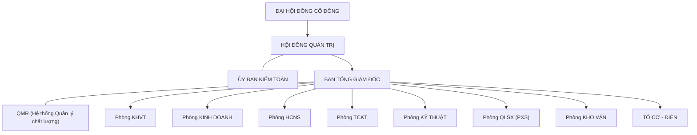

# CÔNG TY CỔ PHẦN SƠN Á ĐÔNG
**Mã cổ phiếu: ADP**

---

# CÔNG BỐ THÔNG TIN

**Kính gửi:**
- Ủy ban Chứng khoán Nhà nước
- Sở Giao dịch Chứng khoán Thành phố Hồ Chí Minh

**Số:** 006/CBTT-ADP.2026  
*Tp. Hồ Chí Minh, ngày 12 tháng 04 năm 2026*

**1. Tên tổ chức:** CÔNG TY CỔ PHẦN SƠN Á ĐÔNG (A DONG PAINT STOCK COMPANY)
- **Mã chứng khoán:** ADP
- **Địa chỉ:** 1387 Bến Bình Đông, Phường Phú Định, Tp. Hồ Chí Minh
- **Điện thoại liên hệ:** 028.38552689 — **Fax:** 028.38555092
- **E-mail:** info@adongpaint.com.vn

**2. Nội dung thông tin công bố:**  
Công ty Cổ phần Sơn Á Đông công bố thông tin:
- Báo cáo thường niên năm 2025 (ANNUAL REPORT 2025)

**3. Thông tin này đã được công bố trên trang thông tin điện tử của công ty:**  
Vào ngày 12/04/2026 tại đường dẫn: https://adongpaint.com.vn/quan-he-co-dong/

Chúng tôi xin cam kết các thông tin công bố trên đây là đúng sự thật và hoàn toàn chịu trách nhiệm trước pháp luật về nội dung các thông tin đã công bố.

**CÔNG TY CỔ PHẦN SƠN Á ĐÔNG**  
*Người ủy quyền công bố thông tin*  
**PHÓ TỔNG GIÁM ĐỐC**  
*(Đã ký)*  
**LÊ ĐÌNH QUANG**

---

# BÁO CÁO THƯỜNG NIÊN 2025
**CÔNG TY CỔ PHẦN SƠN Á ĐÔNG**  
*A DONG PAINT*  
Website: www.adongpaint.com.vn

---

## MỤC LỤC

| Phần | Nội dung | Trang |
| :--- | :--- | :---: |
| **01** | **THÔNG TIN CHUNG** | **05** |
| | Thông tin khái quát | 05 |
| | Quá trình hình thành và phát triển | 06 |
| | Các giải thưởng và ghi nhận nổi bật | 07 |
| | Ngành nghề và địa bàn kinh doanh | 08 |
| | Mô hình quản trị, bộ máy quản lý | 12 |
| | Định hướng phát triển và tôn chỉ | 13 |
| | Các rủi ro | 17 |
| **02** | **TÌNH HÌNH HOẠT ĐỘNG TRONG NĂM** | **20** |
| | Tình hình hoạt động sản xuất kinh doanh | 20 |
| | Tổ chức và nhân sự | 22 |
| | Tình hình đầu tư và thực hiện các dự án | 30 |
| | Cơ cấu cổ đông | 34 |
| | Báo cáo tác động liên quan đến môi trường và xã hội của Công ty | 35 |
| **03** | **BÁO CÁO VÀ ĐÁNH GIÁ CỦA BAN TỔNG GIÁM ĐỐC** | **39** |
| | Đánh giá kết quả của hoạt động sản xuất kinh doanh | 39 |
| | Tình hình tài chính | 41 |
| | Những cải tiến về cơ cấu tổ chức, chính sách, quản lý | 42 |
| | Kế hoạch phát triển trong tương lai | 43 |
| **04** | **ĐÁNH GIÁ CỦA HỘI ĐỒNG QUẢN TRỊ VỀ HOẠT ĐỘNG CỦA CÔNG TY** | **45** |
| | Đánh giá về các mặt hoạt động Công ty | 45 |
| | Đánh giá về hoạt động của Ban Tổng Giám đốc | 46 |
| | Các kế hoạch, định hướng của Hội đồng quản trị | 47 |
| **05** | **QUẢN TRỊ CÔNG TY** | **49** |
| | Hội đồng quản trị | 49 |
| | Ủy ban kiểm toán | 51 |
| | Các giao dịch, thù lao và các khoản lợi ích của Hội đồng quản trị, Ban Tổng Giám đốc và Uỷ Ban Kiểm toán | 52 |
| **06** | **BÁO CÁO TÀI CHÍNH** *(Bỏ qua theo quy định ngắt đọc sớm)* | **53** |

---

## DANH MỤC TỪ VIẾT TẮT

| Từ viết tắt | Nội dung đầy đủ |
| :--- | :--- |
| **ASEAN** | Hiệp hội Các quốc gia Đông Nam Á |
| **CTCP** | Công ty Cổ phần |
| **CHXHCN** | Cộng hòa Xã hội chủ nghĩa |
| **CBCNV** | Cán bộ công nhân viên |
| **DTT** | Doanh thu thuần |
| **ĐHĐCĐ** | Đại hội đồng cổ đông |
| **GDP** | Tổng sản phẩm quốc nội |
| **HĐQT** | Hội đồng quản trị |
| **HOSE** | Sở Giao dịch Chứng khoán TP. Hồ Chí Minh |
| **HTCL** | Hệ thống chất lượng |
| **NHNN** | Ngân hàng Nhà nước |
| **NHTM** | Ngân hàng Thương mại |
| **PCCC** | Phòng cháy chữa cháy |
| **PCT** | Phó Chủ tịch |
| **Phòng KHVT** | Phòng Kế hoạch vật tư |
| **Phòng HCNS** | Phòng Hành chính nhân sự |
| **Phòng TCKT** | Phòng Tài chính Kế toán |
| **Phòng QLSX** | Phòng Quản lý sản xuất |
| **QRM** | Hệ thống Quản lý chất lượng |
| **QTKD** | Quản trị kinh doanh |
| **ROA** | Tỷ suất sinh lời trên tài sản |
| **ROE** | Tỷ suất sinh lời trên vốn chủ sở hữu |
| **SGDs** | Các mục tiêu phát triển bền vững của Liên Hợp Quốc |
| **SXKD** | Sản xuất kinh doanh |
| **TNHH** | Trách nhiệm hữu hạn |
| **TMDV SX** | Thương mại Dịch vụ Sản xuất |
| **TGĐ** | Tổng Giám đốc |
| **TP.HCM** | Thành phố Hồ Chí Minh |
| **VĐL** | Vốn điều lệ |
| **XN** | Xí nghiệp |
| **UBCKNN** | Ủy Ban Chứng khoán Nhà nước |
| **UBKT** | Ủy Ban Kiểm toán |

---

# 01. THÔNG TIN CHUNG

## THÔNG TIN KHÁI QUÁT
**CÔNG TY CỔ PHẦN SƠN Á ĐÔNG**

- **Tên giao dịch:** CÔNG TY CỔ PHẦN SƠN Á ĐÔNG
- **Tên Tiếng Anh:** A DONG PAINT STOCK COMPANY
- **Mã cổ phiếu:** ADP
- **Vốn điều lệ:** 230.398.500.000 Đồng
- **Trụ sở chính:** 1387 Bến Bình Đông, Phường Phú Định, TP.HCM
- **Điện thoại:** (028) 38552689
- **Fax:** (028) 38555092
- **Website:** www.adongpaint.com.vn
- **Giấy chứng nhận đăng ký doanh nghiệp số:** Số 0302066222 do Sở Kế hoạch và Đầu tư TP.HCM cấp lần đầu ngày 13/08/2000, đăng ký thay đổi lần thứ 11 ngày 08/05/2023.

---

## QUÁ TRÌNH HÌNH THÀNH VÀ PHÁT TRIỂN

- **Năm 1970:** Tiền thân của Công ty là Công ty Sơn Á Đông, được thành lập năm 1970 tại Sài Gòn (nay là Tp.HCM), một xí nghiệp sơn lớn nhất Miền Nam Việt Nam trước năm 1975.
- **Năm 1976:** Sau 1975, Công ty chuyển sang hình thức sở hữu Nhà nước, trở thành Xí nghiệp Sơn Á Đông, trực thuộc Công ty Sơn Chất dẻo - Bộ Công nghiệp. Thời kỳ này, xí nghiệp được đầu tư mở rộng quy mô công suất, chuyên sản xuất các sản phẩm từ sơn trang trí và xây dựng.
- **Năm 1993:** Trên cơ sở hợp nhất Công ty Sơn và Mực in và Công ty Hóa chất, Bộ Công nghiệp nặng ra Quyết định số 1058/QĐ/TCCB ngày 28/12/1993 thành lập Công ty Sơn Chất dẻo thuộc Tổng Công ty Hóa chất Việt Nam, trong đó Xí nghiệp Sơn Á Đông là đơn vị thành viên hạch toán kinh tế phụ thuộc.
- **Năm 1998:** Tiếp tục phát huy thế mạnh công nghệ và đáp ứng nhu cầu phát triển của thị trường Việt Nam, Xí nghiệp đã hợp tác sản xuất với Công ty Kansai Paint (Singapore) Pte., Ltd và Công ty Kansai Coating (Malaysia) thuộc Tập đoàn Kansai Paint (Nhật Bản), để sản xuất dòng sản phẩm sơn cho tôn mạ và sơn sấy kỹ nghệ.
- **Năm 2000:** Căn cứ Quyết định số 40/2000/QĐ-BCN ngày 29/06/2000 của Bộ Công nghiệp, Xí nghiệp Sơn Á Đông được phê duyệt chuyển đổi từ Doanh nghiệp Nhà nước thành Công ty Cổ phần Sơn Á Đông với Vốn điều lệ ban đầu là 10 tỷ đồng. Sau khi cổ phần hóa, quy mô và hiệu quả sản xuất kinh doanh của Công ty ngày càng đạt được những bước tiến đáng kể.
- **Năm 2001:** Công ty đã xây dựng và áp dụng Hệ thống quản lý chất lượng ISO 9001:2000 được chứng nhận bởi Tổ chức Quacert (Trung tâm chứng nhận phù hợp). Uy tín và chất lượng được nâng lên Hệ thống Quản lý chất lượng theo ISO 9001:2015.
- **Năm 2005:** Công ty đã ký kết hợp đồng chuyển giao công nghệ sản xuất sơn tôn với Công ty TNHH Kansai Paint (thuộc Tập đoàn Kansai Paint Nhật Bản) dưới hình thức hợp đồng chuyển giao công nghệ để sản xuất trong nước các thương hiệu nổi tiếng KANSAI PAINT. Qua đó, Sơn Á Đông là nhà sản xuất sơn đầu tiên của Việt Nam áp dụng công nghệ tiên tiến và hiện đại, làm ra các sản phẩm đạt chuẩn chất lượng quốc tế.
- **Năm 2006:** Công ty đã ký kết hợp đồng chuyển giao công nghệ sản xuất sơn bột tĩnh điện với Powchem Ltd Co, thành viên của Samhwa Paint Industries Corp (Hàn Quốc). Tháng 12/2006 hoàn thành xây dựng và lập đoàn chính thức phân xưởng sơn bột tĩnh điện công suất 900 tấn/năm tại địa chỉ 1387 Bến Bình Đông, Phường 15, Quận 8, TP.HCM nâng tổng công suất thiết kế của Công ty lên 3.500 tấn/năm.
- **Năm 2010:** Công ty Cổ phần Sơn Á Đông chính thức được Sở Giao dịch Chứng khoán Hà Nội chấp thuận đăng ký giao dịch thị trường UPCOM với mã chứng khoán là ADP.
- **Năm 2014:** Công ty Cổ phần Sơn Á Đông được cấp giấy chứng nhận hợp quy số 03-14 do Trung tâm Kỹ thuật Tiêu chuẩn Đo lường Chất lượng 3 cấp cho sản phẩm sơn Alkyd do Công ty sản xuất.
- **Năm 2015:** Công ty thực hiện phát hành cổ phiếu thưởng theo nghị quyết ĐHĐCĐ thường niên năm 2015 cho cổ đông hiện hữu để tăng vốn điều lệ từ 25.048.990.000 đồng lên 95.999.740.000 đồng.
- **Năm 2016:** Công ty thực hiện phát hành cổ phiếu để tăng vốn cổ phần từ nguồn vốn chủ sở hữu theo nghị quyết ĐHĐCĐ ngày 08/08/2016 nâng tổng số vốn điều lệ từ 95.999.740.000 đồng lên 153.599.140.000 đồng.
- **Năm 2021:** Công ty thực hiện phát hành cổ phiếu để tăng vốn cổ phần từ nguồn vốn chủ sở hữu theo nghị quyết ĐHĐCĐ thường niên ngày 20/04/2021 nâng tổng vốn điều lệ từ 153.599.740.000 đồng lên 230.398.500.000 đồng.
- **Năm 2023:** Công ty được chấp thuận niêm yết tại Sở Giao dịch Chứng khoán Thành phố Hồ Chí Minh (HOSE).

---

## CÁC GIẢI THƯỞNG VÀ GHI NHẬN NỔI BẬT

- **2005:** Ngày 24/05/2005, Chủ tịch nước ký Quyết định số 626/QĐ-CTN tặng thưởng Huân chương Lao động hạng Nhì cho Công ty Cổ phần Sơn Á Đông và Huân chương Lao động hạng Ba cho Bà Nguyễn Thị Nhung - Giám đốc Công ty về thành tích xuất sắc trong công tác 2001 - 2005, góp phần vào sự nghiệp xây dựng Chủ nghĩa xã hội và bảo vệ Tổ quốc.
- **2010:** Ngày 09/11/2010, Chủ tịch nước ký Quyết định số 1885/QĐ-CTN tặng thưởng Huân chương Lao động hạng Nhất cho Công ty Cổ phần Sơn Á Đông về thành tích xuất sắc trong công tác 2005 - 2009, góp phần vào sự nghiệp xây dựng Chủ nghĩa xã hội và bảo vệ Tổ quốc.
- **2014:** Cờ của Uỷ ban Nhân dân thành phố Hồ Chí Minh tặng Công ty Cổ phần Sơn Á Đông 40 năm xây dựng và phát triển (1970 - 2010).
- **2015:** Cờ của Bộ Công Thương tặng Công ty Cổ phần Sơn Á Đông Đơn vị xuất sắc trong phong trào thi đua.

---

## NGÀNH NGHỀ VÀ ĐỊA BÀN KINH DOANH

### NGÀNH NGHỀ KINH DOANH
- Sản xuất các sản phẩm sơn và nguyên liệu, thiết bị ngành sơn.
- Thiết kế và cung ứng các loại dịch vụ kỹ thuật khác về sản phẩm và nguyên liệu, thiết bị ngành sơn.
- Kinh doanh và xuất nhập khẩu các sản phẩm sơn và nguyên liệu, thiết bị ngành sơn.

### ĐỊA BÀN KINH DOANH
- Sơn Á Đông phân phối sản phẩm trên phạm vi toàn quốc, bao gồm khu vực Thành phố Hồ Chí Minh và các tỉnh lân cận như Tây Ninh, Đồng Nai, còn mở rộng đến các tỉnh miền Trung, miền Tây Nam Bộ và khu vực Tây Nguyên, nhằm đáp ứng hiệu quả nhu cầu đa dạng của khách hàng trên khắp các vùng miền.

### SẢN PHẨM KINH DOANH

#### 1. SƠN XÂY DỰNG, TRANG TRÍ
- **Sơn Alkyd Á Đông Sumo AC, Sơn Alkyd Á Đông White Horse:**
  - Sử dụng ngoài trời lẫn trong nhà. Màng sơn dẻo dai, độ bóng và che phủ cao, chịu đựng tốt với thời tiết và dễ dàng sử dụng, màu sắc đa dạng, …
  - Sản phẩm là một loại sơn dung môi Alkyd tổng hợp phổ thông và đa dụng dùng để trang trí; bảo vệ trên các bề mặt vật liệu bằng kim loại, gỗ, … (các loại cửa, hàng rào, khung sắt thép trong các hạng mục xây dựng, thiết bị, …) sử dụng ngoài trời lẫn trong nhà.
- **Sơn nước trong nhà, Sơn nước ngoài trời:**
  - Sử dụng ngoài trời lẫn trong nhà, sử dụng dễ dàng.
  - Sơn khô nhanh, màu sắc đa dạng. Màng sơn phẳng láng có độ bám tốt, bền thời tiết cao, bền màu với thời gian, khả năng chịu rửa nước và chống nấm mốc rong rêu tốt.
  - Sản phẩm sơn nước dùng rộng rãi cho tường, trần bên trong nhà, ngoài trời và sơn sàn cho công trình kiến trúc xây dựng như nhà riêng lẻ, nhà cao tầng…

#### 2. SƠN KỸ NGHỆ
- **Sơn Bình Gas – Cơ khí – Thùng Phuy:**
  - Màng sơn bóng đẹp, độ cứng cao, màu sắc phong phú theo yêu cầu khách hàng.
  - Tính năng kháng hóa chất, dầu mỡ và dung môi cao, dễ sử dụng, màng sơn bền dẻo và chịu va đập tốt.
  - Sản phẩm Alkyd melamin dùng sơn phủ hoàn thiện cho nhiều loại bề mặt, đặc biệt là bề mặt thép như thùng phuy, bình gas, bao bì kim loại, sản phẩm cơ khí và dụng cụ gia dụng khác trước khi xuất xưởng.
- **Sơn Tôn cuộn màu:**
  - Có nhiều dòng sản phẩm và chủng loại đáp ứng đa dạng mục đích sử dụng trong ngành Tôn mạ trong và ngoài nước.
  - Màng sơn có tính mềm dẻo tốt - định hình cao, giữ được độ bóng lâu dài, bền màu và bền thời tiết cao. Cạnh đó tính năng chống ăn mòn và lý – hóa tuyệt vời.
  - Sản phẩm theo tiêu chuẩn quốc tế (ASTM, JIS, ISO, …), dùng cho dây chuyền sơn cuộn để sản xuất tôn mạ màu sử dụng rộng rãi trong các công trình dân dụng và công nghiệp: làm tấm lợp, vách ngăn, tường rào, cửa mành, mái hiên (nhà thép tiền chế, nhà xưởng, nhà máy thủy nhiệt điện, …) và thiết bị dụng cụ gia dụng.

#### 3. SƠN TÀU BIỂN CÔNG TRÌNH
- **Phạm vi sử dụng cho các công trình:**
  - Công trình dầu khí
  - Công trình nhà máy, nhà xưởng, công trình công nghiệp
  - Công trình điện - thuỷ điện
  - Công trình giao thông: cầu, cảng
  - Công trình viễn thông
  - Công trình đường ống, bồn bể
  - Sản phẩm cơ khí, máy móc, thiết bị, dụng cụ kim loại. Sơn mới, bảo trì các loại tàu sông.
- **Đặc tính kỹ thuật:**
  - Hệ thống sơn nhiều chủng loại đa dạng đáp ứng nhiều mục đích sử dụng. Sản phẩm chịu đựng tốt với nước biển, dầu và hóa chất.
  - Màng sơn dẻo dai, chịu va đập và mài mòn tốt, tương thích với các hệ sơn Epoxy chống ăn mòn, dễ dàng sử dụng.
  - Các dòng sơn phủ có ưu điểm chịu đựng thời tiết và duy trì độ bóng cực tốt.
  - Chủng loại sản phẩm: Sơn Epoxy, Sơn Tàu biển, Sơn Poly Urethane, Sơn công trình.

---

## MÔ HÌNH QUẢN TRỊ, BỘ MÁY QUẢN LÝ

### MÔ HÌNH QUẢN TRỊ
- Đại hội đồng cổ đông
- Ủy ban kiểm toán
- Ban Tổng Giám đốc
- **Các công ty con, công ty liên kết:** Công ty không có Công ty con, Công ty liên kết.

### SƠ ĐỒ BỘ MÁY QUẢN LÝ

*Chú thích:*
- *Đường nét liền: Sơ đồ tổ chức*
- *Đường nét đứt: Sơ đồ liên quan Hệ thống chất lượng (HTCL) - Phòng TCKT: Chỉ liên quan một phần đến HTCL.*

---

## ĐỊNH HƯỚNG PHÁT TRIỂN VÀ TÔN CHỈ

### SỨ MỆNH VÀ TẦM NHÌN
- **SỨ MỆNH:** Sơn Á Đông cam kết đổi mới không ngừng để cung cấp những sản phẩm chất lượng cao với giá thành hợp lý cho người tiêu dùng nhằm mang lại không gian sống đẹp, bền vững, bảo vệ công trình và tạo giá trị bền vững cho cộng đồng. Đồng thời, chúng tôi luôn hướng đến việc tối đa hóa lợi ích cho cổ đông và mang lại môi trường làm việc tốt nhất, đầy cảm hứng cho đội ngũ nhân viên.
- **TẦM NHÌN:** Tầm nhìn chiến lược của Sơn Á Đông là trở thành biểu tượng tiên phong trong ngành sơn tại Việt Nam, khẳng định vị thế dẫn đầu bằng chất lượng vượt trội và sự sáng tạo không ngừng. Sơn Á Đông cam kết mang đến những sản phẩm và giải pháp đột phá, đáp ứng mọi nhu cầu của khách hàng, từ thẩm mỹ, độ bền cho đến tính thân thiện với môi trường. Trên cơ sở không ngừng đầu tư vào nghiên cứu và phát triển công nghệ, thúc đẩy sự đổi mới trong từng sản phẩm. Bên cạnh đó, chúng tôi chú trọng xây dựng một thương hiệu vững mạnh và sự đồng hành lâu dài cùng khách hàng, nhân viên và cổ đông. Chúng tôi đặt mục tiêu không chỉ vượt qua mong đợi của thị trường mà còn góp phần nâng tầm ngành sơn trong nước, dẫn dắt ngành công nghiệp sơn Việt Nam vươn xa, khẳng định vị thế và uy tín trên trường quốc tế.

### GIÁ TRỊ CỐT LÕI
- **ĐỐI VỚI CỘNG ĐỒNG VÀ XÃ HỘI:** ADP luôn nỗ lực là một tổ chức có trách nhiệm xã hội, luôn tích cực, chủ động tham gia vào các hoạt động cộng đồng, xã hội, góp phần xây dựng đất nước ngày càng phát triển.
- **ĐỐI VỚI KHÁCH HÀNG:** ADP luôn đặt khách hàng lên hàng đầu, lấy sự hài lòng của khách hàng làm thước đo cho sự thành công của doanh nghiệp. ADP cam kết cung cấp những sản phẩm chất lượng cao, giá cả hợp lý nhất để đáp ứng nhu cầu của khách hàng.
- **ĐỐI VỚI CÁN BỘ CÔNG NHÂN VIÊN:** Mỗi thành viên trong Công ty là một giá trị. ADP là môi trường giúp các thành viên phát huy tối đa tiềm năng, gia tăng giá trị bản thân và đóng góp cho sự phát triển của Công ty.

### CHIẾN LƯỢC TRONG TƯƠNG LAI
- **CHIẾN LƯỢC NGẮN HẠN:**
  - Tập trung vào việc mở rộng thị phần và củng cố vị thế thương hiệu trên thị trường. Đầu tư mạnh mẽ vào nghiên cứu và phát triển, nhằm đổi mới sản phẩm và đáp ứng tốt nhất các nhu cầu đa dạng của khách hàng. Đồng thời, Công ty cũng tập trung vào việc tối ưu hóa chiến lược marketing, nhằm tăng cường nhận thức thương hiệu và xây dựng một hình ảnh doanh nghiệp mạnh mẽ, đáng tin cậy trong lòng khách hàng.
  - Không ngừng tìm kiếm các cơ hội hợp tác và liên kết với các đối tác chiến lược, để mở rộng mạng lưới phân phối và tiếp cận khách hàng một cách rộng rãi hơn. Tăng cường hiệu quả kênh phân phối sẽ giúp Công ty nâng cao khả năng cạnh tranh, qua đó tạo lợi thế trên thị trường và đẩy mạnh doanh số bán hàng.
  - Duy trì và tăng cường khả năng cạnh tranh, Công ty chú trọng vào việc cải thiện chất lượng dịch vụ khách hàng, từ việc tư vấn trước bán hàng đến dịch vụ hỗ trợ sau bán hàng. Công ty tin rằng, sự hài lòng của khách hàng sẽ là nền tảng vững chắc nhất cho sự phát triển bền vững của doanh nghiệp trong tương lai.
- **CHIẾN LƯỢC TRUNG VÀ DÀI HẠN:**
  - **Nâng cao chất lượng sản phẩm:** Đầu tư nghiên cứu và phát triển để sản xuất những sản phẩm mới, chất lượng cao, đáp ứng nhu cầu của thị trường.
  - **Mở rộng thị trường:** Mở rộng hệ thống phân phối, tiếp cận với nhiều khách hàng tiềm năng hơn. Tăng cường hoạt động marketing, quảng bá thương hiệu, nâng cao nhận diện thương hiệu.
  - **Tăng cường năng lực cạnh tranh:** Nâng cao năng suất lao động, giảm chi phí sản xuất. Đẩy mạnh ứng dụng công nghệ hiện đại vào sản xuất kinh doanh.
  - **Nhân lực:** Tăng cường đào tạo và quản lý nhân viên để nâng cao chất lượng dịch vụ.
  - **Quản lý chi phí:** Quản lý chi phí hiệu quả để tăng lợi nhuận, tối đa hóa lợi ích cho cổ đông và các bên đối tác liên quan.
  - **Tái cấu trúc Công ty:** Theo hướng tinh gọn, hiệu quả đảm bảo khả năng cơ động trong việc đa dạng hóa các loại hình kinh doanh và phương thức kinh doanh.

### CÁC MỤC TIÊU ĐỐI VỚI MÔI TRƯỜNG, XÃ HỘI VÀ CỘNG ĐỒNG
- **MỤC TIÊU ĐỐI VỚI MÔI TRƯỜNG:** Công ty Cổ phần Sơn Á Đông cam kết giảm thiểu lượng phát thải ra môi trường trong quá trình sản xuất, tuân thủ các quy định về xử lý, tái chế chất thải, góp phần bảo vệ môi trường.
- **MỤC TIÊU ĐỐI VỚI XÃ HỘI VÀ CỘNG ĐỒNG:** Công ty Cổ phần Sơn Á Đông luôn thực hiện đầy đủ các nghĩa vụ về thuế, bảo hiểm cho công nhân viên, xây dựng môi trường làm việc an toàn, thân thiện, đồng thời quan tâm đến công tác thu gom, xử lý chất thải, góp phần xây dựng xã hội và cộng đồng ngày càng văn minh, hiện đại.
- **TÔN CHỈ HOẠT ĐỘNG CỦA CÔNG TY:** Sơn Á Đông mong muốn góp phần làm tăng tiến chất lượng cuộc sống bằng các hoạt động thân thiện với con người, môi trường và thiên nhiên, lấy sự thỏa mãn khách hàng làm thước đo sự trung tín, sức sáng tạo và nỗ lực hoàn thiện của công ty. Sơn Á Đông bảo đảm hài hòa lợi ích công ty với lợi ích quốc gia và xã hội.
  - *Khách hàng trước hết*
  - *Chất lượng toàn diện*
  - *Cải tiến không ngừng*

---

## CÁC YẾU TỐ RỦI RO

### 1. RỦI RO KINH TẾ
Năm 2025, kinh tế toàn cầu bước vào giai đoạn đầy bất ổn khi các xung đột địa chính trị và xu hướng bảo hộ thương mại của Mỹ trở thành những rào cản tăng trưởng mới. Làn sóng thuế quan không chỉ làm xáo trộn chuỗi cung ứng mà còn làm lung lay niềm tin của giới đầu tư. Trước những thách thức này, Ngân hàng Thế giới (WB) đã buộc phải điều chỉnh giảm dự báo tăng trưởng toàn cầu xuống mức 2,3%, đây là mức thấp nhất kể từ giai đoạn khủng hoảng tài chính toàn cầu năm 2008.

Theo số liệu từ Tổng cục Thống kê, tăng trưởng kinh tế năm 2025 với tốc độ tăng trưởng GDP đạt 8,02% cao thứ hai trong giai đoạn 2011-2025 nhờ động lực chính từ thương mại dịch vụ và sản xuất công nghiệp. Với mức tăng trưởng kinh tế vượt hơn 8% của Việt Nam là điểm sáng trong bối cảnh kinh tế thế giới tiếp tục đối mặt với nhiều biến động, đặc biệt là căng thẳng thương mại, chính sách thuế đối ứng của Mỹ. Đây là mức cao nhất trong khu vực ASEAN và thuộc nhóm tăng trưởng hàng đầu thế giới, cho thấy kinh tế Việt Nam đang khởi sắc đã lấy lại đà tăng trưởng sau đại dịch COVID-19. Với chính sách phục hồi và phát triển kinh tế - xã hội của Chính phủ đã từng bước phát huy hiệu quả.

### 2. RỦI RO PHÁP LUẬT
Mọi hoạt động kinh doanh của doanh nghiệp đều phải chịu sự chi phối và quản lý của pháp luật và Công ty Cổ phần Sơn Á Đông không phải ngoại lệ. Do đó, Công ty chịu sự quản lý từ các quy định của pháp luật bao gồm: Luật Doanh nghiệp, Luật Chứng khoán, Luật Thuế… và các Nghị định, Thông tư và văn bản liên quan đến hoạt động của công ty. Ngoài ra, hoạt động sản xuất và kinh doanh sơn cũng chịu ràng buộc và chính sách quy định của pháp luật về an toàn đối với người tiêu dùng và bảo vệ môi trường. Chính vì sự ràng buộc này dẫn đến nhiều khó khăn cho Công ty khi Luật áp dụng các quy định khác nhau.

Các văn bản pháp luật và hướng dẫn dưới luật hiện đang trong quá trình xây dựng và hoàn thiện. Bất cứ một thay đổi nào trong các quy định trên đều sẽ tác động đến hoạt động kinh doanh của Công ty. Do vậy, Công ty đã luôn chủ động cập nhật quy định luật pháp, hoàn thiện hệ thống quản lý và từ đó đưa các kế hoạch phù hợp và hạn chế tối đa các tác động đến hoạt động sản xuất của Công ty.

### 3. RỦI RO TỶ GIÁ
Rủi ro tỷ giá là loại rủi ro mà doanh nghiệp luôn ở thế bị động và khó có khả năng ứng phó nhất. Rủi ro tỷ giá gây tổn thất cho doanh nghiệp thông qua tác động đến dòng tiền từ hoạt động kinh doanh, hoạt động đầu tư và hoạt động tài trợ.

Trong năm 2025, Tỷ giá trung tâm USD/VND năm 2025 khép lại ở mức 25.121 VND/USD, tăng khoảng 3,2% (786 đồng) so với đầu năm. Tỷ giá biến động cao nhất vào giữa năm (vượt 25.200 VND/USD vào tháng 7) trước khi hạ nhiệt, với biên độ ngân hàng thương mại phổ biến quanh 25.100 – 25.400 VND/USD, cho thấy đồng đô la Mỹ tiếp tục chiếm ưu thế so với đồng Việt Nam. Tỷ giá SGD-VND nằm trong khoảng từ 19.000 VND đến 20.800 VND, với mức trung bình khoảng 19.900 VND, phản ánh sự ổn định tương đối của đồng đô la Singapore nhưng vẫn tăng nhẹ so với VND.

Hiện nay, Công nghiệp sản xuất sơn Việt Nam hầu như lệ thuộc vào nguồn cung ứng từ nước ngoài, tỉ lệ nguyên liệu nhập khẩu chiếm đến 70% nhu cầu sử dụng của Công ty. Do đó, hoạt động kinh doanh của ADP chịu áp lực từ sự biến động của thị trường tài chính quốc tế. Có thể nói rủi ro tỷ giá là loại rủi ro thường xuyên gặp và đáng lo ngại đối với hoạt động xuất nhập khẩu của Công ty.

Phòng ngừa rủi ro từ biến động tỷ giá, Công ty đã áp dụng các biện pháp như sử dụng công cụ tài chính phái sinh, đa dạng hóa nguồn thu/chi ngoại tệ, quản lý dòng tiền hiệu quả, và hợp tác chặt chẽ với ngân hàng. Những giải pháp này giúp doanh nghiệp ổn định hoạt động và tăng tính cạnh tranh trên thị trường.

### 4. RỦI RO ĐẶC THÙ
- **Rủi ro nguyên vật liệu:**
  Thành phần chính của sơn là nhựa (polymer), ngoài ra còn có một số chất dung môi, bột màu và phụ gia. Các thành phần này đa số được chiết xuất từ sản phẩm của dầu mỏ nên sự biến động của tình hình kinh tế - xã hội thế giới ảnh hưởng trực tiếp đến giá cả nguyên vật liệu của Công ty.
  Nhằm ứng phó với tình hình giá cả nguyên vật liệu biến đổi khó lường, ADP đã đưa ra các biện pháp như ADP chủ động đàm phán với các nhà cung cấp nguyên vật liệu để điều chỉnh giá, hướng đến tối ưu hóa chi phí đầu vào.
  Song song đó, ADP tiết giảm chi phí sản xuất, kinh doanh và tham gia các hợp đồng bảo hiểm hàng hóa xuất nhập khẩu nhằm giảm thiểu rủi ro.
  Để đảm bảo nguồn cung nguyên vật liệu không bị đứt gãy và không phụ thuộc vào một nhà cung cấp duy nhất, ADP đã chủ động tìm kiếm thêm các nhà cung cấp khác. Việc đa dạng hóa nguồn cung giúp Công ty chủ động hơn trong việc lựa chọn nguyên vật liệu với giá cả hợp lý và chất lượng đảm bảo.
- **Rủi ro cháy nổ:**
  Nhà máy sản xuất sơn là nơi tiềm ẩn nguy cơ cháy nổ cao bởi nguyên liệu pha chế sơn đều là hóa chất dễ cháy. Đám cháy tại nhà máy sơn rất nguy hiểm, khó dập tắt và gây thiệt hại lớn về người, tài sản và ảnh hưởng môi trường. Do đó, đảm bảo an toàn PCCC tại cơ sở sản xuất kinh doanh luôn là mối quan tâm hàng đầu của Công ty.
  Để đảm bảo an toàn PCCC, ADP đã thực hiện các biện pháp như: Lắp đặt hệ thống báo cháy, chống cháy tự động; trang bị đầy đủ phương tiện chữa cháy cho lực lượng PCCC tại chỗ; thường xuyên kiểm tra, bảo dưỡng các thiết bị PCCC; tổ chức huấn luyện, diễn tập PCCC cho toàn thể CBCNV.
- **Rủi ro tác động môi trường:**
  Sơn là một vật liệu phổ biến trong cuộc sống hiện đại, được sử dụng rộng rãi trong trang trí nhà cửa, công trình xây dựng... Nắm bắt nhu cầu đó, ngày càng có nhiều nhà máy, xưởng sản xuất sơn ra đời. Điều này cũng đi kèm với vấn đề ô nhiễm môi trường do ngành sản xuất sơn gây ra.
  Công ty ý thức được những rủi ro về môi trường và sức khỏe của người lao động do hoạt động sản xuất của mình gây ra. Để hạn chế tối đa những rủi ro này, Công ty đã xây dựng các hệ thống xử lý nước thải, khí thải. Ngoài ra, Công ty cũng định kỳ cung cấp, thay thế đồ bảo hộ lao động cho người lao động và tổ chức kiểm tra sức khỏe định kỳ.
- **Rủi ro khác:**
  Ngoài các rủi ro có thể dự đoán trước, Công ty cũng nhận thức được những rủi ro mang tính bất khả kháng, tuy ít xảy ra nhưng nếu xảy ra sẽ gây ảnh hưởng nghiêm trọng đến hoạt động kinh doanh. Các rủi ro này bao gồm thiên tai, chiến tranh, dịch bệnh… Để giảm thiểu thiệt hại khi xảy ra rủi ro bất khả kháng, Công ty đã xây dựng các phương án dự phòng đối phó với các tình huống bất ngờ.

---

# 02. TÌNH HÌNH HOẠT ĐỘNG TRONG NĂM

## TÌNH HÌNH HOẠT ĐỘNG SẢN XUẤT KINH DOANH

### KẾT QUẢ HOẠT ĐỘNG SẢN XUẤT KINH DOANH TRONG NĂM 2025
Năm 2025 là năm có nhiều biến động do tình hình kinh tế - chính trị thế giới diễn biến phức tạp dẫn đến khủng hoảng năng lượng, lạm phát, làm cho giá nguyên vật liệu giữ ở mức cao. Những yếu tố này đã ảnh hưởng tiêu cực đến nền kinh tế và hoạt động sản xuất kinh doanh cho các ngành công nghiệp tại Việt Nam nói chung và ngành công nghiệp sơn nói riêng.

Ngay từ những tháng đầu năm 2025, Sơn Á Đông đã triển khai các biện pháp ứng phó với đà tăng giá của nguồn nguyên liệu, tối ưu hóa các nguồn lực nhằm ổn định sản xuất, tiêu thụ, xây dựng các chương trình bán hàng, đẩy mạnh tiêu thụ, phấn đấu hoàn thành ở mức cao nhất các chỉ tiêu kế hoạch sản xuất kinh doanh, cụ thể:
- Tăng cường công tác điều hành hoạt động sản xuất kinh doanh, cải tiến hợp lý hóa quá trình sản xuất. Nghiên cứu dòng sản phẩm mới, sản phẩm thay thế để đáp ứng nhu cầu thị trường.
- Rà soát, xác định các kế hoạch chi phí thực sự cần thiết cho sản xuất, kinh doanh, cắt giảm các chi phí chưa cấp thiết. Tạm dừng các hạng mục đầu tư, mua sắm, chưa thực sự cấp bách trong thời điểm hiện tại. Xây dựng và triển khai phương án sắp xếp, tinh gọn lao động linh hoạt theo kế hoạch sản xuất kinh doanh nhằm tăng năng suất, đảm bảo thu nhập cho người lao động.
- Tăng cường công tác quản trị tài sản, nguồn vốn, dòng tiền; quản trị tình hình thực hiện kế hoạch chi phí nhằm theo dõi sát sao và phân tích sự biến động của các yếu tố ảnh hưởng đến kết quả sản xuất kinh doanh, đưa ra các dự báo kịp thời để chủ động trong công tác điều hành.
- Thường xuyên theo dõi diễn biến, đánh giá nhu cầu thị trường qua đó tập trung nguồn lực, chi phí cho thị trường, phát triển sản phẩm, có đánh giá giữa chi phí gắn với hiệu quả kinh doanh.

Trước khó khăn nêu trên, Kết quả hoạt động kinh doanh năm 2025 của Sơn Á Đông tuy không đạt được doanh thu như kế hoạch ĐHĐCĐ thông qua, nhưng chỉ tiêu lợi nhuận đã vượt kế hoạch đề ra. Các chỉ số tài chính của Sơn Á Đông luôn ở mức an toàn, khả năng tự tài trợ vốn cao, đảm bảo bảo toàn và phát triển vốn chủ sở hữu.

#### BẢNG KẾT QUẢ HOẠT ĐỘNG SẢN XUẤT KINH DOANH
*(ĐVT: Triệu đồng)*

| STT | CHỈ TIÊU | Năm 2025 | Năm 2024 | % Tăng/Giảm năm 2025 so với năm 2024 |
| :---: | :--- | :---: | :---: | :---: |
| 1 | Doanh thu thuần | 651.761 | 817.854 | -20,31 |
| 2 | Giá vốn hàng bán | 523.038 | 658.332 | -20,55 |
| 3 | Lợi nhuận gộp | 128.723 | 159.522 | -19,31 |
| 4 | Lợi nhuận thuần từ hoạt động kinh doanh | 96.581 | 106.900 | -9,65 |
| 5 | Lợi nhuận trước thuế | 95.927 | 106.837 | -10,21 |
| 6 | Lợi nhuận sau thuế | 76.460 | 85.313 | -10,38 |
| 7 | Lãi cơ bản trên 1 cổ phiếu (đồng) | 3.319 | 3.703 | -10,37 |

Kết thúc năm 2025, Doanh thu của công ty đạt 651,761 tỷ đồng, giảm 20,31% so với năm 2024. Lợi nhuận sau thuế giảm 10,38% so với năm 2024, đạt 76,460 tỷ đồng. Sản lượng tiêu thụ năm 2025 đạt 5.832 tấn giảm 18,25% so với năm 2024.

---

### CHI PHÍ HOẠT ĐỘNG
*(ĐVT: Triệu đồng)*

| KHOẢN MỤC | NĂM 2025: Giá trị | NĂM 2025: Tỷ trọng/ DTT | NĂM 2024: Giá trị | NĂM 2024: Tỷ trọng/ DTT |
| :--- | :---: | :---: | :---: | :---: |
| Giá vốn hàng bán | 523.038 | 80,25% | 658.332 | 80,50% |
| Chi phí tài chính | 2.179 | 0,33% | 1.079 | 0,13% |
| Chi phí bán hàng | 15.062 | 2,31% | 18.732 | 2,29% |
| Chi phí quản lý doanh nghiệp | 22.119 | 3,39% | 39.015 | 4,77% |
| Chi phí khác | 654 | 0,10% | 63 | 0,01% |
| **Tổng chi phí** | **563.052** | **86,39%** | **717.221** | **87,70%** |
| **Doanh thu thuần** | **651.760** | | **817.854** | |

Là doanh nghiệp ngành nghề chính là sản xuất sơn, giá vốn hàng bán chiếm tỷ trọng cao nhất trong cơ cấu chi phí, tương đương 523.038 tỷ đồng giảm 20,55% so với năm 2024. Nguyên nhân là giảm theo tỷ trọng với Doanh thu. Việc giữ được tỷ trọng các yếu tố chi phí giúp Sơn Á Đông đạt được lợi nhuận trong bối cảnh cạnh tranh khốc liệt với các thương hiệu nước ngoài và trong nước.

Hai khoản mục Chi phí bán hàng và Chi phí quản lý doanh nghiệp đạt 15,06 tỷ đồng và 22,19 tỷ đồng. Tỷ lệ Chi phí bán hàng/Doanh thu thuần và Chi phí Quản lý doanh nghiệp/Doanh thu thuần được kiểm soát tương ứng 2,31% và 3,39%. Việc kiểm soát chi phí chặt chẽ, giúp công ty đảm bảo hoạt động sản xuất kinh doanh hiệu quả.

---

### TÌNH HÌNH THỰC HIỆN SO VỚI KẾ HOẠCH
*(ĐVT: Triệu đồng)*

| STT | CHỈ TIÊU | Thực hiện năm 2025 | Kế hoạch năm 2025 | TH2025/ KH2025 |
| :---: | :--- | :---: | :---: | :---: |
| 1 | Tổng doanh thu | 653.276 | 700.000 | 93,33% |
| 2 | Lợi nhuận trước thuế | 95.927 | 70.000 | 137,04% |

Tổng doanh thu thực hiện năm 2025 đạt 653,276 tỷ đồng, giảm 6,67% so với kế hoạch đề ra. Lợi nhuận trước thuế đạt 95,927 tỷ đồng vượt 37,04% so với kế hoạch ĐHCĐ đề ra. Để đạt được kết quả thắng lợi này, Ban lãnh đạo đã nỗ lực trong tìm kiếm nguồn khách hàng mới đảm bảo đầu ra cho sản phẩm, đề ra các chính sách bán hàng cũng như kiểm soát chặt chẽ các chi phí. Nhờ đó Sơn Á Đông tối ưu hóa hiệu quả.

---

## TỔ CHỨC VÀ NHÂN SỰ

### GIỚI THIỆU BAN LÃNH ĐẠO CÔNG TY
*(Tính đến ngày 31/12/2025)*

| STT | Thành viên | Chức vụ | Số lượng cổ phần sở hữu | Tỷ lệ sở hữu |
| :---: | :--- | :--- | :---: | :---: |
| **I** | **Hội đồng quản trị** | | | |
| 1 | Bà Nguyễn Thị Nhung | Chủ Tịch HĐQT | 2.318.269 | 10,06% |
| 2 | Ông Trần Bửu Trí | Phó Chủ tịch HĐQT | 2.616.568 | 11,36% |
| 3 | Ông Lê Đình Quang | Thành viên HĐQT kiêm Phó TGĐ thường trực | 2.124.000 | 9,22% |
| 4 | Ông Võ Hồng Hà | Thành viên HĐQT kiêm Phó TGĐ | 2.534.400 | 11,00% |
| 5 | Bà Võ Thị Bích Ngọc | Thành viên HĐQT | 637.696 | 2,77% |
| 6 | Bà Nguyễn Thị Minh Sáu | Thành viên HĐQT độc lập | - | 0,00% |
| 7 | Ông Tống Trường Thịnh | Thành viên HĐQT độc lập | 133.500 | 0,58% |
| **II** | **Ủy Ban kiểm toán** | | | |
| 1 | Bà Nguyễn Thị Minh Sáu | Chủ tịch Ủy ban kiểm toán | - | 0,00% |
| 2 | Ông Tống Trường Thịnh | Thành viên Ủy ban kiểm toán | 135.500 | 0,58% |
| **III** | **Ban điều hành** | | | |
| 1 | Ông Lê Đình Quang | Thành viên HĐQT kiêm Phó TGĐ thường trực | 2.124.000 | 9,22% |
| 2 | Ông Võ Hồng Hà | Thành viên HĐQT kiêm Phó TGĐ | 2.534.400 | 11,00% |
| 3 | Ông Huỳnh Thanh Tâm | Kế toán trưởng | 4.372 | 0,02% |

---

### GIỚI THIỆU HỘI ĐỒNG QUẢN TRỊ

#### 1. BÀ NGUYỄN THỊ NHUNG – CHỦ TỊCH HĐQT
- **Năm sinh:** 1941
- **Trình độ chuyên môn:** Đại học Kinh tế
- **Quá trình công tác:**
  - 1960 – 1966: Công tác tại Nhà máy Cao su Sao vàng Hà Nội
  - 1966 – 1972: Thực tập sinh Nước CHXHCN Tiệp Khắc
  - 1972 – 1976: Công tác tại Nhà máy Sơn Tổng Hợp Hà Nội
  - 1976 – 1980: Tiếp quản Nhà máy Sơn Á Đông
  - 1980 – 2000: Công tác tại công ty Sơn Chất Dẻo – XN Sơn Á Đông
  - 2000 – 04/2022: Thành viên HĐQT kiêm Tổng Giám đốc CTCP Sơn Á Đông
  - 04/2022 – Nay: Chủ tịch HĐQT CTCP Sơn Á Đông
- **Chức vụ hiện nay tại tổ chức khác:** Không có
- **Số cổ phần nắm giữ:** 2.318.269 cổ phần, chiếm 10,06% VĐL
- **Số cổ phần nắm giữ của những người có liên quan:**
  - Võ Hồng Hà (Con trai) nắm giữ: 1.821.200 cổ phiếu, chiếm 7,90% VĐL
  - Võ Thị Mai Hương (Con gái) nắm giữ: 264.312 cổ phiếu, chiếm 1,15% VĐL
  - Võ Thị Bích Ngọc (Con gái) nắm giữ: 637.696 cổ phiếu, chiếm 2,77% VĐL
  - Ông Trần Bửu Trí (Con rể) nắm giữ: 2.616.568 cổ phiếu, chiếm 11,36% VĐL

#### 2. ÔNG TRẦN BỬU TRÍ – PHÓ CHỦ TỊCH HĐQT
- **Năm sinh:** 1977
- **Trình độ chuyên môn:** Kỹ sư Hóa
- **Quá trình công tác:**
  - 2000 – 2001: Công tác kỹ thuật bán hàng tại Công ty TNHH Long Thành
  - 2001 – 04/2022: Thành viên HĐQT kiêm Phó TGĐ CTCP Sơn Á Đông
  - 04/2022 – Nay: Thành viên HĐQT CTCP Sơn Á Đông (Phó Chủ tịch HĐQT)
- **Chức vụ hiện nay tại tổ chức khác:** Không có
- **Số cổ phần nắm giữ:** 2.616.568 cổ phần, chiếm 11,36% VĐL *(Nguyên văn trang 25 ghi nhầm dòng text số cổ phần của bà Nhung là 2.318.269 CP - 10,06%, bảng danh sách chuẩn là 2.616.568 CP - 11,36%)*
- **Số cổ phần nắm giữ của những người có liên quan:**
  - Bà Nguyễn Thị Nhung (Mẹ vợ) nắm giữ: 2.318.269 cổ phiếu, chiếm 10,06% VĐL
  - Bà Võ Thị Bích Ngọc (Vợ) nắm giữ: 637.696 cổ phiếu, chiếm 2,77% VĐL

#### 3. ÔNG LÊ ĐÌNH QUANG – THÀNH VIÊN HĐQT KIÊM PHÓ TGĐ THƯỜNG TRỰC
- **Năm sinh:** 1963
- **Trình độ chuyên môn:**
  - Cử nhân Kinh tế, Chuyên ngành Tài chính – Kế toán
  - Cử nhân Luật, Chuyên ngành Thương mại
- **Quá trình công tác:**
  - 1985 – 1994: Công tác tại phòng kế toán Công ty Thương nghiệp Huyện Bình Chánh, TP.HCM
  - 1994 – 2000: Phụ trách kế toán Xí nghiệp Sơn Á Đông
  - 2000 – 2022: Thành viên HĐQT kiêm Phó Tổng Giám Đốc/Kế toán trưởng CTCP Sơn Á Đông
  - 2022 – Nay: Thành viên HĐQT kiêm Phó Tổng Giám Đốc CTCP Sơn Á Đông
- **Chức vụ hiện nay tại tổ chức khác:** Không có
- **Số cổ phần nắm giữ:** 2.124.000 cổ phần, chiếm 9,22% VĐL
- **Số cổ phần nắm giữ của những người có liên quan:**
  - Vương Thị Huyền Trang (Vợ) nắm giữ: 964.974 cổ phiếu, chiếm 4,19% VĐL

#### 4. ÔNG VÕ HỒNG HÀ – THÀNH VIÊN HĐQT KIÊM PHÓ TGĐ
- **Năm sinh:** 1960
- **Trình độ chuyên môn:** Quản trị Kinh doanh
- **Quá trình công tác:**
  - 1992 - 2019: Kinh doanh nhà hàng tại Đan Mạch
  - 2019 - 2021: Trợ lý Phó Tổng Giám Đốc
  - 2022 - 04/2022: Trưởng phòng Kế hoạch cung ứng vật tư CTCP Sơn Á Đông
  - 05/2022 – 01/2023: Thành viên HĐQT kiêm Tổng Giám Đốc CTCP Sơn Á Đông
  - 01/2023 – Nay: Thành viên HĐQT kiêm Phó Tổng Giám Đốc CTCP Sơn Á Đông
- **Chức vụ hiện nay tại tổ chức khác:** Không có
- **Số cổ phần nắm giữ:** 1.821.200 cổ phần, chiếm 7,90% VĐL *(Đầu năm nắm 2.534.400 CP, tỷ lệ 11,00%; cuối năm bán còn 1.821.200 CP, tỷ lệ 7,90%)*
- **Số cổ phần nắm giữ của những người có liên quan:**
  - Bà Nguyễn Thị Nhung (Mẹ ruột) nắm giữ: 2.318.269 cổ phiếu, chiếm 10,06% VĐL *(Nguyên văn trang 26 ghi "Mẹ vợ")*
  - Bà Võ Thị Mai Hương (Em ruột) nắm giữ: 264.312 cổ phiếu, chiếm 1,15% VĐL
  - Bà Võ Thị Bích Ngọc (Em ruột) nắm giữ: 637.696 cổ phiếu, chiếm 2,77% VĐL
  - Ông Trần Bửu Trí (Em rể) nắm giữ: 2.616.568 cổ phiếu, chiếm 11,36% VĐL

#### 5. BÀ VÕ THỊ BÍCH NGỌC – THÀNH VIÊN HĐQT
- **Năm sinh:** 1977
- **Trình độ chuyên môn:** Cử nhân Quản trị Kinh doanh
- **Quá trình công tác:**
  - 2000 – 04/2022: Công tác tại CTCP Sơn Á Đông
  - 04/2022 – Nay: Thành viên Hội đồng quản trị CTCP Sơn Á Đông
- **Chức vụ hiện nay tại tổ chức khác:** Không có
- **Số cổ phần nắm giữ:** 637.696 cổ phần, chiếm 2,77% VĐL
- **Số cổ phần nắm giữ của những người có liên quan:**
  - Bà Nguyễn Thị Nhung (Mẹ) nắm giữ: 2.318.269 cổ phiếu, chiếm 10,06% VĐL
  - Ông Trần Bửu Trí (Chồng) nắm giữ: 2.616.568 cổ phiếu, chiếm 11,36% VĐL
  - Ông Võ Hồng Hà (Anh ruột) nắm giữ: 1.821.200 cổ phiếu, chiếm 7,90% VĐL
  - Bà Võ Thị Mai Hương (Chị ruột) nắm giữ: 264.312 cổ phiếu, chiếm 1,15% VĐL

#### 6. BÀ NGUYỄN THỊ MINH SÁU – THÀNH VIÊN HĐQT ĐỘC LẬP
- **Năm sinh:** 1957
- **Trình độ chuyên môn:** Tiến Sĩ Kinh tế QTKD
- **Quá trình công tác:**
  - 1978 - 1996: Làm việc tại Tập đoàn Dầu khí Việt Nam
  - 1997 - 2012: Làm việc tại Tập đoàn Dầu khí Đa quốc gia Shell Việt Nam
  - 2012 - 04/2022: Nghỉ hưu theo chế độ và tham gia giảng dạy tại các trường đại học về quản trị kinh doanh
  - 04/2022 – Nay: Thành viên HĐQT độc lập kiêm Chủ tịch Ủy Ban Kiểm toán CTCP Sơn Á Đông
- **Chức vụ hiện nay tại tổ chức khác:** Không có
- **Số cổ phần nắm giữ:** 0 cổ phần, chiếm 0% VĐL
- **Số cổ phần nắm giữ của những người có liên quan:**
  - Ông Nguyễn Tài Thảo (Chồng) nắm giữ: 972.258 cổ phiếu, chiếm 4,22% VĐL
  - Bà Nguyễn Thị Lan Hương (Con) nắm giữ: 20.000 cổ phiếu, chiếm 0,09% VĐL

#### 7. ÔNG TỐNG TRƯỜNG THỊNH – THÀNH VIÊN HĐQT ĐỘC LẬP
- **Năm sinh:** 1990
- **Trình độ chuyên môn:** Thạc sỹ Hóa
- **Quá trình công tác:**
  - 2013 - 2015: Công tác tại Công ty TNHH Dệt may Thành công Việt Nam
  - 2015 - 2017: Công tác tại Công ty TNHH DKSH Việt Nam
  - 2017 - 04/2022: Công tác tại Công ty TNHH TMDV SX Bình Phú
  - 04/2022 – Nay: Thành viên HĐQT độc lập kiêm Thành viên Ủy Ban Kiểm toán CTCP Sơn Á Đông
- **Chức vụ hiện nay tại tổ chức khác:** Không có
- **Số cổ phần nắm giữ:** 133.500 cổ phần (tại trang 23, 27) / 135.500 cổ phần (tại trang 26, 27), chiếm 0,58% VĐL
- **Số cổ phần nắm giữ của những người có liên quan:**
  - Ông Tống Quốc Minh (Cha) nắm giữ: 1.148.250 cổ phiếu, chiếm 4,98% VĐL
  - Bà Ngũ Thị Kim Lệ (Mẹ) nắm giữ: 597.150 cổ phiếu, chiếm 2,59% VĐL
  - Bà Tống Trường Lộc (Chị) nắm giữ: 133.025 cổ phiếu, chiếm 0,58% VĐL

---

### GIỚI THIỆU BAN TỔNG GIÁM ĐỐC
*Thông tin lý lịch của Ông Lê Đình Quang - Thành viên HĐQT kiêm Phó TGĐ và Ông Võ Hồng Hà - Thành viên HĐQT kiêm Phó TGĐ vui lòng xem tại thông tin giới thiệu Hội đồng quản trị.*

---

### GIỚI THIỆU BAN ĐIỀU HÀNH

#### ÔNG HUỲNH THANH TÂM – KẾ TOÁN TRƯỞNG
- **Năm sinh:** 1979
- **Trình độ chuyên môn:** Cử nhân kinh tế
- **Quá trình công tác:**
  - 2006 - 04/2022: Phòng kế toán CTCP Sơn Á Đông
  - 04/2023 - Nay: Kế toán trưởng kiêm Người phụ trách quản trị Công ty/Thư ký Công ty
- **Chức vụ hiện nay tại tổ chức khác:** Không có
- **Số cổ phần nắm giữ:** 4.372 cổ phần, chiếm 0,02% VĐL
- **Số cổ phần nắm giữ của những người có liên quan:** Không có

---

### GIỚI THIỆU ỦY BAN KIỂM TOÁN
*Thông tin lý lịch của Bà Nguyễn Thị Minh Sáu – Chủ tịch Ủy Ban Kiểm toán và Ông Tống Trường Thịnh - Thành viên Ủy Ban Kiểm toán vui lòng xem tại thông tin giới thiệu Hội đồng quản trị.*

- **Những thay đổi trong Hội đồng quản trị:** (Không có).
- **Những thay đổi trong Uỷ Ban Kiểm toán:** (Không có).
- **Những thay đổi trong Ban Điều hành:** (Không có).

---

### TÌNH HÌNH LAO ĐỘNG VÀ CHÍNH SÁCH NHÂN SỰ

#### SỐ LƯỢNG CÁN BỘ, NHÂN VIÊN

| STT | Tính chất phân loại | Năm 2024: Số lượng | Năm 2024: Tỷ trọng (%) | Năm 2025: Số lượng | Năm 2025: Tỷ trọng (%) |
| :---: | :--- | :---: | :---: | :---: | :---: |
| **A** | **Theo trình độ** | | | | |
| 1 | Trình độ đại học | 60 | 36,36% | 59 | 37,82% |
| 2 | Trình độ cao đẳng | 5 | 3,03% | 5 | 3,21% |
| 3 | Trình độ trung cấp, trung cấp nghề | 6 | 3,64% | 4 | 2,56% |
| 4 | Lao động phổ thông | 94 | 56,97% | 88 | 56,41% |
| **B** | **Theo thời hạn lao động** | | | | |
| 1 | Hợp đồng có thời hạn 1 - 3 năm | 56 | 33,94% | 48 | 30,77% |
| 2 | Hợp đồng không xác định thời hạn | 104 | 63,03% | 106 | 67,95% |
| 3 | Lưu dụng | 5 | 3,03% | 2 | 1,28% |
| **C** | **Theo giới tính** | | | | |
| 1 | Nam | 128 | 77,58% | 118 | 75,64% |
| 2 | Nữ | 37 | 22,42% | 38 | 24,36% |
| | **Tổng cộng** | **165** | **100%** | **156** | **100%** |

#### THU NHẬP NGƯỜI LAO ĐỘNG

| Chỉ tiêu | Năm 2023 | Năm 2024 | Năm 2025 |
| :--- | :---: | :---: | :---: |
| Tổng số lượng người lao động (người) | 150 | 165 | 156 |
| Thu nhập bình quân (đồng/ người/ tháng) *(tiêu đề gốc: triệu đồng/người/tháng)* | 18.547.000 | 18.947.000 | 18.450.000 |

#### CHÍNH SÁCH ĐỐI VỚI NGƯỜI LAO ĐỘNG
- **MÔI TRƯỜNG CÔNG VIỆC:**  
  Công ty cam kết xây dựng một môi trường làm việc năng động, an toàn, công bằng và thân thiện. Môi trường làm việc tốt là nền tảng quan trọng để cán bộ công nhân viên phát triển năng lực chuyên môn và khả năng sáng tạo, góp phần nâng cao năng suất lao động. Mỗi người lao động đều được tạo điều kiện để cảm thấy gắn kết và trở thành một phần quan trọng của công ty.
- **CHÍNH SÁCH ĐÀO TẠO:**  
  Công ty luôn tập trung vào việc phát triển năng lực toàn diện cho đội ngũ nhân viên thông qua việc thiết kế và tổ chức các chương trình đào tạo với mục đích mong muốn đội ngũ tại mỗi vị trí công việc sẽ phát huy hết khả năng về năng lực chuyên môn, kỹ năng mềm và được khuyến khích sáng tạo để gia tăng năng suất và hiệu quả trong công việc:
  - Phối hợp với các trung tâm đào tạo tổ chức các khóa học chuyên sâu cho nhân viên.
  - Đào tạo về kỹ năng chuyên môn: Tại Sơn Á Đông ngoài việc chú trọng đào tạo kiến thức chuyên môn cho nhân sự tại Công ty, Sơn Á Đông cũng cử một số nhân sự phù hợp tham gia các khóa đào tạo nâng cao nghiệp vụ trong lĩnh vực kỹ thuật, sản xuất của công ty.
  - Các khóa đào tạo về kỹ năng giao tiếp, giải quyết vấn đề, được Sơn Á Đông triển khai phù hợp với từng cấp độ nhân sự, giúp cán bộ công nhân viên phát triển toàn diện các kỹ năng cần thiết cho công việc…
  - Duy trì và cải thiện các chính sách đào tạo để đảm bảo sự hài hòa lợi ích giữa người lao động và doanh nghiệp, từ đó giữ vững sự đoàn kết và thống nhất nội bộ.
- **CHẾ ĐỘ BẢO HIỂM:**  
  Được thực hiện đầy đủ chế độ bảo hiểm xã hội, bảo hiểm y tế, bảo hiểm thất nghiệp theo quy định của Nhà nước; ngoài ra người lao động còn được Tổng công ty hỗ trợ tham gia bảo hiểm sức khỏe.
- **CHẾ ĐỘ PHÚC LỢI:**  
  Người lao động được trợ cấp khi gia đình hoặc bản thân đau ốm, có việc hiếu, hỷ; được tặng quà hiện vật vào các ngày lễ, tết, ngày kỷ niệm; được hỗ trợ chi phí nghỉ mát, …
- **CHẾ ĐỘ CHĂM SÓC SỨC KHỎE:**  
  Công ty tổ chức khám sức khỏe định kỳ hàng năm cho toàn thể người lao động, bao gồm khám bệnh nghề nghiệp và khám chuyên sâu dành cho nữ giới, đảm bảo sức khỏe tốt nhất để làm việc hiệu quả.
- **LƯƠNG, THƯỞNG, ĐÃI NGỘ:**  
  Người lao động được hưởng các chế độ lương, thưởng theo vị trí công việc, mức độ hoàn thành công việc và kết quả kinh doanh của công ty, đảm bảo cạnh tranh thị trường, động viên khích lệ người lao động tăng năng suất và hiệu quả công việc, đảm bảo phù hợp với các quy định hiện hành của Nhà nước.

---

## TÌNH HÌNH ĐẦU TƯ, TÌNH HÌNH THỰC HIỆN CÁC DỰ ÁN

Trong năm, hoạt động đầu tư của Công ty đã tập trung vào việc duy trì và cải thiện hiệu quả hoạt động kinh doanh, đồng thời mở rộng quy mô và nâng cao sức cạnh tranh thị trường. Điều này bao gồm việc bảo trì và nâng cấp các trang thiết bị sản xuất, đồng thời tinh chỉnh quy trình vận hành để đảm bảo hiệu quả và tiết kiệm chi phí.

---

## TÌNH HÌNH TÀI CHÍNH

### BẢNG TỔNG HỢP TÌNH HÌNH TÀI CHÍNH
*(ĐVT: Triệu đồng)*

| STT | CHỈ TIÊU | Năm 2025 | Năm 2024 | % Tăng/giảm năm 2025 so với năm 2024 |
| :---: | :--- | :---: | :---: | :---: |
| 1 | Tổng giá trị tài sản | 355.641 | 355.389 | 0,07 |
| 2 | Doanh thu thuần | 651.761 | 817.855 | (20,31) |
| 3 | Lợi nhuận gộp | 128.723 | 159.522 | (19,31) |
| 4 | Lợi nhuận thuần từ hoạt động kinh doanh | 96.581 | 106.901 | (9,65) |
| 5 | Lợi nhuận trước thuế | 95.927 | 106.837 | (10,21) |
| 6 | Lợi nhuận sau thuế | 76.460 | 85.314 | (10,38) |
| 7 | Lãi cơ bản trên cổ phiếu (đồng) | 3.319 | 3.703 | (10,37) |

---

### CÁC CHỈ TIÊU TÀI CHÍNH CHỦ YẾU

| STT | CHỈ TIÊU | ĐVT | Năm 2025 | Năm 2024 |
| :---: | :--- | :---: | :---: | :---: |
| **A** | **Chỉ tiêu về khả năng thanh toán** | | | |
| 1 | Hệ số thanh toán ngắn hạn | Lần | 3,83 | 3,83 |
| 2 | Hệ số thanh toán nhanh | Lần | 2,38 | 2,18 |
| **B** | **Chỉ tiêu về cơ cấu vốn** | | | |
| 4 | Hệ số nợ/ Tổng tài sản | % | 23,80 | 23,36 |
| 5 | Hệ số Nợ/ Vốn chủ sở hữu | % | 31,24 | 30,48 |
| **C** | **Chỉ tiêu về năng lực hoạt động** | | | |
| 1 | Vòng quay hàng tồn kho | Vòng | 4,06 | 5,04 |
| 2 | Vòng quay tổng tài sản | Vòng | 1,85 | 2,22 |
| **D** | **Chỉ tiêu về khả năng sinh lời** | | | |
| 1 | Hệ số Lợi nhuận sau thuế/ Doanh thu thuần | % | 11,73 | 10,43 |
| 2 | Hệ số Lợi nhuận sau thuế/ Vốn chủ sở hữu bình quân | % | 28,46 | 30,49 |
| 3 | Hệ số Lợi nhuận sau thuế/ Tổng tài sản bình quân | % | 21,75 | 23,16 |
| 4 | Hệ số Lợi nhuận từ hoạt động SXKD/ Doanh thu thuần | % | 14,82 | 13,07 |

---

### PHÂN TÍCH CHI TIẾT TÌNH HÌNH TÀI CHÍNH

#### 1. CHỈ TIÊU VỀ KHẢ NĂNG THANH TOÁN
Các hệ số thanh toán của Công ty không có sự biến động nhiều trong năm 2025, với hệ số thanh toán ngắn hạn ở mức 3,83 giữ nguyên so với năm 2024; và hệ số thanh toán nhanh 2,38 lần tăng nhẹ so với 2,18 lần năm 2024.

Do sự không ổn định về địa - chính trị bởi các cuộc xung đột trên thế giới đã ảnh hưởng nhiều đến kinh tế toàn cầu, tác động đến hoạt động sản xuất kinh doanh của Công ty. Giá nguyên vật liệu đầu vào biến động khó lường khiến Công ty ưu tiên sử dụng hàng tồn kho đã dự trữ và lựa chọn thời điểm phù hợp để tích trữ hàng tồn kho duy trì hoạt động sản xuất kinh doanh. Hàng tồn kho đạt 120,53 tỷ đồng, giảm 12,18% so với năm 2024.

Đối với nợ ngắn hạn, tính đến thời điểm 31/12/2025, nợ ngắn hạn ghi nhận ở mức 82,76 tỷ đồng, giảm 0,32% so với cùng kỳ năm ngoái. Sự sụt giảm này chủ yếu đến từ các khoản phải trả ngắn hạn, do thời điểm cuối năm Công ty chủ động nguồn nguyên vật liệu để chuẩn bị cho công tác sản xuất đầu năm 2026. Nhìn chung, Công ty vẫn hoàn toàn có đủ nguồn lực để thực hiện các nghĩa vụ thanh toán cho các khoản nợ đến hạn trong tương lai.

#### 2. CHỈ TIÊU VỀ CƠ CẤU VỐN
Tỷ lệ nợ/tổng tài sản và tỷ lệ nợ/vốn chủ sở hữu của Công ty đều có xu hướng tăng nhẹ trong năm 2025. Trong đó, tỷ lệ nợ/tổng tài sản của Công ty tăng nhẹ từ 23,36% năm 2024 lên 23,80% năm 2025. Nợ phải trả ghi nhận mức 82,76 tỷ đồng, giảm 0,32% so với cùng kỳ năm ngoái.

Tổng tài sản của Công ty tính đến ngày 31/12/2025 đạt 347,64 tỷ đồng, giảm 2,18% so với cùng kỳ. Mức giảm này chủ yếu đến từ việc giảm khoản phải thu khách hàng. Cụ thể, khoản phải thu ngắn hạn ghi nhận ở mức 45,77 tỷ đồng, giảm 32,98% so với năm 2024.

Tỷ lệ nợ/vốn chủ sở hữu cũng có sự gia tăng nhẹ từ 30,48% năm 2024 lên 31,124% năm 2025. Tuy nhiên, mức nợ này vẫn thấp hơn vốn chủ sở hữu, cho thấy Công ty đang kiểm soát tốt cơ cấu nợ và duy trì cấu trúc tài chính ổn định. Điều này giúp hạn chế rủi ro tài chính và đảm bảo khả năng thanh toán các khoản nợ đến hạn của Công ty.

#### 3. CHỈ TIÊU VỀ NĂNG LỰC HOẠT ĐỘNG
Năm 2025, vòng quay hàng tồn kho và vòng quay tổng tài sản của Công ty đều có xu hướng giảm so với năm 2024. Vòng quay hàng tồn kho giảm từ 5,04 vòng năm 2024 giảm 4,06 vòng năm 2025. Nguyên nhân dẫn đến sự gia giảm này là do biến động khó lường của thị trường tác động trực tiếp đến giá cả nguyên vật liệu đầu vào và nhu cầu tiêu thụ của thị trường. Công ty đã cân đối và điều chỉnh lượng nguyên vật liệu dự trữ cho phù hợp, thời điểm cuối năm Công ty đã tăng cường dự trữ hàng tồn kho để chuẩn bị cho việc sản xuất kinh doanh vào đầu năm 2026.

Vòng quay tài sản giảm trong năm 2025. Việc duy trì xu hướng tích cực trong những năm qua đã thể hiện được tính ổn định trong việc sử dụng tài sản hiệu quả của Công ty.

#### 4. CHỈ TIÊU VỀ KHẢ NĂNG SINH LỜI
Năm 2025 ghi nhận nhiều biến động lớn trong nền kinh tế, đặt ra nhiều thách thức cho các doanh nghiệp nói chung và ADP nói riêng. Tuy nhiên, khả năng sinh lời của Công ty trong năm qua vẫn có sự tăng trưởng tích cực.

- **Tỷ suất Lợi nhuận sau thuế/Doanh thu (tăng từ 10,43% lên 11,73%):** Dù bán được ít hàng hơn, nhưng trên mỗi đơn vị sản phẩm bán ra, doanh nghiệp lại thu về nhiều lợi nhuận hơn.
- **Tỷ suất Lợi nhuận từ hoạt động SXKD/Doanh thu (tăng từ 13,07% lên 14,82%):** Chứng minh năng lực cắt giảm chi phí vận hành và quản lý giá vốn cực kỳ tốt. Nhờ sự chỉ đạo sáng suốt và chiến lược quản lý, sản xuất, kinh doanh phù hợp với bối cảnh của Ban lãnh đạo, cùng với sự nỗ lực không ngừng của toàn thể CBCNV.

---

## CƠ CẤU CỔ ĐÔNG, THAY ĐỔI VỐN ĐẦU TƯ CỦA CHỦ SỞ HỮU

### CỔ PHẦN
- **Cổ phần:** Cổ phiếu Công ty Cổ phần Sơn Á Đông
- **Tổng số cổ phiếu đã phát hành:** 23.039.850 cổ phiếu
  - Số lượng cổ phiếu đang lưu hành: 23.039.850 cổ phiếu
  - Số lượng cổ phiếu quỹ: 0 cổ phiếu
- **Loại cổ phần:** Cổ phiếu phổ thông
- **Mệnh giá cổ phần:** 10.000 đồng/cổ phiếu

### CƠ CẤU CỔ ĐÔNG
*(Chốt tại ngày: 31/12/2025)*

| STT | Loại cổ đông | Số cổ đông | Số lượng cổ phiếu | Tỷ lệ sở hữu |
| :---: | :--- | :---: | :---: | :---: |
| **I** | **Cổ đông trong nước** | **704** | **22.846.510** | **98,90%** |
| 1 | Cá nhân | 702 | 22.765.010 | 98,81% |
| 2 | Tổ chức | 2 | 21.700 | 0,09% |
| **II** | **Cổ đông nước ngoài** | **25** | **193.340** | **1,10%** |
| 1 | Cá nhân | 19 | 73.500 | 0,32% |
| 2 | Tổ chức | 6 | 179.640 | 0,78% |
| **III** | **Cổ phiếu quỹ** | **-** | **-** | **-** |
| | **Tổng cộng** | **729** | **23.039.850** | **100%** |

- **Tình hình thay đổi vốn đầu tư của chủ sở hữu:** Không có
- **Giao dịch cổ phiếu quỹ:** Không có
- **Các chứng khoán khác:** Không có

---

## BÁO CÁO TÁC ĐỘNG LIÊN QUAN ĐẾN MÔI TRƯỜNG VÀ XÃ HỘI CỦA CÔNG TY

Phát triển bền vững là một quá trình hướng đến sự kết hợp chặt chẽ, hợp lý và hài hòa giữa ba mặt: kinh tế, xã hội và môi trường. Trong hai thập kỷ qua, vấn đề này ngày càng được quan tâm trên bình diện quốc tế, trở thành xu thế chung của toàn nhân loại. Năm 2015, Liên Hợp Quốc đã thông qua Mục tiêu Phát triển Bền vững (SDGs) với 17 mục tiêu và 169 chỉ tiêu cụ thể. Đây là một cam kết toàn cầu hướng đến xây dựng một tương lai tốt đẹp hơn cho tất cả mọi người. Tại Việt Nam, phát triển bền vững được xác định là mục tiêu chiến lược quan trọng, là chủ trương đường lối, chính sách, quan điểm của Đảng, Nhà nước và nhân dân.

### 1. TÁC ĐỘNG LÊN MÔI TRƯỜNG
Bắt nhịp xu hướng đô thị hóa, sơn nước là yếu tố cần thiết và phục vụ cho nhiều mục đích trang trí khác nhau như nhà cửa, trạm trường… Nắm bắt nhu cầu đó mà ngày càng có nhiều nhà máy, xưởng sản xuất sơn ra đời. Và đi đôi với sự gia tăng đó là vấn đề ô nhiễm môi trường do ngành sản xuất sơn gây ra. Các tác động cụ thể có thể kể đến như:
- **Khí thải:** Chủ yếu phát sinh từ công đoạn sản xuất sơn, pha hóa chất, nguyên liệu,.. nước thải này chứa các thành phần ô nhiễm như Biological Oxygen Demand, Chemical Oxygen Demand, Tổng Nitrat nitơ $NO_3$ – N, Nitrit nitơ $NO_2$ – N, Amoniac nitơ $NH_3$ – N và các hữu cơ ngoại quan nitơ, màu, …. Ngoài ra còn có nước thải ngành sơn phát sinh từ quá trình sinh hoạt của người lao động trong quá trình lau dọn nhà máy. Nếu không được xử lý trước khi xả thải sẽ gây ảnh hưởng đến môi trường và sức khỏe con người xung quanh.
- **Khí thải và bụi:** Phát sinh từ các hơi dung môi trong quy trình sản xuất sơn phát tán ra không khí. Các loại khí, bụi này phát tán vào môi trường sẽ gây ô nhiễm không khí và tác động đến sức khỏe con người.
- **Chất thải rắn:** Phát sinh từ các sản phẩm phụ gia, dung môi, nguyên liệu bị hư hỏng, các thùng nhựa có dính chất sơn…

Nhằm giảm thiểu những tác động tiêu cực đến môi trường, Sơn Á Đông đã triển khai nhiều giải pháp như:
- **Áp dụng công nghệ tiên tiến:** Công ty đầu tư áp dụng các công nghệ tiên tiến để giảm thiểu phát thải khí thải, nước thải, tiếng ồn, rung...
- **Tăng cường công tác quản lý:** Công ty tăng cường công tác quản lý, giám sát hoạt động sản xuất để phát hiện và xử lý kịp thời các vi phạm về bảo vệ môi trường.
- **Tuyên truyền, nâng cao nhận thức:** Công ty tổ chức tuyên truyền, nâng cao nhận thức của cán bộ, nhân viên về bảo vệ môi trường.

Công ty cam kết sẽ tiếp tục nỗ lực giảm thiểu các tác động tiêu cực đến môi trường, góp phần bảo vệ môi trường và thực hiện trách nhiệm xã hội của doanh nghiệp.

### 2. QUẢN LÝ NGUỒN NGUYÊN VẬT LIỆU
Là doanh nghiệp hoạt động phần lớn trong lĩnh vực sản xuất sơn, nguồn nguyên liệu đầu vào của ADP chủ yếu được nhập khẩu từ nước ngoài.

Để đảm bảo nguồn nguyên liệu đầu vào với chất lượng cao nhất cũng như đảm bảo việc chủ động được nguồn nguyên liệu đáp ứng đầy đủ, kịp thời cho hoạt động sản xuất kinh doanh, Công ty thực hiện đa dạng hóa nguồn cung nguyên vật liệu. Bên cạnh việc duy trì mối quan hệ với các nhà cung cấp nguyên vật liệu lâu năm cho Công ty, Công ty luôn tích cực tìm kiếm, hợp tác với các nhà cung cấp có năng lực và uy tín cả trong và ngoài nước. Thường xuyên tổ chức các Hội nghị gặp gỡ thường niên nhà cung cấp để tạo mối quan hệ và cập nhật thông tin tình hình diễn biến của giá cả nguyên vật liệu đầu vào.

Ngoài ra, Công ty sử dụng nguồn nguyên vật liệu một cách tối ưu, tuân thủ nghiêm ngặt các quy định và định lượng. Nguyên vật liệu được sử dụng đúng mục đích, đủ lượng tiêu thụ, tuân theo quy trình sản xuất, được kiểm soát chặt chẽ từ đầu vào đến đầu ra nhằm đảm bảo tính an toàn và bảo vệ môi trường sản xuất, môi trường tự nhiên xung quanh. Công ty luôn ý thức được việc tái chế, tái sử dụng những nguồn nguyên vật liệu có thể tái sản xuất, đồng thời vẫn đảm bảo độ an toàn và kiểm soát chất lượng thành phẩm xuất ra thị trường tiêu thụ.

### 3. TIÊU THỤ NĂNG LƯỢNG
Tiết kiệm năng lượng là giải pháp quan trọng để tiết kiệm chi phí, bảo vệ môi trường và phát triển bền vững. Để thực hiện hiệu quả, Công ty cần thực hiện đồng bộ các giải pháp sau:
- Đầu tư trang thiết bị hiện đại, tiết kiệm năng lượng.
- Kiểm tra bảo dưỡng định kỳ các thiết bị, máy móc.
- Nâng cao ý thức sử dụng năng lượng của người lao động.

Việc kiểm tra bảo dưỡng định kỳ giúp phát hiện và khắc phục kịp thời các hư hỏng, giảm tiêu hao năng lượng, nâng cao hiệu quả hoạt động. Điều này không chỉ mang lại lợi ích kinh tế cho Công ty mà còn góp phần bảo vệ môi trường, bảo tồn tài nguyên thiên nhiên.

### 4. TIÊU THỤ NƯỚC
Công ty luôn đề cao việc sử dụng nguồn nước hiệu quả và bền vững thông qua chiến lược tái sử dụng nước một cách khoa học. Công ty đã triển khai các hoạt động, chính sách sau:
- Sử dụng các thiết bị, công nghệ tiết kiệm nước trong sản xuất và sinh hoạt.
- Tuyên truyền, nâng cao ý thức tiết kiệm nước cho cán bộ, nhân viên.
- Đầu tư xây dựng hệ thống xử lý nước thải đạt tiêu chuẩn trước khi thải ra môi trường.

Nhận thức rõ tầm quan trọng của việc bảo vệ môi trường nước, Công ty luôn nỗ lực sử dụng nguồn nước một cách hiệu quả. Qua đó từng bước khẳng định cam kết phát triển bền vững, đồng hành cùng cộng đồng bảo vệ môi trường sống.

### 5. TUÂN THỦ PHÁP LUẬT VỀ BẢO VỆ MÔI TRƯỜNG
Công ty Cổ phần Sơn Á Đông luôn tuân thủ các quy định của pháp luật về bảo vệ môi trường. Công ty cũng đã tổ chức các chương trình đào tạo nâng cao nhận thức về bảo vệ môi trường cho cán bộ nhân viên, nhằm nâng cao ý thức trách nhiệm của người lao động đối với môi trường. Với những nỗ lực trong việc bảo vệ môi trường, trong năm 2025, Công ty không vi phạm các quy định và không bị xử phạt liên quan đến lĩnh vực môi trường.

### 6. BÁO CÁO LIÊN QUAN ĐẾN TRÁCH NHIỆM ĐỐI VỚI CỘNG ĐỒNG ĐỊA PHƯƠNG
Bên cạnh các hoạt động sản xuất kinh doanh bền vững, Công ty đã và đang tích cực triển khai nhiều chương trình hoạt động an sinh, xã hội. Thông qua các hoạt động an sinh xã hội, Công ty Cổ phần Sơn Á Đông mong muốn ngày càng lan tỏa tình yêu thương, nguồn năng lượng tươi mới góp phần vun đắp giá trị sống tốt đẹp hơn cho cộng đồng. Ngoài các chương trình ủng hộ quỹ an sinh xã hội theo định kỳ hàng năm, Công ty cũng tham gia công tác tài trợ, hỗ trợ khác, v.v…

---

# 03. BÁO CÁO VÀ ĐÁNH GIÁ CỦA BAN TỔNG GIÁM ĐỐC

## ĐÁNH GIÁ KẾT QUẢ CỦA HOẠT ĐỘNG SẢN XUẤT KINH DOANH

Năm 2025 nền kinh tế Việt Nam diễn ra trong bối cảnh kinh tế thế giới tiếp tục phục hồi chậm, tiềm ẩn nhiều yếu tố bất ổn. Tăng trưởng toàn cầu có cải thiện song thiếu đồng đều, lạm phát tuy được kiểm soát nhưng vẫn gây áp lực lên chi phí sản xuất, chính sách tiền tệ tại các nền kinh tế lớn duy trì trạng thái thận trọng. Cùng với đó, căng thẳng địa chính trị, xung đột thương mại và gián đoạn cục bộ của chuỗi cung ứng tiếp tục ảnh hưởng đến thương mại và đầu tư quốc tế.

Trong nước, nền kinh tế vừa thực hiện mục tiêu ổn định kinh tế vĩ mô, kiểm soát lạm phát thúc đẩy tăng trưởng, vừa triển khai sắp xếp lại đơn vị hành chính, tinh gọn bộ máy và thực hiện chính quyền địa phương hai cấp, qua đó tạo tiền đề để nâng cao hiệu lực, hiệu quả quản lý nhà nước, đồng thời phát sinh những yêu cầu mới trong công tác điều hành, tổ chức thực hiện và phân bổ nguồn lực. Đặc biệt, nền kinh tế phải đối mặt với thiên tai lịch sử, gây hậu quả nghiêm trọng đến sản xuất và đời sống xã hội.

Chỉ tiêu về lợi nhuận sau thuế đều được thực hiện vượt mức kế hoạch đề ra. Dưới sự dẫn dắt của Ban lãnh đạo và nỗ lực không ngừng của toàn thể CBCNV, Sơn Á Đông đã vượt qua những khó khăn và biến động của thị trường trong năm 2025 và đạt được kết quả như sau:
- **Doanh thu thuần** đạt 653,28 tỷ đồng, giảm 20,44% so với năm 2024.
- **Lợi nhuận sau thuế** đạt 76,46 tỷ đồng, giảm 10,38% so với năm 2024.

### KHÓ KHĂN
- Các cuộc xung đột chính trị diễn ra với tần suất dày đặc, như xung đột ở các quốc gia Nga – Ukraine, xung đột tại Trung Đông đã ảnh hưởng đáng kể đến chuỗi cung ứng toàn cầu, khiến giá cước vận chuyển gia tăng và giá nguyên vật liệu, nhiên liệu tăng cao do nguồn cung bị hạn chế … dẫn đến nhiều tác động tiêu cực cho ngành công nghiệp sơn, mực in Việt Nam;
- Nguồn cung nguyên liệu có xu hướng giảm nhưng chủ yếu chỉ là nguồn từ Trung Quốc và xu hướng này không bền vững. Trong khi giá cả nguyên liệu có nguồn gốc từ châu Âu vẫn cao;
- Thị trường nội địa đối mặt với sự cạnh tranh mạnh mẽ từ các đối thủ có vốn đầu tư nước ngoài chiếm 65% thị trường với chất lượng ổn định, đa dạng chủng loại, lại tung nhiều kinh phí để quảng bá sản phẩm, cùng với hãng sơn nội tiềm năng đang tham gia thị phần;
- Trong bối cảnh thị trường bán lẻ các sản phẩm sơn dân dụng, sơn kỹ nghệ diễn ra khốc liệt, Công ty thực hiện nhiều chương trình giá giảm và tăng chiết khấu thương mại nhằm thu hút thêm khách hàng, khiến chi phí dành cho các chương trình này tăng cao. Thêm vào đó, các chi phí khác như chi phí đầu tư vào nghiên cứu sản phẩm mới, chi phí đầu tư cho máy móc thiết bị ngày càng tăng cao đã tạo áp lực lên doanh số của Công ty.

### THUẬN LỢI
- Sản lượng sơn cuộn năm 2025 ghi nhận mức tăng trưởng ấn tượng, nhờ sự phát triển của ngành công nghiệp và xây dựng. Các dự án cơ sở hạ tầng và nhà máy mới thúc đẩy nhu cầu sử dụng sơn cuộn, đặc biệt trong các lĩnh vực như sản xuất tôn và thép mạ màu;
- Thị trường sơn tàu biển không có nhiều biến động đáng kể so với năm trước. Nhu cầu ổn định do các hoạt động đóng mới và bảo trì tàu duy trì ở mức trung bình;
- Phân khúc sơn dân dụng ghi nhận mức tăng trưởng mạnh nhờ sự phục hồi của thị trường bất động sản và nhu cầu cải tạo nhà ở;
- Nền tảng hợp tác quốc tế sẵn có về chuyển giao công nghệ tạo điều kiện thuận lợi cho Công ty sản xuất các sản phẩm tiêu chuẩn quốc tế và dịch vụ chất lượng cao; Đi sâu nghiên cứu sản xuất thêm các dòng sản phẩm sơn mới phù hợp với nhu cầu của thị trường, đáp ứng mọi nhu cầu đa dạng của khách hàng;
- Sơn Á Đông có được sự đồng hành của các cán bộ, công nhân viên, đặc biệt là đội ngũ kỹ thuật và vận hành sản xuất, được đào tạo kỹ năng và chuyên môn chuyên sâu. Đội ngũ lao động có tay nghề, tận tâm với công việc, đáp ứng tốt yêu cầu sản xuất và quản lý;
- Kinh tế Việt Nam vẫn đang hồi phục và dự báo sẽ tiếp tục tăng trưởng trong những năm tiếp theo. Điều này cho thấy, có nhiều không gian và cơ hội cho các hãng sơn Việt phát triển và cạnh tranh trên thị trường nội địa;
- Nhà máy Sơn Á Đông – Long An đã xây dựng hoàn thành và đi vào hoạt động sản xuất cho ra sản phẩm có công suất thiết kế 15.000 tấn/năm các sản phẩm sơn gốc dầu (chủ yếu sơn kỹ nghệ và sơn tàu biển & công nghiệp độ bền cao) và dự phòng có thể nhanh chóng mở rộng sản xuất trong tương lai.

---

## TÌNH HÌNH TÀI CHÍNH

### TÌNH HÌNH TÀI SẢN
*(ĐVT: Triệu đồng)*

| Chỉ tiêu | 31/12/2025 | Tỷ trọng năm 2025 | 31/12/2024 | Tỷ trọng năm 2024 |
| :--- | :---: | :---: | :---: | :---: |
| Tài sản ngắn hạn | 317.083 | 91,21% | 318.232 | 89,54% |
| Tài sản dài hạn | 30.558 | 8,79% | 37.156 | 10,46% |
| **Tổng tài sản** | **347.641** | **100%** | **355.388** | **100%** |

Tính đến ngày 31/12/2025, tổng tài sản của Công ty là 347,64 tỷ đồng, giảm 2,18% so với thời điểm 31/12/2024. Trong đó, tài sản ngắn hạn giảm 0,36% so với năm 2024, chiếm 91,21% tổng tài sản với giá trị 317,08 tỷ đồng. Chiếm phần lớn trong tài sản ngắn hạn là phải thu ngắn hạn và hàng tồn kho. Điều này, giúp ADP chủ động bổ sung nguồn vốn lưu động, đảm bảo khả năng thanh toán các khoản nợ ngắn hạn và ứng phó kịp thời với rủi ro trong hoạt động kinh doanh.

Tài sản dài hạn của Sơn Á Đông giảm 17,76% so với cuối năm 2024, xuống còn 30,56 tỷ đồng. Tuy nhiên, tỷ trọng tài sản dài hạn vẫn chiếm 8,79% tổng tài sản, cho thấy ADP vẫn chú trọng đầu tư vào các trang thiết bị, nhà xưởng, máy móc để nâng cao năng lực sản xuất.

### TÌNH HÌNH NGUỒN VỐN
*(ĐVT: Triệu đồng)*

| Chỉ tiêu | 31/12/2025 | Tỷ trọng năm 2025 | 31/12/2024 | Tỷ trọng năm 2024 |
| :--- | :---: | :---: | :---: | :---: |
| Nợ phải trả | 82.755 | 23,80% | 83.024 | 23,36% |
| - Nợ ngắn hạn | 82.755 | 23,80% | 83.024 | 23,36% |
| - Nợ dài hạn | - | - | - | - |
| Vốn chủ sở hữu | 264.886 | 76,20% | 272.365 | 76,64% |
| **Tổng nguồn vốn** | **347.641** | **100%** | **355.389** | **100%** |

Tính đến ngày 31/12/2025, nợ phải trả của ADP giảm 0,32% từ 83,02 tỷ đồng xuống 82,76 tỷ đồng so với cùng kỳ năm trước. Công ty luôn hướng đến mục tiêu sử dụng chủ yếu nguồn vốn chủ sở hữu và nguồn vốn không sinh lãi để giảm thiểu áp lực lãi vay. Nhờ vậy, tỷ trọng vốn chủ sở hữu trong cơ cấu nguồn vốn được duy trì ở mức cao qua các năm. Tính đến cuối năm 2025, vốn chủ sở hữu chiếm 76,20% nguồn vốn, tương đương 264,89 tỷ đồng.

---

## NHỮNG CẢI TIẾN VỀ CƠ CẤU TỔ CHỨC, CHÍNH SÁCH, QUẢN LÝ

- Tăng cường công tác quản lý sản xuất, hạn chế tối đa lỗi sản phẩm, chú trọng kiểm soát chặt chẽ quá trình sản xuất, kiểm tra chất lượng đầu vào nguyên liệu và đầu ra thành phẩm, tuyệt đối không đưa ra thị trường những sản phẩm không đạt tiêu chuẩn cả về chất lượng lẫn hình thức mẫu mã bao bì.
- Tiếp tục củng cố và nâng cao năng lực quản lý sản xuất, chú trọng công tác hợp lý hóa các khâu sản xuất nhằm tiết giảm tối đa chi phí sản xuất, hạ giá thành sản phẩm.
- Tiếp tục kiện toàn bộ máy quản lý, chú trọng công tác đào tạo và phát triển nguồn nhân lực nhằm đáp ứng nhu cầu phát triển của Công ty trong tình hình mới, tiếp tục hoàn thiện các quy chế, quy định của Công ty phù hợp với sự thay đổi của pháp luật và thực tế hoạt động của Công ty.
- Bố trí sắp xếp lại các khâu sản xuất một cách hợp lý để tiết giảm chi phí, tăng năng suất lao động nhằm tăng thu nhập cho người lao động.

---

## KẾ HOẠCH PHÁT TRIỂN TRONG TƯƠNG LAI

### KẾ HOẠCH SẢN XUẤT KINH DOANH 2026

| STT | CHỦNG LOẠI | ĐVT | KẾ HOẠCH NĂM 2026: SỐ LƯỢNG | KẾ HOẠCH NĂM 2026: GIÁ TRỊ (Đồng) |
| :---: | :--- | :---: | :---: | :---: |
| **I** | **DOANH THU SƠN DÂN DỤNG** | | | |
| | ALKYD | Lít | 440.000 | 34.500.000.000 |
| | SƠN KẼM | Lít | 90.000 | 7.600.000.000 |
| **II** | **DOANH THU SƠN KỸ NGHỆ** | | | |
| | PCM | Lít | 4.500.000 | 438.100.000.000 |
| | STOVING | Lít | 210.000 | 20.300.000.000 |
| | KHÁC | Lít | 21.000 | 2.000.000.000 |
| **III** | **DOANH THU SƠN TÀU BIỂN** | | | |
| | TB ADP | Lít | 450.000 | 47.500.000.000 |
| | **TỔNG DOANH THU** | | **5.691.000** | **550.000.000.000** |
| | **LỢI NHUẬN TRƯỚC THUẾ** | | | **55.000.000.000** |

### CÁC HOẠT ĐỘNG TRIỂN KHAI TRONG NĂM 2026
*(Đối với sản xuất kinh doanh sơn)*

- **Đối với khách hàng:**
  - Hoàn thiện hệ thống phân phối truyền thống, mục tiêu phủ đầy các tỉnh thành đạt từ 1 – 2 nhà phân phối/ 1 tỉnh. Áp dụng quy chế bán hàng năm 2025 cho hệ thống nhà phân phối nhằm thúc đẩy doanh thu.
  - Đối với Khách hàng chủ lực: không ngừng ổn định chất lượng sản phẩm; cải tiến sản phẩm để tăng nhiều ứng dụng sản phẩm cho khách hàng; tăng cường chăm sóc dịch vụ kỹ thuật;
  - Đối với Dự án, công trình: thiết lập đội ngũ tạo mối quan hệ trong ngành chuyên trách (thiết kế, dự án, nhà thầu…); Xây dựng chính sách giá công trình phù hợp từng quy mô, mục đích công trình/ dự án…
- **Đối với sản phẩm:**
  - Tiếp tục ổn định và cải tiến chất lượng sản phẩm.
  - Đưa ra thị trường thêm các dòng sơn mới: Sơn kẽm; Sơn PU kinh tế; Sơn chống vân tay; Sơn có hàm lượng kim loại nặng thấp; Sơn Alkyd nhanh khô; Sơn chống tia UV.
- **Đối với kỹ thuật:**
  - Đầu tư máy móc thiết bị mới phục vụ việc cải tiến sản phẩm, nghiên cứu sản phẩm mới.
  - Tuyển dụng và đào tạo đội ngũ kỹ sư.
- **Đối với đầu tư sản xuất:**
  - Cải tiến, đầu tư mới máy nghiền.
  - Đầu tư mới dây chuyền đóng gói sản phẩm.
- **Nhân sự và đào tạo:**
  - Năm 2026 tiếp tục tuyển dụng nhân sự nhằm đáp ứng nhu cầu của Công ty, đặc biệt nhân sự có trình độ, kinh nghiệm cho sự phát triển những dòng sơn mới – cho sự phát triển thị trường và hệ thống nhà phân phối đại lý…
  - Thực hiện các chương trình đào tạo nâng cao tay nghề, trình độ, kỹ năng cho người lao động.

---

# 04. ĐÁNH GIÁ CỦA HỘI ĐỒNG QUẢN TRỊ VỀ HOẠT ĐỘNG CỦA CÔNG TY

## ĐÁNH GIÁ CỦA HỘI ĐỒNG QUẢN TRỊ VỀ CÁC MẶT HOẠT ĐỘNG CỦA CÔNG TY

Năm 2025, kinh tế Việt Nam tiếp tục duy trì đà phục hồi và tăng trưởng, với ngành công nghiệp hóa chất và xây dựng đóng vai trò quan trọng. Ngành hóa chất ghi nhận mức tăng trưởng ổn định, nhờ nhu cầu nội địa và xuất khẩu tăng cao, cùng với việc đẩy mạnh ứng dụng công nghệ hiện đại trong sản xuất. Trong khi đó, ngành xây dựng được thúc đẩy bởi các dự án hạ tầng chiến lược như đường cao tốc Bắc - Nam, sân bay Long Thành và kế hoạch phát triển nhà ở xã hội. Thị trường vật liệu xây dựng sôi động trở lại, góp phần đáp ứng nhu cầu lớn từ các công trình đang triển khai. Cả hai ngành đều tận dụng tốt các chính sách hỗ trợ, tạo nền tảng phát triển vững chắc trong bối cảnh nhiều thách thức toàn cầu.

Hội đồng quản trị đã luôn theo sát các biến động của thị trường, triển vọng kinh tế vĩ mô trong nước, hoạt động sản xuất kinh doanh của Công ty để đưa ra những định hướng chỉ đạo phù hợp, linh hoạt, đảm bảo an toàn trong sản xuất kinh doanh và mở rộng thị trường, tối đa hóa hiệu quả. Với sự hỗ trợ của Quý Cổ đông, Quý Khách hàng/Đối tác và nỗ lực vượt bậc, đoàn kết một lòng, tập thể CB-CNV Công ty đã hoàn thành các nhiệm vụ và chỉ tiêu kế hoạch kinh doanh do ĐHĐCĐ giao phó.

Nhờ sự đồng lòng, đoàn kết giữa Hội đồng quản trị, Ban Tổng Giám đốc và toàn thể CBCNV, kết quả kinh doanh năm 2025 của Công ty đạt được những kết quả đáng khích lệ như sau:
- **Doanh thu thuần thực hiện năm 2025** đạt 653,28 tỷ đồng, đạt 93,33% kế hoạch đặt ra.
- **Lợi nhuận trước thuế** đạt 95,93 tỷ đồng, hoàn thành 137,04% kế hoạch của ĐHĐCĐ đặt ra.

Công tác nhân sự tiếp tục được thực hiện một cách công khai, minh bạch, khoa học. Công tác đào tạo được triển khai thường xuyên nhằm nâng cao tay nghề, trình độ của CBCNV, chuẩn bị nguồn nhân lực cho chiến lược phát triển công ty. Các chế độ, chính sách cho người lao động theo quy định của pháp luật, quy chế của Công ty luôn được thực hiện nghiêm túc, tạo việc làm và thu nhập ổn định cho CBCNV.

---

## ĐÁNH GIÁ CỦA HỘI ĐỒNG QUẢN TRỊ VỀ HOẠT ĐỘNG CỦA BAN TỔNG GIÁM ĐỐC

Hội đồng quản trị đánh giá cao vai trò của Ban Tổng giám đốc trong việc dẫn dắt Công ty đạt được những kết quả tích cực trong năm 2025. Ban Tổng giám đốc đã thể hiện năng lực lãnh đạo, quản lý và điều hành hiệu quả, tuân thủ các chỉ đạo, nghị quyết của Đại hội đồng cổ đông và Hội đồng quản trị. Cụ thể như sau:

- **Về công tác quản lý điều hành:** Ban giám đốc đã triển khai hiệu quả các biện pháp thực hiện kế hoạch năm 2025, đảm bảo hoàn thành các kế hoạch đã đề ra. Công ty đã hoàn thành đầy đủ nghĩa vụ tài chính đối với Nhà nước, bao gồm nộp thuế, bảo hiểm xã hội, bảo hiểm y tế, bảo hiểm thất nghiệp, và đảm bảo quyền lợi của người lao động theo luật định.
- **Về đảm bảo hoạt động sản xuất kinh doanh hiệu quả:** Ban Tổng giám đốc đã thực hiện tốt công tác quản lý sản xuất, kinh doanh, tiết kiệm chi phí, định mức và góp phần nâng cao hiệu quả sản xuất kinh doanh. Chủ động dự báo mua vật tư, nguyên vật liệu đã giúp đảm bảo nguồn cung ứng cho hoạt động sản xuất, kinh doanh.
- **Về công tác quản lý kỹ thuật:** Công tác quản lý chất lượng sản phẩm luôn được ưu tiên hàng đầu. Song song đó chú trọng giảm định mức tiêu hao, nâng cao hiệu quả sử dụng nguyên vật liệu. Đẩy mạnh thực hành tiết kiệm trong sản xuất và đóng gói hàng hóa. Thực hiện tốt công tác bảo trì, bảo dưỡng máy móc thiết bị.
- **Về đẩy mạnh kinh doanh:** Triển khai các chính sách bán hàng linh hoạt đến từng khách hàng, từng đại lý, nhà phân phối để đẩy mạnh tiêu thụ. Mở rộng thị trường mới, ngoại tỉnh, và đẩy mạnh hoạt động marketing.
- **Về công tác đầu tư:** Thực hiện chủ trương tiết giảm đầu tư, tập trung vào các hạng mục cấp thiết.
- **Về các công tác khác:** Sắp xếp lại quy trình và nhân sự các phòng ban, kết hợp với tổ chức Công đoàn đẩy mạnh phong trào thi đua lao động giỏi, lao động sáng tạo; Phối hợp tổ chức thành công cuộc họp ĐHĐCĐ thường niên năm 2025, giám sát chỉ đạo việc công bố thông tin chính xác, minh bạch đúng quy định của pháp luật; Thực hiện tốt công tác an toàn lao động, vệ sinh an toàn thực phẩm, bảo vệ môi trường; Chăm lo đời sống vật chất và tinh thần cho người lao động, tích cực tham gia các hoạt động an sinh xã hội.

**Kết luận:** Trong một năm hoạt động, Ban Tổng giám đốc đã có những đóng góp quan trọng vào sự phát triển ổn định và bền vững của Công ty. Hội đồng quản trị tin tưởng rằng với năng lực và kinh nghiệm của mình, Ban Tổng giám đốc sẽ tiếp tục dẫn dắt Công ty vượt qua những thách thức và đạt được những thành công mới trong tương lai.

---

## CÁC KẾ HOẠCH, ĐỊNH HƯỚNG CỦA HỘI ĐỒNG QUẢN TRỊ

### NHẬN ĐỊNH CHUNG
Bên cạnh việc đặt ra các mục tiêu kinh doanh cụ thể cho năm 2026 với tổng doanh thu dự kiến đạt 550 tỷ đồng và lợi nhuận trước thuế đạt 55 tỷ đồng, thì việc cạnh tranh với các công ty nước ngoài tham gia hoạt động vào thị trường sơn vẫn là một thách thức thường xuyên cho ADP. Với quyết tâm tập trung hoàn thành ở mức cao nhất kế hoạch sản xuất kinh doanh và đầu tư phát triển năm 2026, Hội đồng quản trị xây dựng kế hoạch hoạt động với các mục tiêu và giải pháp như sau:
- Thực hiện và đảm bảo hoạt động của HĐQT tuân thủ theo đúng các quy định của pháp luật và điều lệ của Công ty.
- Thực hiện đầy đủ các các cuộc họp, trao đổi định kỳ đều đặn, nắm bắt kịp thời hoạt động kinh doanh của Công ty, chỉ đạo kịp thời đảm bảo việc hoàn thành kế hoạch sản xuất kinh doanh mà ĐHĐCĐ giao phó.
- Hoàn thiện và triển khai công tác kiểm toán nội bộ theo đúng quy định pháp luật.
- Đảm bảo hiệu quả hoạt động sản xuất kinh doanh, đẩy mạnh công tác phát triển, mở rộng thị trường, quảng bá thương hiệu ADP.
- Liên tục cập nhật tình hình kinh tế thế giới và diễn biến giá nguyên liệu đầu vào, và xây dựng các chính sách kịp thời để có giải pháp sản xuất kinh doanh phù hợp với tình hình thực tế.
- Thường xuyên quan tâm đến công tác chăm sóc khách hàng nhằm giải quyết hài hòa lợi ích và thắt chặt mối quan hệ giữa Công ty với khách hàng, đại lý, nhà phân phối và người trực tiếp sử dụng sản phẩm của Công ty.
- Tập trung vào việc củng cố và phát triển thị trường mục tiêu, có chính sách hợp lý để phát triển thị trường mới, nơi có kênh phân phối và chú trọng giữ vững thị trường hiện đang có.
- Nghiên cứu, thực thi các cơ chế chính sách thị trường, phân khúc thị trường, xác định nhu cầu thị trường và thị hiếu người tiêu dùng để sản xuất cho ra những dòng sản phẩm mà xã hội cần.
- Tăng cường công tác quản lý sản xuất, hạn chế tối đa lỗi sản phẩm, chú trọng kiểm soát chặt chẽ quá trình sản xuất, kiểm tra chất lượng đầu vào nguyên liệu và đầu ra thành phẩm, tuyệt đối không đưa ra thị trường những sản phẩm không đạt tiêu chuẩn cả về chất lượng lẫn hình thức mẫu mã bao bì.
- Chú trọng phát triển các dòng sản phẩm trong tương lai là các sản phẩm sạch để thân thiện với môi trường sống của xã hội, cộng đồng.

---

# 05. QUẢN TRỊ CÔNG TY

## HỘI ĐỒNG QUẢN TRỊ

### THÀNH PHẦN VÀ CƠ CẤU HĐQT

| STT | Thành viên | Chức vụ | Số lượng cổ phần sở hữu | Tỷ lệ sở hữu (%) |
| :---: | :--- | :--- | :---: | :---: |
| 1 | Bà Nguyễn Thị Nhung | Chủ tịch HĐQT | 2.318.269 | 10,06 |
| 2 | Ông Trần Bửu Trí | Phó Chủ tịch HĐQT | 2.616.568 | 11,36 |
| 3 | Ông Lê Đình Quang | Thành viên HĐQT kiêm Phó TGĐ | 2.124.000 | 9,22 |
| 4 | Ông Võ Hồng Hà | Thành viên HĐQT kiêm Phó TGĐ | 2.534.400 | 11,00 |
| 5 | Bà Võ Thị Bích Ngọc | Thành viên HĐQT | 637.696 | 2,77 |
| 6 | Bà Nguyễn Thị Minh Sáu | Thành viên HĐQT độc lập | - | - |
| 7 | Ông Tống Trường Thịnh | Thành viên HĐQT độc lập | 135.500 | 0,58 |

### CÁC TIỂU BAN THUỘC HỘI ĐỒNG QUẢN TRỊ
Hội đồng quản trị Công ty chưa thành lập các tiểu ban trực thuộc. Các thành viên Hội đồng quản trị thực hiện nhiệm vụ theo sự phân công của Hội đồng quản trị.

### HOẠT ĐỘNG CỦA HỘI ĐỒNG QUẢN TRỊ
Hội đồng quản trị đã tổ chức và duy trì đều đặn các phiên họp định kỳ, ngoài ra đề ra các quyết định phê duyệt, chỉ đạo kinh doanh kịp thời, Hội đồng quản trị đã thực hiện lấy ý kiến các thành viên Hội đồng quản trị dưới hình thức lấy ý kiến bằng văn bản. Các thành viên Hội đồng quản trị tham gia đầy đủ, đã làm việc với tinh thần trách nhiệm cao và đưa ra các quyết định kịp thời để định hướng, chỉ đạo kinh doanh theo theo đúng các Nghị quyết của Đại hội đồng cổ đông và quy định của pháp luật.

#### CÁC CUỘC HỌP HỘI ĐỒNG QUẢN TRỊ

| STT | Thành viên | Chức vụ | Số buổi họp tham dự | Tỷ lệ tham dự họp | Lý do không tham dự họp |
| :---: | :--- | :--- | :---: | :---: | :---: |
| 1 | Bà Nguyễn Thị Nhung | Chủ tịch HĐQT | 7/7 | 100% | - |
| 2 | Ông Trần Bửu Trí | Thành viên HĐQT | 7/7 | 100% | - |
| 3 | Ông Lê Đình Quang | Thành viên HĐQT kiêm Phó TGĐ | 7/7 | 100% | - |
| 4 | Ông Võ Hồng Hà | Thành viên HĐQT kiêm Phó TGĐ | 7/7 | 100% | - |
| 5 | Bà Võ Thị Bích Ngọc | Thành viên HĐQT | 7/7 | 100% | - |
| 6 | Bà Nguyễn Thị Minh Sáu | Thành viên HĐQT độc lập | 7/7 | 100% | - |
| 7 | Ông Tống Trường Thịnh | Thành viên HĐQT độc lập | 7/7 | 100% | - |

---

### NỘI DUNG CÁC PHIÊN HỌP VÀ NGHỊ QUYẾT CỦA HĐQT NĂM 2025

| STT | Số Nghị quyết | Ngày | Nội dung |
| :---: | :--- | :---: | :--- |
| 01 | 001/NQ-HĐQT | 20/01/2025 | Thông qua KQ-SX-KD Quý 4/2024 và năm 2024. |
| 02 | 001/QĐ-HĐQT | 26/02/2025 | Thành lập ban tổ chức cuộc họp Đại hội đồng cổ đông thường niên lần thứ 24 năm 2025. |
| 03 | 002/NQ-HĐQT | 26/02/2025 | Chuẩn bị cho ĐHĐCĐ thường niên năm 2025. |
| 04 | 003/NQ-HĐQTBT | 04/04/2025 | Thông qua tài liệu nghị sự chuẩn bị cho ĐHĐCĐ năm 2025. |
| 05 | 004/NQ-HĐQT | 05/05/2025 | Chi trả cổ tức bổ sung năm 2024; Lựa chọn Công ty kiểm toán độc lập báo cáo tài chính năm 2025; Chi thưởng cho HĐQT và Ban điều hành khi thực hiện hoàn thành kế hoạch năm 2024. |
| 06 | 002/QĐ-HĐQT | 05/05/2025 | Chi trả cổ tức bổ sung năm 2024. |
| 07 | 003/QĐ-HĐQT | 25/06/2025 | Chi trả cổ tức đợt 1 năm 2025. |
| 08 | 005/NQ-HĐQT | 17/07/2025 | Thông qua KQ-SX-KD Quý 2/2025 và 06 tháng đầu năm 2025. |
| 09 | 004/QĐ-HĐQT | 22/09/2025 | Chi trả cổ tức đợt 2 năm 2025. |
| 10 | 006/NQ-HĐQT | 16/10/2025 | Thông qua KQ-SX-KD Quý 3/2025 và 09 tháng đầu năm 2025. |
| 11 | 005/QĐ-HĐQT | 12/12/2025 | Chi trả cổ tức đợt 3 năm 2025. |

---

### HOẠT ĐỘNG CỦA THÀNH VIÊN HỘI ĐỒNG QUẢN TRỊ ĐỘC LẬP
- Thành viên độc lập HĐQT đã tham gia đầy đủ các cuộc họp trong năm của HĐQT, và góp phần hoàn thiện các chính sách, công tác điều hành… bằng các kinh nghiệm và kiến thức chuyên môn của mình thông qua việc đóng góp ý kiến tại các buổi họp.
- Thực hiện các quyền và nghĩa vụ được giao một cách trung thực, cẩn trọng, tốt nhất nhằm bảo đảm lợi ích hợp pháp tối đa của Công ty.
- Thành viên độc lập HĐQT cũng đưa ra nhận xét về tình hình tài chính, hoạt động kinh doanh, các rủi ro, thách thức, kiến nghị và đề xuất để nâng cao hiệu quả hoạt động của HĐQT và Công ty, từ đó khẳng định cam kết thực hiện tốt vai trò của mình.

### DANH SÁCH CÁC THÀNH VIÊN HỘI ĐỒNG QUẢN TRỊ CÓ CHỨNG CHỈ ĐÀO TẠO VỀ QUẢN TRỊ CÔNG TY
Các thành viên trong Ban lãnh đạo Công ty thường xuyên tham gia các chương trình về quản trị công ty nhằm phát huy năng lực hoạt động, sự đóng góp đối với quá trình hoạt động của Sơn Á Đông. Ý thức được vai trò quyết định của đội ngũ lãnh đạo, công tác đào tạo các chứng chỉ, chương trình về quản trị luôn được Công ty chú trọng.

---

## ỦY BAN KIỂM TOÁN

### THÀNH VIÊN VÀ CƠ CẤU CỦA ỦY BAN KIỂM TOÁN

| STT | Thành viên | Chức vụ | Số lượng cổ phần sở hữu | Tỷ lệ sở hữu (%) |
| :---: | :--- | :--- | :---: | :---: |
| 1 | Bà Nguyễn Thị Minh Sáu | Chủ tịch | - | - |
| 2 | Ông Tống Trường Thịnh | Thành viên | 135.500 | 0,58 |

### HOẠT ĐỘNG CỦA ỦY BAN KIỂM TOÁN ĐỐI VỚI HĐQT, BAN TỔNG GIÁM ĐỐC VÀ CỔ ĐÔNG
- Ủy ban kiểm toán thực hiện nhiệm vụ giám sát, Ủy ban kiểm toán đã tham dự họp tất cả các cuộc họp Hội đồng quản trị, soát xét, kiểm tra các văn bản nội bộ của Hội đồng quản trị, Ban Tổng Giám đốc đã phát hành ra trong quá trình quản trị Công ty nhằm đảm bảo việc xây dựng các định hướng và chủ trương điều hành Công ty tuân thủ pháp luật và phù hợp với chủ trương của Đại hội đồng cổ đông. Trong các cuộc họp Ủy ban kiểm toán đều đề xuất các ý kiến quan trọng về vấn đề tài chính, nhân sự, đầu tư...
- Giám sát việc công bố thông tin định kỳ, thông tin bất thường một cách kịp thời và kiểm chứng xác thực của các thông tin công bố tới các cổ đông của Công ty;
- Đánh giá, thẩm định các báo cáo tài chính định kỳ nhằm đánh giá kịp thời tính chính xác và hợp lý của các số liệu tài chính;
- Giám sát, đánh giá thường xuyên hoạt động của HĐQT và Tổng Giám đốc trong việc thực hiện Nghị quyết Đại hội đồng cổ đông và các Nghị quyết của HĐQT;
- Xem xét tính hợp lý, hợp pháp trong việc ban hành các Nghị quyết của HĐQT và Tổng Giám đốc theo đúng quy định của pháp luật và Điều lệ của Công ty;
- Thực hiện các công việc khác theo chức năng, nhiệm vụ và quyền hạn của UBKT.

### SỰ PHỐI HỢP HOẠT ĐỘNG GIỮA ỦY BAN KIỂM TOÁN ĐỐI VỚI HOẠT ĐỘNG CỦA HỘI ĐỒNG QUẢN TRỊ, BAN TỔNG GIÁM ĐỐC VÀ CÁC CÁN BỘ QUẢN LÝ KHÁC
Trong năm 2025, Ủy Ban kiểm toán đã tham dự tất cả các cuộc họp của Hội đồng quản trị đã đưa ra các ý kiến đối với các chủ trương quyết định của Hội đồng quản trị và Ban Tổng Giám đốc để đảm bảo các chủ trương quyết định được ban hành phù hợp các quy định của pháp luật và đảm bảo lợi ích của Công ty. Ủy Ban kiểm toán cũng đồng thời đã có ý kiến phản hồi và trao đổi nhằm đảm bảo quá trình điều hành thực hiện đúng định hướng theo nghị quyết của Đại hội đồng cổ đông. Ủy Ban kiểm toán cũng đã có những tiếp xúc, trao đổi với cổ đông về tình hình tài chính và tình hình hoạt động của Công ty, lĩnh hội những ý kiến đóng góp và giải thích những vấn đề mà cổ đông cần làm rõ về Công ty.

### SỐ LƯỢNG CÁC CUỘC HỌP ỦY BAN KIỂM TOÁN

| STT | Thành viên UBKT | Chức vụ | Số buổi họp tham dự | Tỷ lệ tham dự họp |
| :---: | :--- | :--- | :---: | :---: |
| 1 | Bà Nguyễn Thị Minh Sáu | Chủ tịch | 7/7 | 100% |
| 2 | Ông Tống Trường Thịnh | Thành viên | 7/7 | 100% |

---

## CÁC GIAO DỊCH, THÙ LAO VÀ CÁC KHOẢN LỢI ÍCH CỦA HỘI ĐỒNG QUẢN TRỊ, BAN TỔNG GIÁM ĐỐC VÀ UỶ BAN KIỂM TOÁN

### LƯƠNG, THƯỞNG, THÙ LAO, CÁC KHOẢN LỢI ÍCH
*(ĐVT: đồng)*

| STT | Thành viên | Chức vụ | Thu nhập |
| :---: | :--- | :--- | :---: |
| 1 | Bà Nguyễn Thị Nhung | Chủ tịch HĐQT | 428.000.000 |
| 2 | Ông Trần Bửu Trí | Phó chủ tịch HĐQT | 382.000.000 |
| 3 | Ông Lê Đình Quang | TV HĐQT kiêm Phó Tổng Giám đốc thường trực | 1.184.925.012 |
| 4 | Ông Võ Hồng Hà | TV HĐQT kiêm Phó Tổng Giám đốc | 1.057.097.346 |
| 5 | Bà Võ Thị Bích Ngọc | Phó Tổng Giám đốc *(Thành viên HĐQT)* | 354.000.000 |
| 6 | Bà Nguyễn Thị Minh Sáu | Thành viên HĐQT | 414.000.000 |
| 7 | Ông Tống Trường Thịnh | Chủ tịch UBKT *(Thành viên HĐQT độc lập)* | 402.000.000 |

### GIAO DỊCH CỔ PHIẾU CỦA NGƯỜI NỘI BỘ

| STT | Người thực hiện giao dịch | Quan hệ với người nội bộ | Số cổ phiếu sở hữu đầu kỳ: Số lượng | Số cổ phiếu sở hữu đầu kỳ: Tỷ lệ | Số cổ phiếu sở hữu cuối kỳ: Số lượng | Số cổ phiếu sở hữu cuối kỳ: Tỷ lệ | Lý do tăng, giảm (mua, bán, chuyển đổi,…) |
| :---: | :--- | :--- | :---: | :---: | :---: | :---: | :---: |
| 1 | Võ Hồng Hà | Thành viên HĐQT kiêm Phó tổng giám đốc | 2.534.400 | 11,00% | 1.821.200 | 7,90% | Bán |

### HỢP ĐỒNG HOẶC GIAO DỊCH VỚI NGƯỜI NỘI BỘ
- Giao dịch giữa công ty với người có liên quan của công ty; hoặc giữa công ty với cổ đông lớn, người nội bộ, người có liên quan của người nội bộ: **(Không có)**
- Giao dịch giữa người nội bộ công ty, người có liên quan của người nội bộ với công ty con, công ty do công ty nắm quyền kiểm soát: **(Không có)**

### ĐÁNH GIÁ VIỆC THỰC HIỆN CÁC QUY ĐỊNH VỀ QUẢN TRỊ CÔNG TY
Việc quản trị Công ty luôn được đảm bảo theo đúng pháp luật, Điều lệ, các quy chế nội bộ và các tiêu chí nhằm đảm bảo được hoạt động của Công ty một cách suôn sẻ nhất; theo đuổi các mục tiêu vì lợi ích của Công ty và của các cổ đông, cũng như tạo điều kiện thuận lợi cho việc giám sát hoạt động của Công ty một cách hiệu quả, từ đó khuyến khích Công ty sử dụng các nguồn lực một cách tốt nhất. Ngoài ra, Công ty luôn tăng cường kiến thức quản trị cho các thành viên Hội đồng quản trị và Ban Tổng Giám đốc thông qua việc cử các cán bộ đi đào tạo theo thông báo của UBCKNN, các cơ quan liên quan và các lớp học quản trị công ty. Từ đó, nâng cao hiệu quả kinh doanh, nâng cao khả năng tiếp cận nguồn vốn, giảm chi phí vốn cũng như tạo dựng lòng tin đối với cổ đông, nhà đầu tư.

---

# 06. BÁO CÁO TÀI CHÍNH
*(Toàn bộ phần Báo cáo tài chính kiểm toán gồm Ý kiến kiểm toán, Bảng cân đối kế toán, Báo cáo kết quả hoạt động kinh doanh, Báo cáo lưu chuyển tiền tệ và Bản thuyết minh báo cáo tài chính được BỎ QUA theo quy tắc ngắt đọc sớm).*

---

# XÁC NHẬN CỦA ĐẠI DIỆN THEO PHÁP LUẬT CỦA CÔNG TY

*Tp. Hồ Chí Minh, ngày 12 tháng 04 năm 2026*  
*(Theo văn bản công bố thông tin đính kèm BCTN 2025)*

**CÔNG TY CỔ PHẦN SƠN Á ĐÔNG**  
*Chủ tịch Hội đồng Quản trị*  
*(Đã ký và đóng dấu)*  
**NGUYỄN THỊ NHUNG**
