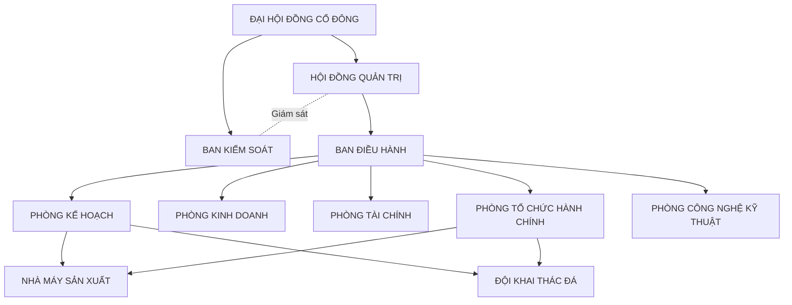

# BÁO CÁO THƯỜNG NIÊN NĂM 2025
## CÔNG TY CỔ PHẦN KHOÁNG SẢN Á CHÂU
**(MÃ CỔ PHIẾU: AMC)**

---

# I. THÔNG TIN CHUNG

## 1. Thông tin khái quát

| Chỉ tiêu | Nội dung |
| :--- | :--- |
| **Mã chứng khoán** | AMC |
| **Tên Công ty** | CÔNG TY CỔ PHẦN KHOÁNG SẢN Á CHÂU |
| **Tên viết tắt** | AMC |
| **Tên tiếng Anh** | Asia Mineral Join Stock Company |
| **Trụ sở chính** | Lô 32- Khu C- Khu công nghiệp Nam Cấm, Xã Trung Lộc, Tỉnh Nghệ An, Việt Nam |
| **Vốn điều lệ** | 42.749.900.000 đồng |
| **Điện thoại** | +84 238 3791 777 |
| **Email** | amc@amcvina.vn |
| **Website** | http://www.amcvina.vn/ |
| **Ngành nghề** | Sản xuất kinh doanh bột đá trắng siêu mịn |
| **Đăng ký kinh doanh** | 2703001715 cấp ngày 28/12/2007 tại Sở Kế hoạch Nghệ An |
| **Nơi niêm yết** | HNX |
| **Mệnh giá** | 10.000 đồng/cổ phiếu |
| **Khối lượng đang NY** | 4.274.990 |
| **Tổng giá trị NY** | 42.749.900.000 |
| **Tổ chức kiểm toán** | Công ty TNHH Kiểm toán Quốc tế |

### - Quá trình hình thành và phát triển

| Ngày, tháng, năm | Sự kiện tiêu biểu |
| :--- | :--- |
| **2001** | Xí nghiệp Khai khoáng (Khai thác mỏ đá trắng) được thành lập là tiền thân của Công ty CP Khoáng sản Á Châu, thuộc Công ty Hợp tác Kinh tế (Quân khu 4/Bộ Quốc phòng). |
| **2007** | Thành lập tên: Công ty CP Khoáng sản Á Châu, vốn điều lệ: 28,5 tỉ đồng. Công ty Hợp tác kinh tế xây dựng Nhà máy sản xuất bột đá trắng siêu mịn, và cùng một số thành viên khác thực hiện liên kết và sáng lập ra Công ty CP Khoáng sản Á Châu. Công ty chính thức đi vào hoạt động ngày 28/12/2007 theo mô hình Công ty Cổ phần do Sở Kế hoạch và Đầu tư tỉnh Nghệ An cấp Giấy chứng nhận đăng ký kinh doanh số 2703001715 |
| **2010** | Đăng ký trở thành Công ty đại chúng |
| **2012- Tháng 11/2025** | Đăng ký niêm yết cổ phiếu tại Sở giao dịch Chứng khoán Hà Nội (HNX) |
| **Tháng 12/2025** | Công ty tăng vốn điều lệ từ 28.500.000.000 đồng lên thành 42.749.900.000 đồng, bằng nguồn vốn Quỹ đầu tư phát triển của Công ty |

## 2. Ngành nghề và địa bàn kinh doanh

AMC là doanh nghiệp hàng đầu trong lĩnh vực khai thác, chế biến và kinh doanh sản phẩm bột đá vôi siêu mịn (CaCO3). Sản phẩm CaCO3 siêu mịn có tráng phủ và không tráng phủ của AMC được sử dụng rộng rãi trong nhiều ngành công nghiệp như sản xuất sơn, nhựa, giấy cao cấp, cao su, kính, gốm sứ, đá marble nhân tạo, thức ăn chăn nuôi, mỹ phẩm, dược phẩm, bột bả (trét) tường,... và được khách hàng công nhận là sự lựa chọn tối ưu nhất của họ.

### a) Ngành nghề kinh doanh

#### * Lĩnh vực kinh doanh
- Khảo sát, thăm dò, khai thác, chế biến khoáng sản (đá, cát, sỏi, quặng kim loại);
- Sản xuất, mua bán sản phẩm bột đá trắng mịn, siêu mịn và các loại khoáng sản khác;
- Đại lý mua bán, ký gửi hàng hóa mua bán sản phẩm bột đá trắng mịn, siêu mịn và các loại khoáng sản khác;
- Cung cấp dịch vụ vận tải bằng đường bộ;
- Kinh doanh bất động sản, quyền sử dụng đất thuộc chủ sở hữu, chủ sử dụng hoặc đi thuê. Chi tiết: Cho thuê mặt bằng;
- Cho thuê xe có động cơ;
- Cho thuê máy móc, thiết bị và đồ dùng hữu hình khác không kèm người điều khiển.

#### * Sản phẩm dịch vụ chính
- Đá vôi trắng (đá hộc) dạng thô kích thước 10-400 mm;
- Bột không tráng phủ và có tráng phủ kích thước từ 5 đến 30 µm;
- Các sản phẩm theo cỡ hạt theo yêu cầu của khách hàng.

Đặc tính đá vôi (CaCO3) có tính chất không cứng, không bền như các loại đá khác nên không thể ứng dụng được trong xây dựng và điêu khắc. Tuy nhiên, do tỉ lệ canxi trong đá cao nên đá vôi được khai thác, trải qua quá trình sản xuất cho ra bột đá trắng siêu mịn với vai trò là thành phần phụ gia, nguyên liệu, chất độn, nhằm mục tiêu tăng cường một số đặc tính cần thiết cho sản phẩm cũng như hạ giá thành sản phẩm cuối cùng.

### b) Địa bàn kinh doanh:
- Trụ sở và Nhà máy của Công ty được đặt tại Khu công nghiệp Nam Cấm, cách Cảng Cửa Lò chỉ 05km, thuận tiện và tiết giảm chi phí vận chuyển, gần nguồn khai thác nguyên liệu.
- Hoạt động khai thác đá vôi trắng của Công ty diễn ra tại xã Quỳ Hợp, xã Châu Hồng, tỉnh Nghệ An (là 01 trong 02 địa phương có trữ lượng đá hoa trắng lớn nhất nước), Công ty sở hữu 02 mỏ đá vôi trắng, với tổng diện tích hơn 25 ha và trữ lượng hơn 9 triệu tấn.

## 3. Thông tin về mô hình quản trị, tổ chức kinh doanh và bộ máy quản lý

### - Mô hình quản trị và sơ đồ bộ máy quản lý

- **Công ty con và công ty liên kết:** Không có.

## 4. Định hướng phát triển

### a) Các mục tiêu chủ yếu của Công ty
- Khai thác, chế biến khoáng sản là lĩnh vực chủ lực, là cốt lõi của Công ty, đồng thời tiếp tục chiến lược đầu tư sang một số lĩnh vực sản xuất khác.
- Duy trì và củng cố đầu tư, khai thác các mỏ hiện có, tìm kiếm, thăm dò phát triển khai thác các vùng mỏ nguyên liệu trong và ngoài tỉnh nhằm đảm bảo nguồn nguyên liệu cho hoạt động sản xuất, kinh doanh lâu dài của Công ty. Công tác này cũng góp phần phục vụ phát triển các sản phẩm mới kể cả việc xây dựng thêm các nhà máy khác.
- Tiếp tục nghiên cứu đổi mới công nghệ, đầu tư MMTB cho Nhà máy, trang thiết bị phục vụ khai thác, chế biến khoáng sản,...bảo vệ môi trường, để đảm bảo ổn định sản phẩm cung ứng, là cơ sở để mở rộng thị trường tiêu thụ.
- Duy trì vị thế doanh nghiệp trên thị trường; Công ty sẵn sàng hợp tác với các đối tác, các khách hàng để hiện thực hóa chiến lược hoạt động SXKD có hiệu quả.

### b) Chiến lược phát triển trung và dài hạn
- Khai thác, chế biến đá trắng là ngành kinh doanh trọng yếu, chủ lực trong phát triển trung và dài hạn của AMC, là điều kiện để tích lũy và phát triển các lĩnh vực kinh doanh khác.
- Sản xuất, chế biến thành phẩm từ khoáng sản tự khai thác, bằng công nghệ hiện đại, để tận dụng hết các lợi thế về tài chính, về mỏ đá trắng, mặt bằng kinh doanh, nhà xưởng và nguồn nhân lực hiện có của Công ty.
- Tích cực tìm kiếm thị trường tiêu thụ mới đối với sản phẩm bột đá trắng mịn và siêu mịn để nâng cao hiệu quả kinh tế, tạo thế ổn định và phát triển cho Công ty.
- Tiếp tục nghiên cứu đầu tư phát triển đa dạng sản phẩm để phát huy năng lực, kinh nghiệm và thương hiệu của đơn vị. Nghiên cứu ứng dụng công nghệ cao, tự động hóa vào một số công đoạn sản xuất có thể áp dụng để nâng cao năng suất lao động, giảm chi phí sản xuất.

### c) Các mục tiêu phát triển bền vững (môi trường, xã hội và cộng đồng)
- Trong quá trình thực hiện khai thác thực hiện đúng và đầy đủ các biện pháp kỹ thuật theo quy định, đảm bảo an toàn mỏ, an toàn lao động, quốc phòng an ninh, bảo vệ môi trường, môi sinh và thực hiện đầy đủ các nghĩa vụ khác có liên quan theo quy định của pháp luật.
- Duy trì thường xuyên công tác đảm bảo an toàn lao động, vệ sinh trong các nhà máy. Kiểm tra định kỳ các hạng mục xử lý chất thải theo cam kết.
- Đảm bảo việc làm và thu nhập cho người lao động tại Công ty.
- Quan tâm đến việc hỗ trợ nhân dân, những trường hợp khó khăn trong địa bàn nơi Công ty hoạt động và các gia đình có hoàn cảnh cần sự giúp đỡ của cộng đồng trong khả năng của Công ty.

## 5. Các rủi ro

### a) Rủi ro về pháp luật
AMC hoạt động theo mô hình Công ty Cổ phần, vì vậy hoạt động của Công ty chịu sự ảnh hưởng đồng thời bởi nhiều bộ Luật và các văn bản hướng dẫn thi hành như: Luật Doanh nghiệp, Luật Chứng khoán, Luật Thuế thu nhập doanh nghiệp, Luật Khoáng sản, Luật môi trường và các văn bản luật có liên quan. Nên bất kỳ sự thay đổi nào của các bộ luật có liên quan cũng sẽ có thể ảnh hưởng đến chính sách và tình hình hoạt động kinh doanh của Công ty.

Đặc biệt, AMC là doanh nghiệp hoạt động SXKD nằm trong Danh mục ngành nghề kinh doanh có điều kiện, do đó Công ty còn chịu ảnh hưởng bởi Luật Khoáng sản số 60/2010/QH12 ngày 17/11/2010, các Nghị định và Thông tư hướng dẫn, thi hành Luật khoáng sản khác có liên quan. Trong đó phải kể đến những quy định về hạn chế hay khuyến khích khai thác khoáng sản (bao gồm thuế xuất khẩu; phí, thuế tài nguyên và tiền cấp quyền khai thác khoáng sản theo Thông tư 44/2017 của Bộ Tài chính) có ảnh hưởng rất lớn đến doanh nghiệp nói riêng và toàn ngành nói chung trong giai đoạn này.

* **Giải pháp:** Để hạn chế những rủi ro phát sinh liên quan đến yếu tố pháp lý trong quá trình hoạt động, Công ty luôn chú trọng công tác theo dõi, cập nhật và nghiên cứu các văn bản pháp luật có liên quan đến lĩnh vực hoạt động của mình; đồng thời thuê tư vấn đối với những vấn đề pháp lý nằm ngoài khả năng của Công ty để đảm bảo quá trình hoạt động SXKD của Công ty được diễn ra liên tục và không bị gián đoạn.

### b) Rủi ro về kinh tế
Năm 2025, đơn vị thực hiện nhiệm vụ SXKD trong điều kiện gặp nhiều khó khăn: Chiến tranh Nga Ucraina tiếp diễn; xung đột Israel - Hamas ngày càng căng thẳng leo thang; nền kinh tế thế giới đang chịu sức ép bởi yếu tố chính trị. Thị trường tiêu thụ trong nước chưa phục hồi, đặc biệt đối với hàng bột đá mịn nhu cầu vẫn sụt giảm mạnh so cùng kỳ các năm trước, thị trường xuất khẩu đang phục hồi. Những điều đó làm ảnh hưởng đến hoạt động sản xuất kinh doanh của Công ty.

* **Giải pháp:** Công ty thường xuyên theo dõi, cập nhật diễn biến kinh tế, chính trị trong nước và thế giới để có những giải pháp, chiến lược, kế hoạch cụ thể, linh hoạt, kịp thời ứng phó với rủi ro.

### c) Rủi ro thị trường tiêu thụ sản phẩm
Hiện nay, 60% doanh thu của Công ty đến từ hoạt động xuất khẩu sản phẩm sang thị trường Campuchia, Ấn Độ... Điều này dẫn đến rủi ro cho Công ty khi các quốc gia tiêu thụ có sự thay đổi về chính sách nhập khẩu và cầu nhập khẩu.

* **Giải pháp:** Công ty luôn chủ động đa dạng hóa thị trường tiêu thụ sản phẩm và rà soát kỹ hạn của các hợp đồng đã ký kết, chú trọng xây dựng chiến lược để tăng sức cạnh tranh trên thị trường hiện nay.

### d) Rủi ro cấp phép khai thác mỏ
Vì khoáng sản là tài nguyên quốc gia nên Luật Khoáng sản đưa ra những quy định nhằm quản lý chặt chẽ việc khai thác và chế biến khoáng sản để tránh lãng phí, tăng hiệu quả khai thác, chế biến và bảo vệ môi trường. Những luật này lại chưa hoàn thiện, các văn bản hướng dẫn thi hành luật còn chưa rõ ràng đã gây nhiều khó khăn cho các doanh nghiệp hoạt động trong lĩnh vực này. Những yêu cầu về công nghệ khai thác rất nghiêm ngặt, trong trường hợp không được cấp phép khai thác, doanh nghiệp sẽ bị lỗ một khoản chi phí rất lớn đến từ chi phí đầu tư ban đầu.

* **Giải pháp:** Các hoạt động của Công ty luôn bám sát quy trình đã được xây dựng cụ thể về việc thăm dò, khảo sát địa chất cho từng hoạt động, dự án triển khai, nhằm hạn chế thấp nhất rủi ro và tiết kiệm tối đa chi phí cho hoạt động này.

### e) Rủi ro về môi trường
Khoáng sản là tài nguyên không tái tạo và có trữ lượng hạn chế. Việc khai thác khoáng sản phụ thuộc rất nhiều vào các yếu tố về môi trường như sức ép bảo vệ môi trường, bảo vệ cảnh quan thiên nhiên. Điều này cũng gây tiềm ẩn rủi ro bị rơi vào những vụ tranh cãi pháp lý hay phản đối từ dư luận đối với hoạt động khai thác của Công ty. Việc thu các khoản phí bảo vệ môi trường, phí nước thải công nghiệp, tiền thuê đất khai thác khoáng sản, thuế tài nguyên ngày càng cao thể hiện việc nâng rào của Nhà nước đối với hoạt động này và sẽ ảnh hưởng tới kết quả hoạt động kinh doanh của Công ty.

* **Giải pháp:** Công ty dự báo xác suất rủi ro và đánh giá thiệt hại khi rủi ro xảy ra đối với từng lĩnh vực hoạt động để có biện pháp phòng ngừa và cải thiện thích hợp. Ban lãnh đạo của Công ty cũng phổ biến rộng rãi các Quy định về việc bảo vệ môi trường, nghiên cứu các giải pháp công nghệ giảm thiểu tối đa các tác động xấu đến môi trường xung quanh.

### g) Rủi ro khác
Các yếu tố thời tiết như nắng nóng khắc nghiệt, mưa, bão lũ, sạt lở ảnh hưởng lớn đến sản lượng khai thác mỏ đá và sản xuất tại nhà máy của Công ty.

* **Giải pháp:** Để hạn chế những thiệt hại khi có bất khả kháng xảy ra, Công ty đã chủ động tham gia vào các hợp đồng bảo hiểm cho các dự án, công trình đang triển khai.

---

# II. TÌNH HÌNH HOẠT ĐỘNG TRONG NĂM

## 1. Tình hình hoạt động SXKD

### a) Kết quả hoạt động SXKD trong năm 2025

| Nội dung | ĐVT | Thực hiện 2024 | Kế hoạch 2025 | Thực hiện 2025 | TH2025/ TH2024 (%) | TH/KH 2025 (%) |
| :--- | :---: | :---: | :---: | :---: | :---: | :---: |
| Doanh thu | Trđ | 160.868 | 176.905 | 171.367 | 106,5% | 96,9% |
| Lợi nhuận trước thuế | Trđ | 7.963 | 6.033 | 8.334 | 104,7% | 138,1% |
| Lợi nhuận sau thuế | Trđ | 6.187 | 4.496 | 6.425 | 103,9% | 142,9% |
| Cổ tức | % | 13 | 13 | 9 | 69,0% | 69,0% |

*Ghi chú: Chi trả cổ tức 9%/VĐL sau khi tăng Vốn điều lệ từ 28,5 tỷ đồng lên thành 42.749.900.000 đồng (tương đương 13,5%/ VĐL cũ 28,5 tỷ đồng).*

Năm 2025, đơn vị thực hiện nhiệm vụ SXKD trong điều kiện gặp nhiều khó khăn, nhưng với sự nỗ lực của toàn thể cán bộ CNV Công ty, bằng nhiều giải pháp, biện pháp chỉ đạo quyết liệt, kịp thời của Hội đồng quản trị, Ban điều hành, Công ty vẫn duy trì được ổn định và phát triển, các chỉ tiêu kinh tế chủ yếu đạt kế hoạch đề ra.

### b) Tình hình thực hiện so với kế hoạch
- Sản lượng sản xuất: 97.563,35 tấn, đạt 86,05% kế hoạch; bằng 98,57% so với năm 2024.
- Sản lượng tiêu thụ: 97.975,88 tấn, đạt 86,41% kế hoạch; bằng 93,25% so với năm 2024.
- Doanh thu và thu nhập khác: 171.367 triệu đồng; đạt 96,87% kế hoạch; bằng 106,53% so với năm 2024.
- Tổng chi phí: 163.033 triệu đồng; bằng 95,41% kế hoạch; bằng 106,62% so với năm 2024.
- Lợi nhuận trước thuế: 8.334 triệu đồng; đạt 138,13% kế hoạch; bằng 104,65% so với năm 2024.
- Lợi nhuận sau thuế: 6.425 triệu đồng; đạt 142,93% kế hoạch; bằng 103,85% so với năm 2024.
- Chi trả cổ tức năm 2025 (dự kiến) 9% theo kế hoạch và bằng 69% so với năm 2024.

## 2. Tổ chức và nhân sự

### a) Danh sách Ban điều hành

#### * Ông Lê Văn Chiến - Giám đốc Công ty.
- Ngày tháng năm sinh: 28/05/1976.
- Trình độ chuyên môn: Cử nhân.
- Quá trình công tác:
  + 2000-2004: Cán bộ Kinh doanh - Công ty TNHH Nhất Vinh;
  + 2004-2007: Giám đốc - Công ty TNHH Trọng Tín;
  + 2007-2012: Trưởng ban Thị trường - Phòng Kinh doanh - Công ty CP Khoáng sản Á Châu;
  + 2012-5/2018: Trưởng phòng Kinh doanh - Công ty CP Khoáng sản Á Châu;
  + Tháng 5/2018 - 07/2022: Phó Giám đốc Công ty CP Khoáng sản Á Châu;
  + Tháng 07/2022 - 08/2022: Quyền Giám đốc Công ty CP Khoáng sản Á Châu;
  + Tháng 08/2022 - đến nay: Giám đốc Công ty CP Khoáng sản Á Châu.
- Tỷ lệ sở hữu CP tại ngày 31/12/2025 (%): 1,02%.

#### * Ông Quế Minh Hoàng - Kế toán trưởng kiêm Trưởng phòng Tài chính
- Quá trình công tác:
  + 2001-2003: Trợ lý kế toán - Công ty Chế biến gỗ Lào Ngam/Công ty Hợp tác kinh tế;
  + 2004-2007: Kế toán trưởng - Công ty Chế biến gỗ Lào Ngam/Công ty Hợp tác kinh tế;
  + 2008-2010: Trợ lý Ban kiểm soát - Công ty Hợp tác kinh tế;
  + 2010-2015: Trợ lý Ban kiểm soát nội bộ - Tổng Công ty Hợp tác kinh tế;
  + 2015-5/2020: Phó Chánh Văn phòng - Tổng Công ty Hợp tác kinh tế;
  + 6/2020 - đến nay: Kế toán trưởng kiêm Trưởng phòng Tài chính - Công ty CP Khoáng sản Á Châu.
- Tỷ lệ sở hữu CP tại ngày 31/12/2025 (%): 0%

### b) Những thay đổi trong ban điều hành:
Không thay đổi.

### c) Số lượng cán bộ, nhân viên
Tổng số cán bộ, công nhân viên và người lao động của Công ty tính đến hết ngày 31/12/2025 là 106 người, được phân loại như sau:

| STT | Tính chất phân loại | Số lượng 2024 (người) | Số lượng 2025 (người) | Tỷ trọng 2025 (%) |
| :---: | :--- | :---: | :---: | :---: |
| **A** | **Theo trình độ lao động** | **109** | **106** | **100%** |
| 1 | Đại học và trên Đại học | 25 | 24 | 23% |
| 2 | Cao đẳng, trung cấp chuyên nghiệp | 13 | 12 | 11% |
| 3 | Sơ cấp và công nhân kĩ thuật | 36 | 37 | 35% |
| 4 | Lao động phổ thông | 35 | 33 | 31% |
| **B** | **Theo đối tượng lao động** | **109** | **106** | **100%** |
| 1 | Lao động trực tiếp | 73 | 63 | 59% |
| 2 | Lao động gián tiếp | 36 | 43 | 41% |
| **C** | **Theo giới tính lao động** | **109** | **106** | **100%** |
| 1 | Nam | 95 | 90 | 85% |
| 2 | Nữ | 14 | 16 | 15% |
| **D** | **Theo độ tuổi** | **109** | **106** | **100%** |
| 1 | Dưới 25 | 0 | 2 | 2% |
| 2 | Từ 25-35 | 22 | 13 | 12% |
| 3 | Trên 35 | 87 | 91 | 86% |
| | **Tổng cộng** | **109** | **106** | |

#### * Chính sách đối với người lao động
- Xác định nguồn nhân lực là chìa khóa cốt lõi trong sự thành công của Công ty, Ban lãnh đạo AMC luôn dành sự quan tâm thích đáng để duy trì và phát triển năng lực của mỗi cá nhân, từ đó tạo dựng sự vững chắc trong quá trình phát triển của Công ty.
- Bên cạnh việc thu hút nhân tài, Công ty luôn duy trì hướng đến một môi trường làm việc thân thiện, an toàn, lao động tốt, tạo điều kiện tối đa để mỗi cá nhân phát huy kinh nghiệm, năng lực của mình.
- Công ty luôn đảm bảo việc làm và thu nhập cho người lao động; chăm lo đời sống vật chất, nơi ăn chỗ ở cho người lao động, để người lao động đồng lòng, quyết tâm gắn bó lâu dài với đơn vị.

## 3. Tình hình đầu tư, tình hình thực hiện các dự án

### a) Các khoản đầu tư lớn
Tổng chi phí đầu tư dự án, MMTB trong năm 2025 là 24.916 triệu đồng. Chủ yếu là hoàn thành Dự án Đầu tư mở rộng dây chuyền nghiền siêu mịn và tráng phủ bột đá CaCO3 tăng năng lực sản xuất, mua sắm thiết bị phục vụ hoạt động SXKD.

### b) Các công ty con, công ty liên kết:
Không có.

## 4. Tình hình tài chính

### a) Tình hình tài chính

| Chỉ tiêu | ĐVT | Năm 2024 | Năm 2025 | % tăng (giảm) |
| :--- | :---: | :---: | :---: | :---: |
| Tổng giá trị tài sản | Triệu đồng | 102.075 | 105.831 | 3,7 |
| Doanh thu thuần | Triệu đồng | 159.789 | 169.866 | 6,3 |
| Lợi nhuận từ hoạt động kinh doanh | Triệu đồng | 8.282 | 9.126 | 10,2 |
| Lợi nhuận khác | Triệu đồng | (319) | (792) | 148,3 |
| Lợi nhuận trước thuế | Triệu đồng | 7.963 | 8.334 | 4,7 |
| Lợi nhuận sau thuế | Triệu đồng | 6.187 | 6.425 | 3,9 |

### b) Các chỉ tiêu tài chính chủ yếu

| Các chỉ tiêu | ĐVT | Năm 2024 | Năm 2025 | % Tăng (giảm) |
| :--- | :---: | :---: | :---: | :---: |
| **1. Chỉ tiêu về khả năng thanh toán** | | | | |
| - Hệ số thanh toán ngắn hạn | Lần | 1,51 | 1,31 | (13,2) |
| - Hệ số thanh toán nhanh | Lần | 1,05 | 0,96 | (8,6) |
| **2. Chỉ tiêu về cơ cấu vốn** | | | | |
| - Hệ số Nợ/Tổng tài sản | % | 48,2 | 48,2 | 0 |
| - Hệ số Nợ/Vốn chủ sở hữu | % | 93 | 93 | 0 |
| **3. Chỉ tiêu về năng lực hoạt động** | | | | |
| - Vòng quay hàng tồn kho | Vòng | 6,33 | 6,19 | (2) |
| - Doanh thu thuần/Tổng tài sản | Vòng | 1,56 | 1,61 | 2,9 |
| **4. Chỉ tiêu về khả năng sinh lời** | | | | |
| - Hệ số lợi nhuận sau thuế/Doanh thu thuần | % | 3,87 | 3,78 | (2,3) |
| - Hệ số lợi nhuận sau thuế/Vốn CSH (ROE) | % | 13,47 | 13,51 | 0,3 |
| - Hệ số lợi nhuận sau thuế/Tổng tài sản (ROA) | % | 6,86 | 6,18 | (9,9) |
| - Hệ số lợi nhuận từ hoạt động KD/Doanh thu thuần | % | 5,18 | 5,37 | 3,7 |

- *Khả năng thanh toán:* Khả năng thanh toán hiện hành đạt 1,31 lần, giảm 13,2% so với năm 2024; Khả năng thanh toán nhanh đạt 0,96 giảm 8,6% so với 2024. Hệ số thanh toán trên là đáp ứng đủ mức an toàn đối với một công ty hoạt động trong lĩnh vực khai thác và sản xuất khoáng sản.
- *Cơ cấu vốn:* Tỷ trọng nợ trên tổng tài sản và nợ trên vốn CSH của Công ty không tăng không giảm so với năm 2024. Nhìn chung, đây là mức cơ cấu vốn an toàn.
- *Năng lực hoạt động:* Vòng quay hàng tồn kho giảm 2% không đáng kể so với 2024. Sản lượng sản xuất trong năm 2025 là 97.563,35 tấn, đạt 86,0% kế hoạch; bằng 98,6% so với năm 2024. Sản lượng tiêu thụ 97.975,88 tấn, đạt 86,4% kế hoạch; bằng 93,3% so với năm 2024. Doanh thu thuần trên Tổng tài sản tăng 2,9% so với 2024.
- *Khả năng sinh lời:*
  + Lợi nhuận sau thuế / doanh thu thuần là 3,78%, giảm 2,3% so với năm 2024;
  + ROE trong năm 2025 là 13,51%, tăng 0,3% với năm 2024;
  + ROA trong năm 2025 là 6,18%, giảm 9,9% với năm 2024.

## 5. Cơ cấu cổ đông, thay đổi vốn đầu tư của Chủ sở hữu

### a) Cổ phần:
Tính đến ngày 31/12/2025, AMC đã phát hành 4.274.990 cổ phiếu. Trong đó:
- Số lượng cổ phần: 4.274.990 cổ phiếu.
- Mệnh giá cổ phiếu: 10.000 đồng.
- Số lượng cổ phiếu ưu đãi: 0 cổ phiếu.
- Số lượng cổ phiếu phổ thông: 4.274.990 cổ phiếu.
- Số lượng cổ phiếu đang lưu hành: 4.274.990 cổ phiếu.
- Số lượng cổ phiếu quỹ: 0 cổ phiếu.

### b) Cơ cấu cổ đông

| STT | Tên cổ đông | Số lượng CP năm 2025 | Tỷ lệ sở hữu năm 2025 |
| :---: | :--- | :---: | :---: |
| 1 | Cổ đông Nhà nước | 1.709.996 | 40,00% |
| 2 | Cổ đông Nước ngoài | 116.700 | 2,73% |
| 3 | Cổ đông khác | 2.448.294 | 57,27% |
| **+** | **Tổng** | **4.274.990** | **100%** |

#### * Danh sách cổ đông lớn

| Tên tổ chức | Số CMND/ Hộ chiếu/ ĐKKD | Địa chỉ | Số lượng cổ phiếu sở hữu cuối kỳ | Tỷ lệ sở hữu cổ phiếu cuối kỳ |
| :--- | :---: | :--- | :---: | :---: |
| Tổng Công ty Hợp tác kinh tế | VSDAMC2706000028 | Số 187 Lê Duẩn, Phường Trường Vinh, Nghệ An | 1.709.996 | 40% |

### c) Tình hình thay đổi vốn đầu tư của chủ sở hữu:
Không thay đổi.

### d) Giao dịch cổ phiếu quỹ:
Không có.

### e) Các chứng khoán khác:
Không có.

## 6. Báo cáo tác động liên quan đến môi trường và xã hội của công ty

### a) Quản lý nguồn nguyên vật liệu
- Tổng lượng nguyên vật liệu được sử dụng để sản xuất và đóng gói các sản phẩm và dịch vụ chính của tổ chức trong năm:

| TT | Danh mục | ĐVT | Số lượng | Đơn giá | Thành tiền |
| :---: | :--- | :---: | :---: | :---: | :---: |
| 1 | Đá vôi trắng | Tấn | 104.022 | 317.806 | 33.058.826.675 |
| 2 | Bao bì | Bao | 2.732.833 | 4.434 | 12.117.379.005 |
| 3 | Nguyên vật liệu khác (chỉ khâu; dịch trợ nghiền; Axit Stearic ...) | | | | 1.545.499.395 |
| **+** | **Tổng cộng** | | | | **46.721.705.075** |

- Báo cáo tỷ lệ phần trăm nguyên vật liệu được tái chế được sử dụng để sản xuất sản phẩm và dịch vụ chính của tổ chức: Không có.

### b) Tiêu thụ năng lượng
- Tổng sản lượng điện tiêu thụ: 9.558.812 KW.
- Tổng chi phí năng lượng điện: 17.656.747.385 đồng.
- Năng lượng tiết kiệm được thông qua các sáng kiến sử dụng năng lượng hiệu quả: Không.
- Các báo cáo sáng kiến tiết kiệm năng lượng: Không.

### c) Tiêu thụ nước
- Tổng sản lượng nước tiêu thụ: 4.542 m³.
- Tổng chi phí: 71.374.261 đồng.

### d) Tuân thủ pháp luật về bảo vệ môi trường
- Số lần bị xử phạt vi phạm do không tuân thủ luật pháp và các quy định về môi trường: Không.
- Tổng số tiền do bị xử phạt vi phạm do không tuân thủ luật pháp và các quy định về môi trường: Không.

### đ) Chính sách liên quan đến người lao động

#### * Số lượng lao động, mức lương trung bình đối với người lao động
- Quân số: 106 người.
- Thu nhập bình quân người lao động: 13.323.598 đồng/người/tháng, đạt 110,6% kế hoạch; bằng 122,2% so với năm 2024.

#### * Chính sách lao động nhằm đảm bảo sức khỏe, an toàn và phúc lợi của người lao động:
- Về thời gian làm việc: Công ty tổ chức làm việc 8 tiếng/ngày, 6 ngày/tuần, nghỉ trưa 1,5 tiếng. Người lao động được nghỉ phép, nghỉ lễ, tết, ốm đau, thai sản thực hiện theo quy định của Bộ luật Lao động.
- Nhân sự Công ty chiếm đa số là công nhân lao động trực tiếp, do đặc thù của ngành nghề khai thác, chế biến khoáng sản. Văn phòng, nhà xưởng được trang bị đầy đủ máy móc thiết bị phục vụ cho công việc. Đối với lực lượng lao động trực tiếp, Công ty trang bị đầy đủ các phương tiện bảo hộ lao động (quần áo, khẩu trang, kính mũ và dày bảo hộ ...), vệ sinh lao động, các nguyên tắc an toàn lao động được tuân thủ nghiêm ngặt.
- Ngoài chế độ tiền lương, Công ty thực hiện đầy đủ công bằng các chế độ chính sách khuyến khích người lao động như: Thưởng Tết, thưởng các dịp lễ lớn, thưởng tiết giảm chi phí, thưởng hiệu quả công việc, thưởng phong trào thi đua quý, năm (hoặc đột xuất).
- Công ty luôn duy trì hướng đến một môi trường lao động tốt, tạo điều kiện tối đa để mỗi cá nhân phát huy kinh nghiệm, năng lực của mình. Đảm bảo tốt các quyền và nghĩa vụ theo quy định của pháp luật và các chế độ theo quy định của Nhà nước: Chính sách lương, thưởng, phúc lợi phù hợp với quy định của Công ty đồng thời đảm bảo mỗi cán bộ, nhân viên ở các bộ phận khác nhau sẽ được hưởng thu nhập tương xứng với công việc mà mình đảm nhận.
- Các phúc lợi khác của người lao động trong Công ty luôn được đảm bảo như: hỗ trợ lao động nữ nhân ngày Quốc tế phụ nữ, ngày Phụ nữ Việt Nam, hỗ trợ thai sản, ốm đau, nghỉ dưỡng hàng năm,...Công ty luôn tạo mọi điều kiện để Công đoàn chăm lo cho người lao động tốt nhất theo đúng quy định.

#### * Hoạt động đào tạo người lao động:
- Cán bộ, CNV, người lao động làm việc tại Công ty luôn được chú trọng đào tạo trao dồi chuyên môn nghiệp vụ, năng lực công tác, nâng cao tay nghề, bậc thợ và tham gia các hoạt động tập huấn, đảm bảo tiêu chuẩn lao động đáp ứng tốt nhất yêu cầu chuyên môn của công việc tại Công ty.
- Các chương trình phát triển kỹ năng và học tập liên tục để hỗ trợ người lao động đảm bảo có việc làm và phát triển sự nghiệp: Không.

### e) Báo cáo liên quan đến trách nhiệm đối với cộng đồng địa phương
Trách nhiệm với cộng đồng địa phương là một trong những sứ mệnh quan trọng được ưu tiên hàng đầu của AMC. Công ty luôn đồng hành cùng các hoạt động thiết thực với xã hội với mong muốn nâng cao tay nghề với trình độ chuyên môn của lực lượng lao động trong nước, duy trì nghĩa vụ và trách nhiệm với cộng đồng địa phương nơi công ty có lợi ích hoạt động. Cụ thể:
- Tuân thủ quy trình, quy định khai thác, đảm bảo an toàn tuyệt đối trong lao động, vệ sinh trong nhà máy; đảm bảo công tác bảo vệ môi trường tại các mỏ khai khoáng và vùng lân cận;
- Kiểm tra định kì các hạng mục xử lý chất thải theo cam kết;
- Quan tâm hỗ trợ người dân, những người khó khăn trong địa bàn nơi công ty hoạt động và giúp đỡ cộng đồng trong khả năng của công ty.

---

# III. BÁO CÁO VÀ ĐÁNH GIÁ CỦA BAN ĐIỀU HÀNH

## 1. Đánh giá kết quả hoạt động SXKD

### - Kết quả SXKD năm 2025

| Nội dung | ĐVT | Thực hiện 2024 | Kế hoạch 2025 | Thực hiện 2025 | TH2024/ TH2023 (%) | TH/KH 2024 (%) |
| :--- | :---: | :---: | :---: | :---: | :---: | :---: |
| Doanh thu | Trđ | 160.868 | 176.905 | 171.367 | 106,5% | 96,9% |
| Lợi nhuận trước thuế | Trđ | 7.963 | 6.033 | 8.334 | 104,7% | 138,1% |
| Lợi nhuận sau thuế | Trđ | 6.187 | 4.496 | 6.425 | 103,9% | 142,9% |
| Cổ tức | % | 13 | 13 | 9 | 69,0% | 69,0% |

*(Lưu ý: Tiêu đề hai cột tỷ lệ được giữ nguyên chính xác theo tài liệu gốc là TH2024/ TH2023 (%) và TH/KH 2024 (%))*

Ban điều hành đánh giá kết quả hoạt động SXKD 2025 hoàn thành vượt mức kế hoạch đề ra.

## 2. Tình hình tài chính

### a) Tình hình tài sản

| TT | Tài sản | ĐVT | Năm 2024 | Năm 2025 |
| :---: | :--- | :---: | :---: | :---: |
| **1** | **Tài sản ngắn hạn** | **Trđ** | **58.317** | **50.989** |
| - | Tiền và các khoản tương đương tiền | Trđ | 4.081 | 3.064 |
| - | Các khoản phải thu ngắn hạn | Trđ | 28.757 | 20.790 |
| - | Hàng tồn kho | Trđ | 17.767 | 14.153 |
| - | Tài sản ngắn hạn khác | Trđ | 7.712 | 12.982 |
| **2** | **Tài sản dài hạn** | **Trđ** | **43.759** | **54.842** |
| - | Các khoản phải thu dài hạn | Trđ | 4.182 | 5.627 |
| - | Tài sản cố định | Trđ | 19.385 | 37.468 |
| - | Tài sản dở dang dài hạn | Trđ | 9.811 | 1.219 |
| - | Tài sản dài hạn khác | Trđ | 10.381 | 10.528 |
| **+** | **Tổng cộng** | **Trđ** | **102.076** | **105.831** |

Tổng tài sản của Công ty trong năm 2025 là 105.831 triệu đồng, tăng 3.755 triệu đồng (tương đương tăng 3,7%) so với năm 2024, chủ yếu do khoản tài sản cố định tăng.
- *Tài sản dài hạn:* Tài sản dài hạn năm 2025 đạt 54.842 triệu đồng, tăng 11.083 triệu đồng (tương đương tăng 25,3%) so với năm 2024. Nguyên nhân chủ yếu tăng tài sản cố định, trong năm công ty đã hoàn thành hệ thống dây chuyền siêu mịn và tráng phủ mới.
- *Tài sản ngắn hạn:* Tài sản ngắn hạn năm 2025 đạt 50.989 triệu đồng, giảm 7.329 triệu đồng (tương đương giảm 12,6%) so với năm 2024. Trong đó:
  + Tiền và các khoản tương đương tiền: Giảm 1.018 triệu đồng (tương đương giảm 24,9%); phải thu ngắn hạn giảm 7.967 triệu đồng (tương đương giảm 27,7%). Nguyên nhân: Do chủ yếu đến từ các khoản tạm ứng trước để thực hiện đầu tư dự án dây chuyền mới đã hoàn thành;
  + Tài sản ngắn hạn khác: Tăng 5.270 triệu đồng (tương đương tăng 68,3%, chủ yếu là thuế giá trị gia tăng đầu vào); hàng tồn kho giảm 3.614 triệu đồng (tương đương giảm 20,3%). Nguyên nhân: Do việc cân đối đầu theo thị trường tiêu thụ.
- *Tỷ trọng tài sản:*
  + Tỷ trọng Tài sản ngắn hạn / Tổng tài sản: 48,2%;
  + Tỷ trọng Tài sản cố định / Tổng tài sản: 35,4%.

### b) Tình hình nợ phải trả

| TT | Nội dung | ĐVT | Năm 2024 | Năm 2025 |
| :---: | :--- | :---: | :---: | :---: |
| | **Nợ phải trả** | **Trđ** | **49.194** | **50.998** |
| - | Nợ ngắn hạn | Trđ | 38.663 | 38.904 |
| - | Nợ dài hạn | Trđ | 10.531 | 12.094 |

Tổng Nợ phải trả tại thời điểm 31/12/2025 là 50.998 triệu đồng, tăng 1.803 triệu đồng (tương đương tăng 3,7%) so với năm 2024. Trong đó:
- Nợ ngắn hạn: Tăng 240 triệu đồng (tương đương tăng 0,6%) so với năm 2024,
- Nợ dài hạn: Tăng 1.563 triệu đồng (tương đương tăng 14,8%) so với năm 2024, do khoản vay và nợ thuê tài chính dài hạn tăng 1.133 triệu đồng (tương đương tăng 15%).
- *Ảnh hưởng của tỷ giá hối đoái:* Hoạt động SXKD của Công ty cũng chịu sự ảnh hưởng bởi các biến động của tỷ giá hối đoái do 60% doanh thu của Công ty đến từ xuất khẩu với đồng tiền giao dịch là USD. Tỷ giá hối đoái năm 2025 (trung bình 25.935 VND/1 USD) tăng so với năm 2024 (trung bình 25.056 VND/1 USD), Công ty tìm cách tối ưu thời hạn thanh toán của các khoản nợ, như: Dự báo tỷ giá ngoại tệ, duy trì hợp lý cơ cấu vay và nợ giữa ngoại tệ và VND, lựa chọn thời điểm mua và thanh toán các khoản ngoại tệ tại thời điểm tỷ giá thấp, sử dụng tối ưu nguồn tiền hiện có để cân bằng giữa rủi ro tỉ giá và rủi ro thanh khoản; cùng với việc nợ thuần ngoại tệ của Công ty có giá trị khá nhỏ nên không có ảnh hưởng lớn từ biến động tỷ giá hối đoái đến lợi nhuận sau thuế và vốn chủ sở hữu của Công ty.
- *Ảnh hưởng của biến động lãi suất vay:* Khoản nợ vay của Công ty với mục đích chủ yếu là bổ sung vốn lưu động SXKD xuất khẩu bột đá siêu mịn và đầu tư dự án dây chuyền mới. Trong năm 2025, lãi suất huy động và cho vay của các tổ chức tín dụng có biến động tăng, Các khoản vay nợ của Công ty đều được áp mức lãi suất cố định và tương đối thấp nên không cần phải lo ngại trước biến động lãi suất đi vay.

## 3. Những cải tiến về cơ cấu tổ chức, chính sách, quản lý

Năm 2025, gặp dù gặp nhiều khó khăn, nhưng hoạt động SXKD của Công ty vẫn duy trì ổn định, phát triển, các chỉ tiêu kinh tế chủ yếu đạt mức kế hoạch đề ra. Ban điều hành đã tăng cường công tác quản lý, cải tiến về cơ cấu tổ chức, chính sách, cụ thể:

### a) Công tác kế hoạch
- Công tác điều hành sản xuất, định hướng sản xuất và giám sát sản xuất được thực hiện khoa học, điều hành linh động đạt hiệu quả cao trong sản xuất.
- Xây dựng kế hoạch SXKD hàng tuần, tháng, quý kịp thời, tính khả thi cao.
- Áp dụng các định mức KTKT vào từng cung đoạn sản xuất, thường xuyên theo dõi giám sát chặt chẽ chi phí trong toàn Công ty, quản lý tốt chất lượng sản phẩm, tổ chức sản xuất hợp lý và khoa học.
- Quản lý tốt giá thành sản xuất, tổ chức lựa chọn được các đối tác cung cấp nguyên liệu như: Bao bì, đá trắng, a xít, dịch trợ nghiền,... ổn định, đảm bảo về chất lượng, giá cả tốt nhất.

### b) Công tác thị trường
- Xây dựng chiến lược phát triển thị trường ngắn hạn và dài hạn phù hợp với năng lực sản xuất của Công ty. Xây dựng giá bán sản phẩm linh hoạt phù hợp với thị trường nội địa và xuất khẩu, mang lại hiệu quả.
- Quản lý tốt thị trường đã có, không ngừng khai thác mở rộng thị trường mới.
- Xây dựng thương hiệu AMC và nhãn hiệu hàng hóa NSS của Công ty trên thị trường trong nước và thị trường quốc tế. Thương hiệu của Công ty được khách hàng trong nước và nước ngoài tín nhiệm và đánh giá cao.

### c) Công tác quản lý tài chính
- Công tác quản lý sử dụng tài sản, vật tư, tiền vốn của đơn vị được thực hiện chặt chẽ; huy động và sử dụng vốn đúng mục đích, nguồn vốn kinh doanh được bảo toàn và phát triển.
- Công tác hạch toán kế toán đúng nguyên tắc, phù hợp với quy chế quản lý tài chính. Cập nhật kịp thời các văn bản, chính sách thuế mới.
- Khai thác tốt các nguồn vốn, đảm bảo đầy đủ, kịp thời cho sản xuất và đầu tư theo kế hoạch; đảm bảo chế độ tiêu chuẩn tiền lương, tiền thưởng và các chế độ khác cho người lao động và các nhu cầu chi thường xuyên của Công ty. Cơ bản đã chấp hành tốt chế độ thu nộp bảo hiểm, thu nộp ngân sách Nhà nước.
- Công nợ phải thu, phải trả được phân loại, theo dõi chi tiết theo từng đối tượng thanh toán. Đơn vị đã tích cực, chủ động thu hồi công nợ để đảm bảo kịp thời vốn cho hoạt động sản xuất kinh doanh và đầu tư.

### d) Công tác công nghệ - kỹ thuật
- Đảm bảo kịp thời, có hiệu quả vật tư, thiết bị phục vụ cho SXKD. Thực hiện tốt công tác bảo đảm kỹ thuật, tổ chức bảo dưỡng MMTB đúng quy trình, quy định, hạn chế tối đa việc ách tắc công việc do hư hỏng xe máy thiết bị gây ra.
- Tiến hành tìm hiểu, nghiên cứu MMTB để đầu tư tăng năng lực sản xuất cho đơn vị. Nghiên cứu ứng dụng công nghệ cao, tự động hóa vào một số cung đoạn sản xuất có thể áp dụng để nâng cao năng suất lao động, giảm chi phí sản xuất.
- Quản lý, thống kê, theo dõi hoạt động máy móc thiết bị chặt chẽ, thực hiện kịp thời, có chất lượng việc sửa chữa máy móc thiết bị, chỉ đạo bảo dưỡng máy móc đúng quy trình và quy định.

### đ) Công tác tổ chức lao động – hành chính
- Công tác tuyển dụng: Phù hợp với nhu cầu sử dụng của Công ty.
- Công tác tiền lương: Đảm bảo tính toán chính xác lợi ích số cho người lao động, động viên khen thưởng kịp thời. Quan tâm chăm lo đời sống vật chất, tinh thần, cải thiện điều kiện làm việc, nghỉ ngơi cho CBCNV. Thanh toán đầy đủ, kịp thời các chế độ quyền lợi cho người lao động.
- Thực hiện khám sức khỏe định kỳ cho người lao động theo quy định.
- Thực hiện tốt trong việc thăm hỏi ốm đau, thai sản, hiếu hỉ và chăm lo cho công nhân lao động khi gia đình gặp hoàn cảnh khó khăn.
- Kịp thời gặp mặt, đối thoại, tìm hiểu tâm tư nguyện vọng giải quyết các thắc mắc của người lao động.

### e) Công tác điều hành tại phân xưởng, đội khai thác mỏ
- Quản lý tốt chất lượng sản phẩm, công cụ dụng cụ, máy móc thiết bị, khắc phục kịp thời MMTB khi hỏng hóc.
- Thực hiện tốt các lệnh sản xuất của Công ty; thực hiện tốt công tác điều hành tại Đội khai thác đá Quỳ Hợp.

### g) Công tác thực hiện Nghị quyết Hội đồng Cổ đông và Hội đồng quản trị
Thực hiện đúng, đầy đủ Nghị quyết Hội đồng cổ đông và các Nghị quyết Hội đồng quản trị năm 2025.

#### * Một số khó khăn, tồn tại và hạn chế
- Một số chỉ tiêu kinh tế chưa đạt kế hoạch đề ra, như: Sản lượng khai thác đá tại mỏ; Sản lượng sản xuất và tiêu thu (do thay đổi cơ cấu sản xuất sản phẩm từ có giá trị thấp sang có giá trị cao).
- Thị trường cạnh tranh ngày càng khốc liệt, giá cả nguyên liệu, nhiên liệu đầu vào đang ở mức cao, trong khi giá bán một số sản phẩm giảm ảnh hưởng đến hiệu quả kinh doanh.
- Máy móc đã đưa vào sử dụng lâu năm, hư hỏng nhiều phải dừng sản xuất, phát sinh chi phí vật tư sửa chữa lớn. Công tác vận hành, bảo dưỡng, sửa chữa còn để xẩy ra tình trạng máy móc hỏng do nguyên nhân chủ quan. Việc cải tiến quy trình vận hành, sửa chữa thiết bị còn chậm.
- Công tác thu hồi, giải quyết công nợ tồn đọng lâu năm vẫn còn một số đơn vị chưa xử lý dứt điểm được.

## 4. Kế hoạch phát triển trong tương lai
- Tập trung khai thác đá tại các mỏ đá của Công ty và chế biến đá trắng là ngành kinh doanh trọng yếu, chủ lực để phát triển trong tương lai của AMC, là điều kiện để Công ty tích lũy và phát triển các lĩnh vực kinh doanh khác.
- Sản xuất, chế biến thành phẩm từ khoáng sản tự khai thác, bằng công nghệ hiện đại, để tận dụng hết các lợi thế về tài chính, về mỏ đá trắng, mặt bằng kinh doanh, nhà xưởng và nguồn nhân lực hiện có của Công ty.
- Tích cực tìm kiếm thị trường tiêu thụ mới đối với sản phẩm bột đá trắng mịn và siêu mịn để nâng cao hiệu quả kinh tế, tạo thế ổn định và phát triển cho Công ty.
- Tiếp tục nghiên cứu đầu tư phát triển đa dạng sản phẩm để phát huy năng lực, kinh nghiệm và thương hiệu của đơn vị. Nghiên cứu ứng dụng công nghệ cao, tự động hóa vào một số cung đoạn sản xuất có thể áp dụng để nâng cao năng suất lao động, giảm chi phí sản xuất.

---

# IV. ĐÁNH GIÁ CỦA HỘI ĐỒNG QUẢN TRỊ VỀ HOẠT ĐỘNG CỦA CÔNG TY

## 1. Đánh giá của Hội đồng quản trị về các mặt hoạt động của Công ty

### a) Đánh giá tình hình kinh tế vĩ mô, ngành
- Kinh tế thế giới năm 2025 lạm phát và suy thoái; kinh tế Việt Nam tăng trưởng chậm, tốc độ tăng trưởng GDP ước đạt 8%, CPI tăng 3,31%, lãi suất Ngân hàng tăng ảnh hưởng không nhỏ tới tình hình SXKD của Công ty.
- Đối với ngành khai thác đá vôi và chế biến bột đá, thị trường tiêu thụ chững lại, cạnh tranh giữa các doanh nghiệp trong ngành đang diễn ra ngày càng gay gắt đã ảnh hưởng rất lớn đến hoạt động SXKD, đầu tư và triển khai các hoạt động khác của Công ty.

### b) Đánh giá về Công tác quản lý
Công suất MMTB được phát huy tối đa, công tác quản lý định mức KTKT, định mức chi phí, giá thành sản phẩm chặt chẽ, bám sát kế hoạch sản xuất nên giá thành sản xuất sản phẩm đá trắng cơ bản thấp hơn giá thành kế hoạch. Công tác duy tu bảo dưỡng MMTB được quan tâm thực hiện thường xuyên, không để gián đoạn trong sản xuất, không để xảy ra hỏng hóc lớn. Kết quả hoạt động SXKD đạt và vượt mức kế hoạch đề ra.

### c) Công tác quản trị tài chính và nhân sự
- Quản trị tài chính kế toán có nền nếp, thực hiện đúng nguyên tắc, quy trình quản lý tài chính, khai thác đảm bảo đầy đủ, kịp thời nguồn vốn cho SXKD và đầu tư. Ghi chép sổ sách, lập chứng từ và lập báo cáo tài chính đầy đủ, kịp thời. Phản ánh các nghiệp vụ kinh tế phát sinh một cách chính xác, trung thực và khách quan, phù hợp theo chính sách chế độ nhà nước quy định.
- Thực hiện tốt chế độ chính sách của người lao động: Chế độ bảo hiểm, bảo hộ, lương, thưởng, nâng lương và các khoản phúc lợi xã hội được thực hiện đầy đủ, kịp thời, đúng quy định.
- Thực hiện tốt việc nộp ngân sách nhà nước, bảo vệ môi trường và công tác quan hệ với địa phương tại địa bàn đứng chân được quan tâm. Công tác Đảng, Đoàn thanh niên, Hội Phụ nữ được duy trì và hoạt động có hiệu quả.

### d) Đánh giá liên quan đến trách nhiệm môi trường và xã hội
- Công ty đã luôn đồng hành cùng các hoạt động thiết thực với xã hội với mong muốn nâng cao tay nghề với trình độ chuyên môn của lực lượng lao động trong nước, duy trì nghĩa vụ và trách nhiệm với cộng đồng địa phương nơi công ty có lợi ích hoạt động.
- Tuân thủ quy trình, quy định khai thác, đảm bảo an toàn tuyệt đối trong lao động, vệ sinh trong các nhà máy, đảm bảo công tác bảo vệ môi trường tại các mỏ khai khoáng và vùng lân cận.
- Kiểm tra định kì các hạng mục xử lý chất thải theo cam kết.
- Quan tâm hỗ trợ người dân, những người khó khăn trong địa bàn nơi công ty hoạt động và giúp đỡ cộng đồng trong khả năng của công ty.

## 2. Đánh giá của Hội đồng quản trị về hoạt động của Ban điều hành công ty

### a) Những điểm làm được
- Trong 2025, Ban điều hành đã lĩnh hội, tiếp thu và tuân thủ một cách đầy đủ, nghiêm túc, kịp thời những chỉ đạo từ các Nghị quyết và Quyết định của HĐQT để triển khai chỉ đạo hoạt động SXKD của Công ty.
- Năm 2025, mặc dù gặp nhiều khó khăn, nhưng Giám đốc cùng với Ban điều hành và với sự nỗ lực của toàn thể cán bộ CNV Công ty, bằng nhiều giải pháp, biện pháp quyết liệt, kịp thời, như: Tăng cường công tác thị trường tiêu thụ sản phẩm; đầu tư MMTB để đảm bảo sản xuất, cải tiến thiết bị tăng công suất máy móc và năng suất lao động; quản lý chặt chẽ chi phí sản xuất, có các chính sách động viên người lao động để họ yên tâm làm việc nên đã làm giảm giá thành sản phẩm, giữ và mở rộng được thị trường, hoạt động SXKD của Công ty vẫn duy trì được ổn định và phát triển, các chỉ tiêu chủ yếu đạt và vượt kế hoạch đề ra, trong đó: Doanh thu đạt 96,9% kế hoạch; Lợi nhuận trước thuế đạt 138,1% kế hoạch; Lợi nhuận sau thuế đạt 142,9% kế hoạch; Thu nhập bình quân người lao động: 13.323.598 đồng/người/tháng, đạt 110,6% kế hoạch.
- Ban điều hành đã không ngừng cải thiện và phát triển hệ thống sản xuất của Công ty, thường xuyên bám sát, triển khai thực hiện tốt Nghị quyết của Đại hội đồng cổ đông, HĐQT và các định mức KTKT để quản lý điều hành Công ty. Bên cạnh đó, Ban điều hành luôn tích cực, cố gắng chủ động trong công tác thị trường nhằm đảm bảo sản xuất và tiêu thụ sản phẩm, đặc biệt là thị trường xuất khẩu. Đoàn kết thống nhất nội bộ, quan tâm chăm lo đến công tác đời sống người lao động, công tác kỹ thuật, an toàn vệ sinh lao động.

### b) Những điểm chưa làm được
- Một số chỉ tiêu kinh tế chưa đạt kế hoạch đề ra, như: Sản lượng khai thác đá tại mỏ; Sản lượng sản xuất và tiêu thu (do thay đổi cơ cấu sản xuất sản phẩm từ có giá trị thấp sang có giá trị cao).
- Do thị trường bán hàng cạnh tranh ngày càng khốc liệt, nhiều sản phẩm phải giảm giá bán để cạnh tranh; máy móc hư hỏng nhiều, phát sinh chi phí sửa chữa lớn.
- Các khoản công nợ phải thu, phải trả khách hàng trong năm vẫn còn lớn; công tác thu hồi, giải quyết công nợ tồn đọng vẫn còn một số đơn vị chưa xử lý dứt điểm được.

## 3. Các kế hoạch, định hướng của Hội đồng quản trị

### a) Đánh giá thị trường năm 2026
- Tình hình thế giới: Năm 2026, dự đoán chiến tranh Nga Ucraina vẫn còn tiếp diễn; xung đột Israel - Hamas ngày càng căng thẳng leo thang; kinh tế thế giới đang chịu sức ép bởi yếu tố chính trị, vận tải đường biển quốc tế giá cả tăng mạnh.
- Trong nước: Nguồn cung nguyên liệu đầu vào ngày càng ít, sản lượng sụt giảm, chất lượng không cao; trong khi các nhà máy sản xuất bột đá tiếp tục được đầu tư mở rộng và đầu tư thêm nhà máy mới nên chi phí nguyên liệu đầu có xu hướng tăng. Cạnh tranh ngày càng khốc liệt, đặc biệt cạnh tranh về giá với các tập đoàn lớn đầu tư theo chuỗi đồng bộ, từ khai thác, vận tải, sản xuất bột đá, sản xuất hạt taical, sản xuất sản phẩm nhựa.

### b) Chỉ tiêu kế hoạch SXKD năm 2026

| STT | Các chỉ tiêu chính | ĐVT | Kế hoạch năm 2026 | Ghi chú |
| :---: | :--- | :---: | :---: | :--- |
| 1 | Sản lượng tiêu thụ bột đá | Tấn | 100.470 | |
| 2 | Doanh thu | Trđ | 187.600 | |
| 3 | Lợi nhuận trước thuế | Trđ | 7.151 | |
| 4 | Lợi nhuận sau thuế | Trđ | 5.448 | |
| 5 | Tỷ lệ chi trả cổ tức/VĐL | % | 9 | |

### c) Phương hướng thực hiện
- Tiếp tục nâng cao chất lượng hoạt động của HĐQT, ban hành kịp thời các nghị quyết, quyết định lãnh đạo quản lý và giải quyết các vấn đề cần thiết; thực hiện nghiêm chỉnh chế độ đôn đốc, kiểm tra, giám sát Ban điều hành trong việc chấp hành các quy định của pháp luật, các nghị quyết của ĐHĐCĐ, Hội đồng quản trị.
- Chỉ đạo Ban điều hành tiếp tục nắm chắc tình hình thị trường, duy trì ổn định thị trường đã có, phát triển thị trường mới (tập trung đẩy mạnh thị trường xuất khẩu); chuẩn bị tốt nguồn nguyên liệu dự trữ để ổn định sản xuất, đảm bảo sản phẩm cho thị trường tiêu thụ. Tăng cường công tác điều hành sản xuất, quản lý định mức KTKT, tiết kiệm chi phí nhằm giảm giá thành sản phẩm, nâng cao hiệu quả SXKD, hoàn thành các chỉ tiêu kế hoạch năm 2026 đã đề ra.
- Thực hiện tốt công tác công nghệ kỹ thuật, tổ chức bảo dưỡng, sửa chữa kịp thời, bảo đảm có hiệu quả MMTB cho sản xuất; đẩy mạnh công tác sáng kiến CTKT, thay đổi một số khâu sản xuất để giảm giá thành, nâng cao hiệu quả. Tăng cường kiểm tra để ổn định và nâng cao chất lượng sản phẩm.
- Tiếp tục tăng cường công tác thu hồi công nợ khách hàng, trong đó tập trung thu hồi công nợ phải thu quá hạn, khó đòi để đảm bảo vốn cho hoạt động SXKD và đầu tư; theo dõi chặt chẽ và đôn đốc thường xuyên các khách hàng có số công nợ lớn, có biện pháp xử lý tình huống kịp thời để đảm bảo an toàn về vốn.
- Tiếp tục nghiên cứu mở rộng đầu tư khi có cơ hội, triển khai thực hiện đầu tư dây chuyền nghiền mịn. Hoàn thiện các thủ tục pháp lý đối với cả 2 mỏ Châu Quang và Châu Hồng để tổ chức sản xuất đúng quy định pháp luật, theo sản lượng được phép khai thác.
- Thực hiện tốt công tác tài chính - kế toán; tích cực tìm kiếm các giải pháp về vốn như thu hồi công nợ khách hàng, huy động vốn từ các tổ chức tín dụng để đảm bảo vốn cho SXKD và đầu tư kịp thời.
- Đảm bảo đầy đủ, kịp thời mọi chế độ cho người lao động, thường xuyên quan tâm đến công tác ATLĐ, VSLĐ và cải thiện môi trường, điều kiện làm việc, thực hiện tốt công tác bảo vệ môi trường. Đảm bảo an toàn tuyệt đối trong sản xuất, khai thác và tham gia giao thông.
- Làm tốt công tác đảng, công tác chính trị; tăng cường công tác giáo dục chính trị tư tưởng, công tác hành chính trong toàn đơn vị; chăm lo đời sống vật chất, nơi ăn chỗ ở cho người lao động để người lao động đồng lòng, quyết tâm gắn bó lâu dài với đơn vị.

---

# V. QUẢN TRỊ CÔNG TY

## 1. Hội đồng quản trị

### a) Thành viên và cơ cấu của Hội đồng quản trị (31/12/2025)

| TT | Họ và Tên | Chức danh | Số lượng CP phổ thông nắm giữ | Tỷ lệ sở hữu (%) | Ghi chú |
| :---: | :--- | :--- | :---: | :---: | :--- |
| 1 | Ông Phạm Việt Hùng | Chủ tịch | 769.498 | 18% | |
| 2 | Ông Lê Văn Chiến | Thành viên | 556.499 | 13,02% | |
| 3 | Bà Nguyễn Thị Ngân | Thành viên | 144.150 | 3,37% | |
| 4 | Ông Nguyễn Văn Hùng | Thành viên | 7.500 | 0,17% | |
| 5 | Ông Nguyễn Thành Hưng | Thành viên | 15.000 | 0,35% | |

### b) Các tiểu ban thuộc Hội đồng quản trị
Hiện Hội đồng quản trị chưa thành lập các tiểu ban.

### c) Hoạt động của Hội đồng quản trị
Trong năm 2025, đã tổ chức 5 cuộc họp HĐQT để thảo luận và thông qua những nội dung quan trọng liên quan đến hoạt động SXKD năm 2025.

| TT | Thành viên HĐQT | Chức vụ | Số buổi họp HĐQT tham dự | Tỷ lệ tham dự họp | Lý do không tham dự họp |
| :---: | :--- | :--- | :---: | :---: | :--- |
| 1 | Ông Phạm Việt Hùng | Chủ tịch | 5 | 100% | |
| 2 | Ông Lê Văn Chiến | Thành viên | 5 | 100% | |
| 3 | Bà Nguyễn Thị Ngân | Thành viên | 5 | 100% | |
| 4 | Ông Nguyễn Văn Hùng | Thành viên | 5 | 100% | |
| 5 | Ông Nguyễn Thành Hưng | Thành viên | 5 | 100% | |

HĐQT luôn chú trọng thực hiện chức năng, nhiệm vụ của mình, kịp thời chỉ đạo và hỗ trợ Ban điều hành trong công tác triển khai thực hiện các chỉ tiêu SXKD của Công ty. Ban hành các Nghị quyết và Quyết định nhằm chỉ đạo kịp thời, tạo điều kiện thuận lợi cho Ban điều hành Công ty hoạt động; các Nghị quyết, Quyết định của HĐQT ban hành đều dựa trên sự thống nhất, đồng thuận của các thành viên HĐQT.

#### * Các nghị quyết, quyết định của HĐQT ban hành trong năm:

| TT | Nghị quyết/Quyết định | Ngày | Nội dung |
| :---: | :---: | :---: | :--- |
| 01 | 01/NQ – HĐQT | 21/01/2025 | Thông qua báo cáo quyết toán năm 2024, kế hoạch Quý I/2025. |
| 02 | 02/NQ – HĐQT | 14/02/2025 | Thông qua ngày đăng ký cuối cùng chốt danh đại hội cổ đông thường niên 2025 |
| 03 | 03/NQ – HĐQT | 18/04/2025 | Thông qua báo cáo quyết toán Quý I và kế hoạch quý II/2025 |
| 04 | 04/NQ – HĐQT | 30/06/2025 | Thông qua chi trả cổ tức bằng tiền |
| 05 | Số 01/QĐ – HĐQT | 10/02/2025 | Quyết định phê duyệt chi phí phát sinh dự án đầu tư |
| 06 | Số 02/QĐ – HĐQT | 30/05/2025 | Quyết định phê duyệt dự án hoàn thành |
| 07 | Số 05/NQ - HĐQT | 22/07/2025 | Thông qua báo cáo quyết toán Quý II và kế hoạch quý III/2025 |
| 08 | Số 06/NQ - HĐQT | 14/08/2025 | Thông qua ngày đăng ký cuối cùng hưởng quyền đại hội cổ đông bất thường |
| 09 | Số 07/NQ - HĐQT | 24/10/2025 | Thông qua báo cáo quyết toán Quý III và kế hoạch quý IV/2025 |
| 10 | Số 08/NQ - HĐQT | 24/10/2025 | Thông qua phương án triển khai tăng vốn điều lệ |
| 11 | Số 09/NQ - HĐQT | 23/12/2025 | Thông qua việc tăng vốn điều lệ, thay đổi nội dung đăng ký doanh nghiệp tại Giấy chứng nhận đăng ký doanh nghiệp, đăng ký chứng khoán bổ sung với VSDC và đăng ký niêm yết bổ sung với HNX |
| 12 | Số 02.1/QĐ - HĐQT | 01/11/2025 | Quyết định ban hành quy chế tài chính |
| 13 | Số 02.2/QĐ - HĐQT | 01/11/2025 | Quyết định ban hành quy chế sử dụng quỹ khen thưởng, phúc lợi |
| 14 | Số 03/QĐ - HĐQT | 05/11/2025 | Quyết định phê duyệt kế hoạch bóc phủ tại mỏ Châu Hồng |
| 15 | Số 06/QĐ - HĐQT | 06/11/2025 | Quyết định phê duyệt mua máy móc thiết bị tại mỏ Châu Hồng |
| 16 | Số 08/QĐ - HĐQT | 01/12/2025 | Quyết định ban hành quy chế mua bán hàng hóa và dịch vụ |
| 17 | Số 09/QĐ - HĐQT | 01/12/2025 | Quyết định ban hành quy chế quản lý lao động |
| 18 | Số 10/QĐ - HĐQT | 01/12/2025 | Quyết định ban hành quy chế tiền lương và thu nhập |

Trong năm 2025, thành viên HĐQT đã tham gia đầy đủ các cuộc họp và biểu quyết khi Lấy phiếu xin ý kiến, thực hiện việc giám sát đúng và đầy đủ, yêu cầu xem xét các báo cáo, đánh giá những vấn đề phát sinh; thông qua đó, việc giám sát vẫn duy trì thường xuyên, liên tục và khách quan.

## 2. Ban Kiểm soát

### a) Thành viên và cơ cấu của Ban kiểm soát

| TT | Thành viên BKS | Chức vụ | Số CP nắm giữ (CP phổ thông) | Tỷ lệ sở hữu | Ngày bắt đầu/không còn là thành viên BKS |
| :---: | :--- | :--- | :---: | :---: | :---: |
| 1 | Ông Bùi Nam Anh | Trưởng ban | 0 | 0% | 16/04/2022 |
| 2 | Bà Trần Thị Hồng Thái | Thành viên | 0 | 0% | 24/03/2018 |
| 3 | Bà Hà Thị Trang | Thành viên | 0 | 0% | 21/06/2023 |

### b) Hoạt động của Ban Kiểm soát

| TT | Thành viên BKS | Chức vụ | Số buổi họp tham dự | Tỷ lệ | Lý do không tham dự |
| :---: | :--- | :--- | :---: | :---: | :--- |
| 1 | Ông Bùi Nam Anh | Trưởng ban | 2/2 | 100% | |
| 2 | Bà Trần Thị Hồng Thái | Thành viên | 2/2 | 100% | |
| 3 | Bà Hà Thị Trang | Thành viên | 2/2 | 100% | |

- Công tác kiểm soát quá trình quản lý và điều hành hoạt động SXKD của HĐQT và Ban điều hành đã tuân thủ các quy định pháp luật, Điều lệ Công ty, Nghị quyết HĐQT, đảm bảo hoạt động SXKD được triển khai theo đúng mục tiêu, chiến lược, kế hoạch đã đưa ra trong ĐHĐCĐ và các cuộc họp của HĐQT. Các vấn đề mang tính chiến lược hoặc vấn đề lớn của Công ty đều được HĐQT thông qua các cuộc họp HĐQT và nhận được sự thống nhất rất cao từ các thành viên HĐQT.
- Kiểm soát Báo cáo tài chính: Giám sát Ban điều hành trong việc thực hiện công tác tài chính; kiểm tra, giám sát các báo cáo tài chính quý, 6 tháng, năm nhằm đánh giá tính hợp lý chính xác của số liệu tài chính; thẩm định BCTC trên cơ sở Báo cáo kiểm toán độc lập trình ĐHĐCĐ thường niên.
- Giám sát việc thực thi công bố thông tin của Công ty theo các quy định của Luật Chứng khoán, xem xét tính minh bạch của quá trình công bố thông tin để đảm bảo quyền lợi của các cổ đông.
- Thực hiện nhiệm vụ giám sát, Ban kiểm soát đã tham dự các cuộc họp HĐQT, kiểm tra các văn bản nội bộ của HĐQT, Ban điều hành ban hành trong quá trình quản trị Công ty, nhằm đảm bảo việc xây dựng các định hướng và chủ trương điều hành Công ty tuân thủ pháp luật và phù hợp với chủ trương của Đại hội cổ đông. Trong các cuộc họp, Ban Kiểm soát tham gia ý kiến đóng góp với những nội dung về công tác SXKD, công tác đầu tư và một số công tác khác của Công ty.
- Đối với cổ đông Ban kiểm soát không nhận được một khiếu nại nào của cổ đông về hoạt động của Công ty, về điều hành của HĐQT và Ban điều hành.

## 3. Các giao dịch, thù lao và các khoản lợi ích của Hội đồng quản trị, Ban điều hành và Ban kiểm soát

### a) Thù lao, các khoản lợi ích

| TT | Họ và Tên | Chức Danh | Thù lao (VNĐ) |
| :---: | :--- | :--- | :---: |
| **I** | **Hội đồng quản trị** | | |
| 1 | Phạm Việt Hùng | Chủ tịch HĐQT | 661.702.379 |
| 2 | Lê Văn Chiến | Thành viên HĐQT | 80.642.259 |
| 3 | Nguyễn Thị Ngân | Thành viên HĐQT | 80.642.259 |
| 4 | Nguyễn Thành Hưng | Thành viên HĐQT | 80.642.259 |
| 5 | Nguyễn Văn Hùng | Thành viên HĐQT | 80.642.259 |
| | **Tổng** | | **1.148.475.073** |
| **II** | **Ban điều hành** | | |
| 1 | Lê Văn Chiến | Giám đốc | 711.104.815 |
| 2 | Quế Minh Hoàng | Kế toán trưởng | 437.370.259 |
| | **Tổng** | | **175.708.020** |
| **III** | **Ban kiểm soát** | | |
| 1 | Bùi Nam Anh | Trưởng BKS | 70.283.208 |
| 2 | Trần Thị Hồng Thái | Thành viên BKS | 52.712.406 |
| 3 | Hà Thị Trang | Thành viên BKS | 52.712.406 |
| | **Tổng** | | **2.308.454.508** |

*(Ghi chú: Toàn bộ số liệu các mục và dòng Tổng được giữ nguyên chính xác 100% theo văn bản gốc)*

### b) Giao dịch cổ phiếu của cổ đông nội bộ:
Không.

### c) Hợp đồng hoặc giao dịch với cổ đông nội bộ:
Không.

### d) Việc thực hiện các quy định về quản trị công ty
Để Công ty hoàn thành tốt các mục tiêu đã thông qua trong Đại hội đồng cổ đông thường niên năm 2025; đồng thời tăng cường tính minh bạch, công khai, công tác quản trị công ty cần tăng cường cụ thể như sau:
- Nắm chắc tình hình thị trường, duy trì ổn định thị trường đã có, phát triển thị trường mới; chuẩn bị tốt nguồn nguyên liệu dự trữ để ổn định sản xuất, đảm bảo sản phẩm cho thị trường tiêu thụ. Tăng cường công tác quản lý điều hành, quản lý chặt chẽ định mức KTKT, tiết kiệm chi phí nhằm giảm giá thành sản phẩm, nâng cao hiệu quả SXKD, hoàn thành các chỉ tiêu kế hoạch 2026 đã đề ra.
- Duy trì và thực hiện tốt công tác bảo dưỡng MMTB, đảm bảo kịp thời các loại vật tư, phụ tùng phục vụ cho việc bảo dưỡng, sửa chữa; quản lý chặt chẽ chất lượng, giá cả các loại vật tư, phụ tùng thay thế đáp ứng yêu cầu nhiệm vụ SXKD của công ty.
- Tăng cường công tác kiểm tra chất lượng sản phẩm, tránh phát sinh sản phẩm lỗi phải bồi thường cho khách hàng.
- Tăng cường công tác thu hồi công nợ khách hàng, trong đó tập trung thu hồi công nợ phải thu quá hạn khó đòi để đảm bảo vốn cho hoạt động SXKD và đầu tư; theo dõi chặt chẽ và đôn đốc thường xuyên các khách hàng có số công nợ lớn, có biện pháp xử lý tình huống kịp thời để đảm bảo an toàn vốn.
- Đẩy mạnh công tác đào tạo, huấn luyện và phát triển nguồn nhân lực, xây dựng chính sách cán bộ và luân chuyển cán bộ hợp lý, phù hợp với hiện tại và yêu cầu phát triển của Công ty.
- Thường xuyên phối hợp giữa chính quyền và các tổ chức đoàn thể, đảng, công đoàn, hội phụ nữ, làm tốt công tác giáo dục chính trị tư tưởng, công tác hành chính trong toàn đơn vị; chăm lo đời sống vật chất, tinh thần cho người lao động, thực hiện tốt công tác thi đua khen thưởng và công tác xã hội.
- Tạo điều kiện thuận lợi cho hoạt động của Ban Kiểm soát theo đúng quy định trên nguyên tắc phòng ngừa, hạn chế sai sót trong mọi hoạt động nhất là hoạt động tài chính.

---

## VI. BÁO CÁO TÀI CHÍNH
*(Chi tiết có Báo cáo tài chính đã được kiểm toán kèm theo)*

**XÁC NHẬN CỦA ĐẠI DIỆN THEO PHÁP LUẬT CỦA CÔNG TY**  
*(Đã ký và đóng dấu)*  
**GIÁM ĐỐC**  
**LÊ VĂN CHIẾN**
