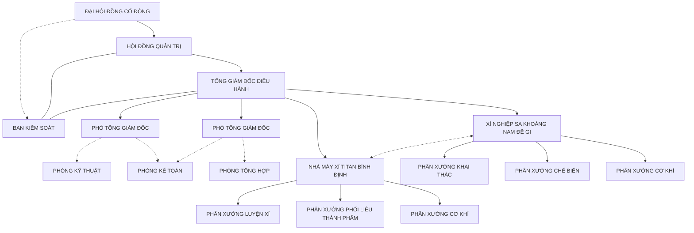

# CÔNG TY CỔ PHẦN KHOÁNG SẢN BÌNH ĐỊNH (BIMICO)
**MÃ CỔ PHIẾU: BMC**

---

# BÁO CÁO THƯỜNG NIÊN NĂM 2025

*Tháng 03 năm 2025*  
*(Ký số bởi: CÔNG TY CỔ PHẦN KHOÁNG SẢN BÌNH ĐỊNH - Ngày: 13/03/2026 14:47:00)*

---

**CTY CỔ PHẦN KHOÁNG SẢN BÌNH ĐỊNH**  
Số: 10 / BC-BMC  

**CỘNG HÒA XÃ HỘI CHỦ NGHĨA VIỆT NAM**  
**Độc lập - Tự do - Hạnh phúc**  
*Gia Lai, ngày 13 tháng 03 năm 2026*

**BÁO CÁO THƯỜNG NIÊN NĂM 2025**

**Kính gửi:**  
- Ủy ban chứng khoán Nhà nước  
- Sở Giao dịch chứng khoán Tp Hồ Chí Minh  

---

## I. THÔNG TIN CHUNG

### 1. Thông tin khái quát
- **Tên tiếng Anh:** Binh Dinh Minerals Joint Stock Company
- **Tên giao dịch:** BIMICO
- **Giấy chứng nhận đăng ký doanh nghiệp số:** 4100 390 008
- **Vốn điều lệ:** 123.926.300.000 đồng.
- **Vốn đầu tư của chủ sở hữu:** 123.926.300.000 đồng.
- **Địa chỉ:** 11 Hà Huy Tập, P.Quy Nhơn, tỉnh Gia Lai
- **Số điện thoại:** 0256-3822073-3820081
- **Website:** www.bimico.vn
- **Mã cổ phiếu:** BMC

#### Quá trình hình thành và phát triển
##### ❖ Lịch sử hình thành:
Công ty Cổ phần Khoáng sản Bình Định tiền thân là Công ty Khoáng sản Bình Định được thành lập năm 1985, là một trong những Công ty có uy tín và tiên phong trong lĩnh vực khai thác sa khoáng tại tỉnh Bình Định cũng như ở Việt Nam.

Trải qua hơn 30 năm phát triển, Công ty Cổ phần Khoáng sản Bình Định đã đứng vững và ngày càng khẳng định vị trí của mình trong cơ chế thị trường. Công ty đã được nhà nước tặng Huân chương lao động hạng 3 vào năm 1999.

Thực hiện chủ trương cổ phần hoá của Nhà nước, Công ty Cổ phần Khoáng sản Bình Định chuyển thành Công ty Cổ phần theo quyết định số 09/2001/QĐ-UB ngày 08 tháng 01 năm 2001 của Uỷ Ban Nhân Dân tỉnh Bình Định. Giấy chứng nhận đăng ký kinh doanh số 3503000009 ngày 08 tháng 01 năm 2001, thay đổi lần thứ 11 số 4100390008 ngày 17 tháng 7 năm 2024 do Sở Kế hoạch và Đầu tư tỉnh Bình Định cấp. Vốn điều lệ tại thời điểm chuyển sang Công ty Cổ phần là 13.114.000.000 đồng. Vốn điều lệ tính đến ngày 31/12/2024 là 123.926.300.000 đồng.

Thực hiện Quyết định của Thủ tướng Chính phủ, Công ty cổ phần Khoáng sản Bình Định đã xúc tiến các thủ tục cần thiết để phục vụ cho việc niêm yết cổ phiếu của Công ty trên thị trường chứng khoán tập trung. Ngày 28 tháng 12 năm 2006, cổ phiếu của Công ty đã chính thức giao dịch phiên đầu tiên tại Trung tâm giao dịch chứng khoán TP Hồ Chí Minh (nay là Sở Giao dịch Chứng khoán TP Hồ Chí Minh). Tính đến ngày 31/12/2024 tổng số cổ phiếu đã phát hành và lưu ký tại Trung tâm Lưu ký chứng khoán TP. HCM là 12.392.630 cổ phiếu.

##### ❖ Quá trình phát triển:
- Hiện nay Công ty đang khai thác, chế biến và kinh doanh sa khoáng Titan. Sản phẩm chính của Công ty là Ilmenite, nguyên liệu chính dùng để sản xuất bột màu Titan dioxit (TiO2) và kim loại Titan. Bên cạnh đó trong quá trình chế biến, Công ty còn thu được các loại sản phẩm khác như: Zircon, Rutile, Monazite, Magnetic - là các hợp chất dùng trong ngành công nghiệp gạch men, que hàn điện, chế tạo bột màu Titan dioxit (TiO2).
- Sản phẩm của Công ty sau khi được sản xuất ra đều đạt được chất lượng theo yêu cầu về chất lượng của khách hàng trong và ngoài nước. Quặng tinh Ilmenite có hàm lượng từ 48% - 51,5% TiO2, bột Zircon mịn có hàm lượng 65% ZrO2 min, Rutile có hàm lượng từ 87% - 92% TiO2, Monazite có hàm lượng REO > 57%, Xỉ titan các loại có hàm lượng từ 85% - 92% TiO2, gang hợp kim.
- Năm 2007, Công ty đã đầu tư hoàn chỉnh và đưa vào sử dụng dây chuyền nghiền mịn Zircon với vốn đầu tư khoảng 4 tỷ đồng. Đây là một dự án đầu tư nhằm nâng cao hơn nữa giá trị sản phẩm xuất khẩu, tăng hiệu quả sản xuất kinh doanh, cũng như thỏa mãn đầy đủ các tiêu chuẩn xuất khẩu do Nhà nước quy định.
- Ngày 16/9/2007 Công ty đã chính thức khởi công Dự án Nhà máy Xỉ titan Bình Định. Đây là dự án chế biến sâu Titan đầu tiên của cả nước. Tháng 1 năm 2009, Công ty đã hoàn thành việc đầu tư xây dựng và chính thức đưa vào hoạt động Nhà máy Xỉ titan Bình Định – giai đoạn 1 với công suất giai đoạn 1 là 9.500 tấn sản phẩm/năm. Tổng mức đầu tư giai đoạn 1 khoảng 44 tỷ đồng. Đây là một dự án đầu tư nhằm nâng cao đáng kể giá trị gia tăng của sản phẩm, tăng hiệu quả sản xuất kinh doanh, tiết kiệm tài nguyên, kéo dài tuổi thọ của mỏ, đồng thời phù hợp với quy hoạch của Nhà nước về thăm dò, khai thác, chế biến và sử dụng quặng titan giai đoạn 2007 – 2015, định hướng phát triển đến 2025. Nhà máy sản xuất ra các loại sản phẩm là Xỉ Titan có hàm lượng từ 85% đến 92% TiO2 và Gang hợp kim có hàm lượng Fe ≥ 98%, đáp ứng tiêu chuẩn xuất khẩu cho thị trường Châu Âu, Nhật Bản, Hàn Quốc và Trung Quốc.
- Năm 2011, thị trường tiêu thụ mặt hàng Xỉ titan có sự khởi sắc hơn so với trước. Mặt khác thuế suất thuế xuất khẩu đối với mặt hàng này cũng đã giảm từ 15% xuống 10%. Các yếu tố trên đã tạo điều kiện thuận lợi cho việc xuất khẩu mặt hàng Xỉ titan. Để đáp ứng nhu cầu ngày càng tăng lên của thị trường về mặt hàng này, Đại hội đồng cổ đông thường niên năm 2011 đã nhất trí thông qua việc tiếp tục đầu tư giai đoạn 2 của Dự án Nhà máy Xỉ titan Bình Định. Công suất của Dự án giai đoạn 2 tăng lên 2,5 lần so với công suất ban đầu của Dự án giai đoạn 2. Quý 3 năm 2012 Công ty đã hoàn thành việc đầu tư xây dựng và đưa vào vận hành dây chuyền luyện xỉ titan giai đoạn 2, làm tiền đề quan trọng cho việc nâng cao sản lượng sản phẩm chế biến sâu cho các năm sau. Trong quá trình đầu tư xây dựng, ngoài việc đầu tư cho hệ thống thiết bị phục vụ cho việc sản xuất sản phẩm, Công ty còn tiến hành đầu tư thêm hệ thống xử lý khói bụi cho dây chuyền thiết bị. Việc đầu tư này đã giải quyết triệt để vấn đề ô nhiễm môi trường. Tạo điều kiện thuận lợi cho Công ty sản xuất lâu dài, ổn định trên địa bàn.

### 2. Ngành nghề và địa bàn kinh doanh
- **Ngành nghề kinh doanh:** Khai thác, chế biến và mua bán khoáng sản từ quặng sa khoáng Titan. Các hoạt động hỗ trợ khai thác khoáng sản (trừ điều tra, thăm dò dầu khí). Kiểm tra, phân tích kỹ thuật các loại quặng khoáng sản. Mua bán các loại vật tư, máy móc, thiết bị phục vụ khai thác và chế biến các loại quặng khoáng sản.
- **Địa bàn kinh doanh:** Toàn bộ địa bàn hoạt động của Công ty hiện nay nằm trong phạm vi tỉnh Gia Lai. Bao gồm:
  + **Trụ sở chính của Công ty:** 11 Hà Huy Tập, Phường Quy Nhơn, Tỉnh Gia Lai.
  + **Các cơ sở sản xuất:** Công ty hiện có 02 cơ sở sản xuất:
    • **Xí nghiệp Sa khoáng Nam Đề Gi:** thuộc xã Cát Tiến, tỉnh Gia Lai. Sản phẩm của Xí nghiệp là các loại tinh quặng được chế biến từ quặng sa khoáng Titan nguyên khai. Bao gồm: Ilmenite, Zircon, Rutile, Monazite. Trong đó sản phẩm Ilmenite sản xuất ra một phần cung cấp cho Nhà máy Xỉ titan Bình Định, phần còn lại dùng để bán cho các đối tượng có nhu cầu.
    • **Nhà máy Xỉ titan Bình Định:** thuộc xã Xuân An, tỉnh Gia Lai. Nhà máy sử dụng nguyên liệu chính là tinh quặng Ilmenite (là sản phẩm của XN Sa khoáng Nam Đề Gi) để tiếp tục thực hiện công đoạn chế biến sâu. Sản phẩm của Nhà máy là Xỉ titan các loại và gang hợp kim.

### 3. Thông tin về mô hình quản trị, tổ chức kinh doanh và bộ máy quản lý
- **Sơ đồ bộ máy tổ chức quản lý của Công ty:**

*Chú thích:*
- `───>`: Quan hệ trực tuyến
- ` - - - >`: Quan hệ chức năng
- `────`: Quan hệ kiểm soát

### 4. Định hướng phát triển
- Lấy năng suất, chất lượng, hiệu quả và sự hài lòng của khách hàng làm thước đo cho sự phát triển bền vững.

#### a. Các mục tiêu chủ yếu của Công ty
- Ổn định hoạt động sản xuất – kinh doanh, tối ưu hóa nguồn lực trong bối cảnh khai thác mỏ đã dừng do Giấy phép khai thác Khoáng sản hết hạn, đảm bảo hiệu quả vận hành và duy trì nguồn thu.
- Hoàn tất thủ tục đóng cửa mỏ theo đúng quy định pháp luật, đồng thời đẩy mạnh các hồ sơ, thủ tục xin cấp phép mỏ titan mới nhằm đảm bảo nguồn nguyên liệu phục vụ sản xuất.
- Phát triển các sản phẩm chế biến sâu, nâng cao giá trị gia tăng, mở rộng thị trường tiêu thụ, giảm dần sự phụ thuộc vào khai thác quặng thô.
- Đầu tư đổi mới công nghệ, nâng cấp dây chuyền sản xuất, cải tiến quy trình nhằm nâng cao năng suất, tối ưu chi phí và đảm bảo chất lượng sản phẩm.
- Đảm bảo tuân thủ quy định pháp luật, thực hiện đầy đủ nghĩa vụ tài chính đối với Nhà nước, đồng thời nâng cao chế độ phúc lợi, đời sống cho người lao động và đảm bảo lợi ích của cổ đông.

#### b. Chiến lược phát triển trung và dài hạn
- **Ổn định và phát triển sản xuất:** Điều chỉnh mô hình hoạt động, tập trung khai thác thế mạnh trong lĩnh vực chế biến sâu, nâng cao khả năng cạnh tranh bằng việc tối ưu quy trình sản xuất và nâng cao chất lượng sản phẩm.
- **Đảm bảo nguồn nguyên liệu:**
  + Hoàn thiện các thủ tục xin cấp phép mỏ mới, đảm bảo nguồn cung cho sản xuất trong tương lai.
  + Tìm kiếm và đánh giá các nguồn nguyên liệu thay thế từ thị trường trong và ngoài nước nhằm chủ động hơn trong hoạt động sản xuất.
- **Đầu tư và ứng dụng công nghệ mới:**
  + Nâng cấp dây chuyền sản xuất, cải tiến công nghệ chế biến sâu để tối ưu hiệu suất và tiết kiệm chi phí.
  + Ứng dụng các giải pháp công nghệ thân thiện với môi trường, giảm thiểu tác động tiêu cực trong quá trình sản xuất.
- **Quản trị tài chính và kiểm soát rủi ro:**
  + Tăng cường kiểm soát chi phí sản xuất, tối ưu dòng tiền và đảm bảo cân đối tài chính trong bối cảnh thị trường biến động.
  + Chủ động thích ứng với các thay đổi về chính sách thuế, môi trường kinh doanh, xu hướng tiêu thụ sản phẩm trong nước và quốc tế.
- **Phát triển bền vững:**
  + Hoàn thành nghĩa vụ hoàn thổ và phục hồi môi trường sau khai thác theo quy định, đảm bảo phát triển hài hòa giữa lợi ích doanh nghiệp và trách nhiệm với xã hội.
  + Duy trì chính sách lao động ổn định, nâng cao phúc lợi, tạo điều kiện làm việc tốt nhất cho người lao động.

### 5. Các rủi ro có thể ảnh hưởng đến hoạt động SXKD hoặc đối với việc thực hiện các mục tiêu của Công ty
#### a. Rủi ro chính sách:
- Chính sách quản lý tài nguyên, môi trường ngày càng thắt chặt, ảnh hưởng đến quá trình xin cấp phép khai thác mới.
- Sự thay đổi về chính sách thuế, phí hoặc xuất khẩu quặng có thể tác động đến hiệu quả kinh doanh.

#### b. Rủi ro thị trường:
- Giá khoáng sản quốc tế biến động, nhu cầu tiêu thụ titan có thể bị ảnh hưởng bởi tình hình kinh tế toàn cầu.
- Áp lực cạnh tranh từ các doanh nghiệp trong và ngoài nước gia tăng, đòi hỏi Công ty phải liên tục cải tiến để duy trì lợi thế.

#### c. Rủi ro nguồn nguyên liệu:
- Việc dừng khai thác do Giấy phép khai thác hết hạn có thể gây thiếu hụt nguyên liệu nếu quá trình xin cấp phép mỏ mới kéo dài hoặc nguồn thay thế chưa ổn định.
- Nếu không có chiến lược chủ động nguồn cung, hoạt động sản xuất có nguy cơ bị gián đoạn.

#### d. Rủi ro kinh tế - tài chính:
- Biến động lãi suất, tỷ giá hối đoái và chi phí vận hành tăng có thể làm ảnh hưởng đến lợi nhuận của Công ty.
- Nền kinh tế trong nước và quốc tế có những biến động khó lường, ảnh hưởng đến nhu cầu tiêu thụ sản phẩm titan, đặc biệt từ các ngành hàng không, ô tô, sơn phủ, gốm sứ, bất động sản,...

#### e. Rủi ro môi trường và xã hội:
- Các quy định về bảo vệ môi trường ngày càng khắt khe, yêu cầu Công ty phải có kế hoạch dài hạn để đáp ứng.
- Áp lực từ cộng đồng địa phương về các vấn đề liên quan đến môi trường và trách nhiệm xã hội ngày càng lớn, đòi hỏi Công ty phải có chính sách hỗ trợ phù hợp.

#### f. Rủi ro bất khả kháng:
- Thiên tai, biến đổi khí hậu có thể ảnh hưởng đến hoạt động khai thác, vận chuyển và sản xuất.
- Xung đột địa chính trị, căng thẳng thương mại giữa các quốc gia có thể tác động đến chuỗi cung ứng nguyên liệu và thị trường tiêu thụ sản phẩm.

---

## II. TÌNH HÌNH HOẠT ĐỘNG TRONG NĂM

### 1. Tình hình hoạt động sản xuất kinh doanh

| Chi tiêu | ĐVT | KH 2025 | TH 2025 | TH2025 /KH 2025 | TH 2025 /TH 2024 |
| :--- | :---: | :---: | :---: | :---: | :---: |
| 1. Tổng doanh thu | Tr.đồng | 137.000 | 119.902 | 87,52% | 61,39% |
| 2. Kim ngạch nhập khẩu | Ng. USD | | | | |
| 3. Kim ngạch xuất khẩu | Ng. USD | 3.558 | 2.056 | 57,79% | 32,55% |
| 4. Lợi nhuận trước thuế | Tr.đồng | 18.750 | 14.407 | 76,84% | 44,86% |
| 5. Lợi nhuận sau thuế | Tr.đồng | 15.000 | 11.516 | 76,77% | 45,09% |
| 6. Đầu tư mới | Tr.đồng | 11.066 | 2.452 | 22,16% | 23,60% |
| 7. Nộp ngân sách | Tr.đồng | 18.445 | 12.586 | 68,24% | 37,35% |

Trong năm 2025, sản lượng tiêu thụ đạt 4.749 tấn sản phẩm các loại. Giá cả các loại sản phẩm về cơ bản không biến động nhiều so với năm trước. Các sản phẩm chế biến sâu về cơ bản cũng có sự cải thiện nhất định. Doanh thu 2025 đạt 87,52% so với kế hoạch năm 2025, giá trị kim ngạch xuất khẩu 2.055 triệu USD đạt 57,79% kế hoạch năm. Các chỉ tiêu lợi nhuận trước thuế và lợi nhuận sau thuế giảm lần lượt giảm chỉ đạt: 76,84 % và 76,77% so với kế hoạch năm 2025.

Nghị quyết Đại hội đồng cổ đông thường niên 2025 đã thông qua kế hoạch tỷ lệ trả cổ tức năm 2024 là 13%. Tháng 05/2024, Công ty đã thực hiện chi trả cổ tức năm 2024 là 13% cho cổ đông theo Nghị quyết Đại hội đồng cổ đông thường niên 2025.

### 2. Tổ chức và nhân sự:
#### a. Ban điều hành:
##### a.1 Danh sách:
Ban điều hành của Công ty hiện nay gồm có:
- Ông: Trần Hồ Toại Nguyện : Tổng giám đốc
- Ông: Trần Cảnh Thịnh : Phó Tổng giám đốc
- Ông: Huỳnh Ngọc Bích : Kế toán trưởng.

##### a.2 Tóm tắt lý lịch của các cá nhân trong Ban điều hành:

**Ông TRẦN HỒ TOẠI NGUYỆN**
- Ngày sinh: 24/06/1983.
- Nơi sinh: Thôn Trung Chánh, xã Đề Gi, Tỉnh Gia Lai.
- Quốc tịch: Việt Nam
- Dân tộc: Kinh
- Quê quán: Thôn Trung Chánh, xã Đề Gi, Tỉnh Gia Lai.
- Địa chỉ thường trú: Tổ 50, KV 6, P. Quy Nhơn Nam, tỉnh Gia Lai
- ĐT liên lạc ở cơ quan:
- Trình độ văn hóa: 12/12
- Trình độ chuyên môn: Cử nhân Quản trị kinh doanh.
- Quá trình công tác:
  • 10/2003 – 10/2006: Tổ phó tổ SX - Công ty cổ phần Khoáng sản Bình Định.  
  • 11/2006 – 10/2016: Nhân viên P. Tổng hợp - Công ty cổ phần Khoáng sản Bình Định.  
  • 11/2016 – 05/2022: Phó phòng P. Tổng hợp - Công ty cổ phần Khoáng sản Bình Định.  
  • 06/2022 – 07/2022: Phó Tổng Giám đốc - Công ty Cổ phần Khoáng sản Bình Định.  
  • 08/2022 – 09/2023: Thành viên Hội đồng quản trị, Phó Tổng Giám đốc Công ty Cổ phần Khoáng sản Bình Định.  
  • 10/2023 đến nay: Thành viên Hội đồng quản trị, Tổng Giám đốc Công ty Cổ phần Khoáng sản Bình Định.
- Số cổ phần nắm giữ: 0 cổ phần.
  Trong đó:
  + Sở hữu cá nhân: 0 cổ phần.
  + Đại diện sở hữu: 0 cổ phần.
- Hành vi vi phạm pháp luật: Không có
- Quyền lợi mâu thuẫn với Công ty: Không có.

**Ông TRẦN CẢNH THỊNH**
- Ngày sinh: 20/03/1965
- Nơi sinh: Xã Phù Mỹ, tỉnh Gia Lai
- Quốc tịch: Việt Nam
- Dân tộc: Kinh
- Quê quán: Xã Phù Mỹ, tỉnh Gia Lai
- Địa chỉ thường trú: KV 12, Phường Quy Nhơn Nam, Tỉnh Gia Lai
- ĐT liên lạc ở cơ quan: 0256.3822039
- Trình độ văn hóa: 12/12
- Trình độ chuyên môn: Cử nhân Luật
- Quá trình công tác:
  • 09/1986 - 08/1994: Công tác tại Ban Quản lý Công trình Thuỷ điện Vĩnh Sơn  
  • 09/1994 - 04/2001: Công tác tại Cảng Thị Nại Bình Định.  
  • 05/2001 - 03/2002: Công tác tại Trung tâm đào tạo nghiệp vụ giao thông vận tải Bình Định.  
  • 04/2002 - 03/2007: Trưởng phòng Tổng hợp Cty cổ phần Khoáng sản Bình Định.  
  • 04/2007 – 02/2012: Thành viên Hội đồng quản trị, Trưởng phòng Tổng hợp Công ty cổ phần Khoáng sản Bình Định.  
  • 03/2012 – 05/2022: Thành viên Hội đồng quản trị, Phó Tổng giám đốc Công ty cổ phần Khoáng sản Bình Định.  
  • 06/2022 – đến nay: Thành viên Hội đồng quản trị, Phó Tổng giám đốc Công ty cổ phần Khoáng sản Bình Định, người phụ trách quản trị Công ty.
- Chức vụ công tác hiện nay: Thành viên Hội đồng quản trị, Phó Tổng giám đốc Công ty cổ phần Khoáng sản Bình Định, Người phụ trách quản trị Công ty.
- Chức vụ hiện đang nắm giữ ở các tổ chức khác: Không.
- Số cổ phần nắm giữ: 0 cổ phần.
  Trong đó:
  + Sở hữu cá nhân: 0 cổ phần.
  + Đại diện sở hữu: 0 cổ phần.
- Hành vi vi phạm pháp luật: Không có
- Quyền lợi mâu thuẫn với Công ty: Không có

**Ông HUỲNH NGỌC BÍCH**
- Ngày sinh: 15/06/1965
- Nơi sinh: Phường Tam Quan, tỉnh Bình Định
- Quốc tịch: Việt Nam
- Dân tộc: Kinh
- Quê quán: Phường Tam Quan, Tỉnh Gia Lai
- Địa chỉ thường trú: 363 Nguyễn Thị Minh Khai, P.Quy Nhơn Nam, Tỉnh Gia Lai
- Điện thoại liên lạc: 0989 072 940
- Trình độ văn hóa: 12/12
- Trình độ chuyên môn: Đại học Tài chính kế toán
- Quá trình công tác:
  • 07/1987 - 07/1995: Kế toán Công ty vật tư Bình Định  
  • 08/1995 - 04/2000: Kế toán tổng hợp Công ty Khoáng sản Bình Định.  
  • 05/2000 - 01/2008: Thành viên Ban kiểm soát, Kế toán tổng hợp Công ty CP Khoáng sản Bình Định.  
  • 01/2008 - 10/2012: Kế toán tổng hợp Công ty CP Khoáng sản Bình Định.  
  • 11/2012 - 03/2017: Kế toán trưởng Công ty CP Khoáng sản Bình Định.  
  • 04/2017 – đến nay: Thành viên HĐQT, Kế toán trưởng Công ty CP Khoáng sản Bình Định.
- Chức vụ công tác hiện nay: Thành viên HĐQT, Kế toán trưởng Công ty cổ phần Khoáng sản Bình Định.
- Chức vụ hiện đang nắm giữ ở các tổ chức khác: Không.
- Số cổ phần nắm giữ: 34.372 cổ phần.
  Trong đó:
  + Sở hữu cá nhân: 34.372 cổ phần.
  + Đại diện sở hữu: 0 cổ phần.
- Hành vi vi phạm pháp luật: Không có

#### b. Các thay đổi trong Ban điều hành năm 2025:
- Không có.

#### c. Người lao động tại Công ty:
##### c.1. Số lượng:
Tổng số lao động của Công ty tại thời điểm 31/12/2025 là 195 người, trong đó có 35 người có trình độ trên đại học, đại học và cao đẳng.

##### c.2 Chính sách đối với người lao động:
❖ **Chế độ làm việc.**
- **Thời gian làm việc:** Công ty đang thực hiện chế độ làm việc 40 giờ/tuần, các nhân viên tại văn phòng làm việc theo giờ hành chính, và tại các nhà xưởng của Công ty được tổ chức làm việc theo ca với mật độ 2 - 3 ca/ngày. Khi có yêu cầu về tiến độ công việc thì người lao động có trách nhiệm làm thêm giờ và Công ty có những quy định đảm bảo quyền lợi cho người lao động theo quy định của nhà nước và đãi ngộ thoả đáng cho người lao động.
- **Nghỉ phép, nghỉ lễ, tết:** Thực hiện theo Luật lao động, nhân viên Công ty làm việc với thời gian 12 tháng được nghỉ phép 12 ngày và thời gian không làm việc đủ 12 tháng được tính theo tỷ lệ thời gian làm việc. Ngoài ra cứ 05 năm làm việc tại Công ty nhân viên được cộng thêm 01 ngày phép trong năm.
- Nhân viên được nghỉ lễ, tết 09 ngày theo quy định của bộ Luật lao động.
- **Nghỉ ốm, thai sản:** Nhân viên Công ty được nghỉ ốm 03 ngày (không liên tục) trong năm và được hưởng nguyên lương. Trong thời gian nghỉ thai sản, ngoài thời gian nghỉ 04 tháng với chế độ bảo hiểm theo đúng quy định, còn được hưởng thêm 04 tháng lương cơ bản do Bảo hiểm xã hội chi trả.
- **Các chế độ, phúc lợi:** Công ty thực hiện đầy đủ các chế độ bảo hiểm xã hội cho người lao động theo Luật lao động.
  • Nộp BHXH, BHYT, BHTN cho 100% CBCNV.  
  • Trang bị phương tiện lao động cho 100% CBCNV.  
  • Bồi dưỡng độc hại theo chế độ hiện hành.  
  • Lao động trực tiếp sản xuất được cấp trang phục bảo hộ lao động.  
  • Tiền ăn giữa ca.  
  • Mua bảo hiểm kết hợp tai nạn – sinh mạng – nằm viện, phẫu thuật cho toàn bộ người lao động tại Công ty.  
- Ngoài ra, công tác an toàn lao động được cấp lãnh đạo Công ty quan tâm hàng đầu, quán triệt cho CBCNV nắm vững an toàn kỹ thuật và hiểu rõ tầm quan trọng của công tác an toàn lao động. Hoạt động của tổ chức Đảng, Công đoàn và Đoàn thanh niên đều được tạo điều kiện thuận lợi.

❖ **Chính sách tuyển dụng, đào tạo.**
- **Tuyển dụng:** mục tiêu tuyển dụng của Công ty là thu hút người lao động có trình độ, năng lực và kinh nghiệm, đáp ứng được yêu cầu công việc. Công ty thường xuyên quan tâm tuyển dụng sắp xếp, bố trí và kiện toàn đội ngũ cán bộ phù hợp với năng lực, trình độ chuyên môn đáp ứng với yêu cầu, nhiệm vụ sản xuất.
- **Đào tạo:** Công ty chú trọng việc đẩy mạnh các hoạt động đào tạo, bồi dưỡng, đặc biệt là trình độ chuyên môn nghiệp vụ. Công ty kết hợp chặt chẽ đến vấn đề đào tạo, phát triển nhân viên, luôn tạo điều kiện cho nhân viên tham gia các khoá tập huấn để nâng cao trình độ nghiệp vụ.

### 3. Tình hình đầu tư, tình hình thực hiện các dự án
- Kế hoạch đầu tư XDCB năm 2025 là 11.066 triệu đồng. Giá trị đầu tư XDCB và mua sắm thiết bị thực tế trong năm là 2.452 triệu đồng, đạt 22,2% kế hoạch năm, chủ yếu là đầu tư cho việc mua sắm máy móc thiết bị và xây dựng; sửa chữa nhà xưởng phục vụ sản xuất của Công ty.

### 4. Tình hình tài chính:
#### a. Tình hình tài chính:
*(ĐVT: triệu đồng)*

| Chỉ tiêu | Năm 2024 | Năm 2025 | % tăng giảm |
| :--- | :---: | :---: | :---: |
| Tổng giá trị tài sản | 257.035 | 242.075 | -5,82% |
| Doanh thu thuần | 195.320 | 119.903 | -38,61% |
| Lợi nhuận từ hoạt động kinh doanh | 32.116 | 14.406 | -55,14% |
| Lợi nhuận khác | 1 | 1 | 0% |
| Lợi nhuận trước thuế | 32.117 | 14.407 | -55,14% |
| Lợi nhuận sau thuế | 25.541 | 11.517 | -54,91% |
| Tỷ lệ lợi nhuận trả cổ tức | 63,08% | 69,94% | 10,88% |

#### b. Các chỉ tiêu tài chính chủ yếu
| Các chỉ tiêu | Năm 2024 | Năm 2025 *(bản gốc in nhầm tiêu đề là Năm 2024)* |
| :--- | :---: | :---: |
| **Chỉ tiêu về khả năng thanh toán** | | |
| Hệ số thanh toán ngắn hạn: Tài sản ngắn hạn/Nợ ngắn hạn | 1.042,41% | 1.411,56% |
| Hệ số thanh toán nhanh: (Tài sản ngắn hạn - Hàng tồn kho)/Nợ ngắn hạn | 561,80% | 601,71% |
| **Chỉ tiêu về cơ cấu vốn** | | |
| Hệ số Nợ/Tổng tài sản | 7,88% | 5,85% |
| Hệ số Nợ/Vốn chủ sở hữu | 8,55% | 6,22% |
| **Chỉ tiêu về năng lực hoạt động** | | |
| Vòng quay hàng tồn kho: Giá vốn hàng bán/Hàng tồn kho bình quân | 162,27% | 88,02% |
| Doanh thu thuần/Tổng tài sản bình quân | 76,93% | 48,05% |
| **Chỉ tiêu về khả năng sinh lời** | | |
| Hệ số Lợi nhuận sau thuế/Doanh thu thuần | 13,08% | 9,61% |
| Hệ số Lợi nhuận sau thuế/Vốn chủ sở hữu | 10,79% | 5,05% |
| Hệ số Lợi nhuận sau thuế/Tổng tài sản | 9,94% | 4,76% |
| Hệ số Lợi nhuận từ hoạt động kinh doanh/Doanh thu thuần | 16,44% | 12,02% |

### 5. Cơ cấu cổ đông, thay đổi vốn đầu tư của chủ sở hữu:
#### a. Cổ phần:
- Tổng số cổ phần: 12.392.630
- Trong đó: cổ phần phổ thông: 12.392.630
- Số lượng cổ phần đang lưu hành: 12.392.630
- Số lượng cổ phần chuyển nhượng tự do: 12.392.630
- Số lượng cổ phần hạn chế chuyển nhượng: 0

#### b. Cơ cấu cổ đông theo tỷ lệ sở hữu: *(tại ngày 17/09/2025)*

| STT | Đối tượng sở hữu vốn | Tổng cộng | Cổ đông Nhà nước | Cổ đông lớn sở hữu từ 5% trở lên | Cổ đông sở hữu từ 1 đến dưới 5% | Cổ đông sở hữu dưới 1 % |
| :---: | :--- | :---: | :---: | :---: | :---: | :---: |
| **I** | **TRONG NƯỚC** | | | | | |
| | - Số lượng CP | 11.841.073 | 3.098.084 | 1.851.100 | 1.008.500 | 5.883.389 |
| | - Tỷ lệ (%) | 95,55% | 24,99% | 14,94% | 8,14% | 47,47% |
| | *Trong đó:* | | | | | |
| 1 | Tổ chức | | | | | |
| | - Số lượng CP | 5.008.531 | 3.098.084 | 1.851.100 | | 59.347 |
| | - Tỷ lệ (%) | 40,42% | 24,99% | 14,94% | | 0,48% |
| 2 | Cá nhân | | | | | |
| | - Số lượng CP | 6.832.542 | | | 1.008.500 | 5.824.042 |
| | - Tỷ lệ (%) | 55,13% | 0,00% | 0,00% | 8,14% | 47,00% |
| **II** | **NƯỚC NGOÀI** | | | | | |
| | - Số lượng CP | 551.557 | 0 | 0 | 255.784 | 295.773 |
| | - Tỷ lệ (%) | 4,45% | 0,00% | 0,00% | 2,06% | 2,39% |
| | *Trong đó:* | | | | | |
| 1 | Tổ chức | | | | | |
| | - Số lượng CP | 352.049 | | | 255.784 | 96.265 |
| | - Tỷ lệ (%) | 2,84% | 0,00% | 0,00% | 2,06% | 0,78% |
| 2 | Cá nhân | | | | | |
| | - Số lượng CP | 199.508 | | | | 199.508 |
| | - Tỷ lệ (%) | 1,61% | 0,00% | 0,00% | 0,00% | 1,61% |
| **III**| **TỔNG CỘNG** | | | | | |
| | - Số lượng CP | 12.392.630 | 3.098.084 | 1.851.100 | 1.264.284 | 6.179.162 |
| | - Tỷ lệ (%) | 100,00% | 24,99% | 14,94% | 10,20% | 48,86% |
| | *Trong đó:* | | | | | |
| 1 | Tổ chức | | | | | |
| | - Số lượng CP | 5.360.580 | 3.098.084 | 1.851.100 | 255.784 | 155.612 |
| | - Tỷ lệ (%) | 43,26% | 24,99% | 14,94% | 2,06% | 1,26% |
| 2 | Cá nhân | | | | | |
| | - Số lượng CP | 7.032.050 | 0 | 0 | 1.008.500 | 6.023.550 |
| | - Tỷ lệ (%) | 56,74% | 0,00% | 0,00% | 8,14% | 48,61% |

#### c. Tình hình thay đổi vốn đầu tư của chủ sở hữu:

| Tháng, năm | Hình thức tăng vốn | Tỷ lệ phát hành | Vốn ĐL trước phát hành | Vốn ĐL sau phát hành |
| :---: | :--- | :---: | :---: | :---: |
| 05/2007 | Phát hành cổ phiếu thưởng | 1:2 | 13.114.000.000 | 39.342.000.000 |
| 02/2008 | Bán thêm cổ phiếu cho cổ đông hiện hữu | | 39.342.000.000 | 82.618.200.000 |
| 04/2012 | Phát hành cổ phiếu thưởng | 2:1 | 82.618.200.000 | 123.926.300.000 |

#### d. Giao dịch cổ phiếu quỹ:
Công ty không có cổ phiếu quỹ.

#### e. Các chứng khoán khác:
Không có.

### 6. Báo cáo tác động liên quan đến môi trường và xã hội của công ty
#### 6.1. Tác động lên môi trường
##### a. Tổng phát thải khí nhà kính (GHG) trực tiếp và gián tiếp
Trong quá trình sản xuất, sự hoạt động của các hệ thống máy móc và thiết bị sẽ phát thải một lượng khí nhà kính nhất định. Trong các sản phẩm Công ty sản xuất có sản phẩm xỉ titan, sản phẩm này được sản xuất từ các lò luyện chuyên dụng, sự hoạt động của các lò này làm phát thải một lượng khí nhà kính nhất định. Mặt khác các lò luyện này tiêu thụ một lượng điện năng đáng kể, là một yếu tố làm phát thải gián tiếp khí nhà kính.

Trong quá trình hoạt động, công ty cũng sử dụng một số thiết bị như xe máy, máy sấy quặng v.v. Các loại thiết bị này trong quá trình hoạt động cũng sinh ra một lượng khí nhà kính nhất định.

Sản phẩm sản xuất ra cần được đưa đi tiêu thụ. Thị trường tiêu thụ có thể trong nước hoặc nước ngoài. Việc thuê phương tiện vận chuyển để phục vụ việc bán hàng cũng gián tiếp làm phát sinh một lượng khí nhà kính thải vào môi trường.

##### b. Các sáng kiến và biện pháp giảm thiểu phát thải khí nhà kính
Trong quá trình sản xuất, việc sử dụng các loại nhiên liệu, chất khử ... tất yếu sẽ dẫn đến phát thải khí nhà kính vào môi trường. Tuy vậy, công ty cũng cố gắng thực hiện các biện pháp có thể nhằm giảm thiểu phát thải khí nhà kính vào môi trường.
- Tích cực áp dụng các cải tiến kỹ thuật trong sản xuất nhằm giảm mức độ tiêu hao năng lượng, điện năng, nguyên nhiên liệu trên một đơn vị sản phẩm nhằm giảm mức độ phát thải khí nhà kính vào môi trường.
- Sử dụng năng lượng tái tạo để thay thế một phần nhiên liệu hóa thạch.
- Trồng cây xanh để lọc bụi và cải thiện vi khí hậu khu vực.

#### 6.2. Quản lý nguồn nguyên vật liệu:
Tổng lượng nguyên vật liệu chính được sử dụng để sản xuất trong năm:
- **Xí nghiệp sa khoáng Nam Đề Gi:**
  + Dầu diezen: 18 ngàn lít
  + Củi khô: 744,5 tấn
- **Nhà máy Xỉ Titan Bình Định:**
  + Dầu diezen: 41,1 ngàn lít
  + Than các loại: 286,7 tấn

#### 6.3. Tiêu thụ năng lượng:
Năng lượng tiêu thụ trực tiếp và gián tiếp:
- **Xí nghiệp sa khoáng Nam Đề Gi:** 0,547 triệu kWh
  + Khai thác quặng: 0, triệu kWh
  + Chế biến tinh: 0,547 triệu kWh
- **Nhà máy Xỉ Titan Bình Định:** 9,133 triệu kWh
  + Lò luyện: 7,416 triệu kWh
  + Các phân xưởng khác: 1,717 triệu kWh

#### 6.4. Tiêu thụ nước: *(mức tiêu thụ nước của các hoạt động kinh doanh trong năm)*
##### a) Nguồn cung cấp nước và lượng nước sử dụng:
- **Xí nghiệp sa khoáng Nam Đề Gi:**
  + Nguồn cung cấp nước: khai thác tại chỗ
  + Lượng nước sử dụng ≈ 20m³/ngày (chủ yếu dùng cho sinh hoạt)
- **Nhà máy Xỉ Titan Bình Định:**
  + Nguồn cung cấp nước: mua của cụm công nghiệp
  + Lượng nước sử dụng: 30 m³/ngày.
  + Lượng nước thải: 28 m³/ngày, phần còn lại bốc hơi

##### b) Tỷ lệ phần trăm và tổng lượng nước tái chế và tái sử dụng:
- Tỷ lệ nước tái sử dụng khoảng: 90 %

#### 6.5. Tuân thủ pháp luật về bảo vệ môi trường:
- **a)** Số lần bị xử phạt vi phạm do không tuân thủ luật pháp và các quy định về môi trường: không
- **b)** Tổng số tiền do bị xử phạt vi phạm do không tuân thủ luật pháp và các quy định về môi trường: Không có,

#### 6.6. Chính sách liên quan đến người lao động:
##### a) Số lượng lao động, thu nhập trung bình đối với người lao động:
Tại 31/12/2025 Công ty có 197 lao động, thu nhập bình quân người lao động trong năm 2025 là 12,8 triệu đồng/người/tháng.

##### b) Chính sách lao động nhằm đảm bảo sức khỏe, an toàn và phúc lợi của người lao động:
- **Thời gian làm việc:** Công ty đang thực hiện chế độ làm việc 40 giờ/tuần, các nhân viên tại văn phòng làm việc theo giờ hành chính, và tại các nhà xưởng của Công ty được tổ chức làm việc theo ca với mật độ 2 - 3 ca/ngày. Khi có yêu cầu về tiến độ công việc thì người lao động có trách nhiệm làm thêm giờ và Công ty có những quy định đảm bảo quyền lợi cho người lao động theo quy định của nhà nước và đãi ngộ thoả đáng cho người lao động.
- **Nghỉ phép, nghỉ lễ, tết:** Thực hiện theo Luật lao động, nhân viên Công ty làm việc với thời gian 12 tháng được nghỉ phép 12 ngày và thời gian không làm việc đủ 12 tháng được tính theo tỷ lệ thời gian làm việc. Ngoài ra cứ 05 năm làm việc tại Công ty nhân viên được cộng thêm 01 ngày phép trong năm.
- Nhân viên được nghỉ lễ, tết 09 ngày theo quy định của bộ Luật lao động.
- **Nghỉ ốm, thai sản:** Nhân viên Công ty được nghỉ ốm 03 ngày (không liên tục) trong năm và được hưởng nguyên lương. Trong thời gian nghỉ thai sản, ngoài thời gian nghỉ 04 tháng với chế độ bảo hiểm theo đúng quy định, còn được hưởng thêm 04 tháng lương cơ bản do Bảo hiểm xã hội chi trả.
- **Các chế độ, phúc lợi:** Công ty thực hiện đầy đủ các chế độ bảo đảm xã hội cho người lao động theo Luật lao động.
  • Nộp BHXH, BHYT, BHTN cho 100% CBCNV.  
  • Trang bị phương tiện lao động cho 100% CBCNV.  
  • Bồi dưỡng độc hại theo chế độ hiện hành.  
  • Lao động trực tiếp sản xuất được cấp trang phục bảo hộ lao động.  
  • Tiền ăn giữa ca.  
  • Mua bảo hiểm kết hợp tai nạn – sinh mạng – nằm viện, phẫu thuật cho toàn bộ người lao động tại Công ty.  
- Về công tác an toàn lao động lãnh đạo Công ty thường xuyên quán triệt cho CBCNV nắm vững an toàn kỹ thuật và hiểu rõ tầm quan trọng của công tác an toàn lao động.

##### c) Hoạt động đào tạo người lao động:
- **Tuyển dụng:** mục tiêu tuyển dụng của Công ty là thu hút người lao động có trình độ, năng lực và kinh nghiệm, đáp ứng được yêu cầu công việc. Công ty thường xuyên quan tâm tuyển dụng sắp xếp, bố trí và kiện toàn đội ngũ cán bộ phù hợp với năng lực, trình độ chuyên môn đáp ứng với yêu cầu, nhiệm vụ sản xuất.
- **Đào tạo:** Công ty chú trọng việc đẩy mạnh các hoạt động đào tạo, bồi dưỡng, đặc biệt là trình độ chuyên môn nghiệp vụ. Công ty kết hợp chặt chẽ đến vấn đề đào tạo, phát triển nhân viên, luôn tạo điều kiện cho nhân viên tham gia các khoá tập huấn để nâng cao trình độ nghiệp vụ.

#### 6.7. Báo cáo liên quan đến trách nhiệm đối với cộng đồng địa phương:
Công ty luôn quan tâm đến việc hỗ trợ nhân dân tại nơi có tài nguyên Công ty đang khai thác hoặc địa bàn mà Công ty đứng chân phù hợp với khả năng tài chính và kết quả kinh doanh của Công ty theo các phương thức thích hợp nhằm thực hiện có hiệu quả việc từng bước góp phần cải thiện đời sống nhân dân tại địa phương, tạo sự đồng thuận cao giữa doanh nghiệp và địa phương cũng như môi trường thuận lợi cho sản xuất kinh doanh của Công ty. Mức hỗ trợ bình quân hàng năm khoảng 1,5% lợi nhuận sau thuế.

---

## III. BÁO CÁO VÀ ĐÁNH GIÁ CỦA BAN TỔNG GIÁM ĐỐC

### 1. Đánh giá kết quả hoạt động sản xuất kinh doanh
#### a. Tình hình thực hiện kế hoạch 2025:

| Chỉ tiêu | ĐVT | KH 2025 | TH 2025 | TH 2025 /KH 2025 | TH 2025 /TH 2024 |
| :--- | :---: | :---: | :---: | :---: | :---: |
| 1. Tổng doanh thu | Tr.đồng | 137.000 | 119.902 | 87,52% | 61,39% |
| 2. Kim ngạch nhập khẩu | Ng. USD | 0 | 0 | 0 | 0 |
| 3. Kim ngạch xuất khẩu | Ng. USD | 3.558 | 2.056 | 57,79% | 32,55% |
| 4. Lợi nhuận trước thuế | Tr.đồng | 18.750 | 14.407 | 76,84% | 44,86% |
| 5. Lợi nhuận sau thuế | Tr.đồng | 15.000 | 11.516 | 76,77% | 45,09% |
| 6. Đầu tư mới | Tr.đồng | 11.066 | 2.452 | 22,16% | 23,60% |
| 7. Nộp ngân sách | Tr.đồng | 18.445 | 12.586 | 68,24% | 37,35% |

#### b. Đánh giá kết quả SXKD:
Năm 2025, hoạt động sản xuất của Công ty giảm hơn so với năm trước, số lượng sản xuất tại các nhà máy và xí nghiệp nhìn chung thực hiện đạt 53,4% kế hoạch sản lượng sản xuất mà Công ty đã đề ra từ đầu năm. Chất lượng sản phẩm về cơ bản là thỏa mãn yêu cầu của thị trường và khách hàng, làm tiền đề thuận lợi cho việc bán hàng cũng như phát triển khách hàng mới.

Về hoạt động kinh doanh, nhìn chung tình hình kinh tế và thị trường titan thế giới vẫn chưa phục hồi, hoạt động kinh doanh của Công ty vì thế cũng bị ảnh hưởng vì vấn đề này. Nhu cầu của thị trường đối với một số sản phẩm là tương đối ổn định, bên cạnh đó cũng có một số ít sản phẩm nhu cầu thị trường giảm sút, có làm ảnh hưởng đến doanh thu và kết quả kinh doanh của Công ty.

Về cơ bản, Công ty chưa hoàn thành các chỉ tiêu kế hoạch chủ yếu của năm 2025. Lợi nhuận trước thuế đạt 14,407 tỷ, đạt 76,78% và lợi nhuận sau thuế đạt 11,516 tỷ, đạt 76,8% so với kế hoạch năm 2025.

**Thuận lợi, khó khăn:**
- **Vấn đề thị trường:**
  Nhìn chung thị trường thế giới các mặt hàng khoáng sản titan năm 2025 chịu nhiều tác động có ảnh hưởng khác nhau, trong đó có tác động tiêu cực của chiến tranh ở châu Âu, giá cả các loại sản phẩm titan do đó cũng có diễn biến phức tạp.
  + Đối với các sản phẩm tinh quặng titan: Giá bán các loại sản phẩm tinh quặng có mức tăng không đáng kể.
  + Đối với các sản phẩm chế biến sâu: Giá sản phẩm chế biến sâu vẫn chưa cải thiện so với năm trước một số sản phẩm còn có xu hướng giảm.
  + Đối với sản phẩm gang, về cơ bản trong năm giá cả đối với sản phẩm này là tương đối ổn định, về cơ bản không có biến động nhiều.
- **Vấn đề về khó khăn khác:**
  Trong năm 2025, Công ty cũng gặp một số khó khăn nhất định liên quan đến việc xin gia hạn giấy phép mỏ khai thác chưa xong, sử dụng nhiều nguyên liệu mua ngoài để chế biến cũng ảnh hưởng không nhỏ đến kết quả kinh doanh chung.

#### c. Những tiến bộ đạt được:
Trong điều kiện có nhiều khó khăn, Công ty đã có nhiều cố gắng và đạt được những tiến bộ nhất định:
- **Trong khâu khai thác:** Công ty đã thực hiện đầu tư các trang thiết bị cần thiết để bảo đảm khai thác triệt để tài nguyên, tiết kiệm chi phí khai thác, kéo dài tuổi thọ của mỏ.
- **Trong khâu chế biến:** Nhờ đầu tư máy móc thiết bị, Công ty đã tăng tỷ lệ thu hồi sản phẩm trong quá trình chế biến sản phẩm. Đối với sản phẩm chế biến sâu về cơ bản đội ngũ cán bộ kỹ thuật Công ty đã làm chủ được dây chuyền luyện xỉ, thỏa mãn đầy đủ các yêu cầu về chất lượng sản phẩm cho các đối tượng khách hàng khác nhau. Công ty cũng có những biện pháp tích cực nhằm giảm thiểu lượng điện tiêu thụ trên đơn vị sản phẩm, góp phần giảm chi phí, hạ giá thành.
- **Về vấn đề môi trường:** Công ty đã thực hiện tốt việc hoàn thổ, trồng cây phục hồi môi trường sau khai thác. Năm 2025 Công ty được tiếp tục đánh giá là doanh nghiệp thực hiện tốt việc trồng cây phục hồi môi trường trên vùng mỏ sau khi khai thác xong.

### 2. Tình hình tài chính

| STT | CHỈ TIÊU | Năm 2024 | Năm 2025 |
| :---: | :--- | :---: | :---: |
| | **Cơ cấu tài sản** | | |
| 1 | - Tài sản dài hạn/Tổng tài sản | 17,89% | 17,37% |
| | - Tài sản ngắn hạn/Tổng tài sản | 82,11% | 82,63% |
| | **Cơ cấu nguồn vốn** | | |
| 2 | - Nợ phải trả/Tổng nguồn vốn | 7,88% | 5,85% |
| | - Nguồn vốn chủ sở hữu/Tổng nguồn vốn | 92,12% | 94,15% |
| | **Khả năng thanh toán** | | |
| 3 | - Khả năng thanh toán nhanh | 224,02% | 246,95% |
| | - Khả năng thanh toán hiện hành | 1042,41% | 1411,56% |
| | **Tỷ suất lợi nhuận** | | |
| 4 | - Tỷ suất lợi nhuận trước thuế/Tổng tài sản | 12,50% | 5,95% |
| | - Tỷ suất lợi nhuận sau thuế/Doanh thu thuần | 13,08% | 9,61% |
| | - Tỷ suất lợi nhuận sau thuế/Nguồn vốn chủ sở hữu | 10,79% | 5,05% |

#### a. Tình hình tài sản
Tình hình tài sản của Công ty so với năm 2024 có một số biến động nhất định. Tài sản ngắn hạn năm 2025 giảm 5,2% so với 2024, trong đó giá trị tiền, các khoản tương đương tiền và các khoản đầu tư tài chính ngắn hạn cuối năm giảm, trong khi đó giá trị hàng tồn kho tăng 17,3%. Tài sản dài hạn giảm 8,5% chủ yếu là khấu hao tài sản cố định trong năm.

Về tỷ suất lợi nhuận: Các chỉ tiêu về tỷ suất lợi nhuận trên tổng tài sản, tỷ suất lợi nhuận trên doanh thu và trên nguồn vốn chủ sở hữu đều giảm so với năm 2024. Điều này là do trong năm 2025 nhìn chung chưa phục hồi về số lượng và giá cả đều giảm so với năm 2024. Trong năm 2025 doanh thu bằng 87,5% so với năm 2024, lợi nhuận trước thuế và lợi nhuận sau thuế tăng lần lượt bằng 76,8% và 76,8% do giảm doanh thu làm kết quả kinh doanh giảm theo..

- Các khoản nợ phải thu nhìn chung là bình thường. Tính đến thời điểm 31/12/2025, Công ty không có bất cứ khoản nợ xấu cũng như khoản nợ khó đòi nào trên số dư nợ phải thu của Công ty.

#### b. Tình hình nợ phải trả:
Nợ phải trả năm 2025 giảm so với năm 2024 (30%) tương ứng với giá trị khoảng gần 6.077 triệu đồng. Nhìn chung tình hình nợ phải trả (nợ ngắn hạn và nợ dài hạn) là bình thường.

#### c. Ảnh hưởng của chênh lệch tỷ giá hối đoái:
Trong năm 2025, tỷ giá USD biến động không lớn. Mức độ ảnh hưởng của chênh lệch tỷ giá hối đoái đến doanh thu hoạt động tài chính của Công ty là không nhiều.

### 3. Những cải tiến về cơ cấu tổ chức, chính sách, quản lý
Qua nhiều năm hoạt động sản xuất kinh doanh, Công ty ngày càng phát triển lớn mạnh, quy mô của của Công ty phát triển trên nhiều mặt. Vốn Điều lệ tăng từ 13,1 tỷ đồng năm 2006, hiện nay là gần 124 tỷ đồng, tổng tài sản cuối năm 2025 đạt hơn 242 tỷ đồng. Số lượng lao động đến 31/12/2025 là 195 người, địa bàn hoạt động mở rộng và mức độ phức tạp của quản lý theo đó cũng tăng lên tương ứng.

Trong bối cảnh đó, để đáp ứng với nhu cầu quản lý sản xuất kinh doanh trong giai đoạn mới, Công ty đã tiến hành thay đổi mô hình quản lý từ mô hình quản lý hai cấp (cấp Công ty và cấp Phân xưởng) sang mô hình quản lý ba cấp (cấp Công ty, cấp Nhà máy, Xí nghiệp và cấp Phân xưởng).

Như vậy, mô hình quản lý mới bổ sung thêm cấp quản lý trung gian là cấp Nhà máy, Xí nghiệp. Việc bổ sung thêm cấp quản lý này một mặt tăng cường quyền hạn cũng như tính chủ động của người đứng đầu cấp Nhà máy, Xí nghiệp; khắc phục được những bất cập của mô hình quản lý cũ; mặt khác, trách nhiệm của các cấp quản lý cũng được tách bạch rõ ràng và nâng cao hơn một bước, góp phần nâng cao hiệu lực quản lý chung trong toàn Công ty.

### 4. Kế hoạch phát triển trong tương lai
Theo định hướng phát triển trước mắt cũng như lâu dài, Công ty sẽ phát triển theo hướng tận dụng và phát huy mạnh mẽ các lợi thế của Công ty trong lĩnh vực khai thác và chế biến sa khoáng titan, tiếp tục nghiên cứu đầu tư các công nghệ chế biến titan sâu hơn trên cơ sở phát huy công nghệ hiện có và tiếp thu các công nghệ tiên tiến khác trong nước và trên thế giới. Tiếp tục nâng cao hàm lượng kỹ thuật và chất lượng sản phẩm, tạo ra sự khác biệt về sản phẩm để tăng khả năng cạnh tranh, tạo thế đứng vững chắc trong lĩnh vực khai thác và chế biến titan, tăng giá trị gia tăng của các sản phẩm, làm cơ sở cho việc nâng cao hiệu quả sản xuất kinh doanh của Công ty.

Bên cạnh các sản phẩm chế biến titan truyền thống, Công ty cũng chú trọng đến việc mở rộng ngành nghề, thực hiện mục tiêu đa dạng hóa sản phẩm, góp phần tạo điều kiện cho sự phát triển ổn định và vững chắc của Công ty trong tương lai.

### 5. Giải trình của Ban Giám đốc đối với ý kiến kiểm toán:
Không có. Ý kiến kiểm toán là chấp nhận toàn phần.

### 6. Báo cáo đánh giá liên quan đến trách nhiệm về môi trường và xã hội của công ty
#### a. Đánh giá liên quan đến các chỉ tiêu môi trường:
Công ty đã đầu tư hệ thống xử lý khí thải, hệ thống được duy trì và vận hành thường xuyên, liên tục, đảm bảo khí thải ra không gây ô nhiễm môi trường.

Trong quá trình sản xuất Công ty cũng cần tiêu thụ một lượng nước nhất định, do áp dụng phương pháp hoàn lưu trong sử dụng nước nên lượng nước tiêu hao trong sản xuất được tiết giảm đáng kể góp phần giảm chi phí sản xuất cũng như giảm tác động đến tài nguyên môi trường.

Hàng năm Công ty đều dành một khoản kinh phí khá lớn để thực hiện việc trồng cây phục hồi môi trường trên diện tích mỏ đã khai thác xong. Công tác này được duy trì thường xuyên, liên tục được các cơ quan quản lý ghi nhận.

Để tạo cảnh quan tại nơi làm việc, Công ty cũng dành một khoản kinh phí nhất định để trồng cây tại khu vực sản xuất. Một mặt cải thiện điều kiện lao động, đồng thời cũng góp phần bảo vệ môi trường.

#### b. Đánh giá liên quan đến vấn đề người lao động:
Công ty luôn thực hiện đầy đủ các quyền lợi của người lao động. Thực hiện đầy đủ các chế độ về nghỉ phép, lễ, tết, các chế độ về nghỉ ốm, thai sản ... cho người lao động. Công ty cũng đã thực hiện đầy đủ các chế độ về phúc lợi, bảo hiểm xã hội theo Luật Lao động.

Để bảo đảm an toàn cho người lao động, Công ty trang bị đầy đủ bảo hộ lao động cho công nhân: quần áo bảo hộ, mặt nạ, khẩu trang, găng tay và các trang thiết bị cần thiết khác. Thường xuyên quán triệt cho người lao động về công tác an toàn kỹ thuật và hiểu rõ tầm quan trọng của công tác an toàn lao động. Hoạt động của các tổ chức đoàn thể cũng được Công ty quan tâm và tạo điều kiện thuận tiện.

#### c. Đánh giá liên quan đến trách nhiệm của doanh nghiệp đối với cộng đồng địa phương
Trong năm 2025, Công ty cũng thực hiện đầy đủ trách nhiệm đối với địa phương nơi doanh nghiệp đứng chân. Công ty đã tích cực chi hỗ trợ địa phương trong việc góp phần ổn định an sinh xã hội của địa phương phù hợp với khả năng tài chính của Công ty. Nhờ vậy đã tạo được sự đồng thuận cao với địa phương, góp phần tạo môi trường hoạt động tốt cho quá trình sản xuất kinh doanh của Công ty.

---

## IV. ĐÁNH GIÁ CỦA HỘI ĐỒNG QUẢN TRỊ VỀ HOẠT ĐỘNG CỦA CÔNG TY

### 1. Đánh giá của Hội đồng quản trị về các mặt hoạt động của Công ty
Trong năm qua, để phục vụ cho công tác quản trị Công ty, Hội đồng quản trị tổ chức họp 11 lần, đã ban hành 09 nghị quyết. Hội đồng quản trị đã thực hiện tốt quyền hạn của mình trong việc giám sát, triển khai và tổ chức thực hiện các nghị quyết của Hội đồng quản trị, đánh giá mức độ hoàn thành nhiệm vụ sản xuất kinh doanh và đầu tư xây dựng của Tổng Giám đốc.
- Hội đồng quản trị và Ban Tổng Giám đốc đã phối hợp tốt và thỏa mãn các yêu cầu của Ban kiểm soát nên đã tạo điều kiện thuận lợi cho Ban kiểm soát phát huy đầy đủ chức năng và hoàn thành nhiệm vụ của mình trong năm 2025.
- Bên cạnh việc nỗ lực thực hiện các chỉ tiêu kế hoạch do Nghị quyết Đại hội đồng cổ đông thường niên 2025 đề ra, Công ty luôn quan tâm đến đời sống và đảm bảo các quyền lợi của người lao động như chế độ BHXH, BHYT, BHTN ...
- Hội đồng quản trị và Ban điều hành Công ty cũng quan tâm tạo điều kiện để các tổ chức chính trị xã hội trong doanh nghiệp hoạt động theo đúng quy định của pháp luật.

### 2. Đánh giá của Hội đồng quản trị về hoạt động của Ban Tổng Giám đốc công ty:
Trong năm 2025, trong điều kiện sản xuất kinh doanh gặp nhiều khó khăn về nhiều mặt, Ban Tổng giám đốc Công ty đã có những nỗ lực đáng kể nhằm ổn định và duy trì sản xuất kinh doanh, cũng như trong việc nỗ lực thực hiện hoàn thành và vượt các chỉ tiêu do Nghị quyết của Đại hội đồng cổ đông thường niên 2025 đề ra, ổn định thu nhập cho người lao động trong Công ty, tạo cơ sở cho việc ổn định và phát triển sản xuất kinh doanh trong năm 2026 và những năm sắp tới.

### 3. Các kế hoạch, định hướng của Hội đồng quản trị:
Năm 2026 được đánh giá là năm vẫn còn còn nhiều khó khăn và thuận lợi đan xen lẫn nhau do tình hình thế giới có nhiều biến động khó lường. Trên cơ sở tiềm lực và các nguồn lực hiện có, Hội đồng quản trị sẽ tiếp tục tăng cường trách nhiệm của mình trong việc chỉ đạo Ban điều hành tổ chức thực hiện hoàn thành các chỉ tiêu trình đại hội. Cụ thể:
- Duy trì việc họp định kỳ của Hội đồng quản trị, trong trường hợp cần thiết có thể tổ chức họp bất thường, kịp thời ban hành các nghị quyết, quyết định theo thẩm quyền nhằm tháo gỡ các khó khăn, vướng mắc trong hoạt động của Công ty, giúp quá trình vận hành của doanh nghiệp ngày càng phù hợp với các quy định hiện hành và thực tiễn sản xuất kinh doanh.
- Tiếp tục chỉ đạo, nghiên cứu và ban hành/sửa đổi để không ngừng hoàn thiện các quy định về quản trị nội bộ để không ngừng nâng cao chất lượng quản trị doanh nghiệp theo hướng công khai, minh bạch, nâng cao hiệu lực quản lý trong công tác điều hành.
- Trước mắt thực hiện một số giải pháp cụ thể: (i) tiếp tục thực hiện nhiệm vụ vừa phòng chống dịch hiệu quả vừa ổn định và phát triển sản xuất kinh doanh trong tình hình mới; (ii) tăng cường quản lý các định mức kinh tế - kỹ thuật, bố trí nhân sự phù hợp nhằm nâng cao hiệu lực quản lý điều hành; (iii) tiếp tục nghiên cứu đầu tư các máy móc thiết bị phù hợp nhằm nâng cao năng suất lao động và chất lượng sản phẩm.

---

## V. QUẢN TRỊ CÔNG TY

### 1. Hội đồng quản trị
#### a. Thành viên và cơ cấu của Hội đồng quản trị

| TT | Họ và tên | Tỷ lệ sở hữu tại 31/12/2025 - Cá nhân sở hữu | Tỷ lệ sở hữu tại 31/12/2025 - Đại diện theo ủy quyền | Thành viên độc lập không điều hành | Số lượng chức danh thành viên HĐQT nắm giữ tại các công ty khác |
| :---: | :--- | :---: | :---: | :---: | :---: |
| | **Cộng** | **0,28%** | **39,94%** | | |
| 1 | Lê Trung Hậu | | 24,99% | X | |
| 2 | Võ Thị Minh Hiền | | 14,94% | X | |
| 3 | Trần Cảnh Thịnh | | | | |
| 4 | Huỳnh Ngọc Bích | 0,28% | | | |
| 5 | Trần Hồ Toại Nguyện | | | | |

#### b. Các tiểu ban thuộc Hội đồng quản trị:
Hiện Công ty không thành lập các tiểu ban thuộc Hội đồng quản trị.

#### c. Hoạt động của Hội đồng quản trị:
Hoạt động của HĐQT Công ty cổ phần Khoáng sản Bình Định luôn bám sát và thực hiện đúng chủ trương, đường lối, chính sách, nghị quyết của Đảng, pháp luật của Nhà nước, Điều lệ Công ty và Nghị quyết của Đại hội đồng cổ đông. Để chỉ đạo, điều hành hoạt động sản xuất kinh doanh, trong năm HĐQT đã tổ chức 6 cuộc họp và ban hành các Nghị quyết phù hợp tình hình thực tế, góp phần mang lại hiệu quả cao cho đơn vị. Cụ thể như sau:

| Stt | Số Nghị quyết/ Quyết định | Ngày | Nội dung | Tỷ lệ thông qua |
| :---: | :--- | :---: | :--- | :---: |
| 1 | 03/NQ-HĐQT-BMC | 18/02/2025 | Thống nhất chốt danh sách cổ đông để triệu tập Đại hội đồng cổ đông thường niên năm 2025 | 100% |
| 2 | 04/NQ-HĐQT-BMC | 11/03/2025 | - Thống nhất báo cáo của Ban quản lý điều hành Công ty về tình hình kết quả hoạt động sản xuất kinh doanh quý IV năm 2024 và năm 2024. - Thống nhất triệu tập Đại hội đồng cổ đông thường niên năm 2025 và địa điểm họp. | 100% |
| 3 | 05/NQ-HĐQT-BMC | 11/03/2025 | Thống nhất chương trình, nội dung họp Đại hội đồng cổ đông thường niên 2025. | 100% |
| 4 | 08/NQ-HĐQT-BMC | 14/04/2025 | Thống nhất ngày triệu tập họp ĐHĐCĐ thường niên năm 2025 lần thứ hai. | 100% |
| 5 | 10/NQ-HĐQT-BMC | 09/05/2025 | Nghị quyết Đại hội cổ đông thường niên năm 2025. | 100% |
| 6 | 17/NQ-HĐQT-BMC | 24/09/2025 | - Thống nhất triệu tập họp Đại hội đồng cổ đông bất thường năm 2025. | 100% |
| 7 | 18/NQ-HĐQT-BMC | 17/10/2025 | - Thống nhất triệu tập họp Đại hội đồng cổ đông bất thường năm 2025 lần thứ hai. | 100% |

• **Về ưu điểm:**  
☞ *Về công tác chỉ đạo điều hành:*  
HĐQT thống nhất cao về mục tiêu củng cố, ổn định và phát triển sản xuất kinh doanh của Công ty; thực hiện đầy đủ nghĩa vụ đối với nhà nước; luôn quan tâm đến việc làm, đời sống vật chất và tinh thần, thực hiện các chế độ chính sách cho người lao động theo đúng quy định của Nhà nước; đảm bảo cổ tức của cổ đông hàng năm theo Nghị quyết Đại hội đồng cổ đông đề ra.

Để chỉ đạo, điều hành hoạt động sản xuất kinh doanh, HĐQT đã kịp thời ban hành, điều chỉnh các Nghị quyết và chỉ đạo Ban Điều hành Công ty trong việc điều hành hoạt động sản xuất kinh doanh đạt hiệu quả.

Xây dựng và thực hiện tốt quy chế dân chủ, mọi chủ trương lớn cũng như kế hoạch trung dài hạn trước khi xây dựng và tổ chức thực hiện đều được HĐQT và Ban quản lý tổ chức lấy ý kiến đóng góp của các đoàn thể, người lao động và các cổ đông, do đó đã tạo được bầu không khí dân chủ, gắn bó của toàn thể CBCNV và cổ đông với Công ty.

☞ *Về công tác nhân sự:*  
Trong năm 2025, để nâng cao hiệu lực quản lý, phục vụ tốt hơn cho công tác điều hành và nâng cao hiệu quả sản xuất kinh doanh, Công ty tiếp tục thực hiện việc hoàn thiện và ổn định cơ cấu tổ chức theo mô hình tổ chức quản lý mới theo hướng làm vững mạnh và phân nhiệm rõ ràng hơn, tạo điều kiện để các bộ phận chủ động trong việc triển khai thực hiện nhiệm vụ của Công ty giao, góp phần hoàn thành các chỉ tiêu do Đại hội đồng cổ đông đề ra.

• **Những hạn chế:**  
Do có những khó khăn nhất định trong thực hiện nên việc xúc tiến các hoạt động liên doanh liên kết và đa dạng hóa sản phẩm còn có phần lúng túng, tiến độ thực hiện chưa được đẩy mạnh và chưa tận dụng hết lợi thế Công ty cũng như cơ hội của thị trường để nâng hiệu quả sản xuất kinh doanh lên cao hơn nữa.

• **Biện pháp khắc phục:**  
Hoàn chỉnh cơ cấu thành viên Hội đồng quản trị theo quy định hiện hành của UBCK Nhà nước. Nghiên cứu, xem xét thành lập các tiểu ban thuộc Hội đồng quản trị và các chức danh khác phù hợp với điều kiện và yêu cầu quản trị của Công ty.

Tiếp tục hoàn thiện hệ thống các quy chế quản lý nội bộ của Công ty, của HĐQT và các quy chế quy định khác theo yêu cầu quản lý, điều hành Công ty.

Tôn trọng nguyên tắc tập trung dân chủ, củng cố sự đoàn kết thống nhất trong HĐQT và trong Công ty trên cơ sở tuân thủ pháp luật, điều lệ Công ty, phối hợp hài hòa mối quan hệ giữa người lao động và cổ đông của Công ty.

#### d. Hoạt động của thành viên Hội đồng quản trị độc lập:
Hội đồng quản trị của Công ty hiện có 02 thành viên độc lập không điều hành:
- Ông: Lê Trung Hậu
- Bà: Võ Thị Minh Hiền

#### e. Hoạt động của các tiểu ban trong Hội đồng quản trị:
Hiện Công ty chưa thành lập các tiểu ban thuộc Hội đồng quản trị.

#### f. Về việc tham gia các chương trình về quản trị công ty:
- Danh sách các thành viên Hội đồng quản trị có chứng chỉ đào tạo về quản trị:
  Ông: Trần Cảnh Thịnh
- Danh sách các thành viên Hội đồng quản trị tham gia các chương trình về quản trị công ty trong năm: không có

### 2. Ban Kiểm soát
#### a. Thành viên và cơ cấu của Ban kiểm soát:

| TT | Họ và tên | Tỷ lệ sở hữu tại 31/12/2025 - Cá nhân sở hữu | Tỷ lệ sở hữu tại 31/12/2025 - Đại diện sở hữu |
| :---: | :--- | :---: | :---: |
| | **Cộng** | **0,002%** | |
| 1 | Nguyễn Hồ Tường Vy | | |
| 2 | Nguyễn Thị Hải Vi | 0,002% | |
| 3 | Nguyễn Thị Qui | | |

#### b. Hoạt động của Ban kiểm soát:
Trong năm 2025, Ban kiểm soát đã tiến hành họp 02 lần để thực hiện việc kiểm tra định kỳ đối với các hoạt động của Công ty. Nội dung kiểm tra chủ yếu bao gồm:
- Kiểm tra báo cáo tài chính cả năm; thẩm định báo cáo tài chính; báo cáo tình hình kinh doanh hàng năm của Công ty; báo cáo đánh giá hoạt động của Hội đồng quản trị và Ban Điều hành Công ty.
- Kiểm tra việc triển khai thực hiện các nội dung của Nghị quyết ĐHĐCĐ.

Ban kiểm soát cũng tham gia các cuộc họp của Hội đồng quản trị và đưa ra những kiến nghị, đề xuất trong phạm vi trách nhiệm quyền hạn.

Ngoài ra Ban kiểm soát còn thực hiện công tác giám sát bao gồm giám sát việc tuân thủ pháp luật của Nhà nước; Điều lệ Công ty; các Nghị quyết của Đại hội đồng cổ đông và Hội đồng quản trị.

### 3. Các giao dịch, thù lao và các khoản lợi ích của Hội đồng quản trị, Ban Giám đốc và Ban kiểm soát
#### a. Lương, thưởng, thù lao, các khoản lợi ích:
##### ❖ Thu nhập của Hội đồng quản trị và Ban kiểm soát:
• **Hội đồng quản trị:**  
*(ĐVT: 1.000 đồng)*

| TT | Họ và tên | Chức vụ | Thù lao | Thưởng | Cộng |
| :---: | :--- | :--- | :---: | :---: | :---: |
| 1 | Lê Trung Hậu | Chủ tịch | 96.000 | 42.569 | 138.569 |
| 2 | Trần Hồ Toại Nguyện | Thành viên | 76.800 | 34.055 | 110.855 |
| 3 | Cao Thái Định | Thành viên | 44.800 | 34.055 | 78.855 |
| 4 | Trần Cảnh Thịnh | Thành viên | 76.800 | 34.055 | 110.855 |
| 5 | Huỳnh Ngọc Bích | Thành viên | 76.800 | 34.055 | 110.855 |
| 6 | Võ Thị Bích Hiền | Thành viên | 6.400 | | 6.400 |

• **Ban kiểm soát:**  
*(ĐVT: 1.000 đồng)*

| TT | Họ và tên | Chức vụ | Thù lao | Thưởng | Cộng |
| :---: | :--- | :--- | :---: | :---: | :---: |
| 1 | Nguyễn Hồ Tường Vy | Trưởng ban | 76.800 | 34.055 | 110.855 |
| 2 | Đinh Thị Thu Hương | Thành viên | 32.000 | 21.285 | 53.285 |
| 3 | Nguyễn Thị Hải Vi | Thành viên | 48.000 | 21.285 | 69.285 |
| 4 | Nguyễn Thị Qui | Thành viên | 4.000 | | 4.000 |

##### ❖ Thu nhập của Ban Tổng Giám đốc:
*(ĐVT: 1.000 đồng)*

| TT | Họ và tên | Chức vụ | Lương | Khác | Cộng |
| :---: | :--- | :--- | :---: | :---: | :---: |
| 1 | Trần Hồ Toại Nguyện | Tổng GĐ | 454.566 | 38.342 | 492.908 |
| 3 | Trần Cảnh Thịnh | Phó TGĐ | 487.063 | 39.464 | 526.527 |
| 4 | Huỳnh Ngọc Bích | KTT | 474.943 | 38.994 | 513.937 |

*(Ghi chú: Đánh số thứ tự 1, 3, 4 giữ nguyên chính xác theo bản gốc báo cáo)*

##### ❖ Thu nhập của các chức danh quản lý khác:
*(ĐVT: 1.000 đồng)*

| TT | Họ và tên | Chức danh | Lương | Khác | Cộng |
| :---: | :--- | :--- | :---: | :---: | :---: |
| 1 | Hồ Trọng Đức | Trưởng phòng | 353.111 | 35.872 | 388.983 |
| 2 | Cao Văn Viên | Trưởng phòng | 288.777 | 31.426 | 320.203 |
| 3 | Trần Hùng | Giám đốc | 301.601 | 32.842 | 334.443 |
| 4 | Võ Văn Tiệm | Giám đốc | 352.447 | 34.788 | 387.235 |

#### b. Giao dịch cổ phiếu của cổ đông nội bộ:
Không có.

#### c. Hợp đồng hoặc giao dịch với cổ đông nội bộ:
Không phát sinh.

#### d. Việc thực hiện các quy định về quản trị công ty:
Công ty đã thực hiện đầy đủ các quy định về quản trị công ty theo quy định của pháp luật.

---
*(Ghi chú kỹ thuật: Theo quy tắc ngắt đọc sớm, toàn bộ phần VI. Báo cáo tài chính kiểm toán bắt đầu từ trang 28 trở đi được bỏ qua theo đúng yêu cầu)*
