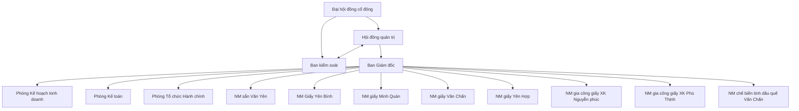

# CÔNG BỐ THÔNG TIN BÁO CÁO THƯỜNG NIÊN NĂM 2025

**CÔNG TY CỔ PHẦN LÂM NÔNG SẢN THỰC PHẨM YÊN BÁI**  
Mã CK: **CAP**  

**CỘNG HÒA XÃ HỘI CHỦ NGHĨA VIỆT NAM**  
**Độc lập – Tự do – Hạnh phúc**  

Số: 310/CBTT  
*Lào Cai, ngày 24 tháng 11 năm 2025*  

### V/v công bố thông tin

**Kính gửi:**  
- Ủy ban Chứng khoán Nhà nước;  
- Sở Giao dịch Chứng khoán Hà Nội (HNX).  

1. **Tên Công ty:** CÔNG TY CỔ PHẦN LÂM NÔNG SẢN THỰC PHẨM YÊN BÁI
2. **Mã chứng khoán:** CAP
3. **Địa chỉ trụ sở chính:** Số nhà 279, đường Nguyễn Phúc, phường Yên Bái, tỉnh Lào Cai
4. **Điện thoại:** 02163.862.278 - **Fax:** 02163.862.804
5. **Người thực hiện công bố thông tin:** Lương Quốc Quyền
6. **Điện thoại:** 0978.131.246
7. **Loại thông tin công bố:** ☐ 24 giờ ☐ 72 giờ ☐ Bất thường ☐ Theo yêu cầu ☑ Định kỳ
8. **Nội dung công bố thông tin:** Báo cáo thường niên năm 2025.
9. **Địa chỉ Website đăng tải công văn tại:** [www.yfatuf.com.vn](http://www.yfatuf.com.vn)

Chúng tôi cam kết các thông tin công bố trên đây là đúng sự thật và hoàn toàn chịu trách nhiệm trước pháp luật về nội dung thông tin công bố.

**Nơi nhận:**  
- Như trên;  
- Lưu: VP.  

**NGƯỜI THỰC HIỆN CBTT**  
*(Đã ký, đóng dấu)*  
**Lương Quốc Quyền**  

*(Ký số bởi: CÔNG TY CỔ PHẦN LÂM NÔNG SẢN THỰC PHẨM YÊN BÁI, Ngày 2025.11.25 08:07:00 +07'00')*

---

# BÁO CÁO THƯỜNG NIÊN NĂM 2025
### CÔNG TY CỔ PHẦN LÂM NÔNG SẢN THỰC PHẨM YÊN BÁI

- **Địa chỉ:** Phường Yên Bái, tỉnh Lào Cai  
- **Điện thoại:** 0216.3862278 / **Fax:** 0216.3862804  
- **Email:** yfatuf@gmail.com – **Website:** www.yfatuf.com.vn  
- **Mã chứng khoán:** CAP  

---

## I. THÔNG TIN CHUNG

### 1. Khái quát
- **Tên Công ty:** CÔNG TY CỔ PHẦN LÂM NÔNG SẢN THỰC PHẨM YÊN BÁI
- **Tên giao dịch quốc tế:** YENBAI JOINT – STOCKS FOREST AGRICULTURAL PRODUCTS AND FOODSTUFF COMPANY
- **Tên viết tắt:** YFATUF
- **Giấy chứng nhận đăng ký kinh doanh:** Số 5200116441 do Sở Kế hoạch và đầu tư tỉnh Yên Bái cấp lần đầu ngày 01 tháng 10 năm 2004, thay đổi lần 18 ngày 28 tháng 07 năm 2025
- **Vốn điều lệ:** 152.699.650.000 VND
- **Địa chỉ trụ sở chính:** Số nhà 279, đường Nguyễn Phúc, phường Yên Bái, tỉnh Lào Cai
- **Điện thoại:** 0216.3862.278
- **Fax:** 0216.3862.804
- **Website:** www.yfatuf.com.vn
- **Email:** yfatuf@gmail.com
- **Mã chứng khoán:** CAP

#### Quá trình hình thành và phát triển Công ty:
- Công ty Cổ phần lâm nông sản thực phẩm Yên bái tiền thân là Nhà máy giấy Yên Bái được thành lập từ năm 1972. Công ty đã trải qua nhiều giai đoạn thăng trầm chuyển đổi từ nền kinh tế bao cấp sang kinh tế thị trường. Đến năm 1994 được thành lập lại và đổi tên là Công ty chế biến lâm nông sản thực phẩm Yên Bái theo Quyết định của Ủy ban nhân dân tỉnh Yên Bái.
- Thực hiện theo Quyết định số 276/QĐ UB ngày 27 tháng 8 năm 2004 của UBND tỉnh Yên Bái, về việc phê duyệt phương án cổ phần hóa và chuyển doanh nghiệp nhà nước Công ty chế biến lâm nông sản thực phẩm Yên Bái thành Công ty cổ phần Lâm nông sản thực phẩm Yên Bái.
- Công ty Cổ phần chính thức hoạt động từ 01.10.2004 theo Giấy chứng nhận đăng ký kinh doanh số 1603000045 do Sở Kế hoạch và đầu tư tỉnh Yên Bái cấp 01/10/2004.
- Trong quá trình hoạt động Công ty đã được cấp 18 lần giấy chứng nhận đăng ký kinh doanh, Hiện tại Công ty đang hoạt động theo Giấy chứng nhận đăng ký doanh nghiệp số 5200116441 cấp thay đổi lần thứ 18 do Sở kế hoạch và đầu tư tỉnh Yên Bái cấp ngày 28/07/2025.
- Ngày 09.01.2008 chính thức giao dịch phiên đầu tiên tại Sàn Trung tâm giao dịch chứng khoán Hà Nội nay là Sở giao dịch chứng khoán Hà Nội.

### 2. Ngành nghề và sản phẩm

#### Ngành nghề đăng ký kinh doanh:
- Chế biến, gia công, kinh doanh lâm sản.
- Chế biến, gia công, kinh doanh nông sản thực phẩm.
- Kinh doanh xuất nhập khẩu phụ tùng, vật tư, thiết bị, hàng hóa tổng hợp.
- Kinh doanh dịch vụ du lịch, thương mại tổng hợp; dịch vụ khách sạn, nhà hàng, cho thuê văn phòng.

#### Sản phẩm chủ yếu hiện nay tại Công ty:
| STT | Tên sản phẩm |
| :---: | :--- |
| 1 | Giấy đế |
| 2 | Giấy vàng mã |
| 3 | Tinh bột sắn |
| 4 | Bã sắn khô |
| 5 | Tinh dầu quế |

### 3. Mô hình quản trị và cơ cấu bộ máy quản lý

**Cơ cấu chi tiết:**
- **Cơ quan quyền lực cao nhất:** Đại hội đồng cổ đông.
- **Cơ quan quản trị:** Hội đồng quản trị.
- **Cơ quan kiểm soát:** Ban kiểm soát.
- **Cơ quan điều hành:** Ban Giám đốc.
- **Các phòng chức năng:**
  - Phòng Kế hoạch kinh doanh
  - Phòng Kế toán
  - Phòng Tổ chức Hành chính
- **Các đơn vị trực thuộc / Nhà máy sản xuất:**
  - Nhà máy sắn Văn Yên
  - Nhà máy Giấy Yên Bình
  - Nhà máy giấy Minh Quán
  - Nhà máy giấy Văn Chấn
  - Nhà máy giấy Yên Hợp
  - Nhà máy gia công giấy XK Nguyễn phúc
  - Nhà máy gia công giấy XK Phú Thịnh
  - Nhà máy chế biến tinh dầu quế Văn Chấn

### 4. Định hướng phát triển doanh nghiệp

#### Các mục tiêu chủ yếu của Công ty:
- Tập trung ổn định sản xuất kinh doanh các sản phẩm truyền thống. Thực hiện mọi biện pháp tăng khả năng cạnh tranh, nâng cao hiệu quả sản xuất, tạo lợi thế và tiềm lực tài chính cho thực hiện chiến lược phát triển Công ty giai đoạn tiếp theo.
- Xây dựng các phương án đầu tư, cải tạo các nhà máy hiện có nhằm tăng năng xuất, hạ giá thành sản phẩm, đảm bảo chất lượng sản phẩm, nâng cao uy tín của Công ty.
- Đầu tư vùng nguyên liệu ổn định bền vững thông qua nhiều hình thức.
- Về nhân sự: Xây dựng phương án quy hoạch và đào tạo cán bộ chủ chốt giai đoạn 2025- 2030 và các năm tiếp theo.
- Chăm lo đời sống từ vật chất tới tinh thần cho người lao động trong doanh nghiệp.

#### Chiến lược phát triển trung và dài hạn:
- Nghiên cứu, tìm kiếm các dự án mới, khả thi để thực hiện đầu tư nhằm phát triển Công ty.
- Doanh thu: Đạt trên 1.000 tỷ đồng
- Lợi nhuận sau thuế: Đạt trên 150 tỷ đồng
- Vốn điều lệ: Trên 200 tỷ đồng

#### Mục tiêu phát triển bền vững:
- Chú trọng đầu tư cải thiện ngày càng tốt hơn công tác bảo vệ môi trường trong sản xuất.

### 5. Hạn chế và thách thức
- Nguyên liệu đầu vào phục vụ cho sản xuất ngày càng thu hẹp, chưa có vùng nguyên liệu tập trung, đặc biệt cho sản xuất giấy đế (nguyên liệu chủ yếu là cây tre, bương), nguyên liệu sắn củ tươi cạnh tranh gay gắt với nhiều đơn vị chế biến trong khu vực.
- Máy móc thiết bị chưa được đổi mới, chủ yếu mang tính thủ công, sử dụng nhiều lao động, khó có khả năng tăng năng suất lao động.
- Thị trường tiêu thụ chủ yếu Trung Quốc, Đài Loan, do đó chịu sự cạnh tranh cao.

---

## II. HOẠT ĐỘNG TRONG NIÊN ĐỘ 2024-2025

### 1. Sản xuất kinh doanh

#### Kết quả sản xuất kinh doanh:
| Chỉ tiêu | Kế hoạch 2024-2025 | Thực hiện 2024-2025 | So sánh |
| :--- | :---: | :---: | :---: |
| Doanh thu (tỷ đồng) | 618 | 656 | 106 % |
| Lợi nhuận sau thuế (Tỷ đồng) | 40 | 50,4 | 126 % |

#### So sánh với năm trước:
| Chỉ tiêu | 2022-2023 ST | 2022-2023 % tăng trưởng so với năm trước liền kề | 2023-2024 ST | 2023-2024 % tăng trưởng so với năm trước liền kề | 2024-2025 ST | 2024-2025 % tăng trưởng so với năm trước liền kề |
| :--- | :---: | :---: | :---: | :---: | :---: | :---: |
| Doanh thu (tỷ.đồng) | 611 | 93% | 592 | 97% | 656 | 111% |
| Lợi nhuận sau thuế (tỷ.đồng) | 114 | 107% | 31 | 27% | 50,4 | 163% |
| Lãi cơ bản trên CP ( đ/CP ) | 10.812 | 110% | 2.922 | 27% | 3.135 | 107% |

### 2. Tổ chức và nhân sự

#### Danh sách Ban điều hành:
| STT | Thành viên Ban điều hành | Ngày tháng năm sinh | Trình độ chuyên môn | Ngày bổ nhiệm/miễn nhiệm |
| :---: | :--- | :---: | :--- | :--- |
| 1 | Ông Nguyễn Huy Thông – Phó giám đốc | 16/05/1977 | Thạc sĩ Quản lý kinh tế | Bổ nhiệm 01/01/2025 |
| 2 | Ông Nguyễn Văn Trữ - Phó giám đốc | 19/08/1977 | Kỹ sư chế biến LS | Bổ nhiệm 10/10/2018 |
| 3 | Ông Hà Hải Yến – Phó giám đốc | 16/01/1978 | Kỹ sư điện | Bổ nhiệm 01/01/2023 |
| 4 | Ông Nguyễn Thanh Sơn – Phó giám đốc | 21/07/1981 | Thạc sĩ kế toán | Bổ nhiệm 01/07/2025 |
| 5 | Ông Lương Quốc Quyền – Kế toán trưởng | 15/12/1981 | Thạc sĩ kế toán | Bổ nhiệm 01/04/2024 |

#### Số lượng cán bộ công nhân viên và chính sách đối với người lao động:
- **Số lượng cán bộ công nhân viên:** 395 người, trong đó trình độ lao động thể hiện qua các chỉ số sau:
  - Thạc sĩ: 07 người
  - Đại học: 58 người
  - Cao đẳng: 18 người
  - Trung cấp: 46 người
  - Công nhân kỹ thuật và sơ cấp: 266 người
- **Chính sách đối với người lao động:** Đảm bảo đầy đủ các chế độ chính sách cho người lao động như bảo hiểm xã hội, y tế, bảo hiểm thân thể, bảo hiểm thất nghiệp; Người lao động đều được tham gia các tổ chức như: Công đoàn, Đoàn thanh niên; Tham gia các khóa đào tạo nâng cao trình chuyên môn - tay nghề, ... Thu nhập bình quân người lao động đạt **12,6 Tr.đ/người/tháng**.

### 3. Tình hình đầu tư, tình hình thực hiện các dự án
- Trong niên độ 2024-2025 Công ty chỉ thực hiện các phương án cải tạo, sửa chữa lớn tại các nhà máy, nhằm ổn định sản xuất, nâng cao chất lượng sản phẩm, giảm lao động, chưa có đầu tư thực hiện dự án mới.

### 4. Tình hình tài chính

#### a- Tình hình tài chính:
| Chỉ tiêu | 2022-2023 ST | 2022-2023 % tăng trưởng so với năm trước liền kề | 2023-2024 ST | 2023-2024 % tăng trưởng so với năm trước liền kề | 2024-2025 ST | 2024-2025 % tăng trưởng so với năm trước liền kề |
| :--- | :---: | :---: | :---: | :---: | :---: | :---: |
| Doanh thu (tỷ.đồng) | 611 | 93% | 592 | 97% | 656 | 111% |
| Lợi nhuận sau thuế (tỷ.đồng) | 114 | 107% | 31 | 27% | 50,4 | 163% |
| Lãi cơ bản trên CP ( đ/CP ) | 10.812 | 110% | 2.922 | 27% | 3.135 | 107% |

#### b- Các chỉ tiêu tài chính chủ yếu:
| TT | Chỉ tiêu | ĐVT | 2023-2024 | 2024-2025 | Ghi chú |
| :---: | :--- | :---: | :---: | :---: | :---: |
| **1** | **Hệ số khả năng thanh toán** | | | | |
| | Hệ số khả năng thanh toán tổng quát | Lần | 9,0 | 7,1 | |
| | Hệ số khả năng thanh toán nợ ngắn hạn | Lần | 8,13 | 5,69 | |
| | Hệ số khả năng thanh toán nhanh | Lần | 4,28 | 5,29 | |
| **2** | **Chỉ tiêu về cơ cấu vốn** | | | | |
| | Hệ số nợ/Tổng tài sản | Lần | 0,11 | 0,14 | |
| | Hệ số Nợ/Vốn chủ sở hữu | Lần | 0,13 | 0,16 | |
| **3** | **Chỉ tiêu về năng lực hoạt động** | | | | |
| | Vòng quay hàng tồn kho | lần | 6,8 | 8,37 | |
| | Vòng quay tổng tài sản | lần | 2,1 | 2,39 | |
| **4** | **Chỉ tiêu về khả năng sinh lời** | | | | |
| | Hệ số Lợi nhuận sau thuế/Doanh thu thuần | lần | 0,05 | 0,08 | |
| | Hệ số Lợi nhuận sau thuế/vốn chủ sở hữu | lần | 0,13 | 0,21 | |
| | Hệ số Lợi nhuận sau thuế/Tổng tài sản | lần | 0,11 | 0,18 | |
| | Hệ số Lợi nhuận từ hoạt động kinh doanh/Doanh thu thuần | lần | 0,07 | 0,10 | |

### 5. Cơ cấu cổ đông, thay đổi vốn đầu tư của chủ sở hữu
Các dữ liệu thống kê về cổ đông - thời điểm gần nhất chốt danh sách: **03/11/2025**

#### a. Cổ phần:
- **Tổng số cổ phần:** 15.269.965 cổ phần
- **Số lượng cổ phần đang lưu hành:** 15.079.284 cổ phần
- **Số lượng cổ phần tự do chuyển nhượng:** 15.079.284 cổ phần
- **Số lượng cổ phần hạn chế chuyển nhượng:** 190.681 cổ phần

#### b. Cơ cấu cổ đông:
| TT | Chỉ tiêu | Số lượng | Tỷ lệ |
| :---: | :--- | :---: | :---: |
| **1** | **Theo tỷ lệ** | | |
| | Cổ đông lớn | 5.257.124 cổ phần | 34% |
| | Cổ đông nhỏ | 10.012.841 cổ phần | 66% |
| **2** | **Theo hình thức** | | |
| | Tổ chức | 53.586 cổ phần | 0,35% |
| | Cá nhân | 15.216.379 cổ phần | 99,65% |
| **3** | **Quốc tịch** | | |
| | Cổ đông trong nước | 15.164.733 cổ phần | 99,31% |
| | Cổ đông nước ngoài | 105.232 cổ phần | 0,69% |
| **4** | **Tỷ lệ sở hữu tối đa của nhà đầu tư nước ngoài theo quy định** | **0** | **0%** |

#### c. Tình hình thay đổi vốn đầu tư của chủ sở hữu:
| TT | Thời điểm thay đổi | Lý do thay đổi |
| :---: | :--- | :--- |
| 1 | Năm 2006 tăng vốn điều lệ lần thứ nhất từ 5 tỷ lên 6 tỷ đồng. | Trả cổ tức bằng cổ phiếu |
| 2 | Năm 2007 tăng vốn điều lệ lần thứ hai từ 6 tỷ lên 11 tỷ đồng. | Trả cổ tức bằng cổ phiếu |
| 3 | Năm 2011 tăng vốn điều lệ lần thứ ba từ 11 tỷ lên 17 tỷ đồng. | Trả cổ tức bằng cổ phiếu |
| 4 | Năm 2013 tăng vốn điều lệ lần thứ tư từ 17 tỷ lên 34 tỷ đồng. | Trả cổ tức bằng cổ phiếu |
| 5 | Năm 2016 tăng vốn điều lệ lần thứ năm từ 34 tỷ lên 47 tỷ đồng. | Trả cổ tức bằng cổ phiếu |
| 6 | Năm 2019 tăng vốn điều lệ lần thứ sáu từ 47 tỷ lên 52 tỷ đồng | Trả cổ tức bằng cổ phiếu |
| 7 | Năm 2022 tăng vốn điều lệ lần thứ bảy từ 52 tỷ lên 78 tỷ đồng | Trả cổ tức bằng cổ phiếu |
| 8 | Năm 2023 tăng vốn điều lệ lần thứ tám từ 78 tỷ lên 100 tỷ đồng | Trả cổ tức bằng cổ phiếu |
| 9 | Năm 2024 tăng vốn điều lệ lần thứ chín từ 100 tỷ lên 152 tỷ đồng | Trả cổ tức bằng cổ phiếu |

#### d. Giao dịch cổ phiếu quỹ:
- Không

#### e. Các loại chứng khoán khác:
- Không

### 6. Báo cáo tác động liên quan đến môi trường và xã hội của công ty

| TT | Chỉ tiêu | ĐVT | Số lượng |
| :---: | :--- | :---: | :---: |
| **1** | **Tổng lượng nguyên vật liệu chính dùng để sản xuất** | | |
| | Tre, nứa,...xenlulo sợi dài | tấn | 49.200 |
| | Sắn củ tươi | tấn | 109.200 |
| | Cành lá quế | tấn | 0 |
| | Gỗ rừng trồng | m³ | |
| **2** | **Tiêu thụ năng lượng** | | |
| | Điện | Kw | 16.100.000 |
| | Củi ( tận thu cành ngọn, ...) | tấn | 28.020 |
| **3** | **Tiêu thụ nước** | | |
| | Nguồn cung cấp (tự khai thác và mua) | | nước mặt |
| | Lượng nước sử dụng | m³ | 1.081.500 |
| **4** | **Tuân thủ pháp luật về bảo vệ môi trường** | | |
| | Số lần bị xử phạt | lần | Không |
| | Tổng số tiền do bị xử phạt | Tr.đ | Không |
| **5** | **Chính sách người lao động** | | |
| | Số lượng lao động | người | 395 |
| | Mức lương trung bình đối với người lao động | Tr.đ/người tháng | 12,6 |
| | *Chính sách nhằm đảm bảo sức khỏe, an toàn và phúc lợi cho người lao động:* | | |
| | Trang bị đồng phục và bảo hộ lao động đầy đủ cho người lao động ở từng vị trí làm việc theo qui định của Nhà nước | Tr.đ | 395 |
| | Khám sức khỏe định kỳ 100% người lao động, đo môi trường lao động | Tr.đ | 68 |
| | Chi nghỉ mát cho người lao động | Trđ | 864 |
| | Chi nghỉ dưỡng sức, ốm đau, thai sản | Tr.đ | 950 |
| | Công đoàn hỗ trợ và tặng quà cho người lao động | Tr.đ | 289 |
| | Tập huấn an toàn vệ sinh lao động, Luật lao động, dân quân tự vệ... | tr.đ | 100 |
| **6** | **Báo cáo liên quan đến trách nhiệm đối với cộng đồng và hoạt động phát triển cộng đồng, bao gồm hỗ trợ tài chính nhằm phục vụ cộng đồng** | | |
| | Tham gia ủng hộ các chương trình từ thiện, phúc lợi xã hội, hỗ trợ khắc phục hậu quả thiên tai | Trđ | 232 |
| | Hỗ trợ phát triển nông thôn mới và cơ sở hạ tầng | Trđ | 60 |

---

## III. BÁO CÁO VÀ ĐÁNH GIÁ CỦA BAN GIÁM ĐỐC

### 1. Đánh giá kết quả hoạt động sản xuất kinh doanh niên độ 2024-2025

#### Kết quả hoạt động kinh doanh:
| Chỉ tiêu | 2023-2024 | 2024-2025 KH | 2024-2025 TH | % So với KH | % So với 2023-2024 |
| :--- | :---: | :---: | :---: | :---: | :---: |
| Doanh thu (Tỷ.đ) | 560 | 618 | 656 | 106% | 117% |
| LN sau thuế (Tỷ.đ) | 70 | 40 | 50,4 | 126% | 72% |

#### Đánh giá việc thực hiện các chỉ tiêu kế hoạch:
- Niên độ 2024-2025 Mặc dù, còn nhiều khó khăn trong niên độ vừa qua. Nhưng dưới sự chỉ đạo sâu sát, kịp thời của HĐQT, sự triển khai quyết liệt của Ban giám đốc Công ty đã hoàn thành cơ bản các chỉ tiêu kế hoạch như Tinh bột sắn đạt 101%, bã sắn đạt 100 %, giấy đế đạt 100% và doanh thu đạt 106%, thu nhập bình quân đạt 101% KH niên độ.
- Vì vậy, hoạt động SX-KD của Công ty tương đối ổn định và đặc biệt kết quả SX-KD hoàn thành vượt mức kế hoạch lợi nhuận mà Đại hội cổ đông giao (50,4 tỷ/40 tỷ KH).

### 2. Tình hình tài chính
- Niên độ 2024-2025 tình hình tài chính của Công ty luôn ổn định, việc bán hàng và thu hồi công nợ được trú trọng, nợ phải trả giảm so với niên độ trước. Vốn chủ sở hữu được bảo toàn.

### 3. Những cải tiến về cơ cấu tổ chức, chính sách, quản lý
- Ban giám đốc đã duy trì họp giao ban đầu tuần để triển khai công việc trong tuần tiếp theo, hàng tháng đều có sơ tổng kết, đánh giá kết quả thực hiện và xây dựng kế hoạch cho tháng sau, đề ra các giải pháp cụ thể để điều hành hoạt động SX-KD của Công ty.
- BGĐ xây dựng và triển khai phương án nhân sự có chiều sâu, đặc biệt là công tác cán bộ.
- Đổi mới công tác quản lý chất lượng sản phẩm, lấy khẩu hiệu chung cho toàn Công ty là “Chất lượng, Uy tín, Hiệu quả”.

### 4. Kế hoạch phát triển trong tương lai
- Ổn định hoạt động SX-KD của các mặt hàng hiện có.
- Nghiên cứu một số Dự án mới, sản phẩm mới, để xem xét lựa chọn các Dự án khả thi, để tổ chức triển khai nhằm mục đích phát triển Công ty.

### 5. Giải trình của Ban giám đốc đối với ý kiến của kiểm toán
- Không

### 6. Đánh giá liên quan đến trách nhiệm về bảo vệ môi trường và xã hội
- Công ty luôn trú trọng công tác bảo vệ môi trường, các nhà máy đều có hệ thống xử lý môi trường đảm bảo. Thường xuyên tham gia các chương trình an sinh xã hội đối với cộng đồng.

---

## IV. ĐÁNH GIÁ CỦA HỘI ĐỒNG QUẢN TRỊ VỀ HOẠT ĐỘNG CỦA CÔNG TY

### 1. Đánh giá của HĐQT về các mặt hoạt động của Công ty
- Hoạt động SX-KD của công ty tương đối ổn định, sản xuất vượt kế hoạch, doanh thu tăng, lợi nhuận tăng so với kế hoạch. Công ty luôn trú trọng công tác bảo vệ môi trường, hàng năm đều có đầu tư, cải tạo hệ thống xử lý môi trường để đảm bảo hoạt động SX-KD được ổn định.

### 2. Đánh giá của HĐQT về hoạt động của BGĐ Công ty
- Niên độ 2024-2025, Ban Giám đốc Công ty, tập thể cán bộ công nhân viên và người lao động trong Công ty có nhiều nỗ lực cố gắng hoàn thành nhiệm vụ SX-KD mà Đại hội đồng cổ đông thường niên năm 2024 đề ra.

### 3. Các kế hoạch định hướng của Hội đồng quản trị
- Ổn định và phát triển bền vững Công ty trên cơ sở các mặt hàng hiện có. Nâng cao hiệu quả trong hoạt động SX-KD của Công ty trên cơ sở tiết kiệm chi phí sản xuất.
- Chỉ đạo nghiên cứu, tìm kiến các dự án mới khả thi, phù hợp với điều kiện của Công ty để đầu tư phát triển Công ty trong thời gian tiếp theo.
- Kiện toàn bộ máy quản lý phù hợp với tình hình SX-KD của Công ty, xây dựng chiến lược đào tạo nguồn nhân lực chất lượng cao đáp ứng nhu cầu phát triển của Công ty.
- Tăng cường công tác quản lý, giám sát các hoạt động của Ban giám đốc và bộ máy giúp việc của Công ty.
- Tổ chức các phiên họp thường kỳ để thảo luận, giám sát và thông qua các báo cáo hoạt động của Ban giám đốc Công ty, chỉ đạo kịp thời và hiệu quả việc triển khai các Nghị quyết của Đại hội đồng cổ đông và HĐQT Công ty.
- Tiếp tục rà soát, bổ sung và điều chỉnh Hệ thống Nội quy - Quy chế - Quy định của Công ty phù hợp với tình hình hoạt động SX-KD.
- Đảm bảo ổn định việc làm, thu nhập, cải thiện và nâng cao đời sống vật chất và tinh thần cho CB CNV trong công ty.

---

## V. QUẢN TRỊ CÔNG TY

### 1. Hội đồng quản trị nhiệm kỳ 2024-2029

#### Danh sách thành viên Hội đồng quản trị:
| TT | Họ tên | Chức vụ | Số lượng cổ phần nắm giữ | Tỷ lệ |
| :---: | :--- | :--- | :---: | :---: |
| 1 | Trương Ngọc Biên | Chủ tịch HĐQT chuyên trách | 1.034.855 | 6,78% |
| 2 | Nguyễn Huy Thông | TV HĐQT – Giám đốc CTY | 126.727 | 0,83% |
| 3 | Nguyễn Văn Trữ | TV HĐQT – P.Giám đốc CTY | 84.227 | 0,55% |
| 4 | Nguyễn Quốc Trình | TV HĐQT không điều hành | 730.969 | 4,79% |
| 5 | Hoàng Thị Bình | TV HĐQT không điều hành | 1.788.116 | 11,71% |
| 6 | Nguyễn Xuân Hồng | TV HĐQT độc lập | 23.901 | 0,16% |
| 7 | Trần Thanh Hà | TV HĐQT độc lập | 10.500 | 0,07% |

#### Hoạt động của Hội đồng quản trị:
- Niên độ 2024-2025, HĐQT đã tổ chức 05 cuộc họp, các cuộc họp của HĐQT được triệu tập và thực hiện với lịch trình cụ thể, chuẩn bị tài liệu chu đáo, theo đúng các nguyên tắc, tuân thủ các quy định tại Điều lệ Công ty và quy định của pháp luật. Nội dung các cuộc họp được các thành viên HĐQT thảo luận, phân biện và đánh giá đầy đủ, cẩn trọng.
- Các quyết định của HĐQT tại các cuộc họp đều được HĐQT thông qua và biểu quyết với sự đồng thuận đều đạt 100%, biên bản cuộc họp được lập đầy đủ. Các nghị quyết, quyết định của Hội đồng quản trị đều được thông báo đầy đủ, kịp thời đến Ban Giám đốc công ty và Ban kiểm soát.
- Thành viên HĐQT độc lập thường xuyên đến các nhà máy trong Công ty, nắm bắt tình hình hoạt động SXKD, tham mưu cho BLĐ nhà máy tháo gỡ những khó khăn, vướng mắc trong công tác điều hành, quản trị. Đồng thời nắm bắt tư tưởng, nguyện vọng chính đáng của người lao động. Thường xuyên tìm hiểu tâm tư nguyện vọng của cổ đông, nắm bắt thông tin, ý kiến của các cổ đông, đặc biệt là các cổ đông nhỏ lẻ để trao đổi, bàn bạc kiến nghị của cổ đông trong các buổi họp của HĐQT. Trong niên độ 2024-2025, thành viên HĐQT độc lập không nhận được ý kiến phản ánh, khiếu kiện của các cổ đông.

### 2. Ban kiểm soát

#### Ban kiểm soát nhiệm kỳ 2024 - 2029:
| TT | Họ tên | Chức vụ | Số lượng cổ phần nắm giữ | Tỷ lệ |
| :---: | :--- | :--- | :---: | :---: |
| 1 | Nguyễn Thị Thu Hằng | Trưởng ban chuyên trách | 65.000 | 0,43% |
| 2 | Trần Sỹ Lâm | TV BKS chuyên trách | 23.800 | 0,16% |
| 3 | Phạm Tú Linh | TV BKS kiêm nhiệm | 11.487 | 0,08% |

#### Hoạt động của Ban kiểm soát:
- Thực hiện chức năng nhiệm vụ của Ban kiểm soát, trong niên độ 2024-2025, Ban kiểm soát đã họp 04 phiên để triển khai nội dung hoạt động, đồng thời kết hợp với nhiệm vụ chuyên môn, hàng tháng đều kiểm tra tình hình hoạt động sản xuất kinh doanh, công tác quản lý tài chính, việc thực hiện chế độ chính sách Nhà nước và Điều lệ tại Công ty.

### 3. Lợi ích, thù lao, giao dịch của Hội đồng quản trị, Ban Giám đốc, Ban kiểm soát

#### a – Lương, phụ cấp, các khoản lợi ích khác:
| TT | Họ tên | Chức vụ | Số tiền |
| :---: | :--- | :--- | :---: |
| 1 | Trương Ngọc Biên | CT HĐQT | 803.470.000 đồng |
| 2 | Nguyễn Huy Thông | TV HĐQT - GĐ | 625.691.000 đồng |
| 3 | Nguyễn Văn Trữ | Phó GĐ | 535.691.000 đồng |
| 4 | Nguyễn Quốc Trình | TV HĐQT | 140.000.000 đồng |
| 5 | Hoàng Thị Bình | TV HĐQT | 140.000.000 đồng |
| 6 | Nguyễn Xuân Hồng | TV HĐQT | 140.000.000 đồng |
| 7 | Trần Thanh Hà | TV HĐQT | 140.000.000 đồng |
| 8 | Nguyễn Thị Thu Hằng | Trưởng BKS | 441.423.000 đồng |
| 9 | Trần Sỹ Lâm | TV Ban KS | 292.935.000 đồng |
| 10 | Phạm Tú Linh | TV Ban KS | 350.981.350 đồng |
| 11 | Hà Hải Yến | Phó GĐ | 588.191.000 đồng |
| 12 | Lương Quốc Quyền | Kế toán trưởng | 492.024.000 đồng |

#### b- Giao dịch cổ phiếu của cổ đông nội bộ và người có liên quan:
| TT | Người thực hiện giao dịch | Quan hệ với người nội bộ | Số cổ phiếu sở hữu đầu kỳ: Số cổ phiếu | Số cổ phiếu sở hữu đầu kỳ: Tỷ lệ (%) | Số cổ phiếu sở hữu cuối kỳ: Số cổ phiếu | Số cổ phiếu sở hữu cuối kỳ: Tỷ lệ (%) | Lý do tăng, giảm (mua, bán, chuyển đổi, thưởng...) |
| :---: | :--- | :--- | :---: | :---: | :---: | :---: | :--- |
| 1 | Trương Ngọc Biên | Chủ tịch HĐQT | 993.355 | 6,51 | 1.034.855 | 6,78 | Mua thêm |
| 2 | Hoàng Thị Bình | TV.HĐQT, vợ Ô. Biên | 1.788.116 | 11,71 | 1.788.116 | 11,71 | |
| 3 | Trương Thị Hoàng Yến | Con gái Ô.Biên, bà Bình | 764.640 | 5,01 | 764.640 | 5,01 | |
| 4 | Trương Thị Hoàng Anh | Con gái Ô.Biên, bà Bình | 757.416 | 4,96 | 757.416 | 4,96 | |
| 5 | Trương Thị Duyên | Em gái Ô. Biên | 82.460 | 0,54 | 85.460 | 0,56 | Mua thêm |
| 6 | Nguyễn Quốc Trình | TV.HĐQT | 730.969 | 4,79 | 730.969 | 4,79 | |
| 7 | Trần Thị Bính | Vợ ông Trình | 404.422 | 2,65 | 404.422 | 2,65 | |
| 8 | Nguyễn Thùy Tiên | Con gái Ô Trình | 54.645 | 0,36 | 54.645 | 0,36 | |
| 9 | Phạm Trung Tâm | Côn rể Ô. Trình | 8.005 | 0,05 | 10.005 | 0,07 | Mua thêm |
| 10 | Nguyễn Xuân Hồng | TV.HĐQT ĐL | 21.101 | 0,14 | 23.901 | 0,16 | Mua thêm |
| 11 | Trần Thanh Hà | TV.HĐQT ĐL | 3.300 | 0,02 | 10.500 | 0,07 | Mua thêm |
| 12 | Nguyễn Văn Trữ | Phó Giám đốc | 78.727 | 0,52 | 84.227 | 0,55 | Mua thêm |
| 13 | Nguyễn Thanh Sơn | Phó Giám đốc | 48.390 | 0,32 | 52.000 | 0,34 | Mua thêm |
| 14 | Nguyễn Huy Thông | Giám đốc | 115.227 | 0,75 | 126.727 | 0,83 | Mua thêm |
| 15 | Ngô Thị Hoài | Vợ ông Thông | 442 | 0,00 | 442 | 0,00 | |
| 16 | Hà Hải Yến | Phó GĐ | 43.702 | 0,29 | 45.802 | 0,30 | Mua thêm |
| 17 | Nguyễn Thị Thu Hường | Vợ ông Yến | 0 | 0,00 | 5.100 | 0,03 | Mua thêm |
| 18 | Nguyễn Thị Thu Hằng | Trưởng Ban KS | 50.634 | 0,33 | 65.000 | 0,43 | Mua thêm |
| 19 | Nguyễn Thăng Thiệu | Chồng bà Hằng | 3.300 | 0,02 | 6.900 | 0,05 | Mua thêm |
| 20 | Trần Sỹ Lâm | TV Ban KS | 20.000 | 0,13 | 23.800 | 0,16 | Mua thêm |
| 21 | Phạm Tú Linh | TV Ban KS | 9.987 | 0,07 | 11.487 | 0,08 | Mua thêm |
| 22 | Lương Quốc Quyền | Kế toán trưởng, người QT Cty | 15.462 | 0,10 | 23.162 | 0,15 | Mua thêm |
| 23 | Nguyễn Hương Lan | Vợ ông Quyền | 3.000 | 0,02 | 6.500 | 0,04 | Mua thêm |

---

## VI. BÁO CÁO TÀI CHÍNH

1. **Ý kiến kiểm toán độc lập:** Báo cáo tài chính tổng hợp đề cập đã phản ánh trung thực và hợp lý trên các khía cạnh trọng yếu tình hình tài chính tổng hợp của Công ty cổ phần lâm nông sản thực phẩm Yên Bái tại thời điểm 30/09/2025 cũng như kết quả hoạt động kinh doanh tổng hợp và tình hình lưu chuyển tiền tệ tổng hợp cho năm tài chính kết thúc cùng ngày, phù hợp với chuẩn mực kế toán, chế độ kế toán doanh nghiệp Việt Nam và các quy định pháp lý có liên quan đến việc lập và trình bày Báo cáo tài chính tổng hợp.
2. **Báo cáo tài chính được kiểm toán gồm:** Bảng cân đối kế toán; Báo cáo kết quả hoạt động kinh doanh; Báo cáo lưu chuyển tiền tệ; Bản thuyết minh báo cáo tài chính được lập theo quy định của pháp luật về kế toán và kiểm toán.

*Yên Bái, ngày 24 tháng 11 năm 2025*  
**NGƯỜI ĐẠI DIỆN THEO PHÁP LUẬT**  
**GIÁM ĐỐC**  
*(Đã ký, đóng dấu)*  
**Nguyễn Huy Thông**  

*(Ghi chú: Toàn bộ hệ thống bảng biểu chi tiết của Báo cáo tài chính kiểm toán sau trang này được ngắt đọc theo đúng Quy tắc ngắt đọc sớm số 4).*
