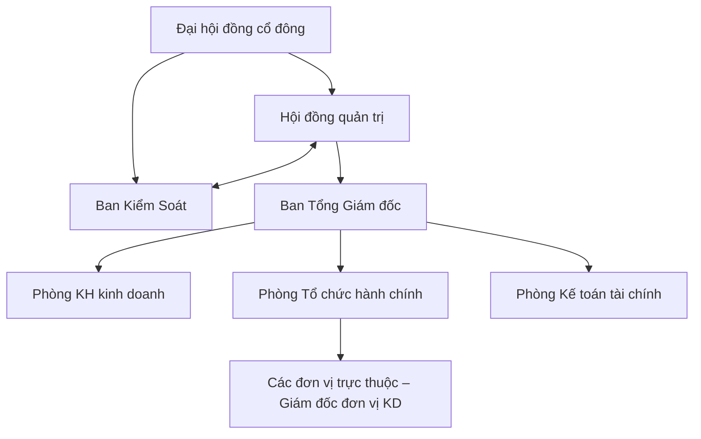

# BÁO CÁO THƯỜNG NIÊN NĂM 2025

**CÔNG TY CỔ PHẦN VẬT LIỆU XÂY DỰNG VÀ TRANG TRÍ NỘI THẤT TP. HCM**  
Số: 169./BCTN-CMID  

**CỘNG HÒA XÃ HỘI CHỦ NGHĨA VIỆT NAM**  
**Độc Lập – Tự Do – Hạnh Phúc**  

*TP. Hồ Chí Minh, ngày 16 tháng 04 năm 2026*  

---

### BÁO CÁO THƯỜNG NIÊN NĂM 2025

**Kính gửi:**
- ỦY BAN CHỨNG KHOÁN NHÀ NƯỚC
- SỞ GIAO DỊCH CHỨNG KHOÁN HÀ NỘI
- QUÝ CỔ ĐÔNG

---

## I. THÔNG TIN CHUNG

### 1. Thông tin khái quát:
- **Tên giao dịch:** CÔNG TY CỔ PHẦN VẬT LIỆU XÂY DỰNG VÀ TRANG TRÍ NỘI THẤT THÀNH PHỐ HỒ CHÍ MINH
- **Tên tiếng Anh:** CONSTRUCTION MATERIAL AND INTERIOR DECORATION JOINT STOCK COMPANY
- **Tên viết tắt:** CMID
- **Giấy chứng nhận đăng ký kinh doanh số:** 0302495140 do Sở Kế hoạch và Đầu tư TP.HCM cấp lần đầu ngày 31/12/2001 (đăng ký thay đổi lần thứ 16 do Sở Tài Chính TP. HCM cấp ngày 08/01/2026).
- **Vốn điều lệ:** 150.000.000.000 Việt Nam đồng
- **Vốn đầu tư chủ sở hữu:** 150.000.000.000 Việt Nam đồng
- **Địa chỉ:** 215 – 217 Trần Hưng Đạo – Phường Cầu Ông Lãnh – TP.HCM
- **Số điện thoại:** (028) 38 367 969 – 38 368 531 – 38 368 406
- **Số Fax:** (028) 38 369 434
- **E-mail:** cmidvlxd@gmail.com
- **Website:** https://www.cmid.com.vn
- **Mã cổ phiếu:** CMD đăng ký giao dịch sàn UPCoM Hà Nội

#### ❖ Quá trình hình thành và phát triển:
- Công ty Cổ phần Vật liệu xây dựng và Trang trí nội thất Thành phố Hồ Chí Minh trước đây là bộ phận vật liệu xây dựng của Công ty Vật liệu xây dựng và Chất đốt. Do nhu cầu của sự phát triển kinh tế, theo Quyết định số 135/TCCQ ngày 16/03/1976 của Ủy Ban Nhân Dân Thành phố Hồ Chí Minh, bộ phận này được tách ra và trở thành Công ty độc lập cũng với tên gọi là Công ty Vật liệu xây dựng và Trang trí nội thất, trực thuộc Sở Thương mại TP.HCM.
- **1976:** Công ty là một doanh nghiệp Nhà Nước nên nguồn vốn chủ yếu do ngân sách Nhà Nước cấp. Khi mới thành lập số vốn ban đầu của Công ty là 840.189.320 đồng. Trong đó, vốn cố định là 138.360.720 đồng, vốn lưu động là 701.828.600 đồng. Với nhiệm vụ là tổ chức thu mua, gia công tự sản xuất, chế biến tập trung nguồn hàng thực hiện vai trò bán buôn, cung ứng hàng hóa cho các đơn vị thương nghiệp quận, huyện và đảm bảo cho nhu cầu xây dựng của TP. Hồ Chí Minh và một số Tỉnh lân cận.
- **1992:** Trải qua thời gian dài kinh doanh có hiệu quả, Công ty được Nhà Nước cho phép thành lập lại theo Nghị định 388/HĐBT của Hội đồng Bộ trưởng ngày 29/09/1992. Trong đó nguồn vốn kinh doanh là 4.513.000.000 đồng (vốn ngân sách Nhà Nước cấp: 3.034.000.000 đồng, vốn doanh nghiệp tự bổ sung: 1.479.000.000 đồng), vốn cố định là 2.225.000.000 đồng, vốn lưu động là 2.288.000.000 đồng. Với ngành nghề kinh doanh là các loại vật liệu xây dựng và trang trí nội thất.
- **1994:** Ngày 15/11/1994 Công ty được bổ sung chức năng sửa chữa và trang trí nội thất – sản xuất vật liệu xây dựng, xây dựng dân dụng và công nghiệp (01/01/1999 Công ty đã bỏ chức năng này do sự khó khăn khi áp dụng thuế GTGT vào quyết toán), sản xuất vật liệu xây dựng. Công ty đã tập trung đầu tư nhanh vào mặt hàng vật liệu xây dựng mũi nhọn để góp phần chi phối thị trường.
- **1999:** Nguồn vốn kinh doanh của Công ty đạt 6.936.000.000 đồng. Trong đó: vốn cố định là 3.649.000.000 đồng (nguồn ngân sách cấp: 1.118.000.000 đồng, nguồn tự bổ sung: 2.531.000.000 đồng), vốn lưu động là 3.287.000.000 đồng.
- **2002:** Theo quyết định số 1286/QĐ-TTg ngày 28/09/2002 của Thủ Tướng Chính phủ, Công ty đã chuyển thể từ Công ty Vật liệu xây dựng và Trang trí nội thất TP.HCM (doanh nghiệp Nhà Nước) sang Công ty Cổ phần Vật liệu xây dựng và Trang trí nội thất TP.HCM (viết tắt là CMID). Vốn điều lệ là 20.000.000.000 đồng. Trong đó: Nhà Nước góp vốn 4.000.000.000 đồng chiếm 20%. Còn lại 80% là vốn góp cổ đông.

Sau gần 50 năm hoạt động, Công ty không ngừng phát triển cả về qui mô, vốn tài sản, ngành nghề kinh doanh, chất lượng dịch vụ, năng lực cạnh tranh. Với số vốn ban đầu trên 840.000.000 đồng vào thời điểm năm 1976, đến năm 2002 khi cổ phần hóa là 20.000.000.000 đồng và đến cuối năm 2008 là 150.000.000.000 đồng.

---

### 2. Ngành nghề và địa bàn kinh doanh:
- **Hoạt động chính của công ty là:**
  - Kinh doanh các loại vật liệu xây dựng. Sửa chữa và trang trí nội thất. Xây dựng dân dụng, công nghiệp và san lấp mặt bằng các công trình.
  - Cho thuê kho bãi, nhà xưởng, văn phòng.
  - Đầu tư tạo lập nhà, công trình xây dựng để bán, cho thuê mua. Mua nhà, công trình xây dựng để bán, cho thuê, cho thuê mua. Thuê nhà, công trình xây dựng để cho thuê lại. Đầu tư cải tạo đất và đầu tư các công trình hạ tầng trên đất thuê để cho thuê đất đã có hạ tầng.
- **Ngành nghề kinh doanh theo Giấy phép đăng ký kinh doanh đã được cập nhật theo Giấy xác nhận về việc thay đổi nội dung đăng ký doanh nghiệp do Sở Tài Chính TP. HCM – Phòng Đăng ký kinh doanh cấp ngày 09/02/2026 như sau:**

| STT | Tên ngành | Mã ngành |
|:---:|---|:---:|
| 1 | Khai thác đá, cát, sỏi, đất sét. Chi tiết: Khai thác sỏi. Khai thác đất sét | 0810 |
| 2 | Hoạt động dịch vụ hỗ trợ khác liên quan đến vận tải Chi tiết: Kinh doanh vận chuyển hành khách theo hợp đồng | 5229 |
| 3 | Hoạt động viễn thông khác Chi tiết: Đại lý dịch vụ bưu chính-viễn thông (trừ đại lý truy cập-truy nhập Internet). | 6190 |
| 4 | Sản xuất sản phẩm khác từ gỗ; Sản xuất sản phẩm từ tre, nứa, rơm, rạ và vật liệu tết bện Chi tiết: gia công, chế biến gỗ (không gia công, chế biến tại trụ sở). | 1629 |
| 5 | Hoạt động của các câu lạc bộ thể thao Chi tiết: bể bơi, sân tennis. | 9312 |
| 6 | Khai thác, xử lý và cung cấp nước Chi tiết: Khai thác nước ngầm, cát, đá (không khai thác tại trụ sở). | 3600 |
| 7 | Sản xuất sản phẩm từ chất khoáng phi kim loại khác chưa được phân vào đâu Chi tiết: Sản xuất các loại vật liệu xây dựng. | 2399 |
| 8 | Hoạt động thiết kế chuyên dụng Chi tiết: Sửa chữa và trang trí nội thất. | 7410 |
| 9 | Chuẩn bị mặt bằng Chi tiết: San lấp mặt bằng các công trình. | 4312 |
| 10 | Kinh doanh bất động sản, quyền sử dụng đất thuộc chủ sở hữu, chủ sử dụng hoặc đi thuê. Chi tiết: Kinh doanh nhà ở. Cho thuê căn hộ. Cho thuê kho bãi, nhà xưởng, văn phòng. Đầu tư tạo lập nhà, công trình xây dựng để bán, cho thuê, cho thuê mua. Mua nhà, công trình xây dựng để bán, cho thuê, cho thuê mua. Thuê nhà, công trình xây dựng để cho thuê lại. Đầu tư cải tạo đất và đầu tư các công trình hạ tầng trên đất thuê để cho thuê đất đã có hạ tầng. Nhận chuyển nhượng quyền sử dụng đất, đầu tư công trình hạ tầng để chuyển nhượng, cho thuê; thuê quyền sử dụng đất đã có hạ tầng để cho thuê lại. | 6810 |
| 11 | Bán buôn máy móc, thiết bị và phụ tùng máy khác Chi tiết: Mua bán máy móc, thiết bị, phụ tùng nông lâm ngư cơ. | 4659 |
| 12 | Bán buôn nông, lâm sản nguyên liệu (trừ gỗ, tre, nứa) và động vật sống Chi tiết: Mua bán nông sản. | 4620 |
| 13 | Bán buôn thực phẩm Chi tiết: Mua bán thủy hải sản, lương thực, thực phẩm, thực phẩm công nghệ. | 4632 |
| 14 | Bán buôn đồ dùng khác cho gia đình Chi tiết: Mua bán dụng cụ và trang thiết bị thể dục thể thao (trừ kinh doanh súng đạn thể thao và vũ khí thô sơ). | 4649 |
| 15 | Xây dựng nhà để ở Chi tiết: Xây dựng dân dụng, công nghiệp. | 4101 |
| 16 | Giáo dục nhà trẻ | 8511 |
| 17 | Sản xuất plastic và cao su tổng hợp dạng nguyên sinh Chi tiết: Chế biến mủ cao su (không hoạt động tại trụ sở). | 2013 |
| 18 | Trồng cây lâu năm khác Chi tiết: Trồng cây nông lâm nghiệp. | 0129 |
| 19 | Giáo dục mẫu giáo | 8512 |
| 20 | Bán buôn vật liệu, thiết bị lắp đặt khác trong xây dựng Chi tiết: Kinh doanh vật liệu xây dựng, gỗ. | 4673 - Chính |
| 21 | Giáo dục trung học phổ thông | 8523 |
| 22 | Đại lý lữ hành Chi tiết: Kinh doanh lữ hành nội địa, quốc tế. | 7911 |
| 23 | Hoạt động liên quan đến du lịch khác | 7990 |
| 24 | Khách sạn và dịch vụ lưu trú tương tự Chi tiết: Kinh doanh khách sạn (không kinh doanh tại trụ sở) | 5510 |
| 25 | Đào tạo trung cấp Chi tiết: Đào tạo nghề (không hoạt động tại trụ sở). | 8532 |
| 26 | Bán buôn chuyên doanh khác chưa được phân vào đâu Chi tiết: Mua bán mủ cao su. | 4679 |
| 27 | Bán buôn nhiên liệu rắn, lỏng, khí và các sản phẩm liên quan Chi tiết: Mua bán xăng dầu, chất đốt (đối với xăng dầu, gas chỉ hoạt động khi được cấp giấy chứng nhận đủ điều kiện kinh doanh theo quy định của pháp luật), nhớt. | 4671 |
| 28 | Bán buôn máy tính, thiết bị ngoại vi và phần mềm Chi tiết: Mua bán hàng kim khí điện máy, máy vi tính và linh kiện. | 4651 |
| 29 | Sửa chữa, bảo dưỡng ô tô và xe cơ động cơ khác Chi tiết: Dịch vụ rửa xe. | 9531 |

- **Địa bàn kinh doanh:** Khu vực Thành phố Hồ Chí Minh, một số Tỉnh lân cận như Tây Ninh, Đồng Tháp, Đồng Nai.

---

### 3. Thông tin về mô hình quản trị, tổ chức kinh doanh và bộ máy quản lý:
- **Mô hình quản trị:** Đại hội đồng cổ đông, Hội đồng quản trị, Ban kiểm soát và Tổng Giám đốc.

- **Cơ cấu bộ máy quản lý:**
  - Hội đồng quản trị gồm 05 thành viên: 01 Chủ tịch là thành viên không điều hành, 01 Phó Chủ tịch và 03 thành viên.
  - Ban Kiểm soát gồm 03 thành viên: 01 Trưởng ban và 02 thành viên.
  - Ban Tổng Giám đốc: 01 Tổng Giám Đốc và 02 Phó Tổng Giám đốc.
    - Năm 2025, số lượng thành viên Hội đồng quản trị và Ban Tổng Giám đốc còn khuyết 01 thành viên do ông Thái Thanh Sơn đã từ nhiệm vị trí Thành viên Hội đồng quản trị và Phó Tổng Giám đốc, công ty đang tìm kiếm nhân sự phù hợp để kiện toàn bộ máy quản lý trong thời gian tới.
  - Các Phòng chức năng:
    - Phòng Tổ Chức Hành Chính: 12 người
    - Phòng Kế Toán Tài Chính: 05 người
    - Phòng Kế Hoạch Kinh Doanh: 12 người
    - Các đơn vị trực thuộc: 25 người
  - Các đơn vị trực thuộc:
    - Trung tâm kinh doanh Vật liệu xây dựng và Trang trí nội thất số 1
    - Trung tâm kinh doanh Vật liệu xây dựng và nhiên liệu số 7
    - Chi nhánh Long An
    - Chi nhánh Bình Dương HCM
    - Trung tâm 9, Trung tâm 10 đã tiến hành sáp nhập và giải thể. Giải thể Chi nhánh Bình Dương và thành lập đơn vị kinh doanh mới là Chi nhánh Bình Dương HCM.
- **Các công ty con, công ty liên kết:** không có

---

### 4. Định hướng phát triển:
#### a. Các mục tiêu chủ yếu của công ty:
- Xây dựng và phát triển Công ty theo hướng chuyên doanh ngành hàng xi măng, dịch vụ cho thuê văn phòng, tập trung vào những mặt hàng chủ yếu có nhu cầu sản lượng lớn, có chiết khấu, khuyến mãi cao nhằm tăng năng lực cạnh tranh trên thị trường, góp phần xây dựng thương hiệu CMID vững mạnh và phát triển bền vững.

#### b. Chiến lược phát triển trung và dài hạn:
- Giữ vững mạng lưới kinh doanh hiện có và từng bước phát triển thêm thị trường và khách hàng mới ở Thành phố Hồ Chí Minh và các tỉnh lân cận, có chính sách phù hợp đối với từng khách hàng để tăng sức cạnh tranh.

#### c. Các mục tiêu phát triển bền vững:
- Đồng hành cùng các đối tác là nhà máy sản xuất xi măng để cung ứng các dòng sản phẩm xi măng thân thiện với môi trường, góp phần giảm thiểu tác động đến môi trường.
- Nâng cao năng lực quản trị, khả năng cạnh tranh và kiểm soát các rủi ro trong quá trình kinh doanh.

---

### 5. Các rủi ro:
- **Rủi ro vĩ mô:** bất ổn thương mại toàn cầu do Mỹ áp thuế đối ứng với nhiều đối tác trong đó có Việt Nam, gây áp lực lên xuất khẩu và chuỗi cung ứng. Căng thẳng địa chính trị ở khu vực Trung Đông ngày càng leo thang làm giá dầu, nguyên liệu thô biến động mạnh, ảnh hưởng đến chi phí sản xuất và kiểm soát lạm phát. Những rủi ro này là các yếu tố tác động mạnh đến tình hình sản xuất, kinh doanh của các doanh nghiệp tại Việt Nam trong năm 2025 và vẫn còn ảnh hưởng kéo dài đến năm 2026. Các chính sách điều hành kinh tế của Chính phủ đã giữ ổn định tỷ giá, nỗ lực kiểm soát lạm phát nhằm hỗ trợ tăng trưởng. Bên cạnh đó, Nhà nước đẩy mạnh cải cách thể chế và tập trung khơi thông các điểm nghẽn đầu tư, thị trường và tăng cường kết nối hạ tầng giao thông để tạo động lực thúc đẩy nền kinh tế.
- **Rủi ro vi mô:** ngành sản xuất xi măng đối diện với vấn đề chi phí sản xuất tăng cao và nguồn cung dư thừa trong khi nhu cầu thị trường phục hồi chậm dẫn đến tình trạng cạnh tranh gay gắt giữa các nhà máy sản xuất ở mọi phân khúc, các chính sách bán hàng chủ yếu tập trung vào cạnh tranh giá gây khó khăn cho nhà phân phối, thêm vào đó nguồn cung cấp vật liệu tự nhiên như đá, cát xây dựng và san lấp đang thiếu hụt nghiêm trọng, giá sắt thép liên tục tăng cao, chi phí vận chuyển biến động liên tục theo giá nhiên liệu....là những rủi ro ảnh hưởng trực tiếp đến sản lượng tiêu thụ của doanh nghiệp.
- **Rủi ro tài chính:**
  - *Rủi ro tín dụng:* là rủi ro mà đối tác sẽ không thực hiện các nghĩa vụ của mình theo quy định của một công cụ tài chính hoặc hợp đồng khách hàng, dẫn đến tổn thất về tài chính. Công ty có rủi ro tín dụng từ các hoạt động kinh doanh của mình (chủ yếu đối với các khoản phải thu khách hàng) và từ hoạt động tài chính của mình bao gồm cả tiền gửi ngân hàng và các công cụ tài chính khác.
  - *Rủi ro thanh khoản:* là rủi ro Công ty gặp khó khăn trong việc đáp ứng các nghĩa vụ tài chính do tình trạng thiếu vốn. Rủi ro thanh khoản của Công ty phát sinh chủ yếu do không tương xứng trong các kỳ hạn của tài sản tài chính và các khoản phải trả tài chính. Công ty giám sát rủi ro thanh khoản bằng việc duy trì tỷ lệ tiền mặt và các khoản tương đương tiền ở mức mà Ban Tổng Giám đốc cho là đủ để hỗ trợ tài chính cho các hoạt động kinh doanh của Công ty và để giảm thiểu ảnh hưởng của những thay đổi các luồng tiền.

---

## II. TÌNH HÌNH HOẠT ĐỘNG TRONG NĂM 2025

### 1. Tình hình hoạt động sản xuất kinh doanh:
- Tổng doanh thu thu nhập: 884.114.345.984 đồng, đạt 98,23% so với kế hoạch
- Tổng sản lượng xi măng các loại: 681.537 tấn đạt 104,85 % so với kế hoạch (bao gồm hàng khuyến mãi)
- Năm 2025, tổng sản lượng sản phẩm tiêu thụ thị trường Việt Nam ước đạt khoảng 112 triệu tấn, ghi nhận sự tăng trưởng khoảng 16% so với năm 2024, trong đó tiêu thụ nội địa tăng trưởng khoảng 12,8%, đặc biệt là trong nửa cuối năm 2025. Nguyên nhân góp phần vào sự tăng trưởng ngành xi măng trong 2025 do Chính phủ đẩy mạnh các dự án đầu tư công vào hạ tầng giao thông và xây dựng, tạo nhu cầu lớn cho ngành vật liệu xây dựng. Thị trường bất động sản có dấu hiệu phục hồi ở phân khúc nhà ở và công trình dân dụng. Trong bối cảnh chung có sự tăng trưởng của thị trường, công ty CMID đã thực hiện tổng sản lượng tiêu thụ năm 2025 tăng 21,4% so với năm 2024 và chi cổ tức bằng tiền mặt 26%.

---

### 2. Tổ chức nhân sự:
#### * Danh sách Ban điều hành:
- Ông Lê Văn Phải: Tổng Giám Đốc
- Ông Huỳnh Ngọc Khánh: P. Tổng Giám Đốc
- Bà Phạm Thị Bắc Giang: Kế toán trưởng

#### * Lý lịch Ban điều hành:
**Tổng Giám đốc: Ông Lê Văn Phải**
- Sinh năm: 1957
- Quê quán: Tây Ninh
- Dân tộc: Kinh
- Quốc tịch: Việt Nam
- CCCD số: 080057000108, cấp ngày 26/12/2021 tại Cục cảnh sát
- Chức vụ hiện nay: Phó CT Hội đồng quản trị - Tổng Giám đốc
- Địa chỉ thường trú: Số 7 Tân Hoà Đông – Phường Phú Lâm – TP.HCM
- Sở hữu 2.634.687 cổ phần, tỷ lệ là 23,48% / tổng số cổ phiếu lưu hành

**Phó Tổng Giám đốc: Ông Huỳnh Ngọc Khánh**
- Sinh năm: 1985
- Quê quán: Tây Ninh
- Dân tộc: Kinh
- Quốc tịch: Việt Nam
- Căn cước số: 079085026299, cấp ngày 19/05/2021 tại Cục cảnh sát
- Chức vụ hiện nay: Thành viên Hội đồng quản trị - Phó Tổng Giám Đốc
- Địa chỉ thường trú: Số 144-146 Đặng Nguyên Cẩn – Phường Phú Lâm – TP.HCM
- Sở hữu 668.080 cổ phần, tỷ lệ là 5,95% / tổng số cổ phiếu lưu hành

**Kế toán trưởng: Bà Phạm Thị Bắc Giang**
- Sinh năm: 1964
- Quê quán: Đồng Tháp
- Dân tộc: Kinh
- Quốc tịch: Việt Nam
- CCCD số: 079164013887, cấp ngày 22/10/2024 tại Bộ Công An
- Chức vụ hiện nay: Kế toán trưởng
- Địa chỉ thường trú: Số 52 Tôn Thất Thuyết, Phường Vĩnh Hội – TP.HCM
- Sở hữu 100.468 cổ phần, tỷ lệ 0,90% / tổng số cổ phiếu lưu hành

#### * Tổng số CB - CNV: 54 người
- Người lao động trong công ty đều có hợp đồng lao động theo đúng Luật lao động và được hưởng đầy đủ các chế độ theo quy định hiện hành của pháp luật về Luật lao động. Công ty thực hiện chế độ về tiền lương, BHXH, BHYT, BH thất nghiệp cho CNVC – LĐ đầy đủ. Làm việc 44 giờ/ tuần, 8 giờ/ ngày.
- Lao động ổn định do đặc thù yêu cầu công việc. Đối với lao động trực tiếp hay gián tiếp công ty luôn tạo điều kiện học tập đào tạo trực tiếp phù hợp với yêu cầu chuyên môn của công việc.

---

### 3. Tình hình đầu tư và tình hình thực hiện dự án:
a) Năm 2025 có đầu tư mới vào dự án kho bãi và cảng logistic nội địa ở xã Mỹ Lệ, tỉnh Tây Ninh. Ngoài ra, các mặt bằng trước đây vẫn đang cải tạo, sửa chữa để đảm bảo an toàn và đúng theo quy định PCCC. Công ty tiếp tục liên hệ các cơ quan chức năng xin mua hoặc thuê dài hạn một số mặt bằng để đầu tư kinh doanh lâu dài như:
- Mặt bằng số 518 Nguyễn Thị Minh Khai, Phường Bàn Cờ, TP. HCM.
- Mặt bằng số 178 Lý Thường Kiệt, Phường Tân Hòa, TP. HCM.
- Mặt bằng số 400 Lê Văn Thọ, Phường An Hội Đông, TP. HCM.
- Mặt bằng số 97/5 Tân Phước, Phường Tân Hòa, TP.HCM.
- Mặt bằng số 19 Đông Sơn, Phường Tân Sơn Nhất, TP.HCM.

b) Các công ty con, công ty liên kết: Không có

---

### 4. Tình hình tài chính:
#### a) Tình hình tài chính
| Chỉ tiêu cơ bản | Năm 2024 | Năm 2025 | % tăng giảm |
|---|---:|---:|---:|
| - Tổng giá trị tài sản | 342.433.397.788 | 436.845.172.021 | 27,57% |
| - Doanh thu thuần | 771.459.885.921 | 884.114.345.984 | 14,60% |
| - Lợi nhuận từ HĐKD | 37.650.289.879 | 39.171.454.118 | 4,04% |
| - Lợi nhuận khác | -84.888.868 | -25.428.238 | 70,04% |
| - Lợi nhuận trước thuế | 37.565.401.011 | 39.146.025.880 | 4,21% |
| - Lợi nhuận sau thuế | 29.986.425.816 | 31.235.849.638 | 4,17% |
| - Lãi cơ bản trên cổ phiếu | 2.592 | 2.700 | 4,17% |

*Các chỉ tiêu khác:* Không có

#### b) Các chỉ tiêu tài chính chủ yếu:
| Chỉ tiêu tài chính | Năm 2024 | Năm 2025 | % tăng giảm |
|---|---:|---:|---:|
| **1. Chỉ tiêu khả năng thanh toán** | | | |
| * Hệ số thanh toán ngắn hạn = Tài sản ngắn hạn/Nợ ngắn hạn | 2,98 | 1,89 | -36,58% |
| * Hệ số thanh toán nhanh = (Tài sản ngắn hạn-Hàng tồn kho)/Nợ ngắn hạn | 2,96 | 1,88 | -36,49% |
| **2. Chỉ tiêu về cơ cấu vốn** | | | |
| * Hệ số nợ/Tổng tài sản | 0,31 | 0,46 | 48,39% |
| * Hệ số nợ/Vốn chủ sở hữu | 0,29 | 0,67 | 131,03% |
| **3. Chỉ tiêu về năng lực hoạt động** | | | |
| * Vòng quay hàng tồn kho = Giá vốn hàng bán/Hàng tồn kho bình quân | 375,07 | 409,20 | 9,1% |
| * Vòng quay tài sản = Doanh thu thuần/Tổng tài sản bình quân. | 2,15 | 2,27 | 5,58% |
| **4. Chỉ tiêu về khả năng sinh lời:** | | | |
| * Hệ số Lợi nhuận sau thuế/Doanh thu thuần | 3,89% | 3,53% | -9,25% |
| * Hệ số Lợi nhuận sau thuế/Vốn chủ sở hữu | 12.8% | 13,22% | 3,28% |
| * Hệ số Lợi nhuận sau thuế/Tổng tài sản | 8.8% | 7,15% | -18,75% |
| * Hệ số Lợi nhuận từ hoạt động kinh doanh/Doanh thu thuần | 4.88% | 4,43% | -9,22% |

---

### 5. Cơ cấu cổ đông, thay đổi vốn đầu tư của chủ sở hữu:
*(Danh sách cổ đông được tổng hợp tại ngày 12/01/2026)*

#### a) Cổ phần:
- Tổng số cổ phần: 15.000.000 CP
- Tổng số cổ phiếu đang lưu hành: 11.220.000 CP
- Trong đó cổ phiếu tự do chuyển nhượng: 11.220.000 CP
- Cổ phiếu quỹ: 3.780.000 CP

#### b) Cơ cấu cổ đông:
| STT | Họ và tên | Số lượng cổ đông | Số lượng cổ phần | Tỷ lệ % trên vốn điều lệ |
|:---:|---|---:|---:|---:|
| **I** | **Cổ đông trong nước** | **500** | **11.216.400** | **74,78%** |
| 1 | Tổ chức | - | - | - |
| 2 | Cá nhân | 500 | 11.216.400 | 74,78% |
| **II** | **Cổ đông nước ngoài** | **3** | **3.600** | **0,02%** |
| 1 | Tổ chức | - | - | - |
| 2 | Cá nhân | 3 | 3.600 | 0,02% |
| **III** | **Cổ phiếu quỹ** | **1** | **3.780.000** | **25,2%** |
| | **Tổng cộng** | **504** | **15.000.000** | **100%** |

#### - Danh sách cổ đông lớn:
| STT | Tên cổ đông | Số CCCD/ĐKKD | Số cổ phần sở hữu (cp) | Tỷ lệ sở hữu (tính trên tổng số cổ phiếu có quyền biểu quyết) |
|:---:|---|:---:|---:|---:|
| 1 | Lê Văn Phải | 080057000108 | 2.634.687 | 23,48% |
| 2 | Châu Thị Kim Xoàn | 080159000104 | 800.000 | 7,13% |
| 3 | Huỳnh Ngọc Khánh | 079085026299 | 668.080 | 5,95% |
| | **Tổng cộng** | | **4.102.767** | **36,56%** |

- **Tỷ lệ sở hữu nước ngoài tối đa:** 0%
- **c) Tình hình thay đổi vốn đầu tư của chủ sở hữu:** Không có thay đổi.
- **d) Giao dịch cổ phiếu quỹ:** Không có giao dịch trong năm 2025.
- **e) Các chứng khoán khác:** Không có

---

### 6. Báo cáo tác động liên quan đến môi trường và xã hội:
**6.1. Tác động lên môi trường:** Công ty chủ yếu hoạt động kinh doanh thương mại, không trực tiếp sản xuất nên tổng khí thải trực tiếp và gián tiếp chủ yếu trong quá trình sinh hoạt tại các văn phòng làm việc của công ty, số lượng không đáng kể.  
*a. Các sáng kiến và biện pháp giảm thiểu phát thải khí nhà kính:* Không có  
**6.2. Quản lý nguồn nguyên vật liệu:** công ty hoạt động chủ yếu trong lĩnh vực thương mại và phân phối xi măng theo hình thức bán hàng trực tiếp từ kho của nhà máy sản xuất nên không sử dụng nguyên vật liệu tác động đến môi trường.  
**6.3. Tiêu thụ năng lượng trực tiếp** từ điện sinh hoạt và nhiên liệu sử dụng cho việc đi lại phục vụ cho hoạt động kinh doanh.  
**6.4. Tiêu thụ nước:** chủ yếu sử dụng nguồn nước thủy cục để phục vụ sinh hoạt cá nhân  
**6.5. Tuân thủ pháp luật về bảo vệ môi trường:** công ty luôn chấp hành và tuân thủ các quy định về bảo vệ môi trường nên công ty không bị xử phạt các vấn đề liên quan đến môi trường.  
**6.6. Chính sách liên quan đến người lao động:** kết thúc năm 2025 tổng số lao động trong công ty là 54 người, lao động luôn ổn định ít có lao động mới. Trong đó quản lý là 11 người và 43 người lao động trực tiếp. Công ty thực hiện chế độ lao động theo Luật lao động và theo quy định khác của pháp luật. Tổng quỹ lương được xây dựng trên đơn giá tiền lương do Hội đồng quản trị giao. Việc phân phối lương được thực hiện công khai dân chủ đảm bảo hợp lý giữa các chức danh. Năm 2025 thu nhập bình quân của người lao động đạt 20,14 triệu đồng/tháng. Công ty thực hiện đầy đủ các chế độ BHXH, kinh phí công đoàn, BHYT... và các chế độ khác theo quy định cho người lao động. Định kỳ hàng năm Công ty tổ chức cho người lao động khám sức khỏe 01 lần gói khám tổng quát chuyên sâu. Kết hợp với Công đoàn luôn quan tâm của người lao động. Ngoài ra Ban TGĐ luôn có chế độ thưởng nhân dịp các ngày Lễ Tết trong năm như Tết dương lịch, Tết Nguyên đán; ngày 30/4-1/5; ngày 2/9; hằng năm tổ chức cho người lao động đi tham quan nghỉ dưỡng 1 lần .  
**6.7. Báo cáo liên quan đến trách nhiệm đối với cộng đồng địa phương:** Công ty đồng hành cùng chính quyền địa phương nơi công ty đặt trụ sở tham gia đóng góp chung tay hỗ trợ người già neo đơn, gia đình có hoàn cảnh khó khăn sau dịch Covid.  
**6.8. Báo cáo liên quan đến hoạt động thị trường vốn xanh theo hướng dẫn của UBCKNN:** Công ty là doanh nghiệp thương mại dịch vụ, nguồn vốn tương đối ổn định, đang còn cổ phiếu quỹ. Công ty chủ yếu sử dụng nguồn vốn vay ngắn hạn từ Ngân hàng Thương mại cổ phần Đầu tư và Phát triển Việt Nam (BIDV) và Ngân hàng Thương mại cổ phần Sài Gòn Thương Tín (Sacombank) để phục vụ nhu cầu kinh doanh.

---

## III. BÁO CÁO ĐÁNH GIÁ CỦA BAN TỔNG GIÁM ĐỐC

### 1. Đánh giá kết quả hoạt động sản xuất kinh doanh:
#### () Về công tác kinh doanh
- **1.1.** Tổng doanh thu thực hiện đạt 98,23% so với kế hoạch.
- **1.2.** Sản lượng thực hiện đạt tương đương 104,85% so với kế hoạch.
- **1.3.** Tổng lợi nhuận sau thuế đạt 96,41% so với kế hoạch.
- **1.4.** Lãi cơ bản trên cổ phiếu đạt 97,40% so với kế hoạch.
- **1.5.** Công ty đã chi tạm ứng cổ tức năm 2025 tổng cộng 26%.

Ban Tổng Giám đốc công ty đã đề ra các chủ trương, biện pháp tích cực trong chỉ đạo, điều hành hoạt động kinh doanh nhằm thích ứng với thị trường cạnh tranh hiện nay. Trong đó tập trung phát triển mạng lưới tiêu thụ đồng bộ cả về mảng công nghiệp và dân dụng thông qua hệ thống các dự án đầu tư công, trạm trộn, đầu mối tiêu thụ, cửa hàng vật liệu xây dựng. Đồng thời, xây dựng các chính sách về giá bán cho phù hợp với từng đối tượng khách hàng để đảm bảo sản lượng tiêu thụ của mỗi chủng loại ximăng theo tiến độ kế hoạch đề ra, góp phần tăng doanh thu và lợi nhuận. Năm 2025, công ty đã hoàn thành và đạt vượt sản lượng 4,85% so với kế hoạch nhưng các chỉ tiêu về doanh thu, tổng lợi nhuận sau thuế và lãi cơ bản trên cổ phiếu chưa đạt kế hoạch là do thị trường tiêu thụ xi măng mặc dù có tín hiệu phục hồi nhu cầu so với năm 2024. Tuy nhiên, do sự cạnh tranh giá cả và chi phí hàng hóa tăng cao đã ảnh hưởng đến kết quả kinh doanh của công ty.

Những tiến bộ công ty đã đạt được: công ty đã tích cực triển khai và ký kết các hợp đồng cung cấp một phần xi măng cho các dự án công trình trọng điểm quốc gia như: đường Vành đai 3 đoạn qua TP. HCM – Long An – Bình Dương (tên tỉnh cũ), đường cao tốc Cần Thơ – Hậu Giang – Sóc Trăng – Cà Mau (tên tỉnh cũ), sân bay Long Thành... Bên cạnh đó, công ty tiếp tục mở rộng thị trường và hệ thống khách hàng ở khu vực giáp với TP. HCM và các dự án khác ở miền Tây.

---

### 2. Tình hình tài chính:
- **2.1. Tính đến 31/12/2025 cơ cấu Vốn điều lệ Công ty như sau:**  
  Vốn điều lệ: 150.000.000.000 đồng, tương đương 15.000.000 cổ phiếu, trong đó:
  - Cổ phiếu quỹ: 3.780.000 CP, chiếm tỷ lệ 25,2 %/Vốn điều lệ
  - Vốn cổ đông: 11.220.000 CP, chiếm tỷ lệ 74,8%/Vốn điều lệ
- **2.2. Đầu tư tài chính:** Đầu tư 151.200 cổ phiếu ximăng Hà Tiên 1, trị giá 2.888.000.000 đồng. Trong năm 2025 Công ty cổ phần xi măng Vicem Hà Tiên chia cổ tức 1%.
- **2.3. Tổng tài sản của Công ty tính đến ngày 31/12/2025 là: 436.845.172.021 đồng**  
  *Trong đó:*
  - **Nợ phải trả:** 200.529.992.878 đồng
    - Nợ ngắn hạn: 197.412.602.878 đồng
    - Nợ dài hạn: 3.117.390.000 đồng
  - **Vốn chủ sở hữu:** 236.315.179.143 đồng
    - Vốn đầu tư chủ sở hữu: 150.000.000.000 đồng
    - Cổ phiếu quỹ: (55.823.611.800) đồng
    - Thặng dư vốn cổ phần: 42.088.848.102 đồng
    - Quỹ đầu tư phát triển: 25.807.335.594 đồng
    - Lợi nhuận chưa phân phối: 74.242.607.247 đồng
- **2.4. Tình hình tài chính của Công ty trong năm 2025** tương đối ổn định và đáp ứng đầy đủ các nghĩa vụ thanh toán đúng hạn cho các bên liên quan. Tổng tài sản của công ty tăng 27,57% so với năm 2024 do công ty sử dụng nguồn vốn vay ngắn hạn của Ngân hàng để đáp ứng các khoản thanh toán cho các đối tác nhà máy xi măng. Mặc dù tình hình công nợ phải thu quá hạn một số khách hàng đã được trích lập dự phòng theo quy định cũng ảnh hưởng đến hiệu quả chung, công ty vẫn tích cực thực hiện các biện pháp thu hồi công nợ và kiểm soát vòng quay vốn để đảm bảo an toàn nguồn vốn và tăng hiệu quả sử dụng vốn trong quá trình kinh doanh.
- **2.5. Trong năm 2025, các chính sách tiền tệ để điều tiết tỷ giá hối đoái và lãi suất của Ngân hàng Nhà nước** không ảnh hưởng nhiều đến hoạt động kinh doanh của công ty vì công ty chủ yếu thực hiện thanh toán và giao dịch bằng Việt Nam đồng. Chính sách hỗ trợ bình ổn lãi suất cho doanh nghiệp cũng tạo sự thuận lợi trong quá trình kinh doanh của công ty trong năm 2025.
- **2.6. Ban Tổng Giám đốc thường xuyên tăng cường công tác quản lý tài chính** để đảm bảo an toàn, công tác kiểm soát nội bộ được coi trọng, kịp thời xử lý các vấn đề phát sinh và hạn chế đến mức thấp nhất các rủi ro trong xử lý thu hồi công nợ, hạn chế để khách hàng chiếm dụng vốn kinh doanh.
- **2.7. Hằng năm thuê Công ty kiểm toán** để kiểm tra số liệu Báo cáo tài chính để công bố thông tin theo quy định của Luật Doanh nghiệp, UBCKNN và Điều lệ Công ty.

---

### 3. Những cải tiến về cơ cấu tổ chức, chính sách quản lý:
- Các phòng chức năng và các đơn vị trực thuộc đã thực hiện tốt công việc thuộc phạm vi chức năng của mình, đồng thời phối hợp với nhau trong việc thực hiện mục tiêu và chiến lược chung của Công ty, cũng như tổ chức thực hiện có hiệu quả các Nghị quyết, Quyết định của Đại hội đồng cổ đông và Hội đồng Quản trị trong hoạt động kinh doanh của Công ty.
- Sắp xếp lại bộ máy tổ chức – nhân sự theo hướng tinh gọn, hiệu quả, phù hợp với qui mô hoạt động của Công ty.

---

### 4. Kế hoạch phát triển trong tương lai:
- Xây dựng và phát triển Công ty theo hướng chuyên doanh ngành hàng ximăng, khai thác tối đa lợi thế về nguồn lực tài chính để phát triển hệ thống phân phối, tạo nền tảng vững chắc phát triển thương hiệu CMID.
- Tích cực tìm đối tác để mở rộng thêm thị trường tiêu thụ ximăng, phấn đấu tốc độ tăng trưởng về doanh thu và sản lượng các mặt hàng ximăng tăng lên.
- Tập trung triển khai thực hiện các dự án đầu tư, sửa chữa, nâng cấp các mặt bằng để đưa vào khai thác có hiệu quả.

---

### 5. Giải trình của Ban Tổng Giám đốc đối đối với ý kiến kiểm toán:
Không có

---

### 6. Báo cáo đánh giá liên quan đến trách nhiệm về môi trường và xã hội của công ty:
#### a. Đánh giá liên quan đến các chỉ tiêu môi trường (tiêu thụ nước, năng lượng, phát thải ...)
- Ban Tổng Giám đốc công ty đề cao và ủng hộ chủ trương tiết kiệm các nguồn năng lượng như điện, nước sạch và bảo vệ môi trường, giảm phát thải. Khuyến khích toàn bộ cán bộ - công nhân viên thực hiện theo chủ trương trên tại nơi làm việc và cộng đồng.

#### b. Đánh giá liên quan đến vấn đề người lao động
- Ban Tổng Giám đốc công ty luôn tạo điều kiện thuận lợi cho người lao động không chỉ về cơ sở vật chất ở mỗi đơn vị mà còn quan tâm đến việc nâng cao thu nhập và đời sống mỗi cán bộ - công nhân viên. Thúc đẩy tinh thần cầu tiến để đáp ứng yêu cầu chuyên môn ngày càng cao trong công việc. Thực hiện đầy đủ các chế độ, chính sách cho người lao động theo quy định của pháp luật.

#### c. Đánh giá liên quan đến trách nhiệm của doanh nghiệp đối với cộng đồng địa phương
- Công ty luôn quan tâm và có sự hỗ trợ kịp thời đối với các chương trình chính sách của địa phương nhằm giải quyết những vấn đề chung của cộng đồng và xã hội như: bảo trợ trẻ em mồ côi sau đại dịch Covid, hằng năm hỗ trợ các gia đình thương binh, liệt sĩ, các chương trình khuyến học cho trẻ em có hoàn cảnh khó khăn. Góp phần lan tỏa tinh thần vì cộng đồng để tạo nên một xã hội công bằng, văn minh, nghĩa tình.

---

## IV. BÁO CÁO CỦA HĐQT VỀ HOẠT ĐỘNG CỦA CÔNG TY

### 1. Đánh giá về các mặt hoạt động của Công ty:
- Kết quả các chỉ tiêu về doanh thu, sản lượng tiêu thụ các mặt hàng ximăng có sự phục hồi và tăng trưởng so với năm 2024, trong đó công ty đạt vượt kế hoạch sản lượng năm 2025 là 4,85%. Ban quản trị luôn cố gắng đảm bảo duy trì ổn định hiệu quả kinh doanh của công ty và thực hiện nhiều biện pháp tích cực để thúc đẩy tăng trưởng.
- Liên kết, hợp tác chặt chẽ với các Công ty ximăng nhằm ổn định về giá, chính sách chiết khấu, khuyến mãi để tăng vị thế cạnh tranh trên thị trường. Đồng thời thực hiện linh hoạt chính sách về giá đối với các khách hàng ở từng khu vực, địa bàn khác nhau nhằm tăng sản lượng cung ứng hàng hóa.
- Quan hệ tốt với các tổ chức tín dụng và các nhà sản xuất để đảm bảo nguồn vốn cho hoạt động kinh doanh, tập trung nguồn vốn cho những mặt hàng có sản lượng lớn, chiết khấu, khuyến mãi cao để tăng lợi nhuận cho đơn vị.
- Qui định lại định mức dư nợ và thời gian thanh toán đối với từng khách hàng, trạm trộn bê tông, cửa hàng vật liệu xây dựng nhằm hạn chế để khách hàng chiếm dụng vốn và sử dụng nguồn vốn kinh doanh có hiệu quả hơn.
- Công ty định hướng phân phối các sản phẩm xi măng xanh và thân thiện với môi trường, thúc đẩy tiêu thụ các dòng sản phẩm đạt chất lượng tiêu chuẩn xanh. Công ty hàng năm vẫn tham gia các hoạt động hỗ trợ các gia đình khó khăn, tài trợ cho các trẻ mồ côi sau đại dịch Covid và các hoạt động thiện nguyện khác theo lời kêu gọi của các tổ chức, chính quyền địa phương.

---

### 2. Đánh giá về hoạt động của Ban Tổng Giám Đốc công ty:
- Ban Tổng Giám Đốc đã tổ chức triển khai tốt các Nghị quyết của Đại hội đồng cổ đông, HĐQT về thực hiện kế hoạch sản xuất kinh doanh hằng năm, kế hoạch phát triển ngắn và dài hạn của Công ty, báo cáo tài chính hằng năm.
- Trước những khó khăn trong hoạt động kinh doanh, Ban Tổng Giám Đốc đã đề ra nhiều giải pháp để thực hiện tốt các Nghị quyết của ĐHĐCĐ, HĐQT như: thị trường tiêu thụ, nguồn vốn kinh doanh, vốn đầu tư, điều hành bộ máy tổ chức,...... nhằm đạt hiệu quả cao nhất.
- Sự đoàn kết thống nhất trong Ban Tổng Giám Đốc về mọi hoạt động, điều hành và quản lý Công ty với mục tiêu chung vì lợi ích của doanh nghiệp, của cổ đông và người lao động.
- Chấp hành tốt qui định về công bố thông tin đối với Công ty đại chúng.
- Định kỳ thuê Công ty kiểm toán kiểm tra số liệu quyết toán trước khi trình Đại hội đồng cổ đông theo qui định của Điều lệ Công ty và Luật doanh nghiệp.

---

### 3. Các kế hoạch định hướng của HĐQT:
- Luôn đồng hành và gắn kết chặt chẽ với các đối tác nhà máy sản xuất xi măng để đảm bảo luôn đạt được các ưu đãi về chiết khấu, chính sách bán hàng nhằm gia tăng ưu thế và tối ưu hiệu quả trong chiến lược kinh doanh.
- Lựa chọn các sản phẩm ximăng có lợi thế cạnh tranh, có hiệu quả cao, để xây dựng cơ chế, chính sách phù hợp khuyến khích khách hàng tiêu thụ sản phẩm, quảng bá thương hiệu CMID.
- Sử dụng và quản lý nguồn vốn Công ty một cách chặt chẽ, đảm bảo hiệu quả sử dụng nguồn vốn, hạn chế bị chiếm dụng vốn. Tăng cường công tác kiểm tra, giám sát công nợ, sử dụng vốn vay trong hoạt động kinh doanh và đầu tư của Công ty.
- Xây dựng và triển khai thực hiện chương trình phát triển nguồn nhân lực đáp ứng yêu cầu mở rộng hoạt động sản xuất kinh doanh – đầu tư phát triển Công ty.

---

## V. VỀ QUẢN TRỊ CÔNG TY

### 1. Hội đồng quản trị:
#### a) Thành viên và cơ cấu HĐQT:
- **Ông Trương Minh Tuyền** – Chủ tịch HĐQT - sở hữu cổ phần có quyền biểu quyết: 20.375 cổ phần, tỷ lệ 0.18% / tổng số cổ phiếu đang lưu hành. Thành viên không điều hành. Chức danh quản lý nắm giữ tại các công ty khác: Không có.
- **Ông Lê Văn Phải** – Phó Chủ tịch HĐQT, Tổng Giám đốc - sở hữu cổ phần có quyền biểu quyết: 2.634.687 cổ phần, tỷ lệ 23,48% / tổng số cổ phiếu đang lưu hành. Chức danh quản lý nắm giữ tại các công ty khác: Chủ tịch hội đồng thành viên Công ty TNHH Xây dựng Dịch vụ Thương mại Kiến Đức.
- **Ông Huỳnh Ngọc Khánh** – Thành viên HĐQT, Phó Tổng Giám đốc - sở hữu cổ phần có quyền biểu quyết: 668.080 cổ phần, tỷ lệ 5.95%/ tổng số cổ phiếu đang lưu hành. Chức danh quản lý nắm giữ tại các công ty khác: Không có.
- **Bà Lê Kim Trinh** - Thành viên HĐQT không điều hành, sở hữu cổ phần có quyền biểu quyết: 396.985 cổ phần, tỷ lệ 3,54%/ tổng số cổ phiếu đang lưu hành. Chức danh quản lý nắm giữ tại các công ty khác: Giám đốc Công ty cổ phần đầu tư phát triển nông nghiệp kỹ thuật cao Lê Viên.

#### b) Các tiểu ban thuộc Hội đồng quản trị:
Không có

#### c) Hoạt động của Hội đồng quản trị:
Trong năm 2025 HĐQT tiến hành 17 cuộc họp HĐQT.

##### ❖ Nội dung các cuộc họp:
| Số Biên bản | Ngày họp | Nội dung cuộc họp |
|---|:---:|---|
| 01/BB-HĐQT | 14/01/2025 | Đánh giá lại tài sản và trích lập dự phòng tại thời điểm 31/12/2024 và điều chỉnh tỷ lệ trích quỹ lương năm 2024 |
| 02/BB-HĐQT | 23/01/2025 | Thanh lý tài sản cố định là lan SG-8723 |
| 03/BB-HĐQT | 01/03/2025 | Tổ chức Đại hội đồng cổ đông thường niên năm 2025 |
| 04/BB-HĐQT | 18/03/2025 | Xem xét, phân công công tác chuẩn bị tổ chức ĐHĐCĐ |
| 05/BB-HĐQT | 27/03/2025 | Kiểm tra, rà soát công tác chuẩn bị tổ chức ĐHĐCĐ Xem xét ký phụ lục hợp đồng với công ty TNHH XD-DV-TM Hưng Thành |
| 06/BB-HĐQT | 18/04/2025 | Kiểm tra, rà soát công tác chuẩn bị tổ chức ĐHĐCĐ lần cuối |
| 07/BB-HĐQT | 09/05/2025 | Duyệt đơn giá tiền lương của công ty năm 2025 |
| 08/BB-HĐQT | 03/06/2025 | Xem xét đề xuất mua chung cư phục vụ CB-CNV |
| 09/BB-HĐQT | 12/06/2025 | Chi tạm ứng cổ tức đợt 1 bằng tiền mặt Thành lập Hội đồng xử lý nợ |
| 10/BB-HĐQT | 18/06/2025 | Lựa chọn ký hợp đồng với công ty TNHH Kiểm toán NVA Điều chỉnh ngày đăng ký cuối cùng chốt quyền chi tạm ứng cổ tức đợt 1 năm 2025 |
| 11/BB-HĐQT | 21/07/2025 | Đánh giá lại tài sản và trích lập dự phòng tại thời điểm 30/06/2025 Xem xét phương án vay vốn tại Ngân hàng TMCP Sài Gòn Thương Tín – Sacombank – Chi nhánh Phú Lâm – PGD An Lạc |
| 12/BB-HĐQT | 18/08/2025 | Điều chỉnh phương án vay vốn tại Ngân hàng TMCP Sài Gòn Thương Tín – Sacombank – Chi nhánh Phú Lâm – PGD An Lạc |
| 13/BB-HĐQT | 26/08/2025 | Chuyển nhượng hợp đồng mua căn hộ chung cư Phú Đông An Bình |
| 14/BB-HĐQT | 06/10/2025 | Đầu tư mua silo chứa xi măng |
| 15/BB-HĐQT | 05/11/2025 | Đầu tư dự án kho bãi và cảng logistic nội địa ở xã Mỹ Lệ, tỉnh Tây Ninh |
| 16/BB-HĐQT | 24/11/2025 | Phương án vay vốn tại Ngân hàng TMCP Đầu tư và Phát triển Việt Nam (BIDV) – Chi nhánh Thành phố Hồ Chí Minh |
| 17/BB-HĐQT | 22/12/2025 | Chi tạm ứng cổ tức đợt 2 năm 2025 bằng tiền mặt Giải thể, sáp nhập và thành lập đơn vị kinh doanh trực thuộc công ty |

- **Kết quả cuộc họp:** Từng thành viên HĐQT tham gia góp ý kiến và có sự thống nhất cao trong công tác quản trị và định hướng hoạt động của công ty.

#### d) Hoạt động điều hành của thành viên HĐQT độc lập:
Công ty không có Thành viên HĐQT độc lập và các tiểu ban trong Hội đồng quản trị.

#### e) Danh sách các thành viên Hội đồng quản trị có chứng chỉ đào tạo về quản trị công ty. Danh sách các thành viên Hội đồng quản trị tham gia các chương trình về quản trị công ty trong năm 2025:
- **Ông Nguyễn Thế Vinh** – Người phụ trách quản trị công ty – Đã được cấp chứng chỉ đào tạo về quản trị công ty do Viện Phát Triển Nguồn Nhân Lực và Kinh Doanh – Đại học Kinh Tế Thành Phố Hồ Chí Minh ngày 19/09/2025.
- Tham dự hội thảo “Đào tạo nâng cao nhận thức về Thẻ điểm Quản trị Công ty (ACGS)” do Ủy ban Chứng khoán Nhà nước tổ chức ngày 11/12/2025.
- Tham dự Diễn đàn Thường niên về Quản trị công ty lần thứ 8 với chủ đề “Hội đồng quản trị bứt phá: vươn tầm khu vực, Định vị niềm tin và Danh tiếng trên Thị trường vốn” do VIOD tổ chức ngày 05/12/2025.

---

### 2. Ban Kiểm Soát:
#### a) Thành viên và cơ cấu Ban Kiểm soát:
##### ❖ Trưởng Ban:
- Họ và tên: Nguyễn Văn Châu
- Giới tính: Nam
- Cổ phần sở hữu: 0 CP, tỷ lệ sở hữu 0%

##### ❖ Thành viên:
- Họ và tên: Võ Thị Ánh Loan
- Giới tính: Nữ
- Cổ phần sở hữu: 16.368 CP, tỷ lệ sở hữu 0,15% / tổng số CP đang lưu hành

##### ❖ Thành viên:
- Họ và tên: Châu Thùy My
- Giới tính: Nữ
- Cổ phần sở hữu: 30.000 CP, tỷ lệ sở hữu 0,27% / tổng số CP đang lưu hành

#### b) Hoạt động của Ban Kiểm Soát:
| Số Biên bản | Ngày họp | Nội dung cuộc họp |
|---|:---:|---|
| 01/BB-BKS | 01/04/2025 | Giám sát, đánh giá văn kiện chuẩn bị ĐHĐCĐ thường niên 2025 |
| 02/BB-BKS | 30/06/2025 | Đánh giá kết quả hoạt động của HĐQT và Ban điều hành 6 tháng đầu năm 2025 |
| 03/BB-BKS | 31/12/2025 | Đánh giá kết quả hoạt động của HĐQT và Ban điều hành 6 tháng cuối năm 2025 |

- Trong năm 2025 BKS đã tổ chức họp 03 lần, căn cứ vào chức năng nhiệm vụ, định kỳ 6 tháng kiểm tra tính hợp lý, hợp pháp, tính trung thực trong quản lý, điều hành hoạt động kinh doanh, trong tổ chức công tác kế toán và lập báo cáo tài chính của công ty đảm bảo lợi ích hợp pháp của các cổ đông.

---

### 3. Các giao dịch, thù lao và các khoản lợi ích của HĐQT, Ban Kiểm Soát và Ban Tổng Giám Đốc:
#### a) Thưởng và thù lao của năm 2025 đã nhận:
##### □ Thành viên Hội đồng quản trị
*ĐV tính: đồng*

| STT | Họ và tên | Chức vụ | Thù lao, thưởng HĐQT | Ghi chú |
|:---:|---|---|---:|---|
| 1 | Trương Minh Tuyền | Chủ tịch HĐQT | 47.974.000 | |
| 2 | Lê Văn Phải | Phó Chủ tịch HĐQT | 38.382.000 | |
| 3 | Thái Thanh Sơn | Thành viên HĐQT | - | Đã miễn nhiệm |
| 4 | Huỳnh Ngọc Khánh | Thành viên HĐQT | 31.985.000 | |
| 5 | Lê Kim Trinh | Thành viên HĐQT | 31.985.000 | |
| | **Cộng** | | **150.326.000** | |

##### □ Thành viên Ban Kiểm soát
*ĐV tính: đồng*

| STT | Họ và tên | Chức vụ | Thù lao, lương, thưởng và phúc lợi khác | Ghi chú |
|:---:|---|---|---:|---|
| 1 | Vũ Phi Bằng | Trưởng BKS | - | Đã miễn nhiệm |
| 2 | Nguyễn Văn Châu | Trưởng BKS | 376.807.000 | |
| 3 | Võ Thị Ánh Loan | Thành viên BKS | 509.388.300 | |
| 4 | Châu Thùy My | Thành viên BKS | 268.505.600 | |
| | **Cộng** | | **1.154.700.900** | |

##### □ Ban Tổng Giám đốc và Kế toán trưởng
*ĐV tính: đồng*

| STT | Họ và tên | Chức vụ | Thù lao, lương, thưởng, phúc lợi khác | Ghi chú |
|:---:|---|---|---:|---|
| 1 | Lê Văn Phải | Tổng Giám đốc | 1.104.740.000 | |
| 2 | Thái Thanh Sơn | Phó Tổng GĐ | - | Đã miễn nhiệm |
| 3 | Huỳnh Ngọc Khánh | Phó Tổng GĐ | 806.740.000 | |
| 4 | Phạm Thị Bắc Giang | Kế toán trưởng | 676.640.000 | |
| | **Cộng** | | **2.588.120.000** | |

---

#### b) Giao dịch cổ phiếu của cổ đông nội bộ:
| STT | Người thực hiện giao dịch | Quan hệ với người nội bộ | Số cổ phiếu sở hữu đầu kỳ (Số cổ phiếu) | Số cổ phiếu sở hữu đầu kỳ (Tỷ lệ) | Số cổ phiếu sở hữu cuối kỳ (Số cổ phiếu) | Số cổ phiếu sở hữu cuối kỳ (Tỷ lệ) | Lý do tăng giảm (mua bán, chuyển đổi, thưởng...) |
|:---:|---|---|---:|---:|---:|---:|---|
| 1 | Nguyễn Thế Vinh | Người phụ trách QT, Trợ lý TGĐ | 218.721 | 1,95% | 94.886 | 0,85% | Bán cổ phiếu |
| 2 | Lê Kim Trinh | TV HĐQT | 233.750 | 2,08% | 396.985 | 3,54% | Mua cổ phiếu |
| 3 | Lê Văn Phải | TV HĐQT, Tổng GĐ | 3.094.687 | 27,58% | 2.634.687 | 23,48% | Bán cổ phiếu |
| 4 | Lê Quang Nghĩa | NCLQ với ông Lê Văn Phải | 200.000 | 1,78% | 400.000 | 3,56% | Mua cổ phiếu |
| 5 | Lê Quang Chánh | NCLQ với ông Lê Văn Phải | 200.000 | 1,78% | 400.000 | 3,56% | Mua cổ phiếu |
| 6 | Trần Thị Phương Thảo | NCLQ với ông Lê Văn Phải | 0 | 0% | 60.000 | 0,53% | Mua cổ phiếu |

---

#### c) Hợp đồng hoặc giao dịch với người nội bộ:
Không có

---

#### d) Đánh giá việc thực hiện các quy định về quản trị công ty:
- Công ty tuân thủ đầy đủ các quy định về quản trị công ty theo quy định chung của pháp luật và Điều lệ công ty. HĐQT cũng đề ra những biện pháp để đảm bảo tính trung thực, minh bạch và hạn chế những vấn đề ảnh hưởng đến lợi ích chung của công ty và cổ đông.

---

## VI. BÁO CÁO TÀI CHÍNH:

### 1. Ý kiến kiểm toán:
Theo ý kiến của chúng tôi, báo cáo tài chính đã phản ánh trung thực và hợp lý, trên các khía cạnh trọng yếu tình hình tài chính của Công ty Cổ phần Vật Liệu Xây Dựng và Trang Trí Nội Thất Thành Phố Hồ Chí Minh tại ngày 31 tháng 12 năm 2025, cũng như kết quả hoạt động kinh doanh và tình hình lưu chuyển tiền tệ cho năm tài chính kết thúc cùng ngày, phù hợp với chuẩn mực kế toán, chế độ kế toán doanh nghiệp Việt Nam và các quy định pháp lý có liên quan đến việc lập và trình bày báo cáo tài chính.

### 2. Báo cáo tài chính được kiểm toán:
*(đính kèm BCTC 2025 đã kiểm toán)*

---

**Người đại diện theo pháp luật**  
**TỔNG GIÁM ĐỐC**  
*(Đã ký, đóng dấu)*  
**Lê Văn Phải**  

*(Theo mẫu tại Phụ lục IV ban hành kèm TT 96/2020/TT-BTC)*
