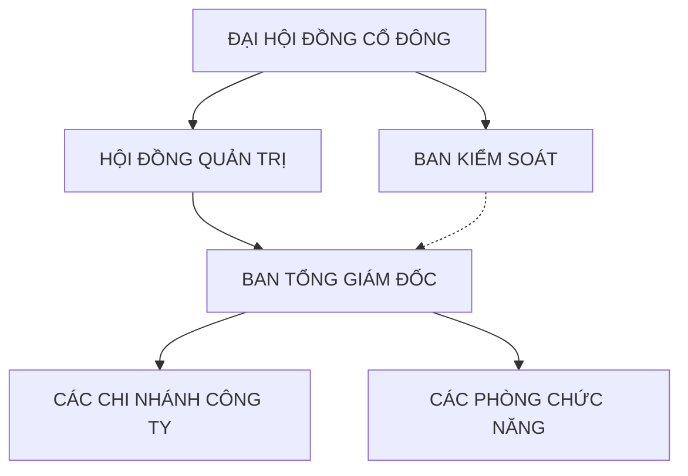

# CÔNG BỐ THÔNG TIN BẤT THƯỜNG

**CÔNG TY CỔ PHẦN HÓA AN (HOA AN JOINT STOCK COMPANY)**  
Số: 35/CV-CTY  
**CỘNG HÒA XÃ HỘI CHỦ NGHĨA VIỆT NAM**  
**Độc lập - Tự do - Hạnh phúc**  
*Đồng Nai, ngày 07 tháng 04 năm 2026*

**Kính gửi:** 
- Ủy ban Chứng khoán Nhà nước
- Sở Giao dịch Chứng khoán thành phố Hồ Chí Minh

1. **Tên công ty niêm yết:** CÔNG TY CỔ PHẦN HÓA AN (HOA AN JOINT STOCK COMPANY)
- Địa chỉ trụ sở chính: 20C KP Cầu Hang, P. Biên Hòa, Đồng Nai
- Điện thoại: 02513954458, Email: info@hoaan.com.vn
- Mã chứng khoán: DHA

2. **Nội dung thông tin công bố:**
Báo cáo thường niên năm 2025.

3. **Thông tin công bố:**
Thông tin này đã được công bố trên trang thông tin điện tử của công ty vào ngày 07/04/2026 tại đường dẫn: `http://hoaancom.vn` mục quan hệ cổ đông/thông tin cổ đông /năm 2026/ Thông báo mời họp và tài liệu ĐHĐCĐ thường niên năm 2026.

Chúng tôi xin cam kết các thông tin công bố trên đây là đúng sự thật và hoàn toàn chịu trách nhiệm trước pháp luật về nội dung các thông tin đã công bố.

**Đại diện tổ chức**  
*Người UQ CBTT*  
*(Ký, ghi rõ họ tên, chức vụ và đóng dấu)*  
**Trần Quốc Trung**

---

# BÁO CÁO THƯỜNG NIÊN NĂM 2025

*(Ban hành kèm theo Thông tư số 96/2020/TT-BTC ngày 16 tháng 11 năm 2020 của Bộ trưởng Bộ Tài chính)*

**CÔNG TY CỔ PHẦN HÓA AN**  
**CỘNG HÒA XÃ HỘI CHỦ NGHĨA VIỆT NAM**  
**Độc lập - Tự do - Hạnh phúc**  
*Đồng Nai, ngày 06 tháng 04 năm 2026*

---

## I. THÔNG TIN CHUNG

### 1. THÔNG TIN KHÁI QUÁT
- **Tên giao dịch:** CÔNG TY CỔ PHẦN HÓA AN
- **Giấy chứng nhận đăng ký doanh nghiệp số:** 3600464464 do Sở Tài chính tỉnh Đồng Nai cấp lần thứ 14 ngày 24/07/2025.
- **Vốn điều lệ:** 151.199.460.000 đồng
- **Vốn chủ sở hữu:** 495.697.055.780 đồng (31/12/2025)
- **Địa chỉ:** 20C, KP Cầu Hang, P. Biên Hòa, tỉnh Đồng Nai
- **Số điện thoại:** 0251.3954458
- **Website:** hoaan.com.vn
- **Mã cổ phiếu:** DHA
- **Quá trình hình thành và phát triển:**

| Năm | Sự kiện |
| :---: | :--- |
| **1980** | Thành lập Xí nghiệp đá Hóa An, trực thuộc Bộ Xây dựng, Công suất thiết kế ban đầu 50.000 m³ đá các loại. |
| **1984** | Nâng sản lượng khai thác lên 200.000 m³/năm. |
| **1994** | Nâng công suất khai thác từ 200.000 m³/năm thành 500.000 m³/năm. |
| **1995** | Đổi tên thành Công ty khai thác đá và vật liệu xây dựng Hóa An, trực thuộc Tổng Công ty vật liệu xây dựng số 1. |
| **1998** | Thành lập thêm Xí nghiệp 2 khai thác đá tại xã Suối Trầu, Huyện Long Thành, Tỉnh Đồng Nai, mỏ có trữ lượng 5,5 triệu m³ và có khả năng khai thác 200.000 m³/năm. |
| **1999** | Công ty nhận chuyển nhượng lại quyền khai thác mỏ Núi Gió, Tỉnh Bình Phước, có công suất khai thác 250.000 m³/năm. |
| **2000** | Chuyển thành công ty cổ phần với vốn điều lệ 25 tỷ đồng, là một trong những doanh nghiệp đầu tiên của Bộ xây dựng tiến hành cổ phần hóa toàn bộ Công ty. |
| **2001** | UBND Tỉnh Đồng Nai cấp phép cho Công ty nâng công suất khai thác lên 1.000.000 m³/năm tại mỏ Đá Hóa An tới năm 2010. |
| **2004** | Cổ phiếu Công ty (DHA) chính thức giao dịch tại Sở GDCK TP.HCM. Vốn điều lệ là 38,5 tỷ đồng. |
| **2006** | Sản lượng sản xuất công nghiệp của Công ty đạt 1.230.000 m³, tổng doanh thu đạt 83,9 tỷ đồng, lợi nhuận sau thuế đạt 22,6 tỷ đồng. |
| **2007** | UBCKNN chấp thuận phát hành thêm cổ phiếu tăng vốn lên thành 100.996.700.000 VND. |
| **2008** | Được Ủy ban nhân dân tỉnh Đồng Nai tặng bằng khen và được chủ tịch nước tặng Huân chương lao động hạng nhất. |
| **2009** | Bộ Xây dựng tặng cờ Đơn vị thi đua xuất sắc ngành xây dựng. Công đoàn xây dựng Việt Nam tặng cờ Đơn vị hoạt động công đoàn xuất sắc. |
| **2010** | Bộ Xây dựng tặng cờ Đơn vị thi đua xuất sắc ngành xây dựng. Công đoàn xây dựng Việt Nam tặng cờ Đơn vị hoạt động công đoàn xuất sắc. Đơn vị có Báo cáo thường niên tốt nhất tại cuộc bình chọn BCTN năm. UBCKNN chấp thuận phát hành thêm cổ phiếu tăng vốn lên thành 151.199.460.000 VND. |
| **2011** | Năm 2005 triển khai đền bù giải phóng mặt bằng dự án mỏ đá Núi Gió, xã Tân Lợi huyện Hớn Quản, tỉnh Bình Phước, chính thức đi vào hoạt động khai thác sản xuất tháng 01 năm 2011. |
| **2011** | Năm 2009 triển khai đầu tư dự án mỏ đá Tân Cang 3, chính thức đi vào hoạt động khai thác sản xuất tháng 3 năm 2011. |
| **2011** | Năm 2008 triển khai đầu tư dự án mỏ đá Thạnh Phú 2, chính thức đi vào hoạt động khai thác sản xuất tháng 10 năm 2011. |
| **2017** | Bộ Xây dựng tặng cờ Đơn vị thi đua xuất sắc ngành xây dựng. |

- **Các sự kiện khác:** không

### 2. NGÀNH NGHỀ VÀ ĐỊA BÀN KINH DOANH:
- **Ngành nghề kinh doanh:** Khai thác và chế biến khoáng sản (đá, cát, sỏi, đất sét)
- **Địa bàn sản xuất kinh doanh:**
  - **CHI NHÁNH CÔNG TY CỔ PHẦN HÓA AN TẠI BIÊN HÒA** (mỏ đá Tân Cang 3).  
    Địa chỉ: Khu phố Thiên Bình, Phường Tam Phước, Tỉnh Đồng Nai.
  - **CHI NHÁNH CÔNG TY CỔ PHẦN HÓA AN TẠI VĨNH CỬU** (mỏ đá Thạnh Phú 2).  
    Địa chỉ: Ấp Ông Hường, Phường Trảng Dài, Tỉnh Đồng Nai.
  - **CHI NHÁNH CÔNG TY CP HÓA AN TẠI BÌNH PHƯỚC** (mỏ đá Núi Gió 2).  
    Địa chỉ: Ấp Núi Gió, Xã Tân Quan, Tỉnh Đồng Nai.

### 3. MÔ HÌNH QUẢN TRỊ, TỔ CHỨC KINH DOANH VÀ BỘ MÁY QUẢN LÝ.
- **MÔ HÌNH QUẢN TRỊ:** Đại hội đồng cổ đông, Hội đồng quản trị, Ban Kiểm soát.

- **CƠ CẤU BỘ MÁY LÃNH ĐẠO - QUẢN LÝ:**
  - HỘI ĐỒNG QUẢN TRỊ.
  - BAN TỔNG GIÁM ĐỐC.
  - GIÁM ĐỐC CÁC CHI NHÁNH CÔNG TY, TRƯỞNG CÁC PHÒNG CHỨC NĂNG.

- **CÁC CÔNG TY CON, CÔNG TY LIÊN KẾT:**
  - **Công ty con:** Công ty Cổ phần Khai thác và Sản xuất đá Xây dựng Ánh Dương
    - Địa chỉ: thôn Ba hồ, xã Công Hải, tỉnh Khánh Hòa.
    - Vốn điều lệ thực góp: 67,219 tỷ đồng (tỉ lệ: 99,997%)
    - Ngành nghề sản xuất kinh doanh chính:

| Mã | Ngành |
| :---: | :--- |
| 0810 | Khai thác đá, cát, sỏi, đất sét |
| 2392 | Sản xuất vật liệu xây dựng từ đất sét |
| 2394 | Sản xuất xi măng, vôi và thạch cao |
| 2395 | Sản xuất bê tông và các sản phẩm từ xi măng và thạch cao |

  - **Công ty liên kết:** Công ty Cổ phần Cơ khí Xây dựng Tân Định.
    - Địa chỉ: Lô E, đường số 2B, Khu CN Đồng An, P. Bình Hòa, TP. Hồ Chí Minh.
    - Vốn điều lệ thực góp: 8,46 tỷ đồng (tỉ lệ: 28,13%)
    - Ngành nghề sản xuất kinh doanh chính:

| Mã | Ngành |
| :---: | :--- |
| 0810 | Khai thác đá, cát, sỏi, đất sét *Chi tiết: Khai thác, chế biến, kinh doanh vật liệu xây dựng (Chỉ hoạt động sau khi được cơ quan có thẩm quyền cấp phép khai thác khoáng sản)* |
| 2511 | Sản xuất các cấu kiện kim loại *Chi tiết: Công nghiệp sản xuất máy móc, phụ tùng, đường ống cấp thoát nước. (trừ xử lý, tráng phủ, xi mạ kim loại)* |
| 2592 | Gia công cơ khí; xử lý và tráng phủ kim loại *Chi tiết: Sản xuất, phục hồi các loại khuôn mẫu (trừ xử lý, tráng phủ, xi mạ kim loại)* |

### 4. ĐỊNH HƯỚNG PHÁT TRIỂN
- **Các mục tiêu chủ yếu của Công ty:** Cung cấp các sản phẩm đạt qui chuẩn, chất lượng tốt, giá cả hợp lý. Đa dạng hóa sản phẩm theo nhu cầu thị trường, củng cố năng lực kỹ thuật, công nghệ để đáp ứng tốt nhất nhu cầu của khách hàng.
- Phát triển toàn diện về tài chính, nguồn nhân lực, công nghệ sản xuất tiên tiến, bảo vệ môi trường, nâng cao mức sống và chế độ đãi ngộ đối với người lao động. Chia sẻ thành quả vật chất và tinh thần với cộng đồng và xã hội.
- Góp phần tạo nên sự gắn kết và nâng cao chất lượng cuộc sống cộng đồng, mang lại sự phồn vinh cùng đất nước, phấn đấu là một công ty luôn có trách nhiệm về mặt xã hội và môi trường.

- **Chiến lược phát triển trung và dài hạn:**
  - Xây dựng và phát triển thương hiệu là một doanh nghiệp khai thác và sản xuất đá xây dựng chất lượng hàng đầu tại khu vực phía Nam.
  - Xây dựng cơ cấu kinh tế công ty bền vững xoay quanh lĩnh vực: khai thác và sản xuất đá xây dựng, nghiên cứu lĩnh vực bất động sản, cơ sở hạ tầng là những ngành nghề liên quan đến tiêu thụ sản phẩm đá xây dựng của công ty.
  - Củng cố và nâng cao chất lượng quản trị, vận hành, sẵn sàng nguồn lực cho mục tiêu tăng trưởng bền vững.

- **Các mục tiêu phát triển bền vững:**
  - Lĩnh vực hoạt động của công ty là khai thác và chế biến đá xây dựng, ảnh hưởng tới môi trường do bụi từ hoạt động khai thác, chế biến đá gây ra, nên công ty có ý thức phải gắn liền với việc bảo vệ môi trường trong quá trình hoạt động. Đây là yếu tố tiên quyết trong chiến lược phát triến bền vững của Công ty. Các hoạt động của Công ty được thực hiện theo đúng qui định về đảm bảo vệ sinh môi trường, trên hiện trường sản xuất luôn có xe tưới nước chống bụi trên các cung đường vận chuyển, tại các trạm nghiền đá được trang bị đầy đủ hệ thống phun sương chống bụi. Nước xả thải từ moong khai thác (nguồn nước phát sinh tại mỏ đá là nước mưa và nước ngầm xuất lộ), được bơm lên trên xử lý qua hố lắng, trước khi xả ra ngoài. Bên cạnh đó, việc quản lý và xử lý chất thải rắn, chất thải nguy hại, có khả năng ngăn ngừa và giảm thiểu các tác động của biến đổi khí hậu và thiên tai được thu gom đúng nơi qui định để xử lý, không phát tán ra môi trường.
  - Định kỳ hàng năm Công ty tiến hành ký hợp đồng đo đạc các thông số về môi trường với đơn vị có chức năng của Nhà nước. Các chỉ số đều nằm trong giới hạn tiêu chuẩn ATVSLĐ.
  - Công ty tiến hành các hoạt động nhằm nâng cao ý thức bảo vệ môi trường cho người lao động như: hướng dẫn sử dụng hiệu quả nguồn tài nguyên thiên nhiên, về các hoạt động bảo vệ môi trường, vệ sinh thường xuyên nơi làm việc, hạn chế tối đa sử dụng chai nhựa, huấn luyện an toàn sử dụng tiết kiệm nguyên nhiên vật liệu trong sản xuất...
  - Tiết kiệm năng lượng (điện, nhiên liệu đầu vào) vừa đảm bảo an ninh năng lượng cho quốc gia, vừa có thể đảm bảo hiệu quả quản lý chi phí cho doanh nghiệp.
  - Tiết kiệm nguồn tài nguyên nước: công ty sử dụng nguồn nước mưa tự nhiên và nước sông cho các hoạt động sản xuất.
  - **Tác động lên môi trường đối với phát thải khí nhà kính:** Không có

### 5. CÁC RỦI RO:
Năm 2026, tình hình kinh tế - chính trị thế giới tiếp tục diễn biến phức tạp; xung đột, chiến tranh tại nhiều khu vực, đặc biệt là khu vực Trung Đông, có thể tác động đến chuỗi cung ứng và làm gia tăng giá nguyên, nhiên vật liệu đầu vào. Trong bối cảnh đó, việc triển khai kế hoạch sản xuất kinh doanh năm 2026 của Công ty dự báo sẽ gặp không ít khó khăn.

Bên cạnh các yếu tố bên ngoài, Công ty còn đối mặt với một số rủi ro trong nước, cụ thể như sau:
- **Rủi ro về pháp lý:**
  - Công ty hoạt động trong lĩnh vực khai thác và chế biến khoáng sản, chịu sự điều chỉnh của hệ thống pháp luật liên quan đến khoáng sản, đất đai, môi trường và các quy định chuyên ngành khác. Việc thay đổi chính sách, quy hoạch hoặc quy định của cơ quan Nhà nước và địa phương có thể ảnh hưởng trực tiếp đến hoạt động sản xuất kinh doanh của Công ty.
  - *Biện pháp:* Chủ động theo dõi, cập nhật kịp thời các quy định pháp luật mới; tăng cường công tác rà soát, hoàn thiện hồ sơ pháp lý; đảm bảo các hoạt động sản xuất kinh doanh tuân thủ đầy đủ quy định hiện hành; đồng thời chủ động làm việc với cơ quan chức năng để tháo gỡ các vướng mắc phát sinh.
- **Rủi ro về an toàn lao động:**
  - Hoạt động khai thác, chế biến đá tiềm ẩn nhiều nguy cơ mất an toàn, có thể xảy ra sự cố, tai nạn lao động nếu không được kiểm soát chặt chẽ, gây thiệt hại về con người, tài sản và ảnh hưởng đến hoạt động sản xuất kinh doanh của Công ty.
  - *Biện pháp:* Xác định công tác an toàn, vệ sinh lao động là nhiệm vụ trọng tâm; tăng cường tuyên truyền, đào tạo, huấn luyện định kỳ về an toàn lao động; trang bị đầy đủ phương tiện bảo hộ lao động; kiểm tra, giám sát thường xuyên việc tuân thủ quy trình, quy định an toàn; cải thiện điều kiện và môi trường làm việc nhằm hạn chế tối đa rủi ro.

---

## II. TÌNH HÌNH HOẠT ĐỘNG TRONG NĂM

### 1. TÌNH HÌNH HOẠT ĐỘNG SẢN XUẤT KINH DOANH

#### 1.1. Kết quả hoạt động sản xuất kinh doanh năm 2025 (theo BCTC của công ty):

| CHỈ TIÊU | ĐVT | Thực hiện 2024 | Kế hoạch 2025 | Thực hiện 2025 | Tỷ lệ % TH2025 / TH2024 | Tỷ lệ % TH2025 / KH2025 |
| :--- | :---: | :---: | :---: | :---: | :---: | :---: |
| 1. Tổng sản phẩm đá các loại tiêu thụ | m³ | 1.677.623 | 1.570.000 | 1.808.650 | 107,8% | 115,2% |
| 2. Tổng doanh thu | 1.000đ | 309.366.590 | 315.600.000 | 429.234.685 | 138,7% | 136,0% |
| 2.1- Doanh thu bán hàng và cung cấp dịch vụ | 1.000đ | 296.193.414 | 303.600.000 | 395.364.600 | 133,5% | 130,2% |
| 2.2- Doanh thu hoạt động tài chính | 1.000đ | 13.168.901 | 12.000.000 | 30.116.609 | 228,7% | 251,0% |
| 2.2- Doanh thu khác | 1.000đ | 4.275 | - | 3.753.476 | 87800,6% | - |
| 3. Tổng lợi nhuận trước thuế | 1.000đ | 68.270.488 | 72.000.000 | 139.853.870 | 204,9% | 194,2% |
| 4. Tổng lợi nhuận sau thuế | 1.000đ | 51.706.620 | 57.600.000 | 116.782.965 | 225,9% | 202,7% |
| 5. Thu nhập theo SP bình quân/tháng/NLĐ | 1.000đ | 13.400 | 14.600 | 18.800 | 140,3% | 128,8% |
| 6. Cổ tức theo nghị quyết ĐHĐCĐ | % | 30% | 15% - 30% | 30% (*) | 100,0% | 100,0% |

(*) *Cổ tức năm 2025: Theo kế hoạch, tỷ lệ cổ tức dự kiến từ 15% đến 30% bằng tiền mặt. Trong năm 2025, Công ty chưa thực hiện tạm ứng hoặc chi trả cổ tức. Dự kiến trình Đại hội đồng cổ đông chia 30%/ VĐL.*

#### 1.2. Tổng hợp kết quả sxkd năm 2025 - hợp nhất:

| CHỈ TIÊU | ĐVT | Thực hiện 2024 | Kế hoạch 2025 | Thực hiện 2025 | Tỷ lệ % TH2025 / TH2024 | Tỷ lệ % TH2025 / KH2025 |
| :--- | :---: | :---: | :---: | :---: | :---: | :---: |
| 1. Tổng sản phẩm đá các loại tiêu thụ | m³ | 1.677.623 | 1.570.000 | 1.876.116 | 111,8% | 119,5% |
| 2. Tổng doanh thu | 1.000đ | 309.366.590 | 315.600.000 | 437.851.129 | 141,5% | 138,7% |
| 2.1- Doanh thu bán hàng và cung cấp dịch vụ | 1.000đ | 296.193.414 | 303.600.000 | 403.979.083 | 136,4% | 133,1% |
| 2.2- Doanh thu hoạt động tài chính | 1.000đ | 13.168.901 | 12.000.000 | 30.118.570 | 228,7% | 251,0% |
| 2.2- Doanh thu khác | 1.000đ | 4.275 | - | 3.753.476 | 87.800,6% | - |
| 3. Tổng lợi nhuận trước thuế | 1.000đ | 68.270.488 | 72.000.000 | 132.814.252 | 194,5% | 184,5% |
| 4. Tổng lợi nhuận sau thuế | 1.000đ | 51.706.620 | 57.600.000 | 109.743.347 | 212,2% | 190,5% |

### 2. TỔ CHỨC VÀ NHÂN SỰ
**Danh sách Ban điều hành:**

#### 1. ÔNG NGUYỄN VĂN LƯƠNG - TV HĐQT - TỔNG GIÁM ĐỐC
*(Bổ nhiệm ngày 13/03/2024)*
- **Năm sinh:** 1977
- **Trình độ chuyên môn:** Th.s kinh tế, cử nhân quản trị kinh doanh
- **Số lượng cổ phần:** 137.740 CP (0,93%) *(DS chốt ngày 10/3/2026)*

*Quá trình công tác:*
| Thời gian | Chức vụ công tác, nơi công tác |
| :--- | :--- |
| 08/1999 - 05/2009 | Chuyên viên Phòng kế toán tài chính, Công ty CP Hóa An |
| 06/2009 - 06/2010 | Chuyên viên Phòng kế toán tài chính, TV-Ban kiểm soát, Công ty CP Hóa An |
| 07/2010 - 06/2014 | Giám đốc Chi nhánh Công ty CP Hóa An tại Vĩnh Cửu |
| 07/2014 - 05/2015 | Phó Tổng giám đốc Cty cổ phần Hóa An, kiêm Giám đốc CN Cty CP Hóa An tại Vĩnh Cửu |
| 06/2015 - 12/2016 | Phó Tổng giám đốc Cty cổ phần Hóa An |
| 01/2017 - 03/2024 | Thành viên HĐQT - Phó Tổng giám đốc Cty cổ phần Hóa An |
| 04/2019 - Nay | TV HĐQT Công ty cổ phần Sonadezi Châu Đức |
| 04/2021 - Nay | TV HĐQT Công ty Cổ phần Phát triển Đô thị Công nghiệp Số 2 |
| 03/2024 - Nay | Thành viên HĐQT - Tổng giám đốc Công ty cổ phần Hóa An |

#### 2. ÔNG TRỊNH ĐÌNH TRỌNG - PHÓ TỔNG GIÁM ĐỐC
*(Bổ nhiệm ngày 09/04/2024)*
- **Năm sinh:** 1979
- **Trình độ chuyên môn:** Kỹ sư cơ khí, Cử nhân QTKD
- **Số lượng cổ phần:** 0 CP

*Quá trình công tác:*
| Thời gian | Chức vụ công tác, nơi công tác |
| :--- | :--- |
| 08/2002 – 04/2003 | Nhân viên kỹ thuật, Công ty chế tạo động cơ VINAPRO |
| 05/2003 - 06/2011 | Chuyên viên Phòng Kế hoạch - Kỹ thuật |
| 07/2011 - 05/2015 | Phó trưởng phòng Tiếp thị Bán Hàng |
| 06/2015 - 03/2024 | Giám đốc Chi nhánh Công ty CP Hóa An tại Vĩnh Cửu |
| 4/2024 đến nay | Phó Tổng giám đốc Cty cổ phần Hóa An |

#### 3. ÔNG ĐỖ VĂN NGỌC - KẾ TOÁN TRƯỞNG
- **Năm sinh:** 1979
- **Trình độ chuyên môn:** Cử nhân kế toán, Kế toán trưởng
- **Số lượng cổ phần:** 0 CP

*Quá trình công tác:*
| Thời gian | Chức vụ công tác, nơi công tác |
| :--- | :--- |
| 06/2003 - 07/2004 | Nhân viên Phòng kế toán, Công ty CP Sứ Thiên Thanh |
| 08/2004 - 04/2017 | Nhân viên Phòng kế toán tài chính, Công ty CP Hóa An |
| 05/2017 - 07/2021 | Phó TP Kế toán Công ty CP Hóa An |
| 08/2021 - Nay | Kế toán trưởng Công ty cổ phần Hóa An |

- **Những thay đổi trong Ban Điều hành:** (không thay đổi trong năm).
- **Số lượng cán bộ, nhân viên:** tại thời điểm 31/12/2025 là 106 người.

### 3. TÌNH HÌNH ĐẦU TƯ, TÌNH HÌNH THỰC HIỆN CÁC DỰ ÁN.
- **a) Các khoản đầu tư lớn:**
  - Năm 2025 công ty đầu tư mua: 99,997% cổ phần của Công ty Cổ phần Khai thác và Sản xuất đá xây dựng Ánh Dương.  
    Địa chỉ: thôn Ba hồ, xã Công Hải, tỉnh Khánh Hòa;  
    Hiện tại mỏ đá đã đi vào hoạt động ổn định, Kế hoạch năm 2026 sản xuất có lợi nhuận.
  - Công ty hiện vẫn nắm giữ cổ phiếu Công ty Cổ phần Xây dựng và Sản xuất Vật liệu Xây dựng Biên Hòa (mã CK: VLB), Tổng giá trị đầu tư đến 31/12/2025 là 155,78 tỷ đồng, số lượng 3.910.800 cổ phần = 8,33% Vốn Điều lệ (của VLB).
- **b) Các công ty con, công ty liên kết:** Công ty cổ phần cơ khí xây dựng Tân Định đang hoạt động kinh doanh.

### 4. TÌNH HÌNH TÀI CHÍNH
- **a) Tình hình tài chính của công ty:**

| Chỉ tiêu | Năm 2024 | Năm 2025 | % tăng giảm/ % |
| :--- | :---: | :---: | :---: |
| Tổng giá trị tài sản | 470.446.189.023 | 538.335.270.522 | 14,43% |
| Doanh thu thuần | 296.193.414.952 | 395.364.600.410 | 33,48% |
| Lợi nhuận từ hoạt động KD | 75.610.276.808 | 138.307.295.513 | 82,92% |
| Lợi nhuận khác | (7.339.788.982) | 1.546.574.963 | - |
| Lợi nhuận trước thuế | 68.270.487.826 | 139.853.870.476 | 104,85% |
| Lợi nhuận sau thuế | 51.706.620.002 | 116.782.965.286 | 125,85% |
| Tỷ lệ lợi nhuận sau thuế trả cổ tức | 85,42% | 37,82% | |

- **b) Các chỉ tiêu tài chính chủ yếu công ty:**

| Chỉ tiêu | Năm 2024 | Năm 2025 | Ghi chú |
| :--- | :---: | :---: | :---: |
| **1. Chỉ tiêu về khả năng thanh toán** | | | |
| + Hệ số thanh toán ngắn hạn: | 10,1 | 8,86 | |
| + Hệ số thanh toán nhanh: | 10,1 | 8,78 | |
| **2. Chỉ tiêu về cơ cấu vốn** | | | |
| + Hệ số Nợ/Tổng tài sản | 9,19% | 7,92% | |
| + Hệ số Nợ/Vốn chủ sở hữu | 10,12% | 8,6% | |
| **3. Chỉ tiêu về năng lực hoạt động** | | | |
| + Vòng quay hàng tồn kho: | 119 | 188 | (Lần) |
| + Doanh thu thuần/Tổng tài sản | 62,9% | 73,44% | |
| **4. Chỉ tiêu về khả năng sinh lời** | | | |
| + Hệ số Lợi nhuận sau thuế/Doanh thu thuần | 17,5% | 29,54% | |
| + Hệ số Lợi nhuận sau thuế/Vốn chủ sở hữu | 12,1% | 26,56% | |
| + Hệ số Lợi nhuận sau thuế/Tổng tài sản | 11,0% | 21,69% | |
| + Hệ số LN từ HĐKD/Doanh thu thuần | 25,5% | 34,98% | |
| + Lãi cơ bản trên cổ phiếu (đồng/CP) | 3.512 | 7.933 | |

### 5. CƠ CẤU CỔ ĐÔNG, THAY ĐỔI VỐN ĐẦU TƯ CỦA CHỦ SỞ HỮU.
- **a) Cổ phần:**
  - Tổng số cổ phần phát hành: 15.119.946 cổ phần phổ thông.
  - Trong đó: số lượng cổ phần lưu hành và chuyển nhượng tự do là 14.721.073 cổ phần; cổ phiếu quỹ là 398.873 cổ phần.

- **b) Cơ cấu cổ đông:**  
  *(Theo DS cổ đông chốt ngày 09/03/2026, ngày ĐKCC 10/03/2026)*

| STT | Tên cổ đông | Phân loại CĐ | Số lượng cổ phần | Tỉ lệ sở hữu | Tỉ lệ biểu quyết |
| :---: | :--- | :--- | :---: | :---: | :---: |
| 1 | Tổng Cty VLXD số 1 | Cổ đông lớn | 3.418.543 | 22,61% | 23,22% |
| 2 | La Mỹ Phượng | Cổ đông lớn | 1.381.100 | 9,13% | 9,38% |
| 3 | Cty TNHH KTTN Lợi Lộc | Cổ đông lớn | 1.105.600 | 7,31% | 7,51% |
| 4 | Các cổ đông còn lại | Cổ đông < 5% | 8.815.830 | 58,31% | 59,89% |
| 5 | Cổ phiếu quỹ | | 398.873 | 2,64% | 0% |
| | **CỘNG** | | **15.119.946** | **100,00%** | **100,00%** |
| | **Phân loại khác** | | | | |
| 1 | 2.020 cổ đông | Cá nhân trong nước | 6.531.821 | 43,2% | 44,37% |
| 2 | 23 cổ đông | Tổ chức trong nước | 5.827.700 | 38,54% | 39,59% |
| 3 | 254 cổ đông | Cá nhân nước ngoài | 1.249.906 | 8,27% | 8,49% |
| 4 | 21 cổ đông | Tổ chức nước ngoài | 1.111.646 | 7,35% | 7,55% |
| 5 | Cổ phiếu quỹ | | 398.873 | 2,64% | 0 |
| **TS** | **2.682 cổ đông** | **CỘNG** | **15.119.946** | **100%** | **100%** |

- **c) Tình hình thay đổi vốn đầu tư của chủ sở hữu:** không thay đổi
- **d) Giao dịch cổ phiếu quỹ:** Số lượng cổ phiếu quỹ hiện tại là: 398.873 CP.
- **e) Các chứng khoán khác:** không có, không phát hành.

### 6. BÁO CÁO TÁC ĐỘNG LIÊN QUAN ĐẾN MÔI TRƯỜNG VÀ XÃ HỘI CỦA CÔNG TY.
- **6.1. Tác động lên môi trường:**
  - Tổng phát thải khí nhà kính (GHG) trực tiếp và gián tiếp: không đáng kể.
  - Các sáng kiến và biện pháp giảm thiểu phát thải khí nhà kính.
- **6.2. Quản lý nguồn nguyên vật liệu:**
  - *a) Tổng lượng nguyên vật liệu được sử dụng để sản xuất và đóng gói các sản phẩm và dịch vụ chính của tổ chức trong năm:*  
    Nguyên vật liệu công ty sử dụng là đá nguyên khai (đá hộc) chế biến ra sản phẩm đầu ra là đá 1x2, đá Dmax các loại, đá 0x4, đá Mi… Tổng khối lượng đầu vào và đầu ra là bằng nhau, năm 2025 Công ty chế biến sản xuất ra 1.876.116 m³ đá thành phẩm các loại, sản phẩm của công ty không phải đóng gói nên không sử dụng vật liệu đóng gói.
  - *b) Báo cáo tỉ lệ phần trăm nguyên vật liệu được tái chế được sử dụng để sản xuất sản phẩm và dịch vụ chính của tổ chức:* Không có nguyên vật liệu tái chế.
- **6.3. Tiêu thụ năng lượng:**
  - *a) Năng lượng tiêu thụ trực tiếp và gián tiếp:* trong năm 2025 toàn công ty sử dụng hết khoảng 7.276.600 KW điện, trị giá 14,23 tỷ đồng.
  - *b) Năng lượng tiết kiệm được thông qua các sáng kiến sử dụng năng lượng hiệu quả:* trong quá trình sản xuất công ty khoán gọn các chi phí nên các đơn vị, bộ phận sử dụng năng lượng đã ở mức tiết kiệm nhất có thể. Đối với khu vực văn phòng, hành chính, các thiết bị điện chỉ được sử dụng (bật) ở mức vừa đủ dùng để tránh lãng phí điện năng, sử dụng các thiết bị công nghệ mới như đèn LED, máy lạnh inverter…
- **6.4. Tiêu thụ nước:**
  - *a) Nguồn cung cấp nước và lượng nước sử dụng:* Trong năm công ty sử dụng lượng nước khoảng 33.000m³, gồm nước dùng sinh hoạt, và nước dùng cho sản xuất (chống bụi). Nguồn nước sinh hoạt là nước máy, nguồn nước dùng cho sản xuất bơm từ các hồ chứa, sông ngòi tự nhiên để chống bụi tại hiện trường sản xuất.
  - *b) Tỷ lệ phần trăm và tổng lượng nước tái chế và tái sử dụng:* không có nước tái chế, hình thức sử dụng nước là rải đường, phun sương chống bụi trong quá trình sản xuất, nên không thể thu gom tái chế được.
- **6.5. Tuân thủ pháp luật về bảo vệ môi trường:**
  - *a) Số lần bị xử phạt vi phạm do không tuân thủ luật pháp và các quy định về môi trường:* Công ty tuân thủ tốt các qui định của pháp luật về bảo vệ môi trường nên không bị phạt.
- **6.6. Chính sách liên quan đến người lao động:**
  - *a) Số lượng lao động, mức lương trung bình đối với người lao động:*
    - Số lượng người lao động tại thời điểm 31/12/2025 là 106 người, mức lương sản phẩm trung bình là 18,8trđ/người /tháng.
    - Phân loại lao động như sau:

| Cơ cấu lao động | Số lượng (người) | Tỷ lệ (%) |
| :--- | :---: | :---: |
| **Phân theo trình độ** | **106** | **100%** |
| Thạc sỹ | 4 | 3,77% |
| Đại học | 37 | 34,9% |
| Cao đẳng | 2 | 1,89% |
| Trung cấp | 14 | 13,21% |
| Sơ cấp, công nhân kỹ thuật | 35 | 33,02% |
| Lao động phổ thông | 14 | 13,2% |
| **Phân theo độ tuổi** | **106** | **100,00%** |
| Dưới 35 tuổi | 8 | 7,6% |
| Từ 35 đến 45 tuổi | 54 | 50,9% |
| Từ 46 đến 55 tuổi | 33 | 31,1% |
| Trên 55 tuổi | 11 | 10,4% |
| **Phân theo giới tính** | **106** | **100,00%** |
| Nam | 86 | 81,13% |
| Nữ | 20 | 18,87% |
| **Phân theo hợp đồng lao động** | **106** | **100,00%** |
| Không xác định thời hạn | 105 | 99,06% |
| Xác định thời hạn từ đủ 12 tháng đến 36 tháng | 01 | 0,94% |

  - *b) Chính sách lao động nhằm đảm bảo sức khỏe, an toàn và phúc lợi của người lao động:*
    - Công ty luôn chú trọng đến quyền lợi của người lao động trong công ty, đặc biệt là về vấn đề an toàn lao động. Do đặc thù ngành khai thác mỏ, rủi ro về tai nạn lao động tiềm ẩn cao nên Công ty mua bảo hiểm tai nạn đầy đủ cho người lao động của Tổng công ty bảo hiểm Việt Nam, trong đó đối với công nhân lao động trong môi trường nguy hiểm, độc hại công ty mua ở mức cao nhất.
    - Trang bị, cấp phát phương tiện, quần áo bảo hộ lao động, trang phục cho toàn thể người lao động theo đúng quy định của pháp luật.
    - Hàng năm công ty tổ chức khám sức khỏe định kỳ cho toàn thể người lao động, khám bệnh nghề nghiệp cho công nhân lao động trong môi trường độc hại, tổ chức quan trắc môi trường lao động hàng năm. Trang bị các vật tư, thuốc y tế đầy đủ theo qui định tại nơi làm việc.
    - Chế độ phúc lợi: hàng năm công ty đều tổ chức đi thăm quan, du lịch nghỉ mát cho toàn thể cán bộ công ty nhân viên phù hợp với tình hình tài chính của công ty, năm 2025 công ty tổ chức đi du lịch nghỉ dưỡng tại Đà Nẵng – Hội An. Công ty luôn hỗ trợ các phong trào đoàn thể trong các hoạt động văn hóa, thể thao, văn nghệ tạo đời sống tinh thần tích cực cho người lao động.
  - *c) Hoạt động đào tạo người lao động:*
    - *Số giờ đào tạo trung bình mỗi năm, theo nhân viên và theo phân loại nhân viên:* Là doanh nghiệp hoạt động trong ngành khai thác đá, nhiều rủi ro về an toàn lao động, nên hàng năm công ty đều tổ chức học về an toàn lao động cho tất cả người lao động theo từng nhóm ngành theo qui định của pháp luật. Các chương trình tập huấn về chuyên môn nghiệp vụ, công ty đều cử đi tập huấn các đối tượng người lao động có liên quan.
    - Các chương trình phát triển kỹ năng và học tập liên tục để hỗ trợ người lao động đảm bảo có việc làm và phát triển sự nghiệp. Công ty luôn tạo điều kiện cho người lao động tự học tập để nâng cao trình độ chuyên môn nghiệp vụ và các kỹ năng khác phục vụ cho công việc và cuộc sống.
- **6.7. Báo cáo liên quan đến trách nhiệm đối với cộng đồng địa phương:**  
  Công ty luôn có ý thức trách nhiệm trong việc tham gia các hoạt động xã hội, từ thiện, phát triển cộng đồng, bảo vệ môi trường thông qua việc ủng hộ về tài chính; như ủng hộ các địa phương nơi công ty có hoạt động sản xuất kinh doanh trong phát triển xây dựng nông thôn mới, ủng hộ các phong trào hoạt động cộng đồng, đoàn thể, quỹ bảo trợ trẻ em, hỗ trợ các gia đình CBCNV có hoàn cảnh khó khăn… Tổng số tiền ủng hộ hơn 1,7 tỷ đồng.

---

## III. BÁO CÁO VÀ ĐÁNH GIÁ CỦA BAN TỔNG GIÁM ĐỐC

### 1. Đánh giá kết quả hoạt động sản xuất kinh doanh
Thực hiện Nghị quyết tại Đại hội cổ đông thường niên Công ty năm 2025. Trong năm qua dưới sự lãnh đạo của Hội đồng quản trị, Ban Tổng giám đốc Công ty cùng tập thể cán bộ công nhân lao động đã tích cực triển khai các hoạt động sản xuất kinh doanh, vượt qua những khó khăn khách quan do tình hình trong nước và quốc tế có nhiều biến động phức tạp và các khó khăn nội tại của công ty để từng bước thực hiện hoàn thành các mục tiêu, nhiệm vụ mà Nghị quyết đại hội đồng cổ đông Công ty đề ra.

Những tiến bộ công ty đã đạt được: Năm 2025 các chỉ tiêu sản xuất kinh doanh chủ yếu như sản lượng, doanh thu, lợi nhuận, thu nhập tiền lương người lao động, nộp ngân sách đều vượt kế hoạch Đại hội đồng cổ đông giao.

- **1.1 Công tác tiêu thụ sản phẩm và công nợ:**  
  Theo tình hình tiêu thụ trên thị trường, Ban Tổng giám đốc giao chỉ tiêu bán hàng bình quân mỗi tháng cho từng Chi nhánh đồng thời có chế độ khuyến khích tiền thưởng khi thực hiện vượt chỉ tiêu tháng cho các Chi nhánh, qua đó mang lại những hiệu quả tích cực, Người lao động nỗ lực và tích cực hơn trong công việc, chăm sóc khách hàng tốt hơn để mở rộng tiêu thụ, các chi phí được quản lý tốt hơn.  
  Quản trị rủi ro của toàn doanh nghiệp, quản lý công nợ giảm tối đa việc bị chiếm dụng vốn, quản lý hàng tồn kho, tăng vòng quay vốn để tăng hiệu quả của việc sử dụng vốn.  
  Kế hoạch kinh doanh được đánh giá và theo dõi bám sát hàng tháng, do vậy đã có những điều chỉnh kịp thời trước những biến động của thị trường để hoạt động của Công ty được ổn định, hoàn thành vượt mức các chỉ tiêu kế hoạch năm 2025.  
  Không để phát sinh nợ xấu, bên cạnh đó do có sự chỉ đạo của Lãnh đạo Công ty, Tổ thu hồi công nợ đã thu được một số khoản nợ xấu, khó đòi.

- **1.2 Công tác quản lý:**  
  Thường xuyên rà soát, đánh giá và khắc phục kịp thời tồn tại trong công tác quản lý, đảm bảo sự thông suốt về qui trình công việc từ lãnh đạo đến các nhân viên, công nhân lao động.  
  Thường xuyên đôn đốc tới các cấp quản lý để nâng cao hiệu quả công tác, cũng như năng lực quản lý để triển khai các kế hoạch sản xuất kinh doanh đạt được hiệu quả cao.  
  Tăng cường phân quyền cho các trưởng bộ phận để đảm bảo tính tự chủ, hiệu quả, sâu sát và nhanh chóng trong việc triển khai các công việc theo kế hoạch chung.

- **1.3 Công tác quản lý máy móc thiết bị:**  
  Hệ thống trang thiết bị, máy móc, phương tiện… hoạt động trên hiện trường của Công ty thường xuyên được kiểm tra và bảo dưỡng, để đáp ứng yêu cầu sản xuất tốt nhất, khi thị trường tiêu thụ có nhu cầu cao, nhằm phát huy hết theo công suất của mỗi mỏ.

- **1.4 Công tác chỉ đạo điều hành sản xuất:**  
  Ban Điều hành luôn bám sát nhiệm vụ kế hoạch sản xuất kinh doanh để chỉ đạo thực hiện sao cho có hiệu quả tốt nhất, xử lý và giải quyết các vướng mắc, phát sinh linh hoạt và kịp thời trong quá trình sản xuất.  
  Công tác kiểm tra kỹ thuật và chất lượng sản phẩm được thực hiện thường xuyên, để đảm bảo sản phẩm sản xuất phù hợp thị hiếu thị trường, đảm bảo chất lượng qui cách.  
  Công tác an toàn vệ sinh lao động được đặt lên hàng đầu, thường xuyên kiểm tra, nhắc nhở các bộ phận phải luôn chú trọng công tác an toàn lao động, vì khi xảy ra mất an toàn thì thiệt hại sẽ khó lường, ảnh hưởng tới nhiều mặt của công ty, không chỉ là hiệu quả sản xuất kinh doanh.  
  Bên cạnh đó công tác vệ sinh môi trường và điều kiện làm việc được chú trọng, phải tuân thủ tốt theo các qui định của pháp luật và cải thiện thường xuyên.

### 2. Tình hình tài chính
- **a) Tình hình tài sản:**  
  Ban Tổng giám đốc Công ty thường xuyên chỉ đạo, giám sát về công tác quản lý tài chính của Công ty, cụ thể:  
  - Chủ động cân đối sử dụng vốn lưu động linh hoạt đảm bảo cho hoạt động sản xuất kinh doanh của Công ty.  
  - Thường xuyên cập nhật thông tin tài chính, sản xuất của từng bộ phận để Ban Điều hành nhìn rõ hơn được các vấn đề trong sản xuất kinh doanh để có điều chỉnh kịp thời.  
  - Quản lý giám sát công nợ khách hàng đảm bảo không phát sinh quá hạn mức. Xem xét các hạn mức tài chính cho từng khách hàng để giảm rủi ro nợ xấu.  
  - Thực hiện lập dự toán đối với các hợp đồng thi công và theo dõi sát việc thực hiện để đảm bảo lãnh đạo Công ty luôn quản lý, nắm bắt được việc triển khai đúng mục tiêu ban đầu.

- **b) Tình hình nợ phải trả:**  
  - *Tình hình nợ hiện tại, biến động lớn về các khoản nợ:* tại ngày 31/12/2025 nợ phải trả của công ty là 42,64 tỷ, trong đó chủ yếu là các khoản nợ các đối tác, tiền thuế, tiền lương người lao động, số dư nợ trên báo cáo tài chính là do việc thanh toán luân phiên gối đầu hàng tháng.  
  - *Phân tích nợ xấu phải trả, ảnh hưởng chênh lệch của tỉ lệ giá hối đoái đến kết quả hoạt động sản xuất kinh doanh của công ty, ảnh hưởng chênh lệch lãi vay:* công ty không có nợ xấu phải trả, không có sản phẩm xuất khẩu, nhập khẩu nên không ảnh hưởng tỉ giá hối đoái. Công ty không phải đi vay.

### 3. Những cải tiến về cơ cấu tổ chức, chính sách, quản lý:
Hiện tại về cơ cấu tổ chức, các chính sách, mô hình quản lý của công ty đang thực hiện khá ổn định, hợp lý và đạt hiệu quả tốt nên chưa cần thay đổi.

### 4. Kế hoạch phát triển trong tương lai:
Tiếp tục nghiên cứu đầu tư vào lĩnh vực mới, đầu tư thêm mỏ mới, hoặc đầu tư vào các công ty cùng ngành hoặc liên kết, liên doanh khi có cơ hội khả thi.

### 5. Giải trình của Ban Giám đốc đối với ý kiến kiểm toán (nếu có):
Ý kiến kiểm toán chấp nhận toàn phần.

### 6. Báo cáo đánh giá liên quan đến trách nhiệm về môi trường và xã hội của công ty.
- **a. Đánh giá liên quan đến các chỉ tiêu môi trường:**  
  Trong năm 2025 công ty thực hiện đầy đủ các qui định của pháp luật về bảo vệ môi trường như hợp đồng với cơ quan chức năng để quan trắc môi trường lao động tại tất cả các địa bàn sản xuất kinh doanh của công ty (như đo nồng độ bụi, tiếng ồn, lượng khí CO2, ánh sáng các khu vực làm việc…, quan trắc chất lượng nguồn nước, qui trình xử lý nước thải, tất cả phải đảm bảo theo qui chuẩn trước khi hoạt động sản xuất kinh doanh. Đã tiến hành trồng cây xanh các khu vực xung quanh nơi sản xuất, đường vận chuyển, hàng năm ký quỹ phục hồi môi trường theo qui định…  
  - *Việc quản lý chất thải rắn thông thường:* rác thải sinh hoạt được công ty môi trường đi thu gom xử lý hàng ngày, bao bì carton do cơ sở nhỏ lẻ thu gom, đất đá không rõ qui cách sử dụng đắp nền đường nội bộ.  
  - *Việc quản lý chất thải rắn nguy hại:* bóng đèn huỳnh quang, giẻ lau, dầu nhớt thải, hộp mực in do Công ty môi trường thu gom xử lý.  
  - Định kỳ theo qui định công ty đều lập Báo cáo hiện trạng khai thác và sử dụng nước, Báo cáo hiện trạng xả nước thải vào nguồn nước, Báo cáo công tác bảo vệ môi trường…gửi các cơ quan chức năng của Tỉnh để kiểm tra và giám sát việc thực hiện bảo vệ môi trường của công ty.  
  - Việc tiêu thụ điện, nước, nguyên nhiên vật liệu, phát thải đều được kiểm soát chặt chẽ và tiết kiệm nhất, hướng tới là đơn vị sản xuất kinh doanh ngày càng xanh hơn.

- **b. Đánh giá liên quan đến vấn đề người lao động:**  
  - Số lượng lao động bình quân năm 2025 là 107 người.  
  - Tiền lương bình quân theo sản phẩm tiêu thụ là 18.800.000đ/người /tháng  
  - *Chính sách đối với người lao động:*  
    - Khám sức khỏe cho người lao động: thực hiện khám tổng quát hàng năm cho toàn bộ người lao động công ty. Khám bệnh nghề nghiệp cho Người làm công việc nặng nhọc độc hại nguy hiểm.  
    - Mua bảo hiểm tai nạn cho toàn thể người lao động hàng năm.  
    - An toàn lao động: hàng năm đều tổ chức tập huấn về an toàn vệ sinh lao động cho tất cả người lao động công ty theo từng phân nhóm theo qui định của pháp luật.  
    - Tổ chức cho người lao động đi du lịch, nghỉ dưỡng hàng năm. Năm 2025 tổ chức du lịch, nghỉ dưỡng tại thành phố Đà Nẵng - Hội An.  
    - Các chế độ chính sách khác: BHXH, BHYT, BHTN, bồi dưỡng ăn ca, độc hại… đều thực hiện đầy đủ theo qui định của pháp luật.

- **c. Đánh giá liên quan đến trách nhiệm của doanh nghiệp đối với cộng đồng địa phương:**  
  Công ty luôn chú trọng đến công tác xã hội, cộng đồng, đóng góp vào sự phát triển bền vững, ổn định của xã hội. Thông qua các nguồn tài chính đóng góp cho địa phương, ủng hộ phòng chống thiên tai, hỗ trợ người có hoàn cảnh khó khăn, tài trợ các phong trào đoàn thể của các địa phương…(số liệu chi tiết tại mục II-6.7).

---

## IV. ĐÁNH GIÁ CỦA HỘI ĐỒNG QUẢN TRỊ VỀ HOẠT ĐỘNG CỦA CÔNG TY

### 1. Đánh giá của Hội đồng quản trị về các mặt hoạt động của Công ty, trong đó có đánh giá liên quan đến trách nhiệm môi trường và xã hội:
- **Đánh giá tình hình chung:** Năm 2025, hoạt động sản xuất và tiêu thụ sản phẩm đá của công ty ổn định. Tình hình thị trường tài chính được cải thiện dần và tăng trưởng tốt, các chỉ tiêu sản lượng và doanh thu, lợi nhuận đều vượt kế hoạch năm 2025. Thu nhập người lao động tốt, tương ứng theo sản lượng tiêu thụ, các chế độ quyền lợi được thực hiện đầy đủ và đúng qui định.
- **Về trách nhiệm môi trường và xã hội:** Công ty thực hiện tốt các qui định, qui chuẩn về môi trường, định kỳ có báo cáo cơ quan chức năng và qua kiểm tra của cơ quan chức năng công ty không vi phạm, không bị phạt liên quan đến việc bảo vệ môi trường. Công tác xã hội công ty cũng luôn chú trọng đóng góp, ủng hộ các địa phương trong nhiều chương trình như phát triển nông thôn mới, hỗ trợ các phong trào của địa phương, hỗ trợ người có hoàn cảnh khó khăn…

### 2. Đánh giá của Hội đồng quản trị về hoạt động của Ban Tổng Giám đốc công ty
Ban Tổng Giám đốc thể hiện tinh thần trách nhiệm cao trong công việc, hoàn thành tốt vai trò của mình, luôn tìm tòi, đề ra các giải pháp điều hành kịp thời, linh hoạt, phù hợp. Tổng giám đốc thường xuyên báo cáo cho HĐQT về các hoạt động của Công ty, chủ trương, định hướng, chỉ đạo của HĐQT đưa ra được Ban TGĐ triển khai đầy đủ, kịp thời, đúng các quy định pháp luật hiện hành và quy chế hoạt động của Công ty, vì vậy HĐQT nắm sát tình hình hoạt động, có những chỉ đạo kịp thời, đúng đắn, mang lại hiệu quả tốt nhất cho hoạt động sản xuất kinh doanh.

HĐQT đánh giá công tác điều hành của Ban Tổng giám đốc trong quá trình thực hiện kế hoạch sản xuất kinh doanh của Công ty năm 2025 đạt kết quả tốt, Ban điều hành và các cán bộ quản lý khác của công ty có tinh thần trách nhiệm trong thực hiện nhiệm vụ sản xuất kinh doanh - tiêu thụ sản phẩm đạt được kết quả tốt nhất có thể. Việc thực hiện các nghĩa vụ như thuế, chế độ lương, thưởng cho người lao động thực hiện tương ứng với kết quả SXKD. Công tác an toàn, vệ sinh lao động, phòng chống cháy nổ, công tác vệ sinh môi trường v.v… đều được thực hiện nghiêm chỉnh theo qui định của pháp luật.

### 3. Kế hoạch, định hướng của Hội đồng quản trị.
- **Chương trình kế hoạch hoạt động của HĐQT năm 2026:**
  - Thực hiện các hoạt động và vai trò của HĐQT theo đúng thẩm quyền và trách nhiệm của mình. Nâng cao năng lực quản trị, quản trị hiệu quả các nguồn lực của công ty, tận dụng các nguồn lực để phát triển công ty.
  - Triển khai và tổ chức thực hiện Nghị Quyết Đại hội đồng cổ đông năm 2026, phấn đấu hoàn thành các chỉ tiêu kế hoạch 2026 ở mức tốt nhất có thể.
  - Chỉ đạo, giám sát thường xuyên đối với các hoạt động sản xuất kinh doanh năm 2026. Nắm bắt sát tình hình để hỗ trợ và phối hợp cùng Ban điều hành Công ty tháo gỡ, xử lý kịp thời những khó khăn vướng mắc, để sản xuất kinh doanh đạt hiệu quả tốt nhất.
  - Về sản xuất: chú trọng trong công tác đầu tư, sửa chữa thiết bị, máy móc, áp dụng công nghệ mới trong chế biến đá xây dựng, để nâng cao hiệu quả sản xuất và chất lượng sản phẩm, tăng giá trị hàng hóa so với hiện tại và bảo vệ môi trường.
  - Tìm kiếm thị trường thích hợp để nâng cao tối đa tỷ lệ sản xuất - tiêu thụ đá 1x2 (sản phẩm có biên lợi nhuận cao) trong cơ cấu sản phẩm. Đảm bảo công tác an toàn - vệ sinh lao động, bảo vệ môi trường theo quy định của pháp luật, giảm thiểu tối đa các rủi ro có thể xảy ra.
  - Bên cạnh việc triển khai, chỉ đạo, điều hành hoạt động để mỏ đá Tây Kà Rôm đi vào sản xuất kinh doanh ổn định, gia tăng lợi nhuận, tiếp tục nghiên cứu tìm kiếm dự án mới khả thi, để đầu tư mở rộng, kết hợp tìm kiếm các cơ hội đầu tư khác để nâng cao lợi nhuận, lợi ích cho cổ đông, ổn định và nâng cao đời sống người lao động, tích lũy phục vụ chiến lược phát triển mở rộng trong dài hạn.

- **Kế hoạch sản xuất kinh doanh năm 2026 (Hợp nhất):**  
  Trên cơ sở phân tích, đánh giá tình hình thị trường tại các khu vực công ty có hoạt động SXKD, tình hình thuận lợi, khó khăn hiện tại của các mỏ đá của Công ty, dự báo triển vọng trong thời gian tới, Công ty xây dựng kế hoạch sản xuất kinh doanh năm 2026 phù hợp thực tế hiện nay, các chỉ tiêu chủ yếu như sau:

| Chỉ tiêu chủ yếu | Thực hiện năm 2025 | Kế hoạch năm 2026 | Tỉ lệ % KH 2026 / TH 2025 |
| :--- | :---: | :---: | :---: |
| **1. Tổng Sản phẩm đá các loại: (Đvt: m³)** | **1.876.116** | **1.730.000** | **92,2%** |
| *Trong đó:* | | | |
| + mỏ Núi Gió 2 (đá các loại ). | 572.800 | 100.000 | 17,5% |
| + mỏ Tân Cang 3 (đá các loại). | 859.244 | 720.000 | 83,8% |
| + mỏ Thạnh Phú 2 (đá các loại). | 376.606 | 500.000 | 132,8% |
| + mỏ Tây Kà Rôm 1 (đá các loại). | 67.466 | 410.000 | 607,7% |
| **2. Tổng Doanh thu: (Đvt: 1.000đ)** | **437.851.129** | **385.559.229** | **88,1%** |
| *Trong đó:* | | | |
| + Doanh thu sản xuất (mỏ Núi Gió 2) | 141.937.007 | 27.564.885 | 19,4% |
| + Doanh thu sản xuất (mỏ Tân Cang 3) | 177.070.567 | 166.540.000 | 94,1% |
| + Doanh thu sản xuất (mỏ Thạnh Phú 2) | 76.357.026 | 96.450.000 | 126,3% |
| + Doanh thu SX (mỏ Tây Kà Rôm 1) | 8.614.482 | 83.004.344 | 963,5% |
| + Doanh thu hoạt động tài chính | 30.118.570 | 12.000.000 | 39,8% |
| + Doanh thu khác | 3.753.477 | - | - |
| **3. Tổng lợi nhuận trước thuế: (Đvt: 1.000đ)** | **132.814.252** | **83.808.000** | **63,1%** |
| *Trong đó:* | | | |
| + Lợi nhuận từ SXKD mỏ đá Núi Gió 2 | 54.989.911 | 6.411.281 | 11,7% |
| + Lợi nhuận từ SXKD mỏ đá Tân Cang 3 | 46.748.357 | 43.557.730 | 93,2% |
| + Lợi nhuận từ SXKD mỏ đá Thạnh Phú 2 | 7.468.360 | 18.478.707 | 247,4% |
| + Lợi nhuận từ SXKD mỏ đá Tây Kà Rôm 1 | - 3.180.493 | 13.658.992 | - |
| + Phân bổ lợi thế thương mại | - 3.859.125 | -9.261.900 | 240,0% |
| + Lợi nhuận từ hoạt động KD tài chính. | 29.100.667 | 11.000.000 | 37,8% |
| + Lợi nhuận khác. | 1.546.575 | -36.810 | - |
| **4. Tổng lợi nhuận sau thuế (Đvt: 1.000đ)** | **109.743.347** | **67.046.400** | **61,1%** |
| **5. Thu nhập (SP) b/q NLĐ/tháng:(Đvt: 1.000đ)** | **18.800** | **14.800** | **78,7%** |
| **6. Cổ tức (%)** | **30% (*)** | **15% - 30 % (**)** | **#** |

(*) *Năm 2025: Xem tại mục II điểm 1.1;*  
(**) *Nguồn chi cổ tức 2026 là lợi nhuận thực hiện của năm 2026 và lợi nhuận chưa phân phối lũy kế đến cuối kỳ trước (31/12/2025).*

---

## V. QUẢN TRỊ CÔNG TY

### 1. HỘI ĐỒNG QUẢN TRỊ

#### 1.1 Thành viên và cơ cấu của Hội đồng quản trị:

**1. CAO TRƯỜNG THỤ - CHỦ TỊCH HĐQT**
- Số lượng cổ phần (tỉ lệ biểu quyết): 0 CP (0,0%)
- SLCP đại diện vốn (tỉ lệ biểu quyết): 2.267.705 CP (15,40%)
- Chức danh tại công ty khác:
  - Tổng công ty VLXD số 1: TV HĐQT – TỔNG GIÁM ĐỐC
  - Công ty CP gạch men Thanh Thanh: Chủ tịch HĐQT
  - Công ty cổ phần VITALY: Chủ tịch HĐQT
  - Công ty cổ phần cơ khí Đông Anh: Chủ tịch HĐQT

**2. NGUYỄN VĂN LƯƠNG - TV HĐQT - TỔNG GIÁM ĐỐC**  
*(Bổ nhiệm ngày 13/04/2024)*
- Số lượng cổ phần (tỉ lệ biểu quyết): 137.740 CP (0,94%) (10/03/2026)
- Chức danh tại công ty khác:
  - Công ty cổ phần Sonadezi Châu Đức: TV HĐQT
  - Công ty CP Phát triển Đô thị Công nghiệp Số 2: TV HĐQT

**4. NGUYỄN TẤN LỘC - TV HĐQT**
- Số lượng cổ phần (tỉ lệ biểu quyết): 375.000 (2,55%) (10/03/2026)
- Chức danh tại công ty khác:
  - Công ty CP Lợi Lộc Holdings: Tổng Giám đốc
  - Xí nghiệp sản xuất Gạch Lợi Lộc: Giám đốc
  - Công ty TNHH gạch Tuynel Bình Thành: TV HĐTV

**5. MAI HOÀNG NGUYÊN - TV HĐQT ĐỘC LẬP**
- Số lượng cổ phần (tỉ lệ biểu quyết): 0 CP (0%)
- Chức danh tại công ty khác: không

**6. NGUYỄN VĂN PHÚC - TV HĐQT**
- Số lượng cổ phần (tỉ lệ biểu quyết): 1.150.838 CP (7,81%)
- Chức danh tại công ty khác:
  - Công Ty TNHH MTV Cát Cam Ranh Fico: Tổng Giám đốc

#### 1.2 Các tiểu ban thuộc Hội đồng quản trị:
Không thành lập.

#### 1.3 Hoạt động của Hội đồng quản trị:
HĐQT xác định với vai trò là định hướng, chỉ đạo, quản lý và giám sát các hoạt động của Công ty phù hợp thẩm quyền của mình. HĐQT đã ban hành các nghị quyết, quyết định để triển khai các nhiệm vụ cho Ban Điều hành thực hiện, tuân thủ các quy định của pháp luật, Điều lệ công ty, Nghị quyết đại hội cổ đông và Quy chế quản trị công ty. Với mục tiêu đảm bảo lợi ích cổ đông, lợi ích khách hàng, đối tác và quyền lợi của người lao động.

Trong năm 2025 HĐQT tổ chức 07 cuộc họp, các thành viên đều tham gia đầy đủ và đóng góp ý nhiều kiến về sản xuất kinh doanh, chủ động đưa ra các giải pháp phù hợp, chỉ đạo, giám sát Công ty thực hiện tốt nhất các chỉ tiêu của kế hoạch năm 2025. Các thành viên HĐQT thực hiện công bố thông tin theo quy định khi giao dịch cổ phiếu của người nội bộ và người có liên quan của người nội bộ.

**Số lượng buổi dự họp của từng TV HĐQT:**

| Stt | Thành viên HĐQT | Chức vụ | Ngày bắt đầu là thành viên HĐQT | Số buổi họp HĐQT tham dự | Tỷ lệ tham dự họp | Lý do không tham dự họp |
| :---: | :--- | :--- | :---: | :---: | :---: | :--- |
| 1 | Cao Trường Thụ | CT HĐQT | 09/04/2022 | 7/7 | 100% | |
| 3 | Nguyễn Văn Lương | TV HĐQT | 17/1/2017 | 7/7 | 100% | |
| 4 | Nguyễn Tấn Lộc | TV HĐQT | 09/04/2022 | 7/7 | 100% | |
| 5 | Mai Hoàng Nguyên | TV HĐQT | 09/04/2022 | 7/7 | 100% | |
| 6 | Nguyễn Văn Phúc | TVHĐQT | 25/04/2024 | 7/7 | 100% | |

**Nội dung các cuộc họp:**

| Stt | Số Nghị quyết/ Quyết định | Ngày | Nội dung |
| :---: | :--- | :---: | :--- |
| 1 | Nghị quyết số 09/NQ- HĐQT | 19/02/2025 | Ngày đăng ký cuối cùng để lập DS cổ đông dự đại hội: 14/03/2025 - Ngày dự kiến tổ chức Đại hội cổ đông thường niên năm 2025: 18/04/2025 - Nội dung đại hội dự kiến : + Báo cáo của HĐQT về Hoạt động của HĐQT năm 2024, Kết quả SXKD năm 2024 đã được kiểm toán. Chương trình hoạt động của HĐQT và Kế hoạch SXKD năm 2025. Kế hoạch mức chia cổ tức năm 2025. + Báo cáo của Ban kiểm soát năm 2024. + Tờ trình phương án phân phối lợi nhuận năm 2024. + Tờ trình báo cáo thù lao của HĐQT, BKS năm 2024 và kế hoạch mức thù lao HĐQT, BKS năm 2025. + Tờ trình lựa chọn đơn vị kiểm toán báo cáo tài chính năm 2025. + Các nội dung khác thuộc thẩm quyền của Đại hội đồng cổ đông. |
| 2 | Nghị quyết số 11/NQ- HĐQT | 05/03/2025 | - HĐQT nhất trí và giao Ban Điều hành tiến hành mua các thửa đất của các hộ ông Tường Kim Quốc, hộ ông Khúc Xuân Thanh nằm trong diện tích khai thác mỏ Thạnh Phú 2 để làm thủ tục sớm đưa vào khai thác. - Đồng ý để ông Nguyễn Văn Lương – Tổng Giám đốc ký hợp đồng chuyển nhượng các thửa đất nằm trong diện tích khai thác. - Đồng ý để ông Nguyễn Văn Lương – Tổng Giám đốc ký thanh lý hợp đồng thuê đất đối với hộ ông Khúc Xuân Thanh. |
| 3 | Nghị quyết số 20/NQ- HĐQT | 21/04/2025 | Nhất trí mua cổ phiếu VLB giá mua từ 43.000đ/CP trở xuống. Tỷ lệ sở hữu của công ty tại VLB, tối đa là 15%. Giao Ban Điều hành tính toán cân đối nguồn tiền để mua. |
| 4 | Nghị quyết số 22/NQ- HĐQT | 21/05/2025 | Nhất trí đầu tư mua lại 100% cổ phần của Công ty CP Khai thác và Sản xuất đá Xây dựng Ánh Dương để tiếp quản và phát triển mỏ đá Tây Kà Rôm 1. Giao Ban Điều hành triển khai thực hiện hợp đồng chuyển nhượng cổ phần. |
| 5 | Nghị quyết số 27/NQ- HĐQT | 08/07/2025 | - Thông qua Báo cáo kết quả sản xuất kinh doanh 6 tháng đầu năm của Công ty CP Hóa An. Tổng sản lượng tiêu thụ : 945.241 m3 đá các loại = 60,2% KH năm. + Tổng doanh thu : 196,6 tỷ đồng 64,8% KH năm. + Tổng Lợi nhuận sau thuế : 56,6 tỷ đồng = 98,3% KH năm. + Thông qua Báo cáo về tình hình và tiến độ pháp lý đất đai tại các mỏ đá của Công ty CP Hóa An. |
| 6 | Nghị quyết số 31/NQ- HĐQT | 07/11/2025 | - Nhất trí thông qua chủ trương hoán đổi diện tích đất đền bù chồng lấn giữa mỏ đá giáp ranh mỏ Tân Cang 3. - Giao Ban Điều hành triển khai các thủ tục tiếp theo để hoàn thành việc hoán đổi các diện tích chồng lấn nêu trên. |
| 7 | Nghị quyết số 33/NQ- HĐQT | 04/12/2025 | Thông qua các nội dung sau: - HĐQT nhất trí Báo cáo ước kết quả sản xuất kinh doanh năm 2025 do Tổng Giám đốc báo cáo (Hợp nhất): Tổng Sản lượng đá các loại: 1.909.080 m3/1.570.000 m3 122% KH năm Doanh thu sản xuất: 409.993 triệu đồng/303.600 triệu đồng = 135% KH năm Doanh thu tài chính: 18.142 triệu đồng / 12.000 triệu đồng = 151% KH năm Lợi nhuận sau thuế: 95.689 triệu đồng / 57.600 triệu đồng = 166% KH năm. - HĐQT nhất trí tăng 5% đơn giá lương chung toàn công ty áp dụng năm 2026. - HĐQT nhất trí về tình hình pháp lý của các mỏ đá theo báo cáo của Ban Điều hành. |

#### 1.4 Hoạt động của thành viên Hội đồng quản trị độc lập:
Hội đồng quản trị công ty có 05 thành viên, trong đó có 1 thành viên độc lập, 03 thành viên không điều hành. Toàn bộ các thành viên HĐQT đều tham gia đầy đủ và tích cực vào các hoạt động chỉ đạo chiến lược chung, đã làm việc với tinh thần trách nhiệm và minh bạch trong công tác quản trị, tuân thủ đúng các quy định đối với Công ty đại chúng.

Năm 2025, HĐQT đã tổ chức 07 cuộc họp, các cuộc họp của HĐQT đã được triệu tập và thực hiện theo các trình tự quy định tại Điều lệ và Quy chế nội bộ về quản trị Công ty. Nội dung các cuộc họp đều được các thành viên HĐQT thảo luận, đánh giá đầy đủ và cẩn thận để đưa ra những định hướng và giải pháp đem lại lợi ích cao nhất cho Công ty.
- Các vấn đề liên quan đến chiến lược kinh doanh, như ổn định thị trường tại các mỏ đã đạt công suất tối đa và mở rộng thị trường tại mỏ Núi Gió, đầu tư các công ty cùng ngành nghề có tiềm năng …đều được HĐQT thường xuyên xem xét và đánh giá trong các cuộc họp định kỳ, đều được thảo luận, kiểm soát một cách chặt chẽ giữa HĐQT và Tổng Giám đốc.
- Các quyết định của HĐQT tại các cuộc họp đều được HĐQT thông qua theo nguyên tắc đa số, biên bản cuộc họp được lập đầy đủ, có chữ ký của các thành viên HĐQT tham dự họp.

**Về việc giám sát Tổng Giám đốc:**
- HĐQT đã thực hiện tốt công tác giám sát đối với Ban Tổng Giám đốc, đảm bảo hoạt động của công ty luôn được kiểm soát chặt chẽ để đi đúng định hướng chiến lược và điều chỉnh các quyết định kịp thời.
- Ban Tổng Giám đốc điều hành các hoạt động tại công ty theo đúng chỉ đạo định hướng của HĐQT nhằm đảm bảo lợi ích của công ty, trong quá trình thực hiện, Ban Tổng giám đốc thường xuyên báo cáo đầy đủ kết quả, qua đó HĐQT nắm rõ tình hình hoạt động của công ty.
- HĐQT đặc biệt chú ý đến các giải pháp quản trị rủi ro, nhằm hỗ trợ Ban Điều hành nhận diện sớm các vấn đề và giúp công ty duy trì sự ổn định trong hoạt động sản xuất kinh doanh, bảo vệ lợi ích của nhà đầu tư.

**Về việc giám sát Báo cáo tài chính, kết quả hoạt động SXKD của công ty:**
- Báo cáo tài chính được lập và công bố phù hợp với chuẩn mực kế toán và quy định pháp luật hiện hành.
- Công ty kiểm toán được lựa chọn đảm bảo độ tin cậy, trung thực, tuân thủ các quy định về nghề nghiệp, đảm bảo tính độc lập, khách quan khi đưa ra ý kiến kiểm toán.
- Kết quả sản xuất kinh doanh hợp nhất năm 2025 với sản lượng đạt 1.876.116 m3 (=119,5% so KH); Tổng doanh thu đạt 437,8 tỷ đồng (= 139% so KH), lợi nhuận sau thuế đạt 109,7 tỷ đồng (= 190,5%). Các chỉ tiêu chính nêu trên đều hoàn thành thành vượt mức kế hoạch rất cao, đó là kết quả của sự nỗ lực làm việc của Ban Tổng Giám đốc và toàn thể người lao động công ty trong năm 2025.

**Đánh giá chung hoạt động của HĐQT:**
- Các hoạt động của HĐQT trong năm 2025 tuân thủ Điều lệ công ty, Quy chế quản trị công ty và quy định pháp luật.
- Tất cả các thành viên HĐQT đã tuân thủ các quy định trong việc tham gia các cuộc họp HĐQT, thảo luận, biểu quyết độc lập, khách quan trên cơ sở đảm bảo lợi ích cao nhất của công ty.
- HĐQT đã đưa ra các giải pháp hiệu quả, kịp thời hỗ trợ Ban Tổng Giám đốc trong quá trình điều hành công ty, thực hiện tốt việc giám sát và kiểm soát đảm bảo tuân thủ quy định của pháp luật.
- Trong năm 2025, HĐQT luôn đồng hành, hỗ trợ Ban Tổng Giám đốc để thực hiện tốt Nghị quyết của Đại hội đồng cổ đông, Nghị quyết của HĐQT.

#### 1.5 Danh sách các thành viên Hội đồng quản trị có chứng chỉ đào tạo về quản trị công ty:
Danh sách các thành viên Hội đồng quản trị tham gia các chương trình về quản trị công ty trong năm (không có).

---

### 2. BAN KIỂM SOÁT

#### 2.1 Thành viên và cơ cấu của Ban kiểm soát:
1. **PHẠM VIỆT THẮNG - TRƯỞNG BAN KIỂM SOÁT**  
   Số lượng cổ phần (tỉ lệ biểu quyết): 0 (0%)
2. **ĐẶNG XUÂN LONG - THÀNH VIÊN BAN KIỂM SOÁT**  
   Số lượng cổ phần (tỉ lệ biểu quyết): 0 (0%)
3. **TRẦN QUỐC TRUNG - THÀNH VIÊN BAN KIỂM SOÁT**  
   Số lượng cổ phần (tỉ lệ biểu quyết): 0 (0%)

#### 2.2 Hoạt động của Ban kiểm soát:
Trong năm 2025, Ban kiểm soát đã tổ chức họp 2 lần để thực hiện các nhiệm vụ của Ban, các thành viên đều tham gia đầy đủ các cuộc họp. Ban kiểm soát cũng tham gia đầy đủ các cuộc họp của Hội đồng quản trị, có đóng góp ý kiến, cũng như chất vấn các nội dung nêu ra trong các cuộc họp của HĐQT.

- Ngày 12/06/2025 Ban kiểm soát đã họp và chọn đơn vị kiểm toán để soát xét bán niên và kiểm toán Báo cáo tài chính năm 2025 cho Công ty.
- Ngày 04/12/2025 Ban Kiểm soát họp kiểm tra tại Công ty CP Hóa An, nhằm đánh giá hoạt động trong toàn công ty năm 2025.

Nhìn chung các hoạt động sản xuất kinh doanh của công ty trong năm 2025 ổn định, các chỉ tiêu SXKD toàn công ty đều vượt kế hoạch ĐHĐCĐ giao. Công tác an toàn lao động, môi trường thực hiện tốt.

#### 2.3 Kết quả giám sát hoạt động của Hội đồng quản trị và Ban Tổng giám đốc và những nội dung khác:
- Hội đồng quản trị đã thực hiện đúng chức năng, nhiệm vụ theo quy định của pháp luật và Điều lệ Công ty; tổ chức các cuộc họp, ban hành các nghị quyết kịp thời nhằm định hướng hoạt động sản xuất kinh doanh của Công ty.
- Ban Tổng Giám đốc đã chủ động, tích cực trong công tác điều hành hoạt động sản xuất kinh doanh; tổ chức triển khai thực hiện các nghị quyết của Đại hội đồng cổ đông và Hội đồng quản trị, đảm bảo duy trì ổn định hoạt động của Công ty.
- Các quyết định quản lý, điều hành của Hội đồng quản trị và Ban Tổng Giám đốc cơ bản được thực hiện đúng thẩm quyền, đúng trình tự và phù hợp với quy định của pháp luật cũng như Điều lệ Công ty.
- Trong năm 2025, Hội đồng quản trị đã tổ chức 07 phiên họp, tập trung đánh giá tình hình thực hiện kế hoạch sản xuất kinh doanh và các mặt hoạt động của Công ty; đồng thời thảo luận, đề ra các giải pháp nhằm thực hiện hiệu quả kế hoạch sản xuất kinh doanh năm 2025 cũng như định hướng chiến lược phát triển của Công ty.
- HĐQT đã thực hiện tốt vai trò quản trị, chỉ đạo và giám sát, đồng thời hỗ trợ Ban Tổng Giám đốc trong công tác điều hành hoạt động sản xuất kinh doanh của Công ty.
- HĐQT đã ban hành các Nghị quyết và Quyết định để triển khai thực hiện, trong đó có các nghị quyết liên quan đến hoạt động sản xuất kinh doanh, phương án phân phối lợi nhuận và chi trả cổ tức……vv, tất cả đều được thực hiện đúng trình tự thủ tục theo qui định của Pháp luật, đảm bảo thực hiện tốt chức năng quản trị của HĐQT.
- Ban Tổng giám đốc đã tổ chức triển khai thực hiện đầy đủ các Nghị quyết và Quyết định của HĐQT; chủ động xử lý kịp thời các khó khăn, vướng mắc phát sinh trong quá trình hoạt động sản xuất kinh doanh; đồng thời áp dụng nhiều biện pháp điều hành nhằm phấn đấu hoàn thành các chỉ tiêu kế hoạch sản xuất kinh doanh năm 2025 theo Nghị quyết của Đại hội đồng cổ đông.
- Trong công tác điều hành, Ban Tổng Giám đốc đã phát huy các lợi thế của Công ty, chủ động điều chỉnh các giải pháp sản xuất kinh doanh phù hợp với tình hình của thị trường; chú trọng nâng cao chất lượng sản phẩm, phục vụ tốt nhu cầu của khách hàng mang lại hiệu quả cao.
- Việc thực hiện giao khoán tiền lương và chế độ thưởng cho người lao động công ty theo KQSXKD (theo sản phẩm tiêu thụ) là phù hợp, mức thu nhập người lao động ổn định, thu nhập bình quân theo sản phẩm đạt 18,8 triệu đ/người/tháng, đạt 129,8% kế hoạch. Trong năm không xảy ra tranh chấp nào giữa người sử dụng lao động và người lao động.
- Công ty luôn duy trì sự hài hòa lợi ích giữa cổ đông, đối tác hợp tác sản xuất kinh doanh và người lao động, đồng thời tích lũy nguồn vốn để phục vụ định hướng phát triển bền vững.
- **Về công bố thông tin:** Công ty tuân thủ đúng các quy định của pháp luật, công bố đầy đủ các thông tin định kỳ theo quí, bán niên, thường niên và các thông tin bất thường khác. Người nội bộ tuân thủ việc công bố thông tin liên quan của cá nhân cũng như của người liên quan.
- Năm 2025, Ban kiểm soát không có nhận được đơn thư khiếu nại, tố cáo, không thấy điều gì bất thường trong hoạt động của các thành viên Hội đồng quản trị, Ban Tổng giám đốc và lãnh đạo quản lý tại các cơ sở trực thuộc của Công ty.

#### 2.4 Kết quả thẩm định báo cáo tài chính và kết quả sản xuất kinh doanh năm 2025.
- **2.4.1 Công tác đánh giá và thẩm định kiểm toán báo cáo tài chính:**
  - Báo cáo tài chính năm 2025 của Công ty được lập phù hợp với các chuẩn mực kế toán, chế độ kế toán và các quy định pháp luật hiện hành của Việt Nam.
  - Các số liệu trong báo cáo tài chính phản ánh trung thực và hợp lý tình hình tài chính, kết quả hoạt động sản xuất kinh doanh và các luồng tiền của Công ty.
  - Công tác quản lý tài chính, kế toán của Công ty được thực hiện tương đối chặt chẽ, tuân thủ các quy định của Nhà nước và quy chế quản lý tài chính nội bộ của Công ty.

- **2.4.2 Kết quả hoạt động sản xuất kinh doanh:**

| Stt | Nội dung | Đvt | Kế hoạch 2025 | Thực hiện 2025 | Thực hiện 2024 | Tỷ lệ So KH 2025 | Tỷ lệ So TH 2024 |
| :---: | :--- | :---: | :---: | :---: | :---: | :---: | :---: |
| | **CÔNG TY MẸ** | | | | | | |
| **I** | **Sản lượng SX và tiêu thụ toàn công ty.** | **m³** | **1.570.000** | **1.808.650** | **1.677.623** | **115%** | **108%** |
| 1 | Núi Gió 2 | m³ | 1.570.000 | 1.808.650 | 1.677.623 | 115% | 108% |
| 2 | Tân Cang 3 | m³ | 350.000 | 572.801 | 254.685 | 164% | 225% |
| 3 | Thạnh Phú 2 | m³ | 720.000 | 859.244 | 855.252 | 119% | 101% |
| **II** | **Tổng doanh thu. trong đó:** | **Tr.đồng** | **315.600** | **426.012** | **307.890** | **135%** | **138%** |
| 1 | Doanh thu BHCCDV | Tr.đồng | 303.600 | 395.365 | 296.193 | 130% | 133% |
| 2 | Doanh thu hoạt động TC và doanh thu khác | Tr.đồng | 12.000 | 30.647 | 11.697 | 255% | 262% |
| **III** | **Tổng lợi nhuận trước thuế** | **Tr.đồng** | **72.000** | **139.854** | **63.445** | **194%** | **220%** |
| **III** | **Tổng lợi nhuận sau thuế** | **Tr.đồng** | **57.600** | **116.783** | **52.332** | **203%** | **223%** |
| | **HỢP NHẤT** | | | | | | |
| 1 | Tổng Doanh thu | Tr.đồng | | 437.851 | | | |
| 2 | Lợi nhuận trước thuế | Tr.đồng | | 132.814 | | | |
| 3 | Lợi nhuận sau thuế | Tr.đồng | | 109.743 | | | |

- **Đánh giá về kết quả kinh doanh:**  
  Trong năm 2025, hoạt động sản xuất kinh doanh của Công ty đạt kết quả rất tốt, nhiều chỉ tiêu kế hoạch vượt mức cao.
  - **CÔNG TY MẸ:**  
    - Doanh thu thuần từ bán hàng và cung cấp dịch vụ đạt 395 tỷ đồng, so với kế hoạch 304 tỷ đồng, đạt 130% kế hoạch năm.  
    - Tổng lợi nhuận trước thuế đạt 139,8 tỷ đồng, bằng 194% kế hoạch năm 2025 và bằng 220% so với kết quả thực hiện năm 2024. Trong đó:  
      - Lợi nhuận từ hoạt động sản xuất kinh doanh chính: 109,2 tỷ đồng.  
      - Lợi nhuận từ hoạt động tài chính và thu nhập khác: 30,6 tỷ đồng, bao gồm:  
        - Doanh thu hoạt động tài chính: 30,1 tỷ đồng, chủ yếu từ lãi tiền gửi ngân hàng và cổ tức nhận được từ Công ty VLB.  
        - Chi phí tài chính: 1 tỷ đồng, chủ yếu là các chi phí liên quan đến hoạt động tài chính của Công ty.  
        - Lợi nhuận khác: 1,5 tỷ đồng, chủ yếu phát sinh từ các khoản thu nhập khác trong quá trình hoạt động của Công ty.
  - **HỢP NHẤT TOÀN CÔNG TY:**  
    Tổng Doanh thu đạt 437 tỷ đồng và Tổng Lợi nhuận trước thuế đạt 132,8 tỷ đồng.  
    Nhìn chung, kết quả kinh doanh năm 2025 cho thấy Công ty đã tổ chức hoạt động sản xuất kinh doanh hiệu quả, kiểm soát tốt chi phí và khai thác hiệu quả các nguồn vốn, góp phần nâng cao lợi nhuận và đảm bảo lợi ích cho cổ đông.

- **Kết quả sản xuất kinh doanh và tình hình tại các mỏ đá:**
  - **Mỏ Núi Gió 2:**  
    - Nhu cầu về đá xây dựng tại khu vực tăng cao, chi nhánh đẩy mạnh khai thác và bán hàng đã giúp hoạt động sản xuất kinh doanh tại mỏ Núi Gió 2 có mức tăng trưởng vượt bậc trong năm 2025.  
    - Lợi nhuận trước thuế: đạt 55 tỷ đồng bằng 385% kế hoạch và 536% so với thực hiện năm 2024. Đây cũng là mức lợi nhuận cao nhất của mỏ đạt được trong nhiều trong năm.  
    - Tỷ suất lợi nhuận/doanh thu năm 2025 đạt 38,7%, năm 2024 đạt 21% cho thấy hiệu quả hoạt động của mỏ được cải thiện.  
    - *Tình hình tại mỏ:* Hiện trường khai thác và sản xuất thuận lợi; hệ thống máy móc, thiết bị đáp ứng yêu cầu sản xuất theo công suất được cấp phép. Lao động đáp ứng nhu cầu sản xuất và đã được huấn luyện an toàn lao động theo quy định.  
    - *Về tiêu thụ sản phẩm:* Sau khi đầu tư lắp đặt thêm máy nghiền mới, chất lượng sản phẩm tốt, cùng với việc tích cực tìm kiếm khách hàng, mở rộng thị trường, nên năm 2025 sản phẩm tiêu thụ rất tốt, gần đạt công suất cấp phép.
  - **Mỏ Tân Cang 3:**  
    - Trong năm 2025, khu vực mỏ Tân Cang tiếp tục được hưởng lợi từ nhu cầu vật liệu xây dựng tăng cao phục vụ các dự án hạ tầng trọng điểm như Sân bay Long Thành và cao tốc Biên Hòa – Vũng Tàu. Nhờ đó, sản lượng tiêu thụ đá của mỏ đạt mức cao.  
    - Lợi nhuận trước thuế: đạt 47 tỷ đồng, bằng 136% kế hoạch và 114 so với thực hiện năm 2024.  
    - Tỷ suất lợi nhuận/doanh thu năm 2025 đạt 26,4%, năm 2024 đạt 26,1%.  
    - *Tình hình tại mỏ:*  
      - Hệ thống máy móc, thiết bị đáp ứng yêu cầu sản xuất theo công suất được cấp phép.  
      - Thị trường tiêu thụ thuận lợi do nhu cầu vật liệu xây dựng tại khu vực tăng cao, vì vậy hoạt động khai thác và tiêu thụ sản phẩm của mỏ đạt công suất cấp phép.  
      - Lao động đáp ứng yêu cầu công việc và được huấn luyện an toàn lao động đầy đủ theo quy định.
  - **Mỏ Thạnh Phú 2:**  
    - Từ đầu năm 2025 khi tiến hành xây dựng kế hoạch năm Ban Điều hành đã tính toán phương án giảm chỉ tiêu sản lượng do gặp nhiều khó khăn trong công tác khai thác và đã xây dựng kế hoạch khai thác đạt khoảng 40% công suất, tuy nhiên mỏ Thạnh Phú 2 cũng chưa đạt được kế hoạch đề ra.  
    - Lợi nhuận trước thuế: đạt 7,5 tỷ đồng bằng 70% kế hoạch và 61% so với thực hiện năm 2024.  
    - Tỷ suất lợi nhuận/doanh thu năm 2025 đạt 10%, năm 2024 đạt 14%.  
    - *Tình hình tại mỏ:*  
      - Hiện tại mỏ Thạnh Phú 2 chỉ có 01 hệ thống nghiền sàng, với năng lực sản xuất khoảng 500.000 m³ đá các loại/năm, do đó phần nào hạn chế khả năng nâng cao sản lượng chế biến và tiêu thụ.  
      - Năm 2025, mỏ Thạnh Phú 2 không hoàn thành kế hoạch sản xuất kinh doanh đã đề ra. Nguyên nhân chủ yếu là do khó khăn trong công tác bóc đất phủ, cụ thể là thiếu bãi chứa đất phủ, đồng thời các thủ tục pháp lý liên quan đến việc thông moong khu vực có thể khai thác với mỏ Thạnh Phú 1 (Công ty CP VLXD và SXVLXD Biên Hòa) chưa giải quyết xong, việc xin giấy phép vận chuyển khoáng sản đi kèm còn vướng mắc, dẫn đến chưa thể giải phóng khối lượng đất phủ ra ngoài khu vực mỏ, ảnh hưởng đến tiến độ khai thác và sản lượng thực hiện trong năm.

- **Tình hình quản lý sử dụng vốn và tài sản:**
  - *Về Công nợ:* Công ty đã thu hồi được một số khoản nợ khó đòi, tuy nhiên việc thu hồi công nợ gặp một số khó khăn, đặc biệt khoản phải thu về cho vay ngắn hạn Cty Phú Mỹ An chưa thu hồi được và công ty đã trích lập dự phòng toàn bộ khoản công nợ khó đòi của công ty Phú Mỹ An là 26,5 tỷ đồng.
  - *Vay nợ ngân hàng:* Công ty không vay nợ ngân hàng.
  - Trong năm 2025 Công ty đã thanh toán cổ tức còn lại năm 2024 với tổng số tiền 44 tỷ đồng.
  - *Công tác đầu tư:* thực hiện Nghị quyết hội đồng quản trị số 22/NQ-HĐQT ngày 21/05/2025, Công ty đã tiến hành mua lại 99,997% cổ phần của Công ty Cổ phần Khai thác và Sản xuất Đá Xây dựng Ánh Dương (Sở hữu mỏ đá Tây Kà Rôm 1), có trụ sở chính tại Thôn Ba Hồ, xã Công Hải, tỉnh Khánh Hòa.

#### 2.5 KẾT LUẬN VÀ KIẾN NGHỊ:
Trên cơ sở kết quả giám sát hoạt động của Công ty trong năm 2025, Ban Kiểm soát kiến nghị Hội đồng quản trị và Ban Tổng Giám đốc quan tâm triển khai một số nội dung sau:
- Một số vấn đề pháp lý liên quan đến hoạt động khai thác tại các mỏ vẫn còn vướng mắc, đề nghị Công ty tích cực phối hợp với các cơ quan chức năng để sớm hoàn thiện các thủ tục pháp lý cần thiết, nhằm đảm bảo hoạt động sản xuất kinh doanh được ổn định, liên tục và đúng quy định của pháp luật.
- Đặc biệt về tình hình xin gia hạn thuê đất của mỏ đá Núi Gió 2 có vướng mắc về quy hoạch đất quốc phòng, đề nghị HĐQT, Ban điều hành phối hợp với các doanh nghiệp cùng khu vực cụm mỏ Núi Gió, tích cực làm việc với cơ quan chức năng để xin điều chỉnh quy hoạch là đất sản xuất VLXD để sớm đưa các hoạt động sản xuất trở lại bình thường.
- Tăng cường công tác quản lý và thu hồi công nợ, chủ động triển khai các giải pháp nhằm xử lý các khoản công nợ tồn đọng, trong đó cần tập trung giải quyết dứt điểm khoản công nợ của Công ty Phú Mỹ An.
- Tiếp tục nghiên cứu, phân tích hiệu quả các khoản đầu tư tài chính, nhằm nâng cao hiệu quả đầu tư vào các doanh nghiệp trên thị trường; đồng thời xem xét, tìm kiếm các cơ hội đầu tư mới phù hợp để mở rộng quy mô hoạt động và tạo nền tảng phát triển bền vững cho Công ty.
- Tăng cường công tác kiểm tra, giám sát và kiểm soát nội bộ, nhằm kịp thời phát hiện và hạn chế tối đa các rủi ro phát sinh trong hoạt động sản xuất kinh doanh.
- Hội đồng quản trị và Ban Điều hành cần thường xuyên bám sát diễn biến của thị trường, đồng thời cân đối hợp lý giữa hoạt động sản xuất kinh doanh và đầu tư tài chính, nhằm nâng cao hiệu quả sử dụng vốn và đảm bảo lợi ích của cổ đông.

---

### 3. CÁC GIAO DỊCH, THÙ LAO VÀ CÁC KHOẢN LỢI ÍCH CỦA HỘI ĐỒNG QUẢN TRỊ, BAN GIÁM ĐỐC VÀ BAN KIỂM SOÁT.

#### 3.1. Lương, thưởng, thù lao, các khoản lợi ích:

**a. Thù lao Hội đồng quản trị:**  
Theo Nghị quyết Đại hội đồng cổ đông năm 2025, tổng mức thù lao của HĐQT năm 2025 là 2% lợi nhuận sau thuế = 2.335.659.000 đồng. Phân bổ như sau:

| TT | Họ và tên | Chức danh | Hệ số | Tiền thù lao (đ) | Ghi chú |
| :---: | :--- | :--- | :---: | :---: | :--- |
| 1 | Cao Trường Thụ | Chủ tịch HĐQT | 1,2 | 538.999.000 | Chưa trừ thuế TNCN |
| 2 | Nguyễn Văn Lương | TV HĐQT - Tổng GĐ | 1 | 449.165.000 | Chưa trừ thuế TNCN |
| 3 | Nguyễn Tấn Lộc | TV- HĐQT | 1 | 449.165.000 | Chưa trừ thuế TNCN |
| 4 | Mai Hoàng Nguyên | TV HĐQT - độc lập | 1 | 449.165.000 | Chưa trừ thuế TNCN |
| 5 | Nguyễn Văn Phúc | TV- HĐQT | 1 | 449.165.000 | Chưa trừ thuế TNCN |
| | **Tổng cộng** | | | **2.335.659.000** | |

*Trong năm HĐQT không phát sinh chi phí khác.*

**b. Lương, thưởng của Ban Tổng Giám đốc và người quản lý khác năm 2025:**

| TT | Họ và tên | Chức danh | Lương (đ) | Thưởng (đ) | Thuế TNCN |
| :---: | :--- | :--- | :---: | :---: | :--- |
| 1 | Nguyễn Văn Lương | TV- HĐQT; Tổng Giám đốc | 888.971.000 | 187.334.000 | Cá nhân quyết toán sau |
| 2 | Trịnh Đình Trọng | Phó Tổng Giám đốc | 564.938.000 | 109.660.000 | 132.168.180 |
| 3 | Đỗ Văn Ngọc | Kế toán trưởng | 511.683.000 | 99.097.000 | Cá nhân quyết toán sau |

**c. Thù lao và các chi phí hoạt động của Ban kiểm soát:**  
Theo Nghị quyết ĐHCĐ 2025, tổng số tiền thù lao BKS là 288.000.000đ và được phân chia như sau:

| TT | Họ và tên | Chức danh | Số tiền thù lao (đ) | Ghi chú |
| :---: | :--- | :--- | :---: | :--- |
| 1 | Phạm Việt Thắng | Trưởng ban | 120.000.000 | Chưa trừ thuế TNCN |
| 2 | Đặng Xuân Long | Thành viên | 84.000.000 | Chưa trừ thuế TNCN |
| 3 | Trần Quốc Trung | Thành viên | 84.000.000 | Chưa trừ thuế TNCN |
| | **Tổng cộng** | | **288.000.000** | |

*Trong năm Ban kiểm soát không phát sinh chi phí khác.*

#### 3.2 Giao dịch cổ phiếu của người nội bộ :

**a. Danh sách người nội bộ và người có liên quan của người nội bộ:**
- Ông Cao Trường Thụ - Chủ tịch HĐQT Công ty CP Hóa An.
- Tổng Công ty VLXD Số 1 - FICO - ông Cao Trường Thụ là Tổng Giám đốc.
- Ông Nguyễn Tấn Lộc - TV Hội đồng quản trị Công ty CP Hóa An.
- Công ty TNHH Khai thác Tài nguyên Lợi Lộc – Ông Nguyễn Tấn Lộc là Giám đốc.

**b. Giao dịch của người nội bộ và người có liên quan đối với cổ phiếu của công ty:**

| Stt | Người thực hiện giao dịch | Quan hệ với người nội bộ | Số cổ phiếu sở hữu đầu kỳ: Số cổ phiếu | Số cổ phiếu sở hữu đầu kỳ: Tỷ lệ | Số cổ phiếu sở hữu cuối kỳ: Số cổ phiếu | Số cổ phiếu sở hữu cuối kỳ: Tỷ lệ | Lý do tăng, giảm (mua, bán, chuyển đổi, thưởng...) |
| :---: | :--- | :--- | :---: | :---: | :---: | :---: | :---: |
| 1 | Tổng Công ty VLXD Số 1 – FICO | Cổ đông lớn/người có liên quan/ | 3.588.343 | 23,73% | 3.418.543 | 22,61% | Bán |
| 2 | Nguyễn Tấn Lộc | TV HĐQT | 1.105.746 | 7,5% | 375.000 | 2,55% | Bán |
| 3 | Công ty TNHH Khai thác Tài nguyên Lợi Lộc | Nguyễn Tấn Lộc là Tổng Giám đốc tại Công ty TNHH KTTN Lợi Lộc | 0 | 0 | 1.105.900 | 7,5% | Mua |

**c. Hợp đồng hoặc giao dịch với cổ đông nội bộ:** Không có.

**d. Việc thực hiện các quy định về quản trị công ty:** Thực hiện đầy đủ theo các quy định pháp luật về quản trị công ty.

---

## VI. BÁO CÁO TÀI CHÍNH *(xem từ trang tiếp theo)*

*(Phần Báo cáo tài chính kiểm toán được ngắt theo quy tắc kỹ thuật)*

---

**Nơi nhận:**  
- UBCKNN, HOSE;  
- Lưu: VT.

**XÁC NHẬN CỦA ĐẠI DIỆN THEO PHÁP LUẬT CỦA CÔNG TY**  
*(Ký, ghi rõ họ tên, đóng dấu)*  
**NGUYỄN VĂN LƯƠNG**
