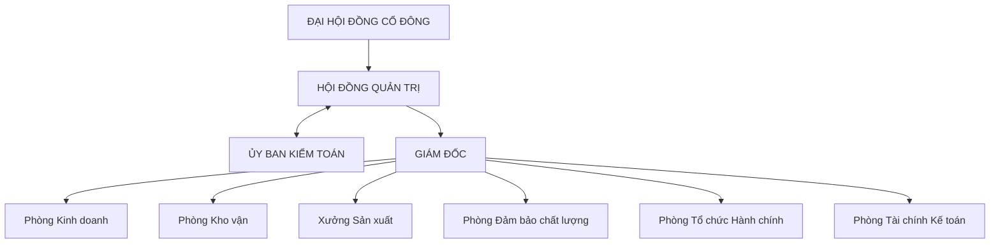

# CÔNG BỐ THÔNG TIN VÀ BÁO CÁO THƯỜNG NIÊN NĂM 2025
**CÔNG TY CỔ PHẦN NHỰA ĐÀ NẴNG (MÃ CK: DPC)**

---

## PHẦN CÔNG BỐ THÔNG TIN

**CÔNG TY CỔ PHẦN NHỰA ĐÀ NẴNG**  
Số: 24/CV-DPC/GĐ/2026  

**CỘNG HOÀ XÃ HỘI CHỦ NGHĨA VIỆT NAM**  
**Độc lập - Tự do - Hạnh phúc**  

*Đà Nẵng, ngày 13 tháng 03 năm 2026*  

### CÔNG BỐ THÔNG TIN TRÊN CỔNG THÔNG TIN ĐIỆN TỬ CỦA ỦY BAN CHỨNG KHOÁN NHÀ NƯỚC VÀ SỞ GIAO DỊCH CHỨNG KHOÁN HÀ NỘI

**Kính gửi:**  
- Ủy ban Chứng khoán Nhà nước  
- Sở Giao dịch Chứng khoán Hà Nội  

1. **Tên công ty:** CÔNG TY CỔ PHẦN NHỰA ĐÀ NẴNG
2. **Mã chứng khoán:** DPC
3. **Địa chỉ trụ sở chính:** Lô Q, đường số 4 và đường số 7, Khu công nghiệp Liên Chiểu, Phường Hải Vân, Thành phố Đà Nẵng.
4. **Điện thoại:** 0236. 3714642
5. **Người thực hiện công bố thông tin:** Hồng Lê Việt  
   - Loại công bố thông tin: [ ] 24h      [ ] 72h      [ ] Yêu cầu      [ ] Bất thường      [x] Định kỳ
6. **Nội dung của thông tin công bố:**  
   Báo cáo thường niên Công ty cổ phần Nhựa Đà Nẵng năm 2025
7. **Địa chỉ đăng tải các văn bản tại website:** https://danaplast.vn/quan-he-co-dong/cong-bo-thong-tin/  

Chúng tôi xin cam kết các thông tin công bố trên đây là đúng sự thật và hoàn toàn chịu trách nhiệm trước pháp luật về nội dung thông tin công bố.

**Nơi nhận:**  
- Như trên.  
- Lưu:  

**Người được UQCBTT**  
*(Đã ký và đóng dấu)*  
**Hồng Lê Việt**  

---

## BÁO CÁO THƯỜNG NIÊN NĂM 2025

**CÔNG TY CỔ PHẦN NHỰA ĐÀ NẴNG**  
- **Địa chỉ:** Lô Q, đường số 4 và số 7, KCN Liên Chiểu, Phường Hải Vân, Thành phố Đà Nẵng, Việt Nam  
- **Website:** danaplast.vn  
- **Email:** danaplast@dng.vnn.vn / kinhdoanh.nhuadanang@gmail.com  
- **Điện thoại:** (84) 0236 3714 642 / 3712 556  

---

### I. THÔNG TIN CHUNG:

#### 1. Thông tin khái quát:
- **Tên doanh nghiệp:** CÔNG TY CỔ PHẦN NHỰA ĐÀ NẴNG  
  - Tên tiếng Anh: DANANG PLASTIC JOINT STOCK COMPANY  
  - Tên viết tắt: DANAPLAST  
- **Giấy chứng nhận đăng ký doanh nghiệp Công ty Cổ phần:** đăng ký thay đổi lần thứ 8, ngày 15/08/2025.
- **Mã số doanh nghiệp:** 0400383300
- **Vốn điều lệ:** 22.372.800.000 đồng.
- **Vốn đầu tư của chủ sở hữu:** 22.372.800.000 đồng.
- **Địa chỉ:** Lô Q đường số 4 và đường số 7, KCN Liên Chiểu, P. Hải Vân, TP. Đà Nẵng.
- **Số điện thoại:** 0236. 3714642
- **Website:** http://danaplast.vn
- **Mã cổ phiếu:** DPC

#### 2. Quá trình hình thành và phát triển:

##### 2.1. Quá trình hình thành:
Công ty CP Nhựa Đà Nẵng trước đây là Công ty Nhựa Đà Nẵng trực thuộc Uỷ ban Nhân dân tỉnh Quảng Nam - Đà Nẵng được thành lập ngày 22/01/1976. Công ty chuyên kinh doanh thiết bị máy móc, nguyên liệu và sản phẩm ngành nhựa, các sản phẩm chủ yếu hiện nay là bao bì, ống nước các loại sử dụng trong công, nông nghiệp và xây dựng.

Công ty Nhựa Đà Nẵng chuyển thành Công ty CP Nhựa Đà Nẵng theo Quyết định số 90/2000/QĐ-TTg ngày 04/8/2000 của Thủ tướng Chính phủ. Đại hội đồng Cổ đông thành lập Công ty cổ phần được tổ chức vào ngày 02/12/2000.

Ngày 09/11/2001, Uỷ ban Chứng khoán Nhà nước có Quyết định số 09/GPPH về việc cấp giấy phép niêm yết cổ phiếu Công ty CP Nhựa Đà Nẵng tại Trung tâm GDCK TP. Hồ Chí Minh. Số lượng cổ phiếu niêm yết là: 1.587.280 cổ phiếu với tổng giá trị theo mệnh giá là 15.872.800.000 đồng (Mệnh giá: 10.000 đồng/cổ phiếu).

Ngày 19/5/2008, Công ty đã phát hành 650.000 cổ phiếu cho cổ đông chiến lược - Công ty CP Nhựa Bình Minh. Ngày 12/12/2008, Trung tâm Lưu ký chứng khoán CN TP. Hồ Chí Minh cấp Giấy chứng nhận số 114/2008/GCNCP-CNTTLK về việc chứng nhận đăng ký bổ sung 650.000 cổ phiếu công ty CP Nhựa Đà Nẵng. Số lượng chứng khoán đăng ký hiện tại là: 2.237.280 cổ phiếu, tổng giá trị đăng ký chứng khoán hiện tại: 22.372.800.000 đồng.

Ngày 16/12/2008, Sở Giao dịch Chứng khoán TP. Hồ Chí Minh đã có Quyết định số 125/QĐ-SGDHCM về việc chấp thuận cho Công ty CP Nhựa Đà Nẵng được niêm yết bổ sung 650.000 cổ phiếu.

Hiện nay, số lượng cổ phiếu niêm yết của Công ty là 2.237.280 cổ phần, với tổng giá trị theo mệnh giá là: 22.372.800.000 đồng.

Ngày 18 tháng 05 năm 2009, Sở Giao dịch Chứng khoán TP. Hồ Chí Minh đã có Quyết định số 35/QĐ-SGDHCM về việc huỷ niêm yết đối với cổ phiếu DPC, để Công ty CP Nhựa Đà Nẵng thực hiện chuyển sang niêm yết tại Trung tâm Giao dịch Chứng khoán Hà Nội theo khoản 1 điều 29 Nghị định 14/2007/NĐ-CP ngày 19/01/2007 của Chính phủ, vì vốn điều lệ nhỏ so với quy định. Ngày huỷ niêm yết có hiệu lực 04/06/2009. Ngày giao dịch cuối cùng của cổ phiếu DPC tại Sở GDCK TPHCM 01/06/2009.

Ngày 22 tháng 05 năm 2009, Trung tâm Giao dịch Chứng khoán Hà Nội đã có Quyết định số 208/QĐ-TTGDHN về việc chấp thuận niêm yết cổ phiếu Công ty CP Nhựa Đà Nẵng; đồng thời đã cấp Giấy chứng nhận đăng ký niêm yết cổ phiếu số 20/GCN-TTGDHN được niêm yết cổ phiếu phổ thông tại Trung tâm Giao dịch Chứng khoán Hà Nội (nay là Sở Giao dịch Chứng khoán Hà Nội).

- Mã chứng khoán: DPC
- Mệnh giá: 10.000 đồng/cổ phiếu.
- Số lượng cổ phiếu: 2.237.280 cổ phiếu.
- Tổng giá trị chứng khoán niêm yết: 22.372.800.000 đồng.

Ngày 29 tháng 05 năm 2009, Trung tâm Giao dịch Chứng khoán Hà Nội có Thông báo số 269/TB-TTGDHN về ngày giao dịch chính thức của cổ phiếu Công ty CP Nhựa Đà Nẵng là ngày 10/06/2009.

##### 2.2. Quá trình phát triển:
Trong quá trình hoạt động, vừa sản xuất vừa tích luỹ tái đầu tư, đến nay Công ty đã hoàn thiện toàn bộ cơ sở hạ tầng nhà xưởng, đường nội bộ với tổng diện tích 20.550 mét vuông tại Khu công nghiệp Liên Chiểu, TP Đà Nẵng. Với năng lực hiện nay, Công ty sản xuất được các nhóm sản phẩm ống bằng vật liệu nhựa khác nhau, để đáp ứng nhu cầu ngày càng tăng của thị trường, là nhóm sản phẩm ống nước HDPE, PVC-U, với các loại đường kính phù hợp nhu cầu sử dụng đa dạng.

Trong những năm qua, Công ty được đánh giá là một trong những đơn vị hoạt động hiệu quả tại Đà Nẵng với những thành tích đạt được như: Huân chương lao động hạng I, II, III do Nhà nước trao tặng; Hàng Việt Nam chất lượng cao; Bằng khen đơn vị dẫn đầu ngành công nghiệp TP. Đà Nẵng trong nhiều năm liền.

Trong năm 2025, Hội đồng Quản trị Công ty đã nỗ lực triển khai nhiều giải pháp nhằm thúc đẩy hoạt động sản xuất kinh doanh, từng bước khắc phục tình trạng thua lỗ của năm 2024 và đạt được những kết quả kinh doanh khả quan trong năm.

---

### II. TÌNH HÌNH HOẠT ĐỘNG TRONG NĂM 2025:

#### 1. Tình hình hoạt động sản xuất kinh doanh:

| CHỈ TIÊU | Năm 2025 | Năm 2024 |
| :--- | :---: | :---: |
| Doanh thu thuần (đồng) | 20.948.133.719 | 31.372.875.776 |
| Lợi nhuận sau thuế (đồng) | 4.207.936.920 | (1.759.874.467) |
| Lãi cơ bản trên cổ phiếu (đồng) | 1.881 | (787) |
| Chi cổ tức (%) | Dự kiến 0% | 0% |

Trong năm 2025, Công ty Cổ phần Nhựa Đà Nẵng hết sức cố gắng nhằm nâng cao hiệu quả hoạt động sản xuất kinh doanh, đẩy mạnh công tác bán hàng, phát triển thị trường, ... thực hiện thêm các hoạt động khác nhằm khắc phục tình trạng lỗ sau khi phải dời vào KCN Liên chiểu năm 2022 của Công ty.

Vì gặp nhiều khó khăn, nhất là sự cạnh tranh từ các nhà sản xuất cùng ngành, nên thương hiệu ống nhựa của Công ty vẫn chưa được nhiều người tiêu dùng sử dụng.

Cùng với thị trường ống nhựa cạnh tranh khốc liệt, bộ máy nhân sự các mảng nghiệp vụ của công ty yếu và mỏng nên rất khó thúc đẩy được hoạt động bán hàng.

Chính vì thế, mặc dù đã khắc phục được tình trạng lỗ so với năm 2024 nhưng kết quả kinh doanh của Công ty vẫn chưa đạt như kỳ vọng.

#### 2. Cơ cấu tổ chức và nhân sự:
- **Hội đồng Quản trị:** Hội đồng quản trị Công ty CP Nhựa Đà Nẵng gồm: 01 Chủ tịch và 01 phó chủ tịch, 03 thành viên, trong đó có 1 thành viên độc lập. Hội đồng quản trị chịu trách nhiệm xây dựng các kế hoạch sản xuất kinh doanh mang tính chiến lược tổng quát và yêu cầu Ban Giám đốc triển khai các kế hoạch đó.
- **Ban Kiểm soát:** Ban Kiểm soát gồm 01 Trưởng ban và 02 thành viên với nhiệm vụ thay mặt cổ đông kiểm tra, giám sát, mọi hoạt động của Hội đồng quản trị và Ban Giám đốc, báo cáo lại tình hình của Công ty với Đại hội đồng Cổ đông.  
  Trong cuộc họp ĐHĐCĐ thường niên năm 2025 diễn ra ngày 27/06/2025 tại Công ty CP Nhựa Đà Nẵng, ĐHĐCĐ đã thông qua và quyết định thay đổi cơ cấu tổ chức Công ty. Từ mô hình ĐHĐCĐ – BKS – HĐQT – Giám đốc (theo nội dung Điều 137.1.a Luật Doanh nghiệp số 59/2020/QH14 2020), sang mô hình ĐHĐCĐ - HĐQT - Giám đốc (theo nội dung Điều 137.1.b Luật Doanh nghiệp số 59/2020/QH14 2020). Công ty đã ra quyết định thành lập Ủy ban Kiểm toán và sửa đổi điều lệ Công ty vào ngày 27/07/2025 phù hợp với mô hình cơ cấu tổ chức mới.
- **Ban Giám đốc:** Ban Giám đốc hiện nay bao gồm 01 thành viên - Giám đốc.

Dựa trên qui mô và ngành nghề, cơ cấu tổ chức của Công ty hiện nay được phân chia theo chức năng, bao gồm:
- Ban Giám đốc
- Phòng Kinh doanh
- Phòng Kho vận
- Xưởng Sản xuất.
- Phòng Đảm bảo chất lượng
- Phòng Tổ chức - Hành chính
- Phòng Tài chính - Kế toán

Đứng đầu các bộ phận này là các Trưởng Bộ phận và chịu sự chỉ đạo trực tiếp của Ban Giám đốc. Bên cạnh đó, trong Công ty còn có tổ chức Công đoàn với 30 đoàn viên, hoạt động trên cơ sở luật pháp của Nhà nước và Điều lệ của tổ chức này.

##### Sơ đồ cơ cấu tổ chức:

##### Tóm tắt lý lịch Ban Giám đốc Công ty CP Nhựa Đà Nẵng:

| Chỉ tiêu | Chi tiết |
| :--- | :--- |
| **Họ và tên Giám đốc:** | **HỒNG LÊ VIỆT** |
| Giới tính: | Nam |
| Ngày tháng năm sinh: | 08/07/1966 |
| Nơi sinh: | Phường Vĩnh Tuy, Quận Hai Bà Trưng, TP Hà Nội. |
| CMND: | 001066042460, ngày cấp: 10/07/2021 Nơi cấp: Cục trưởng cục cảnh sát quản lý hành chính về trật tự xã hội |
| Quốc tịch: | Việt Nam |
| Dân tộc: | Kinh |
| Địa chỉ thường trú: | 85 CMT8, P. Bến Thành, TP. Hồ Chí Minh |
| Số ĐT liên lạc: | 0988200544 |
| Trình độ chuyên môn: | Cử nhân Kinh Tế |
| Quá trình công tác: | - Trước năm 1993: Đi học và tìm việc. - Từ 1993-2001: Nhân viên Phòng TCKT Công ty CP Nhựa Bình Minh. - Từ 2002 đến 2013: Phó phòng TCKT Công ty CP Nhựa Bình Minh. - Từ 2014 đến 2022: Trưởng phòng TCKT, Kế toán trưởng Công ty CP Nhựa Bình Minh. - Từ ngày 01/08/2017 đến 31/05/2022: Giám đốc Công ty CP Nhựa Đà Nẵng. - Từ ngày 01/10/2024 đến nay: Giám đốc Công ty CP Nhựa Đà Nẵng |
| Các chức vụ công tác hiện nay tại tổ chức niêm yết: | Phó Chủ tịch HĐQT kiêm Giám đốc Công ty CP Nhựa Đà Nẵng |
| Các chức vụ hiện đang nắm giữ tại tổ chức khác: | Không |
| **Số CP nắm giữ:** | |
| + Đại diện sở hữu: |  |
| + Cá nhân sở hữu: | 78.000 cổ phần, chiếm 3,5 % Vốn điều lệ |
| Các cam kết nắm giữ (nếu có): | |
| Những người liên quan có nắm giữ cổ phiếu của tổ chức niêm yết: | 1. Mối quan hệ: Vợ , Tên cá nhân/tổ chức: Trần Hải Anh; 80.000 CP, chiếm 3,6% Vốn điều lệ 2. Mối quan hệ: …, Tên cá nhân/tổ chức: |
| Những khoản nợ đối với Công ty: | Không |
| Lợi ích liên quan đối với Công ty: | Không |
| Quyền lợi mâu thuẫn với Công ty: | Không |

##### Cán bộ công nhân viên Công ty CP Nhựa Đà Nẵng và chính sách với người lao động:
Hiện tại, số lượng CBCNV Công ty là 31 người, trong đó có 07 cán bộ và nhân viên quản lý. Tổng tiền lương năm 2025 là 3,995 tỷ đồng.

Thu nhập của Giám đốc và Kế toán trưởng tại Công ty năm 2025:

| Chức danh | Họ và tên | Thu nhập | Đvt |
| :--- | :--- | :---: | :---: |
| Giám đốc | Ông Hồng Lê Việt | 64.553.800 | đồng |
| Kế toán trưởng | Ông Lê Bá Quốc Hưng | 128.191.065 | đồng |

- **Chế độ tuyển dụng:**  
  Việc tuyển dụng lao động và trả lương thực hiện theo chế độ hợp đồng lao động giữa Giám đốc và người lao động phù hợp với quy định của pháp luật và Điều lệ của Công ty.
- **Chế độ và quyền lợi của người lao động làm việc tại Công ty:**  
  Công ty CP Nhựa Đà Nẵng thực hiện đầy đủ các chế độ bảo hiểm xã hội, bảo hiểm y tế, bảo hiểm thất nghiệp, bảo hiểm tính mạng và các chế độ khác cho tất cả người lao động tại Công ty. Khi Người lao động tự nguyện chấm dứt hợp đồng lao động thì giải quyết theo đúng chế độ của pháp luật hiện hành.

#### 3. Tình hình tài chính:

##### a. Tình hình tài chính:

| Chỉ tiêu | ĐVT | Năm 2025 | Năm 2024 | Tỷ lệ (%) |
| :--- | :---: | :---: | :---: | :---: |
| Tổng giá trị tài sản | đồng | 65.999.138.064 | 68.647.095.780 | 96,140% |
| Doanh thu thuần | đồng | 20.948.133.719 | 31.372.875.776 | 66,770% |
| Lợi nhuận từ hoạt động kinh doanh | đồng | 4.207.938.716 | (1.850.119.100) | 327,440% |
| Lợi nhuận khác | đồng | -1.796 | 90.244.633 | -100,002% |
| Lợi nhuận trước thuế | đồng | 4.207.936.920 | (1.759.874.467) | 339,100% |
| Lợi nhuận sau thuế | đồng | 4.207.936.920 | (1.759.874.467) | 339,100% |
| Tỷ lệ lợi nhuận trả cổ tức | đồng | Dự kiến 0% | 0% | |

##### b. Các chỉ tiêu tài chính chủ yếu:

| Các chỉ tiêu | Năm 2025 | Năm 2024 | Ghi chú |
| :--- | :---: | :---: | :---: |
| **1. Chỉ tiêu về khả năng thanh toán** | | | |
| + Hệ số thanh toán ngắn hạn (TSNH/Nợ ngắn hạn) | 0,68 | 0,42 | |
| + Hệ số thanh toán nhanh ((TSNH - Hàng tồn kho)/ Nợ ngắn hạn) | 0,4 | 0,13 | |
| **2. Chỉ tiêu về cơ cấu vốn** | | | |
| + Nợ phải trả/Tổng tài sản | 56,21% | 64,03% | |
| + Nợ phải trả /Vốn chủ sở hữu | 128,38% | 178,02% | |
| **3. Chỉ tiêu về năng lực hoạt động** | | | |
| + Vòng quay hàng tồn kho (Giá vốn hàng bán/ Hàng tồn kho bình quân) | 2,59 | 2,00 | |
| + Doanh thu thuần/Tổng tài sản | 0,32 | 0,46 | |
| **4. Chỉ tiêu về khả năng sinh lời** | | | |
| + Hệ số Lợi nhuận sau thuế/Doanh thu thuần (ROS). | 20% | -6% | |
| + Hệ số Lợi nhuận sau thuế/Vốn chủ sở hữu (ROE). | 15% | -7% | |
| + Hệ số Lợi nhuận sau thuế/Tổng tài sản (ROA). | 6% | -3% | |
| + Hệ số Lợi nhuận từ hoạt động kinh doanh/Doanh thu thuần. | 20,09% | -5,90% | |

#### 4. Cơ cấu cổ đông, thay đổi vốn đầu tư của chủ sở hữu:

##### a. Cổ phần:
- Tổng số đang lưu hành: **2.237.280** cổ phần.
  - Số cổ phần chuyển nhượng tự do: 2.237.280 cổ phần
  - Số cổ phần hạn chế chuyển nhượng: 0 cổ phần

##### b. Cơ cấu cổ đông: (Ngày 27/06/2025)
- **Cá nhân trong nước:** 1.430.361 cổ phần (65,11%)  
  *Trong đó:* Cổ đông lớn: 460.100 cổ phần (20,57%)
- **Tổ chức trong nước:** 766.399 cổ phần (34,89%)  
  *Trong đó:* Cổ đông lớn: 765.000 cổ phần (34,19%)
- **Cá nhân nước ngoài:** 31.680 cổ phần (1,42%)
- **Tổ chức nước ngoài:** 8.400 cổ phần (0,38%)
- **Chưa lưu ký:** 500 cổ phần (0,022%)

##### c. Tình hình thay đổi vốn đầu tư của chủ sở hữu:
Không.

##### d. Giao dịch cổ phiếu quỹ:
Không.

##### e. Các chứng khoán khác:
Không.

#### 5. Báo cáo tác động liên quan đến môi trường và xã hội của công ty:
- **Phát thải khí nhà kính (GHG) trực tiếp và gián tiếp:** Với thiết bị và công nghệ sản xuất hiện nay, Công ty CP Nhựa Đà Nẵng không có phát thải khí nhà kính trực tiếp. Tuy nhiên, nguồn khí phát thải tạo điện năng tại các nhà máy phát điện của quốc gia có thể được xem là khí phát thải gián tiếp của Công ty, do nguồn năng lượng sử dụng tại Công ty CP Nhựa Đà Nẵng trong quá trình sản xuất và kinh doanh dịch vụ là điện năng được mua từ các Công ty Điện lực quốc gia.
- **Đối với các loại chất thải:** Công ty đều phân loại rác thải và chuyển giao cho các đơn vị chuyên ngành và được Nhà nước cấp phép để xử lý. Toàn bộ 100% chất thải nguy hại đã được bàn giao cho đơn vị có chức năng xử lý.
- **Trách nhiệm với người lao động và xã hội:** Công ty tuân thủ và thực hiện theo đúng luật lao động, có trách nhiệm rõ ràng với Người lao động. Cũng như thực hiện đúng nghĩa vụ với chính quyền địa phương, với cộng đồng và xã hội.

---

### III. BÁO CÁO VÀ ĐÁNH GIÁ CỦA BAN GIÁM ĐỐC:

#### 1. Đánh giá kết quả hoạt động sản xuất kinh doanh:

##### a. Về sản phẩm:
Các sản phẩm của Công ty chủ yếu là các sản phẩm được sản xuất từ nguyên liệu nhựa nguyên sinh phục vụ cho lĩnh vực sản xuất kinh doanh, xây dựng và tiêu dùng. Trong những năm gần đây, do nhu cầu thị trường thay đổi theo xu hướng sử dụng sản phẩm nhựa kỹ thuật, Công ty đã chú trọng hoàn toàn vào sản phẩm ống nhựa phục vụ cho xây dựng và cấp thoát nước.

Doanh thu của từng nhóm sản phẩm qua các năm gần đây như sau:

| Nhóm sản phẩm | Năm 2025 | Năm 2024 |
| :--- | :---: | :---: |
| Ống nhựa HDPE, PVC-U | 5.567.917.970 | 17.419.100.012 |
| Bao bì nhựa | 0 | 2.882.181.899 |
| Dịch vụ | 15.380.215.749 | 11.071.593.865 |
| **Tổng cộng** | **20.948.133.719** | **31.372.875.776** |

Các sản phẩm của Công ty phần lớn là hàng hoá phục vụ theo yêu cầu của các ngành sản xuất khác nhau. Do đó, các sản phẩm sản xuất thường phải theo yêu cầu chất lượng của từng khách hàng. Các sản phẩm của công ty đã đạt được tiêu chuẩn chất lượng Việt Nam và các tiêu chuẩn quốc tế được thị trường Việt Nam thừa nhận. Công ty đã đạt chứng nhận Hệ thống quản lý chất lượng sản phẩm ISO 9001:2015.

| Chủng loại sản phẩm | Tiêu chuẩn chất lượng |
| :--- | :--- |
| Ống nhựa HDPE | ISO 4427/TCVN 7305 |
| Ống nhựa PVC-U | ISO 1452/TCVN 8491 |

##### b. Nguyên vật liệu:
Nguyên liệu chiếm tỷ lệ cao nhất trong cơ cấu giá thành sản phẩm chủ yếu là nguyên liệu hạt nhựa nguyên sinh. Hầu hết nguyên liệu của Công ty được nhập khẩu từ các hãng sản xuất nổi tiếng trên thế giới như Borsafe U.A.E (HDPE); Tập đoàn SCG hoặc mua qua các đơn vị kinh doanh hạt nhựa trong nước như Công ty CP Hoá chất nhựa Đà Nẵng, Công ty TNHH nhựa và hóa chất TPC Vina...

##### c. Về thị trường tiêu thụ sản phẩm:
Hiện nay, sản phẩm của Công ty được tiêu thụ chủ yếu thông qua các đại lý bán hàng tại TP. Đà Nẵng và các tỉnh thành lân cận.

Công ty đã tạo dựng được mối quan hệ lâu năm với một số khách hàng lớn và ổn định như: Công ty CP Cấp nước Đà Nẵng, Công ty CP Cấp nước Kontum và các nhà phân phối lớn trên thị trường TP. Đà Nẵng.

#### KẾT QUẢ HOẠT ĐỘNG SẢN XUẤT KINH DOANH:

| Stt | CHỈ TIÊU | Mã số | Năm 2025 | Năm 2024 |
| :---: | :--- | :---: | :---: | :---: |
| 1 | Doanh thu bán hàng và cung cấp dịch vụ | 1 | 21.168.111.275 | 31.880.331.524 |
| 2 | Các khoản giảm trừ doanh thu | 2 | 219.977.556 | 507.455.748 |
| 3 | Doanh thu thuần về bán hàng và cung cấp dịch vụ | 10 | 20.948.133.719 | 31.372.875.776 |
| 4 | Giá vốn hàng bán | 11 | 7.388.468.617 | 21.414.013.729 |
| 5 | Lợi nhuận gộp về bán hàng và cung cấp dịch vụ (20 = 10 - 11) | 20 | 13.559.665.102 | 9.958.862.047 |
| 6 | Doanh thu hoạt động tài chính | 21 | 2.842.190 | 5.854.446 |
| 7 | Chi phí tài chính | 22 | 2.524.282.874 | 3.174.565.764 |
| | *Trong đó: Chi phí lãi vay* | 23 | 2.338.478.113 | 2.746.710.434 |
| 8 | Chi phí bán hàng | 25 | 3.911.602.210 | 5.345.190.869 |
| 9 | Chi phí quản lý doanh nghiệp | 26 | 2.918.683.492 | 3.295.078.960 |
| 10 | Lợi nhuận thuần từ hoạt động kinh doanh/ (lỗ) (30 = 20 + (21 - 22) - (25 + 26)) | 30 | 4.207.938.716 | (1.850.119.100) |
| 11 | Thu nhập khác | 31 | 30 | 90.703.704 |
| 12 | Chi phí khác | 32 | 1.826 | 459.071 |
| 13 | Lợi nhuận khác (40 = 31 - 32) | 40 | (1.796) | 90.244.633 |
| 14 | Tổng lợi nhuận kế toán trước thuế / (lỗ) (50 = 30 + 40) | 50 | 4.207.936.920 | (1.759.874.467) |
| 15 | Chi phí thuế TNDN hiện hành | 51 | - | - |
| 16 | Chi phí thuế TNDN hoãn lại | 52 | - | - |
| 17 | Lợi nhuận sau thuế thu nhập doanh nghiệp / (lỗ) (60 = 50 - 51 - 52) | 60 | 4.207.936.920 | (1.759.874.467) |
| 18 | Lãi cơ bản trên cổ phiếu | 70 | 1.881 | (787) |
| 19 | Lãi suy giảm trên cổ phiếu | 71 | 1.881 | (787) |

#### 2. Tình hình tài chính:

| Stt | Nội dung | Số dư cuối kỳ (31/12/2025) | Số dư đầu kỳ (01/01/2025) |
| :---: | :--- | :---: | :---: |
| **1** | **Tài sản ngắn hạn** | **6.833.542.317** | **5.893.978.968** |
| | Tiền và các khoản tương đương tiền | 1.954.225.470 | 486.485.646 |
| | Các khoản đầu tư tài chính ngắn hạn | | |
| | Các khoản phải thu ngắn hạn | 2.024.580.562 | 1.285.871.941 |
| | Hàng tồn kho | 2.854.190.435 | 4.104.268.885 |
| | Tài sản ngắn hạn khác | 545.85 | 17.352.496 |
| **2** | **Tài sản dài hạn** | **59.165.595.747** | **62.753.116.812** |
| | Các khoản phải thu dài hạn | | |
| | Tài sản cố định | 34.529.041.476 | 36.873.050.110 |
| | *Tài sản cố định hữu hình* | 34.529.041.476 | 36.873.050.110 |
| | - Nguyên giá TSCĐ hữu hình | 70.845.216.342 | 70.845.216.342 |
| | - Giá trị hao mòn luỹ kế TSCĐ hữu hình | -36.316.174.866 | -33.972.166.232 |
| | Bất động sản đầu tư | | |
| | Tài sản dở dang dài hạn | | |
| | Tài sản dài hạn khác | 24.636.554.271 | 25.880.066.702 |
| **I** | **TỔNG CỘNG TÀI SẢN** | **65.999.138.064** | **68.647.095.780** |
| **1** | **Nợ phải trả** | **37.100.055.165** | **43.955.949.792** |
| | Nợ ngắn hạn | 10.025.116.928 | 14.034.105.680 |
| | Nợ dài hạn | 27.074.938.228 | 29.921.844.112 |
| **2** | **Vốn chủ sở hữu** | **28.899.082.908** | **24.691.145.988** |
| | *Vốn chủ sở hữu* | 28.899.082.908 | 24.691.145.988 |
| | - Vốn đầu tư của chủ sở hữu | 22.372.800.000 | 22.372.800.000 |
| | - Thặng dư vốn cổ phần | 1.625.000.000 | 1.625.000.000 |
| | - Các quỹ | | |
| | - Lợi nhuận sau thuế chưa phân phối | 4.207.936.920 | (1.759.874.467) |
| | Nguồn kinh phí và quỹ khác | | |
| | **TỔNG CỘNG NGUỒN VỐN** | **65.999.138.064** | **68.647.095.780** |

#### 3. Kế hoạch phát triển trong tương lai:
Trong năm 2025 HĐQT và Ban Giám đốc vẫn liên tục xác định và thử nghiệm những giải pháp mới trong quản trị và điều hành Công ty, với mong muốn duy trì hoạt động và có hiệu quả cho Công ty. HĐQT và Ban Giám đốc sẽ sớm đưa ra phương hướng phát triển cho từng năm còn lại của Nhiệm kỳ 2022 - 2027.

---

### IV. ĐÁNH GIÁ CỦA HĐQT VỀ HOẠT ĐỘNG CỦA CÔNG TY

Với mục tiêu duy trì và phát triển Công ty, tuy trong năm 2025 chưa có những giải pháp mang tính đột phá cho định hướng phát triển của Công ty, nhưng HĐQT và Ban Giám đốc đã cố gắng bảo đảm lợi ích của cổ đông, thu nhập của người lao động.

Trong năm 2025, HĐQT đã họp tổng cộng 04 phiên họp, ở mỗi phiên họp đều tập trung giải quyết các vấn đề trong hoạt động quản trị và điều hành Công ty.

Công ty không nợ lương của người lao động, mọi chế độ bảo hiểm và các đóng góp xã hội, địa phương đều được thực hiện đúng và đầy đủ.

Công ty CP Nhựa Đà Nẵng đã niêm yết cổ phiếu tại Sở giao dịch Chứng khoán Hà Nội với 2.237.280 cổ phiếu, gồm 283 cổ đông pháp nhân và cá nhân (số liệu chốt danh sách cổ đông ngày 26/07/2025), Trong đó 10 cổ đông là pháp nhân và 273 cổ đông là cá nhân. Cổ đông pháp nhân giữ cổ phiếu lớn nhất là Công ty CP Nhựa Bình Minh với 650.000 cổ phiếu (chiếm ≈ 29,1%). Các cổ đông lớn cá nhân (chiếm hơn 5%/ tổng số cổ phiếu) là 01 cổ đông - Bà Nguyễn Thị Phương Lan với 460.100 cổ phiếu (chiếm ≈ 20.57%).

Một số chỉ tiêu hiện nay:
- **EPS:** 1.881 đồng/CP
- **P/E:** 5.1 lần (giá đóng cửa ngày 28/02/2026: 9.600 đồng/CP)
- **Giá trị sổ sách/01CP:** 11.800 đồng/CP.

---

### V. QUẢN TRỊ CÔNG TY

#### 1. Hội đồng quản trị:
Danh sách thành viên HĐQT năm 2025 bao gồm:

| Số TT | Thành viên HĐQT | Chức vụ | Ngày bổ nhiệm | Ngày miễn nhiệm |
| :---: | :--- | :---: | :---: | :---: |
| 1 | Ông Nguyễn Thanh Hải | Chủ tịch | 08/04/2022 | |
| 2 | Ông Hồng Lê Việt | Phó chủ tịch | 08/04/2022 | |
| 3 | Ông Chaowalit Treejak | Thành viên | 08/04/2022 | |
| 4 | Ông Vũ Văn Lâm | Thành viên | 08/04/2022 | |
| 5 | Ông Bông Hoa Việt | Thành viên | 01/10/2024 | |

Năm tài chính 2025 HĐQT đã họp 04 phiên để triển khai thực hiện các nghị quyết của Đại hội đồng Cổ đông, tỷ lệ tham dự các buổi họp của HĐQT như sau:

| Thành viên HĐQT | Chức vụ | Số buổi họp tham dự | Tỷ lệ % | Lý do không tham dự |
| :--- | :---: | :---: | :---: | :---: |
| Ông Nguyễn Thanh Hải | Chủ tịch | 04 | 100 | |
| Ông Hồng Lê Việt | Phó chủ tịch | 04 | 100 | |
| Ông Chaowalit Treejak | Thành viên | 03 | 75 | |
| Ông Vũ Văn Lâm | Thành viên | 03 | 75 | |
| Ông Bông Hoa Việt | Thành viên | 04 | 100 | |

Hội đồng quản trị Công ty đã quyết định các vấn đề chính như sau:  
**Các Nghị quyết của HĐQT:**

| TT | Số Nghị quyết/ Quyết định | Ngày | Nội dung |
| :---: | :---: | :---: | :--- |
| 1 | 03/NQ-DPC/HĐQT/2025 | 25/02/2025 | Hội đồng Quản trị thống nhất chốt Danh sách cổ đông về ngày đăng ký cuối cùng để tổ chức Đại hội đồng Cổ đông thường niên năm 2025 |
| 2 | 01/NQ-DPC/ĐHĐCĐ/2025 | 27/06/2025 | Nghị quyết Đại hội đồng Cổ đông thường niên năm 2025 Công ty CP Nhựa Đà Nẵng thống nhất thông qua các nội dung trong cuộc họp ĐHĐCĐ thường niên năm 2025 |

#### 2. Ban Kiểm soát:
Trong năm 2025, Ban Kiểm soát đã tổ chức có 02 cuộc họp với sự tham dự gồm các Ông (Bà) như sau:

| Thành viên Ban Kiểm soát | Chức vụ | Số buổi họp tham dự | Tỷ lệ % | Lý do không tham dự |
| :--- | :---: | :---: | :---: | :---: |
| 1. Bà Nguyễn Thị Thu Thuỷ | Trưởng ban | 02 | 100 | |
| 2. Bà Hồ Thị Nguyệt | Thành viên | 02 | 100 | |
| 3. Ông Lê Viết Tần | Thành viên | 02 | 100 | |

Trong cuộc họp ĐHĐCĐ thường niên năm 2025 diễn ra ngày 27/06/2025 tại Công ty CP Nhựa Đà Nẵng, ĐHĐCĐ đã thông qua và quyết định thay đổi cơ cấu tổ chức Công ty, từ mô hình ĐHĐCĐ – BKS – HĐQT – Giám đốc (theo nội dung Điều 137.1.a Luật Doanh nghiệp số 59/2020/QH14 2020), sang mô hình ĐHĐCĐ - HĐQT - Giám đốc (theo nội dung Điều 137.1.b Luật Doanh nghiệp số 59/2020/QH14 2020). Công ty ra quyết định thành lập Ủy ban Kiểm toán và sửa đổi Điều lệ Công ty vào ngày 27/07/2025 phù hợp với mô hình cơ cấu tổ chức mới.

#### 3. Các giao dịch, thù lao và các khoản lợi ích của Hội đồng quản trị, Ban Giám đốc và Ban Kiểm soát:

##### 3.1. Mức thù lao và các khoản lợi ích khác:
Thực hiện đúng Nghị quyết Đại hội đồng Cổ đông thường niên năm 2025, tổng số thù lao của HĐQT, Thư ký HĐQT và Ban Kiểm soát năm 2025 đã chi như sau:

| Đối tượng | Số tiền | Đơn vị tính |
| :--- | :---: | :---: |
| Hội đồng Quản trị | 0 | đồng/ năm |
| Thư ký HĐQT | 24.000.000 | đồng/ năm |
| Ban Kiểm soát | 24.000.000 | đồng/ năm |
| **Tổng cộng:** | **48.000.000** | **đồng/ năm** |

Chi tiết mức thù lao và các khoản lợi ích khác như sau:

**a. Hội đồng quản trị:**

| Chức vụ | Họ và tên | Mức thù lao |
| :--- | :--- | :---: |
| Chủ tịch HĐQT | Ông Nguyễn Thanh Hải | 0 đồng/năm |
| Phó CT HĐQT | Ông Hồng Lê Việt | 0 đồng/năm |
| Thành viên HĐQT | Ông Vũ Văn Lâm | 0 đồng/năm |
| Thành viên HĐQT | Ông Nguyễn Hữu Tuyến | 0 đồng/năm |
| Thành viên HĐQT | Ông Chaowalit Treejak | 0 đồng/năm |
| Thư ký HĐQT | Bà Nguyễn Thị Kiều Oanh | 24.000.000 đồng/năm |

**b. Ban kiểm soát:**

| Chức vụ | Họ và tên | Mức thù lao |
| :--- | :--- | :---: |
| Trưởng Ban Kiểm soát | Bà Nguyễn Thị Thu Thủy | 12.000.000 đồng/năm |
| Thành viên BKS | Bà Hồ Thị Nguyệt | 6.000.000 đồng/năm |
| Thành viên BKS | Ông Nguyễn Viết Tần | 6.000.000 đồng/năm |

##### 3.2. Tổng mức lương, thưởng của HĐQT, Ban Giám đốc, Ban kiểm soát:

| Stt | Họ và tên | Chức vụ | Tiền lương | Thu nhập khác | Tổng cộng |
| :---: | :--- | :---: | :---: | :---: | :---: |
| 1 | Ông Nguyễn Thanh Hải | Chủ tịch HĐQT | 0 | 0 | 0 |
| 2 | Ông Hồng Lê Việt | PCT HĐQT – Giám đốc | 64.553.800 | 0 | 64.553.800 |
| 3 | Ông Vũ Văn Lâm | TV HĐQT | 0 | 0 | 0 |
| 4 | Ông Chaowalit Treejak | TV HĐQT | 0 | 0 | 0 |
| 5 | Ông Bông Hoa Việt | TV HĐQT | 0 | 0 | 0 |
| 6 | Bà Ng Thị Thu Thủy | Trưởng BKS | 0 | 12.000.000 | 12.000.000 |
| 7 | Bà Hồ Thị Nguyệt | TV BKS | 118.683.273 | 6.000.000 | 124.683.273 |
| 8 | Ô. Lê Viết Tần | TV BKS | 0 | 6.000.000 | 6.000.000 |
| 9 | Bà Ng Thị Kiều Oanh | Thư ký | 13.253.415 | 24.000.000 | 37.253.415 |

##### 3.3. Giao dịch cổ phiếu của cổ đông nội bộ: Không có

| TT | Người thực hiện giao dịch | Quan hệ với cổ đông nội bộ | Số cổ phiếu sở hữu cuối kỳ (31/12/2025) - Số cổ phiếu | Số cổ phiếu sở hữu cuối kỳ (31/12/2025) - Tỷ lệ (%) | Số cổ phiếu sở hữu đầu kỳ (01/01/2025) - Số cổ phiếu | Số cổ phiếu sở hữu đầu kỳ (01/01/2025) - Tỷ lệ (%) | Lý do tăng, giảm |
| :---: | :---: | :---: | :---: | :---: | :---: | :---: | :---: |
| - | - | - | - | - | - | - | - |

*(Kết thúc Mục V. Quản trị công ty theo quy định ngắt đọc sớm trước Báo cáo tài chính kiểm toán).*
