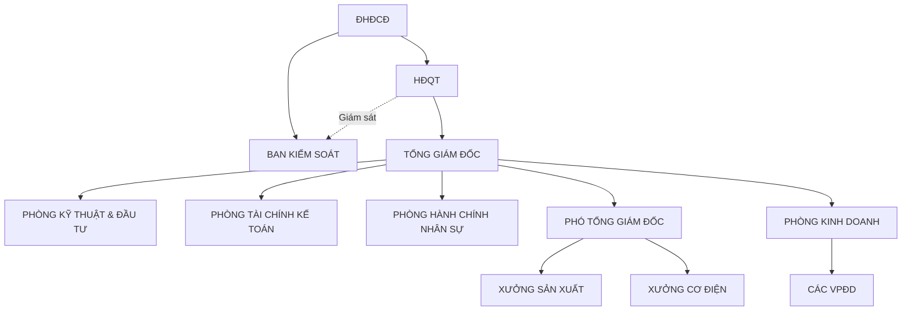

# BÁO CÁO THƯỜNG NIÊN 2025
## CÔNG TY CỔ PHẦN GẠCH NGÓI GỐM XÂY DỰNG MỸ XUÂN (GMX)
*(Phụ lục số 04 Thông tư số 96/2020/TT-BTC)*

---

# I. THÔNG TIN CHUNG

### 1. Thông tin khái quát
- **Tên giao dịch:** CÔNG TY CỔ PHẦN GẠCH NGÓI GỐM XÂY DỰNG MỸ XUÂN
- **Tên tiếng Anh:** My Xuan Brick Tile Pottery And Construction Joint Stock Company.
- **Tên viết tắt:** GMX
- **Logo Công ty:** GMX (ISO 9001:2015)
- **Giấy chứng nhận đăng ký doanh nghiệp số:** 3500640966 do Sở Kế Hoạch và Đầu Tư Tỉnh Bà Rịa - Vũng Tàu cấp lần đầu, ngày 18 tháng 12 năm 2003, đăng ký thay đổi lần 12 ngày 29 tháng 08 năm 2025.
- **Vốn điều lệ tại thời điểm 31/12/2025:** 90.406.970.000 đồng.
- **Vốn đầu tư của chủ sở hữu tại thời điểm 31/12/2025:** 134.587.191.180 đồng.
- **Địa chỉ:** Khu phố Suối Nhum, Phường Hắc Dịch, Thị xã Phú Mỹ, Tỉnh Bà Rịa - Vũng Tàu.
- **Số điện thoại:** 0254 3 893150 - 0254 3 876770
- **Số fax:** 0254 3 894168
- **Website:** www.myxuan-vt.com.vn
- **Mã cổ phiếu:** GMX

#### Quá trình hình thành và phát triển:
Công Ty Cổ Phần Gạch Ngói Gốm Xây Dựng Mỹ Xuân nguyên là Chi Nhánh Công Ty Phát triển Khoáng sản 6 - Thuộc Tổng Công Ty Khoáng Sản Việt Nam - Bộ Công Nghiệp, được thành lập tháng 10/1988 tại Đặc khu Vũng Tàu Côn Đảo nay là Tỉnh Bà Rịa - Vũng Tàu, với nhiệm vụ khảo sát thăm dò địa chất, khai thác, chế biến kinh doanh khoáng sản và vật liệu xây dựng.

Từ năm 1988 đến năm 1997, Chi Nhánh đã thực hiện nhiều phương án khảo sát, thăm dò địa chất, đánh giá trữ lượng khoáng sản, Cuối năm 1995 khảo sát và thăm dò mỏ sét tại xã Mỹ Xuân, Huyện Tân Thành, Tỉnh Bà Rịa - Vũng Tàu để sản xuất Gạch ngói đất sét nung theo quy mô công nghiệp.

Năm 1996 Chi Nhánh xây dựng nhà máy Gạch Ngói Mỹ Xuân, công suất thiết kế 25 triệu viên sản phẩm quy tiêu chuẩn/năm với tổng vốn đầu tư khoảng 22,5 tỷ đồng và Bộ Công Nghiệp quyết định cho phép thành lập Xí nghiệp Gạch Ngói Gốm Xây Dựng - thuộc Công Ty Phát triển Khoáng Sản 6 - Tổng Công Ty Khoáng Sản Việt Nam.

Tháng 7 năm 1997 đã sản xuất ra viên sản phẩm đầu tiên cung cấp cho nhu cầu xây dựng trong tỉnh Bà Rịa - Vũng Tàu và các tỉnh phía Nam.

Thực hiện chủ trương đổi mới và phát triển Doanh Nghiệp của Đảng và Nhà Nước, năm 2003 Xí Nghiệp Gạch Ngói Gốm Xây Dựng tiến hành thủ tục cổ phần hóa thành Công Ty Cổ phần Gạch Ngói Gốm Xây Dựng Mỹ Xuân. Công Ty chính thức đi vào hoạt động theo mô hình Công Ty cổ phần từ ngày 18 tháng 12 năm 2003 với vốn điều lệ là 2.100.000.000 đồng theo Giấy đăng ký kinh doanh số 4903000078 do Sở Kế hoạch và Đầu tư tỉnh Bà Rịa - Vũng Tàu cấp.

Năm 2005 Công Ty đầu tư dây chuyền sản xuất Ngói xi măng màu hiện đại của ITALIA với công suất 2 Triệu viên/năm.

Đến thời điểm hiện nay Công Ty đang duy trì 03 dây chuyền sản xuất Gạch ngói đất sét nung công xuất 75 triệu viên sản phẩm QTC/Năm, 02 dây chuyền sản xuất Ngói xi măng màu công xuất 2 triệu viên sản phẩm QTC/Năm và 01 dây chuyền sản xuất sản phẩm Ngói lợp tráng men.

Kể từ khi được cổ phần hóa đến nay, Công Ty đã 6 lần tiến hành tăng vốn điều lệ nhằm phục vụ cho các nhu cầu mở rộng SXKD và phát triển của Công Ty.

#### Các thành tích đạt được của Công Ty:
- Giải thưởng Chất Lượng Việt Nam năm 2005.
- Giải Bạc Chất Lượng Quốc Gia năm 2009, 2011
- Giải Vàng Chất Lượng Quốc Gia năm 2016.
- Giải sao vàng đất việt năm 2006, 2008, 2009, 2010.
- Chứng nhận “Hàng Việt Nam Chất Lượng Cao” do người tiêu dùng bình chọn từ năm 2005 đến nay.

---

### 2. Ngành nghề và địa bàn kinh doanh
#### Ngành nghề kinh doanh:
- Khai thác đất sét
- Sản xuất, kinh doanh các sản phẩm gốm và vật liệu xây dựng
- Mua bán vật liệu xây dựng, hàng trang trí nội thất
- Mua bán gạch ngói gốm
- Xây dựng công trình dân dụng, công trình công nghiệp, nhà cho thuê
- Xây dựng công trình hạ tầng kỹ thuật mỏ
- Vận tải hàng hóa bằng xe tải liên tỉnh
- Cho thuê máy móc, thiết bị sản xuất vật liệu xây dựng
- Mua bán máy móc thiết bị ngành XD, vật liệu xây dựng, máy móc chuyên dùng

#### Địa bàn kinh doanh:
Thường xuyên khảo sát, nghiên cứu, dự đoán mức độ phát triển hiện tại và dự báo trong tương lai về thị hiếu và cầu của thị trường khu vực và khả năng đáp ứng để lựa chọn tập trung nỗ lực đưa ra các chiến lược Marketing có thể tạo ra ưu thế khác biệt so với các đối thủ cạnh tranh để đạt được các mục tiêu kinh doanh đã xây dựng. Công tác tổ chức bán hàng tiêu thụ sản phẩm đã thực hiện một cách chuyên nghiệp, tập trung mọi nỗ lực định hướng các giải pháp, tăng cường quản trị, giám sát điều hành để vượt qua khó khoăn và đảm bảo hoạt động có hiệu qủa các chỉ tiêu đề ra, tỷ trọng doanh thu tiêu thụ sản phẩm các khu vực được duy trì ổn định.

| STT | Khu vực | Doanh thu 2025 (đồng) | % Doanh thu |
| :-: | :-- | --: | --: |
| 1 | Khu vực Vũng Tàu | 44.211.026.910 | 25,57% |
| 2 | Khu vực Bà Rịa | 20.579.911.173 | 11,90% |
| 3 | Khu vực Phú Mỹ | 33.419.982.433 | 19,33% |
| 4 | Khu vực Tp.HCM, Miền Trung | 39.730.816.533 | 22,98% |
| 5 | Khu vực Miền Tây | 14.249.390.224 | 8,24% |
| 6 | Khu vực Miền Đông, Lâm Đồng | 14.859.933.815 | 8,59% |
| 7 | Doanh thu bán hàng tại nhà máy | 5.862.497.310 | 3,39% |
| | **Tổng Cộng** | **172.913.558.398** | **100%** |

---

### 3. Thông tin về mô hình quản trị, tổ chức kinh doanh và bộ máy quản lý
#### 3.1 Mô hình quản trị
Công Ty Cổ phần Gạch Ngói Gốm Xây Dựng Mỹ Xuân được tổ chức và điều hành theo mô hình Công Ty Cổ phần, tuân thủ các quy định của Luật Doanh nghiệp Việt Nam và các văn bản pháp luật hiện hành.

#### Sơ đồ tổ chức Công ty:

#### 3.2 Cơ cấu bộ máy quản lý
- **Đại hội đồng cổ đông:** Là cơ quan cao nhất của Công Ty bao gồm tất cả các cổ đông có quyền dự họp và quyền biểu quyết.
- **Hội đồng quản trị:** Là cơ quan quản lý Công Ty gồm có 5 người có nhiệm kỳ 5 năm.
- **Ban kiểm soát:** Thực hiện giám sát trong việc quản lý và điều hành Công Ty. Gồm 3 người có nhiệm kỳ 5 năm.
- **Ban Tổng giám đốc và Kế toán trưởng:**
  - *Tổng giám đốc:* Là người điều hành hoạt động SXKD hàng ngày của Công Ty do HĐQT bổ nhiệm.
  - *Phó Tổng giám đốc:* Là người giúp việc cho Tổng giám đốc do HĐQT bổ nhiệm.
  - *Kế toán trưởng:* Là người giúp việc cho Tổng giám đốc trong lĩnh vực tài chính kế toán do HĐQT bổ nhiệm.
- **Phòng Kỹ thuật & Đầu tư:** Có chức năng tham mưu, giúp việc cho HĐQT và Tổng giám đốc trong các công tác quản lý, hướng dẫn và giám sát hoạt động đầu tư phát triển của Công Ty và các đơn vị trực thuộc đồng thời điều hành quản lý kỹ thuật, chất lượng sản phẩm, vật tư nguyên nhiên liệu trong Công Ty, Tiếp nhận kỹ thuật công nghệ mới đưa vào sản xuất khi được đầu tư, Nghiên cứu thử nghiệm nguyên liệu sản phẩm.
- **Phòng Tài chính kế toán:** Có chức năng tham mưu giúp việc cho Tổng giám đốc Công Ty về lĩnh vực tài chính kế toán, quản lý điều hành quá trình sử dụng vốn của Công Ty, kiểm tra, giám sát toàn bộ hoạt động kinh tế tài chính trong toàn Công Ty, tham mưu thực hiện đầu tư kinh doanh tài chính ngắn, dài hạn đảm bảo nguồn vốn cho SXKD và đầu tư phát triển của Công Ty.
- **Phòng Hành chính nhân sự:** Chức năng tổ chức nhân sự; công tác quản lý lao động và phát triển nguồn nhân lực, Công tác Bảo hộ lao động, an toàn vệ sinh lao động, Công tác đào tạo khen thưởng, kỷ luật, công tác phục vụ.
- **Phòng kinh doanh và Văn phòng đại diện:** Tham mưu giúp việc cho HĐQT và Tổng giám đốc trong công tác xây dựng, hướng dẫn và giám sát kế hoạch SXKD, hàng năm xây dựng các chính sách định hướng kinh doanh của Công Ty, Khảo sát thị trường, xúc tiến bán hàng, tìm kiếm đối tác, Tổ chức bán hàng và cung cấp dịch vụ, giao hàng, theo dõi công nợ, và công tác xúc tiến thương mại.
- **Xưởng sản xuất:** Tổ chức quản lý, điều hành sản xuất ra các sản phẩm theo kế hoạch và yêu cầu của thị trường tiêu thụ hàng tháng quý năm.
- **Xưởng cơ điện:** Tổ chức thực hiện công tác chế tạo, lắp đặt, cải tạo, sửa chữa, bảo trì máy móc thiết bị theo kế hoạch. Chuyển giao công nghệ kỹ thuật cho các Doanh nghiệp khác.

#### 3.3 Các Công Ty con, Công Ty liên kết:
Không phát sinh.

---

### 4. Định hướng phát triển
Công Ty xác định hoạt động sản xuất kinh doanh các sản phẩm Gạch ngói đất sét nung, Ngói xi măng màu và Ngói tráng men vẫn là chủ lực, đây là lĩnh vực mang lại doanh thu và lợi nhuận chủ yếu.

Thường xuyên đầu tư đổi mới MMTB, công nghệ, cơ giới hóa và quy trình sản xuất để hạn chế tối đa việc sử dụng lao động thủ công nhằm tinh gọn bộ máy hoạt động.

Tuyển dụng đào tạo phát triển nguồn nhân lực trẻ có đủ kiến thức đáp ứng được yêu cầu quản lý để không ngừng cải tiến nâng cao năng xuất lao động, chất lượng sản phẩm, chất lượng dịch vụ, giảm chi phí trong sản xuất kinh doanh, tăng sức cạnh tranh trong tiêu thụ để mang lại hiệu qủa cao nhất.

#### Các mục tiêu chủ yếu của Công Ty:
- Duy trì và liên tục cải tiến hệ thống quản lý chất lượng theo tiêu chuẩn ISO 9001:2015 ở tất cả các Phòng ban, Xưởng sản xuất.
- Tối đa sản xuất sản phẩm trang trí các loại có giá trị doanh thu cao và phấn đấu hoàn thành hai chỉ tiêu doanh thu và lợi nhuận theo kế hoạch sản xuất kinh doanh đã xây dựng.

#### Chiến lược phát triển trung và dài hạn:
- Tiếp tục đầu tư đổi mới máy móc thiết bị, công nghệ và cơ giới hóa vào các công đoạn sản xuất, đẩy mạnh công tác nghiên cứu phát triển sản phẩm mới. Đẩy mạnh hoạt động truyền thông, quảng bá các sản phẩm/ dịch vụ để MYXUAN - VT ngày càng trở nên thân thuộc với công chúng và khách hàng.
- Xây dựng và duy trì bền vững thị trường và kênh phân phối bán hàng các khu vực hiện có, tiếp tục nghiên cứu phát triển mở rộng thêm thị trường mới trong nước và thị trường xuất khẩu, tập trung nguồn lực vào các vùng thị trường còn yếu để hỗ trợ, chăm sóc tốt khách hàng để nâng cao thị phần.
- Tiếp tục đầu tư vào yếu tố con người để Công Ty phát triển bền vững và lâu dài. Chú trọng công tác quy hoạch nhân sự Ban điều hành và thực hiện kế hoạch đào tạo cán bộ cấp chiến lược, đào tạo nâng cao kỹ năng quản trị Công Ty cho các cấp hiện có để phù hợp với mô hình hoạt động tại nhà máy Mỹ Xuân và cho dự án Châu Đức khi đi vào hoạt động.

---

### 5. Các rủi ro
- Kỹ thuật công nghệ sản xuất Gạch ngói đang có sự phát triển nhanh chóng sẽ tạo ra sự cạnh tranh gay gắt về chất lượng sản phẩm, giá thành sản xuất và giá bán sản phẩm.
- Nguyên liệu chính để sản xuất sản phẩm của Công Ty hiện đang sản xuất là nguồn nguyên liệu đất sét, đây là nguồn nguyên liệu tự nhiên ngày càng cạn kiệt.
- Với hoạt động chủ yếu là sản xuất vật liệu xây dựng, hoạt động kinh doanh của các Doanh nghiệp sản xuất cùng ngành sẽ cạnh tranh thị phần rất quyết liệt bởi lượng tồn kho lớn, năng lực sản xuất đã vượt qúa nhu cầu, điều này sẽ ảnh hưởng rất lớn đến năng lực sản xuất, sản lượng tiêu thụ, doanh thu và lợi nhuận, nếu không có chiến lược kinh doanh tốt thì sẽ gặp nhiều khó khăn.
- Thị trường bất động sản có nhiều biến động tiềm ẩn nhiều rủi ro, đối thủ sản xuất sản phẩm cùng loại nhiều đòi hỏi Công Ty phải có khả năng quản lý tốt để thích ứng với những biến động và giải quyết những khó khăn trong hoạt động.

---

# II. TÌNH HÌNH HOẠT ĐỘNG TRONG NĂM

### 1. Tình hình hoạt động sản xuất kinh doanh
#### Kết quả hoạt động sản xuất kinh doanh năm 2025
*Đơn vị tính: đồng*

| Chỉ tiêu | Thực hiện Năm 2024 | Thực hiện Năm 2025 | Kế hoạch 2025 | So sánh % thực hiện với Kế hoạch 2025 | So sánh % thực hiện với Thực hiện 2024 |
| :-- | --: | --: | --: | --: | --: |
| Doanh thu thuần | 164.814.261.304 | 174.162.597.479 | 170.671.186.428 | 102,05% | 105,67% |
| Giá vốn hàng bán | 111.991.739.552 | 118.101.708.133 | 113.772.675.904 | 103,80% | 105,46% |
| Lợi nhuận gộp | 52.822.521.752 | 56.060.889.346 | 56.898.510.524 | 98,53% | 106,13% |
| Doanh thu hoạt động tài chính | 122.632.815 | 59.967.292 | 68.500.000 | 87,54% | 48,90% |
| Chi phí kinh doanh | 31.424.189.714 | 33.716.099.573 | 34.874.732.028 | 96,68% | 107,29% |
| Lợi nhuận kinh doanh | 21.520.964.853 | 22.404.757.065 | 22.092.278.496 | 101,41% | 104,11% |
| Lợi nhuận khác | (474.727.561) | (198.909.372) | (204.500.000) | 97,27% | 41,90% |
| Lợi nhuận trước thuế | 21.046.237.292 | 22.205.847.693 | 21.887.778.496 | 101,45% | 105,51% |
| Thuế thu nhập doanh nghiệp hiện hành | 4.523.936.681 | 4.654.238.460 | 4.377.555.700 | 106,32% | 102,88% |
| Thuế thu nhập doanh nghiệp hoãn lại | (33.026.972) | 12.610.305 | - | - | - |
| Lợi nhuận sau thuế | 16.555.327.583 | 17.538.998.928 | 17.510.222.796 | 100,16% | 105,94% |

---

### 2. Tổ chức và nhân sự
#### 2.1 Danh sách ban điều hành
*Danh sách Ban điều hành, số cổ phần sở hữu:*

| STT | Họ và tên | Chức vụ | Số CP | % sở hữu |
| :-: | :-- | :-- | --: | --: |
| 1 | Nguyễn Văn Sơn | Tổng giám đốc | 223.927 | 2,48 |
| 2 | Nguyễn Văn Hiếu | Phó tổng giám đốc | 18.944 | 0,21 |
| 3 | Trần Thị Cảnh | Kế toán trưởng | 35.360 | 0,39 |
| 4 | Trương Quốc Toàn | Trưởng xưởng sản xuất | 0 | 0 |
| 5 | Lê Bá Cường | Trưởng xưởng cơ điện | 0 | 0 |
| 6 | Trần Thị Bích | Tp.Hành Chính Nhân Sự | 572 | 0,006 |
| 7 | Nguyễn Lê Minh Trí | Tp.Kinh Doanh | 0 | 0 |

#### *Tóm tắt lý lịch cá nhân trong Ban Tổng giám đốc:*

| STT | Họ và tên | Chức vụ | Ngày tháng năm sinh | Nơi sinh | Trình độ chuyên môn | Quá trình công tác |
| :-: | :-- | :-- | :--: | :-- | :-- | :-- |
| 1 | Nguyễn Văn Sơn | Tổng giám đốc | 01/03/1967 | Bình Minh, Nam Ninh, Nam Định | Cử Nhân Quản trị kinh doanh | - Từ năm 1999 đến 2001 công tác tại Chi Nhánh Công Ty Phát Triển Khoáng Sản 6 LIDISACO Vũng Tàu. - Từ năm 2002 đến 2003 công tác tại Phòng Kinh Doanh Xí Nghiệp Gạch Ngói Gốm Xây Dựng Vũng Tàu. - Từ năm 2004 đến 2010 công tác tại Phòng Kinh Doanh Công Ty CP Gạch Ngói Gốm XD Mỹ Xuân. - Từ 01/01/2011 đến 31/12/2013 Trưởng Phòng Kinh Doanh Công Ty CP Gạch Ngói Gốm Xây Dựng Mỹ Xuân. - Từ năm 2014 đến tháng 12/2015 Thành viên HĐQT, Trưởng Phòng Kinh Doanh Công Ty CP Gạch Ngói Gốm Xây Dựng Mỹ Xuân. - Từ ngày 01/01/2016 đến 07/05/2019 Thành viên HĐQT, Phó Tổng Giám Đốc Kinh Doanh Công Ty CP Gạch Ngói Gốm Xây Dựng Mỹ Xuân. - Từ ngày 09/05/2019 đến nay Thành viên HĐQT, Tổng Giám Đốc điều hành Công Ty CP Gạch Ngói Gốm Xây Dựng Mỹ Xuân. |
| 2 | Nguyễn Văn Hiếu | Phó tổng giám đốc | 23/10/1978 | Danh Thắng, Hiệp Hòa, Bắc Giang | Kỹ Sư điện khí hóa và cung cấp điện | - Từ tháng 9 năm 1999 đến tháng 9/2007 Công nhân tại Tổ cơ điện Công Ty CP Gạch Ngói Gốm Xây Dựng Mỹ Xuân. - Từ 10/09/2007 đến 30/10/2007 Tổ trưởng tổ Ngói màu Công Ty CP Gạch Ngói Gốm Xây Dựng Mỹ Xuân. - Từ ngày 01/11/2007 đến 31/12/2007 Đốc công Xưởng ngói màu Công Ty CP Gạch Ngói Gốm Xây Dựng Mỹ Xuân. - Từ ngày 01/01/2008 đến ngày 30/07/2010 Phó Xưởng sản xuất Công Ty CP Gạch Ngói Gốm Xây Dựng Mỹ Xuân. - Từ 01/08/2010 đến 31/12/2016 Trưởng Xưởng sản xuất Công Ty CP Gạch Ngói Gốm Xây Dựng Mỹ Xuân. - Từ ngày 01/01/2017 đến nay Phó Tổng Giám Đốc Sản Xuất Công Ty CP Gạch Ngói Gốm Xây Dựng Mỹ Xuân. |

#### 2.2 Những thay đổi trong Ban điều hành:
Không

#### 2.3 Số lượng cán bộ, nhân viên và chính sách đối với người lao động:
- **Tổng số lao động trong năm (lao động bình quân):** 276 lao động.
- **Các chính sách đối với người lao động:**
  - Việc trả lương, thưởng được thực hiện trên sản phẩm và hiệu quả kinh doanh, đã khuyến khích người lao động nâng cao năng suất lao động, trên cơ sở đó tăng thu nhập cho người lao động.
  - Công Ty đặc biệt chú trọng đến nhân tố con người, quan tâm đến đời sống vật chất, điều kiện làm việc, xây dựng môi trường văn hóa doanh nghiệp đoàn kết bình đẳng dân chủ kỷ cương, công việc ổn định và thu nhập năm sau cao hơn năm trước, người lao động yên tâm công tác, gắn bó lâu dài vào sự phát triển bền vững của Công Ty.
  - Công Ty luôn thực hiện đúng chế độ bảo hiểm xã hội, bảo hiểm y tế và bảo hiểm thất nghiệp cho người lao động theo đúng quy định hiện hành.
  - Áp dụng các công cụ tăng năng suất lao động như: Tăng cường cải tiến kỹ thuật, áp dụng cơ giới hóa vào sản xuất nhằm giảm lao động nặng nhọc, Xây dựng và triển khai tiền lương năng suất nhằm kích thích người lao động, thực hiện việc thanh toán lương phép không đi cho người lao động.
  - Cùng với Công đoàn, Đoàn thanh niên thực hiện việc chăm sóc đời sống cho toàn bộ người lao động, quan tâm đến những gia đình lao động có hoàn cảnh khó khăn đặc biệt vào dịp. Các chế độ phúc lợi như: Tham quan nghĩ mát, trợ cấp ốm đau, chúc mừng sinh nhật cho CBNV, phụ nữ nhân ngày 08/03, quỹ hỗ trợ về phát triển kinh tế gia đình cho CB.CNV, tổ chức quyên góp tương trợ về tài chính khi CB.CNV gặp khó khăn đã góp phần nâng cao đời sống vật chất, tinh thần cho người lao động, tạo sự gắn bó lâu dài, sự đoàn kết, thống nhất trong tập thể CBCNV Công Ty.
  - Có chính sách khen thưởng, động viên kịp thời, nhất là chương trình phát huy sáng kiến cải tiến trong các lĩnh vực hoạt động của Công Ty.
  - Thường xuyên tổ chức đào tạo, nâng cao tay nghề của người lao động, hỗ trợ chi phí học tập nâng cao trình độ nghiệp vụ cho người lao động cũng như cán bộ nhân viên, giúp cho người lao động đáp ứng được nhu cầu công việc và yên tâm gắn bó lâu dài với Công Ty, điều này giúp Công Ty ổn định về nhân sự để tập trung vào sản xuất kinh doanh.

---

### 3. Tình hình đầu tư, tình hình thực hiện các dự án
#### a) Các khoản đầu tư lớn:
##### * Đầu tư xây dựng dở dang:
Giá trị đầu tư xây dựng dở dang “Mỏ Sét Mỹ Xuân 1 Mở rộng”; “Nhà máy sản xuất gạch ngói Mỹ Xuân”:
*Đơn vị tính: Đồng*

| STT | Hạn mục đầu tư | 31/12/2025 |
| :-: | :-- | --: |
| 1 | Chi phí đền bù Mỏ Sét Mỹ Xuân 1 mở rộng (diện tích thu hồi còn lại) | 1.872.828.920 |
| 2 | Đất mở rộng kho chứa nguyên liệu tại Nhà máy Mỹ Xuân | 2.356.470.000 |
| 3 | Đất chuyển nhượng từ cá nhân | 3.423.605.700 |
| 4 | Bể xử lý nước thải | 453.473.157 |
| | **Tổng cộng** | **8.106.377.777** |

Trong năm 2025, Doanh nghiệp đang thực hiện thủ tục gia hạn sử dụng đất đối với Hợp đồng thuê đất số 25 HĐ/TĐ, diện tích thuê 27.000 m², thời hạn thuê đến ngày 18/12/2025 và Hợp đồng thuê đất số 26 HĐ/TĐ, Diện tích thuê 30.000 m², thời hạn thuê đến ngày 18/12/2025.
Thủ tục cấp chứng nhận quyền sử dụng đất, chuyển mục đích sử dụng và thực hiện chuyển đổi và đăng ký sau khi Doanh nghiệp được cơ quan có thẩm quyền cấp phép theo Luật đất đai và Luật hiện hành.

Giá trị đầu tư xây dựng dở dang Dự án “Mỏ Sét Suối Rao, Châu Đức”; “Nhà máy sản xuất gạch ngói cao cấp Mỹ Xuân - Châu Đức”(*):
*Đơn vị tính: đồng*

| STT | Hạn mục đầu tư/tên công trình | 01/01/2025 | Tăng | Giảm | 31/12/2025 | Ghi chú |
| :-: | :-- | --: | --: | --: | --: | :-- |
| 1 | Mỏ sét Suối Rao, Châu Đức | 10.494.304.000 | 114.450.000 | 10.608.754.000 | - | Tăng tài sản |
| 2 | Nhà máy gạch ngói cao cấp Mỹ Xuân - Châu Đức | 17.759.863.413 | - | - | 17.759.863.413 | Xây dựng dở dang |
| 3 | Chi phí chuyển nhượng vốn Dự án | 2.000.000.000 | - | - | 2.000.000.000 | Xây dựng dở dang |
| 4 | Đường vào Mỏ sét Suối Rao, Châu Đức | 9.721.002.903 | 249.258.000 | 9.970.260.903 | - | Tăng tài sản |
| 5 | Đất làm đường vào nhà máy (chuyển nhượng từ hộ dân) | 2.677.500.000 | - | - | 2.677.500.000 | Xây dựng dở dang |
| 6 | Đất Mỏ sét Suối Rao, Châu Đức (chuyển nhượng từ hộ dân) | 9.342.553.000 | - | - | 9.342.553.000 | Xây dựng dở dang |
| 7 | Nhà điều hành Mỏ sét Suối Rao, Châu Đức | 177.402.164 | 4.551.000 | 181.953.164 | - | Tăng tài sản |
| 8 | San lấp mặt bằng Nhà máy | 2.314.814.815 | - | - | 2.314.814.815 | Xây dựng dở dang |
| 9 | Trạm Cân Mỏ sét Suối Rao | 191.309.073 | 58.141.000 | 249.450.073 | - | Tăng tài sản |
| 10 | Kho chứa Rác thải Mỏ sét Suối Rao | - | 37.579.069 | 37.579.069 | - | Tăng tài sản |
| 11 | Máy móc thiết bị Hệ Chế biến tạo hình | - | 3.718.713.384 | - | 3.718.713.384 | Chưa lắp đặt |
| 12 | Chi phí Ban quản lý dự án | 936.713.094 | 4.668.000 | 264.400.000 | 676.981.094 | Tăng tài sản |
| 13 | Chi phí Dự án khác | 1.416.540.976 | 715.277.777 | 509.565.500 | 1.622.253.253 | Xây dựng dở dang |
| | **Tổng cộng** | **57.032.003.438** | **4.902.638.230** | **21.821.962.709** | **40.112.678.959** | |

(*) Ngày 24/06/2025 UBND tỉnh đã ban hành quyết định số 1955/QĐ-UBND V/v chấp thuận điều chỉnh chủ trương đầu tư đồng thời chấp thuận nhà đầu tư.
- **Tiến độ thực hiện đầu tư dự án:**
  - Từ qúy II.2025 đến qúy IV.2025 hoàn thiện thủ tục đầu tư.
  - Từ qúy 1.2026 đến 01/01/2027 xây dựng xong và đưa nhà máy vào hoạt động.
- **Các công việc đang tiến hành:** Xin bản đồ quy hoạch chi tiết xây dựng tỷ lệ 1/500 và làm thủ tục sang tên giấy chứng nhận quyền sử dụng đất.
- **Công tác đầu tư phát triển:** được triển khai và thực hiện theo Kế hoạch đã thông qua Đại hội đồng cổ đông thường niên.
- Năm 2025, việc thay đổi về vận hành chính quyền hai cấp sau sát nhập vẫn còn nhiều vướng mắc ảnh hưởng tới các thủ tục pháp lý liên quan trong hoạt động sản xuất kinh doanh và Dự án đầu tư của Doanh nghiệp.

#### b) Các Công Ty con, Công Ty liên kết:
Không phát sinh

---

### 4. Tình hình tài chính
#### a) Tình hình tài chính
*Đơn vị tính: Đồng*

| Chỉ tiêu | Năm 2024 | Năm 2025 | % tăng (+), giảm (-) |
| :-- | --: | --: | --: |
| Tổng giá trị tài sản | 160.368.193.371 | 134.587.191.180 | -16,08% |
| Doanh thu thuần | 164.814.261.304 | 174.162.597.479 | 5,67% |
| Lợi nhuận từ hoạt động kinh doanh | 21.520.964.853 | 22.404.757.065 | 4,11% |
| Lợi nhuận khác | (474.727.561) | (198.909.372) | -58,10% |
| Lợi nhuận trước thuế | 21.046.237.292 | 22.205.847.693 | 5,51% |
| Lợi nhuận sau thuế | 16.555.327.583 | 17.538.998.928 | 5,94% |
| Tỷ lệ lợi nhuận trả cổ tức (thanh toán bằng tiền) | 16,0% | 18,0% | 12,50% |
| - Thanh toán Đợt 2/2023 | 10% | | |
| - Thanh toán Đợt 1/2024 | 6% | | |
| - Thanh toán Đợt 2/2024 | | 12% | |
| - Thanh toán Đợt 1/2025 | | 6% | |

#### b) Các chỉ tiêu tài chính chủ yếu:

| Các chỉ tiêu | Năm 2024 | Năm 2025 | Ghi chú |
| :-- | --: | --: | :-- |
| **1. Chỉ tiêu về khả năng thanh toán** | | | |
| + Hệ số thanh toán ngắn hạn (Tài sản ngắn hạn/Nợ ngắn hạn) | 1,33 | 1,86 | |
| + Hệ số thanh toán nhanh (Tài sản ngắn hạn - Hàng tồn kho)/Nợ ngắn hạn | 0,29 | 0,57 | |
| **2. Chỉ tiêu về cơ cấu vốn** | | | |
| + Hệ số Nợ/Tổng tài sản | 0,27 | 0,15 | |
| + Hệ số Nợ/Vốn chủ sở hữu | 0,37 | 0,18 | |
| **3. Chỉ tiêu về năng lực hoạt động** | | | |
| + Vòng quay hàng tồn kho (Giá vốn hàng bán/Hàng tồn kho bình quân) | 2,59 | 3,30 | |
| + Doanh thu thuần/Tổng tài sản | 1,03 | 1,29 | |
| **4. Chỉ tiêu về khả năng sinh lời** | | | |
| + Hệ số Lợi nhuận sau thuế/Doanh Thu thuần | 0,10 | 0,10 | |
| + Hệ số Lợi nhuận sau thuế/Vốn chủ sở hữu | 0,14 | 0,15 | |
| + Hệ số Lợi nhuận sau thuế/Tổng tài sản | 0,10 | 0,13 | |
| + Hệ số Lợi nhuận từ hoạt động kinh doanh/Doanh thu thuần | 0,13 | 0,13 | |
| + Thu nhập trên mỗi cổ phần (EPS) (đồng) | 1.377 | 1.429 | |

---

### 5. Cơ cấu cổ đông, thay đổi vốn đầu tư của chủ sở hữu
#### a) Cổ phần:
Tại thời điểm chốt sổ ngày 20 tháng 11 năm 2025, tổng số cổ phiếu đã phát hành là **9.040.697 cổ phần** (mệnh giá là 10.000 đồng) trong đó:
- Cổ phiếu đang lưu hành: 9.034.451 cổ phần
- Cổ phiếu quỹ: 6.246 cổ phần
- Cổ phần bị hạn chế chuyển nhượng: không có

#### b) Cơ cấu cổ đông:
Tại thời điểm chốt sổ ngày 02 tháng 12 năm 2025, tổng số cổ phiếu phát hành 9.040.697 cổ phần, cổ phiếu đang lưu hành 9.034.451 cổ phần, trong đó:

| Cơ cấu cổ đông | Số lượng cổ đông | Số lượng cổ phiếu | Tỷ lệ (%) |
| :-- | --: | --: | --: |
| **Tổng Số cổ phiếu phát hành** | **514** | **9.040.697** | **100,00%** |
| **I. Cổ đông trong nước** | **503** | **8.493.541** | **93,95%** |
| 1. Cá nhân trong nước | 499 | 7.550.793 | 83,52% |
| Cổ đông sở hữu < 5%VĐL | 498 | 6.935.632 | 76,72% |
| Cổ đông lớn sở hữu từ 5%VĐL | 1 | 615.161 | 6,80% |
| 2. Tổ chức trong nước | 4 | 942.748 | 10,43% |
| Cổ đông sở hữu < 5%VĐL | 3 | 91.328 | 1,01% |
| Cổ đông lớn sở hữu từ 5%VĐL | 1 | 851.420 | 9,42% |
| **II. Cổ đông nước ngoài** | **10** | **540.910** | **5,98%** |
| 1. Cá nhân nước ngoài | 6 | 8.220 | 0,09% |
| Cổ đông sở hữu < 5%VĐL | 6 | 8.220 | 0,09% |
| Cổ đông lớn sở hữu từ 5%VĐL | - | - | 0,00% |
| 2. Tổ chức nước ngoài | 4 | 532.690 | 5,89% |
| Cổ đông sở hữu < 5%VĐL | 3 | 74.590 | 0,83% |
| Cổ đông lớn sở hữu từ 5%VĐL | 1 | 458.100 | 5,07% |
| **III. Cổ phiếu quỹ** | **1** | **6.246** | **0,07%** |

#### c) Tình hình thay đổi vốn đầu tư của chủ sở hữu:
*Quá trình tăng vốn của Công Ty Cổ Phần Gạch Ngói Gốm Xây dựng Mỹ Xuân:*
- Lần 1: Tăng vốn điều lệ từ 2.100.000.000 đồng lên 3.100.000.000 đồng
- Lần 2: Tăng vốn điều lệ từ 3.100.000.000 đồng lên 5.300.000.000 đồng
- Lần 3: Tăng vốn điều lệ từ 5.300.000.000 đồng lên 25.612.400.000 đồng
- Lần 4: Tăng vốn điều lệ từ 25.612.400.000 đồng lên 40.942.700.000 đồng
- Lần 5: Tăng vốn điều lệ từ 40.942.700.000 đồng lên 53.206.940.000 đồng
- Lần 6: Tăng vốn điều lệ từ 53.206.940.000 đồng lên 90.406.970.000 đồng

*Cổ phiếu:*

| Chỉ tiêu | Số cuối năm | Số đầu năm |
| :-- | --: | --: |
| Số lượng cổ phiếu đăng ký phát hành | 9.040.697 | 9.040.697 |
| Số lượng cổ phiếu đã bán ra công chúng | 9.040.697 | 9.040.697 |
| Cổ phiếu phổ thông | 9.040.697 | 9.040.697 |
| Cổ phiếu ưu đãi | - | - |
| Số lượng cổ phiếu được mua lại (cổ phiếu quỹ) | (6.246) | (6.246) |
| Cổ phiếu phổ thông | (6.246) | (6.246) |
| Cổ phiếu ưu đãi | - | - |
| Số lượng cổ phiếu đang lưu hành | 9.034.451 | 9.034.451 |
| Cổ phiếu phổ thông | 9.034.451 | 9.034.451 |
| Cổ phiếu ưu đãi | - | - |

- Mệnh giá cổ phiếu đang lưu hành: 10.000 đồng/cổ phiếu.
- **d) Giao dịch cổ phiếu quỹ:** Trong năm không phát sinh giao dịch
- **e) Các chứng khoán khác:** Trong năm không phát sinh giao dịch

---

### 6. Báo cáo tác động liên quan đến môi trường và xã hội của công ty
#### 6.1. Tác động lên môi trường:
- Tổng phát sinh khí thải nhà kính (GHG) trực tiếp và gián tiếp: Không đo lường
- Các sáng kiến và biện pháp giảm thiểu phát thải khí nhà kính: Không

#### 6.2. Quản lý nguồn nguyên vật liệu:
a) Tổng lượng nguyên vật liệu được sử dụng để sản xuất và đóng gói các sản phẩm và dịch vụ chính của tổ chức trong năm:
- *Nguyên vật liệu sản xuất chính:*
  - Đất sét, đất phối liệu: 86.794,10 M³
  - Thán cám (các loại): 8.442,89 Tấn
- *Bao bì đóng gói:*
  - Báo cũ, bìa vụn, tấm lót: 2.756 Kg
  - Bìa Carton: 186.741 Tờ
  - Băng keo: 3.248 Cuộn
  - Dây đai đóng hàng: 1.460 Cuộn
  - Màng Nilon: 3.248 Cuộn
  - Thùng ngói (các loại): 92.311 Thùng

b) Báo cáo tỉ lệ phần trăm nguyên vật liệu được tái chế được sử dụng để sản xuất sản phẩm và dịch vụ chính của tổ chức: 1.546,07 M³ bột Samot (10% trọng lượng sản phẩm trang trí sản xuất nhập kho).

#### 6.3. Tiêu thụ năng lượng:
a) Năng lượng tiêu thụ trực tiếp và gián tiếp:
- Điện năng tiêu thụ trực tiếp: 4.075.101 Kw
- Điện năng tiêu thụ gián tiếp: 48.172 Kw

b) Năng lượng tiết kiệm được thông qua các sáng kiến sử dụng năng lượng hiệu quả: Không
c) Các báo cáo sáng kiến tiết kiệm năng lượng: Phong trào phát huy sáng kiến cải tiến luôn được phát huy mang lại hiệu quả thiết thực trong năm 2025.

#### 6.4. Tiêu thụ nước:
a) Nguồn cung cấp nước và lượng nước sử dụng: Nguồn nước sử dụng cho sản xuất chủ yếu là nước mặt được thu gom trong toàn bộ diện tích nhà máy vào mùa mưa và lưu trữ vào hồ chứa dây chuyền 1 và dây chuyền 3 để sử dụng trong cả năm. Đây là biện pháp tích cực của doanh nghiệp trong việc bảo vệ nguồn nước ngầm và hạn chế xả nước mặt từ nhà máy sản xuất vào môi trường. Đối với nguồn nước sinh hoạt, trong năm 2025 tiêu thụ 1.725 m³ nước (nguồn nước sạch do công ty cổ phần cấp nước Phú Mỹ cung cấp).
b) Tỷ lệ phần trăm và tổng lượng nước tái chế tái sử dụng: nước thu gom chuyển về hồ chứa phục vụ 100% cho sản xuất.

#### 6.5. Tuân thủ pháp luật về bảo vệ môi trường:
Thực hiện nghiêm túc về bảo vệ môi trường sản xuất mỗi năm Công Ty thực hiện quan trắc môi trường 02 lần kết quả quan trắc môi trường các chỉ tiêu đều đạt tiêu chuẩn môi trường quy định. Thực hiện nghiêm việc hợp đồng sử lý chất thải nguy hại.
Việc khám sức khỏe định kỳ hàng năm cho người lao động được thực hiện tốt, Công Ty có phòng chăm sóc sức khỏe cho CB.CNV khám và điều trị bệnh thông thường kịp thời, sơ cấp cứu ban đầu nhanh chóng cho người lao động nếu bị tai nạn lao động.
- a) Số lần bị xử phạt vi phạm do không tuân thủ luật pháp và các quy định về môi trường: Không có
- b) Tổng số tiền do bị xử phạt vi phạm do không tuân thủ luật pháp và các quy định về môi trường: Không có.

#### 6.6. Chính sách liên quan đến người lao động:
- a) Tổng số lao động trong năm: 276 lao động (là số lao động bình quân tính đến thời điểm 31/12/2025).
- b) Chính sách lao động nhằm đảm bảo sức khỏe, an toàn và phúc lợi cho người lao động:
  - Công Ty duy trì tổ chức khám sức khoẻ cho toàn thể CB.CNV trong Công Ty, quản lý hồ sơ sức khoẻ của người lao động đúng quy định.
  - Tổ chức quan trắc môi trường lao động để đánh giá các yếu tố có thể gây nguy hại cho người lao động. Tổ chức khám bệnh, chữa bệnh thông thường cho người lao động.

#### 6.7. Báo cáo liên quan đến trách nhiệm đối với cộng đồng địa phương:
Trong năm 2025, Công ty chi quỹ phúc lợi Công ty với số tiền 131.700.000 đồng. Công Ty phối hợp cùng công đoàn vận động CB.CNV đóng góp vào các chương trình từ thiện như đóng góp cho Quỹ vì người nghèo, Quỹ vì tương lai con em chúng ta, Quỹ đồng bào bị thiên tai, Quỹ Hội chất độc da cam, chi hỗ trợ đối với gia đình có công nhân viên TNLĐ, chi hỗ trợ tổ chức "Xuân ấm áp - Tết yêu thương" cho các em học sinh nghèo, tổ chức quyên góp tương trợ về tài chính khi CB.CNV gặp khó khăn, khuyến khích cho con em người lao động học tập bằng cách phát quà cho những em có thành tích học tập tốt, con em có hoàn cảnh kinh tế khó khăn, tổ chức vui chơi, liên hoan cho các cháu nhân dịp Quốc tế thiếu nhi và Tết trung thu, tết nguyên đán,..... với số tiền 611.555.970 đồng.

#### 6.8. Báo cáo liên quan đến hoạt động thị trường vốn xanh theo hướng dẫn của UBCKNN:
Hoạt động sản xuất kinh doanh phải đồng hành với trách nhiệm xã hội của doanh nghiệp nhằm phát triển bền vững. Đó là mục tiêu công ty đã và đang thực hiện những nội dung như sau:
- Công Ty đặc biệt chú trọng đến công tác bảo vệ môi trường và chăm sóc sức khỏe cho người lao động, khuyến khích người lao động trong Công Ty phát huy sáng kiến cải tiến kỹ thuật để cải thiện môi trường làm việc nhằm giảm thiểu tác động xấu đến môi trường làm việc.
- Việc sử dụng tài nguyên trong sản xuất và sinh hoạt được quan tâm sử dụng tiết kiệm hiệu quả bằng những việc làm thiết thực. Công Ty đã đầu tư hệ thống thu gom nước mặt của toàn bộ diện tích nhà máy thu gom về hồ chứa vào mùa mưa để sử dụng cho cả năm sản xuất góp phần bảo vệ nguồn nước ngầm và sử lý môi trường nước mặt hiệu quả.

---

# III. BÁO CÁO VÀ ĐÁNH GIÁ CỦA BAN TỔNG GIÁM ĐỐC

### 1. Đánh giá kết quả hoạt động sản xuất kinh doanh năm 2025
#### 1.1. Đánh giá chung
Năm 2025 tiếp tục là một năm đầy thách thức đối với ngành sản xuất vật liệu xây dựng khi phải đối mặt với nhiều khó khăn chung của nền kinh tế và các tồn tại, hạn chế lâu dài, khó giải quyết của ngành xây dựng nói riêng, Công ty cũng bị ảnh hưởng bởi hàng loạt các khó khăn từ thị trường chung khiến tình hình cạnh tranh ngày càng trở lên khó lường.

Chi phí đầu vào và lưu chuyển hàng hóa không ổn định, cung vượt cầu. Trong bối cảnh thị trường không thuận lợi kéo dài, đứng trước những khó khăn thách thức, Công ty chỉ duy trì hoạt động hai dây chuyền với năng lực sản xuất không cao, dẫn đến chi phí quản lý, chi phí sản xuất tăng, giá thành sản xuất cao làm ảnh hưởng đến hiệu quả hoạt động.

Dù vậy, với nền tảng quản trị đã xây dựng, sự ổn định trong hoạt động sản xuất kinh doanh từng lĩnh vực, lực lượng nhân sự gắn bó, cùng với quyết sách đúng đắn, linh hoạt, kịp thời của Ban điều hành và sự quyết tâm cùng đồng hành của tập thể Cán bộ công nhân viên, Công ty đã vượt qua năm 2025 với quá nhiều thách thức và đạt được kết quả đáng ghi nhận trên lĩnh vực hoạt động.

#### Kết quả hoạt động SXKD năm 2025:
Trong năm, Ban điều hành đã nỗ lực xây dựng nhiều biện pháp, giải pháp, định hướng trong hoạt động sản xuất kinh doanh, tận dụng những lợi thế, phát huy nội lực sẵn có để thực hiện theo định hướng của Hội đồng quản trị và Đại hội đồng cổ đông, kết quả sản xuất kinh doanh đã hoàn thành các chỉ tiêu theo kế hoạch. Các chỉ tiêu đạt được như sau:

| STT | Chỉ tiêu | ĐVT | Kế hoạch năm 2025 | Thực hiện Năm 2025 | Thực hiện Năm 2024 | So sánh tỷ lệ % Kế hoạch 2025 | So sánh tỷ lệ % Thực hiện 2024 |
| :-: | :-- | :--: | --: | --: | --: | --: | --: |
| 1 | Doanh thu thuần | Triệu Đồng | 170.671 | 174.163 | 164.814 | 102,05 | 105,67 |
| 2 | Lợi nhuận sau thuế | Triệu Đồng | 17.510 | 17.539 | 16.555 | 100,16 | 105,94 |
| 3 | Tỷ suất lợi nhuận sau thuế/Doanh thu thuần | % | 10,26 | 10,07 | 10,04 | - | - |

#### 1.2. Đánh giá từng mặt hoạt động:
- **Công tác tổ chức nhân sự:**
  - Trong giai đoạn khó khăn khi phải giảm quy mô hoạt động, Công ty đã triển khai nhiều giải pháp để duy trì công việc và thu nhập cho người lao động.
  - Thực hiện đầy đủ chế độ, chính sách đối với người lao động, tham gia và đóng đầy đủ BHXH, BHYT theo đúng quy định, việc chi trả lương đúng kỳ hạn và không nợ lương.
  - Nhân sự có đến thời điểm 31/12/2025 là 266 lao động.
  - Thu nhập bình quân 11.106.864 đồng/người.
- **Công tác điều hành sản xuất:**
  - Bám sát các chỉ tiêu kế hoạch đã xây dựng để triển khai thực hiện một cách kịp thời, cơ cấu sản xuất sản phẩm theo tháng, quý, đặc biệt ưu tiên những đơn đặt hàng và nhóm sản phẩm tiêu thụ tốt để đáp ứng kịp thời sản phẩm theo nhu cầu của thị trường.
  - Kết quả thực hiện đều đạt và vượt so với kế hoạch đã xây dựng, các chỉ tiêu, thông số kỹ thuật của sản phẩm đảm bảo đúng theo TCVN và tiêu chuẩn của nhà sản xuất đã công bố.
  - Xưởng sản xuất kết hợp cùng xưởng cơ điện, Phòng Kỹ thuật đầu tư kiểm soát chặt chẽ quy trình trong chuỗi sản xuất, các chỉ tiêu sản phẩm được kiểm soát thường xuyên để có sự điều chỉnh kịp thời khi chưa phù hợp.
  - Nghiên cứu phát triển sản phẩm mới, năm 2025 Công Ty đã sản xuất nhiều sản phẩm mới theo cầu của thị trường trong nước và sản phẩm theo yêu cầu từng đơn đặt hàng của khách hàng để xuất khẩu.
- **Công tác tổ chức hoạt động kinh doanh:**
  - Hoạt động kinh doanh và dịch vụ khách hàng ghi nhận có nhiều chuyển biến tích cực, đặc biệt là chất lượng chăm sóc khách hàng, cho thấy những nỗ lực nhằm nâng cao chất lượng phục vụ đã được khách hàng đánh giá cao.
  - Trong năm tập thể Cán bộ nhân viên phòng kinh doanh, Văn phòng đại diện đã nỗ lực xây dựng và tạo được sự gắn kết thông qua việc chăm sóc tốt hệ thống bán hàng.
  - Duy trì tốt thị trường, kênh phân phối, tổ chức tốt công tác hỗ trợ hệ thống trong qúa trình xúc tiến bán hàng qua các kênh, đáp ứng kịp thời sản phẩm đến người tiêu dùng theo yêu cầu.
  - Kết hợp với các bộ phận liên quan xử lý thỏa mãn những khiếu nại của hệ thống, người tiêu dùng nếu có về chất lượng sản phẩm, chất lượng dịch vụ.
  - Tổ chức tốt việc thu hồi tiền sau bán hàng, giảm công nợ tồn, công nợ lâu và công nợ rủi ro trong thanh toán.
- **Công tác đầu tư phát triển:**
  - Việc đầu tư cơ sở hạ tầng, mua sắm trang thiết bị, công nghệ mới theo hướng tự động hóa đã mang lại hiệu qủa thiết thực, các trang thiết bị đầu tư đã đáp ứng nhu cầu đổi mới trong hoạt động sản xuất kinh doanh để tăng năng suất lao động, ổn định chất lượng sản phẩm, tăng tỷ lệ sản phẩm thu hồi, giảm được chi phí và cải thiện điều kiện làm việc cho người lao động.

| Stt | Nội dung công việc | Đvt | Kế hoạch | Thực hiện | Ghi chú |
| :-: | :-- | :--: | --: | --: | :-- |
| 01 | Sửa chữa | Triệu đồng | 860 | 245 | |
| 02 | Xây dựng và đầu tư mới | Triệu đồng | 3.364 | 889 | |
| | **Tổng cộng** | | **4.224** | **1.134** | |

- **Quyền lợi của nhà đầu tư và trách nhiệm với nhà nước:**
  - Ngày 28/08/2025 thanh toán 12% cổ tức còn lại của năm 2024 theo danh sách chốt quyền ngày 07/08/2025.
  - Ngày 19/12/2025 tạm ứng 6% cổ tức đợt 1 năm 2025 theo danh sách chốt quyền ngày 02/12/2025.
  - Đối với nhà nước đã thực hiện việc nộp thuế theo quy định đến ngày 31/12/2025.

---

### 2. Tình hình tài chính
#### a) Tình hình tài sản
*Đơn vị tính: đồng*

| Chỉ tiêu | 31/12/2024 | 31/12/2025 |
| :-- | --: | --: |
| **I. Tài sản ngắn hạn** | **57.290.091.023** | **38.445.380.277** |
| 1. Tiền và các khoản tương đương tiền | 5.979.659.042 | 6.705.183.557 |
| 2. Các khoản đầu tư tài chính ngắn hạn | - | - |
| 3. Phải thu ngắn hạn | 5.733.429.784 | 5.062.825.351 |
| 4. Hàng tồn kho | 44.876.835.758 | 26.617.371.369 |
| 5. Tài sản ngắn hạn | 700.166.439 | 60.000.000 |
| **II. Tài sản dài hạn** | **103.078.102.348** | **96.141.810.903** |
| 1. Các khoản phải thu dài hạn | 2.767.750.892 | 2.842.406.225 |
| 2. Tài sản cố định | 29.887.915.423 | 43.113.370.582 |
| 3. Tài sản dở dang dài hạn | 68.824.698.926 | 48.219.056.736 |
| 4. Các khoản đầu tư tài chính dài hạn | - | - |
| 5. Tài sản dài hạn khác | 1.597.737.107 | 1.966.977.360 |
| **Tổng cộng tài sản** | **160.368.193.371** | **134.587.191.180** |

Tài sản cố định hữu hình được trình bày theo nguyên giá trừ giá trị hao mòn lũy kế. Nguyên giá tài sản cố định hữu hình bao gồm giá mua và toàn bộ các chi phí khác liên quan trực tiếp đến việc đưa tài sản vào trạng thái sẵn sàng sử dụng.
Tài sản cố định hữu hình được khấu hao theo phương pháp đường thẳng dựa trên thời gian hữu dụng ước tính, cụ thể như sau:

| Tên Máy móc thiết bị | Số năm | Ghi chú |
| :-- | :--: | :-- |
| Nhà cửa vật kiến trúc | 05 - 25 năm | |
| Máy móc thiết bị | 03 - 10 năm | |
| Phương tiện vận tải, truyền dẫn | 06 - 10 năm | |
| Thiết bị văn phòng | 03 - 05 năm | |
| Quyền sử dụng đất | 05 - 38 năm | |
| Chi phí thăm dò mỏ sét | 10 năm | |

Khi tài sản cố định được bán hay thanh lý, nguyên giá và khấu hao lũy kế được xóa sổ và bất kỳ khoản lãi lỗ nào phát sinh do việc thanh lý (là phần chênh lệch giữa tiền thu thuần từ việc thanh lý tài sản với giá trị còn lại của tài sản) đều được tính vào kết quả hoạt động kinh doanh trong kỳ.

#### Bảng chi tiết các khoản phải thu
*Đơn vị tính: đồng*

| Chỉ tiêu | Năm 2024 | Năm 2025 |
| :-- | --: | --: |
| **I. Phải thu ngắn hạn** | **5.733.429.784** | **5.062.825.351** |
| 1. Phải thu khách hàng | 1.549.141.689 | 1.101.848.504 |
| 2. Trả trước cho người bán | 763.455.000 | 488.380.000 |
| 3. Các khoản phải thu khác | 3.420.833.095 | 3.472.596.847 |
| 4. Dự phòng các khoản phải thu khó đòi | - | - |
| **II. Phải thu dài hạn** | **2.767.750.892** | **2.842.406.225** |
| 1. Phải thu dài hạn khác | 2.767.750.892 | 2.842.406.225 |
| **Tổng cộng các khoản phải thu** | **8.501.180.676** | **7.905.231.576** |

#### b) Tình hình nợ phải trả
*Bảng chi tiết các khoản phải trả:*
*Đơn vị tính: đồng*

| Chỉ tiêu | Năm 2024 | Năm 2025 |
| :-- | --: | --: |
| **I. Nợ ngắn hạn** | **43.108.233.249** | **20.678.405.218** |
| 1. Vay ngắn hạn | 6.213.166.892 | - |
| 2. Phải trả người bán | 18.128.119.383 | 5.951.237.955 |
| 3. Người mua trả tiền trước | 424.365.307 | 887.436.609 |
| 4. Thuế và các khoản phải nộp NSNN | 5.112.345.006 | 3.536.536.222 |
| 5. Phải trả công nhân viên | 2.887.229.491 | 3.209.221.445 |
| 6. Các khoản phải trả phải nộp khác | 1.013.419.132 | 301.380.213 |
| 7. Quỹ khen thưởng phúc lợi | 9.329.588.038 | 6.792.592.774 |
| **II. Nợ dài hạn** | **-** | **-** |
| **Tổng cộng các khoản phải trả** | **43.108.233.249** | **20.678.405.218** |

*Chi tiết vay và nợ thuê tài chính:*
*Đơn vị tính: đồng*

| Khoản mục | 01/01/2025 | Tăng | Giảm | 31/12/2025 |
| :-- | --: | --: | --: | --: |
| **Vay ngắn hạn** | **6.213.166.892** | **54.747.142.771** | **60.960.309.663** | **-** |
| 1. Vay NH Đầu Tư và Phát Triển Việt Nam- CN Phú Mỹ (*) | 2.642.088.543 | 28.983.965.801 | 31.626.054.344 | - |
| 2. Vay NH TMCP Ngoại Thương VN-CN Vũng Tàu (**) | 3.571.078.349 | 25.763.176.970 | 29.334.255.319 | - |
| **Vay dài hạn** | **-** | **-** | **-** | **-** |
| **Cộng** | **6.213.166.892** | **54.747.142.771** | **60.960.309.663** | **-** |

- (*) Vay ngắn hạn Ngân hàng Đầu Tư và Phát Triển Việt Nam – CN Phú Mỹ theo Hợp Hợp đồng tín dụng số Số 01/2022/1509034/HĐTD ngày 07 tháng 12 năm 2022, khoản tín dụng này có thể rút bằng đồng Việt Nam với mức rút vốn tối đa là 25.000.000.000 đồng, thời hạn rút vốn 36 tháng kể từ ngày giải ngân lần đầu tiên theo Hợp đồng này, lãi suất vay vốn theo lãi suất công bố của Ngân hàng tại từng thời điểm rút vốn.
- (**) Vay ngắn hạn Ngân hàng Ngoại thương Việt Nam - Chi nhánh Vũng Tàu theo Hợp Hợp đồng tín dụng số Số GMX-HĐHM/2025, ngày 10 tháng 01 năm 2025, khoản tín dụng này có thể rút bằng đồng Việt Nam với mức rút vốn tối đa là 30.000.000.000 đồng, thời hạn rút vốn 12 tháng kể từ ngày giải ngân lần đầu tiên theo Hợp đồng này, lãi suất vay vốn theo lãi suất công bố của Ngân hàng tại từng thời điểm rút vốn.

---

### 3. Những cải tiến về cơ cấu tổ chức, chính sách, quản lý
Công Ty đã liên tục đổi mới trong công tác quản lý, điều hành, cơ cấu tổ chức, các phòng ban, xưởng sản xuất về việc bổ nhiệm, luân chuyển cho phù hợp với khả năng, năng lực để điều hành sản xuất kinh doanh của Công Ty được hiệu qua.

Với bộ máy quản lý gọn nhẹ, hiệu quả, đội ngũ CBCNV nhiệt tình, có trách nhiệm trong công việc và có tinh thần đoàn kết nội bộ rất cao.

Công ty luôn chú trọng đẩy mạnh ứng dụng công nghệ thông tin, phần mềm quản lý và công nghệ 4.0 vào hoạt động sản xuất kinh doanh nhằm nâng cao hiệu quả quản trị, điều hành theo hướng chuyên nghiệp và phát triển bền vững.

---

### 4. Kế hoạch phát triển trong tương lai
#### 4.1. Kế hoạch SXKD năm 2026
*Nhận định tình hình chung:*
- Thị trường vật liệu xây dựng tiêu thụ trong quý III và quý IV/2025 có mức tăng khá so với cùng kỳ năm 2025, đây là giai đoạn cao điểm thi công, nhiều dự án đầu tư đẩy nhanh tiến độ hoàn thiện.
- So với giai đoạn tăng trưởng cao trước đây, mức phục hồi này vẫn được đánh giá là chưa bứt phá, biên lợi nhuận của doanh nghiệp vật liệu xây dựng còn thấp, do chi phí năng lượng, vận chuyển và nguyên liệu đầu vào tiếp tục ở mức cao.
- Tuy nhiên, áp lực chi phí và thách thức thị trường vẫn hiện hữu, khiến triển vọng tăng trưởng cần được nhìn nhận một cách thận trọng. Bước sang năm 2026, cơ hội và thách thức song hành, đòi hỏi ngành sản xuất vật liệu xây dựng phải tiếp tục theo hướng đánh giá nhu cầu để duy trì hoạt động.
- Vì vậy Công ty phải chủ động các giải pháp trong sản xuất kinh doanh có thể xảy ra: Cung cầu biến động của thị trường, điều tiết quy mô hoạt động, điều tiết sản lượng sản xuất theo thị trường, quản trị sản xuất tốt để giảm chi phí, nâng cao chất lượng sản phẩm, đẩy mạnh công tác xúc tiến bán hàng thị trường trong nước và xuất khẩu.
- Trên cơ sở kết qủa sản xuất kinh doanh thực hiện được năm 2025, dự báo tình hình thị trường, chi phí nguyên nhiên vật liệu đầu vào, chi phí lưu chuyển hàng hóa, các khoản chi phí khác tăng theo quy định. Công ty xây dựng kế hoạch sản xuất kinh doanh, kế hoạch đầu tư phát triển năm 2026 với các chỉ tiêu sau:

*Một số chỉ tiêu kế hoạch SXKD năm 2026:*

| Stt | Khoản mục | ĐVT | Thực hiện 2025 | Kế hoạch 2026 | So sánh % 2026/2025 |
| :-: | :-- | :--: | --: | --: | --: |
| 1 | Tổng doanh thu | Triệu đồng | 174.163 | 175.690 | 100,88 |
| 2 | Lợi nhuận sau thuế | Triệu đồng | 17.539 | 17.566 | 100,15 |
| 3 | Tỷ suất lợi nhuận/Doanh thu | % | 10,07 | 10,00 | - |

#### 4.2. Kế hoạch sửa chữa và đầu tư phát triển
*Đầu tư tại nhà máy gạch Mỹ Xuân:*

| Stt | Nội dung công việc | Đvt | Kế hoạch | Ghi chú |
| :-: | :-- | :--: | --: | :-- |
| 01 | Sửa chữa | Triệu đồng | 1.675 | |
| 02 | Xây dựng và đầu tư mới | Triệu đồng | 6.350 | |
| | **Tổng cộng** | | **8.025** | |

*Đầu tư tại Dự án “Mỏ sét Suối Rao” & “Nhà máy Gạch ngói cao cấp Mỹ Xuân – Châu Đức”:*
Công ty đã và đang thực hiện các công việc pháp lý đầu tư dự án tiếp theo trong năm 2026, Dự án dự kiến hoàn thành và đưa vào hoạt động sản xuất kinh doanh trong năm 2027.

#### 4.3. Các giải pháp để thực hiện kế hoạch SXKD năm 2026
- **Định hướng điều hành:**
  - Duy trì sự ổn định, chắc chắn trong sản xuất, bán hàng, dòng tiền và lợi nhuận trên tiêu chí khả năng đáp ứng hàng hóa, chất lượng sản phẩm và chất lượng dịch vụ.
  - Tập trung mọi nguồn lực hiện có phấn đấu thực hiện hoàn thành hai chỉ tiêu doanh thu và lợi nhuận theo kế hoạch sản xuất kinh doanh đã xây dựng.
  - Bố trí lao động các công đoạn hợp lý để sắp xếp đảm bảo việc làm, thu nhập bình quân ổn định để giữ được người lao động.
  - Bám sát cung cầu của thị trường, kịp thời cập nhật tình hình để có những định hướng, điều chỉnh ngắn, trung và dài hạn phù hợp trong điều hành hoạt động thực tế từng thời điểm.
  - Nghiên cứu phát triển thêm các nhóm sản phẩm mới, để giảm áp lực trùng lặp và cạnh tranh từ các sản phẩm hiện có trên thị trường, tổ chức tốt công tác truyền thông tính năng khác biệt sản phẩm của công ty.
  - Xây dựng phương án thích ứng các yếu tố ảnh hưởng như: Nguyên nhiên vật liệu đầu vào, chi phí lưu chuyển hàng hóa, cung cầu, sản phẩm tồn kho, chính sách giá, quy mô sản xuất.
- **Định hướng sản xuất:**
  - Thực hiện tốt các yếu tố trọng tâm như: Kiểm soát sản lượng, trọng lượng, năng suất, chi phí và điện năng theo định mức, tăng tỷ lệ thu hồi, giảm tỷ lệ phế phẩm để tối ưu giảm giá thành trong sản xuất.
  - Ưu tiên sản xuất các nhóm sản phẩm đã khẳng định được thị hiếu, thị phần, điều tiết để đảm bảo tối ưu giữa sản lượng sản xuất, sản lượng tiêu thụ, sản lượng tồn kho, điều chỉnh quy mô, năng lực sản xuất tùy thuộc theo diễn biến từ thị trường và nguồn lực hiện có.
  - Duy trì hoạt động sản xuất phải an toàn, bám sát các chỉ tiêu kế hoạch sản xuất kinh doanh các giải pháp đã xây dựng để có những chỉ đạo phù hợp với từng giai đoạn, cơ cấu sản xuất nhóm sản phẩmn để đáp ứng theo nhu cầu cần của thị trường.
- **Định hướng kinh doanh:**
  - Quyết tâm giữ vững thị trường, thị phần, vị thế thương hiệu và hệ thống bán hàng, tiếp tục tìm kiếm khách hàng, mở rộng thị trường tiêu thụ sản phẩm, liên tục rà soát, điều chỉnh, nhằm xây dựng chính sách linh hoạt để thúc đẩy tiêu thụ.
  - Tiếp tục đẩy mạnh hoạt động của đội ngũ kinh doanh để tăng cường tiếp thị, tăng cường hoạt động chăm sóc khách hàng, chú trọng thu thập và phân tích thông tin về nhu cầu, xu hướng và đối thủ.
  - Chủ động và đa dạng hóa các kênh vận chuyển để cung cấp cho khách hàng sản phẩm có giá đến công trình phù hợp nhất.
  - Thường xuyên theo dõi công nợ bán hàng, qua đó xác định chiến lược bán hàng phù hợp với từng khách hàng để đề ra các biện pháp thu tiền sau bán hàng tối ưu, giảm tối đa công nợ tồn đọng, công nợ khó đòi, không để xảy ra rủi ro công nợ mất khả năng thanh toán.
  - Tổ chức tốt khâu dịch vụ vận chuyển hàng hóa, phải bảo đảm giao hàng đúng thời hạn, đúng số lượng, đúng cam kết để giữ vững uy tín với khách hàng, tạo điều kiện tốt nhất cho hệ thống phân phối trong quá trình cung cấp SP đến người tiêu dùng.
  - Kết hợp với các bộ phận liên quan để ra giải pháp khắc phục và xử lý kịp thời các khiếu nại của khách hàng một cách thỏa mãn nhất và đề xuất các biện pháp phòng ngừa để không lặp lại trong thời gian tiếp theo.
- **Công tác tài chính:**
  - Xây dựng kế hoạch tài chính, các giải pháp trong vận hành dòng tiền và sử dụng dòng tiền bán hàng và vay vốn các tổ chức tín dụng bảo đảm chặt chẽ, linh hoạt, kịp thời, hợp lý, hợp lệ phù hợp với tình hình thực tế để giảm chi phí tài chính nhưng phải đảm bảo nguồn vốn cho hoạt động sản xuất kinh doanh và đầu tư tại nhà máy Mỹ Xuân và dự án Châu Đức.
  - Chấp hành tuyệt đối các quy định của pháp luật hiện hành về chính sách thuế và các nghĩa vụ tài chính, chế độ báo cáo, công bố thông tin theo quy định của Ủy ban chứng khoán.
  - Thực hiện đầy đủ chế độ, chính sách đối với người lao động về tiền lương, bảo hiểm xã hội, Bảo hiểm y tế đúng quy định, đúng hạn đối với các cơ quan quản lý nhà nước, chi trả tiền lương cho người lao động đúng kỳ hạn và không được nợ lương.

---

### 5. Giải trình của Ban Giám đốc đối với ý kiến kiểm toán
Không có

---

### 6. Báo cáo đánh giá liên quan đến trách nhiệm về môi trường và xã hội của Công Ty
- **a. Đánh giá liên quan đến các chỉ tiêu môi trường:** Trong bối cảnh toàn cầu hóa, nhận thức về môi trường ngày càng phát triển, các đối tác và người tiêu dùng bắt đầu quan tâm nhiều hơn tới các sản phẩm xanh, thân thiện với môi trường. Các hoạt động gây ô nhiễm môi trường, cạn kiệt tài nguyên của các Doanh Nghiệp cũng đang dần bị người tiêu dùng lên án. Mặt khác biến đổi khí hậu ngày càng diễn biến phức tạp dẫn đến giá tài nguyên tăng cao, hiệu quả công việc thấp hơn trong những khu vực bị ô nhiễm đã và đang ảnh hưởng sát sườn đến lợi nhuận của Doanh Nghiệp. Do vậy, để tồn tại và phát triển bền vững, Ban lãnh đạo Công Ty luôn quan tâm tới các khía cạnh môi trường trong quản lý sản xuất gắn với tính hiệu quả sử dụng năng lượng, hạn chế phát thải nhà kính. Công Ty luôn thực hiện đúng và đầy đủ nội dung báo cáo đánh giá tác động môi trường và cam kết bảo vệ môi trường đã được phê duyệt, xác nhận, cũng như những quy định khác của pháp luật về bảo vệ môi trường.
- **b. Đánh giá liên quan đến vấn đề người lao động:** Công Ty luôn chú trọng quan tâm đến đời sống tinh thần, chăm lo sức khỏe cho người lao động. Tổ chức khám kiểm tra sức khỏe định kỳ, cấp tiền bồi dưỡng, hỗ trợ người lao động khi ốm đau, bệnh tật, có chính sách nghỉ bệnh, tai nạn,... Nhằm hỗ trợ người lao động một cách tối đa có thể. Tổ chức họp mặt, liên hoan vào các ngày lễ 08/03, 20/10, Lễ, Tết, ngày thành lập Công Ty 11/10, .... Cùng với Công đoàn, Đoàn thanh niên thực hiện việc chăm sóc đời sống cho toàn bộ người lao động, quan tâm đến những gia đình lao động có hoàn cảnh khó khăn đặc biệt. Các chế độ phúc lợi như: Trợ cấp ốm đau, chúc mừng sinh nhật cho CB.CNV, phụ nữ nhân ngày 08/03, quỹ hỗ trợ về phát triển kinh tế gia đình cho CB.CNV, tổ chức quyên góp tương trợ về tài chính khi CB.CNV gặp khó khăn, khuyến khích cho con em người lao động học tập bằng cách phát quà cho những em có thành tích học tập tốt, con em có hoàn cảnh kinh tế khó khăn, tặng quà cho các cháu nhân dịp Quốc tế thiếu nhi và Tết trung thu, ...
- **c. Đánh giá liên quan đến trách nhiệm của Doanh Nghiệp đối với cộng đồng địa phương:** Công Ty luôn hướng tới sự chia sẻ khó khăn với cộng đồng đối với những gia đình có hoàn cảnh khó khăn, ốm đau, bệnh tật. Tuy nguồn kinh phí còn giới hạn Công Ty luôn có những hoạt động thường niên, thiết thực trong các hoạt động tại địa phương và phối hợp với Công đoàn, Đoàn thanh niên chia sẻ, giáo dục CB.CNV thực hiện tốt trách nhiệm với cộng đồng.

