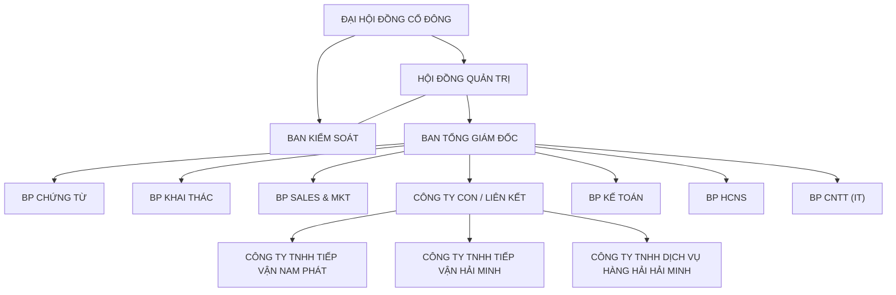

# BÁO CÁO THƯỜNG NIÊN NĂM 2025 - CÔNG TY CỔ PHẦN HẢI MINH (HMH)

*(Ban hành kèm theo Thông tư số 96/2020/TT-BTC ngày 16 tháng 11 năm 2020 của Bộ trưởng Bộ Tài chính)*

**CÔNG TY CỔ PHẦN HẢI MINH**  
**HAI MINH CORPORATION**  
Số: 01/2026/HMH-BCTN2025  
*Tp. Hồ Chí Minh, ngày 26 tháng 02 năm 2026*

**CỘNG HÒA XÃ HỘI CHỦ NGHĨA VIỆT NAM**  
**Độc lập – Tự do – Hạnh phúc**

---

### BÁO CÁO THƯỜNG NIÊN NĂM 2025

**Kính gửi:**
- Ủy ban Chứng khoán Nhà nước (SSC);
- Sở Giao dịch Chứng khoán Hà Nội (HNX).

---

## I. THÔNG TIN CHUNG

### 1. Thông tin khái quát
- **Tên tiếng Việt:** CÔNG TY CỔ PHẦN HẢI MINH
- **Tên tiếng Anh:** HAI MINH CORPORATION
- **Tên giao dịch viết tắt:** HAMI CORP
- **Giấy chứng nhận kinh doanh số:** 0302525162 đăng ký lần đầu ngày 24/01/2002, đăng ký thay đổi lần thứ 19 ngày 09/01/2026
- **Vốn điều lệ:** 138.422.290.000 đồng
- **Vốn đầu tư của chủ sở hữu:** 138.422.290.000 đồng
- **Địa chỉ:** Tầng 17 Tòa nhà Pearl Plaza, 561A Điện Biên Phủ, P. Thạnh Mỹ Tây, Tp. HCM
- **Điện thoại:** 028 3512 8668
- **Fax:** 028 3512 8688
- **Website:** www.haiminh.com.vn
- **Niêm yết cổ phiếu tại:** Sở giao dịch chứng khoán Hà Nội
- **Tên cổ phiếu:** Công ty cổ phần Hải Minh
- **Mệnh giá:** 10.000 VND/cổ phiếu
- **Mã chứng khoán:** HMH
- **Số lượng cổ phiếu niêm yết:** 13.842.229 cổ phiếu

#### Quá trình hình thành và phát triển:
Ngày 24/01/2002, Công ty cổ phần Hải Minh thành lập theo Giấy CNĐKKD số 4103000801 do Sở Kế hoạch Đầu tư Tp. Hồ Chí Minh cấp, với vốn điều lệ ban đầu là 1.500.000.000 đồng với mười một cổ đông sáng lập. Mã số doanh nghiệp hiện nay là 0302525162 theo Giấy CN ĐKDN thay đổi lần gần nhất (lần thứ 19) ngày 09 tháng 01 năm 2026.

Qua một chặng đường phát triển, một số cột mốc đáng chú ý như sau:
- **01/2002:** Thành lập Công ty cổ phần Hải Minh
- **06/2005:** Thành lập Công ty thành viên đầu tiên – Công ty Hải Thanh Thanh
- **08/2005:** Thành lập liên doanh đầu tiên – Hoàng Nam Logistics
- **10/2006:** Thành lập Công ty TNHH “K” Line (Việt Nam) là Công ty liên doanh giữa Công ty Cổ phần Hải Minh và hãng tàu “K” Line Nhật Bản.
- **03/2007:** Nâng vốn điều lệ lên 29,2 tỷ đồng
- **04/2007:** Mở tuyến vận tải container bằng đường thủy Hồ Chí Minh – Campuchia
- **10/2007:** Nâng vốn điều lệ lên 49,3 tỷ đồng
- **06/2008:** Nâng vốn điều lệ lên 56,16 tỷ đồng
- **06/2010:** Được chính thức chỉ định là đại lý cho Samudera Shipping Line (Singapore) tại Việt Nam
- **07/2010:** Niêm yết chứng khoán tại Sở giao dịch chứng khoán Hà Nội
- **08/2010:** Thành lập Công ty liên doanh với Tập đoàn DongBu Hàn Quốc (Cty TNHH Tiếp Vận Dong Bu - Hải Minh)
- **10/2011:** Niêm yết bổ sung 1.741.116 cổ phiếu, tương ứng giá trị chứng khoán đăng ký 17.411.160.000 đ. Nâng vốn điều lệ lên 73,57 tỷ đồng
- **10/2011:** Tiến hành đàm phán với PISD thành lập Công ty TNHH tiếp vận Hải Minh – Tỷ lệ vốn góp ban đầu là 13%. Công ty đã được cấp giấy phép đăng ký kinh doanh và hoạt động từ tháng 03/2012, đến tháng 11/2012 Hải Minh đã nhận chuyển nhượng lại toàn bộ phần vốn góp của PISD
- **12/2012:** Đăng ký lưu ký bổ sung 2.642.504 cổ phiếu, tương ứng giá trị chứng khoán đăng ký 26.425.040.000đ. Nâng vốn điều lệ lên 100 tỷ đồng (theo đúng vốn đăng ký trên giấy phép ĐKKD) và số cổ phiếu này đã được UBCK chấp thuận niêm yết tại sàn HNX vào tháng 01/2013
- **09/2013:** Sáp nhập Công ty TNHH MTV Hải Minh Hải Phòng vào Công ty TNHH tiếp vận Hải Minh
- **04/2014:** Chuyển nhượng một phần vốn góp (25%) tại Công ty TNHH “K” Line Việt Nam
- **03/2015:** Thành lập Công ty TNHH DV Hàng Hải Hải Minh
- **12/2015:** Đăng ký lưu ký bổ sung 3.199.847 cổ phiếu, tương ứng giá trị chứng khoán đăng ký 31.998.470.000đ. Nâng vốn điều lệ lên 131.998.470.000 đồng và số cổ phiếu này đã được UBCK chấp thuận niêm yết tại sàn HNX vào tháng 01/2017
- **07/2016:** Công ty cổ phần Hải Minh thoái toàn bộ vốn khỏi Công ty Hàng hải Hưng Phú (49% của vốn điều lệ 2.000.000.000 VNĐ)
- **08/2016:** Đưa vào sử dụng bãi Container với diện tích 2.3 ha tại Hải Phòng
- **10/2017:** Hạ thủy và đưa vào khai thác Sà lan 1.750 tấn chuẩn SB
- **01/2018:** Chuyển nhượng phần vốn góp liên kết tại Cty TNHH Tiếp Vận DongBu - Hải Minh
- **04/2018:** Chuyển nhượng phần còn lại vốn góp liên kết tại Công ty TNHH “K” Line (Việt Nam)
- **12/2020:** Bổ sung vốn điều lệ của Công ty TNHH Tiếp vận Nam Phát từ 32.000.000.000 VND lên 42.000.000.000 tương ứng số vốn góp cam kết theo tỷ lệ của Công ty Cổ phần Hải Minh 40.651.770.000 với tỷ lệ vốn góp là 96,79%
- **07/2022:** Góp vốn thành lập Công ty cổ phần Dịch vụ Cảng Hải Minh đầu tư hệ thống depot, kho bãi 6,2 ha tại KCN Nam Đình Vũ, Hải Phòng
- **03/2025:** Thoái vốn toàn bộ tại Công ty cổ phần Dịch vụ Cảng Hải Minh
- **10/2025:** Phát hành cổ phiếu ESOP, tăng vốn lên 138 tỷ đồng.

### 2. Ngành nghề và địa bàn kinh doanh
Công ty đăng ký hoạt động kinh doanh chính tại 02 khu vực là Tp. HCM và Hải Phòng với các lĩnh vực kinh doanh chủ yếu như sau:
- Vận tải nội địa và quốc tế; Kho vận và phân phối;
- Cho thuê kho bãi, dịch vụ đại lý hàng hải;
- Sữa chữa và kinh doanh các thiết bị chuyên dụng, container;
- Đại lý tàu biển; cho thuê thiết bị chuyên dùng trong bốc xếp, vận chuyển.
- Sản xuất, mua bán máy móc thiết bị chuyên dùng trong công nghiệp;
- Mua bán xe chuyên dung;
- Cho thuê mặt bằng văn phòng,…

### 3. Mô hình quản trị, tổ chức kinh doanh và bộ máy quản lý
#### 3.1. Mô hình quản trị
- Đại hội đồng cổ đông
- Hội đồng quản trị
- Ban kiểm soát
- Ban điều hành đứng đầu là Tổng giám đốc, các Phó tổng giám đốc và Kế toán trưởng.
- Tổng giám đốc quản lý, điều hành thông qua việc phân cấp phân quyền để trực tiếp giải quyết các công việc cụ thể của các đơn vị thành viên, thông qua người phụ trách cao nhất tại các đơn vị là Giám đốc các đơn vị thành viên và các trưởng phó phòng.

#### 3.2. Cơ cấu bộ máy quản lý – sơ đồ tổ chức:

#### 3.3. Các Công ty con:
- **CÔNG TY TNHH TIẾP VẬN NAM PHÁT**
  - Hoạt động theo Giấy chứng nhận ĐKDN số 0200822416 do Phòng Đăng ký kinh doanh thành phố Hải Phòng cấp lần đầu ngày 25/06/2008, đăng ký thay đổi lần thứ 7 ngày 06/08/2025.
  - Trụ sở chính: Tầng 3, Tòa nhà Hải Minh, Km 105 đường bao Nguyễn Bỉnh Khiêm, Phường Đông Hải, Tp. Hải Phòng.
  - Vốn điều lệ: 42.000.000.000 VND
  - Tỷ lệ lợi ích và quyền biểu quyết công ty: **96,79%**.
- **CÔNG TY TNHH TIẾP VẬN HẢI MINH**
  - Hoạt động theo Giấy chứng nhận ĐKDN số 0201242464 do Phòng Đăng ký kinh doanh thành phố Hải Phòng cấp lần đầu ngày 20/02/2012, đăng ký thay đổi lần thứ 7 ngày 10/03/2025.
  - Trụ sở chính: Tầng 3, Tòa nhà Hải Minh, Km 105 đường bao Nguyễn Bỉnh Khiêm, Phường Đông Hải, Tp. Hải Phòng.
  - Vốn điều lệ: 46.000.000.000 VND
  - Tỷ lệ lợi ích và quyền biểu quyết công ty: **100%**.
- **CÔNG TY TNHH DỊCH VỤ HÀNG HẢI HẢI MINH**
  - Hoạt động theo Giấy chứng nhận ĐKDN số 020624350 do Phòng Đăng ký kinh doanh thành phố Hải Phòng cấp lần đầu ngày 06/03/2015, đăng ký thay đổi lần thứ 2 ngày 16/01/2020.
  - Trụ sở chính: Tầng 3, Tòa nhà Hải Minh, Km 105 đường bao Nguyễn Bỉnh Khiêm, Phường Đông Hải, Tp. Hải Phòng.
  - Vốn điều lệ: 42.000.000.000 VND
  - Tỷ lệ lợi ích và quyền biểu quyết công ty: **100%**.

#### 3.4. Các công ty liên kết:
- **CÔNG TY CỔ PHẦN HẢI MINH ĐÌNH VŨ**
  - Hoạt động theo Giấy chứng nhận ĐKDN số 0202328153 do Phòng Đăng ký kinh doanh thành phố Hải Phòng cấp lần đầu ngày 25/12/2025.
  - Trụ sở chính: Lô KB5.5, KCN MP Đình Vũ, Phường Đông Hải, Tp. Hải Phòng.
  - Vốn điều lệ: 62.000.000.000 VND
  - Tỷ lệ lợi ích và quyền biểu quyết công ty: **19%**.

### 4. Định hướng phát triển
#### 4.1. Các mục tiêu chủ yếu:
- **Tiếp tục duy trì ổn định sản xuất kinh doanh các dịch vụ cốt lõi:**
  - *Đối với Dịch vụ Đại lý container:* Duy trì và phát triển mảng Đại lý cho Samudera và các đối tác khác như TransAsia, TWL, kết hợp tìm kiếm cơ hội Hợp tác liên doanh và Đại lý cho các hãng tàu mới để mở rộng qui mô; tuyển dụng nhân sự chất lượng.
  - *Đối với Dịch vụ vận chuyển container:* Tăng mạnh doanh thu, tạm dừng và thanh lý các xe cũ, kém hiệu quả, tăng cường đầu tư xe mới để gia tăng thị phần vận tải.
  - *Đối với Dịch vụ khai thác kho:* Tìm kiếm đối tác, gia tăng đầu tư, mở rộng qui mô và đa dạng hoá dịch vụ kho hàng.
  - *Đối với Dịch vụ khai thác depot:* Duy trì hợp đồng với hãng tàu hiện hữu, đẩy mạnh công tác thị trường, khai thác thêm Depot mới.
- Tiếp tục chỉ đạo Ban Tổng Giám đốc cơ cấu lại tổ chức, cắt giảm chi phí, đẩy mạnh áp dụng công nghệ thông tin vào công tác quản lý và hoạt động sản xuất kinh doanh đảm bảo khai thác hiệu quả hơn các cơ sở vật chất, kỹ thuật hiện có; gia tăng công tác marketing, hình ảnh của Công ty trên thị trường Logistics.

#### 4.2. Chiến lược phát triển trung và dài hạn:
- Tăng cường tìm kiếm đối tác Hợp tác, liên doanh,… nâng cao chất lượng dịch vụ, mở rộng qui mô, gia tăng lợi nhuận.
- Tiếp tục duy trì ổn định sản xuất kinh doanh trên cơ sở các dịch vụ truyền thống khai thác kho, bãi, vận chuyển container nội địa đường bộ và đại lý container.
- Đầu tư phát triển cụm kho tại Hải Phòng, phục vụ hàng thiết yếu cho trung tâm thành phố.
- Trong việc đầu tư, tiếp cận thị trường, chấp nhận cạnh tranh, nâng cao chất lượng dịch vụ để tồn tại và phát triển. Bám sát tình hình biến động kinh tế tích cực tìm kiếm, đầu tư các dịch vụ mới.
- Tập trung tuyển dụng và đào tạo nhân sự trẻ, chất lượng cao trên tinh thần trẻ hóa, có năng lực, nhiệt tình để điều hành và phát triển Công ty.

#### 4.3. Các mục tiêu phát triển bền vững:
Kiên định với mục tiêu Ổn định & Phát triển Công ty, dưới mọi hình thức: tự lực đầu tư, liên doanh liên kết, đầu tư vốn, mua bán, sát nhập doanh nghiệp tận dụng tối đa nguồn vốn và tài sản hiện có.

### 5. Các rủi ro
#### 5.1. Rủi ro về kinh tế:
Môi trường kinh tế với những nhân tố cơ bản như tốc độ tăng trưởng kinh tế, chỉ số lạm phát, lãi suất, tỷ giá hối đoái,… là yếu tố khách quan nhưng tác động trực tiếp đến sự phát triển của mọi ngành sản xuất, dịch vụ của Công ty cũng như những doanh nghiệp khác. Hoạt động kinh doanh của Công ty chịu ảnh hưởng trực tiếp từ những biến động vĩ mô nói trên của nền kinh tế trong nước cũng như kinh tế toàn cầu, đặc biệt là Công ty hoạt động trong lĩnh vực dịch vụ logistics.

#### 5.2. Rủi ro về luật pháp:
Rủi ro về pháp luật là rủi ro sự thay đổi trong luật pháp hay các quy định mới mà chính phủ đưa ra sẽ gây ảnh hưởng nghiêm trọng đến tình trạng một hay hoạt động kinh doanh, ngành hay một thị trường.

Rủi ro về luật pháp là rủi ro mang tính hệ thống, có ảnh hưởng chung đến toàn ngành. Những thay đổi trong chính sách quản lý vĩ mô của Chính phủ đều có những tác động nhất định đến hoạt động của công ty.

Hệ thống pháp luật của Việt Nam hiện nay tuy đã được cải cách xong vẫn còn thiếu tính ổn định và tính nhất quán, các văn bản hướng dẫn thi hành chưa đầy đủ, thiếu tính cập nhật và chồng chéo. Hoạt động dưới sự điều chỉnh của pháp luật Việt Nam. Bất kỳ điều chỉnh nào trong những quy định của Luật Doanh nghiệp, Luật Chứng khoán và quy định khác liên quan đến ngành nghề hoạt động kinh doanh của công ty đều có ảnh hưởng và tác động đến hoạt động và kết quả kinh doanh của công ty. Để giảm thiểu rủi ro về luật pháp, Công ty luôn duy trì việc cập nhật các quy định pháp luật mới đối với toàn bộ công nhân viên, đồng thời sẽ tham khảo thêm với các tổ chức tư vấn luật pháp khi cần thiết.

#### 5.3. Rủi ro đặc thù kinh doanh:
- **a. Rủi ro ngành:**  
  Hoạt động kinh doanh của Công ty bị ảnh hưởng trực tiếp bởi chính sách quản lý hàng hóa xuất nhập khẩu biên mậu giữa Việt Nam và các nước khác bao gồm chính sách thuế, phí và chính sách kiểm dịch, an toàn vệ sinh và kiểm tra các tiêu chuẩn chất lượng hàng hóa, chính sách quản lý đặc thù đối với mỗi loại hàng hóa trong từng thời kỳ,…
- **b. Rủi ro giá nhiên liệu:**  
  Do hoạt động ngành giao thông vận tải và giao nhận hàng hóa nên hoạt động của Công ty chịu ảnh hưởng bởi tăng giảm giá nhiên liệu. Tuy nhiên do xăng dầu phụ thuộc hoàn toàn vào tình hình thế giới đặc biệt ảnh hưởng lớn từ cuộc chiến Nga–Ukraina những năm gần đây, trong khi Công ty chỉ có thể điều chỉnh giá dịch vụ một cách tương ứng và phù hợp với thị trường.
- **c. Rủi ro cạnh tranh:**  
  Hạ tầng Công ty chủ yếu tập trung Hải Phòng, là trung tâm dịch vụ logistics, kho bãi, cảng biển,… đông đúc nên tình trạng cạnh tranh về giá giữa các doanh nghiệp cùng ngành trong khu vực là rất khốc liệt. Các doanh nghiệp cùng ngành sẵn sàng giảm giá hoặc chấp nhận lỗ để thu hút khách hàng. Đây chính là những thách thức lớn và rủi ro trong cạnh tranh đối với Công ty trong giai đoạn vừa qua và cũng sẽ tiếp tục trong giai đoạn sắp tới đây. Hội đồng quản trị chỉ đạo Ban Giám đốc tìm hướng đi là thế mạnh của Công ty để tìm thế chủ động trong kinh doanh.

#### 5.4. Rủi ro khác:
Các rủi ro khác nằm ngoài dự đoán và vượt quá khả năng phòng chống của con người như thiên tai, hỏa hoạn, dịch họa,… Là những rủi ro bất khả kháng xảy ra sẽ gây thiệt hại cho tài sản, con người và tình hình hoạt động chung của Công ty.

---

## II. TÌNH HÌNH HOẠT ĐỘNG TRONG NĂM

### 1. Tình hình hoạt động sản xuất kinh doanh
#### 1.1. Kết quả hoạt động SXKD trong năm
Năm 2025, kinh tế – xã hội thế giới vận động trong bối cảnh nhiều chuyển biến quan trọng về địa chính trị, công nghệ và cấu trúc tăng trưởng. Tăng trưởng toàn cầu duy trì ở mức trung bình, khi các ngân hàng trung ương lớn như Cục Dự trữ Liên bang Mỹ (FED) và Ngân hàng Trung ương châu Âu (ECB) chuyển dần sang chu kỳ nới lỏng tiền tệ sau giai đoạn thắt chặt kéo dài nhằm kiểm soát lạm phát. Lạm phát hạ nhiệt nhưng chưa hoàn toàn trở về mức mục tiêu, khiến chính sách tiền tệ vẫn thận trọng.

Một sự kiện đáng chú ý trong năm là việc Mỹ mở rộng áp dụng các biện pháp thuế quan và hàng rào thương mại đối với một số mặt hàng chiến lược, đặc biệt là xe điện, pin năng lượng và sản phẩm công nghệ cao nhập khẩu từ Trung Quốc. Động thái này nhằm bảo vệ ngành sản xuất nội địa và chuỗi cung ứng chiến lược, nhưng đồng thời làm gia tăng căng thẳng thương mại song phương và nguy cơ phân mảnh thương mại toàn cầu. Một số nền kinh tế lớn phản ứng bằng việc điều chỉnh chính sách công nghiệp và đa dạng hóa thị trường xuất khẩu.

Về địa chính trị, xung đột giữa Nga và Ukraine tiếp tục kéo dài, ảnh hưởng đến an ninh năng lượng và lương thực.

Về công nghệ, năm 2025 chứng kiến sự bùng nổ ứng dụng trí tuệ nhân tạo, bán dẫn và tự động hóa. Các quốc gia tăng cường đầu tư vào sản xuất chip và bảo vệ chuỗi cung ứng chiến lược. Nhìn chung, năm 2025 đánh dấu giai đoạn tái cấu trúc kinh tế toàn cầu, với xu hướng bảo hộ thương mại gia tăng song hành cùng chuyển đổi xanh và chuyển đổi số.

Đối với ngành vận tải biển và logistics, năm 2025 ghi nhận sự điều chỉnh sau giai đoạn biến động mạnh 2021–2023. Cước vận tải container ổn định hơn nhưng vẫn nhạy cảm trước rủi ro địa chính trị, đặc biệt tại tuyến Biển Đỏ và kênh đào Suez. Các hãng tàu tiếp tục tái cơ cấu đội tàu, đầu tư tàu sử dụng nhiên liệu sạch. Hoạt động logistics toàn cầu tập trung vào số hóa, tự động hóa cảng biển và tối ưu chuỗi cung ứng. Tuy nhiên, dư cung tàu container và chi phí tài chính cao tạo áp lực lợi nhuận cho doanh nghiệp vận tải biển. Tổng thể, ngành bước vào giai đoạn ổn định hơn nhưng vẫn tiềm ẩn rủi ro do phân mảnh thương mại và bất ổn địa chính trị.

Tại Việt Nam, năm 2025 ghi nhận sự phục hồi tích cực nhờ ổn định kinh tế vĩ mô, kiểm soát lạm phát và đẩy mạnh đầu tư công. Xuất khẩu cải thiện nhờ nhu cầu dần hồi phục từ các thị trường lớn, đặc biệt trong các ngành điện tử, dệt may và nông sản. Dòng vốn FDI tiếp tục chảy vào các lĩnh vực công nghệ cao, sản xuất xanh và hạ tầng. Chính phủ thúc đẩy cải cách thể chế, chuyển đổi số quốc gia và phát triển kinh tế xanh theo cam kết phát thải ròng bằng “0”.

Về xã hội, thị trường lao động dần phục hồi, thu nhập người dân cải thiện nhưng còn chênh lệch giữa các khu vực. Các vấn đề an sinh xã hội, giáo dục, y tế và thích ứng biến đổi khí hậu tiếp tục được ưu tiên. Tổng thể, năm 2025 là giai đoạn củng cố nền tảng tăng trưởng bền vững trong bối cảnh thế giới còn nhiều biến động.

Trong năm 2025, nhờ sự chỉ đạo quyết liệt của HĐQT, Ban TGĐ cùng nỗ lực không ngừng của toàn thể CBNV, Công ty đã hoàn thành vượt kế hoạch sản xuất kinh doanh đã đề ra, cụ thể như sau:
- **Tổng doanh thu:** 149 tỷ 058 triệu đồng, bằng 123,19% so với kế hoạch
- **Tổng chi phí:** 118 tỷ 165 triệu đồng, bằng 119,96% so với kế hoạch
- **Lợi nhuận trước thuế:** 30 tỷ 892 triệu đồng, đạt 137,30% so với kế hoạch

#### 1.2. Tình hình thực hiện so với kế hoạch:
*Đơn vị: Triệu đồng*

| CHỈ TIÊU | THỰC HIỆN 2024 (1) | KẾ HOẠCH 2025 (2) | THỰC HIỆN 2025 (3) | TỶ LỆ % (3/2) | TỶ LỆ % (3/1) |
| :--- | :---: | :---: | :---: | :---: | :---: |
| **TỔNG DOANH THU** | **119.738** | **121.000** | **149.058** | **123,19** | **124,49** |
| - Doanh thu từ hoạt động SXKD | 107.881 | | 121.756 | | |
| - Doanh thu từ hoạt động tài chính | 11.120 | | 26.694 | | |
| - Doanh thu khác | 737 | | 608 | | |
| **TỔNG CHI PHÍ** | **98.959** | **98.500** | **118.166** | **119,96** | **119,41** |
| - Chi phí giá vốn | 87.112 | | 101.615 | | |
| - Chi phí tài chính | 4.524 | | 7.474 | | |
| - Chi phí Quản lý doanh nghiệp | 7.138 | | 9.021 | | |
| - Chi phí khác | 185 | | 56 | | |
| **LỢI NHUẬN TRƯỚC THUẾ** | **20.779** | **22.500** | **30.892** | **137,30** | **148,67** |
| **TỔNG LỢI NHUẬN SAU THUẾ HỢP NHẤT** | **18.114** | | **27.017** | | **149,15** |

### 2. Tổ chức nhân sự
#### 2.1. Danh sách Ban điều hành:
Gồm 03 thành viên: 01 Tổng Giám đốc, 01 Phó Tổng Giám đốc và 01 Kế toán trưởng.

**a. Ông KWOK MICHAEL WA TONG - Tổng giám đốc (đã miễn nhiệm ngày 31/12/2025)**
- Giới tính: Nam
- Ngày tháng năm sinh: 12/07/1962
- Nơi sinh: Hong Kong; Quốc tịch: Anh
- Dân tộc: Trung Quốc; Quê quán: Hong Kong
- Số hộ chiếu: 142326225 cấp ngày 05/09/2023 bởi Văn phòng Hộ chiếu Hoàng gia Anh
- Địa chỉ thường trú: 705 C/c Số 14 Thảo Điền, P. An Khánh, Tp. Hồ Chí Minh, Việt Nam
- Trình độ văn hóa: Đại học
- Trình độ chuyên môn: Thạc sĩ Quản trị vận tải
- Chức vụ công tác hiện nay: Tổng Giám đốc (đã miễn nhiệm ngày 31/12/2025)
- Số lượng cổ phần nắm giữ (31/12/2025): 0 cổ phần (~ 0% VĐL).

**b. Ông TRẦN ĐOÀN VIỆN - Tổng Giám đốc (Bổ nhiệm ngày 01/01/2026)**
- Giới tính: Nam
- Ngày tháng năm sinh: 28/08/1970
- Số CMND: 033070010275 cấp ngày 31/08/2021 bởi Cục CS QLHC và TTXH
- Nơi sinh: Hưng Yên; Quốc tịch: Việt Nam
- Dân tộc: Kinh; Quê quán: Hưng Yên
- Địa chỉ thường trú: 508 Nguyễn Văn Linh, P. An Biên, Hải Phòng
- Trình độ văn hóa: Đại học
- Trình độ chuyên môn: Kỹ sư Kinh tế vận tải Biển
- Chức vụ công tác hiện nay: Thành viên Hội đồng quản trị, Tổng Giám đốc và Giám đốc Công ty TNHH Tiếp Vận Hải Minh
- Số lượng cổ phần nắm giữ (31/12/2025): 162.727 cổ phần (~1,18% VĐL)

**c. Ông TRẦN ĐỨC TRUNG - Phó Tổng Giám đốc**
- Giới tính: Nam
- Ngày tháng năm sinh: 20/02/1980
- Số CMND: 031080018721 cấp ngày 20/08/2021 bởi Cục CS QLHC và TTXH
- Nơi sinh: Hải Phòng; Quốc tịch: Việt Nam
- Dân tộc: Kinh; Quê quán: Hải Phòng
- Địa chỉ thường trú: 13 Vũ Trọng Khánh, P. Gia Viên, Hải Phòng
- Trình độ văn hóa: Đại học
- Trình độ chuyên môn: Kỹ sư Kinh tế vận tải biển
- Chức vụ công tác hiện nay: Thành viên Hội đồng quản trị, Phó TGĐ phụ trách Tài chính và Giám đốc Công ty TNHH Tiếp Vận Nam Phát
- Số lượng cổ phần nắm giữ (31/12/2025): 186.700 cổ phần (1,35% VĐL).

**d. Bà HOÀNG THỊ HƯƠNG - Kế toán trưởng**
- Giới tính: Nữ
- Ngày tháng năm sinh: 04/08/1980
- Số CMND: 031180007938 cấp ngày 28/06/2022 bởi Cục CS QLHC và TTXH
- Nơi sinh: Hải Phòng; Quốc tịch: Việt Nam
- Dân tộc: Kinh; Quê quán: Hải Phòng
- Địa chỉ thường trú: 247 đường Ngô Quyền, P. Ngô Quyền, Hải Phòng
- Trình độ văn hóa: Đại học
- Trình độ chuyên môn: Kế toán – kiểm toán
- Chức vụ công tác hiện nay: Kế toán trưởng
- Số lượng cổ phần nắm giữ (31/12/2025): 34.200 cổ phần (~0,25% VĐL)

#### 2.2. Những thay đổi trong Ban điều hành:
Trong năm 2025, Ban Điều hành Công ty có sự thay đổi về vị trí Tổng Giám đốc và Phó Tổng Giám đốc, theo đó:
- Miễn nhiệm Ông Kwok Michael Wa Tong, Tổng Giám đốc Công ty, từ ngày 31/12/2025 vì có Đơn từ nhiệm.
- Miễn nhiệm Ông Trần Đoàn Viện, Phó Tổng Giám đốc Công ty, để nhận nhiệm vụ mới.
- Bổ nhiệm Ông Trần Đoàn Viện làm Tổng Giám đốc Công ty thay Ông Kwok Michael Wa Tong từ ngày 01/01/2026.

#### 2.3. Số lượng cán bộ, nhân viên:
**a. Cơ cấu, số lượng người lao động, nhân viên:**

| STT | Chỉ tiêu | Số lao động |
| :---: | :--- | :---: |
| **1** | **Phân theo Giới tính** | |
| | - Nam | 111 |
| | - Nữ | 25 |
| **2** | **Phân theo trình độ học vấn** | |
| | - Trình độ đại học trở lên | 49% |
| | - Trình độ cao đẳng | 4% |
| | - Trình độ trung cấp | 6% |
| | - Lao động phổ thông | 41% |
| **3** | **Phân theo phân công lao động** | |
| | - Viên chức quản lý | 28 |
| | - Lao động trực tiếp | 108 |
| | **TỔNG LAO ĐỘNG** | **136** |

**b. Chính sách đối với người lao động:**
- Thực hiện đầy đủ các quy định của Nhà nước nhằm đảm bảo quyền lợi cho Người lao động.
- Chế độ tiền lương, thưởng do Ban Tổng Giám đốc xây dựng đề xuất trình được Hội đồng quản trị phê duyệt. Việc trình và chi trả tiền lương căn cứ quy chế trả lương căn cứ luật hiện hành, được thông qua ý kiến người lao động và tổ chức công đoàn.
- Tiền thưởng được chi trả cho người lao động căn cứ Quy chế khen thưởng, căn cứ kết quả đánh giá, xếp loại.

### 3. Tình hình đầu tư, tình hình thực hiện các dự án lớn
#### 3.1. Tình hình đầu tư:
- Đầu tư chứng khoán từ nguồn vốn nhàn rỗi của Công ty để tối ưu hóa lợi nhuận.
- Thoái vốn tại Công ty cổ phần Dịch vụ Cảng Hải Minh.
- Đầu tư vào Công ty cổ phần Hải Minh Đình Vũ.
- Chưa thoái vốn văn phòng và căn hộ tại Tp. HCM vì giá chưa đạt kì vọng.

#### 3.2. Tình hình hoạt động và tài chính của các Công ty liên quan:
*Đơn vị tính: triệu đồng*

| Các chỉ tiêu | Tiếp vận Nam Phát (96,08%) | Tiếp vận Hải Minh (100%) | Hàng hải Hải Minh (100%) |
| :--- | :---: | :---: | :---: |
| Tổng DT | 47.122 | 48.027 | 28.852 |
| LN sau thuế | 3.265 | 2.754 | 5.256 |

### 4. Tình hình tài chính
#### 4.1. Tình hình tài chính:
*Đơn vị tính: triệu đồng*

| STT | CHỈ TIÊU | NĂM 2024 (1) | NĂM 2025 (2) | TĂNG/GIẢM (%) (3)=(2-1)/(1) |
| :---: | :--- | :---: | :---: | :---: |
| 1 | Tổng giá trị tài sản | 248.055 | 283.312 | 14,21 |
| 2 | Doanh thu thuần | 107.881 | 121.756 | 12,86 |
| 3 | Lợi nhuận thuần từ HĐKD | 20.227 | 30.341 | 50,00 |
| 4 | Lợi nhuận khác | 552 | 551 | 0 |
| 5 | Lợi nhuận trước thuế | 20.779 | 30.892 | 48,67 |
| 6 | Lợi nhuận sau thuế | 18.114 | 27.017 | 49,15 |
| 7 | Lãi cơ bản trên cổ phiếu (đồng/CP) | 1.290 | 2.050 | 58,91 |

#### 4.2. Các chỉ tiêu tài chính:

| CHỈ TIÊU | Đơn vị | Năm 2024 | Năm 2025 | Ghi chú |
| :--- | :---: | :---: | :---: | :---: |
| **Chỉ tiêu về khả năng thanh toán** | | | | |
| Hệ số thanh toán ngắn hạn (Tài sản ngắn hạn/Nợ ngắn hạn) | Lần | 3,87 | 4,19 | |
| Hệ số thanh toán nhanh ((TSNH-Hàng tồn kho)/Nợ ngắn hạn) | Lần | 3,87 | 4,19 | |
| **Chỉ tiêu về cơ cấu tài sản** | | | | |
| Hệ số nợ/Tổng tài sản | % | 0,12 | 0,14 | |
| Hệ số nợ/Vốn chủ sở hữu | % | 0,13 | 0,16 | |
| **Chỉ tiêu về năng lực hoạt động** | | | | |
| Vòng quay hàng tồn kho (GVHB/HTK bình quân) | Lần | 4711 | 3523 | |
| Doanh thu thuần/Tổng tài sản | Lần | 0,43 | 0,43 | |
| **Các chỉ tiêu về khả năng sinh lời** | | | | |
| Lợi nhuận sau thuế /Doanh thu thuần | % | 17 | 22 | |
| Lợi nhuận sau thuế /VCSH | % | 8 | 11 | |
| Lợi nhuận sau thuế /Tổng tài sản | % | 7 | 10 | |
| Lợi nhuận từ hoạt động kinh doanh/Doanh thu thuần | % | 19 | 25 | |

### 5. Cơ cấu cổ đông, thay đổi vốn đầu tư của chủ sở hữu
#### 5.1. Cổ phần:
- Tổng số cổ phần: 13.842.229 CP
- Tổng số cổ phiếu đã được mua lại: 0 CP
- Loại cổ phiếu đang lưu hành: Cổ phiếu phổ thông
- Hình thức đăng ký: Ghi sổ
- Số lượng cổ phiếu tự do chuyển nhượng: 13.199.847 CP

#### 5.2. Cơ cấu cổ đông:
Tính đến hiện tại (Theo DS chốt quyền ngày 24/02/2026) cơ cấu cổ đông Công ty cổ phần Hải Minh được thể hiện cụ thể như sau:

| TT | THÀNH PHẦN | SỞ HỮU (Cổ phần) | TỶ LỆ (%) |
| :---: | :--- | :---: | :---: |
| 1 | Cổ đông lớn | 6.263.187 | 45,25% |
| 2 | Cổ đông nhỏ | 7.579.042 | 54,75% |
| 3 | Cổ đông tổ chức | 2.877.064 | 20,78% |
| 4 | Cổ đông cá nhân | 10.965.165 | 79,22% |
| 5 | Cổ đông trong nước | 13.787.510 | 99,60% |
| 6 | Cổ đông nước ngoài | 54.719 | 0,4% |
| 7 | Cổ đông nhà nước | 0 | 0% |

#### 5.3. Tình hình thay đổi vốn đầu tư của chủ sở hữu:
Trong năm 2025, Công ty đã tăng Vốn điều lệ sau khi phát hành thành công cổ phiếu theo chương trình lựa chọn cho người lao động trong Công ty (ESOP), cụ thể như sau:
- Số cổ phiếu đã phân phối: 642.382 cổ phiếu, tương ứng 100% tổng số cổ phiếu dự kiến phát hành.
- Tổng số cổ phiếu sau đợt phát hành (ngày 24/10/2025): 13.842.229 cổ phiếu, trong đó:
  + Số lượng cổ phiếu đang lưu hành: 13.842.229 cổ phiếu;
  + Số lượng cổ phiếu quỹ: 0 cổ phiếu.
- Vốn điều lệ trước khi phát hành: 131.998.470.000 đồng
- Vốn điều lệ sau khi phát hành: 138.422.290.000 đồng

#### 5.4. Giao dịch cổ phiếu quỹ:
Trong năm 2025, Công ty đã thực hiện thành công giao dịch bán ra toàn bộ số cổ phiếu quỹ nắm giữ, cụ thể như sau:
- Số lượng cổ phiếu đăng ký bán: 352.200 cổ phiếu
- Số lượng đã thực hiện: 352.200 cổ phiếu
- Thời gian thực hiện: Từ ngày 29/04/2025 đến ngày 16/05/2025

#### 5.5. Các loại chứng khoán khác:
Tính đến thời điểm 31/12/2025, Công ty có đầu tư mã chứng khoán kinh doanh khác. Danh mục chứng khoán kinh doanh:

*Thời điểm: 31/12/2025 (Đơn vị tính: VND)*

| Cổ phiếu | Số lượng | Giá gốc | Giá trị hợp lý (i) | Dự phòng |
| :--- | :---: | :---: | :---: | :---: |
| **Cổ phiếu** | | **122.943.810.422** | **121.722.409.000** | **(8.039.373.680)** |
| Công ty Cổ phần Cảng dịch vụ Dầu khí Đình Vũ (Mã chứng khoán: PSP) | 1.000.000 | 11.268.812.075 | 17.300.000.000 | - |
| Công ty Cổ phần Vận tải Dầu khí Thái Bình Dương (Mã chứng khoán: PVP) (ii) | 3.220.000 | 50.983.922.573 | 45.080.000.000 | (5.903.922.573) |
| Công ty Cổ phần Lai dắt và Vận tải Cảng Hải Phòng (Mã chứng khoán: TUG) | 717.476 | 12.278.498.212 | 11.838.354.000 | (440.144.212) |
| Tổng công ty Cổ phần Vận tải Dầu khí (Mã chứng khoán: PVT) | 1.289.000 | 25.321.512.513 | 23.717.600.000 | (1.605.777.514) |
| Ngân hàng Thương mại cổ phần Hàng hải Việt Nam (Mã chứng khoán: MSB) | - | - | - | - |
| Ngân hàng TMCP Á Châu (Mã chứng khoán: ACB) | - | - | - | - |
| Ngân hàng TMCP Quân Đội (Mã chứng khoán: MBB) | - | - | - | - |
| Công ty Cổ phần Tập đoàn Hapaco (Mã chứng khoán: HAP) | 2.230.500 | 15.599.027.153 | 16.304.955.000 | (16.443.125) |
| Cổ phiếu khác | | 7.492.037.896 | 7.481.500.000 | (73.086.256) |
| **Tổng** | | **122.943.810.422** | **121.722.409.000** | **(8.039.373.680)** |

---

## III. BÁO CÁO KẾT QUẢ KINH DOANH CỦA BAN TỔNG GIÁM ĐỐC

### 1. Đánh giá kết quả hoạt động sản xuất kinh doanh
#### a. Phân tích tổng quan:
Trên cơ sở số liệu tại Báo cáo tài chính và kết quả kinh doanh của Công ty, Công ty đã hoàn thành vượt kế hoạch đề ra đã được Đại hội đồng cổ đông thường niên 2025 thông qua tại kỳ họp ngày 08/05/2025.

Ban Tổng Giám đốc Công ty cổ phần Hải Minh xin báo cáo tình hình thực hiện các chỉ tiêu kế hoạch và báo cáo tài chính năm 2025 như sau:

*Đơn vị: Triệu đồng*

| CHỈ TIÊU | THỰC HIỆN 2024 (1) | KẾ HOẠCH 2025 (2) | THỰC HIỆN 2025 (3) | TỶ LỆ % (3/2) | TỶ LỆ % (3/1) |
| :--- | :---: | :---: | :---: | :---: | :---: |
| **TỔNG DOANH THU** | **119.738** | **121.000** | **149.058** | **123,19** | **124,49** |
| - Doanh thu từ hoạt động SXKD | 107.881 | | 121.756 | | |
| - Doanh thu từ hoạt động tài chính | 11.120 | | 26.694 | | |
| - Doanh thu khác | 737 | | 608 | | |
| **TỔNG CHI PHÍ** | **98.959** | **98.500** | **118.166** | **119,96** | **119,40** |
| - Chi phí giá vốn | 87.112 | | 101.615 | | |
| - Chi phí tài chính | 4.524 | | 7.474 | | |
| - Chi phí Quản lý doanh nghiệp | 7.138 | | 9.021 | | |
| - Chi phí khác | 185 | | 56 | | |
| **LỢI NHUẬN TRƯỚC THUẾ** | **20.779** | **22.500** | **30.892** | **137,30** | **148,67** |
| **TỔNG LỢI NHUẬN SAU THUẾ HỢP NHẤT** | **18.114** | | **27.017** | | **149,15** |

#### b. Những tiến bộ Công ty đã đạt được:
Dù thị trường còn nhiều khó khăn, Ban Điều hành đã cố gắng thực hiện tốt nhiệm vụ được HĐQT giao, thể hiện cụ thể qua các chỉ số tài chính tại thời điểm kết thúc niên độ (31/12/2025) là:
- Tổng tài sản của Công ty đạt **283.312 triệu đồng**, tăng 14,21% so với thời điểm 31/12/2024.
- Lợi nhuận cơ bản /CP (EPS) đạt **2.050 đồng/cp** (tăng 58,91% so với cùng kỳ).

### 2. Tình hình tài chính
#### a. Tình hình tài sản:
*Đơn vị tính: Triệu đồng*

| CHỈ TIÊU | Năm 2024 Giá trị (1) | Năm 2024 % (2) | Năm 2025 Giá trị (3) | Năm 2025 % (4) | Chênh lệch giá trị Mức tăng/(giảm) (5=3-1) | Chênh lệch giá trị % (6=5/1*100) | Chênh lệch cơ cấu (%) (7=4-2) |
| :--- | :---: | :---: | :---: | :---: | :---: | :---: | :---: |
| **A. TÀI SẢN NGẮN HẠN** | **111.605** | **45** | **167.461** | **59** | **55.856** | **50** | **14** |
| I. Tiền và các khoản tương đương tiền | 28.592 | 12 | 32.354 | 11 | 3.762 | 13 | -1 |
| II. Đầu tư tài chính ngắn hạn | 66.123 | 27 | 116.404 | 41 | 50.281 | 76 | 14 |
| III. Các khoản phải thu ngắn hạn | 15.574 | 6 | 17.441 | 6 | 1.867 | 12 | 0 |
| IV. Hàng tồn kho | 30 | 0,01 | 28 | 0,01 | -2 | -7 | 0 |
| V. Tài sản ngắn hạn khác | 1.286 | 0,52 | 1.234 | 0,44 | -52 | -4 | 0,08 |
| **B. TÀI SẢN DÀI HẠN** | **136.450** | **55** | **115.851** | **41** | **-20.599** | **-15** | **-14** |
| I. Các khoản phải thu dài hạn | 3 | 0 | 8 | 0 | 5 | 167 | 0 |
| II. Tài sản cố định | 88.252 | 36 | 87.955 | 31 | -297 | 0 | -5 |
| 1. Tài sản cố định hữu hình | 68.780 | 28 | 69.000 | 24 | 220 | 0 | -4 |
| 2. Tài sản cố định thuê tài chính | | | | | | | |
| 3. Tài sản cố định vô hình | 19.472 | 8 | 18.955 | 7 | -517 | -3 | -1 |
| III. Bất động sản đầu tư | 23.356 | 9 | 22.931 | 8 | -425 | -2 | -1 |
| IV. Tài sản dở dang dài hạn | 3485 | 1,4 | 661 | 0,23 | -2.824 | -81 | -1,17 |
| V. Đầu tư tài chính dài hạn | 17.984 | 7 | 0 | | -17.984 | -100 | -7 |
| VI. Tài sản dài hạn khác | 3.370 | 1,36 | 4.296 | 1,52 | 926 | 27 | 0,16 |
| **TỔNG CỘNG TÀI SẢN** | **248.055** | **100** | **283.312** | **100** | **35.257** | **14,21** | |

#### b. Tình hình nợ phải trả:
*Đơn vị tính: Triệu đồng*

| CHỈ TIÊU | Năm 2024 Giá trị (1) | Năm 2024 % (2) | Năm 2025 Giá trị (3) | Năm 2025 % (4) | Chênh lệch giá trị Mức tăng/(giảm) (5=3-1) | Chênh lệch giá trị % (6=5/1*100) | Chênh lệch cơ cấu (%) (7=4-2) |
| :--- | :---: | :---: | :---: | :---: | :---: | :---: | :---: |
| **C. NỢ PHẢI TRẢ** | **28.847** | **11,6** | **40.086** | **14,1** | **11.239** | **39,0** | **2,5** |
| I. Nợ ngắn hạn | 28.847 | 11,6 | 39.933 | 14,1 | 11.086 | 38,4 | 2,5 |
| 1. Phải trả người bán ngắn hạn | 8.541 | 3,4 | 4.941 | 1,7 | -3.600 | -42,1 | -1,7 |
| 2. Người mua trả tiền trước ngắn hạn | 166 | 0,1 | 165 | 0,1 | -1 | -0,6 | 0,0 |
| 3. Thuế và các khoản phải nộp Nhà nước | 2957 | 1,2 | 3576 | 1,3 | 619 | 20,9 | 0,1 |
| 4. Phải trả người lao động | 4.557 | 1,8 | 5.439 | 1,9 | 882 | 19,4 | 0,1 |
| 5. Chi phí phải trả ngắn hạn | 333 | 0,1 | 318 | 0,1 | -15 | -4,5 | 0,0 |
| 6. Doanh thu chưa thực hiện ngắn hạn | 57 | 0,0 | 97 | 0,0 | 40 | 70,2 | 0,0 |
| 7. Phải trả ngắn hạn khác | 9.461 | 3,8 | 12.795 | 4,5 | 3.334 | 35,2 | 0,7 |
| 8. Vay và nợ thuê tài chính ngắn hạn | 2058 | 0,8 | 10504 | 3,7 | 8.446 | 410,4 | 2,9 |
| 9. Quỹ khen thưởng, phúc lợi | 717 | 0,3 | 2098 | 0,7 | 1.381 | 192,6 | 0,4 |
| II. Nợ dài hạn | 0 | | | | 0 | | |
| Doanh thu chưa thực hiện dài hạn | | | 153 | 0,1 | 153 | | 0,1 |
| **D. VỐN CHỦ SỞ HỮU** | **219.208** | **88,4** | **243.226** | **85,9** | **24.018** | **11,0** | **-2,5** |
| I. Vốn chủ sở hữu | 219.208 | 88,4 | 243.226 | 85,9 | 24.018 | 11,0 | -2,5 |
| 1. Vốn góp của chủ sở hữu | 131.998 | 53,2 | 138.422 | 48,9 | 6.424 | 4,9 | -4,3 |
| 2. Thặng dư vốn cổ phần | 5.894 | 2,4 | 6.812 | 2,4 | 918 | 15,6 | 0,0 |
| 3. Cổ phiếu quỹ | -4.394 | -1,8 | | 0,0 | 4.394 | -100,0 | 1,8 |
| 4. Quỹ đầu tư phát triển | 6.746 | 2,7 | 6.747 | 2,4 | 1 | 0,0 | -0,3 |
| 5. Lợi nhuận sau thuế chưa phân phối | 77.513 | 31,2 | 89.784 | 31,7 | 12.271 | 15,8 | 0,5 |
| 6. Lợi ích cổ đông không kiểm soát | 1.451 | 0,6 | 1.461 | 0,5 | 10 | 0,7 | -0,1 |
| **TỔNG CỘNG NGUỒN VỐN** | **248.055** | **100,0** | **283.312** | **100** | **35.257** | **14,2** | **0,0** |

### 3. Những cải tiến về cơ cấu tổ chức, chính sách, quản lý
- **Công tác tổ chức, điều hành:**  
  Ban TGĐ sau khi có sự tham gia điều hành của Ông Kwok Michael Wa Tong, Tổng Giám đốc, đã tập trung phát triển mạnh mảng Đại lý tại Tp. HCM và Hải Phòng.  
  Cuối năm 2025, Ông Kwok Michael Wa Tong có đơn từ nhiệm vì lý do cá nhân. Công ty đã bổ nhiệm Ông Trần Đoàn Viện, Phó Tổng Giám đốc làm Tổng Giám đốc thay Ông Kwok Michael Wa Tong từ ngày 01/01/2026.  
  Trong suốt quá trình làm việc tại Công ty năm 2025, Ông Kwok Michael Wa Tong đã có những đóng góp to lớn trong việc chấn chỉnh và phát triển hoạt động Đại lý tại Tp. HCM.  
  Hoạt động của Công ty triển khai bình thường, suôn sẻ, quan hệ với các đối tác nước ngoài, các khách hàng trong nước mới và cũ đều được đảm bảo và phát triển.
  - Ký kết hợp đồng Đại lý với 1 số hãng tàu mới, tuyển dụng bổ sung đội ngũ nhân viên mảng hoạt động Đại lý tại Tp. HCM.
  - Bổ sung chức danh Giám đốc Đại lý để tập trung hơn vào công tác quản lý hoạt động Đại lý.
  - Tiếp tục kiện toàn đẩy mạnh hoạt động vận tải đường bộ tại Hải Phòng.
  - Duy trì họp và chế độ báo cáo giữa các đơn vị thành viên và đề ra biện pháp khắc phục các yếu kém và tồn tại trong quản lý tài chính, quản lý chi phí.
  - Duy trì hoạt động các kho và depot tại Hải Phòng.
- **Công tác đầu tư:**
  - Thoái vốn tại Công ty cổ phần Dịch vụ Cảng Hải Minh vì kết quả kinh doanh chưa hiệu quả. Thực tế đã hoàn thành thoái vốn đầu năm 2025.
  - Vận hành hiệu quả nguồn tiền nhàn rỗi của nhóm Công ty để gia tăng lợi nhuận tài chính.
  - Đầu tư trở thành cổ đông lớn của các doanh nghiệp trong ngành nghề Logistics.
  - Đầu tư vào Công ty cổ phần Hải Minh Đình Vũ triển khai dự án kho bãi mới.
- **Chính sách với người lao động:**  
  Duy trì và đảm bảo thời gian làm việc, đảm bảo thu nhập và ổn định tâm lý cho người lao động (thu nhập bình quân năm đạt **19,7 triệu đồng/người/tháng**).
- **Công tác kiểm soát tài chính-kế toán:**  
  Đảm bảo việc kiểm soát và an toàn tài chính toàn Group, không để xảy ra tình trạng thâm hụt hay mất mát tài sản, nguồn vốn của tổ chức. Tận dụng tốt và tối ưu hóa khả năng tài chính hiện có để tăng thêm lợi nhuận cho Công ty.
- **Công tác nhân sự:**  
  Ngoài việc tiếp tục thực hiện tái cơ cấu và sắp xếp tinh giản nhân sự nội tại, chỉ đạo các đơn vị thành viên Công ty thực hiện chủ trương tuyển dụng mới những nhân sự có chuyên môn và kinh nghiệm lâu năm để thay thế và bổ sung cho các vị trí quản lý, khai thác mở rộng dịch vụ.

### 4. Kế hoạch phát triển tương lai
- Tập trung nhân lực xây dựng kế hoạch chiến lược phát triển trung và dài hạn của Công ty.
- Tiếp tục duy trì và phát triển các dịch vụ cốt lõi hiện có, tăng cao chất lượng dịch vụ, công tác quản trị tài chính, quản trị doanh nghiệp nhằm đảm bảo mức lợi nhuận hàng năm để bảo toàn và phát triển vốn.
- Có chính sách đãi ngộ, thu hút nhân tài để xây dựng và phát triển Công ty.
- Tiếp tục tìm kiếm các dự án đầu tư để tăng vốn điều lệ Công ty đủ lớn trên thị trường chứng khoán.
- Đảm bảo lợi ích của nhà đầu tư và giá trị Công ty trên thị trường chứng khoán.

### 5. Giải trình của Ban Tổng Giám đốc đối với ý kiến kiểm toán
Báo cáo tài chính năm 2025 của Công ty cổ phần Hải Minh đã được đơn vị kiểm toán chấp nhận toàn phần.

---

## IV. ĐÁNH GIÁ CỦA HĐQT VỀ HOẠT ĐỘNG CỦA CÔNG TY

Căn cứ vào Nghị quyết số 01/2025/NQ-ĐHĐCĐ ngày 08/05/2025 của Đại hội đồng cổ đông thường niên năm 2025 của Công ty cổ phần Hải Minh.

Hội đồng quản trị xin Báo cáo tình hình thực hiện Nghị quyết Đại hội đồng cổ đông của Công ty năm 2025 và Dự kiến nhiệm vụ năm 2026 của Công ty như sau:

### 1. Đánh giá của HĐQT về các mặt hoạt động của Công ty
#### 1.1. Về kết quả sản xuất kinh doanh năm 2025:
- **Tổng doanh thu:** 149 tỷ 058 triệu bằng 123,19% so với kế hoạch
- **Tổng chi phí:** 118 tỷ 165 triệu bằng 119,96% so với kế hoạch
- **Lợi nhuận trước thuế:** 30 tỷ 892 triệu đạt 137,30% so với kế hoạch

Công ty đã vượt các chỉ tiêu kế hoạch đặt ra, đạt mức tăng trưởng tốt về cả Doanh thu và Lợi nhuận.

#### 1.2. Phương án phân phối lợi nhuận năm 2025 đã thực hiện trong năm 2025:
HĐQT đã thực hiện đầy đủ việc phân phối lợi nhuận năm 2024 đã được ĐHĐCĐ thông qua cụ thể như sau:
- Trích lập quỹ khen thưởng, phúc lợi 05% lợi nhuận hợp nhất năm 2024.
- Trích lập quỹ HĐQT 03% lợi nhuận hợp nhất năm 2024.
- Chi trả cổ tức năm 2024 bằng tiền tới các cổ đông tỷ lệ 10%.

#### 1.3. Công tác tổ chức nhân sự, chính sách đối với người lao động:
Tiếp tục kiện toàn bộ máy tổ chức, thực hiện luân chuyển, bổ nhiệm cán bộ tại một số vị trí nhằm tăng cường hiệu quả của công tác quản lý.

Rà soát mức lương của người lao động đảm bảo quy định mức lương tối thiểu vùng theo đúng quy định của Nhà Nước. Đảm bảo đời sống vật chất, tinh thần, chăm sóc sức khỏe, giải quyết tốt các chế độ chính sách cho người lao động; tạo đủ việc làm, cải thiện điều kiện làm việc.

#### 1.4. Tình hình quản trị Công ty:
Trong năm 2025, HĐQT đã tiến hành họp 15 cuộc họp, ban hành 13 Nghị quyết và 04 Quyết định liên quan đến công tác thực hiện Nghị quyết của ĐHĐCĐ, công tác quản trị Công ty. Các thành viên HĐQT đã tham gia họp với tỷ lệ 100% và có sự nhất trí cao trong năm 2025. Công ty cũng đã tổ chức thành công Đại hội đồng cổ đông thường niên năm 2025 theo hình thức trực tiếp vào ngày 08/05/2025.

HĐQT Công ty đã bám sát Nghị quyết của Đại hội đồng cổ đông chỉ đạo và thực hiện tốt các nhiệm vụ đã được Đại hội thông qua.

HĐQT đã thực hiện giám sát chỉ đạo Ban giám đốc trong việc thực hiện các nghị quyết của Đại hội đồng cổ đông, của Hội đồng quản trị tập trung toàn lực vào việc thực hiện các chỉ tiêu đã đặt ra.

#### 1.5. Thực hiện Quỹ HĐQT năm 2025:
- **Tổng quỹ HĐQT năm 2025:**
  - Quỹ tồn đến 31/12/2024: 350.515.397 VND
  - Trích quỹ 3% lợi nhuận hợp nhất năm 2024: 540.482.000 VND
- **Tổng chi năm 2025 từ nguồn Quỹ HĐQT:**
  - Chi thù lao HĐQT+BKS: 0 VND
  - Chi hoạt động của HĐQT: 0 VND
- **Tồn quỹ HĐQT:** 890.997.397 VND

### 2. Đánh giá của HĐQT về hoạt động của Ban Tổng Giám đốc Công ty
Ban Tổng Giám đốc đã cố gắng triển khai đúng chỉ đạo của HĐQT, đảm bảo duy trì được hoạt động của Công ty bình thường và hiệu quả, hoàn thành vượt nhiệm vụ mà Đại hội đồng cổ đông giao phó. Cuối năm 2025, Ông Kwok Michael Wa Tong có đơn từ nhiệm vì lý do cá nhân. Công ty đã bổ nhiệm Ông Trần Đoàn Viện, Phó Tổng Giám đốc làm Tổng Giám đốc thay Ông Kwok Michael Wa Tong từ ngày 01/01/2026.

Trong suốt quá trình làm việc tại Công ty năm 2025, Ông Kwok Michael Wa Tong đã có những đóng góp to lớn trong việc chấn chỉnh và phát triển hoạt động Đại lý tại Tp. HCM.

### 3. Kế hoạch, định hướng năm 2026 của Hội đồng quản trị
Căn cứ vào tình hình thực hiện kế hoạch năm 2025 và dự tính tình hình thị trường năm 2026, HĐQT Công ty dự kiến các chỉ tiêu kế hoạch năm 2026 như sau:

#### 3.1. Chỉ tiêu sản xuất kinh doanh:
- **Tổng doanh thu:** 148 tỷ đồng, giảm 0,71% so với TH năm 2025
- **Tổng chi phí:** 122 tỷ đồng, tăng 3,2% so với TH năm 2025
- **Lợi nhuận trước thuế:** 26 tỷ đồng, giảm 15,8% so với TH năm 2025

#### 3.2. Kế hoạch đầu tư mở rộng sản xuất:
- Xem xét, tìm thời điểm thích hợp thoái vốn tại các căn hộ tại Cao ốc Parkview 152 Điện Biên Phủ, Phường Thạnh Mỹ Tây, Tp. HCM và 1 phần diện tích Văn phòng tại Pearl Plaza để tập trung nguồn vốn vào ngành nghề cốt lõi của Công ty như Đại lý, Vận tải, khai thác kho bãi,…
- Chờ thời điểm thích hợp để đầu tư Dự án kho hàng nội địa 7.000 m2.
- Vận hành hiệu quả nguồn vốn nhàn rỗi của nhóm công ty.
- Tiếp tục tìm kiếm cơ hội đầu tư trực tiếp hoặc gián tiếp vào các doanh nghiệp trong lĩnh vực logistics,…
- Tìm kiếm cơ hội hợp tác, liên doanh với các đối tác trong và ngoài nước để mở rộng hoạt động sản xuất kinh doanh.

#### 3.3. Công tác quản lý công ty:
- **Tiếp tục duy trì ổn định sản xuất kinh doanh các dịch vụ cốt lõi:**
  - *Đối với Dịch vụ Đại lý container:* Duy trì và phát triển mảng Đại lý cho Samudera và các đối tác khác như TransAsia, TWL, kết hợp tìm kiếm cơ hội Hợp tác liên doanh và Đại lý cho các hãng tàu mới để mở rộng qui mô; tuyển dụng nhân sự chất lượng.
  - *Đối với Dịch vụ vận chuyển container:* Tăng mạnh doanh thu, tạm dừng và thanh lý các xe cũ, kém hiệu quả, tăng cường đầu tư xe mới để gia tăng thị phần vận tải.
  - *Đối với Dịch vụ khai thác kho:* Tìm kiếm đối tác, gia tăng đầu tư, mở rộng qui mô và đa dạng hoá dịch vụ kho hàng.
  - *Đối với Dịch vụ khai thác depot:* Duy trì hợp đồng với hãng tàu hiện hữu, đẩy mạnh công tác thị trường, khai thác thêm Depot mới.
- Tiếp tục chỉ đạo Ban Tổng Giám đốc cơ cấu lại tổ chức, cắt giảm chi phí, đẩy mạnh áp dụng công nghệ thông tin vào công tác quản lý và hoạt động sản xuất kinh doanh đảm bảo khai thác hiệu quả hơn các cơ sở vật chất, kỹ thuật hiện có; gia tăng công tác marketing, hình ảnh của Công ty trên thị trường Logistics.

---

## V. QUẢN TRỊ CÔNG TY

### 1. Hội đồng quản trị
#### 1.1. Thành viên và cơ cấu Hội đồng quản trị:
*(Theo danh sách cổ đông chốt gần nhất ngày 24/02/2026)*

| Stt | Thành viên | Chức danh | Tỷ lệ sở hữu | Ghi chú |
| :---: | :--- | :--- | :--- | :--- |
| 1 | Trần Quang Tiến | Chủ tịch | 1.460.087 cổ phiếu, chiếm 10,55% | |
| 2 | Trần Đoàn Viện | Thành viên | 162.727 cổ phiếu, chiếm 1,18% | |
| 3 | Trần Đức Trung | Thành viên | 186.700 cổ phiếu, chiếm 1,35% | |
| 4 | Phùng Tuấn Anh | Thành viên | 131.257 cổ phiếu, chiếm 0,95% | Không điều hành |
| 5 | Vũ Thị Thu Việt | Thành viên | 111.000 cổ phiếu, chiếm 0,80% | Độc lập |

#### 1.2. Các tiểu ban thuộc Hội đồng quản trị:
- Không có

#### 1.3. Hoạt động của Hội đồng quản trị:
Trong năm 2025, Hội đồng quản trị công ty đã họp và ban hành 13 Nghị quyết & 04 Quyết định trong nhiều lĩnh vực để thực hiện công tác quản trị doanh nghiệp, thực hiện nghiêm chỉnh chức năng nhiệm vụ quản lý, giám sát mọi mặt hoạt động sản xuất kinh doanh của Công ty.

Tổ chức thành công Đại hội đồng cổ đông thường niên năm 2025 thông qua kết quả kinh doanh năm 2024 và phương hướng nhiệm vụ năm 2025 của Công ty.

Duy trì chế độ họp định kỳ hàng quý, giám sát chặt chẽ mọi hoạt động của Ban Tổng giám đốc trong việc thực hiện nghị quyết của Đại hội đồng cổ đông và các Nghị quyết của HĐQT. Tăng cường công tác kiểm tra, giám sát của Ban kiểm soát đối với các hoạt động tài chính của Công ty.

Các TV HĐQT căn cứ vào chức năng nhiệm vụ đã được giao có trách nhiệm giám sát, giúp đỡ Ban điều hành thực thi tốt các hoạt động của mình cũng như mở rộng hoạt động kinh doanh của công ty.

**Các Nghị quyết, Quyết định của Hội đồng quản trị:**
Trong năm 2025, HĐQT đã có các Nghị quyết, Quyết định sau:

| Stt | Số Nghị quyết / Quyết định | Ngày | Nội dung | Tỷ lệ thông qua |
| :---: | :--- | :---: | :--- | :---: |
| 1 | 01/2025/NQ-HĐQT | 14/02/2025 | - Thông qua Kế hoạch tổ chức Đại hội đồng cổ đông thường niên năm 2025 - Thông qua Hợp đồng, giao dịch với các bên liên quan - Thông qua thay đổi đại diện vốn góp tại HML | 100% |
| 2 | 01/2025/QĐ-HĐQT | 10/03/2025 | Thông qua đầu tư 01 xe ô tô 7 chỗ | 100% |
| 3 | 02/2025/NQ-HĐQT | 28/03/2025 | Thông qua phương án bán cổ phiếu quỹ | 100% |
| 4 | 02/2025/QĐ-HĐQT | 06/05/2025 | Thành lập Ban kiểm tra tư cách cổ đông | 100% |
| 5 | 03/2025/QĐ-HĐQT | 19/05/2025 | Thông qua Kế hoạch chi trả cổ tức 2024 bằng tiền 10% | 100% |
| 6 | 04/2025/QĐ-HĐQT | 16/06/2025 | Lựa chọn đơn vị kiểm toán BCTC 2025 | 100% |
| 7 | 03/2025/NQ-HĐQT | 25/06/2025 | Thông qua hạn mức tín dụng tại TCB | 100% |
| 8 | 04/2025/NQ-HĐQT | 13/08/2025 | Thông qua danh sách phát hành cổ phiếu ESOP | 100% |
| 9 | 05/2025/NQ-HĐQT | 14/08/2025 | Thông qua triển khai phương án phát hành cổ phiếu ESOP | 100% |
| 10 | 06/2025/NQ-HĐQT | 18/08/2025 | Thay thế Nghị quyết số 04/2025/NQ-HĐQT | 100% |
| 11 | 07/2025/NQ-HĐQT | 18/08/2025 | Thanh lý xe ô tô con Mitsubishi Pajero | 100% |
| 12 | 08/2025/NQ-HĐQT | 05/09/2025 | Bổ sung chức danh Giám đốc khối Đại lý tại Tp. HCM | 100% |
| 13 | 09/2025/NQ-HĐQT | 17/09/2025 | Thay đổi nội dung con dấu Công ty theo địa giới mới | 100% |
| 14 | 10/2025/NQ-HĐQT | 14/10/2025 | Phương án xử lý số cổ phiếu ESOP không phân phối hết | 100% |
| 15 | 11/2025/NQ-HĐQT | 24/10/2025 | Báo cáo kết quả phát hành cổ phiếu ESOP | 100% |
| 16 | 12/2025/NQ-HĐQT | 10/12/2025 | Thay đổi nhân sự Ban Tổng Giám đốc từ 31/12/2025 | 100% |
| 17 | 13/2025/NQ-HĐQT | 18/12/2025 | Góp vốn thành lập Công ty cổ phần Hải Minh Đình Vũ | 100% |

### 2. Ban kiểm soát
#### 2.1. Thành viên và cơ cấu Ban kiểm soát:

| Stt | Thành viên | Chức danh | Tỷ lệ sở hữu | Ghi chú |
| :---: | :--- | :--- | :--- | :--- |
| 1 | Ông Đào Thế Hưng | Trưởng ban | 136.000 cổ phiếu, chiếm 0,98% | |
| 2 | Bà Tạ Thu Hường | Thành viên | 24.200 cổ phiếu, chiếm 0,17% | |
| 3 | Bà Đặng Thị Bích Ngọc | Thành viên | 24.200 cổ phiếu, chiếm 0,17% | |

#### 2.2. Hoạt động và đánh giá của Ban kiểm soát:
**a. Hoạt động của Ban Kiểm soát:**  
Ban kiểm soát đã thực hiện đầy đủ các chức năng, nhiệm vụ quy định tại Luật doanh nghiệp, Điều lệ của Công ty. Các công việc của Ban kiểm soát trong năm 2024 cụ thể như sau: *(Ghi chú: nguyên văn trong báo cáo ghi 2024)*
- Tham gia Đại hội đồng cổ đông thường niên của Công ty;
- Tham gia các cuộc họp định kỳ và bất thường của Hội đồng quản trị Công ty;
- Giám sát hoạt động của Hội đồng quản trị, Ban điều hành theo quy định của pháp luật và Nghị quyết Đại hội đồng cổ đông của Công ty;
- Đề xuất công ty kiểm toán độc lập thực hiện kiểm toán báo cáo tài chính năm và bán niên; thẩm định Báo cáo tài chính năm trước và sau kiểm toán;
- Tổ chức các cuộc họp định kỳ và bất thường của Ban kiểm soát để soát xét, thảo luận, đánh giá hoạt động của Công ty.
- Trong năm 2025, BKS tổ chức 02 cuộc họp và cuộc họp của BKS được lập thành văn bản và gửi đến các thành viên;
- Các công việc khác theo chức năng và nhiệm vụ của Ban Kiểm soát.

**b. Báo cáo kết quả giám sát:**  
*1. Kết quả giám sát hoạt động của Hội đồng quản trị:*
- Hội đồng quản trị đã giám sát và đưa ra những định hướng phát triển mới để cải tiến, thay thế một số định hướng cũ nhằm nâng cao hiệu quả hoạt động của Ban Giám đốc trong điều hành sản xuất kinh doanh của Công ty.
- Hội đồng quản trị luôn chủ động tìm kiếm cơ hội đầu tư góp phần gia tăng thị phần các mảng kinh doanh của Công ty trên thị trường và giám sát việc thực hiện Nghị quyết ĐHĐCĐ đã được thông qua.
- Trong năm 2025, Hội đồng quản trị đã tổ chức 15 cuộc họp, các thành viên HĐQT tham gia đầy đủ và có tinh thần trách nhiệm cao đối với việc đóng góp ý kiến về các nội dung đã đề ra. Các cuộc họp đều được lập biên bản và ban hành Nghị quyết để triển khai thực hiện.
- Các Nghị quyết của HĐQT đã ban hành đúng với chức năng, quyền hạn và phù hợp với Nghị quyết ĐHĐCĐ, hoàn toàn tuân thủ Điều lệ Công ty, Luật Doanh nghiệp và các quy định pháp luật khác;
- Công tác quản trị điều hành được thực hiện theo đúng Pháp luật, các quy định đối với hoạt động của công ty niêm yết, Điều lệ Công ty và Nghị quyết của Đại hội đồng cổ đông.

*2. Kết quả giám sát hoạt động của Ban Tổng giám đốc:*
- Ban Tổng Giám đốc đã luôn bám sát các mục tiêu, định hướng và thực hiện đầy đủ các nhiệm vụ mà ĐHĐCĐ và HĐQT đã giao.
- Ban Tổng Giám đốc đã thực hiện nhiều giải pháp triển khai kế hoạch kinh doanh, nghiên cứu ứng dụng công nghệ thông tin vào các lĩnh vực quản lý, tăng cường công tác quản lý tài chính thông qua việc kiểm soát các khoản chi phí, quản lý công tác nghiệp vụ hướng đến mục tiêu và kế hoạch của ĐHĐCĐ và HĐQT đề ra.
- Tổ chức các cuộc họp giao ban, các buổi họp tổng kết hàng tháng, hàng quý nhằm đánh giá đầy đủ các mặt của hoạt động kinh doanh, đồng thời chỉ rõ những mặt hạn chế và tồn tại để giải quyết tháo gỡ và khắc phục. Xây dựng và triển khai nhiệm vụ kinh doanh đến từng công ty thành viên, định hướng các giải pháp đồng bộ để các công ty chủ động quản lý, giám sát và điều hành hoạt động kinh doanh của công ty mình.
- Trong thời gian hoạt động vừa qua, Ban kiểm soát không phát hiện điều gì bất thường trong công tác quản lý điều hành của Ban Tổng Giám đốc. Ban Tổng Giám đốc đã thực hiện các chế độ quản lý tài chính một cách minh bạch đúng với các quy định tài chính hiện tại.

*3. Công tác thẩm định các báo cáo tài chính:*
- Báo cáo tài chính năm 2025 được Công ty TNHH Kiểm toán CPA Việt Nam kiểm toán.
- Tại Báo cáo kiểm toán độc lập số 70/2026/BCKTHN-CPA VIETNAM-HCM ngày 04 tháng 02 năm 2026, đơn vị kiểm toán có nêu ý kiến kiểm toán như sau:
  > *"Theo ý kiến của chúng tôi, Báo cáo tài chính kèm theo đã phản ánh trung thực và hợp lý, trên các khía cạnh trọng yếu, tình hình tài chính hợp nhất của Công ty tại ngày 31/12/2025, cũng như kết quả hoạt động kinh doanh hợp nhất và tình hình lưu chuyển tiền tệ hợp nhất cho năm tài chính kết thúc cùng ngày, phù hợp với Chuẩn mực kế toán Việt Nam, Chế độ kế toán doanh nghiệp Việt Nam và các quy định pháp lý có liên quan đến việc lập và trình bày Báo cáo tài chính hợp nhất."*

- **Kết quả sản xuất kinh doanh năm 2025:**  
  *Đơn vị tính: Triệu đồng*

| CHỈ TIÊU | KẾ HOẠCH 2025 (1) | THỰC HIỆN 2025 (2) | TỶ LỆ % (2/1) |
| :--- | :---: | :---: | :---: |
| **TỔNG DOANH THU** | **121.000** | **149.058** | **123,19** |
| - Doanh thu từ hoạt động SXKD | | 121.756 | |
| - Doanh thu từ hoạt động tài chính | | 26.694 | |
| - Doanh thu khác | | 608 | |
| **TỔNG CHI PHÍ** | **98.500** | **118.165** | **119,96** |
| - Chi phí giá vốn | | 101.615 | |
| - Chi phí tài chính | | 7.474 | |
| - Chi phí Quản lý doanh nghiệp | | 9.020 | |
| - Chi phí khác | | 56 | |
| **LỢI NHUẬN TRƯỚC THUẾ** | **22.500** | **30.892** | **137,30** |
| **TỔNG LỢI NHUẬN SAU THUẾ HỢP NHẤT** | | **27.017** | |

- **Tình hình tài sản, nguồn vốn đến 31/12/2025:**  
  *Đơn vị tính: Triệu đồng*

| CHỈ TIÊU | TẠI NGÀY 31/12/2025 | TẠI NGÀY 31/12/2024 |
| :--- | :---: | :---: |
| **A. TÀI SẢN** | **283.312** | **248.055** |
| Tài sản ngắn hạn | 167.461 | 111.605 |
| Tài sản dài hạn | 115.850 | 136.450 |
| **B. NGUỒN VỐN** | **283.312** | **248.055** |
| Nợ phải trả | 40.086 | 28.847 |
| Nợ ngắn hạn | 39.933 | 28.847 |
| Nợ dài hạn | 153 | 0 |
| Vốn chủ sở hữu | 243.226 | 219.208 |
| Vốn góp chủ sở hữu | 138.422 | 131.998 |
| Thặng dư vốn | 6.812 | 5.894 |
| Cổ phiếu quỹ | 0 | (4.394) |
| Quỹ đầu tư phát triển | 6.747 | 6.746 |
| Lợi nhuận chưa phân phối | 89.784 | 77.513 |
| Lợi ích cổ đông không kiểm soát | 1.461 | 1.450 |

Trong năm 2025, Công ty đã chia cổ tức bằng tiền tỷ lệ 10% theo Nghị quyết của Đại hội đồng cổ đông thường niên ngày 08/05/2025.

- **Tình hình tài chính:**  
  Căn cứ vào kết quả kiểm tra Ban kiểm soát đánh giá Công ty có tài chính ổn định và lành mạnh thể hiện qua các chỉ tiêu về nguồn vốn, khả năng thanh toán. Công ty đã bảo toàn và phát triển vốn trong sản xuất kinh doanh chủ yếu bằng nguồn vốn đầu tư từ các cổ đông và vốn tích lũy qua các năm không phải vay mượn ngoài.

- **Tình hình thực hiện đầu tư:**  
  - Năm 2025, Công ty đã hoàn tất chuyển nhượng vốn đầu tư tại Công ty cổ phần Dịch vụ Cảng Hải Minh.
  - Cuối năm 2025, Hội đồng quản trị ban hành nghị quyết góp vốn vào Công ty cổ phần Hải Minh Đình Vũ để đầu tư Dự án kho bãi.

*4. Đánh giá – Nhận xét và kiến nghị:*  
Trong quá trình kiểm tra, giám sát các hoạt động của Công ty, Ban Kiểm soát đánh giá trong năm 2025, Hội đồng quản trị và Ban Giám đốc đã thực hiện nghiêm túc Nghị quyết Đại hội đồng cổ đông, điều lệ tổ chức của công ty và các quy định của pháp luật thông qua việc thực hiện phân phối lợi nhuận, trích lập và sử dụng các quỹ, đảm bảo các lợi ích của nhà đầu tư và người lao động. Thực hiện tốt các chế độ, nghĩa vụ về tài chính với nhà nước.

Các Nghị quyết, Quyết định được ban hành đúng luật và kịp thời bám sát thực tế nhằm xử lý các khó khăn trong từng giai đoạn hoạt động sản xuất kinh doanh của công ty.

Ban kiểm soát không nhận được kiến nghị nào của các tổ chức, cá nhân và chưa phát hiện điều gì bất thường trong công tác quản lý công ty của HĐQT và Ban Giám đốc trong năm 2025.

**c. Phương hướng, nhiệm vụ của Ban Kiểm soát năm 2026:**
- Thực hiện đầy đủ chức năng nhiệm vụ được giao, hợp lý quy trình làm việc để nắm bắt tốt hơn tình hình hoạt động của Công ty, tăng cường trao đổi thông tin với các bộ phận trong quyền hạn của BKS để kịp thời phản hồi trong các cuộc họp định kỳ của BKS.
- Giám sát việc triển khai thực hiện các Nghị quyết của ĐHĐCĐ, HĐQT, Ban Tổng Giám đốc trong việc xây dựng kế hoạch, thực hiện nhiệm vụ SXKD năm 2026;
- Tham gia rà soát phối hợp công tác lập Báo cáo tài chính, Báo cáo quản trị nhằm đảm bảo phản ánh trung thực, minh bạch tình hình tài chính của Công ty;
- Tổ chức xem xét kiểm tra để phát hiện những những bất hợp lý và khuyến cáo các cấp điều hành, quản lý Công ty chấp hành nghiêm túc các quy chế của Công ty và quy định của pháp luật.

### 3. Các giao dịch, thù lao và các khoản lợi ích của HĐQT, BKS và BGĐ
#### 3.1. Thù lao của HĐQT chi trong năm 2025:

| STT | Thành viên | Chức danh | Thu nhập đã nhận trong năm 2025 (VND) | Ghi chú |
| :---: | :--- | :--- | :---: | :--- |
| 1 | Trần Quang Tiến | Chủ tịch | 60.000.000 | |
| 2 | Trần Đoàn Viện | Thành viên | 60.000.000 | |
| 3 | Trần Đức Trung | Thành viên | 60.000.000 | |
| 4 | Phùng Tuấn Anh | Thành viên | 60.000.000 | |
| 5 | Vũ Thị Thu Việt | Thành viên | 60.000.000 | |

#### 3.2. Thù lao Ban kiểm soát:

| STT | Thành viên | Chức danh | Thu nhập đã nhận trong năm 2025 (VND) | Ghi chú |
| :---: | :--- | :--- | :---: | :--- |
| 1 | Ông Đào Thế Hưng | Trưởng ban | 36.000.000 | |
| 2 | Bà Tạ Thu Hường | Thành viên | 36.000.000 | |
| 3 | Bà Đặng Thị Bích Ngọc | Thành viên | 36.000.000 | |

#### 3.3. Thu nhập Ban Tổng Giám đốc:

| STT | Thành viên | Chức danh | Thu nhập đã nhận trong năm 2025 (VND) | Ghi chú |
| :---: | :--- | :--- | :---: | :--- |
| 1 | Kwok Michael Wa Tong | TGĐ | 1.337.538.468 | |
| 2 | Trần Đoàn Viện | PTGĐ | 556.120.000 | |
| 3 | Trần Đức Trung | PTGĐ | 255.100.000 | |

#### 3.4. Thông tin giao dịch của HĐQT, BKS, cổ đông liên quan:
**a. Giao dịch với các bên liên quan:**

| Stt | Tên TC / cá nhân | Mối quan hệ liên quan với Công ty | Địa chỉ trụ sở chính / địa chỉ liên hệ | Nội dung | Tổng giá trị giao dịch (triệu đồng) |
| :---: | :--- | :--- | :--- | :--- | :---: |
| 1 | Công ty TNHH Tiếp vận Nam Phát | Công ty con | Tầng 3, toà nhà Hải Minh, Km 105 đường bao Nguyễn Bỉnh Khiêm, Phường Đông Hải, TP. Hải Phòng, Việt Nam | Chia lợi nhuận, thuê văn phòng | 2.846 |
| 2 | Công ty TNHH Tiếp Vận Hải Minh | Công ty con | Tầng 3, toà nhà Hải Minh, Km 105 đường bao Nguyễn Bỉnh Khiêm, Phường Đông Hải, TP. Hải Phòng, Việt Nam | Chia lợi nhuận | 919 |
| 3 | Công ty TNHH Dịch vụ Hàng Hải Hải Minh | Công ty con | Tầng 3, toà nhà Hải Minh, Km 105 đường bao Nguyễn Bỉnh Khiêm, Phường Đông Hải, TP. Hải Phòng, Việt Nam | Chia lợi nhuận, thuê dịch vụ | 2.079 |

**b. Giao dịch với HĐQT, BKS:** Không có.

---
*(Theo quy định tại mục 4 kỹ thuật: Toàn bộ phần VI - Báo cáo tài chính kiểm toán đã được lược bỏ theo yêu cầu ngắt đọc sớm).*
