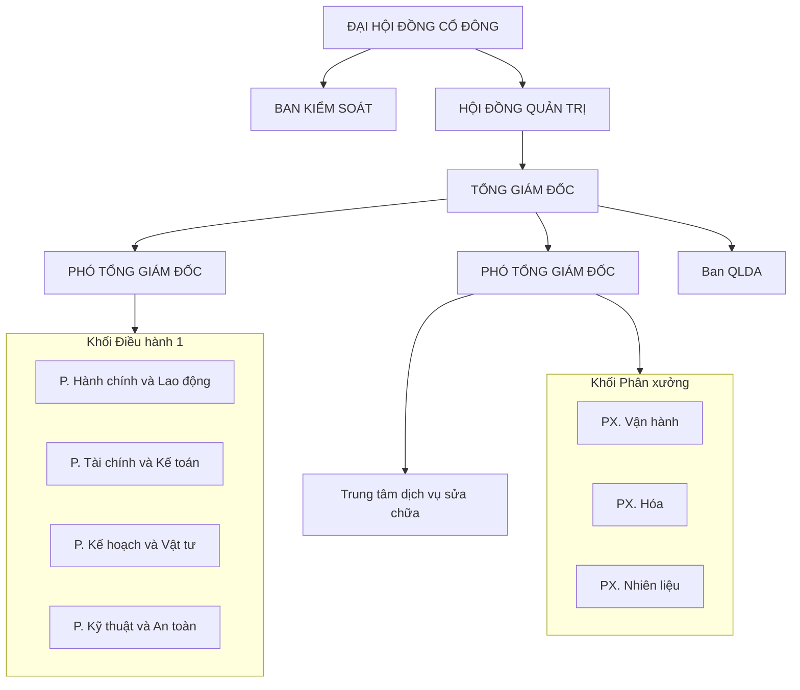

# BÁO CÁO THƯỜNG NIÊN CÔNG TY ĐẠI CHÚNG
## CÔNG TY CỔ PHẦN NHIỆT ĐIỆN HẢI PHÒNG
**Năm báo cáo: 2025**

---

CÔNG TY CỔ PHẦN NHIỆT ĐIỆN HẢI PHÒNG  
Số: 1840/BC-NĐHP  

**CỘNG HOÀ XÃ HỘI CHỦ NGHĨA VIỆT NAM**  
**Độc lập - Tự do - Hạnh phúc**  

*Hải Phòng, ngày 09 tháng 4 năm 2026*  

---

# I. THÔNG TIN CHUNG

## 1. Thông tin khái quát
- **Tên giao dịch:** Công ty Cổ phần Nhiệt điện Hải Phòng.
- **Giấy Chứng nhận ĐKDN:** số 0200493225 do Sở Tài chính thành phố Hải Phòng cấp ngày 19/08/2025 (thay đổi lần 11).
- **Vốn điều lệ:** 5.000 tỷ đồng.
- **Vốn đầu tư của chủ sở hữu:** 5.980,25 tỷ đồng (tại ngày 31/12/2025).
- **Địa chỉ:** Tổ dân phố 6, Phường Nam Triệu, Thành phố Hải Phòng.
- **Điện thoại:** 0225. 3775.161.
- **Fax:** 0225.3775.162.
- **Website:** http://www.ndhp.com.vn.
- **Mã cổ phiếu:** HND.

## 2. Quá trình hình thành và phát triển
- Thực hiện chủ trương thay đổi cơ chế quản lý kinh tế của các công ty, doanh nghiệp Nhà nước, trong đó có các công ty phát điện. Ngày 30/7/2002, Văn phòng Chính phủ đã có Thông báo số 129/TB-VPCP nêu ý kiến của Phó Thủ tướng Nguyễn Tấn Dũng cho phép thành lập Công ty cổ phần có vốn của doanh nghiệp Nhà nước để đầu tư Dự án Nhà máy Nhiệt điện Hải Phòng.
- Tháng 9/2002, Tập đoàn Điện lực Việt Nam, Tập đoàn Công nghiệp Than - Khoáng sản, Tổng Công ty Bảo Việt, Tổng Công ty Lắp máy Việt Nam và Tổng Công ty XNK Xây dựng Việt Nam (Vinaconex) đã đi đến thống nhất thành lập Công ty Cổ phần Nhiệt điện Hải Phòng để đầu tư xây dựng Nhà máy Nhiệt điện.
- Công ty Cổ phần Nhiệt điện Hải Phòng được thành lập ngày 17/9/2002 theo Giấy chứng nhận đăng ký kinh doanh số 0203000279 do Sở Kế hoạch và Đầu tư thành phố Hải Phòng cấp. Theo đó, Công ty Cổ phần Nhiệt điện Hải Phòng hoạt động theo Luật Doanh nghiệp gồm 05 cổ đông sáng lập, với tổng vốn điều lệ là 3.000 tỷ đồng của các đơn vị góp vốn:
  + Tập đoàn Điện lực Việt Nam: 77,5%.
  + Tập đoàn Công nghiệp Than - Khoáng sản Việt Nam: 10%.
  + Tổng Công ty Bảo hiểm Việt Nam: 2,5%.
  + Tổng Công ty Xuất nhập khẩu xây dựng Việt Nam (Vinaconex): 5%.
  + Tổng Công ty Lắp máy Việt Nam (Lilama): 5%.
- Thực hiện tổng sơ đồ phát triển điện lực Việt Nam giai đoạn 2001 - 2010 (Quy hoạch điện V), bù đắp sự thiếu hụt công suất của hệ thống điện tại khu vực phía Bắc, Công ty Cổ phần Nhiệt điện Hải Phòng được Thủ tướng Chính phủ giao làm chủ đầu tư Dự án Nhà máy Nhiệt điện Hải Phòng theo Quyết định số 1186/QĐ-TTg ngày 13/12/2002, đồng thời, Công ty tiếp tục được Thủ tướng giao làm chủ đầu tư Dự án Nhiệt điện Hải Phòng 2 theo Quyết định số 1195/QĐ-TTg ngày 09/11/2005.
- Để đầu tư xây dựng dự án Nhà máy Nhiệt điện Hải Phòng 2, ngày 09/01/2008, Đại hội đồng cổ đông Công ty Cổ phần Nhiệt điện Hải Phòng được tổ chức tại Hà Nội đã thông qua việc tăng vốn điều lệ, cụ thể như sau:
  + Vốn điều lệ đã đăng ký: 3.000.000.000.000 đồng
  + Vốn điều lệ thay đổi: 5.000.000.000.000 đồng
  + Thời điểm thay đổi vốn: Tháng 2/2008
  + Mục đích thay đổi vốn: Để đầu tư xây dựng dự án Nhà máy Nhiệt điện Hải Phòng 2.
  + Hình thức tăng vốn: Các cổ đông góp vốn bổ sung.
- Thực hiện chỉ đạo của Thủ tướng Chính phủ tại Công văn số 138/TTg-ĐMDN ngày 03/02/2012 về việc thành lập các Tổng công ty phát điện trực thuộc Tập đoàn Điện lực Việt Nam, ngày 01/6/2012 Bộ Công thương đã ban hành Quyết định số 3024/QĐ-BCT về việc thành lập Công ty mẹ - Tổng Công ty Phát điện 2 (EVNGENCO 2). Theo đó, Công ty Cổ phần Nhiệt điện Hải Phòng là doanh nghiệp do EVNGENCO 2 nắm giữ 51% vốn điều lệ.
- Hiện nay, Công ty Cổ phần Nhiệt điện Hải Phòng trở thành Công ty đại chúng được UBCKNN chấp thuận tại văn bản số 716/UB-QLPH ngày 24/02/2014.
- Ngày 05/10/2016, Cổ phiếu của Công ty cổ phần nhiệt điện Hải Phòng chính thức giao dịch trên sàn chứng khoán Upcom với mã cổ phiếu HND.

## 3. Ngành nghề kinh doanh
a) Khai thác đá, cát, sỏi, đất sét.  
b) Bán buôn chuyên doanh khác chưa được phân vào đâu  
*Chi tiết:* Bán buôn phế liệu, phế thải kim loại, phi kim loại  
c) Sửa chữa thiết bị điện tử và quang học  
d) Sửa chữa thiết bị điện  
e) Bán buôn thiết bị và linh kiện điện tử, viễn thông  
f) Bán buôn máy móc, thiết bị và phụ tùng máy khác  
*Chi tiết:* Bán buôn máy móc, thiết bị điện, vật liệu điện (máy phát điện, động cơ điện, dây điện và thiết bị khác dùng trong mạch điện)  
g) Kiểm tra và phân tích kỹ thuật  
*Chi tiết:* Thí nghiệm, hiệu chỉnh các thiết bị điện  
h) Đại lý, môi giới, đấu giá hàng hóa  
*Chi tiết:* Đại lý, môi giới hàng hóa (Không bao gồm đại lý chứng khoán, bảo hiểm, môi giới tài chính, bất động sản)  
i) Bán buôn kim loại và quặng kim loại  
*Chi tiết:* Bán buôn quặng kim loại; Bán buôn sắt, thép; Bán buôn kim loại khác (không bao gồm bán buôn vàng miếng)  
j) Bán buôn vật liệu, thiết bị lắp đặt khác trong xây dựng  
*Chi tiết:* Bán buôn tre, nứa, gỗ cây và gỗ chế biến; Bán buôn xi măng (bao gồm phụ gia xi măng, clinker); Bán buôn gạch xây, ngói, đá, cát, sỏi; Bán buôn kính xây dựng; Bán buôn sơn, vécni; Bán buôn gạch ốp lát và thiết bị vệ sinh; Bán buôn đồ ngũ kim, hàng kim khí, tôn mạ mầu; Bán buôn cửa cuốn, khung nhôm, cửa nhôm kính, cửa nhựa lõi thép, cửa kính, lan can cầu thang kính, lan can cầu thang inox, cửa nhôm cuốn, cửa gỗ; Bán buôn ống, ống nối, ống dẫn, khớp nối, vòi, cút chữ T, ống cao su, tro, xỉ, thạch cao  
k) Đào tạo trung cấp  
*Chi tiết:* Đào tạo dạy nghề quản lý thiết bị, vận hành, bảo dưỡng và sửa chữa thiết bị nhà máy điện  
l) Kinh doanh bất động sản, quyền sử dụng đất thuộc chủ sở hữu, chủ sử dụng hoặc đi thuê  
*Chi tiết:* Cho thuê, điều hành, quản lý nhà và đất ở  
m) Hoạt động dịch vụ hỗ trợ trực tiếp cho vận tải đường bộ  
*Chi tiết:* Dịch vụ vận tải hàng hóa, hành khách đường bộ; Dịch vụ trông giữ xe  
n) Dịch vụ lưu trú ngắn ngày  
*Chi tiết:* Khách sạn; Nhà khách, nhà nghỉ kinh doanh dịch vụ lưu trú ngắn ngày; Biệt thự hoặc căn hộ kinh doanh dịch vụ lưu trú ngắn ngày; Nhà trọ, phòng trọ và các cơ sở lưu trú tương tự  
o) Nhà hàng và các dịch vụ ăn uống phục vụ lưu động  
p) Hoạt động bảo vệ tư nhân  
*Chi tiết:* Dịch vụ bảo vệ  
q) Vệ sinh chung nhà cửa  
r) Dịch vụ chăm sóc và duy trì cảnh quan  
s) Sửa chữa các sản phẩm kim loại đúc sẵn  
*Chi tiết:* Hiệu chỉnh lò hơi  
t) Sửa chữa máy móc, thiết bị  
*Chi tiết:* Hiệu chỉnh tua bin nhà máy nhiệt điện  
u) Sản xuất điện  
v) Truyền tải và phân phối điện  
(bao gồm bán buôn, bán lẻ điện)  
w) Khai thác, xử lý và cung cấp nước  
x) Thoát nước và xử lý nước thải  
y) Thu gom rác thải không độc hại  
z) Thu gom rác thải độc hại  
aa) Xử lý và tiêu huỷ rác thải không độc hại  
bb) Xử lý và tiêu huỷ rác thải độc hại  
cc) Tái chế phế liệu  
dd) Xử lý ô nhiễm và hoạt động quản lý chất thải khác  
ee) Xây dựng công trình điện  
*Chi tiết:* Thi công, lắp đặt, vận hành, bảo dưỡng, sửa chữa, cải tạo đường dây và trạm biến áp đến 220KV  
ff) Xây dựng công trình chế biến, chế tạo  
*Chi tiết:* Xây dựng, sửa chữa, bảo dưỡng, cải tạo công trình nhiệt điện, công trình kiến trúc của nhà máy nhiệt điện  
gg) Lắp đặt hệ thống điện  

## 4. Thông tin về mô hình quản trị, tổ chức kinh doanh và bộ máy quản lý
- **Cơ cấu tổ chức theo cấp quản lý:**

```
Tập đoàn Điện lực Việt Nam
          │
          ▼
Tổng Công ty Phát điện 2 (EVNGENCO 2)
          │
          ▼
Công ty Cổ phần Nhiệt điện Hải Phòng
```

Ngày 28/12/2012, Tập đoàn Điện lực Việt Nam đã có Biên bản bàn giao điều hành cho EVNGENCO 2. Theo đó, từ ngày 01/01/2013, EVNGENCO 2 có quyền điều hành đối với các đơn vị trực thuộc, các công ty con, công ty liên kết thuộc EVNGENCO 2, trong đó có Công ty Cổ phần Nhiệt điện Hải Phòng. 

- **Một số thông tin giới thiệu về Tổng Công ty Phát điện 2:**
  + Tên gọi tiếng Việt: Tổng Công ty Phát điện 2.
  + Tên giao dịch tiếng Anh: POWER GENERATION CORPORATION 2.
  + Tên viết tắt bằng tiếng Anh: EVNGENCO 2.
  + Vốn điều lệ: 10.677 tỷ đồng.
  + Trụ sở chính: Số 01 đường Lê Hồng Phong, phường Trà Nóc, quận Bình Thủy, thành phố Cần Thơ.
  + Giấy Chứng nhận ĐKKD số 1800590430 do Sở KH&ĐT TP.Cần Thơ cấp ngày 19/11/2012.

- **Mô hình quản trị:** Công ty được tổ chức theo mô hình công ty Cổ phần, đứng đầu là Đại hội đồng cổ đông; Hội đồng quản trị, Ban Kiểm soát; Ban điều hành đứng đầu là Tổng Giám đốc và các Phó Tổng Giám đốc.

- **Cơ cấu bộ máy quản lý đến ngày 31/12/2025:**



## 5. Định hướng phát triển
### a) Các mục tiêu chủ yếu của Công ty
- Đảm bảo vận hành các tổ máy an toàn, liên tục và hiệu quả, cung ứng điện cho nền kinh tế hàng năm từ 6-7,5 tỷ kWh.
- Bảo toàn và phát triển vốn của các cổ đông. 
- Đầu tư, nâng cao chất lượng cải thiện môi trường, hướng tới sự phát triển bền vững.
- Nâng cao đời sống vật chất, văn hoá tinh thần cho người lao động.
- Chiến lược phát triển trung và dài hạn
- Duy trì các tổ máy phát điện an toàn, hiệu quả và đảm bảo môi trường.
- Sửa chữa, bảo dưỡng nhằm duy trì phát điện ổn định các tổ máy.
- Đảm bảo cổ tức cho các cổ đông.
- Nâng cao chất lượng nguồn nhân lực. Nâng cao năng lực quản trị doanh nghiệp theo hướng chuyên nghiệp hiện đại. 
- Xây dựng các định mức chi phí, chỉ tiêu kinh tế - kỹ thuật.
- Tiết kiệm chi phí.

### b) Các mục tiêu đối với môi trường, xã hội và cộng đồng của Công ty.
- Tiếp tục đầu tư, nâng cao chất lượng cải thiện môi trường, đảm bảo môi trường thân thiện.
- Tham gia và ủng hộ tích cực các hoạt động của xã hội của cộng đồng.

## 6. Các rủi ro
- Rủi ro cạnh tranh phát điện trên thị trường điện, giữa các nhà máy nhiệt điện với Nhiệt điện, giữa các nhà máy nhiệt điện với thuỷ điện, giữa các nhà máy nhiệt điện và các nhà máy điện mặt trời, gió.
- Các vật tư sửa chữa chủ yếu vẫn phải nhập khẩu do vậy tác động tỷ giá tăng ảnh hưởng đến chi phí.
- Do chủng loại than đã có nhiều thay đổi so với thiết kế ban đầu, cộng với nhiệt độ nước tuần hoàn đầu vào tăng làm tăng suất tiêu hao nhiệt các tổ máy.

---

# II. TÌNH HÌNH HOẠT ĐỘNG TRONG NĂM

## 1. Tình hình hoạt động sản xuất kinh doanh
Năm 2025 Công ty Cổ phần Nhiệt điện Hải Phòng thực hiện nhiệm vụ sản xuất kinh doanh, đầu tư xây dựng, chuyển đổi số trong bối cảnh khó khăn do ảnh hưởng từ nhiều yếu tố khách quan về giá cả vật tư thiết bị, nguyên nhiên liệu tăng cao, tỷ giá hối đoái biến động, hệ thống điện nhiều thời điểm huy động thấp… đã ảnh hưởng đến hoạt động sản xuất kinh doanh của Công ty.

Mặc dù vậy, Công ty đã vận hành ổn định hai nhà máy, theo đó tổng sản lượng điện sản xuất của hai nhà máy đạt 5.957,88 triệu kWh, đạt 85,09% kế hoạch giao. 

Doanh thu đạt 89,03% kế hoạch; lợi nhuận trước thuế 381,03 tỷ đồng, lợi nhuận sau thuế là 342,43 tỷ đồng.

Lũy kế sản lượng điện phát của Công ty đến hết đến hết 31/12/2025 đạt 93,03 tỷ kWh.

*ĐVT: Triệu đồng*

| Nội dung | Thực hiện năm 2024 | Kế hoạch năm 2025 theo ĐHĐCĐ | Thực hiện năm 2025 | So sánh năm 2025/ KH năm 2025 (%) | So sánh TH năm 2025/ năm 2024 (%) |
|---|---|---|---|---|---|
| **1/ Sản lượng điện Sản xuất (triệu kWh)** | 6.754,50 | 7.002,20 | 5.957,88 | 85,09 | 88,21 |
| **2/ Sản lượng điện thương phẩm (triệu kWh)** | 6.122,17 | 6.325,09 | 5.402,18 | 85,41 | 88,24 |
| **3/ Doanh thu** | **11.041.641** | **10.949.590** | **9.748.495** | **89,03** | **88,29** |
| - Doanh thu sản xuất điện: | 11.036.275 | 10.944.997 | 9.730.822 | 88,91 | 88,17 |
| - Doanh thu hoạt động tài chính: | 521 | 500 | 11.353 | 2270,66 | 2179,14 |
| - Hoạt động khác: | 4.845 | 4.093 | 6.320 | 154,41 | 130,43 |
| **4/ Chi phí** | **10.768.846** | **10.670.737** | **9.367.468** | **87,79** | **86,99** |
| - Chi phí sản xuất điện: | 10.764.456 | 10.666.873 | 9.363.631 | 87,78 | 86,99 |
| - Chi phí hoạt động tài chính : | 0 | 0 | 0 | | |
| - Chi phí khác: | 4.390 | 3.864 | 3.836 | 99,29 | 87,39 |
| **5/ Lợi nhuận trước thuế = (3) - (4)** | **272.795** | **278.853** | **381.027** | **136,64** | **139,68** |
| *Thuế TNDN* | 13.857 | 27.885 | 38.599 | 138,42 | 278,55 |
| **6/ Lợi nhuận sau thuế và CLTG** | **258.938** | **250.968** | **342.428** | **136,44** | **132,24** |

## 2. Tổ chức và nhân sự
### - Danh sách Ban điều hành và Cán bộ quản lý Công ty đến ngày 31/12/2025:

| TT | Họ và tên | Chức danh | Ghi chú |
|---|---|---|---|
| 1. | Tạ Công Hoan | Chủ tịch HĐQT | |
| 2. | Lê Minh Tuấn | Thành viên HĐQT chuyên trách | |
| 3. | Dương Sơn Bá | Tổng Giám đốc | |
| 4. | Lê Anh Tân | Phó Tổng Giám đốc | |
| 5. | Trần Xuân Trường | Phó Tổng Giám đốc | |
| 6. | Nguyễn Minh Thành | Phó Tổng Giám đốc | Đến 30/6/2025 |
| 7. | Phạm Quốc Toàn | Kế toán trưởng | |
| 8. | Bùi Thu Trang | Phó Trưởng Phòng Tài chính Kế toán | |
| 9. | Trần Hồng Vương | Trưởng phòng HCLĐ | |
| 10. | Đào Văn Kiên | Phó phòng HCLĐ | |
| 11. | Hồ Văn Thuận | Phó phòng HCLĐ | |
| 12. | Vũ Đình Kiên | Phó phòng HCLĐ | |
| 13. | Trần Thanh Huy | Trưởng phòng KHVT | |
| 14. | Tống Hồng Tuân | Phó Trưởng phòng KHVT | |
| 15. | Nguyễn Kim Thinh | Phó Trưởng phòng KHVT | |
| 16. | Nguyễn Chí Thành | Trưởng phòng KTAT | |
| 17. | Mạc Văn Bắc | Phó Trưởng phòng KTAT | |
| 18. | Đặng Anh Huy | Phó Trưởng phòng KTAT | |
| 19. | Bùi Đại Tá | Phó Trưởng phòng KTAT | |
| 20. | Đỗ Ngọc Hinh | Phó Quản đốc PX. Vận hành | |
| 21. | Đào Gia Hồi | Phó Quản đốc PX. Vận hành | |
| 22. | Mai Ngọc Thành | Phó Quản đốc PX. Vận hành | |
| 23. | Phạm Văn Luân | Phó Quản đốc PX. Vận hành | |
| 24. | Phạm Đức Tự | Phó Quản đốc PX. Vận hành | |
| 25. | Hoàng Đức Thân | Quản đốc PX. Hóa | |
| 26. | Trần Đức Văn | Phó Quản đốc PX. Hóa | |
| 27. | Vũ Văn Lập | Phó Quản đốc PX. Hóa | |
| 28. | Ngô Hồng Phong | Quản đốc PX. Nhiên liệu | |
| 29. | Nguyễn Huy Đông | Phó Quản đốc PX. Nhiên liệu | |
| 30. | Hồ Chí Sở | Phó Quản đốc PX. Nhiên liệu | |
| 31. | Trần Văn Tiến | Phó Giám đốc TT DVSC | |
| 32. | Vũ Xuân Tiệp | Phó Giám đốc TT DVSC | |
| 33. | Phạm Thanh Hương | Phó Giám đốc TT DVSC | |
| 34. | Bùi Mạnh Hùng | Trưởng phòng Kinh tế tổng hợp, TT DVSC | |
| 35. | Nguyễn Mạnh Hường | Trưởng phòng Kỹ thuật dịch vụ, TT DVSC | |
| 36. | Nguyễn Quốc Việt | Đội trưởng Đội SCCN, TT DVSC | |
| 37. | Nguyễn Đình Song | Đội trưởng Đội SXKD khác, TT DVSC | |
| 38. | Trần Quang Trung | Đội trưởng Đội SC ĐTĐ, TT DVSC | |
| 39. | Cao Bắc Ninh | Phó Giám đốc Ban QLDA | |
| 40. | Nguyễn Việt Anh | Trưởng phòng QLXD Ban QLDA | |
| 41. | Hoàng Thạch | Trưởng phòng KHĐT Ban QLDA | |

### - Tóm tắt lý lịch Ban điều hành:

#### 1) Ông Tạ Công Hoan:
- **Chức danh hiện tại:** Chủ tịch HĐQT Công ty Cổ phần Nhiệt điện Hải Phòng.
- **Sinh ngày:** 03/11/1969
- **Quê quán:** Từ Sơn, Bắc Ninh.
- **Địa chỉ thường trú:** Nhà số 14/135/48, Nguyễn Văn Cừ, Long Biên, Hà Nội.
- **Dân tộc:** Kinh
- **Tôn giáo:** Không
- **Trình độ chuyên môn:** Kỹ sư Quản trị doanh nghiệp, Trường Đại học Bách Khoa Hà Nội, tốt nghiệp năm 2002. 
- **Trình độ ngoại ngữ:** Tiếng Anh trình độ C.
- **Trình độ lý luận chính trị:** Cao cấp.
- **Ngày vào Đảng Cộng sản Việt Nam:** 20/9/2002. Ngày chính thức: 20/9/2003.
- **Quá trình công tác:**
  - Từ 10/1993 - 12/1995: Kỹ thuật viên sửa chữa điện, Xí nghiệp thi công cơ giới số 17 (Sao Đỏ, Chí Linh, Hải Dương).
  - Từ 01/1996 - 8/2001: Cán bộ Phòng Kinh tế - Kế hoạch, Ban Quản lý dự án Nhà máy Nhiệt điện Phả Lại 2.
  - Từ 9/2001 - 10/2002: Cán bộ Phòng Kế hoạch Vật tư Nhà máy Điện Phả Lại.
  - Từ 11/2002 - 7/2004: Cán bộ Phòng Kỹ thuật - Kế hoạch - Vật tư, Công ty CP Nhiệt điện Hải Phòng.
  - Từ 3/2003 - 7/2004: Kiêm nhiệm nhiệm vụ Thư ký Hội đồng quản trị Công ty CP Nhiệt điện Hải Phòng.
  - Từ 8/2004 - 6/2006: Phó phòng phụ trách Phòng Kế hoạch Vật tư Công ty CP Nhiệt điện Hải Phòng.
  - Từ 7/2006 - 11/2016: Trưởng phòng Kế hoạch Vật tư Công ty CP Nhiệt điện Hải Phòng.
  - Từ 12/2016 - 30/5/2017: Quản đốc Phân xưởng Nhiên liệu Công ty Cổ phần Nhiệt điện Hải Phòng.
  - Từ 6/2017 - 27/12/2018: Phó Tổng Giám đốc, Công ty Cổ phần Nhiệt điện Hải Phòng, Giám đốc Ban Quản lý dự án NĐ Hải Phòng 1&2 (trong đó, từ 6/2017 - 14/8/2018, kiêm nhiệm Quản đốc Phân xưởng Nhiên liệu).
  - Từ 28/12/2018 đến nay: Chủ tịch HĐQT Công ty Cổ phần Nhiệt điện Hải Phòng.

#### 2) Ông Lê Minh Tuấn
- **Chức danh hiện tại:** Thành viên HĐQT chuyên trách Công ty Cổ phần Nhiệt điện Hải Phòng.
- **Sinh ngày:** 22/4/1974
- **Quê quán:** Quảng Nam - Đà Nẵng.
- **Địa chỉ thường trú:** 11-12B, Block A3, ERA TOWN, Đường 15B, phường Phú Mỹ, Quận 7, thành phố Hồ Chí Minh.
- **Dân tộc:** Kinh
- **Tôn giáo:** Không
- **Trình độ chuyên môn:** Thạc sỹ Kỹ thuật, Thạc sỹ Quản trị kinh doanh.
- **Trình độ ngoại ngữ:** Tiếng Anh IELTS 6.0.
- **Trình độ lý luận chính trị:** Cao cấp.
- **Ngày vào Đảng Cộng sản Việt Nam:** 14/02/2011. Ngày chính thức: 14/02/2012.
- **Quá trình công tác:**
  - Từ 7/1996 đến 7/1997: Kỹ sư thiết kế trạm điện, Công ty TNHH MAPRO TP HCM
  - Từ 8/1997 đến 6/1999: Trưởng ca tập sự, Nhà máy TĐ Trị An
  - Từ 7/1999 đến 3/2004: Trưởng ca, Nhà máy TĐ Trị An
  - Từ 4/2004 đến 9/2008: Phó Quản đốc, Nhà máy TĐ Trị An
  - Từ 10/2008 đến 2/2009: Phó phòng Kỹ thuật, Nhà máy TĐ Trị An
  - Từ 3/2009 đến 11/2009: Trưởng phòng Kỹ thuật, Công ty CP TĐ Thác Mơ
  - Từ 12/2009 đến 4/2017: Phó Tổng Giám đốc, Công ty CP TĐ Thác Mơ
  - Từ 5/2013 đến nay: Ủy viên HĐQT, Công ty CP TĐ Thác Mơ
  - Từ 5/2017 đến 11/2020: Tổng Giám đốc, Công ty CP TĐ Thác Mơ
  - Từ 12/2020 đến nay: Thành viên HĐQT chuyên trách Công ty Cổ phần Nhiệt điện Hải Phòng

#### 3) Ông Dương Sơn Bá
- **Họ và tên khai sinh:** Dương Sơn Bá
- **Sinh ngày:** 20/01/1968
- **Chức danh hiện tại:** Thành viên Hội đồng quản trị, Tổng Giám đốc Công ty Cổ phần Nhiệt điện Hải Phòng.
- **Quê quán:** xã Hưng Phúc, huyện Hưng Nguyên, tỉnh Nghệ An.
- **Dân tộc:** Kinh
- **Tôn giáo:** Không.
- **Trình độ văn hóa:** 12/12.
- **Trình độ chuyên môn:** Kỹ sư Nhiệt điện, Đại học Bách khoa Hà Nội, hệ chính quy; Cử nhân QTKD, Đại học Bách khoa Hà Nội, tốt nghiệp tháng 6/2012.
- **Trình độ ngoại ngữ:** Tiếng Anh trình độ C.
- **Trình độ lý luận:** Cao cấp.
- **Ngày vào Đảng:** ngày 19/4/2002, Ngày chính thức: 19/4/2003.
- **Quá trình công tác:**
  - Từ tháng 4/1994 - 9/1998: Kỹ sư Nhà máy điện, Công ty phân đạm và hóa chất Hà Bắc.
  - Từ 10/1998 - 4/2000: Kỹ sư Phòng Kỹ thuật, Ban QLDA Phả Lại 2.
  - Từ 5/2000 - 10/2001: Kỹ sư Phòng Kỹ thuật, Ban CBSX, Nhà máy Nhiệt điện Phả Lại 2.
  - Từ 11/2001 - 10/2002: Kỹ thuật viên Phòng Kỹ thuật, Nhà máy Nhiệt điện Phả Lại.
  - Từ 11/2002 - 8/2006: Kỹ sư Phòng Kỹ thuật, Công ty CP Nhiệt điện Hải Phòng.
  - Từ 9/2006 - 5/2009: Phó phòng Kỹ thuật, Công ty Cổ phần Nhiệt điện Hải Phòng.
  - Từ 5/2009 - 9/2009: Phó phòng Phụ trách Phòng Kỹ thuật, Công ty Cổ phần Nhiệt điện Hải Phòng.
  - Từ 10/2009 - 11/2013: Trưởng phòng Kỹ thuật, Công ty Cổ phần Nhiệt điện Hải Phòng.
  - Từ 11/2013 - 03/2021: Phó Tổng Giám đốc Công ty Cổ phần Nhiệt điện Hải Phòng.
  - Từ 04/2021-06/2021: Thành viên HĐQT, Phó Tổng Giám đốc Công ty Cổ phần Nhiệt điện Hải Phòng.
  - Từ 07/2021 - nay: Thành viên HĐQT, Tổng Giám đốc Công ty Cổ phần Nhiệt điện Hải Phòng.

#### 4) Ông Trần Xuân Trường:
- **Họ và tên khai sinh:** Trần Xuân Trường
- **Sinh ngày:** 22/03/1976
- **Quê quán:** Tây Đô, Hưng Hà, Thái Bình
- **Dân tộc:** Kinh
- **Tôn giáo:** Không
- **Trình độ chuyên môn:** Kỹ sư Công nghệ nhiệt, Cử nhân quản trị doanh nghiệp.
- **Trình độ lý luận chính trị:** Trung cấp.
- **Quá trình công tác:**
  - Từ 01/10/2008 - 30/04/2010: Kỹ sư Phân xưởng Vận hành 1, Công ty CP Nhiệt điện Hải Phòng.
  - Từ 01/05/2010 - 05/01/2014: Phó Quản đốc Phân xưởng Vận hành 1, Công ty CP Nhiệt điện Hải Phòng.
  - Từ 06/01/2014 - 05/01/2017: Phó Quản đốc Phân xưởng Vận hành 2, Công ty CP Nhiệt điện Hải Phòng.
  - Từ 24/07/2014 - 14/01/2022: Quản đốc Phân xưởng Vận hành 1, Công ty CP Nhiệt điện Hải Phòng.
  - Từ 15/01/2022 – nay: Phó Tổng giám đốc, Công ty CP Nhiệt điện Hải Phòng.

#### 5) Ông Lê Anh Tân:
- **Họ và tên khai sinh:** Lê Anh Tân
- **Sinh ngày:** 14/7/1978
- **Quê quán:** Lê Hóa, Tuyên Hóa, Quảng Bình.
- **Nơi ở hiện nay:** P.508-C4 khu tập thể Trung Tự, Đống Đa, Hà Nội.
- **Dân tộc:** Kinh
- **Tôn giáo:** Không
- **Trình độ chuyên môn:** Kỹ sư Điện tử - Viễn thông, Trường Đại học Bách khoa Hà Nội; Thạc sỹ QTKD, Trường Đại học Bách khoa Hà Nội, tốt nghiệp năm 2011.
- **Trình độ lý luận chính trị:** Trung cấp.
- **Trình độ ngoại ngữ:** Anh văn C
- **Ngày vào Đảng Cộng sản Việt Nam:** 06/3/2017. Ngày chính thức: 06/3/2018.
- **Quá trình công tác:**
  - Từ 9/2002 - 8/2003: Kỹ sư vận hành hệ thống điều khiển tự động tại Công ty TNHH MTV Thép Miền Nam tại thành phố Hồ Chí Minh.
  - Từ 9/2003 - 10/2016: Chuyên viên Phòng Kỹ thuật, Trung tâm Công nghệ thông tin - Tập đoàn Điện lực Việt Nam.
  - Từ 16/10/2016 - 30/6/2020: Phó Trưởng phòng, Trưởng phòng Văn thư lưu trữ, Văn phòng Tập đoàn Điện lực Việt Nam.
  - Từ 01/7/2020 - đến nay: Phó Tổng Giám đốc, Công ty Cổ phần Nhiệt điện Hải Phòng.

#### 6) Ông Nguyễn Minh Thành:
- **Họ và tên:** Nguyễn Minh Thành
- **Sinh ngày:** 16/12/1982
- **Quê quán:** Tiên Phong, Vĩnh Bảo, Hải Phòng. 
- **Dân tộc:** Kinh
- **Tôn giáo:** Không
- **Trình độ chuyên môn:** Cử nhân Kinh tế chuyên ngành Kế toán, Đại học Kinh tế Quốc dân (Hệ chính quy).
- **Trình độ lý luận chính trị:** Cao cấp.
- **Trình độ ngoại ngữ:** Tiếng Anh trình độ C.
- **Ngày vào Đảng Cộng sản Việt Nam:** 26/7/2012. Ngày chính thức: 15/8/2013.
- **Quá trình công tác:**
  - Từ 8/2004 - 7/2009: Kiểm toán viên Công ty TNHH Deloitte Việt Nam.
  - Từ 8/2009 - 4/2010: Kế toán viên, Kế toán viên Phòng Tài chính Kế toán, Công ty Cổ phần Nhiệt điện Hải Phòng
  - Từ 5/2010 - 10/2013: Phó phòng Tài chính Kế toán, Công ty Cổ phần Nhiệt điện Hải Phòng.
  - Từ 11/2013 - 10/2019: Kế toán trưởng Công ty Cổ phần Nhiệt điện Hải Phòng.
  - Từ 10/2019 - 10/2020: Thành viên HĐQT, Kế toán trưởng Công ty Cổ phần Nhiệt điện Hải Phòng.
  - 10/2020 - đến 30/6/2025: Phó Tổng Giám đốc, Công ty Cổ phần Nhiệt điện Hải Phòng.

- **Số lượng CBCNV tính đến 31/12/2025:** 822 người.
- **Chế độ chính sách đối với người lao động:**
  - *Chính sách tiền lương:* Công ty đã xây dựng và ban hành Quy chế về công tác lao động và tiền lương cho người lao động và tổ chức thực hiện, đảm bảo công bằng theo mức độ đóng góp của người lao động, khuyến khích người lao động nâng cao năng suất, chất lượng, hiệu quả công việc, đảm bảo hài hòa các lợi ích của Công ty và người lao động.
  - *Tiền lương bình quân người lao động năm 2025 là:* 33,32 triệu đồng/người/tháng.
- **Quản trị nguồn nhân lực:**
  - Công ty luôn chú trọng công tác quản trị nguồn nhân lực: Bổ nhiệm và bổ nhiệm lại một số cán bộ lãnh đạo quản lý; khuyến khích áp dụng các sáng kiến cải tiến kỹ thuật, bố trí nhân lực làm việc phù hợp với năng lực, trình độ chuyên môn; luôn quan tâm thường xuyên đến công tác đào tạo nâng cao chất lượng nguồn nhân lực.
- **Chính sách khác:** 
  - Công ty thường xuyên quan tâm đến đời sống vật chất, tinh thần của người lao động để người lao động có điều kiện tập trung sản xuất, công tác, nâng cao năng suất lao động, đảm bảo an toàn và hiệu quả; tổ chức các hoạt động văn hóa, văn nghệ, thể dục thể thao...
  - Ngoài các chế độ theo quy định của pháp luật mà người lao động được hưởng, Công ty còn xây dựng ký kết Thỏa ước lao động tập thể trong đó có một số quyền lợi người lao động được hưởng cao hơn so với luật như:
    - Thưởng cho các tập thể và cá nhân có thành tích đột xuất trong lao động sản xuất; thưởng cho các cá nhân có nhiều thành tích thông qua việc cho nghỉ công tác để đi tham quan nghỉ mát trong và ngoài nước.
    - Công ty thực hiện chế độ làm việc 40h/tuần. Người lao động được nghỉ sớm 30 phút vào các ngày cuối tuần và ngày nghỉ lễ, Tết.
    - Thực hiện một số chế độ khác có lợi cho người lao động.

## 3. Tình hình đầu tư, tình hình thực hiện các dự án
### a) Các khoản đầu tư lớn:
Trong năm 2025, Công ty tổ chức triển khai thực hiện đầu tư 02 Dự án:
- Dự án Nâng cấp hệ thống xử lý khí thải NMNĐ Hải Phòng 1 và 2.
- Dự án khôi phục công suất và hiệu suất các tổ máy NMNĐ Hải Phòng.
- Dự án cải tạo nâng công suất Trạm biến áp 220kV – Nhà máy Nhiệt điện Hải Phòng.
- Dự án Điện mặt trời áp mái tại Công ty Cổ phần Nhiệt điện Hải Phòng.
- Dự án Xây dựng nhà hành chính tại nhà máy Nhiệt điện Hải Phòng 2.

### b) Các công ty con, công ty liên kết:
Không có.

## 4. Tình hình tài chính
### a) Tình hình tài chính

| Chỉ tiêu | Năm 2024 (tr. Đồng) | Năm 2025 (tr. Đồng) | % tăng giảm |
|---|---|---|---|
| ***Đối với tổ chức không phải là tổ chức tín dụng và tổ chức tài chính phi ngân hàng:*** | | | |
| Tổng giá trị tài sản | 6.980.222 | 7.355.002 | 5,4 |
| Doanh thu thuần | 11.036.275 | 9.730.822 | -11,8 |
| Lợi nhuận từ hoạt động kinh doanh | 272.340 | 378.544 | 39,0 |
| Lợi nhuận khác | 455 | 2.483 | 445,7 |
| Lợi nhuận trước thuế | 272.795 | 381.027 | 39,7 |
| Lợi nhuận sau thuế | 258.938 | 342.428 | 32,2 |
| Tỷ lệ lợi nhuận trả cổ tức (dự kiến) | 4% | 4% | 0,0 |

### b) Các chỉ tiêu tài chính chủ yếu

| Các chỉ tiêu | Năm 2024 | Năm 2025 | Ghi chú |
|---|---|---|---|
| **1. Chỉ tiêu về khả năng thanh toán** | | | |
| + Hệ số thanh toán ngắn hạn: $\frac{\text{TSLĐ}}{\text{Nợ ngắn hạn}}$ | 2,83 | 3,21 | |
| + Hệ số thanh toán nhanh: $\frac{\text{TSLĐ - Hàng tồn kho}}{\text{Nợ ngắn hạn}}$ | 2,19 | 2,66 | |
| **2. Chỉ tiêu về cơ cấu vốn** | | | |
| + Hệ số Nợ/Tổng tài sản | 0,18 | 0,187 | |
| + Hệ số Nợ/Vốn chủ sở hữu | 0,22 | 0,23 | |
| **3. Chỉ tiêu về năng lực hoạt động** | | | |
| + Vòng quay hàng tồn kho: $\frac{\text{Giá vốn hàng bán}}{\text{Hàng tồn kho bình quân}}$ | 12,32 | 11,34 | |
| + Doanh thu thuần/Tổng tài sản | 1,58 | 1,323 | |
| **4. Chỉ tiêu về khả năng sinh lời** | | | |
| + Hệ số Lợi nhuận sau thuế/Doanh thu thuần | 0,023 | 0,035 | |
| + Hệ số Lợi nhuận sau thuế/Vốn chủ sở hữu | 0,045 | 0,057 | |
| + Hệ số Lợi nhuận sau thuế/Tổng tài sản | 0,037 | 0,047 | |
| + Hệ số Lợi nhuận từ hoạt động kinh doanh/Doanh thu thuần | 0,025 | 0,039 | |

## 5. Cơ cấu cổ đông, thay đổi vốn đầu tư của chủ sở hữu
### a) Cổ phần:
- Tổng số cổ phần: 500.000.000 cổ phần (Năm trăm triệu cổ phần).
- Loại cổ phần: Cổ phần phổ thông.

### b) Cơ cấu cổ đông:
Căn cứ sổ cổ đông Công ty Cổ phần Nhiệt điện Hải Phòng chốt đến ngày 25/8/2025, cơ cấu cổ đông như sau:
- Theo tỷ lệ sở hữu: Cổ đông (4 nhà đầu tư) sở hữu từ 5% cổ phần trở lên, chiếm 93,18%. Cổ đông (1490 nhà đầu tư) sở hữu cổ phần dưới 5% chiếm 6,82%.
- Theo tổ chức: 18 cổ đông là tổ chức và 1468 cổ đông cá nhân. Trong đó có 15 cổ đông nước ngoài.

### c) Tình hình thay đổi vốn đầu tư chủ sở hữu:
Không.

### d) Giao dịch cổ phiếu quỹ:
Không.

### e) Các chứng khoán khác:
Không.

## 6. Báo cáo tác động liên quan đến môi trường và xã hội của công ty

### 6.1 Tác động lên môi trường (ATMT)
- **Tổng phát thải khí nhà kính (GHG) trực tiếp và gián tiếp:** Công ty đã thực hiện việc kiểm kê khí nhà kính cho kỳ kiểm kê năm cơ sở là năm 2025 theo đúng quy định tại Nghị định số 06/2022/NĐ-CP ngày 07/01/2022 của Chính phủ về quy định giảm nhẹ phát thải khí nhà kính và bảo vệ tầng ô-dôn. Thực hiện lập báo cáo giảm nhẹ phát thải khí nhà kính năm 2025 theo đúng quy định.
- **Các biện pháp giảm thiểu phát thải khí nhà kính:** Công ty đang triển khai thực hiện 6 biện pháp:
  + Điều chỉnh chế độ đốt
  + Điều chỉnh tỉ lệ gió cấp cho lò hơi
  + Khắc phục hệ thống bảo ôn
  + Cải tạo, khôi phục hiệu suất của hệ thống thổi bụi
  + Hệ thống chiếu sáng (Đèn và các thiết bị điện tiết kiệm điện)
  + Xây dựng kế hoạch quản lý và sử dụng năng lượng điện tiết kiệm và hiệu quả.

### 6.2 Quản lý nguồn nguyên vật liệu
a) Tổng lượng nguyên vật liệu được sử dụng để sản xuất và đóng gói các sản phẩm và dịch vụ chính của tổ chức trong năm:
- Than: 2,83 triệu tấn.
- Dầu FO: 9.356 tấn.

b) Báo cáo tỉ lệ phần trăm nguyên vật liệu được tái chế được sử dụng để sản xuất sản phẩm và dịch vụ chính của tổ chức: 0%.

### 6.3 Tiêu thụ năng lượng
a) Năng lượng điện sử dụng lấy từ hệ thống điện tự dùng của Nhà máy khi tổ máy đang phát điện hoặc mua điện từ lưới trong trường hợp ngừng dự phòng, sửa chữa:
- Điện lấy từ hệ thống tự dùng nhà máy: 555,70 triệu kWh.
- Điện lấy từ lưới điện: 23,87 triệu kWh.

b) Năng lượng tiết kiệm được thông qua các sáng kiến sử dụng năng lượng hiệu quả: 20,42 trkWh so với phương án giá điện (Tăng cường công tác quản lý kỹ thuật, vận hành giảm điện tự dùng: hiệu chỉnh tối ưu hóa năng suất hệ thống nghiền than, vận hành hợp lý các bơm tuần hoàn theo mùa; Các giải pháp giảm suất hao nhiệt nhà máy, tiết kiệm than/dầu: Kiểm soát chất lượng than; Thí nghiệm Hiệu chỉnh định kỳ Lò hơi, tối ưu chế độ cháy của lò, giảm tổn thất trong chu trình nhiệt; Tăng hiệu quả trao đổi nhiệt của bình ngưng; Tăng cường quản lý, giám sát công tác sửa chữa bảo dưỡng; Trong quá trình tổ máy vận hành đặc biệt tăng cường giám sát, kiểm tra và xử lý các khiếm khuyết ảnh hưởng đến tổn thất chu trình).

### 6.4 Tiêu thụ nước (mức tiêu thụ nước của các hoạt động kinh doanh trong năm)
a) Tổng số nước tiêu thụ mua của Công ty TNHH MTV KTCT Thủy Lợi Thủy Nguyên phục vụ sản xuất, sinh hoạt Nhà máy Nhiệt điện Hải Phòng cả năm 2025 là: 7.841.749 m³ tương đương 7.057.574.100 VNĐ.  
Nguồn cung cấp nước từ hồ Đà Nẵng, lượng nước khoảng 9,99 triệu m³/năm.

b) Tỷ lệ phần trăm và tổng lượng nước tái chế và tái sử dụng:  
Lượng nước tái sử dụng (dùng nước thải để thải xỉ) chiếm tỷ lệ 37%, khoảng 3,7 triệu m³/năm.

### 6.5 Tuân thủ pháp luật về bảo vệ môi trường
a) Số lần bị xử phạt vi phạm do không tuân thủ luật pháp và các quy định về môi trường: Không.  
b) Tổng số tiền do bị xử phạt vi phạm do không tuân thủ luật pháp và các quy định về môi trường: Không.

### 6.6 Chính sách liên quan đến người lao động
a) Số lượng lao động bình quân: 822 lao động, mức lương trung bình đối với người lao động: 33,32 triệu đồng/người/tháng.

b) Chính sách lao động nhằm đảm bảo sức khỏe, an toàn và phúc lợi của người lao động:
- **Chính sách lương:** Công ty đã ban hành lại Quy chế về công tác lao động và tiền lương đảm bảo phân phối thu nhập công bằng theo mức độ đóng góp của người lao động, khuyến khích người lao động nâng cao năng suất, chất lượng, hiệu quả công việc. Việc chi trả lương được thực hiện theo đúng quy định. Công ty thực hiện chế độ nâng lương cho cán bộ công nhân viên hàng năm và có sự quan tâm thường xuyên đến thu nhập, đời sống cán bộ công nhân viên.
- **Chính sách thưởng:** Nhằm khuyến khích động viên cán bộ công nhân viên trong Công ty gia tăng hiệu quả đóng góp, Công ty có chính sách thưởng dựa trên nguyên tắc gắn với kết quả và hiệu quả lao động đạt được. Công ty tổ chức bình bầu hàng quý để đánh giá kết quả lao động của nhân viên, việc xét thưởng sẽ thực hiện vào cuối năm căn cứ vào quá trình đạt được thành tích của cá nhân hoặc tập thể trong thực hiện công việc. Công ty cũng xét thưởng đột xuất cho cá nhân và tập thể có sáng kiến trong cải tiến phương pháp làm việc, có thành tích chống tiêu cực, lãng phí.
- **Phúc lợi:** hàng năm Công ty tổ chức khám sức khoẻ định kỳ cho toàn bộ người lao động, tổ chức đi nghỉ mát, du lịch, duy trì phong trào văn hóa, thể dục, thể thao phù hợp với tình hình dịch bệnh.

c) Công tác đào tạo:
d) Năm 2025, Công ty được giao tổng số lượt đào tạo là 1.486 lượt với tổng chi phí đào tạo là 5 tỷ 845 triệu đồng; mục tiêu:
- Tổ chức thực hiện các chương trình đào tạo đảm bảo chất lượng, hiệu quả;
- Đào tạo nhân lực chất lượng cao (đào tạo cán bộ quản lý, chuyên gia, ứng viên chuyên gia, các chương trình đào tạo chuyên sâu đáp ứng yêu cầu công việc);
- Đảm bảo 100% công nhân viên trực tiếp sản xuất được đào tạo, bồi dưỡng, sát hạch hàng năm, đảm bảo đủ năng lực tham gia sản xuất; sử dụng tối đa các công cụ đào tạo trực tuyến, khuyến khích tinh thần chủ động học tập của CBCNV;
- Chủ động triển khai, đảm bảo số lượt đào tạo trực tuyến qua hệ thống E-learning bình quân đạt tối thiểu 15 lượt học/CBCNV/năm;
- Phối hợp/thực hiện các chương trình đào tạo theo chỉ đạo của Tổng công ty.

e) Nội dung đào tạo và kết quả thực tế trong kỳ:
- Công ty đã tổ chức bồi dưỡng nghề cho 100% công nhân trực tiếp sản xuất, tổ chức thi và kiểm tra sát hạch nghề, thi giữ bậc cho CNKT. Ngoài ra, Công ty tổ chức các chương trình đào tạo nâng cao gồm: Đào tạo nâng cao tay nghề thợ hàn điện, hàn hơi; Đào tạo bảo dưỡng và sửa chữa các loại thiết bị đo trong nhà máy nhiệt điện.
- Tổ chức các khoá học đào tạo nâng cao nghiệp vụ và cử CBCNV tham dự các khóa đào tạo bồi dưỡng nghiệp vụ trong Tổng Công ty Phát điện 2 như: tập huấn Quy định pháp luật đấu thầu năm 2025; tập huấn công tác quản trị rủi ro; chương trình đào tạo, quản lý vật tư; Tập huấn pháp luật lao động trong doanh nghiệp.
- Cử CBQL tham dự các chương trình đào tạo, hội thảo, học tập kinh nghiệm theo chương trình của EVNGENCO2: Hội nghị Khoa học và Công nghệ Điện lực toàn quốc năm 2025; chương trình đào tạo và tìm hiểu thực tế về chiến lược phát triển trung tâm giám sát và điều khiển từ xa cho nhà máy điện.
- Cử CBCNV tham dự chương trình đào tạo Cán bộ quản lý cấp 3, cấp 4 do EVN và EVNGENCO2 tổ chức.

f) Đánh giá việc thực hiện đào tạo so với kế hoạch và quy định của Pháp luật:
- Công ty đã thực hiện sát với mục tiêu đào tạo được giao của Tổng Công ty Phát điện 2 và tuân thủ các quy định hiện hành. Mục tiêu trong thời gian tới, Công ty xây dựng các chương trình đào tạo tập trung hơn vào các chuyên đề nâng cao, kiến thức chuyên sâu để nâng cao chất lượng nguồn nhân lực.

### 6.7 Báo cáo liên quan đến trách nhiệm đối với cộng đồng địa phương
Các hoạt động đầu tư cộng đồng và hoạt động phát triển cộng đồng khác, bao gồm hỗ trợ tài chính nhằm phục vụ cộng đồng:  
Năm 2025, Công ty tích cực tham gia thực hiện các hoạt động an sinh xã hội, đền ơn đáp nghĩa trên địa bàn TP. Hải Phòng và các địa phương khác như: ủng hộ Quỹ vì người nghèo, hỗ trợ các đơn vị dịp Tết Nguyên đán, ngày Thương binh liệt sỹ.... và rất nhiều các hoạt động khác.

### 6.8 Báo cáo liên quan đến hoạt động thị trường vốn xanh của UBCKNN:
Không có

---

# III. BÁO CÁO VÀ ĐÁNH GIÁ CỦA BAN TỔNG GIÁM ĐỐC

## 1. Đánh giá kết quả hoạt động sản xuất kinh doanh
Năm 2025, Công ty Cổ phần Nhiệt điện Hải Phòng thực hiện nhiệm vụ sản xuất kinh doanh, đầu tư xây dựng, chuyển đổi số trong bối cảnh khó khăn do ảnh hưởng từ nhiều yếu tố khách quan về giá cả vật tư thiết bị, nguyên nhiên liệu tăng cao, tỷ giá hối đoái biến động… đã ảnh hưởng đến hoạt động sản xuất kinh doanh của Công ty. 

Mặc dù vậy, Công ty đã vận hành ổn định hai nhà máy, theo đó tổng sản lượng điện sản xuất của hai nhà máy đạt 5.957,88 triệu kWh, đạt 85,06% kế hoạch giao (KH 7.002,20 triệu kWh).

**Về đầu tư xây dựng:**
- **Dự án Nâng cấp hệ thống xử lý khí thải:**
  + Ngày 17/9/2025, HĐQT Công ty đã có quyết định số 7228/QĐ-NĐHP về việc phê duyệt hiệu chỉnh dự án đầu tư xây dựng công trình Nâng cấp hệ thống xử lý khí thải Nhà máy nhiệt điện Hải Phòng 1&2.
  + Ngày 30/9/2025, Công ty đã có Quyết định số 7460/QĐ-NĐHP về việc duyệt kế hoạch lựa chọn nhà thầu các gói thầu: Gói số 1: Tư vấn lập HSMT gói thầu Thiết kế, cung cấp hàng hóa và xây lắp (EPC) Nâng cấp hệ thống xử lý khí thải NMNĐ Hải Phòng 1&2; Gói số 2: Tư vấn thẩm định HSMT gói thầu Thiết kế, cung cấp hàng hóa và xây lắp (EPC) Nâng cấp hệ thống xử lý khí thải NMNĐ Hải Phòng 1&2; Gói số 3: Tư vấn khảo sát, kiểm định chất lượng công trình Nhà máy Nhiệt điện Hải Phòng 1&2 (kết cấu khu vực lò hơi). Hiện gói thầu số 2 và 3 đã ký hợp đồng với nhà thầu, gói số 1 đang hoàn thiện thủ tục trình phê duyệt KQLCNT.
  + Gói thầu EPC của dự án: Ngày 16/12/2025, Hội đồng quản trị đã có Quyết định số 9217/QĐ-NĐHP về việc duyệt kế hoạch lựa chọn nhà thầu. Hiện Công ty đang triển khai các thủ tục lựa chọn nhà thầu.
- **Dự án xây dựng đơn nguyên nhà hành chính công ty:**
  + Trong năm, Công ty tiếp tục báo cáo giải trình bổ sung với Tổng công ty Phát điện 2 và EVN về xin điều chỉnh chủ đầu tư Dự án xây dựng đơn nguyên Nhà hành chính – NMNĐ Hải Phòng 2. Hiện đang chờ ý kiến của các cấp có thẩm quyền.
- **Dự án khôi phục công suất và hiệu suất tổ máy:**
  + Trong năm, Công ty đã hoàn thành các thủ tục phê duyệt chủ trương đầu tư dự án; phê duyệt đầu tư dự án; phê duyệt KHLCNT đợt 1 gồm 02 gói thầu: gói số 1 (Tư vấn lập HSMT), gói số 2 (Tư vấn thẩm định HSMT) thiết kế, cung cấp hàng hóa và xây lắp (EPC) Khôi phục công suất và hiệu suất các tổ máy NMNĐ Hải Phòng. Hiện đã ký hợp đồng gói thầu số 2; gói số 1 đang hoàn thiện các thủ tục ký hợp đồng.
  + Đối với gói thầu EPC của dự án: hiện Công ty đã trình xin ý kiến Tổng công ty Phát điện 2 tại văn bản số 7864/NĐHP-NĐDPV ngày 15/10/2025 về KHLCNT đợt 2 (gói thầu EPC). Hiện đang chờ ý kiến của Tổng công ty để triển khai các bước tiếp theo.
- **Dự án Đầu tư hệ thống điện mặt trời áp mái:** Công ty đang hoàn thiện ký hợp đồng tư vấn lập báo cáo đề xuất chủ trương đầu tư.
- **Dự án Cải tạo nâng công suất Trạm biến áp 220kV:** Đang hoàn thiện ký hợp đồng tư vấn lập báo cáo đề xuất chủ trương đầu tư.

**Những tiến bộ Công ty đã đạt được:**
- Công ty đã sắp xếp mô hình tổ chức và bố trí lao động phù hợp với yêu cầu sản xuất, kinh doanh, bộ máy gọn nhẹ và năng động, nhiệm vụ chủ yếu hiện nay là sản xuất kinh doanh.
- Tăng cường chú trọng hoàn thiện các Quy chế, Quy định trong tất cả các lĩnh vực hoạt động quản lý của Công ty, công tác quản lý của Công ty ngày càng đi vào nền nếp và có hiệu quả cao.
- Ý thức chấp hành kỷ luật lao động của người lao động được nâng cao, ngày càng có trách nhiệm với công việc và gắn bó với công ty.
- Tăng cường công tác tự kiểm soát và kiểm tra nội bộ trong các lĩnh vực hoạt động quản lý, sản xuất kinh doanh và đầu tư xây dựng...
- Duy trì việc chấp hành các chế độ chính sách của Nhà nước, các Nghị quyết của Đại hội đồng cổ đông cũng như của Hội đồng quản trị.

## 2. Tình hình tài chính
### a) Tình hình tài sản
- Tài sản của Công ty chủ yếu là tài sản dài hạn, trong đó có máy móc và thiết bị. Các tài sản đều tham gia vào hoạt động sản xuất của Công ty. Tổng tài sản của Công ty tăng so với đầu năm là 374,8 tỷ đồng, trong đó:
  + Nguyên nhân tăng/giảm của các chỉ tiêu tăng/giảm từ 10% trở lên và các trường hợp đặc biệt khác (trong đó tăng do đầu tư, mua sắm...): tài sản dài hạn giảm 476,9 tỷ đồng, tỷ lệ giảm 13,9%, trong đó, giá trị còn lại của tài sản cố định giảm 476,6 tỷ đồng tỷ lệ giảm 14,93% do khấu hao trong năm. Tài sản dở dang dài hạn giảm 14,1 tỷ đồng, tỷ lệ giảm 31,57%.
  + Tài sản ngắn hạn tăng 851,7 tỷ đồng, tỷ lệ tăng 24,06%, trong đó, tiền và tương đương tiền tăng 923,5 tỷ đồng, tỷ lệ tăng 5.087%; Đầu tư tài chính ngắn hạn tăng 755 tỷ đồng, tỷ lệ tăng 5.033% do tăng khoản tiền gửi kỳ hạn trên 3 tháng; Các khoản phải thu ngắn hạn giảm 826,4 tỷ đồng, tỷ lệ giảm 32,4%; tài sản ngắn hạn khác tăng 62,8 tỷ đồng, tỷ lệ tăng 42,3% do tăng khoản thuế GTGT khấu trừ.
  + Tỷ trọng tài sản ngắn hạn, dài hạn/Tổng tài sản, nhận xét, đánh giá mức độ hợp lý của việc phân bổ và xu hướng biến động: Tỷ trọng tài sản ngắn hạn/ Tổng tài sản là 59,72%, Tài sản dài hạn là 40,28%. Xu hướng, tỷ trọng tài sản ngắn hạn/ Tổng tài sản ngày càng tăng lên do giá trị tài sản dài hạn ngày càng giảm xuống do khấu hao.
- Hoạt động sản xuất kinh doanh điện của Công ty, điện năng bán trực tiếp cho Công ty Mua bán điện trực thuộc Tập đoàn Điện lực Việt Nam. Việc thu hồi công nợ tiền điện tuân thủ quy định của hợp đồng mua bán điện.

### b) Tình hình nợ phải trả
- Công nợ phải trả của công ty bao gồm: phải trả nhà cung cấp nguyên liệu, vật liệu phục vụ sản xuất kinh doanh, phải trả gốc vay ngắn và dài hạn, phải trả người lao động, chi phí phải trả về lãi vay và các khoản phải trả khác.

## 3. Những cải tiến về cơ cấu tổ chức, chính sách, quản lý
Năm 2025, Công ty duy trì sự ổn định về cơ cấu tổ chức, chính sách quản lý, chú trọng công tác đào tạo phát triển nguồn nhân lực, nâng cao chất lượng lao động.

## 4. Kế hoạch phát triển trong tương lai
- Duy trì vận hành an toàn - kinh tế các tổ máy phát điện, đảm bảo sản xuất phải bù đắp các chi phí; cổ tức dự kiến 8%.
- Nâng cao độ sẵn sàng của thiết bị trên cơ sở thực hiện tốt các chương trình sửa chữa, bảo dưỡng, trung tu, đại tu các tổ máy đúng hạn.
- Xây dựng hoàn thiện các định mức tiêu hao, chỉ tiêu kinh tế kỹ thuật.
- Bồi huấn, bồi dưỡng nâng cao chất lượng nguồn nhân lực quản lý, vận hành và sửa chữa.
- Thực hiện chuyển đổi số ưu tiên tiết kiệm chi phí, giảm giá thành, nâng cao chất lượng bảo dưỡng thiết bị.
- Đẩy mạnh chương trình cải cách hành chính, nâng cao hiệu lực, hiệu quả công tác quản lý.
- Phát triển bền vững thân thiện môi trường, tuân thủ các qui định của pháp luật về môi trường.
- Nâng cao chất lượng đời sống vật chất, tinh thần CBCNV.

## 5. Giải trình của Ban Giám đốc đối với ý kiến kiểm toán
Không có.

---

# IV. ĐÁNH GIÁ CỦA HỘI ĐỒNG QUẢN TRỊ VỀ HOẠT ĐỘNG CỦA CÔNG TY

## 1. Đánh giá của Hội đồng quản trị về các mặt hoạt động của Công ty trong đó có đánh giá liên quan đến trách nhiệm môi trường và xã hội
Sau khi đã xem xét toàn diện các mặt hoạt động của Công ty, HĐQT thống nhất đánh giá thực trạng công tác quản lý điều hành năm 2025 như sau: 
- Hoạt động sản xuất kinh doanh trong năm 2025 duy trì ổn định và hiệu quả.
- Các chỉ tiêu về sản lượng, doanh thu, chi phí và các chỉ tiêu kinh tế - kỹ thuật cơ bản đáp ứng yêu cầu đề ra.
- Công ty thực hiện đầy đủ nghĩa vụ đóng góp vào ngân sách địa phương, hoạt động có lãi và đảm bảo chi trả cổ tức cho các cổ đông đúng kế hoạch.
- Công tác quản trị doanh nghiệp được cải thiện về chất lượng và chiều sâu.
- Duy trì vững chắc công tác an ninh tại Đơn vị, góp phần tích cực vào việc đảm bảo an ninh năng lượng Quốc gia.
- Công tác an toàn, vệ sinh lao động, bảo vệ môi trường (BVMT), phòng cháy chữa cháy (PCCC), và phòng chống thiên tai - tìm kiếm cứu nạn (PCTT-TKCN) luôn được ưu tiên hàng đầu, đáp ứng tốt các tiêu chuẩn trong sản xuất và đầu tư xây dựng.
- Đời sống văn hóa, tinh thần của cán bộ công nhân viên (CBCNV) thường xuyên được quan tâm và nâng cao, tạo môi trường làm việc gắn kết.
- Công ty tích cực tham gia các hoạt động thiện nguyện, an sinh xã hội và nhận được sự đánh giá cao từ chính quyền cùng nhân dân địa phương.

## 2. Đánh giá của Hội đồng quản trị về hoạt động của Ban Giám đốc Công ty
- Ban Tổng Giám đốc đã quyết liệt trong công tác điều hành, đảm bảo bám sát kế hoạch sản xuất kinh doanh và các mục tiêu chiến lược do HĐQT đề ra.
- Công tác thông tin, báo cáo giữa Ban Tổng Giám đốc và HĐQT duy trì được sự thông suốt, kịp thời, làm cơ sở cho việc điều chỉnh các quyết sách kinh doanh và đầu tư phù hợp với tình hình thực tế.
- Công tác quản trị nội bộ được thực hiện bài bản thông qua việc phân công trách nhiệm cụ thể cho từng thành viên, đảm bảo tính minh bạch và hiệu quả trong việc triển khai nhiệm vụ.

## 3. Các kế hoạch, định hướng của Hội đồng quản trị
HĐQT tiếp tục bám sát hoạt động sản xuất, vận hành, chỉ đạo Ban Điều hành tập trung triển khai các nhiệm vụ trọng tâm sau:
- **Tối ưu hóa sản xuất:** Duy trì hoạt động kinh doanh ổn định; phấn đấu đạt và vượt các chỉ tiêu kinh tế - kỹ thuật được giao. Đặc biệt chú trọng công tác an toàn lao động và bảo vệ môi trường.
- **Nâng cao năng lực cạnh tranh:** Thực hiện quyết liệt các giải pháp tiết giảm chi phí. Chủ động trong chiến lược chào giá thị trường điện để tối ưu hóa doanh thu và đảm bảo mục tiêu lợi nhuận.
- **Quản trị tài chính vững mạnh:** Sử dụng nguồn vốn hợp lý, hiệu quả và bền vững. Thực hiện nghiêm túc chủ trương "Thực hành tiết kiệm, chống lãng phí".
- **Hoàn thiện hệ thống quản trị:** Chỉ đạo xây dựng, chuẩn hóa các quy chế, quy định và hệ thống chỉ tiêu kinh tế - kỹ thuật phục vụ công tác điều hành.
- **Đẩy mạnh Chuyển đổi số:** Tập trung nguồn lực triển khai các dự án công nghệ ưu tiên, khắc phục tình trạng chậm tiến độ tại một số hạng mục để tạo đột phá trong quản lý.
- **Phát triển nguồn lực con người & Trách nhiệm xã hội:** Đảm bảo phúc lợi, đời sống vật chất và tinh thần cho cán bộ nhân viên; đồng thời thực hiện tốt các chương trình an sinh xã hội.

---

# V. QUẢN TRỊ CÔNG TY, BAN KIỂM SOÁT

## 1. Hội đồng quản trị
### a) Thành viên và cơ cấu của Hội đồng quản trị
- Ông Tạ Công Hoan - Chủ tịch HĐQT.
- Ông Dương Sơn Bá - Thành viên HĐQT.
- Ông Lê Minh Tuấn - Thành viên HĐQT.
- Ông Trần Anh Duy - Thành viên HĐQT.
- Ông Chu Thế Hoàng - Thành viên HĐQT.
- Ông Nghiêm Xuân Chiến - Thành viên HĐQT.
- Ông Lê Văn Chính - Thành viên HĐQT.

**Cơ cấu thành viên Hội đồng quản trị:**

| Stt | Danh sách | Cổ phần sở hữu | Chức danh nắm giữ tại các tổ chức khác |
|---|---|---|---|
| 1 | Ông Tạ Công Hoan | 10.000 | |
| 2 | Ông Dương Sơn Bá | 6.707 | |
| 3 | Ông Lê Minh Tuấn | 0 | |
| 4 | Ông Trần Anh Duy | 0 | Trưởng ban Kế hoạch – Tổng Công ty Phát điện 2 |
| 5 | Ông Chu Thế Hoàng | 0 | Phó Trưởng Ban quản lý rủi ro - Tổng Công ty đầu tư và kinh doanh vốn nhà nước |
| 6 | Ông Nghiêm Xuân Chiến | 0 | Phó Tổng Giám đốc - Tổng Công ty điện lực Vinacomin |
| 7 | Ông Lê Văn Chính | 0 | Chủ tịch Công đoàn Công ty Cổ phần Nhiệt điện Phả Lại |

- **Các ban thuộc Hội đồng quản trị:** Hội đồng quản trị không thành lập các ban.

### b) Hoạt động của Hội đồng quản trị
- Tổ chức 01 lần Đại hội Cổ đông thường niên ngày 24/6/2025.
- Tổ chức 01 lần Đại hội đồng Cổ đông bất thường ngày 16/09/2025.
- Hội đồng quản trị tổ chức các cuộc họp định kỳ, bất thường và nhiều lần lấy ý kiến bằng văn bản để giải quyết các vấn đề sản xuất kinh doanh, đầu tư của Công ty kịp thời, hiệu quả. Cụ thể: Tổ chức họp định kỳ hàng quý (04 cuộc họp); 01 cuộc họp xem xét báo cáo nghiên cứu khả thi của dự án xử lý khí thải và dự án Khôi phục công suất, 01 cuộc họp thông qua các nội dung trình Đại hội đồng Cổ đông năm 2025; Thực hiện lấy ý kiến bằng văn bản (141 lần) thông qua và quyết định các tờ trình, báo cáo của Tổng Giám đốc Công ty để giải quyết các vấn đề sản xuất kinh doanh, đầu tư, tổ chức cán bộ… kịp thời, hiệu quả.
- Việc giám sát của HĐQT với Ban Tổng Giám đốc cũng được thực hiện qua báo cáo hoạt động của Công ty gửi các thành viên HĐQT định kỳ theo tháng, quý, năm.

### c) Hoạt động của thành viên Hội đồng quản trị độc lập không điều hành
Hội đồng quản trị có 05 thành viên độc lập không điều hành, trong đó: 01 thành viên HĐQT là ông Lê Minh Tuấn hoạt động chuyên trách tại Công ty; 04 thành viên HĐQT hiện đang hoạt động tại các đơn vị đầu tư, sản xuất kinh doanh điện là các ông: Ông Trần Anh Duy (Tổng Công ty Phát điện 2), Ông Lê Văn Chính (Công ty Cổ phần Nhiệt điện Phả Lại), Ông Nghiêm Xuân Chiến (Tổng Công ty điện lực Vinacomin); Thành viên còn lại là ông Chu Thế Hoàng (Tổng Công ty đầu tư và kinh doanh vốn nhà nước) là thành viên có kiến thức trong lĩnh vực đầu tư tài chính;

Những thành viên HĐQT với những kiến thức, kinh nghiệm trong quản lý điều hành đã có nhiều đóng góp, chỉ đạo hoạt động đầu tư, sản xuất kinh doanh của Công ty.

### d) Danh sách các thành viên Hội đồng quản trị có chứng chỉ đào tạo về quản trị công ty
Các thành viên HĐQT Công ty đã tham gia các khóa học về Quản trị Doanh nghiệp.

## 2. Ban Kiểm soát
### a) Thành viên và cơ cấu của Ban Kiểm soát

| TT | Danh sách | Cổ phần sở hữu | Chức danh nắm giữ tại các tổ chức khác |
|---|---|---|---|
| 1. | Bà Phạm Thị Dung - Trưởng Ban Kiểm soát | 16.005 | |
| 2. | Ông Vũ Quang Huy - Thành viên | 0 | Chuyên viên Ban Kiểm toán nội bộ và giám sát tài chính - Tổng Công ty Phát điện 2 (đến 24/6/2025) |
| 3. | Bà Lê Thị Thủy - Thành viên | 0 | Phó Ban Tài chính, Tổng Công ty Điện lực Vinacomin |
| 4. | Ông Nguyễn Ngọc Anh - Thành viên | 0 | Chuyên viên Ban đầu tư 2, Tổng Công ty đầu tư và kinh doanh vốn nhà nước (SCIC) |
| 5. | Ông Trần Minh Tâm - Thành viên (Từ ngày 18/5/2023) | 0 | Chuyên viên Ban Kỹ thuật sản xuất Tổng Công ty Phát điện 2 |
| 6. | Nguyễn Thị Huỳnh Hoa | 0 | Chuyên viên Ban KTGS, Tổng Công ty Phát điện 2 (từ 24/6/2025) |

### b) Hoạt động của Ban Kiểm soát
Ban Kiểm soát đã thực hiện chức năng, nhiệm vụ, quyền hạn được quy định tại Điều 123 Luật Doanh nghiệp và Điều 38 - Điều Lệ Công ty:
- Giám sát hoạt động của Hội đồng Quản trị, Tổng Giám đốc và Ban điều hành trong quản lý, điều hành Công ty, thực hiện các nhiệm vụ do Đại hội đồng cổ đông giao; Giám sát việc thực hiện Nghị quyết của HĐQT đối với Tổng Giám đốc và Ban điều hành.
- Kiểm tra tính hợp lý, hợp lệ, trung thực, mức độ cẩn trọng trong quản lý, điều hành hoạt động đầu tư, sản xuất kinh doanh, công tác kế toán, thống kê và lập báo cáo tài chính năm 2025 của Ban lãnh đạo Công ty, việc tuân thủ Điều lệ, các quy chế, quy định của Công ty.
- Thẩm định Báo cáo tình hình sản xuất kinh doanh, báo cáo tài chính của Công ty năm 2025.

## 3. Các giao dịch, thù lao và các khoản lợi ích của Hội đồng quản trị, Ban giám đốc và Ban Kiểm soát
### 4. Thù lao của thành viên HĐQT, BKS của Công ty năm 2025:

| TT | Nội dung | Số người bình quân | Số tháng | Mức tiền lương thù lao đồng/người/tháng | Mức tiền lương thù lao đồng/người/năm | Tổng số (đồng) |
|---|---|---|---|---|---|---|
| | **Tổng tiền lương Thù lao HĐQT,BKS** | | | | | **4.539.943.000** |
| 1 | Chủ tịch HĐQT chuyên trách | 1 | 12 | 85.035.000 | 1.020.420.000 | 1.020.420.000 |
| 2 | Thành viên HĐQT chuyên trách | 1 | 12 | 69.681.333 | 836.176.000 | 836.176.000 |
| 3 | Thành viên HĐQT không chuyên trách | 5 | 12 | 13.936.333 | 836.180.000 | 836.180.000 |
| 4 | Trưởng Ban Kiểm soát chuyên trách | 1 | 12 | 71.705.750 | 860.469.000 | 860.469.000 |
| 5 | Thành viên BKS chuyên trách | 1 | 5,77 | 68.838.000 | 397.195.000 | 397.195.000 |
| 6 | Thành viên Ban Kiểm soát không chuyên trách | 3,525 | 12 | 13.936.333 | 589.503.000 | 589.503.000 |

### a) Giao dịch cổ phiếu cổ đông nội bộ:
Không.

### b) Hợp đồng hoặc giao dịch với cổ đông nội bộ:
Không.

### c) Việc thực hiện các quy định về quản trị Công ty:
Được thực hiện nghiêm túc, đảm bảo tuân thủ đầy đủ các quy định của pháp luật hiện hành và Điều lệ tổ chức, hoạt động của Công ty.
