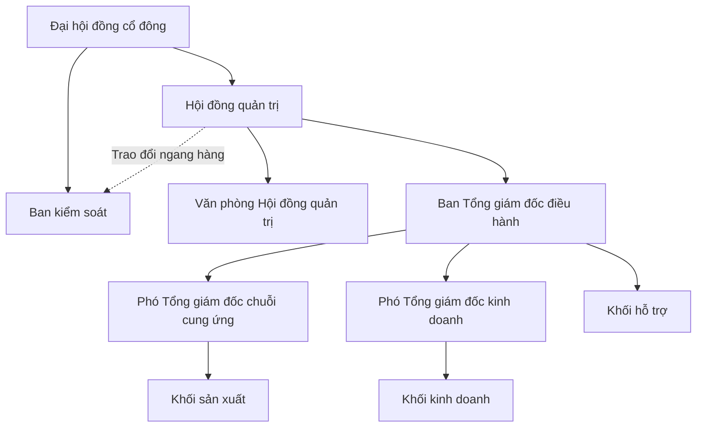

# BÁO CÁO THƯỜNG NIÊN NĂM 2025
*(Ban hành kèm theo Thông tư số 96/2020/TT-BTC ngày 16 tháng 11 năm 2020 của Bộ trưởng Bộ Tài chính)*

**CÔNG TY CỔ PHẦN THỰC PHẨM HỮU NGHỊ**  
Số: 53 /BC-TPHN  
*Hà Nội, ngày 24 tháng 3 năm 2026*

**CỘNG HÒA XÃ HỘI CHỦ NGHĨA VIỆT NAM**  
**Độc lập - Tự do - Hạnh phúc**

---

### BÁO CÁO THƯỜNG NIÊN NĂM 2025

**Kính gửi:**
- Ủy ban chứng khoán Nhà nước;
- Sở Giao dịch chứng khoán.

---

## I. THÔNG TIN CHUNG

### 1. Thông tin khái quát
- **Tên giao dịch:** Công ty cổ phần thực phẩm Hữu Nghị (Huunghi Food Joint Stock Company)
- **Giấy chứng nhận đăng ký doanh nghiệp số:** 
- **Vốn điều lệ:** 300.000.000.000đ (Ba trăm tỷ đồng)
- **Vốn đầu tư của chủ sở hữu:** 727.255.390.443 đồng
- **Địa chỉ:** 122 Định Công – Phường Phương Liệt – Hà Nội
- **Số điện thoại:** 024.38643362
- **Số fax:** 024.36658549
- **Website:** www.huunghi.com.vn
- **Mã cổ phiếu:** HNF
- **Quá trình hình thành và phát triển:**
  - Công ty Cổ phần Thực phẩm Hữu Nghị tiền thân là Nhà máy Bánh kẹo cao cấp Hữu Nghị được thành lập năm 1997. Ngày 01 tháng 12 năm 2006, Nhà máy Bánh kẹo cao cấp Hữu Nghị được cổ phần hóa và chính thức chuyển thành Công ty Cổ phần bánh kẹo cao cấp Hữu Nghị. Để phù hợp với chiến lược phát triển công ty, ngày 18/6/2009 Công ty đổi tên thành Công ty Cổ phần Thực phẩm Hữu Nghị. Công ty có trụ sở chính tại 122 Định Công, phường Định Công, quận Hoàng Mai, thành phố Hà Nội.
  - Công ty đã nhận được nhiều huân, huy chương, bằng khen của Nhà nước và các tổ chức tặng. Nổi bật trong số đó là Huân chương Lao động Hạng Nhì do Chủ tịch nước tặng thưởng năm 2011; Huân chương Lao động hạng ba do Chủ tịch nước tặng năm 2001, 2003.
  - Tháng 4/2017, nhà nước chính thức thoái vốn khỏi Hữu Nghị. Tháng 4 năm 2019, sau 22 năm gắn bó với người tiêu dùng Việt, Hữu Nghị chính thức thay đổi bộ nhận diện thương hiệu, đề ra chiến lược phát triển thương hiệu với tầm nhìn trở thành thương hiệu dẫn đầu trong việc truyền tải và lan tỏa những giá trị thân thuộc của mỗi gia đình Việt ra khu vực và thế giới.
  - Cùng với đó, Hữu Nghị thực hiện sứ mệnh “tạo ra những sản phẩm gắn kết thành viên trong gia đình, mang lại cảm giác thân thuộc cho mỗi khách hàng, trong mỗi gia đình Việt.”
  - Từ năm 2019 đến nay, Hữu Nghị triển khai xây dựng văn hóa doanh nghiệp dựa trên 4 giá trị cốt lõi “Tin tưởng - Trách nhiệm - Tôn trọng - Hiệu quả”.
- **Các sự kiện khác:** Tháng 6.2020, Hữu Nghị chính thức khánh thành nhà máy sản xuất hiện đại bậc nhất trong khu vực Đông Nam Á, đạt tiêu chuẩn chứng nhận an toàn thực phẩm toàn cầu FSSC tại Yên Phong, Bắc Ninh.

### 2. Ngành nghề và địa bàn kinh doanh
- **Ngành nghề kinh doanh:** Sản xuất bánh mứt kẹo và bánh trung thu mang thương hiệu Hữu Nghị, Tipo (...).
- **Địa bàn kinh doanh:** Thị trường bán hàng trên toàn quốc và xuất khẩu sang một số nước châu Á như Trung Quốc, Thái Lan, Hàn Quốc…

### 3. Thông tin về mô hình quản trị, tổ chức kinh doanh và bộ máy quản lý
- **Mô hình quản trị:** Đại hội đồng cổ đông, Hội đồng quản trị, Ban kiểm soát và Tổng giám đốc; Chủ tịch HĐQT Công ty là người đại diện theo pháp luật.
- **Cơ cấu bộ máy quản lý:**

- **Các công ty con, công ty liên kết:**
  - **Trụ sở chính của Hữu Nghị:**
    - Địa chỉ: 122 Định Công, Phường Định Công, Quận Hoàng Mai, Hà Nội
    - Điện thoại: 024.3864 3362 – 024 3864 2579
    - Fax: 024.3665 8549
    - Website: www.huunghi.com.vn
  - **Ngoài ra Hữu Nghị còn có các Nhà máy, Chi nhánh tại:**
    - **Nhà máy tại Hà Nội:**
      - Địa chỉ: 122 Định Công - Hoàng Mai - Hà Nội
      - Điện thoại: 024. 3864 2579
      - Fax: 024. 3864 2579
    - **Chi nhánh Miền Nam:**
      - Địa chỉ: Khu công nghiệp Sóng thần 3, phường Phú Tân, thành phố Thủ Dầu Một, Tỉnh Bình Dương.
      - Điện thoại: (84-650) 3907877
      - Fax: (84-650) 3817255
    - **Chi nhánh Miền Bắc:**
      - Địa chỉ: Lô 15-2 KCN Yên Phong mở rộng - xã Yên Trung - Yên Phong - Bắc Ninh.
      - Địa chỉ đăng ký: Lô 15-2 Khu công nghiệp Yên Phong mở rộng, xã Yên Trung, Huyện Yên Phong, Tỉnh Bắc Ninh. Điện thoại: 0976.188.834

### 4. Định hướng phát triển
- **Các mục tiêu chủ yếu của Công ty:**
  - Phát triển Công ty một cách bền vững, duy trì vị thế “Nhà sản xuất kinh doanh bánh kẹo lớn nhất Việt Nam”.
  - Tiếp tục tái cấu trúc công ty, cơ cấu lại bộ máy, đội ngũ nhân sự quản lý theo hướng tinh gọn, chuyên nghiệp, hiệu quả, phù hợp với quy mô và sự phát triển của Công ty trong giai đoạn mới.
  - Đề cao tính tuân thủ và ghi nhận, đánh giá thành tích lao động một cách khách quan, công bằng, tạo động lực cho người lao động.
  - Xây dựng các thương hiệu Tipo, Staff cho các dòng sản phẩm bánh, mứt, kẹo, bánh trung thu Hữu Nghị trở thành thương hiệu mạnh hàng đầu ở Việt Nam và khu vực.
  - Áp dụng các phương pháp quản lý khoa học, các sáng kiến kỹ thuật nhằm tiết kiệm, tránh lãng phí trong sản xuất, lưu thông hàng hóa… góp phần giảm giá thành sản xuất.
  - Kiểm soát tốt chi phí hoạt động, tối ưu hiệu quả đầu tư tạo lợi thế cạnh tranh về giá. Giữ vững thị trường truyền thống, các kênh bán hàng hiện có và tiếp tục mở rộng thị trường mới, kênh/ phương thức bán hàng mới.
- **Chiến lược phát triển trung và dài hạn:**
  - Đầu tư phát triển nguồn nhân lực chất lượng cao thông qua hoạt động đào tạo và chính sách thu hút, đãi ngộ nhân tài, tạo mọi điều kiện để người lao động thể hiện được năng lực và phát triển được tài năng.
  - Xây dựng văn hóa doanh nghiệp, môi trường làm việc thân thiện, lành mạnh & hiệu quả, có bản sắc riêng của Hữu Nghị, là nơi “đáng làm việc” hàng đầu Việt Nam.
  - Đẩy mạnh hoạt động nghiên cứu, phát triển (R&D), đầu tư dây chuyền thiết bị, máy móc hiện đại, tự động hóa và tiếp cận, chuyển giao công nghệ hiện đại nhằm liên tục nâng cao chất lượng sản phẩm, đảm bảo an toàn vệ sinh thực phẩm và đáp ứng được yêu cầu ngày càng cao của khách hàng trong nước và quốc tế.
  - Thực hiện chuyển đổi số, đẩy mạnh thương mại điện tử, tăng cường tìm kiếm và đầu tư cho các giải pháp quản trị bằng công nghệ (ERP, DMS), tin học hóa các quy trình tác nghiệp và bảo mật thông tin.
  - Chú trọng phát triển thương hiệu sản phẩm và thương hiệu Công ty; tiếp tục thực hiện các biện pháp xúc tiến thương mại, mở rộng thị trường trong nước và xuất khẩu; chuyên môn hóa các kênh bán hàng để làm kín, làm kỹ thị trường, phục vụ khách hàng mục tiêu nhanh & hiệu quả hơn.
  - Tăng cường hợp tác với nhà đầu tư chiến lược, các hệ thống ngân hàng và các nhà cung cấp để chủ động về nguồn vốn sản xuất kinh doanh, tận dụng các cơ hội đầu tư và nâng cao được uy tín, vị thế trong ngành bánh kẹo.
- **Các mục tiêu phát triển bền vững (môi trường, xã hội và cộng đồng) và chương trình chính liên quan đến ngắn hạn và trung hạn của Công ty:**
  - *Đối với môi trường:*
    - Tiếp tục đầu tư nâng cấp cho hệ thống xử lý nước thải theo đúng tiêu chuẩn;
    - Ưu tiên tìm kiếm và sử dụng những nguyên vật liệu, nhiên liệu sạch và thân thiện với môi trường, vì sức khỏe của người tiêu dùng;
    - Cải tạo không gian làm việc, cảnh quan nhà máy theo hướng xanh-sạch-đẹp;
    - Nâng cao tinh thần trách nhiệm và nghiêm túc thực hiện 5S để đảm bảo không gian làm việc luôn được sắp xếp gọn gàng, khoa học, sạch sẽ v.v…
  - *Đối với xã hội và cộng đồng công ty:*
    - Tích cực tham gia hưởng ứng các ngày mang tính cộng đồng lớn như: ngày môi trường thế giới, ngày chống HIV AIDS…
    - Ủng hộ quỹ đền ơn đáp nghĩa trên địa bàn, nơi công ty và các chi nhánh đang đặt trụ sở;
    - Cứu trợ, ủng hộ bằng tiền và sản phẩm bánh kẹo cho các nơi xảy ra thiên tai lũ lụt gây hậu quả nghiêm trọng;
    - Xây dựng và thực hiện văn hóa doanh nghiệp.

### 5. Các rủi ro
- **a. Rủi ro về kinh tế:**
  - Sự tăng trưởng ổn định của GDP và thu nhập bình quân đầu người có ảnh hưởng đến việc tiêu thụ các sản phẩm bánh kẹo. Khi nền kinh tế tăng trưởng mạnh, thu nhập của người dân cao, đời sống vật chất được đảm bảo thì các nhu cầu nâng cao dinh dưỡng, nhu cầu biếu tặng các loại thực phẩm cao cấp, trong đó bánh kẹo cũng tăng. Nếu nền kinh tế lâm vào tình trạng khủng hoảng, thu nhập người dân sụt giảm, không đảm bảo những nhu cầu sinh hoạt tối thiểu hàng ngày thì ngành sản xuất bánh kẹo chắc chắn bị tác động.
  - Để quản lý các rủi ro do tác động của môi trường kinh tế vĩ mô, Công ty đã tiến hành dự báo tình hình phát triển kinh tế để lập kế hoạch kinh doanh phù hợp với các kịch bản tăng trưởng trong tương lai. Bên cạnh đó, Công ty còn triệt để thực hiện tiết kiệm chi phí nhằm tối ưu hóa lợi nhuận.
- **b. Rủi ro về dịch bệnh bất khả kháng:**
  - Các rủi ro về dịch bệnh, chủng loại vi rút mới gây ra, đại dịch xảy ra làm ảnh hưởng trầm trọng đến nền kinh tế thế giới. Điều này đã ảnh hưởng trực tiếp đến việc lưu thông và tiêu dùng các sản phẩm bánh kẹo của Hữu Nghị.
- **c. Một số rủi ro đặc thù: Rủi ro hàng giả, hàng kém phẩm chất:**
  - Giống như một số thị trường đang phát triển khác trên thế giới, thị trường Việt Nam vẫn bị ảnh hưởng nặng nề bởi nạn hàng giả, hàng kém phẩm chất. Hàng giả trong đó có bánh kẹo giả với nguồn gốc xuất phát từ Việt Nam và Trung Quốc được bán lẫn với hàng thật và đôi khi thông qua cả hệ thống đại lý phân phối chính thức tới tay người tiêu dùng, gây ảnh hưởng không nhỏ tới những nhãn hiệu nổi tiếng như Hữu Nghị.
  - Thêm vào đó, bánh kẹo sản xuất từ những cơ sở nhỏ lẻ không tuân thủ quy định về ghi nhãn mác, nguồn gốc, thời hạn sử dụng, không qua cơ quan kiểm duyệt thực phẩm, tuy không ảnh hưởng trực tiếp tới những nhãn hiệu nổi tiếng nhưng lại tác động xấu đến sức khỏe người tiêu dùng. Trên thực tế, kiến thức tiêu dùng của xã hội ngày càng được nâng cao do người tiêu dùng - nhất là người tiêu dùng thành thị hiện nay được tiếp cận với rất nhiều nguồn thông tin từ báo chí, internet… Vì vậy hàng giả chỉ có thể xuất hiện ở một số vùng nông thôn, vùng sâu, vùng xa.
  - Hữu Nghị đã tích cực triển khai các chương trình chống hàng giả thông qua việc nâng cấp bao bì sản phẩm, tổ chức việc tiếp nhận thông tin từ nhiều nguồn khác nhau về hàng giả, phối hợp với các cơ quan chức năng phát hiện hàng giả trên thị trường.
- **d. Rủi ro về biến động giá nguyên vật liệu:**
  - Do nguyên vật liệu chiếm tỷ trọng lớn trong giá thành sản phẩm nên biến động giá cả nguyên vật liệu sẽ tác động đến lợi nhuận của Hữu Nghị. Rủi ro tăng giá nguyên vật liệu có thể đến từ cả nguyên nhân do thiên tai, dịch bệnh, sự gián đoạn của chuỗi cung ứng, sự khan hiếm nguồn cung hoặc do ảnh hưởng của lạm phát…
  - Hoạt động kinh doanh của Hữu Nghị chịu ảnh hưởng lớn của những rủi ro về giá nguyên vật liệu. Tuy nhiên, nếu tình trạng tăng giá nguyên vật liệu diễn ra trong thời gian dài thì thị trường sẽ đồng loạt điều chỉnh giá bán ra sản phẩm, khi đó Hữu Nghị có thể tăng giá bán ra, doanh thu tăng và triệt tiêu được ảnh hưởng của rủi ro tăng giá nguyên vật liệu đến lợi nhuận của Hữu Nghị.
- **e. Rủi ro lãi suất:**
  - Do đặc thù của ngành sản xuất và kinh doanh bánh kẹo đòi hỏi phải có lượng vốn lưu động lớn, tốc độ quay vòng vốn cao do các sản phẩm thường mang tính thời vụ, nên tỷ lệ vốn vay không được quá cao so với vốn chủ sở hữu. Hữu Nghị luôn duy trì tỷ lệ vốn vay trên vốn chủ sở hữu ở mức an toàn. Rủi ro lãi suất có thể xảy ra khi lãi suất biến động bất thường. Lãi suất tăng cao sẽ làm gia tăng chi phí tài chính và gây ảnh hưởng tới kết quả kinh doanh trong kỳ của Hữu Nghị.

---

## II. TÌNH HÌNH HOẠT ĐỘNG TRONG NĂM

### 1. Tình hình hoạt động sản xuất kinh doanh
- **Kết quả hoạt động sản xuất kinh doanh trong năm:**

| STT | Chỉ tiêu | ĐVT | Thực hiện năm 2024 | Kế hoạch năm 2025 | Thực hiện năm 2025 | % 2025/Kế hoạch 2025 | % Thực hiện 2025/Thực hiện 2024 |
|:---:|---|:---:|:---:|:---:|:---:|:---:|:---:|
| 1 | Doanh thu | Tỷ đồng | 2.124,34 | 2.155,865 | 1.956,591 | 91% | 92% |
| 2 | Sản lượng | Tấn | 23.205,0 | 25.832 | 21.585 | 84% | 93% |
| 3 | Nộp ngân sách | Tỷ đồng | 78 | 61 | 61,5 | 101% | 79% |
| 4 | Lợi nhuận trước thuế | Tỷ đồng | 205,92 | 101,845 | 120,45 | 118% | 58% |
| 5 | Lao động bình quân năm | Người | 2.020 | 2.271 | 2.215 | 98% | 110% |
| 6 | Thu nhập bình quân 1 người | Tr.đ/tháng | 13,0 | 14,3 | 14,1 | 99% | 108% |

- **Tình hình thực hiện so với kế hoạch:**
  - Mặc dù tình hình chính trị thế giới và kinh tế trong nước có nhiều biến động, tuy nhiên doanh thu năm 2025 của công ty đạt 91% so với kế hoạch, nộp ngân sách nhà nước đạt 61,5 tỷ đồng; Riêng lợi nhuận trước thuế đạt 120 tỷ đồng, đạt 118% so với kế hoạch đặt ra, tiếp tục kỳ vọng một năm chia cổ tức như kế hoạch đã trình Đại hội cổ đông thường niên thông qua. Tuy nhiên, mặc dù kết quả thực hiện là rất xuất sắc, Ban Lãnh đạo Công ty vẫn đang tiếp tục theo dõi, đánh giá rủi ro một cách thận trọng để có các quyết định phù hợp đối với hoạt động kinh doanh của doanh nghiệp trong thời gian tới.

### 2. Tổ chức và nhân sự
- **Danh sách Ban điều hành:**
  - **Hội đồng quản trị:**
    - Chủ tịch: Ông Trịnh Trung Hiếu
    - Thành viên: Bà Nguyễn Thị Hải Lan
    - Thành viên: Ông Nguyễn Thái Dương
    - Thành viên: Ông Tạ Nguyên Hải
    - Thành viên: Ông Bùi Tuấn Anh (thành viên độc lập)
  - **Ban kiểm soát:**
    - Trưởng ban kiểm soát: Ông Thái Anh Tuấn
    - Thành viên: Bà Lê Mai Dịu
    - Thành viên: Bà Lại Thị Lời
  - **Ban điều hành và Kế toán trưởng:**
    - Tổng giám đốc: Hiện đang phân công cho các Phó TGĐ điều hành.
    - Phó Tổng giám đốc: Ông Tạ Nguyên Hải, Ông Trần Ngọc Chung.
    - Kế toán trưởng: Bà Đoàn Thùy Dương

- **Sơ yếu lý lịch, tỷ lệ sở hữu cổ phần của cán bộ quản lý chủ chốt:**

#### 1. Ông Trịnh Trung Hiếu - Chủ tịch Hội đồng quản trị (thành viên HĐQT không tham gia điều hành)
- **Họ và tên:** Trịnh Trung Hiếu
- **Giới tính:** Nam
- **Ngày sinh:** 28/02/1974
- **Nơi sinh:** Hà Bình - Hà Trung - Thanh Hóa
- **Quốc tịch:** Việt Nam
- **Dân tộc:** Kinh
- **Trình độ chuyên môn:**
  - Đại Học Help - Thạc sĩ Quản trị Kinh doanh
  - Đại học Kinh tế Quốc dân - Cử nhân Kinh tế
  - Đại học Công nghiệp Thái Nguyên - Kỹ sư Điện
- **Quá trình công tác:**

| Thời gian | Vị trí, Đơn vị công tác |
|---|---|
| 03/2019 – Hiện tại | Chủ tịch HĐQT Công ty cổ phần thực phẩm Hữu Nghị Công tác Đảng: + 2007 – 2010: Phó bí thư Đảng ủy Công ty cổ phần thực phẩm Hữu Nghị + 2011 - 04/2015: Ủy viên BCH Đảng bộ Tổng công ty thuốc lá Việt Nam, Bí thư Đảng ủy Công ty cổ phần thực phẩm Hữu Nghị + 2015 đến nay: Bí thư Đảng ủy Công ty cổ phần thực phẩm Hữu Nghị |
| 06/2016 - 2017 | Người đại diện phần vốn góp của Tổng Công ty Thuốc Lá Việt Nam – giữ chức vụ Chủ tịch HĐQT Công ty Cổ phần Thực phẩm Hữu Nghị. |
| 04/2015 – 05/2016 | Người đại diện phần vốn góp của Tổng Công ty Thuốc Lá Việt Nam – giữ chức vụ Chủ tịch HĐQT, Tổng Giám Đốc Công ty Cổ phần Thực phẩm Hữu Nghị |
| 06/2009 – 04/2015 | Tổng giám đốc – Công ty cổ phần thực phẩm Hữu Nghị |
| 05/2008 – 05/2009 | Tổng giám đốc - CTCP Bánh kẹo cao cấp Hữu Nghị |
| 01/2007 – 04/2008 | Phó Tổng giám đốc - CTCP thực phẩm Bánh kẹo cao cấp Hữu Nghị |
| 03/2000 - 12/2006 | Phó giám đốc - Nhà máy Bánh kẹo cao cấp Hữu Nghị - Công ty thực phẩm Miền Bắc. |
| 08/1997 - 02/2000 | Kỹ sư điện – Nhà máy bánh quy cao cấp Hữu Nghị - Công ty thực phẩm Miền Bắc. |

- **Chức vụ tại Công ty:** Chủ tịch HĐQT (thành viên HĐQT không tham gia điều hành)
- **Chức vụ tại tổ chức khác:** Chủ tịch HĐQT Công ty cổ phần công nghệ thực phẩm Đông Nam Á; Chủ tịch HĐQT Công ty cổ phần thực phẩm quốc tế Alpha.
- **Tổng số CP nắm giữ tại HNF:** Xem tại mục Công bố thông tin, chiếm 39,09% VĐL
  - Cá nhân sở hữu: 11.727.687 CP
  - Đại diện sở hữu: 0 CP
- **Hành vi vi phạm pháp luật:** Không

#### 2. Bà Nguyễn Thị Hải Lan - Thành viên HĐQT không tham gia điều hành
- **Họ và tên:** Nguyễn Thị Hải Lan
- **Giới tính:** Nữ
- **Ngày tháng năm sinh:** 19/07/1981
- **Nơi sinh:** Hà Nội
- **Quốc tịch:** Việt Nam
- **Dân tộc:** Kinh
- **Trình độ văn hoá:** Đại Học
- **Chức vụ tại Công ty:** Thành viên HĐQT (thành viên HĐQT không tham gia điều hành)
- **Chức vụ tại tổ chức khác:** Không
- **Tổng số CP nắm giữ tại HNF:** Xem tại mục Công bố thông tin, chiếm 0,65% VĐL
  - Cá nhân sở hữu: 194.150 CP
  - Đại diện sở hữu: 0 CP
- **Hành vi vi phạm pháp luật:** Không

#### 3. Ông Nguyễn Thái Dương - Thành viên Hội đồng quản trị
- **Họ và tên:** Nguyễn Thái Dương
- **Giới tính:** Nam
- **Ngày sinh:** 25/7/1992
- **Quốc tịch:** Việt Nam
- **Dân tộc:** Kinh
- **Trình độ chuyên môn:** Cử nhân đại học Ngoại thương - Chuyên ngành kinh tế đối ngoại
- **Quá trình công tác:**

| Thời gian | Vị trí, Đơn vị công tác |
|---|---|
| 5/2019 - nay | Thành viên HĐQT công ty cổ phần thực phẩm Hữu Nghị |
| 2019 – 5/2019 | Nhân viên xuất khẩu Công ty cổ phần quốc tế Bamboo |
| 2017 - 2018 | Nhân viên bán hàng Công ty cổ phần công nghệ thực phẩm Đông Nam Á |
| 2016 - 2017 | Nhân viên phát triển thị trường Công ty CP công nghệ thực phẩm Đông Nam Á |
| 2014 - 2015 | Nhân viên bán hàng Công ty cổ phần thực phẩm Hữu Nghị |

- **Chức vụ tại Công ty:** Thành viên HĐQT Công ty
- **Chức vụ tại tổ chức khác:** Không
- **Tổng số CP nắm giữ tại HNF:** 0 CP
  - Cá nhân sở hữu: 0 CP
  - Đại diện sở hữu: 0 CP
- **Hành vi vi phạm pháp luật:** Không

#### 4. Ông Bùi Tuấn Anh - Thành viên độc lập Hội đồng quản trị
- **Họ và tên:** Bùi Tuấn Anh
- **Giới tính:** Nam
- **Ngày sinh:** 21/1/1983
- **Nơi sinh:** Thành phố Thái Nguyên, tỉnh Thái Nguyên
- **Quốc tịch:** Việt Nam
- **Dân tộc:** Kinh
- **Trình độ chuyên môn:** Thạc sĩ kỹ thuật Điện Cộng hòa Liên Bang Đức
- **Quá trình công tác:**

| Thời gian | Vị trí, Đơn vị công tác |
|---|---|
| 2018 – nay | Thành viên HĐQT Công ty cổ phần thực phẩm Hữu Nghị |
| 2016 - 02/2018 | Kỹ sư dự án Công ty CP kỹ thuật Sigma |
| 2012 - 2016 | Giảng viên trường Đại học kỹ thuật công nghiệp Thái Nguyên |
| 2009 - 2012 | Du học - Trường đại học Kassel - CHLB Đức |
| 2006 - 2009 | Giảng viên trường Đại học kỹ thuật công nghiệp Thái Nguyên |

- **Chức vụ tại Công ty:** Thành viên HĐQT
- **Chức vụ tại tổ chức khác:** Không
- **Tổng số CP nắm giữ tại HNF:** 0 CP
  - Cá nhân sở hữu: 0 CP
  - Đại diện sở hữu: 0 CP
- **Hành vi vi phạm pháp luật:** Không có

#### 5. Ông Tạ Nguyên Hải – Phó Tổng giám đốc chuỗi cung ứng, Thành viên HĐQT
- **Họ và tên:** Tạ Nguyên Hải
- **Giới tính:** Nam
- **Ngày tháng năm sinh:** 01/03/1979
- **Nơi sinh:** Hà Trung, Thanh Hóa
- **Quốc tịch:** Việt Nam
- **Dân tộc:** Kinh
- **Chức vụ hiện nay tại tổ chức là đối tượng công bố thông tin:** Phó Tổng giám đốc Công ty
- **Các chức vụ hiện đang nắm giữ tại tổ chức khác:** Tổng giám đốc Công ty cổ phần thực phẩm Alpha
- **Số CP nắm giữ tại HNF:** 4.350, chiếm 0,01% vốn điều lệ HNF, trong đó:
  - Cá nhân sở hữu: 4.350 CP
  - Đại diện sở hữu: 0 CP

#### 6. Bà Đoàn Thùy Dương – Kế toán trưởng
- **Họ và tên:** Đoàn Thùy Dương
- **Giới tính:** Nữ
- **Ngày tháng năm sinh:** 03/07/1985
- **Nơi sinh:** Thái Nguyên
- **Quốc tịch:** Việt Nam
- **Dân tộc:** Kinh
- **Chức vụ hiện nay tại tổ chức là đối tượng công bố thông tin:** Kế toán Trưởng
- **Các chức vụ hiện đang nắm giữ tại tổ chức khác:** Không
- **Số CP nắm giữ tại HNF:** 0 cổ phiếu, chiếm 0% vốn điều lệ, trong đó:
  - Cá nhân sở hữu: 0 CP
  - Đại diện sở hữu: 0 CP

#### 7. Ông Thái Anh Tuấn – Trưởng ban kiểm soát
- **Họ và tên:** Thái Anh Tuấn
- **Giới tính:** Nam
- **Ngày tháng năm sinh:** 27/01/1978
- **Nơi sinh:** Hà Nội
- **Quốc tịch:** Việt Nam
- **Dân tộc:** Kinh
- **Chức vụ hiện nay tại tổ chức là đối tượng công bố thông tin:** Trưởng ban kiểm soát
- **Các chức vụ hiện đang nắm giữ tại tổ chức khác:** Kế toán trưởng Công ty TNHH 1 thành viên DNA Holding
- **Số CP nắm giữ tại HNF:** 0 cổ phần, chiếm 0% vốn điều lệ, trong đó:
  - Cá nhân sở hữu: 0 CP
  - Đại diện sở hữu: 0 CP

- **Những thay đổi trong ban điều hành:**
  - Nghị quyết số 154/NQ-TPHN (Đại hội đồng cổ đông bất thường năm 2024 tổ chức lần thứ nhất) ngày 11/09/2024: Thông qua toàn văn nội dung Tờ trình số 133/TTr-TPHN ngày 06/08/2024 về việc miễn nhiệm thành viên Hội đồng quản trị đối với Bà Lê Thị Lan Anh, Ông Lê Việt Anh và bầu bổ sung 02 thành viên HĐQT thay thế Bà Nguyễn Thị Hải Lan; Ông Tạ Nguyên Hải (nhiệm kỳ 5 năm: 2024-2029).
  - Nghị quyết 10/HĐQT-TPHN ngày 17/01/2025 thông qua việc miễn nhiệm đối với Ông Lê Việt Anh - Phó Tổng giám đốc kinh doanh kể từ ngày 01 tháng 02 năm 2025 theo nguyện vọng cá nhân.

- **Số lượng cán bộ, nhân viên. Tóm tắt chính sách và thay đổi trong chính sách đối với người lao động:**
  - **Cơ cấu lao động đến hết 31/12/2025:**

| Chỉ tiêu | Nam | Nữ | Tổng cộng |
|---|:---:|:---:|:---:|
| **Phân theo trình độ học vấn** | **1004** | **1211** | **2215** |
| 1. Trên Đại học | 3 | 2 | 5 |
| 2. Đại học | 129 | 150 | 279 |
| 3. Cao đẳng/Trung cấp | 229 | 166 | 395 |
| 4. Sơ cấp/Lao động phổ thông | 643 | 893 | 1536 |
| **Phân theo phân công lao động** | **1004** | **1211** | **2215** |
| 1. HĐQT/Ban Giám đốc | 6 | 0 | 6 |
| 2. Lao động quản lý (từ cấp phó phòng/Bộ phận trở lên) | 30 | 25 | 55 |
| 3. Lao động chuyên môn | 167 | 265 | 432 |
| 4. Lao động trực tiếp | 798 | 893 | 1688 |
| 5. Lao động thừa hành phục vụ | 6 | 28 | 34 |

  - Hữu Nghị Food luôn chú trọng đầu tư cho hoạt động đào tạo, phát triển nguồn nhân lực. Trong đó:
    - Toàn bộ nhân sự sản xuất đều được đào tạo cập nhật kiến thức, kỹ năng về vệ sinh an toàn thực phẩm, an toàn lao động, phòng chống cháy nổ và kiểm soát rủi ro trong vận hành sản xuất; tham gia đầy đủ các khóa đào tạo nâng cao nhận thức và thực hành áp dụng hệ thống quản lý chất lượng ISO, SA8000, tiêu chuẩn chất lượng Halal v.v...
    - Các Giám đốc kênh kinh doanh, Giám đốc bán hàng khu vực được đào tạo, cập nhật về mô hình tổ chức kinh doanh, ứng dụng công nghệ trong quản trị hệ thống phân phối-bán hàng, xây dựng-phát triển mối quan hệ khách hàng (CRM) và văn hóa phục vụ khách hàng.
    - Nhân sự phòng Tài chính-Kế toán, phòng Nhân sự được đào tạo cập nhật pháp luật về thuế, pháp luật về chính sách người lao động, bảo hiểm xã hội.
    - 100% nhân sự mới đều được đào tạo Hội nhập, hướng dẫn nội quy, quy định và văn hóa ứng xử tại nơi làm việc.

### 3. Tình hình đầu tư, tình hình thực hiện các dự án
- **a) Các khoản đầu tư lớn:**
  - Công ty đã cơ bản hoàn thành việc triển khai xây dựng dự án tại Khu công nghiệp Yên Phong mở rộng. Cụ thể:
    - **Tên dự án:** “Đầu tư mới nhà máy thực phẩm Hữu Nghị - Chi nhánh Công ty cổ phần thực phẩm Hữu Nghị tại Miền Bắc”.
    - **Chủ đầu tư:** Công ty cổ phần thực phẩm Hữu Nghị. Giấy chứng nhận đăng ký kinh doanh số 0102109239 do Phòng đăng ký kinh doanh Sở kế hoạch và đầu tư thành phố Hà Nội cấp ngày 01/12/2006, thay đổi lần thứ 13 ngày 06/5/2020.
    - **Địa điểm đầu tư:** Tại Lô CN15-2 khu Công nghiệp Yên Phong (khu mở rộng), xã Yên Trung, huyện Yên Phong, tỉnh Bắc Ninh.
    - **Giá trị đầu tư theo giấy chứng nhận đầu tư:** 996 tỷ VNĐ.
    - **Nguồn vốn:** Vốn huy động (phát hành trái phiếu không chuyển đổi, vốn vay) và vốn tự có.
- **b) Các công ty con, công ty liên kết:** Không.

### 4. Tình hình tài chính
- **a) Tình hình tài chính:**

#### BẢNG CÂN ĐỐI KẾ TOÁN
*Tại ngày 31 tháng 12 năm 2025*  
*(Đơn vị tính: VNĐ)*

| Chỉ tiêu | Mã chỉ tiêu | Thuyết minh | Số cuối kỳ | Số đầu năm |
|---|:---:|:---:|:---:|:---:|
| **TÀI SẢN** | | | | |
| **A- TÀI SẢN NGẮN HẠN** | **100** | | **972.980.913.953** | **1.198.171.727.912** |
| **I. Tiền và các khoản tương đương tiền** | **110** | | **231.578.411.601** | **154.366.119.933** |
| 1. Tiền | 111 | | 141.578.411.601 | 72.811.373.048 |
| 2. Các khoản tương đương tiền | 112 | | 90.000.000.000 | 81.554.746.885 |
| **II. Các khoản đầu tư tài chính ngắn hạn** | **120** | | **128.499.925.665** | **372.845.678.500** |
| 1. Chứng khoán kinh doanh | 121 | | - | - |
| 2. Dự phòng giảm giá chứng khoán kinh doanh | 122 | | - | - |
| 3. Đầu tư nắm giữ đến ngày đáo hạn | 123 | | 128.499.925.665 | 372.845.678.500 |
| **III. Các khoản phải thu ngắn hạn** | **130** | | **467.101.919.947** | **513.893.627.911** |
| 1. Phải thu ngắn hạn của khách hàng | 131 | | 420.273.784.311 | 448.811.065.887 |
| 2. Trả trước cho người bán ngắn hạn | 132 | | 42.436.325.976 | 7.703.327.562 |
| 3. Phải thu nội bộ ngắn hạn | 133 | | - | - |
| 4. Phải thu theo tiến độ kế hoạch hợp đồng xây dựng | 134 | | - | - |
| 5. Phải thu về cho vay ngắn hạn | 135 | | - | - |
| 6. Phải thu ngắn hạn khác | 136 | | 5.073.491.169 | 57.951.610.278 |
| 7. Dự phòng phải thu ngắn hạn khó đòi | 137 | | (681.681.509) | (572.375.816) |
| 8. Tài sản Thiếu chờ xử lý | 139 | | - | - |
| **IV. Hàng tồn kho** | **140** | | **121.513.496.211** | **135.047.117.847** |
| 1. Hàng tồn kho | 141 | | 121.513.496.211 | 135.047.117.847 |
| 2. Dự phòng giảm giá hàng tồn kho | 149 | | - | - |
| **V. Tài sản ngắn hạn khác** | **150** | | **24.287.160.529** | **22.019.183.721** |
| 1. Chi phí trả trước ngắn hạn | 151 | | 10.934.917.291 | 10.471.041.433 |
| 2. Thuế GTGT được khấu trừ | 152 | | 13.352.243.238 | 11.548.142.288 |
| 3. Thuế và các khoản khác phải thu Nhà nước | 153 | | - | - |
| 4. Giao dịch mua bán lại trái phiếu Chính phủ | 154 | | - | - |
| 5. Tài sản ngắn hạn khác | 155 | | - | - |
| **B. TÀI SẢN DÀI HẠN** | **200** | | **1.071.038.072.142** | **866.955.421.465** |
| **I. Các khoản phải thu dài hạn** | **210** | | **52.000.000** | **69.000.000** |
| 1. Phải thu dài hạn của khách hàng | 211 | | - | - |
| 2. Trả trước cho người bán dài hạn | 212 | | - | - |
| 3. Vốn kinh doanh ở đơn vị trực thuộc | 213 | | - | - |
| 4. Phải thu nội bộ dài hạn | 214 | | - | - |
| 5. Phải thu về cho vay dài hạn | 215 | | - | - |
| 6. Phải thu dài hạn khác | 216 | | 52.000.000 | 69.000.000 |
| 7. Dự phòng phải thu dài hạn khó đòi | 219 | | - | - |
| **II. Tài sản cố định** | **220** | | **633.596.525.191** | **683.273.490.405** |
| 1. Tài sản cố định hữu hình | 221 | | 631.500.456.969 | 637.336.393.207 |
| - Nguyên giá | 222 | | 1.153.584.610.862 | 1.076.168.929.888 |
| - Giá trị hao mòn lũy kế | 223 | | (522.084.153.893) | (438.832.536.681) |
| 2. Tài sản cố định thuê tài chính | 224 | | - | 42.724.391.174 |
| - Nguyên giá | 225 | | - | 58.858.210.990 |
| - Giá trị hao mòn lũy kế | 226 | | - | (16.133.819.816) |
| 3. Tài sản cố định vô hình | 227 | | 2.096.068.222 | 3.212.706.024 |
| - Nguyên giá | 228 | | 5.779.277.273 | 5.663.277.273 |
| - Giá trị hao mòn lũy kế | 229 | | (3.683.209.051) | (2.450.571.249) |
| **III. Bất động sản đầu tư** | **230** | | **-** | **-** |
| - Nguyên giá | 231 | | - | - |
| - Giá trị hao mòn lũy kế | 232 | | - | - |
| **IV. Tài sản dở dang dài hạn** | **240** | | **268.320.779.197** | **9.358.786.283** |
| 1. Chi phí sản xuất, kinh doanh dở dang dài hạn | 241 | | - | - |
| 2. Chi phí xây dựng cơ bản dở dang | 242 | | 268.320.779.197 | 9.358.786.283 |
| **V. Đầu tư tài chính dài hạn** | **250** | | **-** | **-** |
| 1. Đầu tư vào công ty con | 251 | | - | - |
| 2. Đầu tư vào công ty liên kết, liên doanh | 252 | | - | - |
| 3. Đầu tư góp vốn vào đơn vị khác | 253 | | - | - |
| 4. Dự phòng đầu tư tài chính dài hạn | 254 | | - | - |
| 5. Đầu tư nắm giữ đến ngày đáo hạn | 255 | | - | - |
| **VI. Tài sản dài hạn khác** | **260** | | **169.068.767.754** | **174.254.144.777** |
| 1. Chi phí trả trước dài hạn | 261 | | 169.068.767.754 | 174.254.144.777 |
| 2. Tài sản thuế thu nhập hoãn lại | 262 | | - | - |
| 3. Thiết bị, vật tư, phụ tùng thay thế dài hạn | 263 | | - | - |
| 4. Tài sản dài hạn khác | 268 | | - | - |
| 5. Lợi thế thương mại | 269 | | - | - |
| **TỔNG CỘNG TÀI SẢN** | **270** | | **2.044.018.986.095** | **2.065.127.149.377** |
| **NGUỒN VỐN** | | | | |
| **C. NỢ PHẢI TRẢ** | **300** | | **1.316.763.595.652** | **1.371.283.075.187** |
| **I. Nợ ngắn hạn** | **310** | | **905.302.357.715** | **1.089.951.434.641** |
| 1. Phải trả người bán ngắn hạn | 311 | | 169.049.451.988 | 208.970.143.525 |
| 2. Người mua trả tiền trước ngắn hạn | 312 | | 5.602.252.347 | 4.555.204.519 |
| 3. Thuế và các khoản phải nộp nhà nước | 313 | | 9.810.486.590 | 23.916.155.549 |
| 4. Phải trả người lao động | 314 | | 45.650.177.510 | 51.807.633.306 |
| 5. Chi phí phải trả ngắn hạn | 315 | | 74.975.229.712 | 82.576.499.905 |
| 6. Phải trả nội bộ ngắn hạn | 316 | | - | - |
| 7. Phải trả theo tiến độ kế hoạch hợp đồng xây dựng | 317 | | - | - |
| 8. Doanh thu chưa thực hiện ngắn hạn | 318 | | 9.803.962.273 | 9.560.878.952 |
| 9. Phải trả ngắn hạn khác | 319 | | 3.352.537.980 | 3.354.103.459 |
| 10. Vay và nợ thuê tài chính ngắn hạn | 320 | | 557.946.747.131 | 684.794.521.893 |
| 11. Dự phòng phải trả ngắn hạn | 321 | | - | - |
| 12. Quỹ khen thưởng phúc lợi | 322 | | 29.111.512.184 | 20.416.293.533 |
| 13. Quỹ bình ổn giá | 323 | | - | - |
| 14. Giao dịch mua bán lại trái phiếu Chính phủ | 324 | | - | - |
| **II. Nợ dài hạn** | **330** | | **411.461.237.937** | **281.331.640.546** |
| 1. Phải trả người bán dài hạn | 331 | | - | - |
| 2. Người mua trả tiền trước dài hạn | 332 | | - | - |
| 3. Chi phí phải trả dài hạn | 333 | | - | - |
| 4. Phải trả nội bộ về vốn kinh doanh | 334 | | - | - |
| 5. Phải trả nội bộ dài hạn | 335 | | - | - |
| 6. Doanh thu chưa thực hiện dài hạn | 336 | | - | - |
| 7. Phải trả dài hạn khác | 337 | | 85.790.871.132 | 86.726.708.344 |
| 8. Vay và nợ thuê tài chính dài hạn | 338 | | 325.670.366.805 | 194.604.932.202 |
| 9. Trái phiếu chuyển đổi | 339 | | - | - |
| 10. Cổ phiếu ưu đãi | 340 | | - | - |
| 11. Thuế thu nhập hoãn lại phải trả | 341 | | - | - |
| 12. Dự phòng phải trả dài hạn | 342 | | - | - |
| 13. Quỹ phát triển khoa học và công nghệ | 343 | | - | - |
| **D. VỐN CHỦ SỞ HỮU** | **400** | | **727.255.390.443** | **693.844.074.190** |
| **I. Vốn chủ sở hữu** | **410** | | **727.255.390.443** | **693.844.074.190** |
| 1. Vốn góp của chủ sở hữu | 411 | | 300.000.000.000 | 300.000.000.000 |
| - Cổ phiếu phổ thông có quyền biểu quyết | 411a | | 300.000.000.000 | 300.000.000.000 |
| - Cổ phiếu ưu đãi | 411b | | - | - |
| 2. Thặng dư vốn cổ phần | 412 | | 16.689.002.236 | 16.689.002.236 |
| 3. Quyền chọn chuyển đổi trái phiếu | 413 | | - | - |
| 4. Vốn khác của chủ sở hữu | 414 | | - | - |
| 5. Cổ phiếu quỹ | 415 | | - | - |
| 6. Chênh lệch đánh giá lại tài sản | 416 | | - | - |
| 7. Chênh lệch tỷ giá hối đoái | 417 | | - | - |
| 8. Quỹ đầu tư phát triển | 418 | | 137.326.102.943 | 110.574.918.126 |
| 9. Quỹ hỗ trợ sắp xếp doanh nghiệp | 419 | | - | - |
| 10. Quỹ khác thuộc vốn chủ sở hữu | 420 | | - | - |
| 11. Lợi nhuận sau thuế chưa phân phối | 421 | | 273.240.285.264 | 266.580.153.828 |
| - LNST chưa phân phối lũy kế đến cuối kỳ trước | 421a | | 170.911.907.405 | 118.238.921.715 |
| - LNST chưa phân phối kỳ này | 421b | | 102.328.377.859 | 148.341.232.113 |
| 12. Nguồn vốn đầu tư XDCB | 422 | | - | - |
| 13. Lợi ích cổ đông không kiểm soát | 429 | | - | - |
| **II. Nguồn kinh phí và quỹ khác** | **430** | | **-** | **-** |
| 1. Nguồn kinh phí | 431 | | - | - |
| 2. Nguồn kinh phí đã hình thành TSCĐ | 432 | | - | - |
| **TỔNG CỘNG NGUỒN VỐN** | **440** | | **2.044.018.986.095** | **2.065.127.149.377** |

- **b) Các chỉ tiêu tài chính chủ yếu:** Như đã thể hiện trong BCTC kiểm toán đã công bố thông tin của Công ty.

### 5. Cơ cấu cổ đông, thay đổi vốn đầu tư của chủ sở hữu
- **a) Cổ phần:**
  - Trong năm 2020, Công ty thực hiện đợt chào bán cổ phiếu cho cổ đông hiện hữu theo Giấy chứng nhận đăng ký chào bán cổ phiếu số 30/GCN-UBCK do Chủ tịch Ủy ban Chứng khoán Nhà nước cấp ngày 10/02/2020, sau khi kết thúc đợt chào bán, tổng số cổ phần đang lưu hành tính đến 31/12/2020: 30.000.000 cổ phần.
  - Đến 31/12/2022: 30.000.000 cổ phần.

| STT | Nội dung | Trước khi thay đổi | Thay đổi | Sau khi thay đổi | Lý do thay đổi |
|:---:|---|:---:|:---:|:---:|---|
| 01 | Vốn điều lệ (VNĐ) | 200.000.000.000 | 100.000.000.000 | 300.000.000.000 | Phát hành thêm cổ phiếu cho cổ đông hiện hữu |
| 02 | Tổng số cổ phiếu (cổ phiếu) | 20.000.000 | 10.000.000 | 30.000.000 | Phát hành thêm cổ phiếu cho cổ đông hiện hữu |
| 03 | Số lượng cổ phiếu quỹ (cổ phiếu) | 0 | 0 | 0 | |
| 04 | Số lượng cổ phiếu có quyền biểu quyết đang lưu hành (cổ phiếu) | 20.000.000 | 10.000.000 | 30.000.000 | Phát hành thêm cổ phiếu cho cổ đông hiện hữu |
| 05 | Số lượng cổ phần hạn chế chuyển nhượng | - | - | 0 | |

- **b) Cơ cấu cổ đông (Tại thời điểm 31/12/2025):**

| STT | Tên cá nhân/tổ chức (người đại diện) | Cổ đông nhà nước | Cổ đông chiến lược | Cổ đông lớn | Cổ phiếu quỹ | Số lượng CP nắm giữ | Tỷ lệ CP nắm giữ (%) |
|:---:|---|:---:|:---:|:---:|:---:|:---:|:---:|
| 1 | Công ty TNHH một thành viên DNA Holding *(chuyển đổi loại hình từ Công ty cổ phần DNA Holding)* | Không | Không | Có | Không | 17.031.325 | 56,77% |
| 2 | Trịnh Trung Hiếu | Không | Không | Có | Không | 11.727.687 | 39,09% |
| 4 | Cổ đông còn lại | Không | Không | Không | Không | 1.240.988 | 4,14% |
| **8** | **Tổng cộng** | | | | | **30.000.000** | **100,00%** |

- **c) Tình hình thay đổi vốn đầu tư của chủ sở hữu:**

| STT | Thời điểm | Vốn điều lệ (Triệu đồng) | Giá trị tăng thêm (Triệu đồng) | Phương thức |
|:---:|:---:|:---:|:---:|---|
| 1 | 2006 | 22.500 | - | Cổ phần hoá |
| 2 | 2009 | 52.500 | 30.000 | Phát hành ra công chúng cho các cổ đông hiện hữu |
| 3 | 2010 | 66.750 | 14.250 | Trả cổ tức bằng cổ phiếu |
| 4 | 2011 | 73.425 | 6.675 | Trả cổ tức bằng cổ phiếu |
| 5 | 2012 | 100.000 | 26.575 | Phát hành ra công chúng cho cổ đông hiện hữu, phát hành cho CBCNV và Tổng công ty Thuốc lá Việt Nam |
| 6 | 2013 | 108.449,070 | 8.449,070 | Trả cổ tức bằng cổ phiếu |
| 7 | 2014 | 200.000 | 91.550,93 | Phát hành ra công chúng cho cổ đông hiện hữu, phát hành cho CBCNV và Tổng công ty Thuốc lá Việt Nam |
| 8 | 2020 | 300.000 | 100.000 | Phát hành ra công chúng cho cổ đông hiện hữu |

- **d) Giao dịch cổ phiếu quỹ:**
  - Số lượng cổ phiếu quỹ hiện tại: 0 cổ phiếu
  - Trong năm không có giao dịch cổ phiếu quỹ
- **e) Các chứng khoán khác:** Không có đợt phát hành chứng khoán nào khác trong năm.

### 6. Báo cáo tác động liên quan đến môi trường và xã hội của công ty (ESG)
- **6.1. Tác động lên môi trường:**
  - *Tổng phát thải khí nhà kính (GHG) trực tiếp và gián tiếp:* Công ty thực hiện theo Quy định tại Giấy chứng nhận phê duyệt báo cáo đánh giá tác động môi trường và Giấy chứng nhận hoàn thành công trình bảo vệ môi trường; chưa có hệ thống đo đạc ghi nhận số liệu này.
  - *Các sáng kiến và biện pháp giảm thiểu phát thải khí nhà kính:* Công ty thực hiện theo Quy định tại Giấy chứng nhận phê duyệt báo cáo đánh giá tác động môi trường và Giấy chứng nhận hoàn thành công trình bảo vệ môi trường; chưa có hệ thống đo đạc ghi nhận số liệu này.
- **6.2. Quản lý nguồn nguyên vật liệu:**
  - *a) Tổng lượng nguyên vật liệu được sử dụng để sản xuất và đóng gói các sản phẩm và dịch vụ chính của tổ chức trong năm:* Công ty thực hiện nghiêm túc việc quản trị nguồn nguyên liệu để đảm bảo hoạt động sản xuất kinh doanh và ổn định thị trường, giảm nguy cơ phụ thuộc.
  - *b) Báo cáo tỉ lệ phần trăm nguyên vật liệu được tái chế được sử dụng để sản xuất sản phẩm và dịch vụ chính của tổ chức:* [Không có số liệu ghi nhận]
- **6.3. Tiêu thụ năng lượng:**
  - *a) Năng lượng tiêu thụ trực tiếp và gián tiếp:* Công ty kết hợp sử dụng năng lượng điện, Gas, lò hơi cho hoạt động sản xuất và thực hiện quản trị tốt việc tiêu thụ năng lượng hợp lý.
  - *b) Năng lượng tiết kiệm được thông qua các sáng kiến sử dụng năng lượng hiệu quả:* [Không có số liệu ghi nhận]
  - *c) Các báo cáo sáng kiến tiết kiệm năng lượng:* [Không có số liệu ghi nhận]
- **6.4. Tiêu thụ nước:**
  - *a) Nguồn cung cấp nước và lượng nước sử dụng:* Nguồn nước của Công ty sử dụng chủ yếu là nguồn nước máy. Quá trình kiểm soát chất lượng nước đầu vào và nước thải cũng được kiểm soát chặt chẽ theo quy định của pháp luật.
  - *b) Tỷ lệ phần trăm và tổng lượng nước tái chế và tái sử dụng:* [Không có số liệu ghi nhận]
- **6.5. Tuân thủ pháp luật về bảo vệ môi trường:**
  - *a) Số lần bị xử phạt vi phạm do không tuân thủ luật pháp và các quy định về môi trường:* Trong năm 2024, Công ty không bị xử phạt vi phạm về môi trường.
  - *b) Tổng số tiền do bị xử phạt vi phạm do không tuân thủ luật pháp và các quy định về môi trường:* 0 đồng.
- **6.6. Chính sách liên quan đến người lao động:**
  - *a) Số lượng lao động, mức lương trung bình đối với người lao động:* Tính đến 31/12/2025, số lượng lao động của Công ty đạt 2215 người, thu nhập trung bình đạt 14,1 triệu đồng/1 người. Công ty vẫn duy trì công ăn việc làm cho một lượng lớn lao động và duy trì mức thu nhập ổn định.
  - *b) Chính sách lao động nhằm đảm bảo sức khỏe, an toàn và phúc lợi của người lao động:* Công ty không ngừng nâng cao năng suất lao động và chế độ đãi ngộ cho người lao động. Thu nhập trung bình của người lao động bảo đảm và so với các doanh nghiệp cùng ngành thì mức thu nhập này là tương đối thu hút và ổn định. Công ty cũng thực hiện khám sức khỏe định kỳ, bồi dưỡng tăng ca nhằm đảm bảo sức khỏe, an toàn và phúc lợi cho người lao động, đồng thời tăng cường các hoạt động đào tạo, nâng cao kiến thức, kỹ năng cho người lao động để tăng năng suất, đảm bảo công việc và phát triển sự nghiệp.
  - *c) Hoạt động đào tạo người lao động:* Xem mục chính sách phát triển nguồn nhân lực.
- **6.7. Báo cáo liên quan đến trách nhiệm đối với cộng đồng địa phương:**
  - Các hoạt động đầu tư cộng đồng và hoạt động phát triển cộng đồng khác, bao gồm hỗ trợ tài chính nhằm phục vụ cộng đồng: Công ty thực hiện các hoạt động tài trợ và ủng hộ sản phẩm bánh kẹo theo các hoạt động cộng đồng.
- **6.8. Báo cáo liên quan đến hoạt động thị trường vốn xanh theo hướng dẫn của UBCKNN:**
  - *Lưu ý:* Mục 6 phần II Phụ lục này, công ty có thể lập riêng thành Báo cáo phát triển bền vững, trong đó các mục 6.1, 6.2 và 6.3 không bắt buộc đối với các doanh nghiệp hoạt động trong lĩnh vực dịch vụ tài chính, ngân hàng, chứng khoán, bảo hiểm. Khuyến khích các doanh nghiệp áp dụng các chuẩn mực báo cáo quốc tế trong việc báo cáo Phát triển bền vững.

---

## III. BÁO CÁO VÀ ĐÁNH GIÁ CỦA BAN GIÁM ĐỐC

### 1. Đánh giá kết quả hoạt động sản xuất kinh doanh
- **Cơ hội:**
  - An ninh, chính trị ổn định, các biện pháp thực hiện mục tiêu kép của chính phủ: vừa chống lạm phát vừa phát triển kinh tế đã phát huy tác dụng, tạo cơ hội cho Hữu Nghị duy trì và triển khai được hoạt động sản xuất, kinh doanh trong nước và giảm được tác động tiêu cực của dịch bệnh.
  - Nhận thức của người tiêu dùng đối với sản phẩm chất lượng, an toàn vệ sinh thực phẩm và các thương hiệu uy tín trong nước ngày càng được nâng lên, góp phần đáng kể cho việc lựa chọn, tiêu dùng các sản phẩm của Hữu Nghị;
  - Hữu Nghị đã tạo dựng được vị thế, uy tín trên thị trường và được khách hàng tin dùng các nhãn hiệu Staff, Tipo, bánh Trung Thu và Mứt Tết;
  - Hữu Nghị đã xác lập mô hình phân phối từ năm 2006 và liên tục kiện toàn hệ thống phân phối-bán hàng đa kênh tại thị trường nội địa và xuất khẩu thành công các sản phẩm ra thị trường quốc tế, đảm bảo sự ổn định và cân bằng giữa thị trường trong nước và nước ngoài;
  - Khánh thành nhà máy hiện đại, đầu tư thêm dây chuyền sản xuất đồng bộ, tự động hóa, đạt chuẩn an toàn thực phẩm toàn cầu tại Yên Phong, Bắc Ninh để thực hiện tập trung sản xuất quy mô lớn, tối ưu chi phí hoạt động và tạo ra những sản phẩm chất lượng cao đáp ứng được nhu cầu ngày càng cao của người tiêu dùng trong nước và khách hàng quốc tế.
- **Khó khăn thách thức:**
  - Sức ép cạnh tranh trong ngành bánh kẹo ngày càng khốc liệt, nhất là đối với phân khúc trung-cao cấp.
  - Vị thế đàm phán của nhà bán lẻ ngày càng lớn và họ đòi hỏi nhiều hơn đối với nhà sản xuất gây ảnh hưởng không nhỏ cho Hữu Nghị với việc tăng chi phí mở mã sản phẩm, chiết khấu thương mại, chi phí trưng bày, marketing tại điểm bán v.v..
  - Giá nguyên liệu, bao bì, chi phí logistics, chi phí khấu hao tài sản, lãi vay tăng cao... làm ảnh hưởng đến hiệu quả kinh doanh của Hữu Nghị.
  - Việc di dời các dây chuyền thiết bị và triển khai lắp đặt tại nhà máy mới ít nhiều làm ảnh hưởng tới tiến độ và sản lượng ra hàng ở một số thời điểm.
- **Các biện pháp đã thực hiện:**
  - **T1. Về sản phẩm:**
    - Cơ cấu lại nhãn hàng, danh mục sản phẩm để gia tăng sự tập trung và sức mạnh thương hiệu Tipo, Staff và tối ưu chi phí trong việc tổ chức sản xuất và quản lý danh mục sản phẩm.
    - Loại bỏ những sản phẩm có biên lợi nhuận thấp, sản lượng tiêu thụ ít hoặc tốn kém trong tổ chức sản xuất, lưu thông phân phối.
    - Cơ cấu lại danh mục sản phẩm mùa vụ Tết và định vị rõ nét theo từng phân khúc để tập trung nguồn lực triển khai và thuận tiện cho sự lựa chọn của khách hàng;
    - Ưu tiên lựa chọn đầu tư công nghệ hiện đại, dây chuyền thiết bị đồng bộ, tự động hóa; áp dụng các sáng kiến kỹ thuật và tiết kiệm trong sản xuất để tối ưu chi phí hoạt động, tăng cơ hội cạnh tranh về giá và chất lượng sản phẩm.
    - Tối ưu lượng hàng tồn kho, đảm bảo luôn đủ hàng cho thị trường với hạn sử dụng tốt nhất.
  - **T2. Về khách hàng:**
    - Đánh giá và lựa chọn các đối tác kinh doanh có cùng chí hướng, có thiện chí đầu tư cùng phát triển, phù hợp với quy mô và định hướng phát triển của Hữu Nghị.
    - Thanh lọc các nhà phân phối, các đối tác bán lẻ không tuân thủ hợp đồng, không phối hợp triển khai thị trường.
    - Điều chỉnh tăng mức đặt cọc đảm bảo cho đơn hàng và thanh toán trước đối với tất cả đơn hàng thường ngày và mùa vụ để giảm thiểu rủi ro thanh toán.
    - Tăng đầu tư cho các điểm keyshop, chuỗi cửa hàng tiện lợi (CVS), các siêu thị bán lẻ và mở rộng kênh bán hàng online.
  - **T3. Về thị trường:**
    - Tổ chức lại khu vực phân phối-bán hàng, tuyến bán hàng để chăm sóc, làm kín, làm kỹ thị trường và tối ưu chi phí logistics.
    - Kiện toàn tổ chức bán hàng theo kênh chuyên biệt, phục vụ đúng đối tượng khách hàng mục tiêu của kênh.
    - Tăng cường các biện pháp chống bán phá giá, lấn vùng, đảm bảo sự lành mạnh và hiệu quả của từng kênh bán hàng, từng khu vực thị trường.
  - **T4. Về nhân sự và văn hóa doanh nghiệp:**
    - Sắp xếp lại tổ chức bộ máy nhân sự theo hướng tinh gọn, chuyên nghiệp và hiệu quả; ưu tiên nhân sự có năng lực, thực hiện được đa nhiệm;
    - Tăng phạm vi quản lý địa bàn cho lực lượng giám sát, quản lý bán hàng để giảm đầu mối quản lý nhưng vẫn đảm bảo hiệu quả kinh doanh và tăng thu nhập cho nhân sự có năng lực.
    - Đẩy mạnh việc truyền tải và lan tỏa các giá trị cốt lõi của Công ty trong toàn hệ thống.
    - Tăng cường kiểm soát tính tuân thủ, kết hợp với hướng dẫn, đào tạo để nâng cao kiến thức, kỹ năng, góp phần tăng năng suất lao động và tạo cơ hội phát triển nghề nghiệp lâu dài cho người lao động trong toàn công ty.
    - Thực hiện các biện pháp thu hút nhân tài, tuyển chọn các nhân sự phù hợp, đáp ứng quy mô và sự phát triển của công ty.
  - **T5. Về tài chính, mua hàng:**
    - Xây dựng và duy trì tốt mối quan hệ với các ngân hàng, các tổ chức tín dụng, các nhà cung cấp để đảm bảo luôn có đủ nguồn vốn, nguyên liệu, bao bì... đáp ứng sản xuất kinh doanh và đảm bảo sử dụng vốn hiệu quả.
    - Xây dựng và áp dụng các quy chế mua sắm, vận dụng lợi thế quy mô để đạt lợi thế trong đàm phán với mức giá tốt nhất cho tất cả các yếu tố đầu vào, góp phần giảm giá thành sản xuất, tăng hiệu quả hoạt động cho Công ty.
- **Những tiến bộ công ty đã đạt được:**
  - Giữ vững được vị thế “Nhà sản xuất kinh doanh bánh kẹo thuần Việt lớn nhất Việt Nam”.
  - Đạt Chứng nhận an toàn thực phẩm toàn cầu (Food Safety System Certification - FSSC).

### 2. Tình hình tài chính
- **a) Tình hình tài sản:** Phân tích, đánh giá hiệu quả sử dụng tài sản và nợ phải thu quá hạn ảnh hưởng đến kết quả hoạt động kinh doanh: *(Trình bày chi tiết trong BCTC kiểm toán).*
- **b) Tình hình nợ phải trả:** Biến động lớn về các khoản nợ, phân tích nợ phải trả quá hạn, ảnh hưởng chênh lệch tỷ giá hối đoái, chênh lệch lãi vay: *(Trình bày chi tiết trong BCTC kiểm toán).*

### 3. Những cải tiến về cơ cấu tổ chức, chính sách, quản lý
- Sắp xếp lại tổ chức bộ máy nhân sự theo hướng tinh gọn, chuyên nghiệp và hiệu quả; ưu tiên nhân sự có năng lực, thực hiện được đa nhiệm;
- Tăng phạm vi quản lý địa bàn cho lực lượng giám sát, quản lý bán hàng để giảm đầu mối quản lý nhưng vẫn đảm bảo hiệu quả kinh doanh và tăng thu nhập cho nhân sự có năng lực.
- Đẩy mạnh việc truyền tải và lan tỏa các giá trị cốt lõi của Công ty trong toàn hệ thống.
- Tăng cường kiểm soát tính tuân thủ, kết hợp với hướng dẫn, đào tạo để nâng cao kiến thức, kỹ năng, góp phần tăng năng suất lao động và tạo cơ hội phát triển nghề nghiệp lâu dài cho người lao động trong toàn công ty.
- Thực hiện các biện pháp thu hút nhân tài, tuyển chọn các nhân sự phù hợp, đáp ứng quy mô và sự phát triển của công ty.

### 4. Kế hoạch phát triển trong tương lai
- Phát triển Công ty một cách bền vững, duy trì vị thế “Nhà sản xuất kinh doanh bánh kẹo lớn nhất Việt Nam”.
- Tiếp tục tái cấu trúc công ty, cơ cấu lại bộ máy, đội ngũ nhân sự quản lý theo hướng tinh gọn, chuyên nghiệp, hiệu quả, phù hợp với quy mô và sự phát triển của Công ty trong giai đoạn mới.
- Đề cao tính tuân thủ và ghi nhận, đánh giá thành tích lao động một cách khách quan, công bằng, tạo động lực cho người lao động.
- Xây dựng các thương hiệu Tipo, Staff cho các dòng sản phẩm bánh, mứt, kẹo, bánh trung thu Hữu Nghị trở thành thương hiệu mạnh hàng đầu ở Việt Nam và khu vực.
- Áp dụng các phương pháp quản lý khoa học, các sáng kiến kỹ thuật nhằm tiết kiệm, tránh lãng phí trong sản xuất, lưu thông hàng hóa… góp phần giảm giá thành sản xuất.
- Kiểm soát tốt chi phí hoạt động, tối ưu hiệu quả đầu tư tạo lợi thế cạnh tranh về giá.
- Giữ vững thị trường truyền thống, các kênh bán hàng hiện có và tiếp tục mở rộng thị trường mới, kênh/ phương thức bán hàng mới.

### 5. Giải trình của Ban Giám đốc đối với ý kiến kiểm toán
*(Không có ý kiến kiểm toán ngoại trừ).*

### 6. Báo cáo đánh giá liên quan đến trách nhiệm về môi trường và xã hội của công ty
- **a. Đánh giá liên quan đến các chỉ tiêu môi trường:** Công ty tiếp tục đầu tư nâng cấp cho hệ thống xử lý nước thải theo đúng tiêu chuẩn; Ưu tiên tìm kiếm và sử dụng những nguyên vật liệu, nhiên liệu sạch và thân thiện với môi trường, vì sức khỏe của người tiêu dùng; Cải tạo không gian làm việc, cảnh quan nhà máy theo hướng xanh-sạch-đẹp; Nâng cao tinh thần trách nhiệm và quán triệt CBCNV nghiêm túc thực hiện 5S để đảm bảo không gian làm việc luôn được sắp xếp gọn gàng, khoa học, sạch sẽ v.v…
- **b. Đánh giá liên quan đến vấn đề người lao động:** Công ty chú trọng đầu tư phát triển nguồn nhân lực chất lượng cao thông qua hoạt động đào tạo và chính sách thu hút, đãi ngộ nhân tài, tạo mọi điều kiện để người lao động thể hiện được năng lực và phát triển được tài năng. Đồng thời xây dựng văn hóa doanh nghiệp, môi trường làm việc thân thiện, lành mạnh & hiệu quả, có bản sắc riêng của Hữu Nghị, là nơi “đáng làm việc” hàng đầu Việt Nam.
- **c. Đánh giá liên quan đến trách nhiệm của doanh nghiệp đối với cộng đồng địa phương:** Công ty luôn chấp hành và thực hiện nghiêm túc các quy định của pháp luật và quy định của địa phương.

---

## IV. ĐÁNH GIÁ CỦA HỘI ĐỒNG QUẢN TRỊ VỀ HOẠT ĐỘNG CỦA CÔNG TY

### 1. Đánh giá của Hội đồng quản trị về các mặt hoạt động của Công ty
Công ty tuân thủ và thực hiện nghiêm túc các Nghị quyết của HĐQT và các quy định của pháp luật có liên quan. Các trách nhiệm về môi trường xã hội được tuân thủ nghiêm túc và không bị xử phạt.

### 2. Đánh giá của Hội đồng quản trị về hoạt động của Ban Giám đốc công ty
Ban giám đốc Công ty đã thực hiện và chỉ đạo kịp thời hoạt động sản xuất kinh doanh của Công ty theo đúng Quyết nghị của Đại hội đồng cổ đông; Nghị quyết của HĐQT và các quy định của pháp luật có liên quan.

### 3. Các kế hoạch, định hướng của Hội đồng quản trị
- Định kỳ hàng tháng HĐQT họp với Ban điều hành thông qua báo cáo và kế hoạch tháng/quý/năm, qua đó điều chỉnh và chỉ đạo kịp thời.
- Đôn đốc và yêu cầu BKS tổ chức các hoạt động kiểm tra, rà soát việc tuân thủ nội quy, quy chế, chính sách của Công ty.
- HĐQT thực hiện việc giám sát thông qua việc phê duyệt các quy định về phân quyền, ban hành quy chế quy định về vận hành trong Công ty.

---

## V. QUẢN TRỊ CÔNG TY

### 1. Hội đồng quản trị
- **a) Thành viên và cơ cấu của Hội đồng quản trị:**
  - Danh sách các thành viên Hội đồng quản trị:
    - Chủ tịch: Ông Trịnh Trung Hiếu - Sở hữu 11.727.687 cổ phần, chiếm 39,09%
    - Thành viên: Bà Nguyễn Thị Hải Lan - Sở hữu 194.150 cổ phần, chiếm 0,65%
    - Thành viên: Ông Nguyễn Thái Dương - Sở hữu 0 cổ phần
    - Thành viên: Ông Tạ Nguyên Hải - Sở hữu 4.350 cổ phần, chiếm 0,01%
    - Thành viên độc lập: Ông Bùi Tuấn Anh - Sở hữu 0 cổ phần
- **b) Các tiểu ban thuộc Hội đồng quản trị:** Không có.
- **c) Hoạt động của Hội đồng quản trị:**
  - Trong năm Hội đồng quản trị đã tổ chức 27 phiên họp và ban hành 27 nghị quyết và nhiều quyết định quan trọng khác trong công tác điều hành Công ty (chi tiết các quyết nghị đã nêu tại Báo cáo tình hình quản trị Công ty năm 2024 và đã công bố thông tin).
  - Chuẩn bị tài liệu và tổ chức thành công Đại hội đồng cổ đông thường niên năm 2024.
  - Chỉ đạo xây dựng lại các quy chế của công ty nhằm hoàn thiện trong điều kiện thực tế.
- **d) Hoạt động của thành viên Hội đồng quản trị độc lập / Hoạt động của các tiểu ban trong Hội đồng quản trị:**
  - Công ty đã bầu bổ sung thành viên HĐQT độc lập đáp ứng quy định. Thành viên độc lập thực hiện theo đúng chức năng nhiệm vụ pháp luật quy định.
- **e) Danh sách các thành viên Hội đồng quản trị có chứng chỉ đào tạo về quản trị công ty:**
  - Các thành viên HĐQT của công ty là những người được đào tạo bài bản, thể hiện rõ tại mục thông tin lý lịch trong báo cáo.

### 2. Ban Kiểm soát
- **a) Thành viên và cơ cấu của Ban kiểm soát:**

| STT | Thành viên BKS | Chức vụ | Ngày bắt đầu/không còn là thành viên BKS | Trình độ chuyên môn |
|:---:|---|---|---|---|
| 1 | Ông Thái Anh Tuấn | Trưởng ban kiểm soát | Ngày bắt đầu 29/8/2020 theo Biên bản và Nghị quyết ĐHĐCĐ bất thường 2020 ngày 29/8/2020 | Kế toán |
| 2 | Bà Lê Mai Dịu | Thành viên | Ngày bắt đầu 30/6/2021 theo Biên bản và Nghị quyết ĐHĐCĐ thường niên 2021 ngày 30/6/2021 | Kế toán |
| 3 | Bà Lại Thị Lời | Thành viên | Ngày bắt đầu 30/6/2021 theo Biên bản và Nghị quyết ĐHĐCĐ thường niên 2021 ngày 30/6/2021 | Kế toán |

- **b) Hoạt động của Ban kiểm soát:**
  - Trong năm, Ban kiểm soát thực hiện các hoạt động kiểm tra, giám sát việc tuân thủ các quy định của Luật Doanh nghiệp, Điều lệ của công ty trong việc quản lý và điều hành hoạt động sản xuất kinh doanh, cụ thể như sau:
    - Ban Kiểm soát cũng đã thực hiện 02 kỳ họp và thực hiện chức năng kiểm tra kiểm soát theo đúng quy định của Điều lệ.
    - Tham gia đánh giá, sửa đổi, hoàn thiện các quy trình, quy định và quy chế nội bộ của Công ty nhằm phát hiện các rủi ro tiềm tàng hoặc những thiếu sót, từ đó đưa ra những giải pháp kiến nghị phù hợp.
    - Kiểm soát tính phù hợp của các quyết định của HĐQT, Ban giám đốc trong công tác quản lý. Kiểm soát việc ban hành các văn bản của Công ty phù hợp với quy định của pháp luật và Điều lệ Công ty.
    - Giám sát việc chấp hành các quy định của Luật Doanh nghiệp, Luật Chứng khoán, Điều lệ tổ chức và hoạt động của Công ty.
    - Kiểm soát tính chính xác, phù hợp của các báo cáo tài chính hàng quý và cả năm. Xem xét việc chấp hành luật về các chính sách và chế độ tài chính kế toán của Công ty.
    - Thẩm định báo cáo tài chính hàng năm trình Đại hội đồng cổ đông tại phiên họp thường niên.

### 3. Các giao dịch, thù lao và các khoản lợi ích của Hội đồng quản trị, Ban giám đốc và Ban kiểm soát
- **a) Lương, thưởng, thù lao, các khoản lợi ích:**

| Họ và tên | Chức vụ | Năm 2025 (VND) | Năm 2024 (VND) |
|---|---|:---:|:---:|
| **Thu nhập của Hội đồng quản trị và Ban Tổng giám đốc** | | **4.539.073.300** | **6.813.847.300** |
| Ông Trịnh Trung Hiếu | Chủ tịch HĐQT | 1.425.938.600 | 2.071.451.200 |
| Bà Lê Thị Lan Anh | Phó Chủ tịch HĐQT *(đã miễn nhiệm)* | - | 120.000.000 |
| Ông Nguyễn Thái Dương | Thành viên HĐQT | 260.121.000 | 297.761.900 |
| Ông Bùi Tuấn Anh | Thành viên HĐQT | 388.761.100 | 366.551.800 |
| Bà Nguyễn Thị Hải Lan | Thành viên HĐQT | 188.205.300 | 24.000.000 |
| Ông Lê Việt Anh | Thành viên HĐQT, Phó Tổng giám đốc *(đã miễn nhiệm)* | - | 1.432.200.000 |
| Ông Tạ Nguyên Hải | Thành viên HĐQT, Phó Tổng giám đốc | 1.155.346.800 | 1.439.400.000 |
| Ông Trần Ngọc Chung | Phó Tổng giám đốc | 1.120.700.500 | 1.062.482.400 |
| **Thu nhập, thù lao của thành viên Ban kiểm soát** | | **1.263.690.000** | **1.214.121.600** |
| Ông Lê Thái Tuấn *(Thái Anh Tuấn)* | Trưởng ban kiểm soát | 673.763.600 | 651.795.700 |
| Bà Lê Mai Dịu | Thành viên | 557.526.400 | 526.325.900 |
| Bà Lại Thị Lời | Thành viên | 32.400.000 | 36.000.000 |

- **b) Giao dịch cổ phiếu của người nội bộ:**

| STT | Người thực hiện giao dịch | Quan hệ với người nội bộ | Số CP sở hữu đầu kỳ | Tỷ lệ đầu kỳ (%) | Số CP sở hữu cuối kỳ | Tỷ lệ cuối kỳ (%) | Lý do tăng, giảm (mua, bán, chuyển đổi, thưởng...) |
|:---:|---|---|:---:|:---:|:---:|:---:|---|
| 1 | Công ty TNHH một thành viên DNA Holding *(trước đây là Công ty cổ phần DNA Holding)* | Là người liên quan đến người nội bộ Trịnh Trung Hiếu - Chủ tịch HĐQT | 15.410.125 | 51,37% | 17.031.325 | 56,77% | Đầu tư |
| 2 | Thái Lan Anh | Bà Thái Lan Anh là em gái ông Thái Anh Tuấn - người nội bộ (Trưởng ban kiểm soát) | 1.771.200 | 5,90% | 150.000 | 0,50% | Cơ cấu lại danh mục |

- **c) Hợp đồng hoặc giao dịch với người nội bộ:**

| STT | Tên tổ chức/cá nhân | Mối quan hệ liên quan với công ty | Số Giấy NSH*, ngày cấp, nơi cấp | Địa chỉ trụ sở chính/Địa chỉ liên hệ | Thời điểm giao dịch với Công ty | Số Nghị quyết/Quyết định của ĐHĐCĐ/HĐQT... thông qua | Nội dung, số lượng, tổng giá trị giao dịch | Ghi chú |
|:---:|---|---|---|---|:---:|---|---|:---:|
| 1 | Công ty cổ phần thực phẩm quốc tế Alpha *(Alpha International Food Joint Stock Company)* | Người liên quan | Mã số doanh nghiệp: 2300614653 do Sở Kế hoạch và Đầu tư TP Bắc Ninh cấp lần đầu ngày 16/12/2010 | Lô E13 và E14 cụm đa nghề Đông Thọ, xã Văn Môn, tỉnh Bắc Ninh, Việt Nam | 13/5/2024  21/3/2025 | - Nghị quyết HĐQT số 85/VPHĐQT-TPHN ngày 13/5/2024 - Nghị quyết 31a/HĐQT-TPHN ngày 21/3/2025 | - Thông qua Hợp đồng giao dịch với công ty cổ phần thực phẩm quốc tế Alpha (mượn kho) - Thông qua giao dịch bảo đảm | |
| 2 | Công ty TNHH một thành viên DNA Holding *(trước đây là Công ty cổ phần DNA Holding)* | Người liên quan | Mã số doanh nghiệp số 2301054242 do Phòng đăng ký kinh doanh Sở Kế hoạch và Đầu tư tỉnh Bắc Ninh cấp 10/10/2018 | KCN Yên Phong mở rộng, Xã Yên Trung, Huyện Yên Phong, Bắc Ninh | 18/5/2021 | Nghị quyết HĐQT số 143/HĐQT-TPHN ngày 18/5/2021 | Thông qua việc chấp nhận ký Hợp đồng về việc bảo đảm tài sản giữa Công ty cổ phần thực phẩm Hữu Nghị (bên được bảo đảm) với Công ty cổ phần DNA Holding (bên bảo đảm) | |
| 3 | Công ty CP công nghệ thực phẩm Đông Nam Á *(DNAFood)* | Người liên quan | Mã số doanh nghiệp 2300888044 do Phòng đăng ký kinh doanh Sở Kế hoạch và Đầu tư tỉnh Bắc Ninh cấp 15/5/2015 | Lô H1 - 6 cụm công nghiệp đa nghề Đông Thọ, Xã Văn Môn, Tỉnh Bắc Ninh | 20/5/2022  21/3/2023  23/12/2024 | - Nghị quyết HĐQT số 93/VPHĐQT-TPHN - Nghị quyết HĐQT số 40/VPHĐQT-TPHN - Nghị quyết HĐQT số 276/VPHĐQT-TPHN | Thông qua giao dịch hợp đồng giữa Công ty cổ phần thực phẩm Hữu Nghị và Công ty CP công nghệ thực phẩm Đông Nam Á | |

- **d) Đánh giá việc thực hiện các quy định về quản trị công ty:**
  - Ban quản trị Công ty đã nghiêm chỉnh thực hiện các quy định về quản trị Công ty theo quy định của pháp luật hiện hành về việc hướng dẫn về quản trị Công ty áp dụng đối với các Công ty đại chúng và đã tổ chức triển khai hoàn thiện Điều lệ và quy chế theo đúng quy định.
  - **Kết quả giám sát đối với thành viên Hội đồng quản trị, Tổng giám đốc và cán bộ quản lý Công ty:** Đã tuân thủ quy định hiện hành và thực hiện các quy định của Đại hội đồng cổ đông, của Hội đồng quản trị.
  - **Công tác điều hành của Ban Tổng giám đốc:** Ban Tổng giám đốc về cơ bản đã tổ chức triển khai thực hiện đúng các nội dung Nghị quyết, quyết định của HĐQT. Trong năm tài chính, Ban Tổng giám đốc đã điều hành chỉ đạo hoạt động sản xuất kinh doanh sát sao, đảm bảo đúng định hướng của HĐQT đã đề ra.

*(Ghi chú: Theo quy tắc ngắt đọc sớm, toàn bộ phần VI. Báo cáo tài chính kiểm toán bắt đầu từ trang 33 được bỏ qua).*
