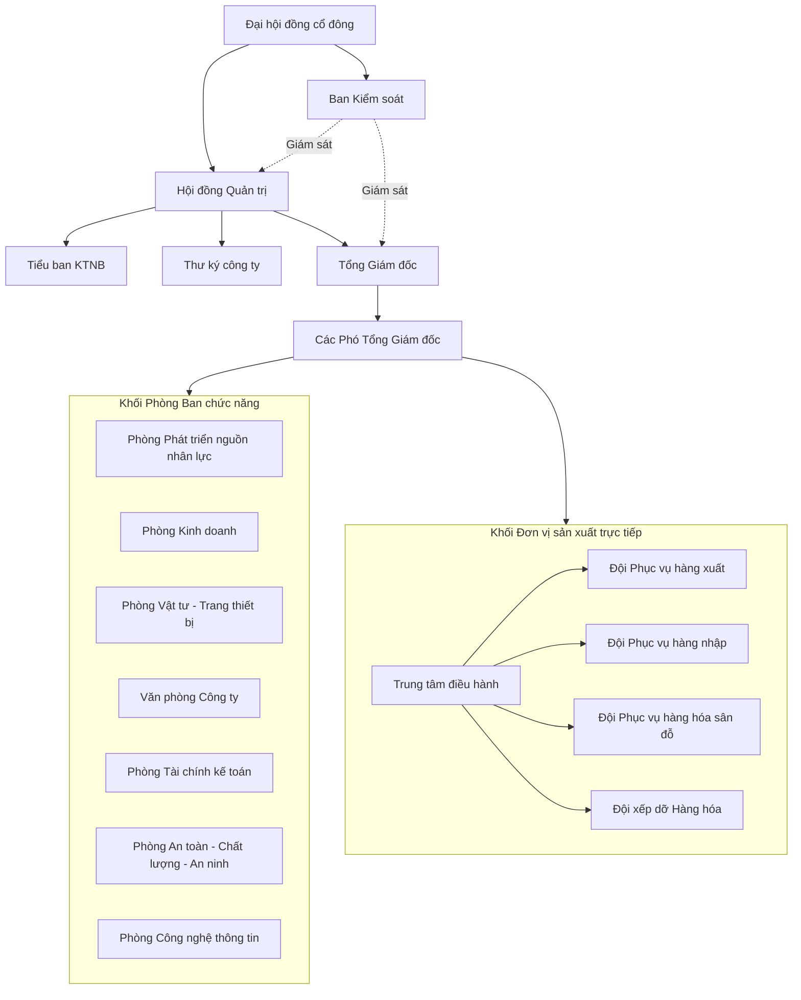

# CÔNG BỐ THÔNG TIN: BÁO CÁO THƯỜNG NIÊN NĂM 2025

**CÔNG TY CỔ PHẦN DỊCH VỤ HÀNG HÓA NỘI BÀI**  
*Số: 305/NCTS-CBTT*  
*Hà Nội, ngày 16 tháng 03 năm 2026*

**CỘNG HÒA XÃ HỘI CHỦ NGHĨA VIỆT NAM**  
**Độc lập - Tự do - Hạnh phúc**

**Kính gửi:**
- Uỷ ban Chứng khoán Nhà nước
- Sở Giao dịch Chứng khoán Việt Nam
- Sở Giao dịch Chứng khoán TP. HCM

1. **Tên tổ chức:** Công ty Cổ phần Dịch vụ Hàng hóa Nội Bài
- Mã chứng khoán: NCT
- Địa chỉ trụ sở chính: Sân bay quốc tế Nội Bài, xã Nội Bài, Tp. Hà Nội
- Điện thoại: (84-24) 35840905 | Fax: (84-24) 35840906
- E-mail: tranvietphuong@noibaicargo.com.vn
2. **Nội dung thông tin công bố:** Báo cáo thường niên năm 2025.
3. **Thông tin này được công bố trên trang thông tin điện tử của công ty** vào ngày 16/03/2026 tại đường dẫn: ncts.vn.

Chúng tôi xin cam kết các thông tin công bố trên đây là đúng sự thật và hoàn toàn chịu trách nhiệm trước pháp luật về nội dung thông tin đã công bố.

**Người đại diện theo pháp luật của Công ty**  
*(Ký, ghi rõ họ tên, chức vụ, đóng dấu)*  
*(Đã ký và đóng dấu)*  
**Trần Việt Phương**  
*Thời gian ký số: 16.03.2026 16:05:23 +07:00*

**Tài liệu đính kèm:**  
- Báo cáo thường niên năm 2025.

---

# CÔNG TY CỔ PHẦN DỊCH VỤ HÀNG HÓA NỘI BÀI
**Địa chỉ:** Sân bay Quốc tế Nội Bài, Xã Nội Bài, TP Hà Nội, Việt Nam  
**Điện thoại:** 024 35840905 | **Fax:** 024 35840906 | **Website:** ncts.vn  

# BÁO CÁO THƯỜNG NIÊN NĂM 2025

---

## I. THÔNG TIN CHUNG

### 1. Thông tin khái quát
- **Tên giao dịch:** Công ty Cổ phần dịch vụ hàng hóa Nội Bài
- **Tên viết tắt:** NCTS
- **Mã cổ phiếu:** NCT
- **Địa chỉ:** Sân bay quốc tế Nội Bài, Xã Nội Bài, TP Hà Nội, Việt Nam.
- **Vốn điều lệ và thực góp:** 261.669.400.000 đồng.
- **Giấy chứng nhận đăng ký doanh nghiệp:** Mã số 0101640729 do Sở Tài chính thành phố Hà Nội cấp lần đầu ngày 19/04/2005 và chính thức đi vào hoạt động từ ngày 01/05/2005, đăng ký thay đổi lần thứ 13 ngày 03/3/2026.

#### Quá trình hình thành và phát triển
Sự ra đời của NCTS đáp ứng xu thế phát triển tất yếu của ngành dịch vụ phục vụ hàng hóa tại Việt Nam, giúp gia tăng giá trị dịch vụ, đáp ứng yêu cầu ngày càng cao của khách hàng, góp phần quan trọng vào sự phát triển ngành hàng không của đất nước.

Ngày 08/01/2015, Công ty thực hiện niêm yết cổ phiếu tại Sở giao dịch chứng khoán thành phố Hồ Chí Minh (HoSE). Kể từ đó đến nay, Công ty luôn nằm trong nhóm các công ty niêm yết tốt nhất Việt Nam.

### 2. Ngành nghề và địa bàn kinh doanh
- **Ngành nghề kinh doanh chính:** Hoạt động dịch vụ hỗ trợ trực tiếp cho vận tải hàng không và dịch vụ hỗ trợ khác liên quan đến vận tải.
- **Địa bàn kinh doanh:** Sân bay quốc tế Nội Bài, Xã Nội Bài, Tp Hà Nội, Việt Nam.

### 3. Thông tin về mô hình quản trị, tổ chức kinh doanh và bộ máy quản lý
- **Mô hình quản trị:** Đại hội đồng cổ đông, Hội đồng quản trị, Ban Kiểm soát, Ban Giám đốc, các phòng ban chức năng và đơn vị sản xuất trực tiếp.
- **Cơ cấu bộ máy quản lý:** Công ty được tổ chức và hoạt động theo Luật Doanh nghiệp, các Luật khác và Điều lệ Công ty được Đại hội đồng cổ đông thông qua.

#### Sơ đồ tổ chức của Công ty

*Ghi chú quan hệ quản lý:*
- Mối quan hệ chỉ đạo trực tuyến: `——>`
- Mối quan hệ chỉ đạo phối hợp: `- - - ->`
- Mối quan hệ giám sát: `- . - ->`

- **Các công ty con, công ty liên kết:** Không có

### 4. Định hướng phát triển
- **Tầm nhìn, sứ mệnh:** Trở thành công ty phục vụ hàng hóa hàng đầu khu vực, theo tiêu chuẩn chất lượng như đã cam kết với khách hàng, phù hợp với tiêu chuẩn và sự phát triển của ngành hàng không.
- **Mục tiêu chủ yếu:** Công ty không ngừng đổi mới, chú trọng nâng cao chất lượng dịch vụ theo tiêu chuẩn đã cam kết với khách hàng; mở rộng cơ sở vật chất, kho bãi; phát triển thêm các loại hình dịch vụ mới dựa trên năng lực các dịch vụ cốt lõi của Công ty; phát triển đội ngũ cán bộ nhân viên đủ năng lực, trình độ nhằm mang gia tăng giá trị và tiện ích tối ưu cho khách hàng; đảm bảo quyền lợi cho người lao động và gia tăng giá trị cho cổ đông.
- **Chiến lược phát triển trung và dài hạn:** Công ty tiếp tục tìm kiếm cơ hội để mở rộng mặt bằng khai thác, đảm bảo ổn định lâu dài; thực hiện đồng bộ các giải pháp về quản trị, đảm bảo hoạt động sản xuất kinh doanh (SXKD) hiệu quả, nâng cao năng lực cạnh tranh; hợp tác, liên doanh liên kết với các đối tác trong chuỗi công đoạn phục vụ hàng hóa nhằm nâng cao, tối ưu hóa năng lực phục vụ.
- **Mục tiêu phát triển bền vững (môi trường, xã hội, cộng đồng):** NCTS luôn hướng tới đảm bảo môi trường làm việc bền vững, công bằng và an toàn cho người lao động, đồng thời gia tăng các mục tiêu kinh tế; luôn chú trọng đầu tư công tác đào tạo và phát triển nguồn nhân lực, tạo điều kiện thuận lợi cho phát triển cá nhân và chuyên môn của nhân viên. Luôn tôn trọng và bảo vệ người lao động, đảm bảo thu nhập, chế độ phúc lợi và quyền lợi tốt nhất cho người lao động. Công ty luôn đặt tiêu chí tuân thủ pháp luật về bảo vệ môi trường lên hàng đầu thông qua việc sử dụng hợp lý nguyên vật liệu sản xuất, ưu tiên lựa chọn máy móc, phương tiện có công nghệ mới, giảm thiểu tác hại đến môi trường. Bên cạnh nỗ lực giữ vị thế còn đặc biệt chú trọng góp phần cải thiện an sinh xã hội, chung tay phát triển đất nước thông qua các hoạt động thiện nguyện, ủng hộ, cộng đồng.

### 5. Các rủi ro và biện pháp quản trị rủi ro
- **Rủi ro về môi trường kinh doanh, chính trị:**  
  Kinh tế thế giới năm 2025 tiếp tục xu hướng tăng trưởng nhưng chậm lại khi trải qua một năm đầy biến động. Bối cảnh địa chính trị tiếp tục phức tạp với xu hướng bảo hộ thương mại gia tăng, chính sách thuế quan bất định, khó lường của Mỹ và rủi ro đứt gãy chuỗi cung ứng do xung đột tại nhiều khu vực, gây áp lực lên lạm phát và an ninh năng lượng toàn cầu.  
  Những diễn biến trên làm gia tăng chi phí logistics, kéo dài thời gian vận chuyển, ảnh hưởng đến nguồn cung hàng hóa, nhất là dầu thô, nhiên liệu và một số mặt hàng thiết yếu. Giá cả hàng hóa cơ bản có xu hướng biến động mạnh, tiềm ẩn nguy cơ gia tăng lạm phát tại nhiều quốc gia, qua đó tác động đến sức cầu và hoạt động thương mại quốc tế. Theo đó ảnh hưởng đến hoạt động xuất nhập khẩu hàng hóa và hoạt động của các doanh nghiệp logistics và vận tải hàng không.
- **Rủi ro về thị trường hàng hóa, cạnh tranh:**  
  Năm 2025, nhu cầu tiêu dùng và sản xuất toàn cầu tiếp tục duy trì xu hướng phục hồi, tuy nhiên tốc độ tăng trưởng có dấu hiệu chậm lại và phân hóa giữa các khu vực. Nhu cầu vận chuyển hàng hóa vẫn ở mức cao, trong đó vận chuyển hàng hóa bằng đường hàng không tiếp tục phát huy vai trò quan trọng nhờ khả năng đáp ứng nhanh, linh hoạt trước các biến động của thị trường. Bên cạnh đó, việc thực thi các hiệp định thương mại tự do thế hệ mới tiếp tục mở ra nhiều cơ hội cho hoạt động xuất nhập khẩu, góp phần thúc đẩy sản lượng hàng hóa vận chuyển bằng đường hàng không.  
  Tình hình cạnh tranh tại thị trường Nội Bài trong năm 2025 tiếp tục diễn ra. Một số hãng hàng không tiếp tục tổ chức đấu thầu lựa chọn doanh nghiệp cung cấp dịch vụ hàng hóa cho giai đoạn mới, đặt ra yêu cầu cao hơn về chất lượng dịch vụ, năng lực khai thác và giá cả. Trước áp lực cạnh tranh đó, Công ty tập trung nâng cao chất lượng dịch vụ, đẩy mạnh ứng dụng công nghệ, tối ưu hóa quy trình quản trị và khai thác đảm bảo phục vụ hàng hóa.
- **Rủi ro về kinh tế:**  
  Theo Quỹ Tiền tệ Quốc tế (IMF), mức tăng trưởng kinh tế toàn cầu năm 2025 là 3,2%, khả quan hơn so với dự báo đưa ra do các nền kinh tế lớn thực hiện chính sách nới lỏng tiền tệ và tăng chi tiêu công để hỗ trợ tăng trưởng.  
  Trong nước, GDP tăng trưởng ở mức 8,02%, đạt mục tiêu Chính phủ đề ra, nền kinh tế ghi nhận những kết quả bứt phá ngoạn mục, đưa Việt Nam trở thành một trong những nền kinh tế tăng trưởng nhanh nhất thế giới. Chỉ số giá tiêu dùng (CPI) bình quân cả năm 2025 tăng 3,31%. Tổng kim ngạch xuất, nhập khẩu hàng hóa đạt 930,05 tỷ USD, lập kỷ lục cao nhất từ trước tới nay, tăng 18,2% so với năm 2024.
- **Rủi ro khác:**  
  Các rủi ro bất khả kháng như thiên tai, thời tiết cực đoan, dịch bệnh, hỏa hoạn và các sự cố ngoài dự kiến vẫn tiềm ẩn nguy cơ xảy ra, có thể ảnh hưởng đến hoạt động khai thác hàng hóa, gây thiệt hại về tài sản, cơ sở hạ tầng, trang thiết bị cũng như tác động đến sức khỏe, an toàn của người lao động. Biến đổi khí hậu với tần suất và mức độ ngày càng gia tăng của hiện tượng thời tiết cực đoan tiếp tục đặt ra thách thức đối với hoạt động khai thác, vận hành và bảo đảm an toàn trong lĩnh vực hàng không.  
  Mặc dù tình hình dịch bệnh toàn cầu đã được kiểm soát, hoạt động kinh tế, xã hội cơ bản ổn định trở lại, nhưng nguy cơ phát sinh các biến thể dịch bệnh mới cũng như các bệnh truyền nhiễm khác vẫn tiềm ẩn, có thể ảnh hưởng đến chuỗi cung ứng, nhu cầu vận tải hàng không và tiến trình phục hồi, phát triển của ngành hàng không nói chung và lĩnh vực khai thác hàng hóa nói riêng, Công ty tiếp tục chủ động triển khai các biện pháp phòng ngừa và tăng cường quản trị rủi ro, trong đó duy trì đầy đủ các chương trình bảo hiểm như: bảo hiểm hàng không, bảo hiểm cháy nổ, bảo hiểm tài sản và trang thiết bị, cùng với bảo hiểm sức khỏe cho người lao động nhằm bảo đảm hoạt động SXKD ổn định và bền vững.  
  Công ty tiếp tục đầu tư, duy trì và nâng cấp hệ thống phòng cháy chữa cháy, hệ thống cảnh báo, giám sát an ninh theo đúng tiêu chuẩn, quy định tại các khu vực khai thác hàng hóa và khu vực văn phòng; tổ chức công tác đào tạo, huấn luyện an toàn và diễn tập ứng phó sự cố định kỳ hằng năm cho người lao động nhằm hạn chế tối đa rủi ro và thiệt hại có thể phát sinh.

---

## II. TÌNH HÌNH HOẠT ĐỘNG TRONG NĂM

### 1. Tình hình hoạt động và kết quả SXKD
Năm 2025, hoạt động SXKD của Công ty có nhiều thuận lợi tuy vẫn có khó khăn đan xen. Sản lượng hàng hóa tại thị trường Nội Bài nói chung và của các Công ty phục vụ nói riêng đều tăng trưởng tốt so với kế hoạch đề ra.

Công ty tập trung mọi nguồn lực để nâng cao chất lượng dịch vụ, đầu tư trang thiết bị, đẩy mạnh ứng dụng công nghệ thông tin và chuyển đổi số, đưa các phần mềm vào sử dụng; cải tiến nhiều công đoạn khai thác; đặc biệt chú trọng đến công tác đào tạo chuyên sâu về quản lý, chuyên môn nghiệp vụ đảm bảo yêu cầu ngày càng cao của khách hàng cũng như đáp ứng các điều kiện, tiêu chuẩn của IATA và yêu cầu của nhà chức trách. Bên cạnh đó, mở rộng mặt bằng khu vực đỗ xe và trả hàng cho khách, giúp hạn chế tình trạng ách tắc, giúp nâng cao chất lượng dịch vụ.

Một số chỉ tiêu hoạt động SXKD năm 2025 như sau:

*Đơn vị tính: Triệu đồng*

| Stt | Chỉ tiêu | Kế hoạch năm 2025 | Thực hiện năm 2025 | %TH/KH 2025 |
|:---:|---|:---:|:---:|:---:|
| 1 | Sản lượng (Tấn) | 405.000 | 421.821 | 104,2% |
| 2 | Tổng doanh thu | 1.156.800 | 1.263.298 | 109,2% |
| 3 | Lợi nhuận trước thuế | 410.000 | 478.812 | 116,8% |
| 4 | Lợi nhuận sau thuế | 331.600 | 386.889 | 116,7% |

Sản lượng hàng hóa phục vụ năm 2025 đạt 421.821 tấn, tăng 4,2% so với kế hoạch đề ra.
- **Sản lượng nội địa:** Nền kinh tế phục hồi tích cực, thị trường logistics nội địa dần ổn định, chuỗi cung ứng được cải thiện; kéo theo nhu cầu vận chuyển hàng hóa tăng, đặc biệt là các mặt hàng có giá trị cao, hàng nhanh tăng trở lại... giúp sản lượng phục vụ hàng hóa của Công ty duy trì ổn định và tăng trưởng.
- **Sản lượng quốc tế:** Sản lượng hàng hóa tăng trưởng tích cực nhờ nhiều yếu tố: các công ty lớn như Samsung, Apple, Foxconn... tại Bắc Ninh, Thái Nguyên hoạt động ổn định; việc ra mắt các dòng sản phẩm mới (smartphone, máy tính, linh kiện điện tử...) luôn yêu cầu vận chuyển bằng đường hàng không để kịp thời điểm ra mắt; căng thẳng trên Biển Đỏ, tình hình tắc nghẽn cảng biển tại một số thời điểm khiến thời gian vận chuyển đường biển kéo dài dẫn đến nhiều hàng hóa chuyển dịch từ đường biển sang đường không; nhiều nhà cung cấp lựa chọn vận chuyển bằng đường hàng không để kịp tiến độ giao hàng.

Với tình hình sản lượng như trên cùng với những nỗ lực của Công ty trong việc thực hiện đồng bộ các giải pháp điều hành hoạt động SXKD, quản trị doanh thu, chi phí đã giúp Công ty đạt doanh thu năm 2025 là 1.263,3 tỷ đồng, lợi nhuận sau thuế là 386,9 tỷ đồng, lần lượt tăng 9,2% và 16,7% so với kế hoạch đã đề ra.

Bên cạnh đó, Công ty còn nhận được nhiều thư khen của khách hàng, đặc biệt là các hãng hàng không lớn như Etihad Airways (EY), AFcom Airlines (O9), Qatar Airways (QR), Indigo (6E), Thai AirAsia (FD)... về công tác phục vụ an toàn, đúng giờ và hiệu quả.

### 2. Tổ chức và nhân sự

#### a. Danh sách Ban điều hành và cán bộ quản lý

| Thành viên | Chức vụ | Trình độ | Tỷ lệ sở hữu cổ phần tại ngày 31/12/2025 |
|---|---|---|:---:|
| Ông Nguyễn Duy Việt | Tổng Giám đốc | Thạc sỹ | 0,001% |
| Ông Đinh Trọng Sơn | Phó Tổng Giám đốc | Thạc sỹ | 0,040% |
| Ông Nguyễn Quốc Hưng | Phó Tổng Giám đốc | Cử nhân | - |
| Ông Nguyễn Việt Dũng | Phó Tổng Giám đốc | Cử nhân | - |
| Bà Hồ Xuân Hiếu | Kế toán trưởng | Cử nhân | - |
| Ông Nguyễn Hải Quang | Trưởng phòng Kinh doanh (i) | Thạc sỹ | - |
| Ông Trần Hải Hà | Trưởng phòng Phát triển nguồn nhân lực | Thạc sỹ | - |
| Ông Đỗ Khắc Thưởng | Trưởng phòng Vật tư trang thiết bị | Cử nhân | - |
| Ông Nguyễn Từ Duy | Chánh văn phòng | Cử nhân | - |
| Ông Nguyễn Đức Hạnh | Trưởng Trung tâm điều hành | Thạc sỹ | 0,00003% |
| Ông Vũ Đình Khánh | Trưởng phòng An toàn chất lượng an ninh | Thạc sỹ | - |
| Ông Phạm Ngọc Hồ | Trưởng phòng Công nghệ thông tin | Cử nhân | - |
| Ông Lưu Đức Đồng | Đội trưởng Đội xếp dỡ hàng hóa | Cử nhân | 0,02690% |
| Ông Nguyễn Xuân Vĩnh | Đội trưởng Đội phục vụ hàng hóa sân đỗ (ii) | Cử nhân | - |
| Ông Bùi Quang Lâm | Đội trưởng Đội phục vụ hàng xuất | Cử nhân | - |
| Ông Đào Mạnh Dũng | Đội phó (phụ trách) Đội phục vụ hàng nhập | Trung cấp | 0,000004% |
| Bà Nguyễn Thị Hồng Phương | Thư ký Công ty | Cử nhân | 0,000004% |

#### b. Những thay đổi trong Ban điều hành, cán bộ quản lý
- (i) Ông Nguyễn Hải Quang: Được bổ nhiệm là Trưởng phòng Kinh doanh từ ngày 22/8/2025.
- (ii) Ông Nguyễn Xuân Vĩnh: Được bổ nhiệm là Đội trưởng Đội phục vụ hàng hóa sân đỗ từ ngày 15/6/2025.

#### c. Số lượng cán bộ, nhân viên Công ty
Tổng số cán bộ nhân viên của Công ty tại ngày 31/12/2025 là 834 người. Với đặc thù hoạt động phục vụ hàng hóa nên người lao động là nam giới chiếm trên 80% tổng số lao động. Cơ cấu lao động của Công ty tương đối ổn định, luôn đáp ứng công tác phục vụ an toàn, hiệu quả và năng suất lao động cao.

Cơ cấu lao động như sau:

| Chỉ tiêu | Năm 2024 | Năm 2025 |
|---|:---:|:---:|
| **Lao động chia theo loại hợp đồng** | | |
| Hợp đồng lao động không xác định thời hạn | 635 | 622 |
| Hợp đồng lao động xác định thời hạn từ 12 tháng đến 36 tháng | 140 | 212 |
| Hợp đồng lao động dưới 12 tháng | - | - |
| **Lao động chia theo giới tính** | | |
| Lao động nam | 627 | 673 |
| Lao động nữ | 148 | 161 |
| **Lao động chia theo độ tuổi lao động** | | |
| Độ tuổi từ 18 đến dưới 30 tuổi | 99 | 131 |
| Độ tuổi từ 30 đến dưới 40 tuổi | 364 | 381 |
| Độ tuổi từ 40 đến dưới 50 tuổi | 221 | 234 |
| Độ tuổi từ 50 trở lên | 91 | 88 |
| **Tổng cộng** | **775** | **834** |

### 3. Tình hình đầu tư và thực hiện các dự án
Công tác đầu tư luôn được Công ty quan tâm và đẩy nhanh tiến độ. Đặc biệt là các dự án đầu tư trang thiết bị thân thiện với môi trường giúp tăng năng suất lao động, bảo đảm chất lượng dịch vụ theo yêu cầu của khách hàng và giảm chi phí SXKD.

Trong năm 2025, Công ty tập trung triển khai hoàn thành và đưa vào sử dụng dự án như xe xúc nâng điện 2,5 tấn, xe xúc nâng cao, kho lạnh bảo quản hàng hóa... Các dự án còn lại đang tiếp tục thực hiện theo tiến độ phù hợp với tình hình SXKD và chuyển tiếp sang năm 2026.

### 4. Tình hình tài chính Công ty

#### a. Tình hình tài chính

*Đơn vị tính: Triệu đồng*

| Chỉ tiêu | Năm 2024 | Năm 2025 | 2025/2024 (%) |
|---|:---:|:---:|:---:|
| Tổng giá trị tài sản bình quân | 629.740 | 893.989 | 142,0% |
| Tổng doanh thu | 949.687 | 1.263.298 | 133,0% |
| *Doanh thu thuần* | *920.645* | *1.211.824* | *131,6%* |
| Lợi nhuận thuần từ hoạt động SXKD | 330.862 | 446.819 | 144,1% |
| Lợi nhuận khác | (162) | 1.992 | (1.229,2%) |
| Lợi nhuận trước thuế | 330.700 | 478.812 | 144,8% |
| Lợi nhuận sau thuế | 266.441 | 386.889 | 145,2% |

#### b. Các chỉ tiêu tài chính chủ yếu
Công tác tài chính của Công ty được thực hiện tốt. Các chế độ, chính sách, quy định của Nhà nước cũng như của Công ty được triển khai và thực hiện đầy đủ. Công ty thực hiện đầy đủ các nghĩa vụ ngân sách với Nhà nước. Các khoản thu chi được kiểm soát chặt chẽ, đúng quy định. Các chỉ tiêu tài chính luôn ở trạng thái an toàn, hiệu quả, tạo điều kiện tốt cho hoạt động SXKD và phát triển của Công ty.

Trong năm, Công ty thực hiện nghiêm chế độ quản lý, sử dụng vốn, tài sản và phân phối lợi nhuận theo quy định. Khả năng thanh toán tại ngày 31/12/2025 duy trì ở mức cao, thể hiện khả năng thanh toán tốt. Hệ số nợ trên tổng tài sản và hệ số nợ trên tổng số vốn chủ sở hữu được duy trì ở mức thấp và an toàn.

| Chỉ tiêu | 31/12/2024 | 31/12/2025 |
|---|:---:|:---:|
| **Chỉ tiêu về khả năng thanh toán** | | |
| Hệ số thanh toán ngắn hạn (lần) | 3,1 | 3,1 |
| Hệ số thanh toán nhanh (lần) | 2,6 | 2,6 |
| **Chỉ tiêu về cơ cấu vốn** | **31/12/2024** | **31/12/2025** |
| Hệ số nợ/Tổng tài sản | 24,6% | 26,8% |
| Hệ số nợ/Vốn chủ sở hữu | 32,7% | 36,6% |
| **Chỉ tiêu về năng lực hoạt động** | **Năm 2024** | **Năm 2025** |
| Vòng quay hàng tồn kho (lần) | 160,5 | 229,4 |
| Vòng quay tổng tài sản (lần) | 1,5 | 1,4 |
| **Chỉ tiêu về khả năng sinh lời** | | |
| Lợi nhuận sau thuế/Doanh thu thuần | 28,9% | 31,9% |
| Lợi nhuận sau thuế/Tổng tài sản | 42,3% | 43,3% |
| Lợi nhuận sau thuế/Nguồn vốn chủ sở hữu | 101,8% | 147,9% |
| Lợi nhuận thuần từ SXKD/Doanh thu thuần | 35,9% | 39,3% |

### 5. Cơ cấu cổ đông, thay đổi vốn đầu tư của chủ sở hữu

#### a. Thông tin cổ phần
| Loại cổ phần | Cổ phần phổ thông |
|---|---|
| Mệnh giá | 10.000 đồng/cổ phần |
| Tổng số cổ phần đang lưu hành | 26.165.732 cổ phần |
| Cổ phiếu quỹ | 1.208 cổ phần |
| Tổng số cổ phiếu đăng ký giao dịch | 26.166.940 cổ phần |

#### b. Danh sách cổ đông lớn (nắm giữ trên 5% tổng số cổ phần)
*(Danh sách do Tổng công ty Lưu ký và Bù trừ chứng khoán Việt Nam (VSDC) cung cấp chốt ngày 18/11/2025)*

| Tên cổ đông | Số cổ phần | Tỷ lệ sở hữu |
|---|:---:|:---:|
| Tổng công ty Hàng không Việt Nam - CTCP | 14.425.401 | 55,13% |
| Công ty CP DVHK sân bay Việt Nam | 1.827.649 | 6,98% |
| America LCC | 3.100.950 | 11,85% |
| Cổ đông khác | 6.812.940 | 26,04% |
| **Cộng** | **26.166.940** | **100,00%** |

#### c. Cơ cấu cổ đông
*(Danh sách do VSDC cung cấp chốt ngày 18/11/2025)*

| Cơ cấu cổ đông | Số cổ đông | Số cổ phần | Tỷ lệ sở hữu |
|---|:---:|:---:|:---:|
| **Nhà nước** | **3** | **17.027.005** | **65,1%** |
| **Tổ chức** | **47** | **5.109.777** | **19,5%** |
| Trong nước | 20 | 1.363.028 | 5,2% |
| Nước ngoài | 27 | 3.746.749 | 14,3% |
| **Cá nhân** | **2.412** | **4.028.950** | **15,4%** |
| Trong nước | 2.297 | 3.823.198 | 14,6% |
| Nước ngoài | 115 | 205.752 | 0,8% |
| **Cổ phiếu quỹ** | **1** | **1.208** | **0,0%** |
| **Cộng** | **2.104** | **26.166.940** | **100,0%** |

#### d. Tình hình thay đổi vốn đầu tư của chủ sở hữu
Vốn đầu tư của chủ sở hữu khi thành lập năm 2005 là 35.000.000.000 đồng. Từ đó đến nay, Công ty đã thực hiện các đợt tăng vốn để đảm bảo hoạt động SXKD. Vốn đầu tư đến thời điểm 31/12/2025 của Công ty là 261.669.400.000 đồng.

#### e. Giao dịch cổ phiếu quỹ
Công ty đang có 1.208 cổ phiếu quỹ và không có giao dịch trong năm 2025.

#### f. Các chứng khoán khác: Không có.

### 6. Báo cáo tác động liên quan đến môi trường và xã hội của Công ty

#### 6.1 Tác động lên môi trường
Tổng phát thải khí nhà kính (GHG) trực tiếp và gián tiếp: Không phát sinh.

#### 6.2 Quản lý nguồn nguyên vật liệu
Hàng năm, Công ty sử dụng các loại nguyên vật liệu phục vụ chủ yếu trong quá trình đóng gói, gia cố hàng hóa trên các chuyến bay và in giấy tờ tài liệu. Do đặc thù hoạt động là cung cấp dịch vụ phục vụ hàng hóa nên Công ty không sử dụng vật liệu tái chế. Lượng nguyên vật liệu đã sử dụng qua các năm, cụ thể như sau:

| Danh mục | Đơn vị tính | Năm 2024 | Năm 2025 |
|---|:---:|:---:|:---:|
| Giá gỗ, ván kê | Tấn | 1.130,8 | 1.300,4 |
| Tấm nhựa các loại (Nhựa LDPE) | Tấn | 126,5 | 136,6 |
| Băng dính các loại | Tấn | 42,1 | 54,7 |
| Giấy và biểu mẫu in các loại | Tấn | 32,0 | 33,6 |

#### 6.3 Tiêu thụ năng lượng
##### a. Năng lượng tiêu thụ trực tiếp và gián tiếp
| Năng lượng tiêu thụ | Đơn vị tính | Năm 2024 | Năm 2025 |
|---|:---:|:---:|:---:|
| Dầu DO | Tấn | 497,6 | 474,9 |
| Quy đổi năng lượng tiêu thụ | MJ | 22.638.991 | 20.284.714 |
| Xăng RON92 | Tấn | 38,1 | 36,1 |
| Quy đổi năng lượng tiêu thụ | MJ | 1.705.086 | 1.552.300 |

##### b. Năng lượng tiết kiệm được thông qua các sáng kiến sử dụng năng lượng hiệu quả
Trong năm, việc sử dụng một số trang thiết bị xe xúc nâng điện thay thế cho số xe cũ sử dụng nguồn nhiên liệu xăng, dầu đã hạn chế được lượng nhiên liệu tiêu thụ, góp phần tiết kiệm chi phí cho Công ty cũng như giảm thiểu ảnh hưởng rất lớn đến môi trường.

##### c. Các báo cáo sáng kiến tiết kiệm năng lượng
(Cung cấp các sản phẩm và dịch vụ tiết kiệm năng lượng hoặc sử dụng năng lượng tái tạo); báo cáo kết quả của các sáng kiến này: Không có.

#### 6.4 Tiêu thụ nước
Công ty sử dụng 100% lượng nước sạch do Cảng HKQT Nội Bài cung cấp. Khối lượng nước sử dụng bình quân 26 đến 27 m³/ngày. Nguồn nước thải được nhà cung cấp xử lý theo đúng tiêu chuẩn, nguồn nước tự khai thác của Công ty cũng được xử lý qua hệ thống bể nước ngầm theo đúng tiêu chuẩn kỹ thuật khi xây dựng.

#### 6.5 Tuân thủ pháp luật về bảo vệ môi trường
Công tác bảo vệ môi trường luôn được chú trọng, đảm bảo và được truyền thông đến từng người lao động, nâng cao tính tuân thủ. Mặt bằng làm việc của Công ty thuộc khu vực sân bay Nội Bài do vậy càng phải tuân thủ chặt chẽ các quy định về môi trường do các cơ quan chủ quản quản lý. Công ty luôn thực hiện theo đúng Đăng ký môi trường cho cơ sở kinh doanh theo quy định. Thực hiện chương trình giám sát môi trường và các cam kết khác như đã đăng ký trong Đăng ký môi trường cho cơ sở kinh doanh, việc quan trắc và phân tích chất lượng môi trường được thực hiện định kỳ 06 tháng/lần và gửi báo cáo tới các cơ quan liên quan theo quy định.

Ngoài ra, Công ty còn triển khai áp dụng các biện pháp giảm thiểu tiếng ồn từ các phương tiện, trang thiết bị và sửa chữa bảo dưỡng định kỳ đúng quy định. Công ty luôn ưu tiên lựa chọn và sử dụng các tài sản, trang thiết bị đảm bảo điều kiện ít tác động đến môi trường nhất, đã và đang dần thay thế các loại xe nâng chạy bằng xăng dầu sang loại xe xúc nâng chạy bằng điện để hạn chế ảnh hưởng đến môi trường. Công ty liên hệ với đối tác đủ năng lực thực hiện xử lý chất thải rắn, chất thải nguy hại phát sinh trong quá trình phục vụ hàng hóa theo quy định để đảm bảo vệ sinh môi trường, sức khỏe cho cán bộ nhân viên.

Công ty luôn tuân thủ luật pháp và các quy định về môi trường, cũng như chấp hành tốt các quy định của cơ quan đơn vị chủ quản tại Cảng HKQT Nội Bài. Kết quả làm việc hàng năm với các đoàn kiểm tra về môi trường không ghi nhận vi phạm hành chính liên quan nào.

#### 6.6 Chính sách liên quan đến người lao động
- **Thu nhập và chế độ theo quy định:**  
  Xác định người lao động là nguồn lực quan trọng, một trong những giá trị cốt lõi của Công ty, trong nhiều năm qua Ban lãnh đạo Công ty đã từng bước thực hiện chương trình cải cách tiền lương, gắn tiền lương với hiệu quả SXKD đã tạo động lực nâng cao năng suất lao động, hiệu quả công việc và giữ chân người lao động gắn bó với Công ty, đảm bảo nguồn nhân lực ổn định cho sự phát triển của Công ty.  
  Công ty luôn quan tâm và thực hiện tốt chính sách đối với người lao động: Đảm bảo đầy đủ các chế độ về đóng bảo hiểm theo quy định; thực hiện đúng chế độ chi trả tiền lương và phụ cấp định kỳ hàng tháng; thường xuyên áp dụng chính sách thi đua khen thưởng đối với những cá nhân, tập thể hoàn thành tốt nhiệm vụ, đóng góp tích cực cho hoạt động của Công ty.
- **Công tác đào tạo:**  
  Công ty luôn quan tâm đến công tác đào tạo nâng cao kiến thức, tay nghề cho người lao động. Chương trình đào tạo được thiết kế phù hợp với tình hình hoạt động SXKD của Công ty, kết hợp giữa lý thuyết và thực hành, tăng cường công tác hướng dẫn nhân viên mới tại các vị trí làm việc nhằm trang bị cho học viên đủ kiến thức, kỹ năng khi được giao nhiệm vụ. Trong năm 2025, bên cạnh các nội dung đào tạo bắt buộc như an toàn vệ sinh lao động, an ninh hàng không, hàng hóa cơ bản, hàng hóa nguy hiểm... Công ty tăng cường nhiều nội dung đào tạo nâng cao như tổng quan về Trí tuệ nhân tạo (AI) và ứng dụng AI trong doanh nghiệp, nhận thức về nâng tầm dịch vụ, nâng cao tính tuân thủ trong doanh nghiệp... nhằm tăng cường kiến thức, kỹ năng cho người lao động trong thời kỳ chuyển đổi số.

*Tổng số lớp học, lượt người tham gia và ngân sách chi cho đào tạo như sau:*

| Nội dung | Đơn vị tính | Năm 2024 | Năm 2025 |
|---|:---:|:---:|:---:|
| Số lớp học | Lớp | 160 | 242 |
| Tổng số lượt người học | Lượt | 5.674 | 9.652 |
| Tổng số giờ đào tạo | Giờ | 1.806 | 3.088 |
| Ngân sách chi cho đào tạo | Triệu đồng | 3.519 | 10.414 |

- **Chế độ, chính sách phúc lợi khác:**  
  Ban lãnh đạo Công ty đặc biệt quan tâm và luôn nỗ lực đảm bảo các chế độ đãi ngộ, quyền lợi và phúc lợi khác đối với người lao động. Các chế độ phúc lợi hàng năm luôn được duy trì như: Khám sức khỏe định kỳ cho toàn thể cán bộ nhân viên; khám sức khỏe chuyên sâu đối với các vị trí làm việc có yếu tố môi trường độc hại; duy trì bộ phận y tế trực hỗ trợ hàng ngày; chi trả phụ cấp bồi dưỡng bằng hiện vật; phối hợp với Công đoàn, Đoàn thanh niên Công ty tổ chức các hoạt động nâng cao thể chất, sức khỏe cũng như đời sống tinh thần cho người lao động; tiếp tục duy trì gói bảo hiểm chăm sóc sức khỏe tự nguyện cho người lao động; đặc biệt mua gói bảo hiểm hưu trí cho Người lao động; tổ chức chuyến xe đưa cán bộ nhân viên và thân nhân về quê dịp Tết Nguyên đán; tổ chức chương trình “Ngày hội thể thao” là dịp để người lao động nghỉ ngơi, tái tạo sức lao động và tạo sự gắn kết giữa các cán bộ nhân viên trong Công ty, tổ chức về nguồn... các hoạt động được đánh giá thiết thực và hiệu quả. Đây là những hoạt động phúc lợi nhằm tạo động lực, khuyến khích người lao động yên tâm làm việc, cống hiến và gắn kết lâu dài với Công ty.

#### 6.7 Báo cáo liên quan đến trách nhiệm đối với cộng đồng địa phương
Công ty luôn tích cực tham gia và đóng góp vào các hoạt động xã hội tại địa phương; hưởng ứng phong trào của địa phương; tri ân ngày thương binh liệt sỹ; phụng dưỡng bà mẹ Việt Nam anh hùng; ủng hộ, giúp đỡ trẻ em có hoàn cảnh khó khăn trên khu vực Nội Bài... Công ty phát động chương trình hiến máu nhân đạo “Ngày hội những giọt máu hồng NCTS” với rất nhiều người lao động nhiệt tình tham gia. Ngoài ra, người lao động luôn tích cực hưởng ứng các phong trào khác như đóng góp, ủng hộ hoạt động thiện nguyện, giúp đỡ các cá nhân gặp hoàn cảnh khó khăn...

#### 6.8 Báo cáo liên quan đến hoạt động thị trường vốn xanh theo hướng dẫn của UBCKNN
Không có.

---

## III. BÁO CÁO VÀ ĐÁNH GIÁ CỦA BAN GIÁM ĐỐC

### 1. Đánh giá kết quả hoạt động SXKD
Năm 2025, trong bối cảnh kinh tế toàn cầu đầy biến động, căng thẳng địa chính trị leo thang, sự tăng trưởng không đồng đều giữa các khu vực; thị trường trong nước phát triển ổn định, bên cạnh thuận lợi vẫn có nhiều thách thức đan xen, đã ảnh hưởng không nhỏ đến tình hình SXKD của Công ty. Ban Giám đốc và các cấp quản lý đã chủ động, linh hoạt trong công tác điều hành, cùng với sự nỗ lực của tập thể cán bộ nhân viên, Công ty đã hoàn thành xuất sắc mục tiêu, nhiệm vụ:
- Đảm bảo phục vụ an toàn các chuyến bay.
- Hoàn thành chỉ tiêu hoạt động SXKD đề ra.
- Từng bước nâng cao chất lượng dịch vụ theo tiêu chuẩn đã cam kết với khách hàng, giữ chân được các khách hàng truyền thống và giữ vững thị phần đứng số 1 tại Nội Bài.
- Đảm bảo việc làm, thu nhập cho người lao động và quyền lợi của các cổ đông.

### 2. Tình hình tài chính

#### a. Tình hình tài sản
Hệ số vốn chủ sở hữu trên tài sản dài hạn tại ngày 31/12/2025 là 3,2 lần, thể hiện Công ty có khả năng đảm bảo tự tài trợ tài sản dài hạn bằng nguồn vốn tự có.

Tỷ trọng tài sản ngắn hạn và tài sản dài hạn trên tổng tài sản tại 31/12/2025 lần lượt là 77% và 23%. Trong đó, tổng các chỉ tiêu tiền, đầu tư ngắn hạn (là các khoản tiền gửi có kỳ hạn tại ngân hàng) và các khoản phải thu khách hàng tại ngày 31/12/2025 chiếm tỷ trọng là 76,8% trên tổng tài sản, thể hiện nguồn vốn lưu động của Công ty là rất tốt, khả năng chuyển đổi thành tiền cao.

Tổng nợ phải thu tại thời điểm 31/12/2025 là 110,3 tỷ đồng. Công nợ phải thu của Công ty chủ yếu là công nợ luân chuyển, được kiểm soát chặt chẽ và thực hiện theo đúng quy định.

#### b. Tình hình nợ phải trả
Tổng nợ phải trả thời điểm 31/12/2025 là 259,6 tỷ đồng, chiếm tỷ trọng 26,8% trên tổng nguồn vốn. Các khoản công nợ phải trả là các khoản công nợ luân chuyển, thường xuyên của Công ty. Các khoản phải trả này đều được lập kế hoạch chi trả và Công ty có đủ các nguồn lực để thực hiện chi trả cho nhà cung cấp, người lao động đúng quy định. Công ty không có nợ phải trả quá hạn.

Công ty có giao dịch bằng ngoại tệ không nhiều, theo đó chênh lệch tỷ giá không ảnh hưởng đến kết quả hoạt động SXKD của Công ty.

Công ty không huy động nguồn vốn vay, theo đó không có phát sinh chi phí lãi vay.

### 3. Những cải tiến về cơ cấu tổ chức, chính sách, quản lý
Cơ cấu quản lý, công tác tổ chức và quản trị nguồn lực của Công ty ổn định. Các phòng ban chức năng chuyên biệt hóa, nâng cao vai trò tham mưu trong công tác quản trị điều hành của Công ty.

Bên cạnh đó, Công ty tiếp tục tìm hiểu, nghiên cứu mô hình tổ chức, quản lý khai thác của các công ty phục vụ khác, tìm hiểu các hãng hàng không đang phục vụ về các lĩnh vực thương mại, dịch vụ... để cập nhật, đổi mới phù hợp xu thế, nâng cao tính cạnh tranh của Công ty.

### 4. Kế hoạch phát triển trong tương lai
Thị trường quốc tế dự báo duy trì sự tăng trưởng, nhưng vẫn còn tiềm ẩn rất nhiều rủi ro liên quan đến yếu tố vĩ mô, xung đột địa chính trị kéo dài tại Trung Đông, căng thẳng thương mại giữa các nền kinh tế lớn, chính sách công nghiệp bảo hộ và lãi suất cao duy trì ở nhiều quốc gia như Nga, Mỹ, Trung Quốc. Các yếu tố này tiếp tục ảnh hưởng tới hoạt động thương mại, chuỗi cung ứng toàn cầu và sản lượng hàng hóa vận chuyển, đặc biệt là vận tải hàng không.

Chính phủ đặt mục tiêu GDP Việt Nam năm 2026 ở mức 10% để mở đầu giai đoạn tăng trưởng hai chữ số. Sản lượng hàng hóa qua Cảng HKQT Nội Bài dự báo tăng trưởng 5-6%, tập trung chủ yếu vẫn là các nhóm hàng như điện thoại, điện tử, sản phẩm may mặc... Bức tranh thị trường nội địa dự kiến có sự tăng trưởng tốt tương ứng với sự tăng trưởng kinh tế ở Việt Nam, tuy nhiên, quy mô thị trường sẽ phụ thuộc nhiều vào khả năng nhận tàu bay và khai thác của các hãng hàng không.

Năm 2026, hoạt động SXKD của Công ty vẫn tồn tại nhiều khó khăn như thị trường sản lượng biến động, mặt bằng SXKD chưa ổn định và sự cạnh tranh giữa các công ty phục vụ hàng hóa tại Nội Bài. Với các điều kiện hiện có, Công ty phát huy và tập trung mọi nguồn lực, quyết tâm đạt được các mục tiêu sau:
- Đảm bảo phục vụ an toàn các chuyến bay.
- Hoàn thành kế hoạch SXKD đề ra, giữ thị phần sản lượng số 1 tại Nội Bài.
- Tiếp tục nâng cao chất lượng dịch vụ theo tiêu chuẩn đã cam kết với khách hàng.
- Tìm kiếm cơ hội mở rộng mặt bằng để đảm bảo ổn định lâu dài.
- Đảm bảo thu nhập cho người lao động và lợi ích của cổ đông.

### 5. Giải trình của Ban Giám đốc đối với ý kiến Kiểm toán
Báo cáo tài chính năm 2025 của Công ty được kiểm toán bởi Công ty TNHH Kiểm toán và tư vấn UHY và đưa ý kiến chấp nhận toàn phần, theo đó không có ý kiến kiểm toán cần giải trình.

### 6. Báo cáo đánh giá liên quan đến trách nhiệm về môi trường và xã hội của Công ty
- **a. Liên quan đến các chỉ tiêu môi trường:** Công ty luôn chấp hành các quy định của pháp luật, đơn vị chủ quản và các đơn vị cho thuê mặt bằng tại Cảng HKQT Nội Bài; thực hiện theo tiêu chuẩn đã cam kết với các hãng hàng không. Công tác an toàn vệ sinh lao động được chú trọng, mặt bằng hoạt động luôn sạch sẽ, gọn gàng, thông thoáng; vệ sinh lao động, phòng chống cháy nổ, phòng chống ngập úng... luôn được đảm bảo.
- **b. Liên quan đến người lao động:** Nguồn nhân lực luôn là yếu tố quan trọng hàng đầu để doanh nghiệp hoạt động và phát triển. Nhận thức được tầm quan trọng đó, Công ty luôn quan tâm và chú trọng đến hoạt động phát triển nguồn nhân lực; đảm bảo việc làm, thu nhập và các quyền lợi chính đáng của người lao động; duy trì khám sức khỏe định kỳ hàng năm; đảm bảo môi trường làm việc; duy trì các hoạt động phúc lợi để động viên khuyến khích và tạo sự gắn kết của người lao động; tích cực tham gia các hoạt động thiện nguyện, cộng đồng và làm tốt công tác trách nhiệm với xã hội.
- **c. Liên quan đến trách nhiệm của doanh nghiệp đối với cộng đồng địa phương:** Công ty tích cực tham gia, đóng góp và thực hiện tốt các hoạt động xã hội tại địa phương và do các tổ chức, đoàn thể phát động.

---

## IV. ĐÁNH GIÁ CỦA HỘI ĐỒNG QUẢN TRỊ VỀ HOẠT ĐỘNG CỦA CÔNG TY

### 1. Đánh giá của HĐQT về các mặt hoạt động của Công ty
Năm 2025, HĐQT đã khẩn trương, tích cực triển khai, phối hợp và chỉ đạo Ban Giám đốc thực hiện nghiêm túc Nghị quyết ĐHĐCĐ và tổ chức hoạt động SXKD có hiệu quả. Ban lãnh đạo và toàn thể cán bộ nhân viên trong Công ty luôn đồng lòng, quyết tâm vượt qua mọi khó khăn, áp dụng các biện pháp linh hoạt, hiệu quả, thực hiện hoàn thành xuất sắc mục tiêu kế hoạch SXKD, đảm bảo việc làm, quyền lợi của cổ đông và tăng thu nhập cho người lao động.

### 2. Đánh giá của HĐQT về hoạt động của Ban Giám đốc
Trong năm, trên cơ sở định hướng của HĐQT, Ban Giám đốc thường xuyên nắm bắt diễn biến của thị trường, chỉ đạo xây dựng và triển khai quyết liệt, đồng bộ các giải pháp, tổ chức hoạt động SXKD an toàn, chất lượng, hiệu quả và phát triển bền vững. Triển khai thực hiện đầy đủ, nghiêm túc các Nghị quyết/Quyết định của HĐQT, tuân thủ theo đúng quy định pháp luật, Điều lệ công ty và các văn bản nội bộ khác.

Thực hiện tốt chế độ báo cáo về tình hình hoạt động SXKD trên các lĩnh vực và các mặt hoạt động. Bên cạnh việc phân tích, đánh giá kết quả thực hiện, báo cáo đã chú trọng trong việc dự báo, đánh giá tình hình thị trường giai đoạn tiếp theo để đưa ra các phương án ứng phó, nâng cao tính chủ động, linh hoạt trong điều hành hoạt động SXKD.

### 3. Các kế hoạch, định hướng của HĐQT
Trong thời gian tới, Công ty tiếp tục tập trung nguồn lực để đảm bảo an ninh, an toàn khai thác, cải thiện chất lượng dịch vụ, nâng cao năng lực cạnh tranh nhằm giữ vững thị phần phục vụ và phát triển bền vững. Tiếp tục thực hiện mục tiêu của Công ty là tìm kiếm cơ hội mở rộng mặt bằng khai thác, chủ động hợp tác với các doanh nghiệp cùng ngành nghề, điều hành hiệu quả và nâng cao năng suất lao động nhằm đảm bảo hoàn thành kế hoạch hoạt động SXKD.

---

## V. QUẢN TRỊ CÔNG TY

### 1. Hội đồng quản trị

#### a. Thành viên và cơ cấu của HĐQT
Cơ cấu của HĐQT bao gồm: 01 thành viên HĐQT điều hành, 04 thành viên HĐQT không điều hành. Tất cả các thành viên HĐQT đều có chứng chỉ về quản trị công ty.

| Thành viên HĐQT | Chức vụ | Tỷ lệ sở hữu cổ phần tại ngày 31/12/2025 |
|---|---|:---:|
| Ông Hồ Quang Tuấn | Chủ tịch | - |
| Ông Nguyễn Duy Việt | Thành viên | 0,001% |
| Ông Nguyễn Giang Tiến | Thành viên | 0,068% |
| Ông Nguyễn Thanh Dương | Thành viên | - |
| Ông Đặng Ngọc Trường (*) | Thành viên | - |
| Ông Vũ Thành Đạt (**) | Thành viên | - |

- (*) Thôi là thành viên HĐQT từ ngày 20/6/2025.
- (**) Là thành viên HĐQT từ ngày 20/6/2025.

#### b. Hoạt động của HĐQT
Trong năm 2025, HĐQT thường xuyên thực hiện các hoạt động giám sát đối với BGĐ, việc giám sát của HĐQT được thực hiện thông qua báo cáo định kỳ của BGĐ gửi HĐQT. Trong năm 2025, HĐQT đã tổ chức 06 phiên họp, 19 lần lấy ý kiến bằng văn bản và ban hành các nghị quyết, quyết định liên quan để chỉ đạo, hỗ trợ thực hiện và giám sát các hoạt động SXKD của công ty. HĐQT luôn bám sát tình hình thực tế, đề ra các quyết sách có liên quan đến hoạt động SXKD và tổ chức hoạt động của Công ty, đồng thời tạo mọi điều kiện thuận lợi để BGĐ chủ động thực hiện hoàn thành nhiệm vụ.

##### Các Nghị quyết HĐQT ban hành trong năm 2025

| Stt | Số nghị quyết | Ngày | Nội dung | Tỷ lệ thông qua |
|:---:|---|:---:|---|:---:|
| 1 | 01/NQ-HĐQT/NCTS | 17/01/2025 | Phê duyệt kết quả lựa chọn nhà thầu qua mạng gói thầu mua xe ô tô phục vụ sản xuất năm 2024 | 100% |
| 2 | 02/NQ-HĐQT/NCTS | 06/02/2025 | Phê duyệt dự án đầu tư xe tải chở ULD năm 2024 | 100% |
| 3 | 03/NQ-HĐQT/NCTS | 05/3/2025 | Phê duyệt tài sản thanh lý và phương án thanh lý tài sản | 100% |
| 4 | 04/NQ-HĐQT/NCTS | 14/3/2025 | Gia hạn thời gian họp ĐHĐCĐ thường niên năm 2025 | 100% |
| 5 | 05/NQ-HĐQT/NCTS | 14/4/2025 | Phê duyệt dự án đầu tư xe đầu kéo năm 2024 | 100% |
| 6 | 06/NQ-HĐQT/NCTS | 18/4/2025 | Phê duyệt kết quả lựa chọn nhà thầu qua mạng gói thầu mua xe tải chở ULD năm 2024 | 100% |
| 7 | 07/NQ-HĐQT/NCTS | 18/4/2025 | Thông qua kết quả kiểm toán nội bộ năm 2024 và kế hoạch hoạt động năm 2025 | 100% |
| 8 | 08/NQ-HĐQT/NCTS | 28/4/2025 | Thông qua kế hoạch và nội dung họp ĐHĐCĐ thường niên năm 2025 | 100% |
| 9 | 09/NQ-HĐQT/NCTS | 19/5/2025 | Các nội dung tham gia ĐHĐCĐ thường niên ALS năm 2025 | 100% |
| 10 | 10/NQ-HĐQT/NCTS | 30/5/2025 | Triệu tập ĐHĐCĐ thường niên năm 2025 | 100% |
| 11 | 11/NQ-HĐQT/NCTS | 30/5/2025 | Các nội dung trình ĐHĐCĐ thường niên năm 2025 | 100% |
| 12 | 12/NQ-HĐQT/NCTS | 18/6/2025 | Bổ sung hệ thống PCCC và mở rộng mái che sân khai thác kho hàng Nhập quốc tế NCT3 | 100% |
| 13 | 13/NQ-HĐQT/NCTS | 20/6/2025 | Thông qua danh sách đề cử bổ sung ứng viên tham gia bầu thành viên HĐQT/BKS công ty nhiệm kỳ 2025-2030 | 100% |
| 14 | 14/NQ-HĐQT/NCTS | 20/6/2025 | Công tác nhân sự Hội đồng quản trị Công ty | 100% |
| 15 | 15A/NQ-HĐQT/NCTS | 20/6/2025 | Triển khai thực hiện Nghị quyết ĐHĐCĐ thường niên năm 2025 | 100% |
| 16 | 15/NQ-HĐQT/NCTS | 01/7/2025 | Ban hành Quy định về chế độ chi tiêu các khoản mục chi phí của Công ty cổ phần dịch vụ hàng hóa Nội Bài | 100% |
| 17 | 16/NQ-HĐQT/NCTS | 11/7/2025 | Hủy tài liệu kế toán hết thời hạn lưu trữ | 100% |
| 18 | 17/NQ-HĐQT/NCTS | 21/7/2025 | Phê duyệt kết quả lựa chọn nhà thầu qua mạng gói thầu mua xe đầu kéo năm 2024 thuộc dự án đầu tư xe đầu kéo năm 2024 | 100% |
| 19 | 18/NQ-HĐQT/NCTS | 22/7/2025 | Phê duyệt quyết toán vốn đầu tư dự án hoàn thành dự án đầu tư thiết bị giám sát điều hành camera và đầu tư xe ô tô phục vụ sản xuất năm 2024 | 100% |
| 20 | 19/NQ-HĐQT/NCTS | 22/7/2025 | Phê duyệt kết quả lựa chọn nhà thầu gói thầu lựa chọn công ty kiểm toán độc lập kiểm toán Báo cáo tài chính giai đoạn 2025-2026 | 100% |
| 21 | 20/NQ-HĐQT/NCTS | 18/8/2025 | Bổ nhiệm lại Phó Tổng giám đốc Công ty | 100% |
| 22 | 21/NQ-HĐQT/NCTS | 18/8/2025 | Bổ nhiệm và bổ nhiệm lại đối với cán bộ Công ty | 100% |
| 23 | 22/NQ-HĐQT/NCTS | 21/8/2025 | Điều chỉnh, bổ sung một số nội dung liên quan đến hạng mục “bổ sung hệ thống PCCC và mở rộng mái che sân khai thác kho hàng Nhập quốc tế (NCT3)” | 100% |
| 24 | 23/NQ-HĐQT/NCTS | 28/10/2025 | Ban hành Quy chế quản lý nợ của Công ty cổ phần dịch vụ hàng hóa Nội Bài | 100% |
| 25 | 24/NQ-HĐQT/NCTS | 03/11/2025 | Chi trả cổ tức năm 2024 | 100% |
| 26 | 25/NQ-HĐQT/NCTS | 12/11/2025 | Phê duyệt dự án đầu tư Truckdock 20FT năm 2025 | 100% |
| 27 | 26/NQ-HĐQT/NCTS | 18/11/2025 | Thông qua Kế hoạch SXKD điều chỉnh năm 2025 | 100% |
| 28 | 27/NQ-HĐQT/NCTS | 26/11/2025 | Thông qua việc thuê xe xúc nâng điện 2,5 tấn phục vụ sản xuất | 100% |
| 29 | 28/NQ-HĐQT/NCTS | 26/11/2025 | Phê duyệt dự án đầu tư xe xúc nâng điện 2,5 tấn năm 2025 | 100% |
| 30 | 29/NQ-HĐQT/NCTS | 19/12/2025 | Phê duyệt việc điều chỉnh thời gian thực hiện dự án đầu tư và thời gian thực hiện gói thầu mua xe tải chở ULD năm 2024 thuộc dự án đầu tư mua xe tải chở ULD năm 2024 | 100% |
| 31 | 30/NQ-HĐQT/NCTS | 19/12/2025 | Phê duyệt thuê bổ sung mặt bằng khai thác liền kề kho hàng Nhập quốc tế (NCT3) và vị trí lắp đặt biển hiệu tên công ty tại tòa nhà trụ sở | 100% |
| 32 | 31/NQ-HĐQT/NCTS | 19/12/2025 | Thông qua tình hình thực hiện SXKD năm 2025 và định hướng kế hoạch xây dựng SXKD năm 2026 | 100% |

##### Các Quyết định HĐQT ban hành trong năm 2025

| Stt No | Số Quyết định | Ngày | Nội dung | Tỷ lệ thông qua |
|:---:|---|:---:|---|:---:|
| 1 | 01/QĐ-HĐQT/NCTS | 17/01/2025 | Phê duyệt kết quả lựa chọn nhà thầu gói thầu mua xe ô tô phục vụ sản xuất năm 2024 thuộc kế hoạch lựa chọn nhà thầu năm 2024 thuộc dự án đầu tư xe ô tô phục vụ sản xuất năm 2024 | 100% |
| 2 | 02/QĐ-HĐQT/NCTS | 06/02/2025 | Phê duyệt dự án đầu tư xe tải chở ULD năm 2024 | 100% |
| 3 | 03/QĐ-HĐQT/NCTS | 05/3/2025 | Phê duyệt tài sản thanh lý và phương án thanh lý tài sản | 100% |
| 4 | 04/QĐ-HĐQT/NCTS | 06/3/2025 | Cử cán bộ tham gia đoàn công tác phục vụ chuyến bay thuê chuyến đặc biệt | 100% |
| 5 | 05/QĐ-HĐQT/NCTS | 14/4/2025 | Phê duyệt dự án đầu tư xe đầu kéo năm 2024 | 100% |
| 6 | 06/QĐ-HĐQT/NCTS | 18/4/2025 | Phê duyệt kết quả lựa chọn nhà thầu qua mạng gói thầu mua xe tải chở ULD năm 2024 thuộc kế hoạch lựa chọn nhà thầu dự án đầu tư xe tải chở ULD năm 2024 thuộc dự án đầu tư xe tải chở ULD năm 2024 | 100% |
| 7 | 07/QĐ-HĐQT/NCTS | 25/4/2025 | Cử cán bộ đi công tác nước ngoài | 100% |
| 8 | 08/QĐ-HĐQT/NCTS | 16/5/2025 | Cử cán bộ đi công tác nước ngoài | 100% |
| 9 | 09/QĐ-HĐQT/NCTS | 18/6/2025 | Bổ sung hệ thống PCCC và mở rộng mái che sân khai thác kho hàng Nhập quốc tế NCT3 | 100% |
| 10 | 10/QĐ-HĐQT/NCTS | 20/6/2025 | Cử cán bộ đi công tác nước ngoài | 100% |
| 11 | 11/QĐ-HĐQT/NCTS | 20/6/2025 | Ban hành kế hoạch SXKD năm 2025 | 100% |
| 12 | 12/QĐ-HĐQT/NCTS | 21/7/2025 | Phê duyệt kết quả lựa chọn nhà thầu qua mạng gói thầu mua xe đầu kéo năm 2024 thuộc dự án đầu tư xe đầu kéo năm 2024 | 100% |
| 13 | 13/QĐ-HĐQT/NCTS | 22/7/2025 | Phê duyệt quyết toán vốn đầu tư dự án hoàn thành dự án đầu tư xe ô tô phục vụ sản xuất năm 2024 | 100% |
| 14 | 14/QĐ-HĐQT/NCTS | 22/7/2025 | Phê duyệt quyết toán vốn đầu tư dự án hoàn thành dự án đầu tư thiết bị giám sát điều hành camera | 100% |
| 15 | 15/QĐ-HĐQT/NCTS | 22/7/2025 | Phê duyệt kết quả lựa chọn nhà thầu gói thầu lựa chọn công ty kiểm toán độc lập kiểm toán báo cáo tài chính giai đoạn 2025-2026 | 100% |
| 16 | 16/QĐ-HĐQT/NCTS | 18/8/2025 | Bổ nhiệm lại PTGĐ Công ty | 100% |
| 17 | 17/QĐ-HĐQT/NCTS | 18/8/2025 | Bổ nhiệm cán bộ | 100% |
| 18 | 18/QĐ-HĐQT/NCTS | 18/8/2025 | Bổ nhiệm cán bộ | 100% |
| 19 | 19/QĐ-HĐQT/NCTS | 18/8/2025 | Bổ nhiệm cán bộ | 100% |
| 20 | 20/QĐ-HĐQT/NCTS | 18/8/2025 | Bổ nhiệm cán bộ | 100% |
| 21 | 21/QĐ-HĐQT/NCTS | 18/8/2025 | Bổ nhiệm cán bộ | 100% |
| 22 | 22/QĐ-HĐQT/NCTS | 18/8/2025 | Cử cán bộ đi công tác nước ngoài | 100% |
| 23 | 23/QĐ-HĐQT/NCTS | 21/8/2025 | Phê duyệt việc điều chỉnh, bổ sung một số nội dung liên quan đến hạng mục “bổ sung hệ thống PCCC và mở rộng mái che sân khai thác kho hàng Nhập quốc tế (NCT3)” | 100% |
| 24 | 24/QĐ-HĐQT/NCTS | 03/10/2025 | Cử cán bộ đi công tác nước ngoài | 100% |
| 25 | 25/QĐ-HĐQT/NCTS | 16/10/2025 | Cử cán bộ đi công tác nước ngoài | 100% |
| 26 | 26/QĐ-HĐQT/NCTS | 28/10/2025 | Ban hành Quy chế quản lý nợ của Công ty cổ phần dịch vụ hàng hóa Nội Bài | 100% |
| 27 | 27/QĐ-HĐQT/NCTS | 12/11/2025 | Phê duyệt dự án đầu tư Truckdock 20FT năm 2025 | 100% |
| 28 | 28/QĐ-HĐQT/NCTS | 18/11/2025 | Ban hành Kế hoạch SXKD điều chỉnh năm 2025 | 100% |
| 29 | 29/QĐ-HĐQT/NCTS | 26/11/2025 | Phê duyệt dự án đầu tư xe xúc nâng điện 2,5 tấn năm 2025 | 100% |
| 30 | 30/QĐ-HĐQT/NCTS | 26/11/2025 | Cử cán bộ đi công tác nước ngoài | 100% |
| 31 | 31/QĐ-HĐQT/NCTS | 19/12/2025 | Phê duyệt việc điều chỉnh thời gian thực hiện dự án đầu tư và thời gian thực hiện gói thầu mua xe tải chở ULD năm 2024 thuộc dự án đầu tư mua xe tải chở ULD năm 2024 | 100% |

#### d. Các Tiểu ban thuộc HĐQT
Trong năm 2025, Tiểu ban Kiểm toán nội bộ đã thực hiện công việc theo đúng chức trách nhiệm vụ được giao và kế hoạch kiểm toán nội bộ đã được thông qua. BGĐ và cán bộ nhân viên tham gia công tác kiểm toán nội bộ luôn tạo điều kiện và phối hợp tốt trong việc cung cấp đầy đủ hồ sơ, tài liệu cũng như giải trình, báo cáo... phục vụ chương trình kiểm toán.

### 2. Ban Kiểm soát

#### a. Thành viên và cơ cấu của Ban Kiểm soát (BKS)

| Thành viên BKS | Chức vụ | Tỷ lệ sở hữu cổ phần tại ngày 31/12/2025 |
|---|---|:---:|
| Bà Trần Mai Hạnh (*) | Trưởng ban | 0,00003% |
| Ông Đinh Hồng Sơn (**) | Trưởng ban | - |
| Ông Vũ Xuân Mạnh | Thành viên | - |
| Ông Nguyễn Văn Tân | Thành viên | - |

- (*) Là trưởng ban/thành viên BKS từ ngày 20/06/2025.
- (**) Thôi là trưởng ban/thành viên BKS từ ngày 20/06/2025.

#### b. Hoạt động của BKS
Ban Kiểm soát thực hiện đúng chức năng, nhiệm vụ, quyền hạn được quy định tại Điều lệ và Quy chế quản trị nội bộ của Công ty, luôn phối hợp chặt chẽ với HĐQT và Ban Giám đốc trong việc thực thi nhiệm vụ.

##### Hoạt động giám sát của BKS đối với HĐQT, BGĐ điều hành và cổ đông:
Trong năm 2025, BKS đã tổ chức 10 buổi họp/làm việc tập trung để thực hiện chức trách và nhiệm vụ của BKS theo quy định tại Điều lệ Công ty và Quy chế nội bộ về quản trị công ty. Cụ thể: Tổng kết hoạt động 2024 và xây dựng kế hoạch hoạt động năm 2025, thẩm định BCTC đã kiểm toán năm 2024; giám sát tình hình thực hiện kế hoạch SXKD, kế hoạch đầu tư năm 2024 chuyển tiếp; triển khai phương án lựa chọn công ty kiểm toán độc lập giai đoạn 2025-2026; kiểm tra, giám sát việc chấp hành các quy định của Nhà nước và quy định nội bộ của Công ty, việc thực hiện nghị quyết của ĐHĐCĐ và các nghị quyết, quyết định của HĐQT Công ty, tình hình thực hiện kiến nghị của các cơ quan thanh tra, kiểm tra và của BKS; phối hợp với Công ty củng cố, hoàn thiện hệ thống kiểm soát nội bộ; thẩm định kết quả lựa chọn nhà thầu và thẩm tra quyết toán dự án hoàn thành các dự án thuộc thẩm quyền của HĐQT; thực hiện công tác kiểm soát tài chính 6 tháng đầu năm 2025; thực hiện kiểm tra chuyên đề theo kế hoạch.

Kiểm tra, giám sát việc chấp hành các quy định pháp luật và quy định nội bộ trong công tác quản lý, điều hành Công ty. Giám sát việc triển khai, thực hiện các nội dung nghị quyết của ĐHĐCĐ; việc ban hành và tổ chức thực hiện nghị quyết, quyết định của HĐQT; tình hình thực hiện kiến nghị của các cơ quan kiểm tra và của BKS.

Giám sát tình hình thực hiện kế hoạch SXKD, kế hoạch đầu tư năm 2025. Trong năm, BGĐ điều hành đã luôn bám sát diễn biến thị trường, triển khai hiệu quả các giải pháp tăng doanh thu, kiểm soát chi phí, thực hiện tốt các chỉ tiêu kế hoạch SXKD được ĐHĐCĐ giao.

##### Sự phối hợp hoạt động giữa BKS đối với hoạt động của HĐQT, BGĐ điều hành và các cán bộ quản lý khác:
Trong năm 2025, công tác phối hợp hoạt động giữa BKS đối với HĐQT, BGĐ và các cán bộ quản lý khác trong công ty được duy trì và thực hiện tốt. BKS đã thực hiện theo đúng chức năng, nhiệm vụ, quyền hạn được quy định tại Điều lệ công ty và Quy chế nội bộ về quản trị công ty; luôn phối hợp chặt chẽ với HĐQT và BGĐ trong việc thực thi nhiệm vụ. BGĐ và các cán bộ quản lý khác luôn tạo điều kiện và phối hợp tốt với BKS trên mọi hoạt động.

Thành viên HĐQT, BGĐ và các cán bộ quản lý cung cấp đầy đủ thông tin và tài liệu theo yêu cầu của BKS. Chương trình, nội dung và dự thảo Biên bản các cuộc họp; Nghị quyết và Quyết định của HĐQT được gửi tới BKS cùng thời gian gửi tới các thành viên HĐQT. Báo cáo của BGĐ và các thông tin, tài liệu về quản lý, điều hành hoạt động SXKD, báo cáo tài chính được gửi tới BKS kịp thời và đầy đủ.

### 3. Các giao dịch, thù lao, khoản lợi ích khác của thành viên HĐQT, BGĐ, BKS

#### a. Tiền lương và thù lao
Công ty cổ phần dịch vụ hàng hóa Nội Bài là Công ty cổ phần có vốn góp chi phối của Tổng công ty Hàng không Việt Nam - CTCP. Theo đó, việc xác định quỹ tiền lương, thù lao, tiền thưởng của HĐQT, Ban Giám đốc, Kế toán trưởng và Ban kiểm soát được thực hiện theo quy định của Tổng công ty Hàng không Việt Nam - CTCP và các quy định của pháp luật có liên quan.

Chi tiết tiền lương, thù lao của HĐQT, Ban Giám đốc, Kế toán trưởng và Ban kiểm soát được trình bày tại Báo cáo tài chính năm 2025 đã được kiểm toán.

#### b. Giao dịch cổ phiếu của người nội bộ
Không phát sinh.

#### c. Hợp đồng hoặc giao dịch với người nội bộ
Ngoài trừ việc chi trả lương, thù lao cho người nội bộ nêu tại mục a trên đây, Công ty còn chi trả cổ tức cho một số người nội bộ nắm giữ cổ phiếu của Công ty nêu ra dưới đây, còn lại không có hợp đồng hay giao dịch nào khác phát sinh giữa Công ty và người nội bộ:
- Chi trả cổ tức cho Ông Nguyễn Giang Tiến, thành viên HĐQT Công ty, số tiền: **141.960.000 đồng**.
- Chi trả cổ tức cho Ông Đinh Trọng Sơn, Phó Tổng Giám đốc Công ty, số tiền: **84.000.000 đồng**.
- Chi trả cổ tức cho Ông Nguyễn Duy Việt, Tổng Giám đốc Công ty, số tiền: **2.400.000 đồng**.
- Chi trả cổ tức cho Bà Trần Mai Hạnh, Trưởng BKS Công ty, số tiền: **64.000 đồng**.

#### d. Đánh giá việc thực hiện các quy định về quản trị công ty
Công ty tuân thủ thực hiện theo Điều lệ Công ty, các quy chế quản lý nội bộ, quy chế quản lý liên quan, các nội quy, quy định nhằm đảm bảo công tác quản trị điều hành hoạt động SXKD đạt hiệu quả.

Công ty đang thực hiện tìm kiếm ứng viên phù hợp với vị trí thành viên độc lập Hội đồng quản trị và người phụ trách quản trị Công ty.

---

## VI. BÁO CÁO TÀI CHÍNH

### 1. Ý kiến kiểm toán
Báo cáo tài chính đã phản ánh trung thực và hợp lý, trên khía cạnh trọng yếu, tình hình tài chính của Công ty Cổ phần dịch vụ hàng hóa Nội Bài tại ngày 31/12/2025 cũng như kết quả hoạt động sản xuất kinh doanh và tình hình lưu chuyển tiền tệ cho năm tài chính kết thúc ngày 31/12/2025, phù hợp với các chuẩn mực Kế toán Việt Nam, chế độ Kế toán doanh nghiệp Việt Nam và các quy định pháp lý có liên quan đến việc lập và trình bày báo cáo tài chính.

### 2. Báo cáo tài chính được kiểm toán
Báo cáo tài chính năm 2025 được kiểm toán bởi Công ty TNHH Kiểm toán và Tư vấn UHY, được thẩm định bởi Ban Kiểm soát Công ty, được đăng tải trên website của Công ty theo đường dẫn: ncts.vn.

---

*Hà Nội, ngày 16 tháng 03 năm 2026*  
**TỔNG GIÁM ĐỐC**  
*(Đã ký và đóng dấu)*  
**Trần Việt Phương**  
