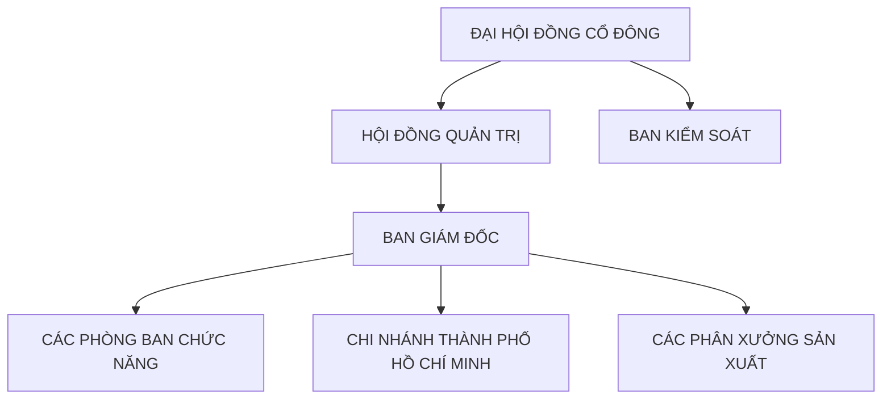

# BÁO CÁO THƯỜNG NIÊN
**(Ban hành kèm theo Thông tư số 96/2020/TT-BTC ngày 16 tháng 11 năm 2020 của Bộ trưởng Bộ Tài chính)**

## Công ty cổ phần Pin Hà Nội
### Năm 2025

---

## I. Thông tin chung

### 1. Thông tin khái quát
- **Tên giao dịch:** Công ty cổ phần Pin Hà Nội
- **Giấy chứng nhận đăng ký doanh nghiệp số:** 0100100752
- **Vốn điều lệ:** 72.539.110.000 VND
- **Vốn đầu tư của chủ sở hữu:** 72.539.110.000 VND
- **Địa chỉ:** Số 72 đường Phan Trọng Tuệ, xã Đại Thanh, TP Hà Nội
- **Số điện thoại:** 024- 3861 5365
- **Số fax:**
- **Website:** www.habaco.com.vn
- **Mã cổ phiếu:** PHN

#### Quá trình hình thành và phát triển
- Quá trình hình thành và phát triển (ngày thành lập, thời điểm niêm yết, thời gian các mốc sự kiện quan trọng kể từ khi thành lập đến nay:
  + **Việc thành lập:** Được đầu tư xây dựng theo sự giúp đỡ của Trung Quốc năm 1958, chính thức đi vào hoạt động năm 1960 với các tên gọi lần lượt qua các thời kỳ như: Nhà máy pin Văn Điển; Xí nghiệp liên hiệp Pin Hà Nội, Công ty Pin Hà Nội; chuyên cung cấp các sản phẩm pin thông dụng phục vụ quốc phòng và dân sinh với nhãn hiệu “Con Thỏ”.
  + **Chuyển đổi sở hữu thành công ty cổ phần:** Công ty chuyển đổi thành Công ty cổ phần từ 01 tháng 01 năm 2004 theo quyết định số 207/QĐ-BCN ngày 03 tháng 12 năm 2003 của Bộ trưởng Bộ Công nghiệp.
  + **Tháng 3 năm 2011:** phát hành cổ phiếu bán cho cổ đông hiện hữu và cổ đông chiến lược là Công ty TNHH Pin quốc tế GP Singapore (GPBI) thuộc Tập đoàn pin GP, qua đó nâng vốn Điều lệ từ 19.740.000.000 đồng lên 34.545.000.000 đồng.
  + **Tháng 3 năm 2011:** thành lập công ty con Công ty TNHH MTV Pin Hà Nội (Công ty cổ phần Pin Hà nội góp 100% vốn) tại N3 khu C khu Công nghiệp Hòa Mạc thị trấn Hòa Mạc huyện Duy Tiên Tỉnh Hà Nam. Mã số doanh nghiệp số: 0700524947 do Sở Kế hoạch Đầu tư tỉnh Hà Nam cấp ngày 11 tháng 3 năm 2011. Giấy chứng nhận đầu tư số 06221000118 do Ban Quản lý các khu Công nghiệp tỉnh Hà Nam cấp ngày 23 tháng 9 năm 2011.
  + **Tháng 5 năm 2011:** thành lập Chi nhánh Công ty CP Pin Hà Nội tại Thành phố Hồ Chí Minh Đăng ký kinh doanh số 0100100752-002 do Sở Kế Hoạch Đầu Tư TP Hồ Chí Minh cấp ngày 31 tháng 5 năm 2011 thay đổi lần 4 ngày 26 tháng 8 năm 2022.
  + **Tháng 10 năm 2015:** tăng vốn điều lệ từ việc chia cổ tức bằng cổ phiếu và từ Vốn chủ sở hữu lên 51.184.430.000 VND.
  + **Tháng 12 năm 2015:** ký hợp đồng hợp tác liên doanh với Công ty TNHH Pin Quốc tế GP Singapore thành lập Công ty TNHH Pin GP (Việt Nam) tại Khu Công nghiệp Hòa Mạc Huyện Duy Tiên Tỉnh Hà Nam. Tổng vốn Điều lệ 90 tỷ đồng Công ty cổ phần Pin Hà Nội góp 30% với Công ty TNHH Pin Quốc tế GP Singapore góp 70%.
  + **Tháng 7 năm 2016:** giải thể Công ty TNHH MTV Pin Hà Nội.
  + **Tháng 12 năm 2017:** tăng vốn điều lệ từ việc chia cổ tức bằng cổ phiếu và từ Vốn chủ sở hữu lên 72.539.110.000 VND.
  + **Ngày 7 tháng 1 năm 2019:** Sở GDCK Hà Nội ban hành Quyết định số: 20/QĐ-SGDHN về việc chấp thuận niêm yết cổ phiếu Công ty Cổ phần Pin Hà Nội với mã CK: PHN.
  + **Niêm yết:** Ngày 13 tháng 3 năm 2019 Cổ phiếu của Công ty Cổ phần Pin Hà Nội (Mã CK: PHN) chính thức khai trương phiên giao dịch đầu tiên tại Sàn GDCK Hà Nội theo Thông báo số 194/TB-SGDHN ngày 1 tháng 3 năm 2019.
  + **Tháng 10 năm 2019:** Công ty TNHH GP (Việt Nam) tăng vốn Điều lệ từ 90 tỷ đồng lên 275 tỷ 624 triệu đồng. Công ty CP Pin Hà Nội không góp vốn bổ sung do đó giảm tỷ lệ góp tại Công ty TNHH GP (Việt Nam) từ 30% xuống 9,8%.
  + **Tháng 12 năm 2019:** Tập đoàn Hóa chất Việt Nam thực hiện thoái vốn giảm tỷ lệ sở hữu nhà nước từ 21% xuống còn 2%.
  + **Tháng 12 năm 2019:** Công ty TNHH Pin Quốc tế GP Singapore mua lại 19% cổ phần của Tập đoàn Hóa chất Việt nam nâng tỷ lệ sở hữu từ 30% lên 49% (sở hữu nước ngoài).
  + **Tháng 1 năm 2024:** Công ty TNHH GP (Việt Nam) tăng vốn Điều lệ từ 275 tỷ 624 triệu đồng lên 341.328.317.880 đồng. Công ty CP Pin Hà Nội không góp vốn bổ sung do đó giảm tỷ lệ góp tại Công ty TNHH GP (Việt Nam) từ 9,8% xuống 7,91%.

Công ty hoạt động theo Giấy Chứng nhận đăng ký kinh doanh số 0103003444 do Sở Kế hoạch và Đầu tư Thành phố Hà Nội cấp ngày 02/01/2004, đăng ký kinh doanh cấp lại lần 16 ngày 15/10/2025 với mã số Doanh nghiệp: 0100100752.

- **Các sự kiện khác:**

### 2. Ngành nghề và địa bàn kinh doanh:
- **Ngành nghề kinh doanh:**
Giấy chứng nhận đăng ký kinh doanh số 0100100752 cấp lần đầu ngày 2 tháng 1 năm 2004; sửa đổi lần thứ 16 ngày 15 tháng 10 năm 2025.

| STT | Tên ngành | Mã ngành |
| :-: | :--- | :---: |
| 1 | Sản xuất pin và ắc quy | 2720 (chính) |
| 2 | Bán buôn chuyên doanh khác chưa được phân vào đâu (Chi tiết: bán buôn Pin các loại, nguyên liệu phục vụ sản xuất pin) | 4669 |
| 3 | Hoạt động dịch vụ hỗ trợ kinh doanh khác còn lại chưa được phân vào đâu Chỉ gồm có: Xuất nhập khẩu trực tiếp nguyên vật liệu, sản phẩm pin các loại và máy móc, thiết bị phục vụ sản xuất kinh doanh. | 8299 |
| 4 | Kinh doanh bất động sản, quyền sử dụng đất thuộc chủ sở hữu, chủ sử dụng hoặc đi thuê Chỉ gồm có: Cho thuê nhà xưởng, nhà làm việc, kho bãi | 6810 |

- **Địa bàn kinh doanh:** (Nêu các địa bàn hoạt động kinh doanh chính, chiếm trên 10% tổng doanh thu trong 02 năm gần nhất)
  + Thị trường chính của Công ty là toàn bộ các tỉnh phía Bắc, Miền trung và Tây nguyên;
  + Năm 2011 Công ty đã thành lập Chi nhánh tại TP Hồ Chí Minh nhằm hướng tới việc tiêu thụ các sản phẩm cao cấp và mở rộng thị trường tiêu thụ sản phẩm tại các tỉnh phía Nam;
  + Công ty có sản lượng xuất khẩu ổn định sang thị trường Lào, Campuchia và thông qua Cổ đông chiến lược là Công ty TNHH Pin quốc tế GP Singapore đã và đang đẩy mạnh hoạt động xuất khẩu sang các thị trường tiềm năng như Ấn độ, Đông Âu, Trung Á, Châu Phi, Nam Mỹ, Hoa Kỳ...
  + Công ty tái ký hợp đồng với GPBI để trở thành nhà phân phối độc quyền các sản phẩm pin nhãn hiệu GP tại thị trường Việt Nam từ tháng 9 năm 2019 sau một thời gian gián đoạn.

### 3. Thông tin về mô hình quản trị, tổ chức kinh doanh và bộ máy quản lý
- **Mô hình quản trị:**
  + Mô hình quản trị:

- **Cơ cấu bộ máy quản lý:**
  + **GIÁM ĐỐC**
    * **PHÓ GIÁM ĐỐC THỊ TRƯỜNG TIÊU THỤ:**
      - Phòng Tài chính Kế toán
      - Phòng Kế hoạch Vật tư
      - Phòng Thị trường Tiêu thụ
      - Chi nhánh TP Hồ Chí Minh
    * **PHÓ GIÁM ĐỐC KỸ THUẬT - SẢN XUẤT:**
      - Phân xưởng Pin số 1
      - Phân xưởng Pin số 2
      - Phân xưởng Phụ kiện
      - Phòng Tổ chức Hành chính & Phục vụ
      - Phòng Kỹ thuật Cơ điện
      - Phòng Kỹ thuật Công nghệ - Môi trường

- **Các công ty con, công ty liên kết:**
  + **Chi nhánh Công ty Cổ phần Pin Hà Nội tại Thành phố Hồ Chí Minh:**
    - Mã số thuế: 0100100752002
    - Địa chỉ: Số 369F/2 - An Dương Vương, Phường Bình Phú, TP Hồ Chí Minh
    - Chức năng nhiệm vụ: có chức năng giới thiệu quảng bá, tổ chức tiêu thụ sản phẩm của Công ty tại thành phố Hồ Chí Minh và các tỉnh phía nam.
    - Hình thức hạch toán: Chi nhánh có con dấu và tài khoản, hạch toán phụ thuộc và hoạt động theo sự điều hành của Công ty.
  + **Công ty TNHH Pin GP (Việt Nam):**
    - Mã số thuế: 0700761514
    - Địa chỉ: Đường N3 Khu C Khu Công nghiệp Hòa Mạc Phường Duy Tiên tỉnh Ninh Bình
    - Vốn điều lệ: 341.328.317.880 đồng
    - Hình thức sở hữu: Công ty Cổ phần Pin Hà Nội nắm giữ 7,91% vốn. Công ty TNHH Pin Quốc tế GP Singapore nắm giữ 92,09% vốn.
    - Quan hệ sở hữu: Công ty liên kết.

### 4. Định hướng phát triển
- **Các mục tiêu chủ yếu của Công ty:**
  • Tập trung đầu tư cho sản phẩm pin carbon zinc để nâng cao chất lượng, nâng cao khả năng cạnh tranh so với sản phẩm cùng loại trong nước và sản phẩm nhập khẩu cùng loại về chất lượng, hình thức và giá cả.
  • Đẩy mạnh nghiên cứu sản xuất các sản phẩm thân thiện với môi trường hướng tới phát triển bền vững.
  • Đảm bảo hiệu quả và tuyệt đối an toàn vốn cho cổ đông, đảm bảo việc làm và thu nhập cho người lao động.
  • Đảm bảo hài hòa giữa lợi ích cổ đông, lợi ích người lao động, lợi ích Nhà nước và trách nhiệm xã hội.
  • Từng bước thay đổi phương thức bán hàng để dần dần có được một hệ thống bán hàng riêng của công ty tiếp cận gần hơn đến người tiêu dùng thông qua hệ thống đại lý hiện có của công ty. Tiếp cận và triển khai các phương thức bán hàng mới, hiện đại, tìm biện pháp để kích cầu đến người tiêu dùng phù hợp với đặc thù của sản phẩm, giữ thị phần và tăng thị phần tiêu thụ trong nước, tăng cường xuất khẩu tiểu ngạch.
  • Nỗ lực chủ động hoặc thông qua đối tác GPBI tìm kiếm thị trường xuất khẩu chính ngạch. Tiếp tục kiện toàn và hoàn thiện các quy trình trong quản lý, có kế hoạch đầu tư và tuyển dụng hợp lý nhằm đáp ứng nhu cầu phát triển đối với thị trường xuất khẩu.
  • Phối hợp hiệu quả với đối tác GPBI triển khai quảng bá và thúc đẩy tiêu thụ sản phẩm pin cao cấp (mà công ty chưa sản xuất) thương hiệu GP tại thị trường Việt Nam.
  • Nâng cao năng lực sản xuất, đồng bộ hóa tiêu chuẩn kẽm đồng xu nhằm đáp ứng được yêu cầu cung ứng kẽm đồng xu cho Công ty TNHH Pin GP (Việt Nam) qua đó hạn chế tối đa nguồn kẽm đồng xu nhập khẩu, góp phần đảm bảo tỉ trọng nội địa hóa cho các sản phẩm xuất khẩu của Công ty TNHH Pin GP (Việt Nam) đồng thời nâng cao hiệu quả cho phần vốn góp của Công ty vào Công ty liên doanh cũng như tối ưu hóa chi phí sản xuất khâu nấu cán kẽm của công ty.

- **Chiến lược phát triển trung và dài hạn:**
  * **Về sản lượng sản xuất và tiêu thụ:** Phấn đấu tăng bình quân 7%.
    * **Biện pháp cụ thể:**
      - Đối với thị trường truyền thống: Bằng các biện pháp cụ thể và với sự hỗ trợ mở rộng thị trường và tăng thị phần từ GP. Giữ vững và tăng thị trường hiện có ở trong nước, Lào và Campuchia, tăng R6 và R03 bù đắp cho R20 giảm để thị trường này tăng 5%, đến năm 2027 đạt 290 triệu viên pin các loại.
      - Pin thương hiệu Kodak, xuất khẩu tại chỗ và khách hàng tiêu dùng công nghiệp: Phát huy kết quả đã đạt được của năm 2021 và 2022 phấn đấu mỗi năm tăng 10% góp phần tăng 2-3% tổng sản lượng.
      - Thị trường xuất khẩu thông qua GP: Phấn đấu bình quân tăng >8%, bằng các biện pháp:
        + Duy trì, giữ vững và tăng sản lượng các thị trường hiện có.
        + Bằng mọi biện pháp đáp ứng yêu cầu nhập khẩu pin cho thị trường rất lớn của Ấn Độ và các thị trường khác.
        + Xuất khẩu pin thương hiệu “Con Thỏ” theo phân khúc tiêu dùng với mức chất lượng hiện tại theo định hướng của GP vào thị trường Đông Nam Á và Châu Phi.
      - Sớm hoàn thiện công nghệ sản xuất pin không chì, thực hiện đúng lộ trình đã xây dựng trong việc sản xuất pin không chì nhằm tới mục tiêu sản phẩm của Công ty đạt tiêu chuẩn “Nhãn xanh Việt Nam” đầu tiên trong cả nước.
      - Tăng thị phần với đối tượng tiêu dùng pin thân thiện môi trường khi chính thức có sản phẩm thân thiện môi trường.
      - Tập trung nguồn lực cùng với việc hỗ trợ của GP cho việc nghiên cứu thị trường trong nước đối với các sản phẩm cao cấp, kết hợp với thị trường đã có của GP để định hướng đầu tư sản phẩm mới theo xu thế tiêu dùng pin thông qua nhập khẩu GP tiêu thụ trong nước để đánh giá thị trường.
  * **Về hiệu quả:** Phấn đấu lợi nhuận trước thuế đạt tỷ lệ > 45%/ VĐL hiện tại; Trên cơ sở đó đảm bảo:
    * Cổ tức > 25%.
    * Đảm bảo tỷ lệ trích quỹ đầu tư phát triển lợi nhuận sau thuế nhằm tích lũy cho đầu tư phát triển trong tương lai.
    * Giữ được tỷ lệ lợi nhuận chưa phân phối nhằm bình ổn cổ tức cho những năm lợi nhuận không đảm bảo.
    * Trích cho quỹ khen thưởng và phúc lợi.
  * **Về địa điểm sản xuất:**
    Duy trì địa điểm sản xuất hiện tại đến khi có được đối tác hợp tác chuyển đổi có hiệu quả hoặc khi bắt buộc phải di dời theo quy hoạch. Từng bước chủ động tìm kiếm địa điểm, xây dựng phương án đầu tư xây dựng cơ sở sản xuất mới phù hợp với điều kiện của Công ty.
  * **Về quản trị doanh nghiệp:**
    Tiếp cận và áp dụng quản trị doanh nghiệp tiên tiến theo thông lệ quốc tế với sự hỗ trợ từ GP nhằm đáp ứng tất cả các yêu cầu của khách hàng tiêu thụ sản phẩm trên cơ sở phù hợp với giá bán sản phẩm và điều kiện cụ thể của công ty.
  * **Về vốn:**
    Đảm bảo an toàn về vốn.
    Căn cứ mục tiêu sản lượng, căn cứ nhu cầu đầu tư thực tế xem xét tăng vốn điều lệ từ các nguồn vốn thuộc vốn chủ sở hữu của công ty hoặc biện pháp khác.
  * **Đảm bảo việc làm và thu nhập cho người lao động.**
  * **Chấp hành đúng pháp luật hiện hành trên tất cả các lĩnh vực hoạt động của công ty.**

- **Các mục tiêu phát triển bền vững (môi trường, xã hội và cộng đồng) và chương trình chính liên quan đến ngắn hạn và trung hạn của Công ty:**
  Từ năm 2018 Công ty đã đầu tư thay đổi công nghệ nấu kẽm bằng lò điện cảm ứng thay cho lò nấu dùng dầu DO để giảm thiểu tối đa phát thải khí, cải thiện môi trường làm việc cho người lao động. Cải tạo nâng cấp hệ thống xử lý nước thải đáp ứng yêu cầu ngày càng cao theo Quy chuẩn Việt Nam.
  Trong năm Công ty cũng đã xây dựng, áp dụng hệ thống quản lý trách nhiệm xã hội theo tiêu chuẩn châu âu BSCI, đã được tổ chức chứng nhận Intertek của Anh đánh giá chứng nhận đạt yêu cầu.
  Về dài hạn Công ty đã triển khai thực hiện rất nhiều biện pháp để bảo vệ môi trường như: Xây dựng, áp dụng và đã được chứng nhận Hệ thống quản lý môi trường theo tiêu chuẩn ISO 14001:2015, đầu tư các hệ thống xử lý khí, bụi thải đạt quy chuẩn khí thải công nghiệp QCVN19:2024/BTNMT, Hệ thống xử lý nước thải công nghiệp, hệ thống xử lý nước thải sinh hoạt đạt QCTĐHN 02:2014/BTNMT. Công ty đã được Bộ NN-MT cấp Giấy phép môi trường.
  Song hành với các biện pháp quản lý để Bảo vệ môi trường, trong các năm qua Công ty không ngừng đổi mới công nghệ chuyển đổi sang công nghệ Xanh, không sử dụng Hg, Cd và Pb trong sản xuất pin, pin của Công ty đã đạt tiêu chuẩn Châu Âu theo qui định tại chỉ thị EU 2023/1542 có hiệu lực từ 18/8/2024. Công ty là đơn vị trong nước đầu tiên sản xuất pin công nghệ Xanh đạt các chỉ tiêu nhãn Xanh Việt Nam, theo Quyết định số 2186/QĐ-BTNMT ngày 11/9/2017 về NXVN 15:2017 cho pin với tiêu chí hàm lượng các Kim loại nặng Hg ≤ 5ppm, Cd ≤ 20 ppm và Pb ≤ 100 ppm.

### 5. Các rủi ro:
- **Quản lý rủi ro tài chính:**
  Rủi ro tài chính của Công ty bao gồm rủi ro thị trường, rủi ro tín dụng và rủi ro thanh khoản. Công ty đã xây dựng hệ thống kiểm soát nhằm đảm bảo sự cân bằng ở mức hợp lý giữa chi phí rủi ro phát sinh và chi phí quản lý rủi ro. Ban Giám đốc Công ty có trách nhiệm theo dõi quy trình quản lý rủi ro để đảm bảo sự cân bằng hợp lý giữa rủi ro và kiểm soát rủi ro.

- **Rủi ro thị trường:**
  - *Thị trường tiêu thụ nội địa:* Luôn có sự cạnh tranh gay gắt giữa các công ty SX pin trong nước dẫn tới không ổn định sản lượng, giá bán và doanh thu bán hàng.
  - *Thị trường xuất khẩu:* phụ thuộc vào các đơn hàng từ cổ đông chiến lược. Chịu áp lực cạnh tranh về giá, đòi hỏi về chất lượng và mẫu mã ngày càng đa dạng. Do vậy việc công ty phải đối mặt với việc tăng hoặc giảm các đơn hàng một cách bất thường là điều khó tránh khỏi.
  - *Thị trường nguyên vật liệu đầu vào:* Chi phí nguyên vật liệu chiếm tỷ trọng lớn trong giá thành sản phẩm của Công ty nên giá cả nguyên liệu đầu vào có tác động trực tiếp đến hiệu quả SXKD của Công ty. Nguyên liệu kẽm thỏi (nguyên liệu có tỷ trọng lớn nhất trong giá thành sản phẩm) chịu ảnh hưởng trực tiếp từ biến động của thị trường kim loại mầu thế giới với biên độ tăng giảm bất thường phụ thuộc vào nhiều yếu tố như chính sách vĩ mô của các nước công nghiệp phát triển, nguồn cung ứng nguyên liệu cho ngành công nghiệp luyện kim... Ngoài ra các chủng loại nguyên liệu khác bao gồm có nguồn gốc nhập khẩu cũng như nội địa cũng chịu những ảnh hưởng trực tiếp từ các chính sách về môi trường, về năng lượng, về thuế quan...

- **Bên cạnh các rủi ro nêu trên, Công ty cũng chịu ảnh hưởng từ các yếu tố địa chính trị và an ninh phi truyền thống:**
  - Những biến động về xung đột khu vực, cạnh tranh thương mại giữa các nền kinh tế lớn, cùng với các rủi ro như dịch bệnh, thiên tai, khủng hoảng năng lượng... có thể tác động gián tiếp đến thị trường nguyên vật liệu, chi phí vận chuyển, nhu cầu tiêu thụ và sự ổn định của chuỗi cung ứng. Các yếu tố này có tính chất khó dự báo và có thể làm phát sinh biến động về giá đầu vào, tiến độ giao hàng hoặc sức mua tại một số thị trường.
  - Công ty thường xuyên theo dõi diễn biến thị trường, chủ động điều chỉnh kế hoạch sản xuất - kinh doanh và duy trì các phương án dự phòng phù hợp nhằm hạn chế ảnh hưởng bất lợi.

- **Rủi ro về tỷ giá hối đoái:**
  Công ty chịu rủi ro về tỷ giá do giá trị hợp lý của các luồng tiền trong tương lai của một công cụ tài chính sẽ biến động theo những thay đổi của tỷ giá ngoại tệ khi các khoản vay, doanh thu và chi phí của Công ty được thực hiện bằng đơn vị tiền tệ khác với đồng Việt Nam.

- **Rủi ro về lãi suất:**
  Công ty chịu rủi ro về lãi suất do giá trị hợp lý của các luồng tiền trong tương lai của một công cụ tài chính sẽ biến động theo những thay đổi của lãi suất thị trường khi Công ty có phát sinh các khoản tiền gửi có hoặc không có kỳ hạn, các khoản vay và nợ chịu lãi suất thả nổi. Công ty quản lý rủi ro lãi suất bằng cách phân tích tình hình cạnh tranh trên thị trường để có được các lãi suất có lợi cho mục đích của Công ty.

- **Rủi ro tín dụng:**
  Rủi ro tín dụng là rủi ro mà một bên tham gia trong một công cụ tài chính hoặc hợp đồng không có khả năng thực hiện được nghĩa vụ của mình dẫn đến tổn thất về tài chính cho Công ty. Công ty có các rủi ro tín dụng từ hoạt động sản xuất kinh doanh (chủ yếu đối với các khoản phải thu khách hàng) và hoạt động tài chính (bao gồm tiền gửi ngân hàng, cho vay và các công cụ tài chính khác).

| Chỉ tiêu | Từ 1 năm trở xuống (VND) | Trên 1 năm đến 5 năm (VND) | Trên 5 năm (VND) | Cộng (VND) |
| :--- | :---: | :---: | :---: | :---: |
| **Tại ngày 31/12/2025** | | | | |
| Tiền và các khoản tương đương tiền | 17,379,485,746 | - | - | 17,379,485,746 |
| Phải thu khách hàng, phải thu khác | 13,693,403,918 | - | - | 13,693,403,918 |
| Các khoản cho vay | 26,784,800,077 | - | - | 26,784,800,077 |
| **Tổng cộng** | **57,857,689,741** | **-** | **-** | **57,857,689,741** |
| **Tại ngày 01/01/2025** | | | | |
| Tiền và các khoản tương đương tiền | 19,913,084,405 | - | - | 19,913,084,405 |
| Phải thu khách hàng, phải thu khác | 15,713,755,199 | - | - | 15,713,755,199 |
| Các khoản cho vay | 44,000,000,000 | - | - | 44,000,000,000 |
| **Tổng cộng** | **79,626,839,604** | **-** | **-** | **79,626,839,604** |

- **Rủi ro thanh khoản:**
  Rủi ro thanh khoản là rủi ro Công ty gặp khó khăn khi thực hiện các nghĩa vụ tài chính do thiếu vốn. Rủi ro thanh khoản của Công ty chủ yếu phát sinh từ việc các tài sản tài chính và nợ phải trả tài chính có các thời điểm đáo hạn khác nhau.
  Thời hạn thanh toán của các khoản nợ phải trả tài chính dựa trên các khoản thanh toán dự kiến theo hợp đồng (trên cơ sở dòng tiền của các khoản gốc) như sau:

| Chỉ tiêu | Từ 1 năm trở xuống (VND) | Trên 1 năm đến 5 năm (VND) | Trên 5 năm (VND) | Cộng (VND) |
| :--- | :---: | :---: | :---: | :---: |
| **Tại ngày 31/12/2025** | | | | |
| Vay và nợ | 14,387,232,043 | - | - | 14,387,232,043 |
| Phải trả người bán, phải trả khác | 33,821,857,536 | - | - | 33,821,857,536 |
| **Tổng cộng** | **48,209,089,579** | **-** | **-** | **48,209,089,579** |
| **Tại ngày 01/01/2025** | | | | |
| Vay và nợ | 4,994,435,062 | - | - | 4,994,435,062 |
| Phải trả người bán, phải trả khác | 34,253,000,415 | - | - | 34,253,000,415 |
| Chi phí phải trả | 2,926,708,651 | - | - | 2,926,708,651 |
| **Tổng cộng** | **42,174,144,128** | **-** | **-** | **42,174,144,128** |

Công ty cho rằng mức độ tập trung rủi ro đối với việc trả nợ là có thể kiểm soát được. Công ty có khả năng thanh toán các khoản nợ đến hạn từ dòng tiền từ hoạt động kinh doanh và tiền thu từ các tài sản tài chính đáo hạn.

---

## II. Tình hình hoạt động trong năm

### 1. Tình hình hoạt động sản xuất kinh doanh
- **Kết quả hoạt động sản xuất kinh doanh trong năm: Nêu các kết quả đạt được trong năm.**

| Chỉ tiêu | Đơn vị | KH 2025 (HĐQT điều chỉnh 31/10) | Thực tế Năm 2024 | Thực tế Năm 2025 | Tăng, giảm 2025/2024 | Chênh lệch (%) So với KH | Chênh lệch (%) So với 2024 |
| :--- | :---: | :---: | :---: | :---: | :---: | :---: | :---: |
| 1/ Sản xuất | 1000 v | 306.263 | 358.130 | 315.582 | (42.55) | 103% | 88% |
| 2/ Tiêu thụ | 1000 v | 306.263 | 361.609 | 298.192 | (63.42) | 97% | 82% |
| **Tổng hợp tiêu thụ** | | | | | | | |
| Nhãn hiệu Con Thỏ thị trường truyền thống | 1000 v | 265.000 | 280.326 | 253.673 | (26.65) | | 90% |
| Thị trường XK | 1000 v | 41.263 | 81.282 | 44.519 | (36.76) | | 55% |
| *XK nhãn GP* | | | 28.652 | 28.479 | (0.17) | | 99% |
| *XK OEM* | | | 48.199 | 15.042 | (33.16) | | 31% |
| *XK khác* | | | 4.431 | 0.998 | (3.43) | | 23% |
| 3/ Tổng doanh thu | Tỷ VND | 438.90 | 456.81 | 422.04 | (34.77) | 96% | 92% |
| 4/ Lợi nhuận | Tỷ VND | 47.00 | 73.19 | 44.41 | (28.78) | 94% | 61% |

**Đánh giá:**
Năm 2025 là một năm có rất nhiều diễn biến phức tạp, khó lường tác động lớn đến hoạt động SXKD của các doanh nghiệp trong nền Kinh tế nói chung và Công ty CP Pin Hà Nội nói riêng.
Ngay từ đầu năm, dấu hiệu suy giảm sức mua đối với sản phẩm của Công ty đã xuất hiện, tổng sản lượng tiêu thụ trên thị trường truyền thống trong Q1 đã giảm hơn 17% so với Q1 năm 2024.
Ngoài ra các yếu tố khách quan khác như chiến tranh thương mại giữa các nền kinh tế lớn đặc biệt là Hoa Kỳ với chính sách thuế quan đột biến, thay đổi liên tục từ đầu Q2. Việc điều chỉnh chính sách thuế nhằm từng bước tạo ra môi trường kinh doanh bình đẳng, từng bước hạn chế tiến tới xóa bỏ chính sách thuế khoán đối với các hộ kinh doanh cá thể cũng là một yếu tố tác động đến hoạt động thương mại, phân phối hàng hóa trên thị trường. Diễn biến thời tiết cực đoan trở nên khó lường và khắc nghiệt hơn, việc ba cơn bão lớn liên tiếp đổ bộ vào Việt Nam trên diện rộng kèm theo mưa lũ, lụt lội đã gây ảnh hưởng nặng nề đến nền kinh tế, đời sống xã hội nói chung và sức mua của người tiêu dùng (trong đó có khách hàng tiêu thụ các sản phẩm Pin) nói riêng.
Từ những yếu tố mang tính trọng yếu trên, kết quả SXKD năm 2025 của công ty đã suy giảm đáng kể so với năm 2024 và so với mục tiêu kế hoạch 2025 mà Đại hội đồng cổ đông đã thông qua.

### 2. Tổ chức và nhân sự
- **Danh sách Ban điều hành:**
  + **Ông Nguyễn Thanh Hùng** - Chức vụ: UV HĐQT - Giám đốc
    - Năm sinh: 1963
    - Trình độ: Kỹ sư chế tạo máy; Kỹ sư quản trị kinh doanh
    - Số cổ phần sở hữu: 117.980 cổ phần
  + **Ông Nguyễn Cao Sơn** - Chức vụ: UV HĐQT - Phó Giám đốc
    - Năm sinh: 1966
    - Trình độ: Kỹ sư Điện hóa
    - Số cổ phần sở hữu: 2.223 cổ phần
  + **Ông Võ Khánh Toàn** - Chức vụ: UV HĐQT - Phó Giám đốc
    - Năm sinh: 1973
    - Trình độ: Cử nhân Quản trị kinh doanh
    - Số cổ phần sở hữu: 19.600 cổ phần
  + **Bà Nguyễn Thị Thùy Dương** - Chức vụ: Kế toán trưởng
    - Năm sinh: 1982
    - Trình độ: Cử nhân Tài chính Kế toán
    - Số cổ phần sở hữu: 0 cổ phần

- **Những thay đổi trong ban điều hành:** Trong năm không có thay đổi nhân sự trong ban điều hành.
- **Số lượng cán bộ, nhân viên. Tóm tắt chính sách và thay đổi trong chính sách đối với người lao động:**
  - Lao động sử dụng bình quân: 262 người.
  - Lao động nghỉ chế độ; chấm dứt hợp đồnglao động: 7 người
  - Lao động tuyển dụng mới: 4 người
  - Tổng chi phí cho người lao động (bao gồm tổng quỹ lương và Cơm ca): 46,18 tỷ đồng; Thu nhập bình quân 14,69 trđ/người/tháng giảm 1,87% so với năm 2024.

### 3. Tình hình đầu tư, tình hình thực hiện các dự án
**a) Các khoản đầu tư lớn:**

| Stt | Mã tài sản | Tên tài sản | Ngày tăng | Nguyên giá (VND) | Diễn giải |
| :-: | :--- | :--- | :---: | :---: | :---: |
| | **L02** | **Máy móc, thiết bị** | | **3,211,034,134** | |
| 1 | TSCD1000 | Máy dập đứng APA60 | 01/03/2025 | | Mua mới |
| 2 | TSCD1002 | Máy dán nhãn nhôm 600c/p | 01/04/2025 | | Mua mới |
| 3 | TSCD998 | Dây chuyền thành phẩm R6p - 650 cái/ phút | 10/01/2025 | | Mua mới |
| 4 | TSCD999 | Máy cắt via ống kẽm R20 năng suất 80c/p | 01/01/2025 | | Mua mới |
| | **L03** | **Phương tiện vận tải** | | **380,038,182** | |
| 5 | TSCD1004 | Xe ôtô Van nhãn hiệu Thaco | 01/07/2025 | | Mua mới |
| | **L04** | **Thiết bị, dụng cụ quản lý** | | **129,800,000** | |
| 6 | TSCD1001 | máy chủ Dell PowerEdge | 01/04/2025 | | Mua mới |
| | **L05** | **TSCĐ hữu hình khác** | | **918,003,601** | |
| 7 | TSCD1003 | Hệ thống xử lý bụi và khí thải | 01/07/2025 | | Mua mới |
| | | **Tổng cộng:** | | **4,638,875,917** | |

**b) Các công ty con, công ty liên kết:**
- **Công ty TNHH Pin GP (Việt Nam):**
  · Mã số thuế: 0700761514
  · Địa chỉ: Đường N3, Khu C, Khu công nghiệp Hoà Mạc, Phường Duy Tiên, Tỉnh Ninh Bình
  · Vốn điều lệ: 341 tỷ 328 triệu VND
  · Hình thức sở hữu: Công ty Cổ phần Pin Hà Nội sở hữu 7,91% vốn. Công ty TNHH Pin Quốc tế GP (GP Batteries International Limited) sở hữu 92,09% vốn.
  · Quan hệ sở hữu: Công ty liên kết.
  · **Kết quả sản xuất và kinh doanh năm tài chính 2025-26 (Kết thúc vào 31/3/2026) - Dự kiến:**
    - Doanh thu: 406,2 tỷ VND (ước tính)
    - Tổng giá trị tài sản cố định: 234 tỷ VND; Khấu hao lũy kế: 103,9 tỷ VND
    - Lợi nhuận tạo ra: 26,4 tỷ VND (ước tính)
    - Lỗ lũy kế: 51,7 tỷ VND (ước tính)
  · **Thuận lợi trong năm 2025:**
    - Sản lượng tăng khoảng 1% so với năm trước.
    - Lợi nhuận tăng khoảng 33% so với năm trước.
    - Nhà máy có nhiều cải tiến để giảm phế phẩm.
    - Triển khai nhiều dự án tiết kiệm chi phí.
  · **Khó khăn trong năm 2024:**
    - Giá thỏi kẽm cao.
    - Bị ảnh hưởng bởi sự bất ổn của thị trường toàn cầu do chiến tranh, nhu cầu yếu do lạm phát.
  · **Kế hoạch cho năm 2026:**
    - Sản lượng: 408 triệu chiếc, tăng 20% so với năm tài chính 2025-26.
    - Doanh thu: 451 tỷ VND, tăng 11% so với năm tài chính 2025-26.
    - Lợi nhuận: 25,9 tỷ VND.
    - Lỗ lũy kế: 25,8 tỷ VND.
    - Nhân sự: Số lượng nhân viên hiện tại: 160 người Việt Nam và 1 người nước ngoài.
  · **Thuận lợi năm 2026:**
    - Nhà máy tiếp tục triển khai các dự án tiết kiệm chi phí, chủ yếu nội địa hóa nguồn nguyên vật liệu và tự động hóa.
    - Đầu tư thêm dây chuyền để mở rộng công suất; Kế hoạch đầu tư lò nấu kẽm.
    - Giảm chi phí khấu hao nhờ cho thuê nhà xưởng 9V.
  · **Khó khăn năm 2026:**
    - Sản lượng không ổn định do tình hình thị trường không chắc chắn.
    - Giá kẽm thỏi tiếp tục xu hướng tăng.
    - Chính sách hoàn thuế VAT của Trung Quốc, đồng nhân dân tệ tăng giá, ảnh hưởng đến giá nhập khẩu nguyên vật liệu.

### 4. Tình hình tài chính
**a) Tình hình tài chính**

**b) Các chỉ tiêu tài chính chủ yếu:**

| Chỉ tiêu | Năm 2024 | Năm 2025 | Ghi chú |
| :--- | :---: | :---: | :---: |
| **1. Chỉ tiêu về khả năng thanh toán** | | | |
| + Hệ số thanh toán ngắn hạn: $\frac{\text{Tài sản ngắn hạn}}{\text{Nợ ngắn hạn}}$ | 3.16 | 2.98 | lần |
| + Hệ số thanh toán nhanh: $\frac{\text{Tài sản ngắn hạn - Hàng tồn kho}}{\text{Nợ ngắn hạn}}$ | 1.50 | 0.98 | lần |
| **2. Chỉ tiêu về cơ cấu vốn** | | | |
| + Hệ số Nợ/Tổng tài sản | 26.58% | 28.14% | % |
| + Hệ số Nợ/Vốn chủ sở hữu | 36.20% | 39.17% | % |
| **3. Chỉ tiêu về năng lực hoạt động** | | | |
| + Vòng quay hàng tồn kho: $\frac{\text{Giá vốn hàng bán}}{\text{Hàng tồn kho bình quân}}$ | 3,77 | 3.05 | lần |
| + Doanh thu thuần/Tổng tài sản | 2,15 | 1,89 | lần |
| **4. Chỉ tiêu về khả năng sinh lời** | | | |
| + Hệ số Lợi nhuận sau thuế/Doanh thu thuần | 13,01 | 8,46 | % |
| + Hệ số Lợi nhuận sau thuế/Vốn chủ sở hữu | 38,08 | 22,27 | % |
| + Hệ số Lợi nhuận sau thuế/Tổng tài sản | 27,96 | 16,00 | % |
| + Hệ số Lợi nhuận từ hoạt động kinh doanh/Doanh thu thuần | 15,96 | 10,51 | % |

### 5. Cơ cấu cổ đông, thay đổi vốn đầu tư của chủ sở hữu
**a) Cổ phần:**
- Tổng số cổ phần: 7.253.911 cổ phần
- Số lượng CP chuyển nhượng tự do: 7.253.911 cổ phần
- Cổ phần hạn chế chuyển nhượng: 0 cổ phần

**b) Cơ cấu cổ đông:**
- **Cổ đông pháp nhân:** 8 tổ chức nắm giữ 3.708.130 cp tương ứng 51,12% tổng số cp
  * Trong đó: 01 cổ đông lớn:
    - **GP BATTERIES INTERNATIONAL LIMITED** sở hữu: 3.554.233 Cp tương ứng 49%
- **Cổ đông thể nhân:** 336 người sở hữu 3.545.781 CP tương ứng 48.88%
  * Trong đó 02 cổ đông lớn:
    - **Ông Phạm Văn Nghĩa** sở hữu: 364.350 CP tương ứng 5,02%
    - **Ông Lê Xuân Lương** sở hữu: 426.300 CP tương ứng 5,88%
- **Cổ đông trong nước:** 332 cổ đông sở hữu 3.694.898 CP tương ứng 50,94%
- **Cổ đông nước ngoài:** 12 cổ đông sở hữu 3.559.013 CP tương ứng 49,06%

*Ghi chú: Số liệu nêu trên căn cứ vào danh sách cổ đông có quyền nhận cổ tức chốt ngày 26 tháng 1 năm 2026 do Tổng Công ty Lưu ký và Bù trừ Chứng khoán Việt Nam lập ngày 28 tháng 1 năm 2026.*

**c) Tình hình thay đổi vốn đầu tư của chủ sở hữu:** Không

**d) Giao dịch cổ phiếu quỹ:** Không có

**e) Các chứng khoán khác:** Không có

### 6. Báo cáo tác động liên quan đến môi trường và xã hội của công ty
#### 6.1. Quản lý nguồn nguyên vật liệu:
**a) Tổng lượng nguyên vật liệu được sử dụng để sản xuất và đóng gói các sản phẩm và dịch vụ chính của tổ chức trong năm:**
- Giá trị vật liệu chính dùng cho sản xuất năm 2025: 255,9 tỷ đồng
- Giá trị vật liệu phụ dùng cho sản xuất năm 2025: 23 tỷ đồng
- Tổng phát thải khí nhà kính (GHG) năm 2025 là 1778,32 tấn CO2, trong đó trực tiếp phát thải là 11,02 tấn CO2 (Công thức tính 2114 tấn CO2/ 1000 m3 khí GAS) và gián tiếp phát thải là 1767,3 tấn CO2 (CT tính 0.8 kg CO2/ Kwh điện sử dụng).

**b) Báo cáo tỉ lệ phần trăm nguyên vật liệu được sử dụng để sản xuất sản phẩm và dịch vụ chính của tổ chức:**

| STT | TÊN NGUYÊN LIỆU | ĐƠN VỊ TÍNH | TỔNG CỘNG |
| :---: | :--- | :---: | :---: |
| 1 | Kẽm | Tấn | 1.607 |
| 2 | Mangan điôxít điện giải | Tấn | 1.040 |
| 3 | NH4CL | Tấn | 130 |
| 4 | ZnCl2 | Tấn | 268,5 |
| 5 | Mangan điôxít thiên nhiên | Tấn | 300 |

- Tổng số lượng kẽm được tái chế cho sản xuất Pin trong năm 2025: 11,5 tấn từ tận thu tái sử dụng nguyên liệu.
- Tổng số lượng bột cực dương được tái chế cho sản xuất Pin trong năm 2025: 25 tấn từ tận thu tái sử dụng nguyên liệu.

#### 6.2. Tiêu thụ năng lượng:
**a) Năng lượng tiêu thụ trực tiếp và gián tiếp:**

| STT | TÊN NVL | ĐVT | TỔNG CỘNG |
| :---: | :--- | :---: | :---: |
| 1 | Điện | Kwh | 2.209.200 |
| 2 | Gas | Lít (1 kg=1,81 lít) | 5.213 |

**b) Năng lượng tiết kiệm được thông qua các sáng kiến sử dụng năng lượng hiệu quả**
**c) Các báo cáo sáng kiến tiết kiệm năng lượng (cung cấp các sản phẩm và dịch vụ tiết kiệm năng lượng hoặc sử dụng năng lượng tái tạo); báo cáo kết quả của các sáng kiến này**

#### 6.3. Tiêu thụ nước: (mức tiêu thụ nước của các hoạt động kinh doanh trong năm)
**a) Nguồn cung cấp nước và lượng nước sử dụng:**

| STT | TÊN NGUỒN NƯỚC | ĐVT | TỔNG CỘNG |
| :---: | :--- | :---: | :---: |
| 1 | Nước sạch từ VIWACO | M3 | 10.125 |
| 2 | Nước khai thác ngầm dưới đất | M3 | 13.291 |

**b) Tỷ lệ phần trăm và tổng lượng nước tái chế và tái sử dụng:**
Lượng nước tái sử dụng khu vực nấu cán kẽm, nước làm mát kẽm được đưa ra thiết bị làm nguội rồi tái sử dụng lại được 50m3/ngày cả năm tái sử dụng được 13.200 m3/ năm.

#### 6.4. Tuân thủ pháp luật về bảo vệ môi trường:
- **a) Số lần bị xử phạt vi phạm do không tuân thủ luật pháp và các quy định về môi trường:** 01 lần.
- **b) Tổng số tiền do bị xử phạt vi phạm do không tuân thủ luật pháp và các quy định về môi trường:** 40.000.000 đồng (bốn mươi triệu đồng).

#### 6.5. Chính sách liên quan đến người lao động
**a) Số lượng lao động, mức lương trung bình đối với người lao động:**
- Lao động sử dụng bình quân: 262 người.
- Lao động nghỉ chế độ; chấm dứt hợp đồnglao động: 7 người
- Lao động tuyển dụng mới: 4 người
- Tổng chi phí cho người lao động (bao gồm tổng quỹ lương và Cơm ca): 46,18 tỷ đồng; Thu nhập bình quân 14,69 trđ/người/tháng giảm 1,87% so với năm 2024.

**b) Chính sách lao động nhằm đảm bảo sức khỏe, an toàn và phúc lợi của người lao động:**
Công ty đã xây dựng và duy trì hệ thống trách nhiệm xã hội theo tiêu chuẩn quốc tế BSCI, được tổ chức Intertek đánh giá và chứng nhận hàng năm, góp phần nâng cao nhận thức của người quản lý và người lao động trong việc tuân thủ pháp luật Việt Nam về lao động, an toàn vệ sinh lao động, môi trường và các chuẩn mực quốc tế.
Hàng năm, Ban Giám đốc phối hợp với Công đoàn tổ chức Hội nghị người lao động để thảo luận, thống nhất và thông qua các nội dung liên quan trực tiếp đến người lao động như quy chế tiền lương, thưởng, thỏa ước lao động tập thể, nội quy lao động, quy chế dân chủ cơ sở, đồng thời xem xét và giải quyết các kiến nghị, đề xuất của người lao động.
Công ty đã triển khai nhiều chính sách phúc lợi vượt quy định của pháp luật như: thưởng vào các dịp lễ, Tết; tổ chức nghỉ mát cho 100% người lao động hàng năm; khen thưởng con em cán bộ công nhân viên có thành tích học tập tốt. Công đoàn cũng tích cực chăm lo đời sống tinh thần cho người lao động thông qua các hoạt động văn hóa, thể thao thường niên.
Nhằm đảm bảo sức khỏe và an toàn cho người lao động, Công ty tổ chức khám sức khỏe định kỳ cho 100% cán bộ công nhân viên; đối với các vị trí nặng nhọc, độc hại, thực hiện khám sức khỏe và khám bệnh nghề nghiệp 2 lần/năm. Các chế độ bảo hiểm (BHXH, BHYT, BHTN) được thực hiện đầy đủ, đúng quy định. Đồng thời, Công ty có các chính sách hỗ trợ bổ sung trong mùa hè như cung cấp đồ uống giải nhiệt và hỗ trợ chi phí nhằm giúp người lao động chủ động chăm sóc sức khỏe, chống nóng trong quá trình làm việc.
- Tổng chi phí bồi dưỡng tại chỗ bằng hiện vật và chống nóng cho người lao động năm 2025: 364,7 triệu đồng.
- Chi phí cho người lao động đi tham quan nghỉ mát năm 2025: ~440 triệu đồng trong đó từ nguồn kinh phí công đoàn khoảng ~50tr đồng.
- Công ty duy trì tổ chức khám sức khỏe định kỳ đúng hạn cho toàn thể CBCNV qua đó bố trí sắp xếp việc làm phù hợp với điều kiện sức khỏe của từng NLĐ.

**c) Hoạt động đào tạo người lao động:**
- Số giờ đào tạo trung bình mỗi năm, theo nhân viên và theo phân loại nhân viên:
  + Trong năm công ty đã tổ chức các khóa đào tạo hướng dẫn công việc cho công nhân trực tiếp sản xuất và cán bộ quản lý phân xưởng, nhân viên KCS nhằm củng cố công tác quản lý chất lượng, nâng cao chất lượng sản phẩm, bảo vệ môi trường, trách nhiệm xã hội, để thực hiện tốt các hệ thống quản lý mà Công ty đang áp dụng như HTQLCL ISO9001:2015 ; HTQLMT ISO 14001:2015 ; TNXH BSCI.
  + Đào tạo nhận thức HTQLMT ISO14001:2015 cho 74 CBNV thời gian đào tạo, 08 giờ/người.
  + Đào tạo chuyên gia đánh giá nội bộ HTQLMT ISO14001:2015: 13 người, 16 giờ/ người.
  + Đào tạo ATVSLĐ cho 146 người, 8 giờ/người
  + Đào tạo ATHC cho 24 người, 16 giờ/ người
  + Đào tạo hệ thống quản lý TNXH BSCI cho 146 người, 4 giờ/ người
  + Đào tạo nhận thức và hướng dẫn thực hiện phân loại chất thải rắn cho 146 người, 4 giờ/người
  + Đào tạo 12 hệ thống cốt lõi của HTQLCL của tập đoàn GP cho 20 CBNV, 4 giờ/ người
  + Đào tạo, huấn luyện PCCC và CNCH cho 25 người, 8 giờ/người
  + Đào tạo nghiệp vụ, hướng dẫn công việc, nâng bậc.. cho 52 người…
  + Tổng số lượt người được đào tạo, đào tạo lại trong năm 2025: 387 lượt người
  + Tổng số giờ đào tạo trung bình trong năm 2025: 2620 giờ
- Các chương trình phát triển kỹ năng và học tập liên tục để hỗ trợ người lao động đảm bảo có việc làm và phát triển sự nghiệp:
  Nội dung đào tạo gồm đào tạo làm việc theo hướng dẫn, đào tạo nội quy lao động, quy chế công ty, phương pháp kiểm tra chất lượng sản phẩm, hướng dẫn ghi biểu mẫu, hướng dẫn thực hiện kiểm tra, bảo dưỡng máy móc thiết bị, nhận thức về ISO9001:2015 và đào tạo chuyên gia đánh giá nội bộ.
  Đào tạo người lao động để thực hiện HTQLMT ISO14001:2015, Hệ thống quản lý trách nhiệm xã hội BSCI.
  Đào tạo cho các cán bộ quản lý, cán bộ kỹ thuật về 12 hệ thống cốt lõi của quản lý chất lượng tập đoàn GP, đào tạo tiêu chuẩn pin của Ấn độ, đào tạo tiêu chuẩn môi trường của sản phẩm pin theo qui định của Châu Âu.
  Ngoài ra Công ty thường xuyên cử cán bộ nhân viên nghiệp vụ tham gia các lớp tập huấn về chế độ chính sách mới. Các lớp bồi dưỡng về kỹ năng bán hàng, marketing, phát triển thị trường cũng được công ty quan tâm tổ chức.

#### 6.6. Báo cáo liên quan đến trách nhiệm đối với cộng đồng địa phương:
Các hoạt động đầu tư cộng đồng và hoạt động phát triển cộng đồng khác, bao gồm hỗ trợ tài chính nhằm phục vụ cộng đồng.
- Công ty tích cực tham gia ủng hộ các hoạt động hỗ trợ của địa phương nơi Công ty đặt trụ sở.
- Tổng số tiền tham gia các quỹ xã hội, từ thiện, hỗ trợ khắc phục hậu quả bão lụt trong năm 2025: 205 triệu đồng.

#### 6.7. Báo cáo liên quan đến hoạt động thị trường vốn theo hướng dẫn của UBCKNN:
Không

---

## III. Báo cáo và đánh giá của Ban Giám đốc
**(Ban Giám đốc báo cáo và đánh giá về tình hình mọi mặt của công ty)**

### 1. Tình hình hoạt động sản xuất kinh doanh

| Chỉ tiêu | Đơn vị | KH 2025 (HĐQT điều chỉnh 31/10) | Thực tế Năm 2024 | Thực tế Năm 2025 | Tăng, giảm 2025/2024 | Chênh lệch (%) So với KH | Chênh lệch (%) So với 2024 |
| :--- | :---: | :---: | :---: | :---: | :---: | :---: | :---: |
| 1/ Sản xuất | 1000 v | 306.263 | 358.130 | 315.582 | (42.55) | 103% | 88% |
| 2/ Tiêu thụ | 1000 v | 306.263 | 361.609 | 298.192 | (63.42) | 97% | 82% |
| **Tổng hợp tiêu thụ** | | | | | | | |
| Nhãn hiệu Con Thỏ thị trường truyền thống | 1000 v | 265.000 | 280.326 | 253.673 | (26.65) | | 90% |
| Thị trường XK | 1000 v | 41.263 | 81.282 | 44.519 | (36.76) | | 55% |
| *XK nhãn GP* | | | 28.652 | 28.479 | (0.17) | | 99% |
| *XK OEM* | | | 48.199 | 15.042 | (33.16) | | 31% |
| *XK khác* | | | 4.431 | 0.998 | (3.43) | | 23% |
| 3/ Tổng doanh thu | Tỷ VND | 438.90 | 456.81 | 422.04 | (34.77) | 96% | 92% |
| 4/ Lợi nhuận | Tỷ VND | 47.00 | 73.19 | 44.41 | (28.78) | 94% | 61% |

**Đánh giá:**
#### 1.1 Đánh giá kết quả sản xuất:
Công tác tổ chức sản xuất năm 2025 hợp lý, linh hoạt, đảm bảo đáp ứng yêu cầu về số lượng và chất lượng sản phẩm cho tiêu thụ nội địa và xuất khẩu tại mọi thời điểm, kết quả cụ thể:
- SLSX Pin cả năm đạt: 315,582 triệu viên các loại, giảm 42,548 triệu viên, tương ứng 12% so với năm 2024. Nguyên nhân sản xuất giảm là do tiêu thụ giảm.
- Sản lượng sản xuất kẽm đồng xu cho VNGP cả năm đạt: 828,65 tấn tăng 583,19 tấn, tương ứng 238% so với năm 2024 là do nhu cầu của VNGP và việc làm của Người Lao động Công ty.
- Lao động sử dụng bình quân trong năm 262 người, giảm 2% so với năm 2024; Việc làm và thu nhập bình quân của Người lao động đạt 14,69 triệu đồng/người/tháng, giảm 1,87% so với năm 2024.
- Quyền lợi, chế độ, chính sách đối với Người lao động được đảm bảo theo quy định của Pháp luật và các quy định, quy chế của Công ty.
- Điều kiện làm việc cho NLĐ cơ bản đảm bảo theo đúng quy định của Pháp luật và của Công ty.
- Đối với các kiến nghị, đề xuất của NLĐ đều được Lãnh đạo Công ty chỉ đạo, phối hợp với Công đoàn và các đơn vị xem xét, giải quyết triệt để.
- Công ty đã chủ động áp dụng hệ thống quản lý trách nhiệm xã hội theo tiêu chuẩn Châu Âu BSCI đối với người lao động, được tổ chức quốc tế Intertek đánh giá định kỳ hàng năm.
- Nhờ vậy người lao động trong Công ty có tâm lý yên tâm làm việc, tâm huyết và gắn bó với Công ty.

#### 1.2 Đánh giá kết quả tiêu thụ:
**a/ Đối với thị trường truyền thống: (Thị trường nội địa, Lào và Cambodia)**
- Năm 2025, thị trường tiêu thụ pin truyền thống tiếp tục xu hướng suy giảm so với năm 2024. Sản lượng tiêu thụ giảm ở cả ba chủng loại sản phẩm chính gồm R20 (D size), R6 (AA size) và R03 (AAA size), trong đó mức giảm rõ nhất thuộc về dòng R03 và R20. Xu hướng này diễn ra trên hầu hết các khu vực thị trường nội địa, đồng thời các thị trường xuất khẩu truyền thống như Lào và Cambodia cũng ghi nhận mức tiêu thụ thấp hơn so với năm trước.
- Đối với pin R20, nhu cầu tiếp tục giảm theo xu thế dài hạn do vòng đời sản phẩm suy giảm và sự thay thế của các thiết bị sử dụng nguồn điện lưới hoặc thiết bị sạc điện. Các thiết bị sử dụng pin R20 trong đời sống dân dụng ngày càng ít xuất hiện trên thị trường.
- Đối với pin R6, mặc dù vẫn là chủng loại chiếm tỷ trọng lớn nhất trong cơ cấu tiêu thụ, sức mua trong năm 2025 giảm trên diện rộng do nhu cầu từ các thiết bị tiêu dùng (đồ chơi, micro karaoke và thiết bị điện tử dân dụng) không tăng trưởng như các năm trước.
- Đối với pin R03, sản lượng tiêu thụ giảm so với năm 2024 do năm 2024 đã ghi nhận mức tăng trưởng đột biến từ các yếu tố mang tính thời điểm (thiếu hụt nguồn cung một số thương hiệu pin nhập khẩu và sự bùng nổ của một số dòng đồ chơi sử dụng pin AAA). Sang năm 2025 khi các yếu tố này không còn, thị trường quay trở lại xu hướng tiêu thụ bình thường và có thể có dư địa tăng trưởng trong năm 2026 và các năm tiếp theo.
- Ngoài các yếu tố mang tính xu hướng của thị trường, một số yếu tố khách quan trong năm 2025 cũng ảnh hưởng đáng kể đến kết quả tiêu thụ, bao gồm:
  + Từ cuối Quý I/2025, Chính phủ tăng cường kiểm soát chính sách thuế khoán đối với hộ kinh doanh cá thể, đồng thời khuyến khích các hộ kinh doanh chuyển đổi sang mô hình doanh nghiệp nhằm nâng cao tính minh bạch và bình đẳng trong nghĩa vụ thuế. Trong giai đoạn chuyển đổi, nhiều đại lý và hộ kinh doanh phải điều chỉnh mô hình hoạt động và phương thức hạch toán, làm cho hoạt động thương mại trên thị trường có thời điểm chững lại, qua đó ảnh hưởng nhất định đến kết quả tiêu thụ sản phẩm.
  + Trong giai đoạn cuối Quý III – đầu Quý IV/2025, ba cơn bão mạnh liên tiếp đổ bộ vào Việt Nam trên diện rộng, từ khu vực miền núi phía Bắc đến các tỉnh duyên hải Nam Trung bộ, đúng vào thời điểm mùa Trung Thu – giai đoạn cao điểm tiêu thụ các sản phẩm R6 và R03. Điều kiện thời tiết bất lợi đã làm gián đoạn hoạt động thương mại và các hoạt động tiêu dùng, dẫn đến sức mua trên thị trường giảm đáng kể so với dự kiến.
  + Đến cuối Quý IV/2025, tình hình thị trường bắt đầu dần ổn định khi hệ thống phân phối thích nghi với các yêu cầu quản lý mới. Dự kiến từ năm 2026, môi trường kinh doanh sẽ ổn định hơn về mặt chính sách, đồng thời việc tăng cường kiểm soát hàng giả, hàng lậu sẽ góp phần tạo lập một thị trường minh bạch và cạnh tranh bình đẳng hơn.

**b/ Đối với xuất khẩu:**
- *Xuất khẩu tại chỗ:* Sản lượng xuất khẩu vào các khu chế xuất giảm 77,5% do các nhà máy tại các khu chế xuất điều chỉnh cơ cấu sản phẩm theo đó giảm các sản phẩm có sử dụng pin dòng pin Carbon R03 và R6 do công ty sản xuất và thay thế bằng dòng pin sạc hoặc nguồn pin năng lượng khác. Mặc dù vậy sản lượng xuất khẩu gián tiếp vào các khu chế xuất có qui mô khá khiêm tốn (ước tính 1% tổng sản lượng) nên việc sụt giảm này không ảnh hưởng quá lớn đến tổng sản lượng tiêu thụ của Công ty.
- *Xuất khẩu qua GP:* Sản lượng suy giảm đáng kể (giảm 28,7%) do các yếu tố suy giảm sức mua ở thị trường xuất khẩu và ảnh hưởng của chính sách bảo hộ của các thị trường nhập khẩu lớn, chiến tranh thương mại thông qua chính sách thuế quan giữa các nước lớn (đặc biệt là Trung Quốc và Hoa Kỳ).
- Ngoài việc xuất khẩu gián tiếp vào khu chế xuất và xuất khẩu qua đối tác chiến lược thuộc Tập đoàn pin quốc tế GP, năm 2025 Công ty ghi nhận đã nối lại việc xuất khẩu trực tiếp vào Thị trường Ấn độ cho đối tác khách hàng cũ sau một số năm gián đoạn. Sản lượng xuất khẩu trực tiếp này chiếm tỷ trọng 3% tổng sản lượng xuất khẩu năm 2025 tạo tiền đề thuận lợi cho việc chủ động mở rộng thị trường xuất khẩu trong tương lai.

**c/ Đối với Pin thương hiệu GP nhập khẩu tiêu thụ tại thị trường Việt Nam:**
Công ty đã hợp tác chặt chẽ với đối tác trong việc xây dựng đội ngũ nhân sự bán hàng, từng bước mở rộng thị trường thông qua việc mở mới các nhà phân phối cho kênh bán hàng siêu thị, nhà sách... Đối tác GP cung cấp nguồn lực tài chính đảm bảo xây dựng được bước giá và chính sách chiết khấu phù hợp với diễn biến thị trường đảm bảo khả năng cạnh tranh của sản phẩm cũng như quảng bá được thương hiệu hình ảnh sản phẩm đến thị trường. Đối tác GP tiếp tục đầu tư nguồn lực tài chính và nhân sự cho hoạt động Marketing nhằm mở rộng qui mô tiêu thụ nhãn hàng GP tại Việt Nam. Doanh thu tiêu thụ sản phẩm GP Nhập khẩu tăng 27% so với năm 2024 là tín hiệu khá tích cực tuy nhiên đóng góp không nhiều vào tổng doanh thu cũng như hiệu quả sản xuất kinh doanh chung của Công ty.

#### 1.3 Chỉ tiêu doanh thu:
Tổng doanh thu đạt: 422,04 tỷ đồng, giảm 34,7 tỷ đồng so với năm 2024, bao gồm:

| Khoản mục | Năm 2025 (VND) | Năm 2024 (VND) |
| :--- | :---: | :---: |
| Doanh thu bán thành phẩm | 361,598,923,381 | 422,316,025,664 |
| Doanh thu bán hàng hóa | 13,037,122,957 | 10,131,771,021 |
| Doanh thu bán vật tư, phế liệu | 41,390,080,445 | 21,040,024,304 |
| Doanh thu cung cấp dịch vụ | 6,016,779,759 | 3,318,612,864 |
| **Tổng cộng** | **422,042,906,542** | **456,806,433,853** |

#### 1.4 Về chỉ tiêu Hiệu quả:
- Mục tiêu năm 2025 đề ra tại Nghị quyết ĐHĐ Cổ đông là 54,1 tỷ đồng lợi nhuận trước thuế.
- Kết quả lợi nhuận trước thuế cả năm đạt 44,4 tỷ đồng, giảm 9,7 tỷ đồng so với NQ ĐHĐCĐ, giảm 28,8 tỷ so với năm 2024 và giảm 3,3 tỷ đồng so với kế hoạch điều chỉnh của HĐQT.
- Nguyên nhân chủ yếu do sản lượng tiêu thụ giảm, do giá nguyên liệu đầu vào chiếm tỉ trọng lớn trong giá thành như Kẽm thỏi … tăng hơn 13% so với năm 2024 và một số nguyên nhân khác như trích nộp phí hơn 3,4 tỷ đồng vào quỹ bảo vệ môi trường theo quy định bằng 1% Doanh thu Pin Con thỏ và Pin GP nhập khẩu tiêu thụ tại thị trường Nội địa.
- Tỷ suất lợi nhuận trước thuế/ Vốn điều lệ đạt 61%.

#### 1.5 Nộp ngân sách Nhà nước:
Tổng nộp ns năm 2025: 40,4 tỷ đồng giảm 7,7 tỷ đồng so với năm 2024 chủ yếu do giảm doanh thu và lợi nhuận từ hoạt động SXKD giảm dẫn đến giảm thuế GTGT và thuế TNDN.

#### 1.6 Về đầu tư:
**Danh mục đầu tư hoàn thành năm 2025:**

| Stt | Mã tài sản | Tên tài sản | Ngày tăng | Nguyên giá (VND) | Diễn giải |
| :-: | :--- | :--- | :---: | :---: | :---: |
| | **L02** | **Máy móc, thiết bị** | | **3,211,034,134** | |
| 1 | TSCD1000 | Máy dập đứng APA60 | 01/03/2025 | | Mua mới |
| 2 | TSCD1002 | Máy dán nhãn nhôm 600c/p | 01/04/2025 | | Mua mới |
| 3 | TSCD998 | Dây chuyền thành phẩm R6p - 650 cái/ phút | 10/01/2025 | | Mua mới |
| 4 | TSCD999 | Máy cắt via ống kẽm R20 năng suất 80c/p | 01/01/2025 | | Mua mới |
| | **L03** | **Phương tiện vận tải** | | **380,038,182** | |
| 5 | TSCD1004 | Xe ôtô Van nhãn hiệu Thaco | 01/07/2025 | | Mua mới |
| | **L04** | **Thiết bị, dụng cụ quản lý** | | **129,800,000** | |
| 6 | TSCD1001 | máy chủ Dell PowerEdge | 01/04/2025 | | Mua mới |
| | **L05** | **TSCĐ hữu hình khác** | | **918,003,601** | |
| 7 | TSCD1003 | Hệ thống xử lý bụi và khí thải | 01/07/2025 | | Mua mới |
| | | **Tổng cộng:** | | **4,638,875,917** | |

Các hạng mục mới đầu tư đã đưa vào vận hành, khai thác phát huy hiệu quả ngay trong quá trình sử dụng.

### 2. Tình hình tài chính
#### a) Tình hình tài sản
**TIỀN VÀ CÁC KHOẢN TƯƠNG ĐƯƠNG TIỀN**

| Chỉ tiêu | 31/12/2025 (VND) | 01/01/2025 (VND) |
| :--- | :---: | :---: |
| Tiền mặt | 177,423,633 | 126,456,149 |
| Tiền gửi ngân hàng không kỳ hạn | 9,379,485,746 | 14,913,084,405 |
| Các khoản tương đương tiền | 8,000,000,000 | 5,000,000,000 |
| **Tổng cộng** | **17,556,909,379** | **20,039,540,554** |

Tại ngày 31/12/2025, các khoản tương đương tiền là tiền gửi có kỳ hạn 01 tháng có giá trị 8.000.000.000 VND được gửi tại ngân hàng Nông nghiệp và Phát triển Nông thôn Việt Nam - chi nhánh Thanh Trì với lãi suất 4,75%/năm.

**PHẢI THU NGẮN HẠN CỦA KHÁCH HÀNG**

| Chỉ tiêu | 31/12/2025 Giá trị (VND) | 31/12/2025 Dự phòng (VND) | 01/01/2025 Giá trị (VND) | 01/01/2025 Dự phòng (VND) |
| :--- | :---: | :---: | :---: | :---: |
| **Bên liên quan** | **6,020,646,293** | **-** | **6,644,460,915** | **-** |
| - Công ty TNHH Pin GP (Việt Nam) | 1,114,459,741 | - | 118,641,267 | - |
| - GPI International Limited | 1,478,032,883 | - | 6,525,819,648 | - |
| - GP Battery Marketing (HK) Limited | 3,428,153,669 | - | - | - |
| **Bên khác** | **5,422,014,668** | **(72,103,300)** | **5,826,901,845** | **(29,850,885)** |
| - Công ty TNHH MTV Thương mại Xuất nhập khẩu Hoàng Anh | 1,026,312,920 | - | 908,792,720 | - |
| - Nguyễn Thị Cúc | - | - | 671,246,704 | - |
| - Công ty TNHH Khánh Pin | 591,104,893 | - | - | - |
| - Phải thu khách hàng | 3,804,596,855 | (72,103,300) | 4,246,862,421 | (29,850,885) |
| **Tổng cộng** | **11,442,660,961** | **(72,103,300)** | **12,471,362,760** | **(29,850,885)** |

**TRẢ TRƯỚC CHO NGƯỜI BÁN NGẮN HẠN**

| Chỉ tiêu | 31/12/2025 Giá trị (VND) | 31/12/2025 Dự phòng (VND) | 01/01/2025 Giá trị (VND) | 01/01/2025 Dự phòng (VND) |
| :--- | :---: | :---: | :---: | :---: |
| **Bên khác** | **188,202,731** | **-** | **1,022,460,725** | **-** |
| - PINGXIANG SHI | - | - | 906,228,419 | - |
| - Công ty Cổ phần kim loại màu Thái Nguyên VIMICO | 79,361,831 | - | 60,407,437 | - |
| - Công ty TNHH INTERTEK Việt Nam | - | - | 48,803,969 | - |
| - Các đối tượng khác | 108,840,900 | - | 7,020,900 | - |
| **Tổng cộng** | **188,202,731** | **-** | **1,022,460,725** | **-** |

**PHẢI THU KHÁC**

| Chi tiết theo nội dung | 31/12/2025 Giá trị (VND) | 31/12/2025 Dự phòng (VND) | 01/01/2025 Giá trị (VND) | 01/01/2025 Dự phòng (VND) |
| :--- | :---: | :---: | :---: | :---: |
| Phải thu về lãi tiền gửi | 518,902,085 | - | 1,320,049,315 | - |
| Phải thu về bảo hiểm xã hội | 198,514,248 | - | 199,790,964 | - |
| Phải thu về bảo hiểm y tế | 29,194,125 | - | 27,396,870 | - |
| Phải thu về bảo hiểm thất nghiệp | 19,227,000 | - | 17,328,920 | - |
| Tạm ứng | 131,700,426 | - | 265,656,304 | - |
| Ký cược, ký quỹ | 1,255,700,000 | - | 1,255,700,000 | - |
| Phải thu khác | 97,505,073 | - | 156,470,066 | - |
| **Tổng cộng** | **2,250,742,957** | **-** | **3,242,392,439** | **-** |

**NỢ XẤU**

| Chỉ tiêu | 31/12/2025 Giá gốc (VND) | 31/12/2025 Giá trị có thể thu hồi (VND) | 01/01/2025 Giá gốc (VND) | 01/01/2025 Giá trị có thể thu hồi (VND) |
| :--- | :---: | :---: | :---: | :---: |
| Tổng giá trị các khoản phải thu, cho vay quá hạn thanh toán hoặc chưa quá hạn nhưng khó có khả năng thu hồi: | | | | |
| - Hồ Tuấn Kiệt | 10,000,000 | - | 10,000,000 | - |
| - Hoàng Phú Giáp | 10,000,000 | - | 10,000,000 | - |
| - Công ty TNHH Thời trang xanh VN | 99,611,000 | 69,727,700 | - | - |
| - Các khoản khác | 34,589,116 | 12,369,116 | 9,850,885 | - |
| **Tổng cộng** | **154,200,116** | **82,096,816** | **29,850,885** | **-** |

**HÀNG TỒN KHO**

| Chỉ tiêu | 31/12/2025 Giá gốc (VND) | 31/12/2025 Dự phòng (VND) | 01/01/2025 Giá gốc (VND) | 01/01/2025 Dự phòng (VND) |
| :--- | :---: | :---: | :---: | :---: |
| Nguyên liệu, vật liệu | 85,930,238,961 | (240,047,728) | 72,343,683,508 | (240,047,728) |
| Công cụ, dụng cụ | 105,819,892 | - | 58,309,321 | - |
| Chi phí sản xuất kinh doanh dở dang | 2,593,810,271 | - | 2,991,849,757 | - |
| Thành phẩm | 26,410,581,663 | - | 13,200,513,054 | - |
| Hàng hoá | 8,904,968,640 | - | 3,714,740,709 | - |
| **Tổng cộng** | **123,945,419,427** | **(240,047,728)** | **92,309,096,349** | **(240,047,728)** |

**TÀI SẢN DỞ DANG DÀI HẠN**

| Chỉ tiêu | 31/12/2025 (VND) | 01/01/2025 (VND) |
| :--- | :---: | :---: |
| **Chi phí làm hồ sơ, giấy phép** | **276,780,000** | **402,861,600** |
| - Chi phí làm hồ sơ đề nghị cấp giấy phép môi trường | - | 402,861,600 |
| - Chi phí làm hồ sơ đề nghị cấp giấy phép PCCC | 276,780,000 | - |
| **Mua sắm tài sản cố định** | **-** | **2,353,438,008** |
| - Hệ thống dây chuyền máy đóng gói pin R6 650 và máy cắt via | - | 2,353,438,008 |
| **Tổng cộng** | **276,780,000** | **2,756,299,608** |

**TÀI SẢN CỐ ĐỊNH VÔ HÌNH**

| Chỉ tiêu | Phần mềm máy tính (VND) |
| :--- | :---: |
| **Nguyên giá** | |
| Số dư đầu năm | 310,946,712 |
| **Số dư cuối năm** | **310,946,712** |
| **Giá trị hao mòn lũy kế** | |
| Số dư đầu năm | 127,518,552 |
| - Khấu hao trong năm | 21,370,272 |
| **Số dư cuối năm** | **148,888,824** |
| **Giá trị còn lại** | |
| Tại ngày đầu năm | 183,428,160 |
| **Tại ngày cuối năm** | **162,057,888** |

*Trong đó:* Nguyên giá TSCĐ vô hình cuối năm đã khấu hao hết nhưng vẫn còn sử dụng: 97,244,000 VND.

**TÀI SẢN CỐ ĐỊNH HỮU HÌNH**

| Chỉ tiêu | Nhà cửa, vật kiến trúc (VND) | Máy móc, thiết bị (VND) | Phương tiện vận tải, truyền dẫn (VND) | Thiết bị, dụng cụ quản lý (VND) | Cộng (VND) |
| :--- | :---: | :---: | :---: | :---: | :---: |
| **Nguyên giá** | | | | | |
| Số dư đầu năm | 11,895,731,167 | 59,023,018,088 | 6,514,930,599 | 455,113,364 | 77,888,793,218 |
| - Mua trong năm | - | 1,831,347,647 | 380,038,182 | 129,800,000 | 2,341,185,829 |
| - Đầu tư xây dựng cơ bản hoàn thành | - | 2,297,690,088 | - | - | 2,297,690,088 |
| - Thanh lý, nhượng bán | - | (2,465,798,127) | - | - | (2,465,798,127) |
| **Số dư cuối năm** | **11,895,731,167** | **60,686,257,696** | **6,894,968,781** | **584,913,364** | **80,061,871,008** |
| **Giá trị hao mòn lũy kế** | | | | | |
| Số dư đầu năm | 11,895,731,167 | 50,875,579,349 | 5,547,365,587 | 433,237,372 | 68,751,913,475 |
| - Khấu hao trong năm | - | 2,904,877,078 | 293,972,654 | 32,625,006 | 3,231,474,738 |
| - Thanh lý, nhượng bán | - | (2,465,798,127) | - | - | (2,465,798,127) |
| **Số dư cuối năm** | **11,895,731,167** | **51,314,658,300** | **5,841,338,241** | **465,862,378** | **69,517,590,086** |
| **Giá trị còn lại** | | | | | |
| Tại ngày đầu năm | - | 8,147,438,739 | 967,565,012 | 21,875,992 | 9,136,879,743 |
| **Tại ngày cuối năm** | **-** | **9,371,599,396** | **1,053,630,540** | **119,050,986** | **10,544,280,922** |

*Trong đó:* Nguyên giá tài sản cố định hữu hình cuối năm đã khấu hao hết nhưng vẫn còn sử dụng: 51.465.253.348 VND.

#### b) Tình hình nợ phải trả
- Tình hình nợ hiện tại, biến động lớn về các khoản nợ/
- Phân tích nợ xấu, ảnh hưởng chênh lệch của tỉ lệ giá hối đoái đến kết quả hoạt động sản xuất kinh doanh của công ty, ảnh hưởng chênh lệch lãi vay ‘

**CHI PHÍ TRẢ TRƯỚC**

| Chỉ tiêu | 31/12/2025 (VND) | 01/01/2025 (VND) |
| :--- | :---: | :---: |
| **Ngắn hạn** | | |
| Công cụ dụng cụ xuất dùng | 80,683,960 | 77,759,748 |
| Chi phí mua bảo hiểm | 17,188,420 | 26,462,719 |
| Chi phí sửa chữa tài sản cố định | 84,085,897 | 319,167,676 |
| Chi phí trả trước ngắn hạn khác | 77,333,333 | 115,079,167 |
| **Tổng cộng ngắn hạn** | **259,291,610** | **538,469,310** |
| **Dài hạn** | | |
| Công cụ dụng cụ xuất dùng | 206,854,167 | 345,132,996 |
| Chi phí sửa chữa lớn tài sản cố định chờ phân bổ | 2,206,003,329 | 1,217,407,513 |
| Chi phí trả trước dài hạn khác | 1,182,601,253 | 146,612,827 |
| **Tổng cộng dài hạn** | **3,595,458,749** | **1,709,153,336** |

**PHẢI TRẢ NGƯỜI BÁN NGẮN HẠN**

| Chỉ tiêu | 31/12/2025 Giá trị (VND) | 31/12/2025 Số có khả năng trả nợ (VND) | 01/01/2025 Giá trị (VND) | 01/01/2025 Số có khả năng trả nợ (VND) |
| :--- | :---: | :---: | :---: | :---: |
| **Bên liên quan** | **4,027,278,574** | **4,027,278,574** | **1,294,232,356** | **1,294,232,356** |
| Công ty TNHH Pin GP (Việt Nam) | 703,803,742 | 703,803,742 | 1,294,232,356 | 1,294,232,356 |
| GPI International (Shenzhen) Limited | 3,323,474,832 | 3,323,474,832 | - | - |
| **Bên khác** | **10,192,531,685** | **10,192,531,685** | **12,186,732,382** | **12,186,732,382** |
| V-RESOURCE LIMITED | - | - | 6,662,745,600 | 6,662,745,600 |
| GUANGXI GUILIU NEW MATERIAL CO., LTD | 7,036,328,520 | 7,036,328,520 | 3,990,555,180 | 3,990,555,180 |
| Công ty TNHH Hoá chất Ngọc Việt | 1,313,326,054 | 1,313,326,054 | - | - |
| Phải trả nhà cung cấp khác | 1,842,877,111 | 1,842,877,111 | 1,533,431,602 | 1,533,431,602 |
| **Tổng cộng** | **14,219,810,259** | **14,219,810,259** | **13,480,964,738** | **13,480,964,738** |

**THUẾ VÀ CÁC KHOẢN PHẢI NỘP NHÀ NƯỚC**

| Chỉ tiêu | Số phải thu đầu kỳ (VND) | Số phải nộp đầu kỳ (VND) | Số phải nộp trong năm (VND) | Số đã thực nộp trong năm (VND) | Số phải thu cuối năm (VND) | Số phải nộp cuối năm (VND) |
| :--- | :---: | :---: | :---: | :---: | :---: | :---: |
| Thuế Giá trị gia tăng | - | - | 11,208,103,477 | 11,208,103,477 | - | - |
| Thuế Xuất khẩu, Nhập khẩu | 398,369,001 | - | 757,780,227 | 757,780,227 | 398,369,001 | - |
| Thuế Thu nhập doanh nghiệp | - | 4,927,300,318 | 9,312,562,482 | 11,927,300,318 | - | 2,312,562,482 |
| Thuế Thu nhập cá nhân | - | 78,032,956 | 1,486,033,152 | 1,533,408,747 | - | 30,657,361 |
| Thuế Tài nguyên | - | - | 4,613,850 | 4,613,850 | - | - |
| Thuế Nhà đất, Tiền thuê đất | - | - | 4,299,561,469 | 4,299,561,469 | - | - |
| Các loại thuế khác | - | - | 4,000,000 | 4,000,000 | - | - |
| Phí, lệ phí và các khoản phải nộp khác | - | 4,356,206 | 29,864,393 | 34,220,599 | - | - |
| **Tổng cộng** | **398,369,001** | **5,009,689,480** | **27,102,519,050** | **29,768,988,687** | **398,369,001** | **2,343,219,843** |

*Quyết toán thuế của Công ty sẽ chịu sự kiểm tra của cơ quan thuế. Do việc áp dụng luật và các qui định về thuế đối với nhiều loại giao dịch khác nhau có thể được giải thích theo nhiều cách khác nhau, số thuế được trình bày trên Báo cáo tài chính có thể bị thay đổi theo quyết định của cơ quan thuế.*

**CHI PHÍ PHẢI TRẢ NGẮN HẠN**

| Chỉ tiêu | 31/12/2025 (VND) | 01/01/2025 (VND) |
| :--- | :---: | :---: |
| Chiết khấu thanh toán, chiết khấu thương mại | 662,976,134 | 1,974,152,762 |
| Chi phí phải trả khác | 290,799,894 | 952,555,889 |
| **Tổng cộng** | **953,776,028** | **2,926,708,651** |

**PHẢI TRẢ NGẮN HẠN KHÁC**

| Chỉ tiêu | 31/12/2025 (VND) | 01/01/2025 (VND) |
| :--- | :---: | :---: |
| Kinh phí công đoàn | 199,095,891 | 154,230,024 |
| Nhận ký quỹ, ký cược ngắn hạn | 4,551,907,988 | 5,815,781,542 |
| Cổ tức, lợi nhuận phải trả | 14,537,600,000 | 14,524,907,000 |
| Phải trả phụ cấp Hội đồng quản trị không tham gia điều hành | 156,000,000 | 141,000,000 |
| Các khoản phải trả, phải nộp khác | 157,443,398 | 136,117,111 |
| **Tổng cộng** | **19,602,047,277** | **20,772,035,677** |

### 3. Những cải tiến về cơ cấu tổ chức, chính sách, quản lý
- **Về cơ cấu tổ chức:**
  Công ty đã xây dựng và tiếp tục hoàn thiện mô hình công ty cổ phần với mục tiêu đảm bảo phù hợp với quy định của pháp luật và các yêu cầu quản trị doanh nghiệp đối với công ty niêm yết.
- **Về công nghệ và quản lý chất lượng:**
  Hệ thống quản lý chất lượng ISO9001:2015 vẫn được duy trì và thường xuyên được kiểm toán đánh giá nội bộ, qua kiểm toán nội bộ đã phát hiện chỉ ra những điểm không phù hợp, những lỗi của người lao động để từ đó xử lý vi phạm và đề ra ngay biện pháp khắc phục phòng ngừa và cải tiến nhằm nâng cao hiệu lực, hiệu quả của hệ thống.
  Nhờ thực hiện tốt công tác quản lý chất lượng, quản lý sản xuất và định mức vật tư nên trong năm không để xảy ra sự cố chất lượng sản phẩm ở mức độ nghiêm trọng, tỷ lệ phế phẩm đạt mục tiêu và sử dụng định mức vật tư đúng quy định tại tất cả các đơn vị sản xuất. Pin xuất khẩu và pin nội địa đều đạt tiêu chuẩn và yêu cầu của khách hàng.
  Từ năm 2020, Công ty đã sản xuất nhiều lô pin R6 xuất khẩu theo tiêu chuẩn IEC60086-2:2015 và đều đạt yêu cầu theo tiêu chuẩn và yêu cầu của khách hàng.
  Đã hoàn thành các bước nghiên cứu, sản xuất thử nghiệm, đánh giá nghiệm thu sản phẩm pin không chì tại Công ty và tại STC – Trung tâm kỹ thuật Singapore. Từ ngày 30/11/2024, Công ty đã chính thức không sử dụng chì trong sản xuất pin để sản xuất pin không chì và trở thành Đơn vị đầu tiên trong ngành Pin Việt Nam chủ động làm chủ và cung ứng ra thị trường sản phẩm Pin Carbon Zinc không chì.
- **Về vấn đề môi trường:**
  Công ty luôn quan tâm và thực hiện nghiêm túc việc duy trì công tác bảo vệ môi trường theo qui định của pháp Luật. Công ty đã Đầu tư hệ thống đường nước và máy bơm nước cứu hỏa phục vụ công tác PCCC và đã Đầu tư trạm xử lý nước thải sinh hoạt để đảm bảo chất lượng nước xả thải ra môi trường đạt qui chuẩn thủ đô Hà Nội. Đầu tư và đưa vào sử dụng hệ thống xử lý bụi và khí thải cho khu vực sản xuất bột cực dương với tổng mức đầu tư ~ 1 tỷ đồng nhằm không ngừng cải thiện điều kiện làm việc cho người lao động cũng như thực hiện trách nhiệm bảo vệ môi trường trong quá trình sản xuất.
- **Về chính sách đối với người lao động (BSCI):**
  Công ty đã chủ động tiếp cận và áp dụng hệ thống quản lý trách nhiệm xã hội theo tiêu chuẩn Châu Âu BSCI. Các chính sách đối với người lao động được Công ty tuân thủ theo Luật lao động, NQLĐ và Thỏa ước lao động tập thể.
  Tổ chức Intertek đã hoàn thành đánh giá việc tuân thủ BSCI tại công ty cho năm 2025, đã ban hành báo cáo đánh giá vào hệ thống BSCI toàn cầu, mã số báo cáo 704-000016-001, kết quả đánh giá đạt mức C, có giá trị hiệu lực trong vòng 1 năm từ ngày 7/2/2026 đến 7/2/2027.

### 4. Kế hoạch phát triển trong tương lai
**Các chỉ tiêu cơ bản về sản xuất kinh doanh:**

| STT | Chỉ tiêu | ĐVT | KH 2026 | SS với thực hiện năm 2025: Tăng/Giảm | SS với thực hiện năm 2025: Tỷ lệ ± % |
| :---: | :--- | :---: | :---: | :---: | :---: |
| 1 | Sản lượng sản xuất và tiêu thụ | 1000 viên | 326.012 | 27.289 | +9,2% |
| 2 | Tổng Doanh thu tiêu thụ | Tỷ đồng | 500 | 78 | 18,5% |
| 3 | Lợi nhuận trước thuế | Tỷ đồng | 38 | -6,4 | 14,4% |
| 4 | Cổ tức dự kiến | % | 40 | 0 | 0 |

### 5. Giải trình của Ban Giám đốc đối với ý kiến kiểm toán (nếu có): Không

### 6. Báo cáo đánh giá liên quan đến trách nhiệm về môi trường và xã hội của công ty
**a. Đánh giá liên quan đến các chỉ tiêu môi trường (tiêu thụ nước, năng lượng, phát thải...):**
- Tổng lượng nước sử dụng cho sản xuất và sinh hoạt tại Công ty ước tính 87 m3/ ngày.
- Tổng tiêu thụ nước trong năm 2025: 23.416 m3.
- Công ty luôn quan tâm và thực hiện nghiêm túc việc duy trì công tác bảo vệ môi trường theo qui định của pháp Luật.

**b. Đánh giá liên quan đến vấn đề người lao động:**
- Công ty đã xây dựng được quy chế tiền lương hợp lý được Hội nghị Người Lao động hàng năm thông qua. Qua đó vấn đề việc làm và thu nhập của người lao động được đảm bảo. Tổng chi phí cho người lao động (bao gồm tổng quỹ lương và Cơm ca): 46,18 tỷ đồng; Thu nhập bình quân 14,69 trđ/người/tháng giảm 1,87% so với năm 2024.
- Quỹ khen thưởng phúc lợi được bổ sung đáng kể qua việc nâng tỷ lệ trích lập trong quá trình phân phối lợi nhuận góp phần quan trọng vào việc nâng cao chất lượng quan tâm, chăm sóc của Công ty dành cho người lao động.
- Các chính sách đãi ngộ đối với người lao động, điều kiện làm việc được đảm bảo. Nhờ vậy người lao động trong Công ty có tâm lý yên tâm làm việc gắn bó với Công ty.
- Hoạt động của tổ chức Công đoàn cũng được vận hành đúng quy định, đảm bảo quyền lợi cho người lao động qua đó không để xẩy ra hiện tượng mâu thuẫn, xung đột lợi ích giữa người lao động và người sử dụng lao động.
- Công ty đã chủ động tiếp cận và áp dụng hệ thống quản lý trách nhiệm xã hội theo tiêu chuẩn Châu Âu BSCI. Các chính sách đối với người lao động được Công ty tuân thủ theo Luật lao động, NQLĐ và Thỏa ước lao động tập thể.

**c. Đánh giá liên quan đến trách nhiệm của doanh nghiệp đối với cộng đồng địa phương:**
- Công ty hoạt động tại địa phương với thời gian 65 năm luôn được chính quyền địa phương đánh giá cao về trách nhiệm cộng đồng.
- Một số lượng không nhỏ CBCNV của Công ty hiện còn đang làm việc hoặc đã nghỉ hưu tại Khu tập thể Công ty cũng được Công ty quan tâm về điều kiện sinh hoạt thông qua các công trình phúc lợi như nhà Văn Hóa, Sân chơi tập thể .v.v. hoặc thăm hỏi quà tết hàng năm.

---

## IV. Đánh giá của Hội đồng quản trị về hoạt động của Công ty (đối với công ty cổ phần)

### 1. Đánh giá của Hội đồng quản trị về các mặt hoạt động của Công ty, trong đó có đánh giá liên quan đến trách nhiệm môi trường và xã hội

#### 1.1 Về mục tiêu sản lượng, doanh thu và lợi nhuận:
Năm 2025 có sự suy giảm đáng kể với tất cả các chỉ tiêu sản lượng, doanh thu và lợi nhuận. Qua các phiên họp định kỳ hàng tháng, hàng quý, HĐQT ghi nhận các nguyên nhân chủ đạo tác động đến sự suy giảm nêu trên hầu như là những yếu tố khách quan bao gồm:
- Sự suy giảm về sức mua trên thị trường;
- Sự phục hồi nguồn cung của các sản phẩm nhập khẩu;
- Sự điều chỉnh phương thức, mô hình bán hàng của hệ thống phân phối khi Nhà nước chủ trương hạn chế chính sách thuế khoán, tăng cường tính minh bạch trong môi trường kinh doanh thương mại;
- Ảnh hưởng của chính sách bảo hộ, áp thuế nhập khẩu của các nước lớn;
- Nguyên liệu đầu vào biến động mạnh theo xu thế tăng do ảnh hưởng của các cuộc xung đột vũ trang trên diện rộng cũng như do biến động tỷ giá giữa VND với USD và CNY.
- Ảnh hưởng nghiêm trọng từ yếu tố thời tiết cực đoan bão lũ trên diện rộng.

HĐQT ghi nhận kết quả tiêu thụ, doanh thu và lợi nhuận thực hiện năm 2025 là khá phù hợp với tình hình thực tế phát sinh trong năm. Một số kết quả tích cực trong điều hành góp phần hạn chế các ảnh hưởng tiêu cực nêu trên tới kết quả SXKD của Công ty gồm:
- Tổ chức sản xuất linh hoạt, hài hòa đảm bảo cơ cấu tồn kho hợp lý đáp ứng kịp thời đầy đủ nhu cầu tăng trưởng của Thị trường đặc biệt là trong Q1 và Q4 năm 2025.
- Thực hiện tốt công tác quản lý chi phí sản xuất, quản lý môi trường và trách nhiệm xã hội theo đúng quy định.
- Kiểm soát tốt chi phí bán hàng, xây dựng chính sách chiết khấu hợp lý hiệu quả qua đó tiết giảm được chi phí bán hàng nhưng vẫn đảm bảo được khả năng cạnh tranh của sản phẩm.

Tuy nhiên HĐQT tại các phiên họp thường kỳ đã chỉ ra những bất cập trong điều hành mà Ban Giám đốc cần nghiêm túc tiếp thu, khắc phục nhằm phát huy hơn nữa những lợi thế của Công ty đồng thời hạn chế tối đa những rủi ro tiềm ẩn có nguy cơ phát sinh gây ảnh hưởng đến hiệu quả SXKD của Công ty.

#### 1.2 Về đầu tư:
Trong năm, Công ty đã hoàn tất đầu tư 7 hạng mục tài sản cố định bao gồm 4 hạng mục máy móc thiết bị, 1 hạng mục thiết bị xử lý bụi và khí thải, 1 phương tiện vận tải và 1 máy chủ server phục vụ quản lý. Tổng giá trị đầu tư hoàn thành là 4,64 tỷ đồng.
HĐQT đánh giá các khoản đầu tư nêu trên là cần thiết và phù hợp với nhu cầu của Công ty. Các khoản đầu tư cũng đã phát huy được hiệu quả góp phần bình ổn sản xuất, từng bước nâng cao năng suất lao động và đảm bảo an toàn cho hoạt động của Công ty.

#### 1.3 Vấn đề niêm yết trên sàn giao dịch chứng khoán:
Cổ phiếu của Công ty đã được niêm yết tại Sở Giao dịch chứng khoán Hà Nội từ tháng 3 năm 2019. Khối lượng giao dịch trong năm không lớn do các Cổ đông nắm giữ cổ phần của Công ty chủ yếu với mục đích đầu tư dài hạn.
Trong năm Công ty không bị UBCKNN hoặc Sở GDCK Hà Nội nhắc nhở hay xử phạt hành chính vì vi phạm các quy định đối với công ty niêm yết.

#### 1.4 Công tác cán bộ:
BGĐ đã chủ động hoàn thiện qui hoạch, kiện toàn nhân sự quản lý để đáp ứng yêu cầu trong tình hình mới.

#### 1.5 Về lao động và việc làm:
Việc làm và thu nhập cho người lao động được đảm bảo và duy trì ở mức khá cao so với mặt bằng chung tại địa phương. Đội ngũ công nhân viên lao động có tay nghề, kỹ năng tốt đủ năng lực đáp ứng được yêu cầu phát triển của Công ty.

### 2. Đánh giá của Hội đồng quản trị về hoạt động của Ban Giám đốc công ty
- Các phiên họp của HĐQT đều tiến hành kiểm điểm đánh giá tình hình thực hiện điều lệ công ty, tình hình thực hiện Nghị quyết của đại hội đồng cổ đông cũng như các Nghị quyết, các quyết định của HĐQT đối với Ban giám đốc. Hội đồng Quản trị ghi nhận ban giám đốc đã thực hiện đúng chức năng nhiệm vụ được quy định trong Điều lệ công ty, thực hiện đúng các nghị quyết của HĐQT và chấp hành đúng pháp luật hiện hành; Chủ động điều hành trong phạm vi quyền hạn để đảm bảo hiệu quả cao nhất cho công ty, những vấn đề vượt quá thẩm quyền đều xin ý kiến HĐQT để HĐQT quyết định;
- HĐQT đã chỉ ra những hạn chế, rủi ro trong điều hành hoạt động SXKD và yêu cầu giám đốc và BGĐ phải có biện pháp nhằm hạn chế các rủi ro có thể phát sinh trong quá trình điều hành.

### 3. Các kế hoạch, định hướng của Hội đồng quản trị
- Bám sát nghị quyết Đại hội đồng cổ đông thường niên năm 2026 trong hoạt động quản trị doanh nghiệp. Quyết tâm thực hiện thành công Nghị quyết Đại hội đồng cổ đông thường niên năm 2026.
- Chủ động bố trí nhân sự bám sát diễn biến giao dịch cổ phiếu của Công ty trên sàn giao dịch chứng khoán nhằm phản ứng kịp thời và có hiệu quả nhất nhằm đảm bảo lợi ích cho Công ty và cổ đông.
- Tăng cường công tác giám sát đối với Giám đốc và BGĐ cũng như các cán bộ quản lý khác để có biện pháp giải quyết tích cực và kịp thời. Ban hành các nghị quyết, quy chế quản lý công ty phù hợp nhằm phát huy tính chủ động sáng tạo của Ban giám đốc, đồng thời đảm bảo an toàn vốn cho công ty cũng như có hiệu quả cao nhất.
- Triển khai một cách đồng bộ và quyết liệt những giải pháp nhằm khắc phục một cách hiệu quả và triệt để những tồn tại trong quản trị, điều hành, quản lý Công ty mà HĐQT qua kiểm điểm đã chỉ ra.
- HĐQT sẽ tổ chức các phiên họp định kỳ để thảo luận, nắm bắt tình hình SXKD của Công ty. Thông qua đó sẽ có chủ trương, ý kiến chỉ đạo kịp thời trong điều hành.
- Ngoài ra HĐQT sẽ tổ chức các phiên họp bất thường (nếu có) để giải quyết và xử lý các vấn đề phát sinh thuộc thẩm quyền của HĐQT cũng như những vấn đề đã được Đại hội đồng cổ đông ủy quyền giải quyết.
- Chủ động nghiên cứu phương án nhân sự HĐQT và BKS nhiệm kỳ tới bao gồm số lượng, cơ cấu làm cơ sở, căn cứ trình ĐHĐCĐ khi HĐQT và BKS nhiệm kỳ 2022-2027 kết thúc.
- Chủ động xây dựng phương án nhân sự Ban điều hành phù hợp với yêu cầu phát triển của Công ty.
- Kiện toàn một số phòng, phân xưởng, xây dựng quy hoạch và đạo tạo cán bộ chủ chốt của công ty trên cơ sở cán bộ hiện có và có năng lực trình độ, có nguyện vọng làm việc và cống hiến cho công ty kể cả cán bộ công nhân viên đã đến tuổi nghỉ hưu.
- Công tác điều hành và quản lý, công ty thường xuyên đánh giá định kỳ các nội dung cơ bản của hoạt động sản xuất kinh doanh, các biện pháp điều hành, tìm ra nguyên nhân các mục tiêu không đạt được, các vấn đề còn tồn tại, biện pháp giải quyết, xác định trách nhiệm của cá nhân đơn vị.
- Chủ động nghiên cứu, nắm bắt chủ trương, chính sách chung của Thành phố Hà Nội về việc điều chỉnh qui hoạch, di dời các cơ sở sản xuất khỏi địa chỉ hiện tại, trên cơ sở đó chủ động lên phương án chuẩn bị, tiếp nhận địa chỉ sản xuất mới, lập kế hoạch đầu tư xây dựng cơ bản, cân đối nguồn vốn cho nhu cầu đầu tư xây dựng cơ sở sản xuất mới trình Đại hội đồng cổ đông phê duyệt theo thẩm quyền một cách kịp thời.
