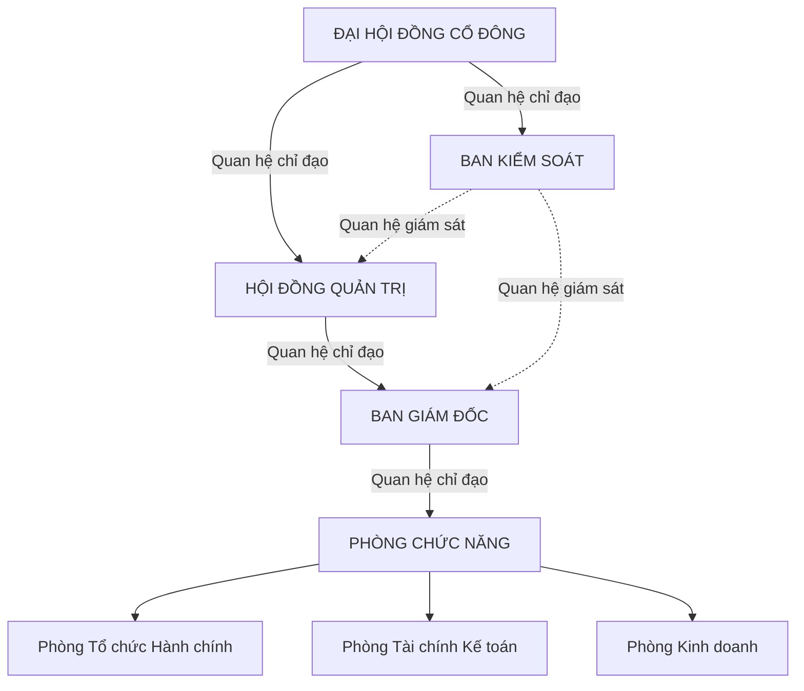

# CÔNG TY CỔ PHẦN PHÂN BÓN VÀ HÓA CHẤT DẦU KHÍ MIỀN BẮC (PVFCCo-PMB)
**MÃ CHỨNG KHOÁN: PMB**

---

## CÔNG VĂN CÔNG BỐ THÔNG TIN BÁO CÁO THƯỜNG NIÊN NĂM 2025

**TỔNG CÔNG TY PHÂN BÓN VÀ HÓA CHẤT DẦU KHÍ**  
**CÔNG TY CỔ PHẦN PHÂN BÓN VÀ HÓA CHẤT DẦU KHÍ MIỀN BẮC**  
Số: 26-509/MB-TCHC  
*V/v: CBTT Báo cáo thường niên năm 2025*

**CỘNG HOÀ XÃ HỘI CHỦ NGHĨA VIỆT NAM**  
**Độc lập - Tự do - Hạnh phúc**  
*Hà Nội, ngày 26 tháng 03 năm 2026*

**Kính gửi:**  
- Ủy ban Chứng khoán Nhà nước;  
- Sở Giao dịch chứng khoán Hà Nội.

1. **Tên công ty:** Công ty Cổ phần Phân bón và Hóa chất Dầu khí miền Bắc
2. **Mã chứng khoán:** PMB
3. **Địa chỉ trụ sở chính:** Tầng 4, Tòa nhà Viện Dầu khí Việt Nam, số 167 đường Trung Kính, phường Yên Hòa, thành phố Hà Nội.
4. **Điện thoại:** 024.35378256 | **Fax:** 024.35378255
5. **Người thực hiện công bố thông tin:** Ông Phạm Trần Nguyễn - Trưởng phòng TCHC
6. **Loại thông tin công bố:** ☐ 24h ☐ 72h ☐ Yêu cầu ☐ Bất thường ☒ Định kỳ
7. **Nội dung thông tin công bố:** Báo cáo thường niên năm 2025
8. **Địa chỉ website đăng tải toàn bộ báo cáo quản trị:** www.pmb.vn

Chúng tôi xin cam kết các thông tin công bố trên đây là đúng sự thật và hoàn toàn chịu trách nhiệm trước pháp luật về nội dung các thông tin đã công bố.

**Nơi nhận:**  
- Như trên;  
- HĐQT, BKS, GĐ (để b/c);  
- Lưu VT, ĐNH.  
*Đính kèm: BC thường niên năm 2025.*

**NGƯỜI CÔNG BỐ THÔNG TIN**  
**TRƯỞNG PHÒNG TCHC**  
*(Đã ký và đóng dấu)*  
**Phạm Trần Nguyễn**

---

# BÁO CÁO THƯỜNG NIÊN NĂM 2025

**CÔNG TY CỔ PHẦN PHÂN BÓN VÀ HÓA CHẤT DẦU KHÍ MIỀN BẮC**  
*Tầng 4, Tòa nhà VPI, số 167 Trung Kính, Yên Hòa, Hà Nội*  
*ĐT: 024.35378256 - Fax: 024.35378255 - Website: www.pmb.vn*  
*Hà Nội, tháng 3 năm 2026*

---

## MỤC LỤC

- **PHẦN I: THÔNG TIN CHUNG**
  - I. Thông tin khái quát
  - II. Ngành nghề và địa bàn kinh doanh
  - III. Thông tin về mô hình quản trị, tổ chức kinh doanh và bộ máy quản lý
  - IV. Định hướng phát triển
  - V. Quản trị rủi ro
- **PHẦN II: TÌNH HÌNH HOẠT ĐỘNG TRONG NĂM 2025**
  - I. Tình hình hoạt động kinh doanh năm 2025
  - II. Tổ chức và nhân sự
    - 1. Danh sách Ban Điều hành
    - 2. Số lượng cán bộ, nhân viên, tóm tắt chính sách và thay đổi trong chính sách đối với người lao động
  - III. Tình hình đầu tư và thực hiện các dự án
  - IV. Tình hình tài chính
    - 1. Tình hình tài chính
    - 2. Các chỉ tiêu tài chính chủ yếu
  - V. Cơ cấu cổ đông, thay đổi vốn đầu tư của chủ sở hữu
    - 1. Cổ phần
    - 2. Cơ cấu cổ đông
    - 3. Tình hình thay đổi vốn đầu tư của chủ sở hữu
  - VI. Báo cáo tác động liên quan đến môi trường và xã hội của Công ty
    - 1. Công tác quản lý nguồn nguyên vật liệu, tiêu thụ năng lượng, nước
    - 2. Tuân thủ pháp luật về bảo vệ môi trường
    - 3. Chính sách liên quan đến người lao động
    - 4. Báo cáo liên quan đến trách nhiệm đối với cộng đồng địa phương
- **PHẦN III: BÁO CÁO VÀ ĐÁNH GIÁ CỦA BAN GIÁM ĐỐC**
  - I. Đánh giá kết quả hoạt động kinh doanh năm 2025
  - II. Tình hình tài chính
    - 1. Tình hình tài sản
    - 2. Tình hình nợ phải trả
  - III. Những cải tiến về cơ cấu tổ chức, chính sách, quản lý
  - IV. Kế hoạch phát triển trong tương lai
  - V. Giải trình ý kiến của kiểm toán (nếu có)
  - VI. Báo cáo đánh giá liên quan đến trách nhiệm về môi trường và xã hội của Công ty
- **PHẦN IV: ĐÁNH GIÁ CỦA HỘI ĐỒNG QUẢN TRỊ VỀ HOẠT ĐỘNG CỦA CÔNG TY**
  - I. Đánh giá của Hội đồng quản trị về các mặt hoạt động của Công ty
  - II. Đánh giá của Hội đồng quản trị về hoạt động của Ban Giám đốc Công ty
  - III. Các kế hoạch, định hướng của Hội đồng quản trị
- **PHẦN V: QUẢN TRỊ CÔNG TY**
  - I. Hội đồng quản trị
    - 1. Thành viên và cơ cấu của Hội đồng quản trị
  - II. Hoạt động của Hội đồng quản trị
    - 1. Hoạt động của Thành viên Hội đồng quản trị độc lập và các tiểu ban trong Hội đồng quản trị
    - 2. Danh sách các Thành viên Hội đồng quản trị có chứng chỉ đào tạo về quản trị Công ty
  - III. Ban Kiểm soát
    - 1. Thành viên và cơ cấu của Ban Kiểm soát
    - 2. Hoạt động của Ban Kiểm soát
    - 3. Thực hiện Nghị quyết ĐHĐCĐ của Công ty
    - 4. Đánh giá việc thực hiện nhiệm vụ quản lý, điều hành của Hội đồng quản trị và Ban Giám đốc Công ty
    - 5. Kế hoạch hoạt động của Ban Kiểm soát năm 2026
  - IV. Báo cáo tiền lương, thù lao và các lợi ích khác của Hội đồng quản trị, Ban Giám đốc và Ban Kiểm soát
    - 1. Chi tiết tiền lương, thù lao và các lợi ích khác của Hội đồng quản trị, Ban Giám đốc và Ban Kiểm soát
    - 2. Giao dịch cổ phiếu của cổ đông nội bộ
    - 3. Hợp đồng hoặc giao dịch với cổ đông nội bộ
    - 4. Việc thực hiện các quy định về quản trị công ty
- **PHẦN VI: BÁO CÁO TÀI CHÍNH**

---

# PHẦN I: THÔNG TIN CHUNG

## I. Thông tin khái quát
- **Tên giao dịch:** Công ty Cổ phần Phân bón và Hóa chất Dầu khí miền Bắc.
- **Giấy chứng nhận Đăng ký doanh nghiệp số:** 0102886450 do Sở Kế hoạch và Đầu tư thành phố Hà Nội cấp lần đầu ngày 19/08/2008 và đăng ký thay đổi lần thứ 14 ngày 01/02/2024.
- **Vốn điều lệ:** 120.000.000.000 đồng *(Một trăm hai mươi tỷ đồng)*.
- **Vốn đầu tư của chủ sở hữu:** 120.000.000.000 đồng *(Một trăm hai mươi tỷ đồng)*.
- **Địa chỉ:** Tầng 4, Tòa nhà Viện Dầu khí Việt Nam, số 167 đường Trung Kính, phường Yên Hòa, thành phố Hà Nội.
- **Số điện thoại:** 024 - 35378256.
- **Số fax:** 024 - 35378255.
- **Website:** www.pmb.vn.
- **Mã chứng khoán:** PMB

### Quá trình hình thành và phát triển
- **Ngày 27/12/2007:** Thành lập Chi nhánh Công ty Cổ phần Phân đạm và Hóa chất Dầu khí - Xí nghiệp Kinh doanh Phân bón miền Bắc.
- **Ngày 13/08/2008:** Thành lập Công ty TNHH MTV Phân bón và Hóa chất Dầu khí miền Bắc.
- **Ngày 24/12/2010:** Chuyển đổi từ Công ty TNHH MTV Phân bón và Hóa chất Dầu khí miền Bắc thành Công ty Cổ phần Phân bón và Hóa chất Dầu khí miền Bắc.
- **Ngày 07/09/2015:** Công ty Cổ phần Phân bón và Hóa chất Dầu khí miền Bắc được Trung tâm Lưu ký Chứng khoán Việt Nam cấp Giấy chứng nhận đăng ký chứng khoán.
- **Ngày 21/9/2015:** Công ty Cổ phần Phân bón và Hóa chất Dầu khí miền Bắc được Sở Giao dịch Chứng khoán Hà Nội ra quyết định chấp thuận niêm yết cổ phiếu trên sàn giao dịch chứng khoán.
- **Ngày 07/10/2015:** Công ty Cổ phần Phân bón và Hóa chất Dầu khí miền Bắc chính thức lên sàn giao dịch chứng khoán với mã cổ phiếu là PMB.

## II. Ngành nghề và địa bàn kinh doanh

### Ngành nghề kinh doanh:
- Bán buôn phân bón (trừ loại Nhà nước cấm).
- Bán lẻ hàng hóa phân bón (trừ loại Nhà nước cấm), hóa chất được phép lưu hành (không bao gồm chất thú y, hóa chất y tế và hóa chất bảo vệ thực vật).
- Bán lẻ theo yêu cầu đặt hàng qua bưu điện hoặc internet (trừ hoạt động đấu giá).
- Bán buôn hàng nông, lâm sản nguyên liệu.
- Vận tải hàng hóa bằng đường bộ, đường thủy.
- Dịch vụ tư vấn hỗ trợ sản xuất nông nghiệp; kinh doanh bất động sản; kinh doanh dịch vụ kho bãi.
- Xuất nhập khẩu các mặt hàng công ty kinh doanh; nghiên cứu thị trường và thăm dò dư luận; quảng cáo; bán buôn tơ, xơ, sợi dệt; tổ chức giới thiệu xúc tiến thương mại.

*Thực tế, hoạt động kinh doanh chính của Công ty Cổ phần Phân bón và Hóa chất Dầu khí miền Bắc (PVFCCo - PMB) là kinh doanh các loại phân bón đặc biệt là các loại phân bón mang thương hiệu Phú Mỹ và các sản phẩm hóa chất khác sử dụng trong nông nghiệp, các hoạt động sản xuất kinh doanh khác chiếm tỷ trọng không đáng kể.*

### Địa bàn kinh doanh:
- Bao gồm 19 tỉnh và thành phố thuộc khu vực miền Bắc, từ Quảng Trị trở ra phía Bắc.

## III. Thông tin về mô hình quản trị, tổ chức kinh doanh và bộ máy quản lý

### Mô hình quản trị:
- Đại hội đồng cổ đông
- Hội đồng quản trị
- Ban Kiểm soát
- Ban Giám đốc

### Cơ cấu bộ máy quản lý:

*Chú thích:*
- `—>` : Quan hệ chỉ đạo
- `-.->` : Quan hệ giám sát

## IV. Định hướng phát triển

### Nguyên tắc phát triển:
Trong quá trình hoạt động, Công ty luôn hướng đến mục tiêu phát triển bền vững, đảm bảo hiệu quả trong kinh doanh và nâng cao năng lực cạnh tranh. Để thực hiện điều đó, Công ty xác định các nguyên tắc cốt lõi như sau:
- **Không ngừng đổi mới, đảm bảo an toàn, nâng cao hiệu quả và phát triển bền vững:** Công ty cam kết đổi mới trong quản lý, duy trì sự an toàn trong mọi hoạt động, đồng thời không ngừng mở rộng, nâng cao hiệu quả kinh doanh nhằm hướng đến sự phát triển lâu dài và bền vững.
- **Tập trung vào các sản phẩm chủ lực:** Công ty ưu tiên phát triển, kinh doanh và phân phối các sản phẩm cốt lõi của PVFCCo như Urea, Kali và NPK mang thương hiệu Phú Mỹ, nhằm khẳng định vị thế trên thị trường và đáp ứng nhu cầu của khách hàng.
- **Mở rộng danh mục sản phẩm phân bón tự doanh:** Công ty chủ động phát triển các sản phẩm phân bón tự doanh để gia tăng doanh thu, tối ưu lợi nhuận và nâng cao năng suất lao động, góp phần mở rộng thị phần và củng cố năng lực kinh doanh.
- **Tăng cường đầu tư để chủ động trong sản xuất kinh doanh:** Công ty chú trọng đầu tư có trọng điểm, nâng cao năng lực sản xuất nhằm giảm sự phụ thuộc vào nguồn cung bên ngoài, từ đó nâng cao tính chủ động trong hoạt động kinh doanh.
- **Kiểm soát chặt chẽ chất lượng sản phẩm và hệ thống phân phối:** Công ty đặc biệt chú trọng đến việc kiểm soát chất lượng đảm bảo sản phẩm đến tay khách hàng đạt tiêu chuẩn cao nhất, đồng thời thực hiện đầy đủ các cam kết đối với khách hàng và đối tác.
- **Phát huy nguồn lực nội bộ, mở rộng hợp tác chiến lược:** Công ty tận dụng tối đa nguồn lực sẵn có, đồng thời thúc đẩy hợp tác lâu dài với các đối tác chiến lược nhằm chia sẻ rủi ro, khai thác các cơ hội phát triển và tăng cường sức mạnh cạnh tranh trên thị trường.

Những nguyên tắc này sẽ là nền tảng giúp Công ty phát triển ổn định, duy trì vị thế vững chắc trên thị trường, đồng thời mang lại giá trị bền vững cho cổ đông, khách hàng và toàn bộ hệ thống.

### Các mục tiêu chủ yếu của Công ty:
Công ty hướng đến mục tiêu trở thành doanh nghiệp mạnh trong lĩnh vực kinh doanh phân bón, đồng thời mở rộng các hoạt động kinh doanh khác phù hợp với định hướng của PVFCCo và ngành Dầu khí. Các mục tiêu cụ thể bao gồm:
- **Khẳng định vị thế trong ngành phân bón:** Công ty đặt mục tiêu phát triển bền vững, trở thành doanh nghiệp kinh doanh phân bón hàng đầu tại khu vực miền Bắc, cung cấp các sản phẩm chất lượng cao, đặc biệt là dòng sản phẩm phân bón mang thương hiệu Phú Mỹ.
- **Củng cố và mở rộng thị phần:** Công ty cam kết đảm bảo chất lượng, sự ổn định và hiệu quả của sản phẩm, đáp ứng nhu cầu của khách hàng, đặc biệt tại các vùng trọng điểm như Bắc Trung Bộ và đồng bằng sông Hồng. Đồng thời, duy trì và mở rộng thị phần phân bón tại khu vực miền Bắc.
- **Phát triển hệ thống phân phối:** Công ty tập trung xây dựng và tối ưu hóa hệ thống phân phối, phát triển kênh bán hàng theo chiều rộng và chiều sâu, hướng tới trở thành đơn vị kinh doanh phân bón có hệ thống phân phối hàng đầu khu vực phía Bắc.
- **Đầu tư vào hạ tầng kho bãi và hậu cần:** Công ty xây dựng hệ thống kho bãi và hậu cần chuyên nghiệp, đảm bảo khả năng cung ứng hàng hóa nhanh chóng, hiệu quả đến các địa bàn trọng điểm.
- **Nâng cao chất lượng dịch vụ để tạo lợi thế cạnh tranh:** Công ty xác định dịch vụ chất lượng cao là yếu tố quan trọng giúp sản phẩm Phú Mỹ trở thành sự lựa chọn ưu tiên của người tiêu dùng trong khu vực.
- **Đảm bảo quyền lợi của cổ đông và người lao động:** Công ty chú trọng cân đối giữa phát triển kinh doanh và đảm bảo quyền lợi cho cổ đông, người lao động, tạo điều kiện làm việc tốt và chế độ phúc lợi hợp lý.

### Chiến lược phát triển trung và dài hạn:
Phát triển bền vững, trở thành một trong những doanh nghiệp kinh doanh và phân phối phân bón hàng đầu tại khu vực miền Bắc.

### Mục tiêu đối với môi trường, xã hội và cộng đồng của Công ty:
Phát triển doanh nghiệp luôn đi đôi với bảo vệ môi trường và trách nhiệm xã hội.

## V. Quản trị rủi ro
Trong bối cảnh năm 2025 tiếp tục ghi nhận nhiều biến động phức tạp của kinh tế thế giới và thị trường phân bón trong nước, PVFCCo - PMB xác định quản trị rủi ro là một trong những trụ cột quan trọng nhằm đảm bảo an toàn tài chính, ổn định hoạt động kinh doanh và phát triển bền vững.

Công tác quản trị rủi ro được thực hiện trên cơ sở chủ động nhận diện - đánh giá - kiểm soát - giám sát thường xuyên, gắn chặt với chiến lược phát triển giai đoạn 2025-2030 và kế hoạch kinh doanh hàng năm.

Trong năm 2025, Công ty tập trung quản trị các nhóm rủi ro trọng yếu sau:

1. **Rủi ro địa chính trị và biến động kinh tế vĩ mô:**  
   Tình hình địa chính trị thế giới tiếp tục diễn biến phức tạp. Xung đột Nga - Ukraine kéo dài, căng thẳng tại khu vực Trung Đông và xu hướng tái cấu trúc chuỗi cung ứng toàn cầu đã tác động trực tiếp đến thị trường năng lượng, vận tải biển và chi phí đầu vào của ngành phân bón. Bên cạnh đó, chính sách tiền tệ của nhiều nền kinh tế lớn vẫn duy trì trạng thái thận trọng nhằm kiểm soát lạm phát, khiến chi phí vốn và dòng tiền trên thị trường có sự biến động nhất định.  
   Để giảm thiểu tác động, Công ty đã triển khai các biện pháp tối ưu hóa chuỗi cung ứng, đa dạng hóa nguồn hàng và tăng cường dự báo thị trường để điều chỉnh kế hoạch kinh doanh phù hợp.

2. **Rủi ro cung vượt cầu và áp lực tiêu thụ:**  
   Thị trường phân bón trong nước tiếp tục ghi nhận nguồn cung dồi dào từ sản xuất nội địa và nhập khẩu. Trong khi đó, nhu cầu tiêu thụ chịu ảnh hưởng bởi biến động giá nông sản và điều kiện thời tiết bất thường tại một số khu vực. Áp lực cung vượt cầu tạo sức ép lên giá bán và biên lợi nhuận của các doanh nghiệp phân phối.  
   Nhằm duy trì lợi thế cạnh tranh, Công ty tiếp tục thực hiện củng cố và phân vùng lại hệ thống phân phối Phân bón Phú Mỹ từ Quảng Trị trở ra phía Bắc, đẩy mạnh các chương trình bán hàng theo mùa vụ đồng thời tăng cường công tác dự báo nhu cầu, tối ưu vòng quay hàng tồn kho.

3. **Rủi ro cạnh tranh về giá và thị phần:**  
   Giá phân bón trong nước vẫn chịu ảnh hưởng trực tiếp từ biến động giá thế giới và chiến lược giá của các nhà sản xuất lớn. Trong năm 2025, giá phân bón tiếp tục biến động theo xu hướng phức tạp, tạo ra những thách thức cho hoạt động kinh doanh. Công ty đã xây dựng chiến lược giá linh hoạt, cân đối giữa rủi ro và cơ hội, nhằm đảm bảo khả năng cạnh tranh mà vẫn duy trì hiệu quả tài chính.

4. **Rủi ro về tính thanh khoản của khách hàng:**  
   Chính sách bán hàng của Công ty tiếp tục được kiểm soát chặt chẽ thông qua việc áp dụng hạn mức công nợ hợp lý theo năng lực tài chính, mức độ tín nhiệm của từng nhà phân phối. Nhờ các biện pháp kiểm soát rủi ro hiệu quả, trong năm 2025, Công ty không ghi nhận tranh chấp liên quan đến công nợ xấu.

5. **Rủi ro khi đưa sản phẩm mới ra thị trường và rủi ro về chất lượng sản phẩm:**  
   Nhu cầu thị trường tiếp tục dịch chuyển sang các dòng sản phẩm phân bón chất lượng cao, thân thiện với môi trường và có giá trị gia tăng cao. Để đáp ứng xu hướng này, bên cạnh sản phẩm chủ lực là Urea Phú Mỹ, Công ty đã và đang mở rộng danh mục sản phẩm như Kaly Phú Mỹ, NPK Phú Mỹ, Kebo Phú Mỹ, đồng thời nghiên cứu phát triển các dòng phân bón chuyên dụng nhằm gia tăng sản lượng kinh doanh và giữ vững thị phần.

6. **Rủi ro về môi trường và tuân thủ quy định pháp luật:**  
   - Cạnh tranh từ các doanh nghiệp nước ngoài ngày càng gia tăng khi Việt Nam hội nhập sâu rộng vào thị trường quốc tế, tạo áp lực lớn đối với các doanh nghiệp trong nước.  
   - Tình trạng phân bón giả, kém chất lượng vẫn còn tồn tại, ảnh hưởng tiêu cực đến các doanh nghiệp kinh doanh chân chính. Công ty tiếp tục đẩy mạnh hợp tác với cơ quan quản lý để tăng cường kiểm soát thị trường, bảo vệ thương hiệu và quyền lợi người tiêu dùng.

7. **Rủi ro do biến đổi khí hậu:**  
   Biến đổi khí hậu tiếp tục tác động mạnh đến sản xuất nông nghiệp, ảnh hưởng đến nhu cầu sử dụng phân bón. Nhận thức rõ vấn đề này, Công ty đã xây dựng các giải pháp thích ứng, như đa dạng hóa sản phẩm, nâng cao chất lượng dịch vụ tư vấn kỹ thuật, hỗ trợ bà con nông dân tối ưu hóa sử dụng phân bón để đạt hiệu quả cao nhất.

Trên cơ sở đánh giá các rủi ro trên, Công ty đã triển khai các biện pháp kiểm soát và giám sát chặt chẽ nhằm giảm thiểu tác động tiêu cực, đảm bảo hoạt động kinh doanh diễn ra ổn định và đạt được các mục tiêu chiến lược đề ra trong năm 2025.

---

# PHẦN II: TÌNH HÌNH HOẠT ĐỘNG TRONG NĂM 2025

## I. Tình hình hoạt động kinh doanh năm 2025

Năm 2025, hoạt động kinh doanh phân bón tiếp tục diễn ra trong bối cảnh thị trường có nhiều yếu tố đan xen giữa thuận lợi và thách thức. Sản xuất nông nghiệp trong nước cơ bản duy trì ổn định, tiếp tục đóng vai trò là trụ đỡ của nền kinh tế; tuy nhiên, thị trường vật tư nông nghiệp nói chung và phân bón nói riêng vẫn chịu tác động đáng kể từ biến động giá hàng hóa quốc tế, cạnh tranh gay gắt trong nước và rủi ro phát sinh từ địa chính trị, thời tiết cực đoan và logistics toàn cầu.

Trên thị trường quốc tế, chỉ số giá phân bón trong nửa đầu năm 2025 có xu hướng tăng trở lại sau giai đoạn điều chỉnh của năm trước, giá các loại phân lân như DAP và MAP ghi nhận mức tăng đáng kể do nhu cầu phục hồi tại một số thị trường lớn, trong khi nguồn cung chịu ảnh hưởng bởi các biện pháp hạn chế xuất khẩu của một số quốc gia sản xuất lớn, đặc biệt là Trung Quốc. Bên cạnh đó, giá khí tự nhiên - nguyên liệu đầu vào quan trọng trong sản xuất urê tăng trong giai đoạn đầu năm đã làm gia tăng chi phí sản xuất tại một số quốc gia xuất khẩu lớn ở Trung Đông và Bắc Phi, qua đó tác động đến nguồn cung và mặt bằng giá urê trên thị trường thế giới.

Những yếu tố này khiến mặt bằng giá phân bón quốc tế trong năm 2025 biến động theo xu hướng kém ổn định hơn so với giai đoạn trước, đồng thời tạo áp lực nhất định đối với công tác tạo nguồn, quản trị tồn kho, định giá bán hàng và điều hành thị trường của các doanh nghiệp phân phối trong nước.

Môi trường kinh doanh còn chịu ảnh hưởng bởi các yếu tố địa chính trị và vận tải biển quốc tế. Tình trạng gián đoạn kéo dài tại tuyến Biển Đỏ - kênh đào Suez khiến nhiều hãng tàu tiếp tục lựa chọn hành trình vòng qua châu Phi trong phần lớn năm 2025, làm gia tăng rủi ro về thời gian giao hàng, chi phí vận chuyển và chi phí lưu kho đối với hàng hóa nhập khẩu. Đối với thị trường phân bón trong nước, điều này tạo thêm áp lực đối với các mặt hàng phụ thuộc vào nguồn cung nhập khẩu như Kali, DAP và một số nguyên liệu đầu vào phục vụ phối trộn, sản xuất NPK.

Trong nước, mặc dù sản xuất nông nghiệp nhìn chung vẫn duy trì tăng trưởng, song diễn biến thời tiết, thiên tai, mưa lớn, bão lũ và các hiện tượng khí hậu cực đoan trong năm 2025 tiếp tục làm gia tăng tính bất định của thị trường theo từng vùng, từng mùa vụ. Cùng với đó, cạnh tranh trong ngành phân bón vẫn ở mức cao, đặc biệt ở nhóm sản phẩm NPK và phân đơn, khi các doanh nghiệp đẩy mạnh chính sách bán hàng, chiết khấu, hỗ trợ thương mại và chăm sóc hệ thống phân phối. Điều này khiến biên lợi nhuận thương mại tiếp tục chịu sức ép, đòi hỏi doanh nghiệp phải nâng cao năng lực dự báo thị trường, quản trị tồn kho và điều hành bán hàng linh hoạt hơn.

Trong bối cảnh đó, Công ty đã chủ động bám sát diễn biến thị trường, linh hoạt điều chỉnh chính sách kinh doanh, tăng cường phối hợp với Tổng công ty Phân bón và Hóa chất Dầu khí - CTCP và các đơn vị liên quan để bảo đảm nguồn cung, tối ưu hóa cơ cấu hàng hóa, kiểm soát tồn kho hợp lý và triển khai đồng bộ các chương trình bán hàng, xúc tiến thương mại, chăm sóc hệ thống phân phối. Nhờ vậy, Công ty tiếp tục duy trì được hoạt động kinh doanh ổn định, củng cố mối quan hệ với nhà phân phối, cửa hàng bán lẻ và khách hàng, đồng thời giữ vững vị thế đối với các sản phẩm chủ lực như Đạm Phú Mỹ và NPK Phú Mỹ trên địa bàn phụ trách.

### KẾT QUẢ THỰC HIỆN KẾ HOẠCH NĂM 2025

| TT | Chỉ tiêu | Đơn vị | TH 2024 | KH 2025 | TH 2025 | TH 2025/ KH 2025 | TH 2025/ TH 2024 |
|:---:|:---|:---:|:---:|:---:|:---:|:---:|:---:|
| **A** | **Sản lượng kinh doanh** | **Tấn** | **224.651** | **220.000** | **232.817** | **106%** | **104%** |
| 1 | Ure Phú Mỹ | Tấn | 150.540 | 150.000 | 150.266 | 100% | 100% |
| 2 | NPK Phú Mỹ | Tấn | 25.041 | 31.000 | 31.566 | 102% | 126% |
| 3 | Các sản phẩm từ gốc Ure | Tấn | 3.104 | 3.000 | 3.113 | 104% | 100% |
| 4 | Phân bón thương hiệu Phú Mỹ | Tấn | 18.002 | 20.000 | 20.031 | 100% | 111% |
| 5 | Phân bón tự doanh | Tấn | 27.964 | 16.000 | 27.840 | 174% | 100% |
| **B** | **Các chỉ tiêu tài chính** | | | | | | |
| 1 | Tổng tài sản | Tỷ đồng | 192,86 | 184,18 | 241,05 | 131% | 125% |
| 2 | Vốn chủ sở hữu | Tỷ đồng | 142,43 | 143,68 | 149,29 | 104% | 105% |
| 3 | Tổng doanh thu | Tỷ đồng | 2.163,19 | 2.175,43 | 2.659,91 | 122% | 123% |
| 4 | Lợi nhuận trước thuế | Tỷ đồng | 12,96 | 14,20 | 25,46 | 179% | 196% |
| 5 | Lợi nhuận sau thuế | Tỷ đồng | 9,90 | 11,36 | 20,17 | 178% | 204% |
| 6 | Nộp NSNN | Tỷ đồng | 5,56 | 3,85 | 7,25 | 188% | 130% |
| 7 | Tỷ suất LNTT/VĐL | % | 11% | 12% | 21% | 179% | 196% |

## II. Tổ chức và nhân sự

### 1. Danh sách Ban Điều hành

| STT | Tên tổ chức/cá nhân | Chức vụ tại Công ty | Năm sinh | Tổng số cổ phần: Đại diện | Tổng số cổ phần: Cá nhân | Tỷ lệ sở hữu cổ phần |
|:---:|:---|:---|:---:|:---:|:---:|:---:|
| 1 | Cao Trung Kiên | Chủ tịch HĐQT | 1976 | 5.400.000 | 20.000 | 45,17% |
| 2 | Bùi Tuấn Anh | Thành viên HĐQT, Giám đốc | 1979 | 3.600.000 | | 30% |
| 3 | Ông Tạ Quốc Phương | Thành viên HĐQT | 1977 | | | 0% |
| 4 | Nguyễn Quang Đoàn | Phó Giám đốc | 1971 | | 3.800 | 0,032% |
| 5 | Phạm Trần Nguyễn | Phó Giám đốc | 1980 | | 6.050 | 0,05% |
| 6 | Đào Thị Kim Anh | Trưởng Ban Kiểm soát | 1974 | | | 0% |
| 7 | Nguyễn Trà My | Thành viên Ban Kiểm soát | 1984 | | | 0% |
| 8 | Đỗ Thị Minh Tâm | Thành viên Ban Kiểm soát | 1987 | | | 0% |
| 9 | Nguyễn Tiến Hưng | Kế toán trưởng | 1984 | | | 0% |

### 2. Số lượng cán bộ, nhân viên, tóm tắt chính sách và thay đổi trong chính sách đối với người lao động
- Tính đến thời điểm 31/12/2025: Tổng số lao động của Công ty là 68 người (trong đó lao động nữ là 29 người). 100% lao động được ký HĐLĐ theo đúng quy định của Bộ luật lao động.
- Trong năm 2025, Công ty tiếp tục sửa đổi, bổ sung các nội quy, quy chế liên quan trực tiếp đến người lao động theo đúng Bộ Luật lao động, đảm bảo tính dân chủ và phù hợp với tình hình kinh doanh, mô hình quản lý của Công ty Cổ phần niêm yết.
- Các chính sách đang thực hiện đã thể hiện sự quan tâm cao của Công ty đến lợi ích chính đáng của NLĐ nhằm động viên, khích lệ người lao động phát huy, cống hiến và gắn bó lâu dài với Công ty.

## III. Tình hình đầu tư và thực hiện các dự án
Năm 2025, Công ty không đầu tư và thực hiện dự án nào.

## IV. Tình hình tài chính

### 1. Tình hình tài chính
*ĐVT: Tỷ đồng*

| Chỉ tiêu | Năm 2024 | Năm 2025 | Tăng, giảm (%) |
|:---|:---:|:---:|:---:|
| Tổng tài sản | 192,86 | 241,05 | 25% |
| Doanh thu thuần | 2.153,31 | 2.651,25 | 23% |
| Lợi nhuận từ hoạt động kinh doanh | 4,75 | 19,92 | 319% |
| Lợi nhuận khác | 8,21 | 5,54 | -33% |
| Lợi nhuận trước thuế | 12,96 | 25,46 | 96% |
| Lợi nhuận sau thuế | 9,90 | 20,17 | 104% |
| Tỷ lệ lợi nhuận trả cổ tức (%) | 7 | 10 | 43% |

Doanh thu thuần năm 2025 của tất cả các hoạt động tăng 23%, lợi nhuận trước thuế tăng 96%, lợi nhuận sau thuế tăng 104% so với năm 2024. Công ty đã giữ vững thị trường, thị phần tại khu vực và thực hiện hoàn thành kế hoạch kinh doanh năm 2025 đã được thông qua.

### 2. Các chỉ tiêu tài chính chủ yếu

| Chỉ tiêu | 2024 | 2025 | Tăng/Giảm (%) |
|:---|:---:|:---:|:---:|
| **- Chỉ tiêu về khả năng thanh toán** | | | |
| Hệ số thanh toán ngắn hạn | 3,65 | 2,55 | -30,2% |
| Hệ số thanh toán nhanh | 2,99 | 2,15 | -28,2% |
| **- Chỉ tiêu về cơ cấu vốn** | | | |
| Hệ số nợ/Tổng tài sản | 26% | 38% | 46% |
| Hệ số nợ/Vốn chủ sở hữu | 35% | 61% | 74% |
| **- Chỉ tiêu về năng lực hoạt động** | | | |
| Vòng quay hàng tồn kho = Giá vốn hàng bán/Hàng tồn kho bình quân | 33,2 | 75,1 | 126% |
| Doanh thu thuần/Tổng tài sản bình quân | 11,4 | 12,2 | 7% |
| Doanh thu thuần/Vốn CSH bình quân | 15,1 | 18,2 | 20% |
| **- Chỉ tiêu về khả năng sinh lời** | | | |
| Hệ số Lợi nhuận sau thuế/Doanh thu thuần | 0,5% | 0,8% | 65% |
| Hệ số Lợi nhuận sau thuế/Vốn chủ sở hữu | 7,0% | 13,5% | 94% |
| Hệ số Lợi nhuận sau thuế/Tổng tài sản | 5,1% | 8,4% | 63% |
| Hệ số Lợi nhuận từ hoạt động kinh doanh/Doanh thu thuần | 0,2% | 0,8% | 241% |
| Lợi nhuận ròng/Vốn chủ sở hữu bình quân (ROE) | 6,9% | 13,8% | 100% |
| Lợi nhuận ròng/Tổng tài sản bình quân (ROA) | 5,2% | 9,3% | 77% |

#### Khả năng thanh toán:
- **Hệ số thanh toán ngắn hạn = 2,55:** Với hệ số thanh toán ngắn hạn đạt 2,55 chứng tỏ Công ty có khả năng thanh toán các khoản nợ ngắn hạn cao, tài sản lưu động gấp hơn 2,5 lần so với nợ ngắn hạn. Điều này cho thấy tình hình tài chính của Công ty dồi dào và không gặp khó khăn trong việc thanh toán các nghĩa vụ tài chính ngắn hạn.
- **Hệ số thanh toán nhanh = 2,15:** Chỉ số thanh toán nhanh là 2,15 cho thấy Công ty có khả năng thanh toán nợ ngắn hạn mà không phụ thuộc vào hàng tồn kho. Điều này minh chứng rằng Công ty có đủ tài sản thanh khoản để xử lý các khoản nợ ngắn hạn.  
Khả năng thanh toán của Công ty tốt, không chỉ giúp Công ty duy trì hoạt động ổn định mà còn tạo ra sự tin tưởng từ phía các nhà đầu tư và đối tác.

#### Cơ cấu vốn:
- **Hệ số nợ/Tổng tài sản = 38%:** Tỷ lệ nợ trên tổng tài sản trong năm 2025 của Công ty ở mức 38%, cho thấy Công ty duy trì một cơ cấu vốn an toàn với nợ thấp, giúp giảm thiểu rủi ro tài chính. Mức độ nợ này cho phép Công ty linh hoạt trong việc huy động vốn mà không làm ảnh hưởng đến khả năng tài chính.
- **Hệ số nợ/Vốn chủ sở hữu = 61%:** Tỷ lệ nợ trên Vốn chủ sở hữu ở mức 61%, cho thấy Công ty đang sử dụng nợ ở mức hợp lý để tài trợ cho các hoạt động kinh doanh. Đây là mức tỷ lệ hợp lý giúp Công ty duy trì sự ổn định và chủ động trong các quyết định tài chính.  
Cơ cấu vốn của Công ty lành mạnh, với tỷ lệ nợ không quá cao, giúp giảm thiểu rủi ro tài chính và duy trì sự ổn định trong các hoạt động.

#### Năng lực hoạt động năm 2025:
- **Vòng quay hàng tồn kho = 63,4:** Chỉ số này cho thấy hàng tồn kho được luân chuyển rất nhanh, phản ánh hiệu quả quản lý và tiêu thụ hàng hóa tốt. Điều này giúp Công ty giảm thiểu rủi ro từ việc tồn kho ứ đọng hoặc giảm giá trị.
- **Doanh thu thuần/Tổng tài sản bình quân = 12,2:** Chỉ số này cho thấy Công ty tạo ra 12,2 đồng doanh thu thuần từ mỗi đồng tài sản, phản ánh sự sử dụng tài sản hiệu quả để tạo ra doanh thu.
- **Doanh thu thuần/Vốn chủ sở hữu bình quân = 18,2:** Với chỉ số này, Công ty đã tạo ra 18,2 đồng doanh thu thuần cho mỗi đồng vốn chủ sở hữu. Đây là một mức rất tốt, thể hiện hiệu quả sử dụng vốn cao.  
Công ty có năng lực hoạt động tốt, sử dụng hiệu quả tài sản và vốn, đồng thời kiểm soát hàng tồn kho chặt chẽ; qua đó góp phần giảm chi phí và nâng cao năng lực cạnh tranh trên thị trường.

#### Khả năng sinh lời:
- **ROE (Lợi nhuận ròng/Vốn chủ sở hữu bình quân) = 13,8%:** Chỉ số ROE đạt 13,8% cho thấy Công ty sử dụng vốn chủ sở hữu tương đối hiệu quả, tạo ra mức sinh lời ổn định trên mỗi đồng vốn của cổ đông.
- **ROA (Lợi nhuận ròng/Tổng tài sản bình quân) = 9,3%:** ROA đạt 9,3%, cho thấy Công ty đang sử dụng tài sản hiệu quả để tạo ra lợi nhuận, phản ánh năng lực khai thác tài sản tốt và hiệu quả hoạt động ổn định.

Nhìn chung tình hình tài chính năm 2025 của Công ty tiếp tục duy trì được sự ổn định, luôn đảm bảo kịp thời nguồn vốn để phục vụ cho hoạt động kinh doanh.

## V. Cơ cấu cổ đông, thay đổi vốn đầu tư của chủ sở hữu

### 1. Cổ phần
Công ty hiện đang lưu hành 12.000.000 cổ phần phổ thông. Tất cả là cổ phần chuyển nhượng tự do.

### 2. Cơ cấu cổ đông
Theo danh sách cổ đông do Trung tâm lưu ký chứng khoán Việt Nam lập ngày 04/08/2025, Công ty có 489 cổ đông, trong đó có 02 cổ đông lớn là PVFCCo chiếm 75% và Tổng Công ty Cổ phần Vật tư Nông nghiệp Nghệ An chiếm 10,02%, còn lại là các cổ đông nhỏ lẻ.

**Cơ cấu cổ đông:**

| STT | Cổ đông | Tỷ lệ nắm giữ | Ghi chú |
|:---:|:---|:---:|:---|
| **1** | **Trong nước** | **99,18 %** | |
| | Cổ đông lớn PVFCCo | 75% | |
| | Cổ đông lớn Tổng Công ty Cổ phần Vật tư Nông nghiệp Nghệ An | 10,02% | |
| | Các tổ chức khác | 2% | |
| | Cá nhân | 12,16% | |
| **2** | **Nước ngoài** | **0,82%** | |
| | Các tổ chức khác | 0,63% | |
| | Cá nhân | 0,19% | |

### 3. Tình hình thay đổi vốn đầu tư của chủ sở hữu
Năm 2025, Công ty không có sự thay đổi về vốn đầu tư của chủ sở hữu.

## VI. Báo cáo tác động liên quan đến môi trường và xã hội của Công ty

### 1. Công tác quản lý nguồn nguyên vật liệu, tiêu thụ năng lượng, nước
Với mô hình là Công ty chuyên kinh doanh và phân phối, không trực tiếp sản xuất nên lượng rác thải và sử dụng năng lượng và tài nguyên nước là không nhiều. Đồng thời Công ty cũng luôn có các chính sách và hoạt động nhằm quản lý, sử dụng hiệu quả các nguồn nguyên vật liệu, tài nguyên, đảm bảo tuân thủ các quy định hiện hành của Nhà nước.

### 2. Tuân thủ pháp luật về bảo vệ môi trường
- Thường xuyên cập nhật các văn bản pháp luật về bảo vệ môi trường, kịp thời phổ biến, triển khai đến các đơn vị; đồng thời, thường xuyên tổ chức rà soát, cập nhật các quy trình/quy định về ATSKMT - CL để đảm bảo phù hợp với quy định của pháp luật và tình hình thực tế phát sinh.
- Thực hiện nghiêm túc và đầy đủ các hoạt động công tác môi trường, thường xuyên tiến hành kiểm tra định kỳ, đột xuất đảm bảo an toàn tuyệt đối về con người, hàng hóa, giữ môi trường làm việc sạch sẽ, gọn gàng và nâng cao ý thức tiết kiệm các nguồn tài nguyên, chi phí của Công ty.
- Thực hiện quan trắc môi trường tại các kho do Công ty quản lý định kỳ 6 tháng/lần và đo kiểm môi trường lao động tại các kho, văn phòng Công ty định kỳ 01 năm/lần nhằm đảm bảo môi trường làm việc tốt nhất cho CBNV Công ty.
- Định kỳ thực hiện kiểm tra, giám sát công tác an toàn trong quá trình kinh doanh, giao nhận hàng hóa, đảm bảo tuân thủ các quy định, ngăn ngừa và giảm thiểu các nguy cơ mất an toàn, các vi phạm môi trường.
- Công tác quản lý chất thải được tuân thủ đúng và đầy đủ theo yêu cầu của pháp luật: bố trí kho chứa chất thải nguy hại, thùng chứa rác thải nguy hại theo đúng yêu cầu. Chất thải rắn, chất thải nguy hại được đăng ký, phân loại, thu gom và lưu trữ tạm thời để xử lý.
- Duy trì, tăng cường công tác vệ sinh, trồng cây xanh, tạo cảnh quan môi trường xanh - sạch - đẹp ở Văn phòng Công ty và các đơn vị trực thuộc.

### 3. Chính sách liên quan đến người lao động
- Xây dựng thang lương, bảng lương, định biên, định mức lao động, đơn giá tiền lương theo đúng nguyên tắc và quy định của Pháp luật, Tập đoàn, Tổng công ty và Công ty. Việc trả lương, thưởng được thực hiện đúng theo quy chế trả lương, trả thưởng và phân phối quỹ phúc lợi của Công ty.
- Xây dựng kế hoạch, biện pháp an toàn lao động, vệ sinh lao động và cải thiện điều kiện lao động, kế hoạch huấn luyện về an toàn lao động, vệ sinh lao động; đảm bảo cung cấp các trang thiết bị BHLĐ cho các cá nhân làm việc theo đúng quy định. Thực hiện đầy đủ các chế độ phụ cấp cho mạng lưới an toàn vệ sinh viên và CBNV làm việc thường xuyên tại các kho, cảng.
- Thực hiện đầy đủ các chế độ phụ cấp cho mạng lưới an toàn vệ sinh viên và có chế độ bồi dưỡng bằng hiện vật cho CBNV làm việc trực tiếp tại kho trạm thuộc Công ty.
- Hàng năm, Công ty tổ chức khám sức khỏe cho CBNV nhằm phát hiện bệnh nghề nghiệp hoặc các loại bệnh khác để có biện pháp chữa trị, thông báo, kiểm tra chuyên sâu kịp thời cho CBNV theo quy định.
- Công tác đào tạo luôn được Công ty quan tâm với chủ trương đầu tư một cách có hiệu quả cho nguồn nhân lực để hỗ trợ người lao động đảm bảo có việc làm và phát triển sự nghiệp. Công tác đào tạo nội bộ đã được nâng cao về cả số lượng và chất lượng.

### 4. Báo cáo liên quan đến trách nhiệm đối với cộng đồng địa phương
- Triển khai thực hiện nhiều chương trình an sinh xã hội tại khu vực Công ty quản lý như: Cứu trợ các địa phương bị ảnh hưởng do thời tiết bất thường,...
- Hoạt động thăm hỏi và tặng quà người khuyết tật, các gia đình chính sách, gia đình có hoàn cảnh khó khăn, các trung tâm bảo trợ xã hội...luôn được quan tâm và tổ chức.
- Triển khai thực hiện chương trình Tết người nghèo nhân dịp Tết nguyên đán tại nhiều tỉnh thành thuộc địa bàn kinh doanh của Công ty.
- Tuân thủ nghiêm mọi quy định của Chính phủ và địa phương.

---

# PHẦN III: BÁO CÁO VÀ ĐÁNH GIÁ CỦA BAN GIÁM ĐỐC

## I. Đánh giá kết quả hoạt động kinh doanh năm 2025

Kế thừa và phát huy những kinh nghiệm tích lũy trong quá trình hoạt động, cùng với việc tiếp tục hoàn thiện mô hình tổ chức, nâng cao hiệu quả công tác quản trị và điều hành, trong năm 2025 PVFCCo-PMB đã nỗ lực vượt qua nhiều khó khăn, thách thức của thị trường để duy trì hoạt động kinh doanh ổn định và đạt được những kết quả tích cực.

Trong bối cảnh thị trường phân bón tiếp tục cạnh tranh gay gắt, giá cả có nhiều biến động và yêu cầu của thị trường ngày càng cao, Ban Giám đốc Công ty đã chủ động bám sát diễn biến thị trường, linh hoạt điều hành hoạt động kinh doanh, triển khai đồng bộ các giải pháp về quản trị, bán hàng và phát triển thị trường. Nhờ đó, Công ty tiếp tục duy trì hiệu quả hoạt động kinh doanh, từng bước củng cố và mở rộng thị phần đối với các sản phẩm chủ lực, đồng thời giữ vững uy tín thương hiệu trên địa bàn khu vực miền Bắc.

Những kết quả đạt được trong năm 2025 đã góp phần nâng cao giá trị thương hiệu Phú Mỹ, khẳng định vị thế của Công ty trong hệ thống phân phối phân bón của Tổng Công ty cũng như trên thị trường khu vực. Đồng thời, hoạt động kinh doanh ổn định cũng tạo được sự yên tâm, gắn bó của cán bộ, người lao động trong Công ty và đảm bảo hài hòa lợi ích giữa doanh nghiệp và các cổ đông.

Kết quả này tiếp tục khẳng định tính đúng đắn và phù hợp của định hướng chiến lược, mô hình quản trị và phương thức điều hành mà Công ty đã triển khai trong những năm qua, đồng thời tạo nền tảng quan trọng để PVFCCo-PMB tiếp tục phát triển ổn định, nâng cao hiệu quả hoạt động và hướng tới mục tiêu tăng trưởng bền vững trong giai đoạn tiếp theo.

## II. Tình hình tài chính

### 1. Tình hình tài sản

| STT | Chỉ tiêu | ĐVT | 31/12/24 Số tiền [1] | 31/12/24 Tỷ trọng (%) | 31/12/25 Số tiền [2] | 31/12/25 Tỷ trọng (%) | Tăng, giảm [3]=[2]-[1] | Tăng, giảm (%) [4]=[3]/[1] |
|:---:|:---|:---:|:---:|:---:|:---:|:---:|:---:|:---:|
| *A* | *B* | *C* | *[1]* | *(%)* | *[2]* | *(%)* | *[3]* | *[4]* |
| **1** | **Tài sản ngắn hạn** | **Tỷ đ** | **184,25** | **96%** | **234,14** | **97%** | **49,89** | **27%** |
| 1.1 | Tiền và các khoản tương đương tiền | " | 139,84 | 73% | 167,74 | 70% | 27,90 | 20% |
| 1.2 | Các khoản phải thu ngắn hạn | " | 11,06 | 6% | 29,41 | 12% | 18,35 | 166% |
| 1.3 | Hàng tồn kho | " | 32,94 | 17% | 35,26 | 15% | 2,32 | 7% |
| 1.4 | Tài sản ngắn hạn khác | " | 0,41 | 0% | 1,73 | 1% | 1,32 | 324% |
| **2** | **Tài sản dài hạn** | **"** | **8,60** | **4%** | **6,90** | **3%** | **(1,70)** | **-20%** |
| 2.1 | Tài sản cố định | " | 3,72 | 2% | 4,39 | 2% | 0,67 | 18% |
| 2.2 | Tài sản dài hạn khác | " | 4,89 | 3% | 2,52 | 1% | (2,37) | -48% |
| | **Tổng tài sản** | **"** | **192,86** | | **241,05** | | **48,19** | **25%** |

- Tổng tài sản tính đến 31/12/2025 là 241,05 tỷ đồng tăng 25% so với năm 2024. Kết cấu tài sản của Công ty chủ yếu là tài sản ngắn hạn (chiếm tỷ lệ 97% trên tổng tài sản), trong khi tài sản dài hạn chiếm tỷ trọng thấp (chiếm tỷ lệ 3% trên tổng tài sản).
- Trị giá các khoản phải thu ngắn hạn cuối năm 2025 là 29,41 tỷ đồng, tăng 166% so với đầu năm. Các khoản phải thu có xu hướng tăng và không làm ảnh hưởng tới hiệu quả sử dụng vốn nói chung và hiệu quả sử dụng vốn lưu động nói riêng. Việc theo dõi thu hồi công nợ được tiến hành thường xuyên và chặt chẽ. Công ty không có các khoản phải thu dài hạn. Trong năm 2025 Công ty không phát sinh nợ xấu, nợ khó đòi, nợ mất khả năng thanh toán.
- Hàng tồn kho tại thời điểm 31/12/2025 tăng 7% so với năm 2024, chiếm tỷ lệ 15% trên tổng tài sản.

**Hiệu suất sử dụng tài sản:**
$$\text{Vòng quay tổng tài sản} = \frac{\text{Tổng doanh thu thuần}}{\text{Tổng tài sản bình quân}} = \frac{2.651\text{ tỷ đồng}}{217\text{ tỷ đồng}} = 12\text{ vòng}$$

$$\text{Vòng quay tài sản cố định} = \frac{\text{Tổng doanh thu thuần}}{\text{Tài sản cố định bình quân}} = \frac{2.651\text{ tỷ đồng}}{4,1\text{ tỷ đồng}} = 654\text{ vòng}$$

### 2. Tình hình nợ phải trả
Tính đến ngày 31/12/2025:

| STT | Chỉ tiêu | ĐVT | 31/12/2025 Số tiền [1] | 31/12/2025 Tỷ trọng (%) | 31/12/2024 Số tiền [2] | 31/12/2024 Tỷ trọng (%) | Tăng, giảm [3]=[1]-[2] | Tăng/giảm [4]=[3]/[2] |
|:---:|:---|:---:|:---:|:---:|:---:|:---:|:---:|:---:|
| *A* | *B* | *C* | *[1]* | *(%)* | *[2]* | *(%)* | *[3]* | *[4]* |
| **I.** | **Tổng nguồn vốn** | **Tỷ đồng** | **241,05** | | **184,93** | | **56,11** | **30%** |
| **1.** | **Các khoản nợ phải trả ngắn hạn.** | **"** | **91,76** | **38%** | **40,62** | **22%** | **51,14** | **126%** |
| | Trong đó: | | | | | | | |
| 1.1 | Khoản vay ngắn hạn | " | | | | | | |
| 1.2 | Phải trả cho người bán | " | 6,91 | 3% | 2,92 | 2% | 4,00 | 137% |
| 1.3 | Người mua trả tiền trước | " | 47,67 | 20% | 6,36 | 3% | 41,31 | 649% |
| 1.4 | Các khoản phải trả khác | " | 37,17 | 15% | 31,34 | 17% | 5,83 | 19% |
| **2** | **Vốn chủ sở hữu** | **"** | **149,29** | **62%** | **144,31** | **78%** | **4,97** | **3%** |

- Các khoản nợ phải trả ngắn hạn tại ngày 31/12/2025 là 91,76 tỷ đồng, tăng 125,9% so với năm 2024.
- Công ty không có các khoản nợ phải trả dài hạn và không có nợ xấu xảy ra.

**Các chỉ số nợ phải trả:**
$$\text{Hệ số nợ trên Tổng tài sản} = \frac{\text{Nợ phải trả}}{\text{Tổng tài sản}} = \frac{91,76\text{ tỷ đồng}}{241,05\text{ tỷ đồng}} = 0,38$$

$$\text{Hệ số nợ trên Vốn chủ sở hữu} = \frac{\text{Nợ phải trả}}{\text{Vốn chủ sở hữu}} = \frac{91,76\text{ tỷ đồng}}{149,29\text{ tỷ đồng}} = 0,61$$

Tổng nguồn vốn tại ngày 31/12/2025 tăng 56,11 tỷ tương ứng mức tăng 30,3% so với năm 2024. Trong kết cấu nguồn vốn, nợ phải trả ngắn hạn chiếm 38% trên tổng nguồn vốn, vốn chủ sở hữu chiếm 62% trên tổng nguồn vốn.

## III. Những cải tiến về cơ cấu tổ chức, chính sách, quản lý

Trong năm 2025, Công ty tập trung rà soát, kiện toàn hệ thống quản lý, cơ cấu tổ chức và nguồn vốn, đồng thời tối ưu hóa nguồn nhân lực để nâng cao năng suất lao động. Các chương trình đào tạo nội bộ, hội thảo chuyên đề được tổ chức thường xuyên nhằm khuyến khích sáng tạo, đổi mới, đồng thời kịp thời động viên, khen thưởng những ý tưởng có tính ứng dụng cao.

Bên cạnh đó, Công ty tiếp tục hoàn thiện cơ chế bán hàng theo khu vực địa lý, đảm bảo sự ổn định giá cả trong hệ thống phân phối Phân bón Phú Mỹ, giúp duy trì hiệu quả kinh doanh ngay cả trong giai đoạn thấp điểm. Chính sách lương thưởng cũng được gắn liền với hiệu quả kinh doanh nhằm khuyến khích nhân viên phát huy tối đa năng lực.

Hệ thống phân phối tại các vùng trọng điểm được củng cố thông qua việc đầu tư, hỗ trợ các nguồn lực xúc tiến thương mại cho Nhà phân phối, tăng cường sự gắn kết giữa Công ty và khách hàng. Đồng thời, Công ty không ngừng cải tiến chính sách hỗ trợ bán hàng, nghiên cứu và hoàn thiện danh mục sản phẩm phù hợp với nhu cầu thị trường và từng loại cây trồng chủ lực.

Song song với việc tinh gọn bộ máy tổ chức để nâng cao hiệu quả hoạt động, Công ty cũng tăng cường công tác kiểm tra, giám sát nhằm kịp thời phát hiện, khắc phục sai sót trong quản lý và kinh doanh, đảm bảo hoạt động vận hành minh bạch, ổn định.

## IV. Kế hoạch phát triển trong tương lai

Nhằm hướng tới mục tiêu phát triển bền vững, Công ty sẽ tập trung mọi nguồn lực để hoàn thành kế hoạch kinh doanh năm 2026, đồng thời bám sát chiến lược dài hạn để đạt được các mục tiêu trong giai đoạn tiếp theo. Để thực hiện hiệu quả các nhiệm vụ này, Công ty đặt ra một số giải pháp trọng tâm như sau:

- Công tác xây dựng kế hoạch sẽ được nâng cao với các dự báo sát thực tế, đảm bảo triển khai kịp thời và hiệu quả. Chính sách bán hàng tiếp tục được điều chỉnh linh hoạt để kích thích hệ thống Nhà phân phối đẩy mạnh tiêu thụ các sản phẩm mang thương hiệu Phú Mỹ. Công ty cũng sẽ lựa chọn thời điểm thích hợp để phát triển các sản phẩm phân bón tự doanh, gia tăng doanh thu và tối ưu năng suất lao động.
- Bên cạnh đó, năng lực cạnh tranh sẽ được cải thiện thông qua việc nâng cao chất lượng dịch vụ và phát triển giá trị gia tăng trong sản phẩm. Hệ thống phân phối được sàng lọc, phân vùng hiệu quả, đồng thời đẩy mạnh kênh phân phối cấp 2 nhằm mở rộng độ bao phủ tại các thị trường trọng điểm. Công ty sẽ tăng cường công tác hậu cần, xây dựng phương án điều độ hàng hóa phù hợp theo từng khu vực để đảm bảo nguồn cung kịp thời và duy trì lộ trình phát triển thị phần NPK Phú Mỹ.
- Về tài chính, Công ty chú trọng quản lý vốn, kiểm soát hàng tồn kho, công nợ và rủi ro, đảm bảo an toàn tài chính. Các biện pháp tái cấu trúc sẽ tiếp tục được thực hiện theo định hướng của Tổng công ty, đồng thời hoàn thiện chiến lược phát triển trung và dài hạn làm cơ sở cho các mục tiêu tương lai.
- Công ty cũng tập trung phát triển sản phẩm mới, tận dụng hệ thống kho bãi và quan hệ đối tác để mở rộng kinh doanh. Hoạt động đầu tư, mua sắm sẽ được kiểm soát chặt chẽ, đảm bảo chất lượng, tiến độ và tuân thủ các quy định hiện hành.
- Về nhân sự, Công ty sẽ tái cơ cấu phòng Kinh doanh, tăng tỷ trọng cán bộ trực tiếp, phân chia khu vực thị trường chuyên biệt để nâng cao hiệu quả kinh doanh. Công tác đào tạo sẽ được đẩy mạnh, đặc biệt là đào tạo nội bộ nhằm nâng cao trình độ nghiệp vụ và quản lý cho cán bộ nhân viên.
- Công ty cũng đặt mục tiêu tiết kiệm 5% chi phí quản lý và bán hàng bằng cách tăng cường kiểm soát chi phí trong mọi hoạt động. Đồng thời, thương hiệu Công ty sẽ tiếp tục được gắn kết với “PVFCCo”, chú trọng phát triển văn hóa doanh nghiệp và nâng cao đời sống vật chất, tinh thần cho người lao động.

Công ty cam kết phát triển bền vững đi đôi với bảo vệ môi trường, thực hiện trách nhiệm xã hội và đảm bảo lợi ích hài hòa cho các cổ đông.

## V. Giải trình ý kiến của kiểm toán (nếu có)
*(Không có ý kiến ngoại trừ)*

## VI. Báo cáo đánh giá liên quan đến trách nhiệm về môi trường và xã hội của Công ty

Công ty đã thực hiện đầy đủ các nghĩa vụ và trách nhiệm về môi trường theo quy định. Định kỳ thực hiện các báo cáo về công tác An toàn - Sức khỏe - Môi trường cho Công ty mẹ và các cơ quan quản lý nhà nước tại địa phương.

Công tác An sinh xã hội cũng được Công ty quan tâm, chú trọng nhằm thể hiện vai trò, trách nhiệm của Công ty đối với cộng đồng tại địa phương.

---

# PHẦN IV: ĐÁNH GIÁ CỦA HỘI ĐỒNG QUẢN TRỊ VỀ HOẠT ĐỘNG CỦA CÔNG TY

## I. Đánh giá của Hội đồng quản trị về các mặt hoạt động của Công ty

Năm 2025, thị trường phân bón tiếp tục diễn biến phức tạp dưới tác động của nhiều yếu tố trong nước và quốc tế. Cạnh tranh trong ngành ngày càng gay gắt khi các doanh nghiệp sản xuất và phân phối liên tục điều chỉnh chính sách bán hàng, mở rộng mạng lưới phân phối và gia tăng các chương trình xúc tiến thương mại nhằm gia tăng thị phần tại các khu vực trọng điểm. Bên cạnh đó, biến động của giá phân bón trên thị trường quốc tế, chi phí logistics và các yếu tố thời tiết, mùa vụ cũng tạo ra nhiều thách thức đối với hoạt động kinh doanh của các doanh nghiệp trong ngành.

Trong bối cảnh đó, Hội đồng quản trị đã thường xuyên theo dõi sát diễn biến thị trường, kịp thời định hướng và ban hành các quyết sách phù hợp nhằm đảm bảo hoạt động kinh doanh của Công ty được duy trì ổn định, hiệu quả và an toàn. Ban Lãnh đạo Công ty đã chủ động điều hành linh hoạt, triển khai đồng bộ các giải pháp về thị trường, bán hàng, quản trị chi phí và quản lý nguồn lực, qua đó tiếp tục giữ vững vị thế của Công ty trên địa bàn khu vực miền Bắc, đồng thời đảm bảo hài hòa lợi ích giữa doanh nghiệp, người lao động và các cổ đông.

Trong năm 2025, Công ty tiếp tục triển khai hoạt động kinh doanh theo phương châm an toàn – hiệu quả – tiết kiệm, chú trọng nâng cao hiệu quả sử dụng nguồn lực và phát triển thị trường một cách bền vững. Thị phần sản phẩm Đạm Phú Mỹ tại khu vực miền Bắc tiếp tục được duy trì ổn định, trong khi các sản phẩm NPK Phú Mỹ, Kali Phú Mỹ từng bước khẳng định vị thế trên thị trường và có tiềm năng phát triển độc lập. Hệ thống phân phối của Công ty tiếp tục được củng cố và mở rộng, đồng thời được quản lý chặt chẽ nhằm nâng cao hiệu quả hoạt động và đảm bảo phát triển bền vững theo cả chiều rộng lẫn chiều sâu.

Về tổ chức nhân sự, Công ty tiếp tục thực hiện rà soát, sắp xếp và tối ưu hóa nguồn lực theo hướng nâng cao hiệu quả lao động và tăng cường năng lực chuyên môn của đội ngũ nhân sự. Công tác đào tạo, bồi dưỡng nghiệp vụ được chú trọng triển khai nhằm nâng cao chất lượng nguồn nhân lực, đáp ứng yêu cầu phát triển của Công ty trong bối cảnh thị trường ngày càng cạnh tranh. Chính sách tiền lương và đãi ngộ tiếp tục được xây dựng gắn với hiệu quả công việc, góp phần khuyến khích tinh thần làm việc chủ động, sáng tạo và nâng cao năng suất lao động.

Công tác tiếp thị và chăm sóc khách hàng tiếp tục được Công ty quan tâm đẩy mạnh. Các chương trình hội nghị khách hàng, hội thảo nông nghiệp, tập huấn kỹ thuật canh tác và giới thiệu sản phẩm được triển khai thường xuyên tại các địa bàn trọng điểm, góp phần nâng cao uy tín thương hiệu Phú Mỹ, đồng thời gia tăng mức độ gắn kết giữa Công ty với hệ thống phân phối, đại lý và người tiêu dùng.

Về công tác tài chính, Công ty tiếp tục thực hiện quản lý chặt chẽ nguồn vốn, kiểm soát hiệu quả công nợ và tối ưu hóa dòng tiền nhằm đảm bảo an toàn tài chính trong hoạt động kinh doanh. Các biện pháp tiết giảm chi phí, nâng cao hiệu quả sử dụng vốn và tối ưu hóa hoạt động logistics, tồn kho được triển khai đồng bộ, góp phần nâng cao hiệu quả hoạt động chung của Công ty. Đồng thời, công tác rà soát, tái cấu trúc tổ chức và quy trình quản trị tiếp tục được thực hiện theo hướng tinh gọn, nâng cao hiệu suất hoạt động.

Công tác an toàn lao động, phòng chống cháy nổ và đảm bảo an ninh trong hoạt động sản xuất kinh doanh luôn được Công ty đặt lên hàng đầu. Trong năm 2025, các quy định về an toàn lao động và bảo vệ môi trường tiếp tục được thực hiện nghiêm túc. Công tác quan trắc môi trường, kiểm tra điều kiện lao động và các biện pháp phòng ngừa rủi ro được triển khai định kỳ, đảm bảo các chỉ tiêu môi trường và điều kiện làm việc đều nằm trong giới hạn cho phép, góp phần duy trì môi trường làm việc an toàn và ổn định.

Với kết quả đạt được trong năm 2025, Công ty tiếp tục đảm bảo quyền và lợi ích hợp pháp của các cổ đông. Hội đồng quản trị đã trình Đại hội đồng cổ đông xem xét phương án phân phối lợi nhuận và chi trả cổ tức phù hợp với kết quả hoạt động kinh doanh của Công ty, đồng thời đảm bảo cân đối giữa lợi ích cổ đông và nhu cầu tái đầu tư phục vụ phát triển bền vững trong giai đoạn tiếp theo.

## II. Đánh giá của Hội đồng quản trị về hoạt động của Ban Giám đốc Công ty

Căn cứ Điều lệ tổ chức và hoạt động của Công ty, cùng các quy chế, quy định quản trị nội bộ đã được ban hành, kết thúc năm 2025, Hội đồng quản trị đánh giá Ban Giám đốc đã nghiêm túc triển khai và thực hiện đầy đủ các Nghị quyết, Quyết định của Đại hội đồng cổ đông và Hội đồng quản trị. Trong quá trình điều hành, Ban Giám đốc đã bám sát định hướng chiến lược của Công ty, chủ động xây dựng và triển khai các giải pháp điều hành phù hợp với diễn biến thực tế của thị trường.

Trong bối cảnh thị trường phân bón tiếp tục có nhiều biến động và cạnh tranh ngày càng gia tăng, Ban Giám đốc đã thể hiện sự linh hoạt trong công tác điều hành, kịp thời điều chỉnh chính sách kinh doanh, tăng cường công tác quản trị rủi ro, kiểm soát chi phí và tối ưu hóa hiệu quả sử dụng nguồn lực. Nhờ đó, hoạt động kinh doanh của Công ty trong năm 2025 tiếp tục được duy trì ổn định, đảm bảo hiệu quả và hoàn thành các mục tiêu cơ bản đã được Đại hội đồng cổ đông và Hội đồng quản trị đề ra.

Bên cạnh đó, Ban Giám đốc cũng đã chú trọng nâng cao hiệu quả quản trị doanh nghiệp, tăng cường phối hợp giữa các đơn vị trong Công ty, đồng thời quan tâm phát triển nguồn nhân lực, củng cố hệ thống phân phối và nâng cao chất lượng dịch vụ khách hàng. Các hoạt động quản lý tài chính, kiểm soát công nợ, quản trị tồn kho và đảm bảo an toàn trong hoạt động kinh doanh được triển khai chặt chẽ, góp phần duy trì sự ổn định và phát triển bền vững của Công ty.

Hội đồng quản trị ghi nhận và đánh giá cao những nỗ lực của Ban Giám đốc cùng toàn thể cán bộ, người lao động trong việc điều hành và tổ chức thực hiện các nhiệm vụ sản xuất kinh doanh của Công ty trong năm 2025, qua đó góp phần củng cố vị thế của Công ty trên thị trường và tạo nền tảng cho sự phát triển trong giai đoạn tiếp theo.

## III. Các kế hoạch, định hướng của Hội đồng quản trị

Bước sang năm 2026, Hội đồng quản trị Công ty xác định định hướng trọng tâm là nâng cao năng lực chủ động trong hoạt động kinh doanh, tối ưu hóa chuỗi cung ứng và gia tăng hiệu quả sử dụng vốn, trên cơ sở thích ứng linh hoạt với biến động của thị trường phân bón trong nước và quốc tế. Trong đó, hai trụ cột chiến lược được ưu tiên triển khai là phát triển hoạt động thuê gia công sản phẩm và đầu tư, nâng cấp hệ thống kho bãi - logistics.

Về hoạt động kinh doanh, Công ty tiếp tục điều hành theo phương châm “Chủ động - Hiệu quả - Kiểm soát rủi ro”, tập trung nâng cao năng lực tạo nguồn và khả năng điều tiết thị trường. Hội đồng quản trị định hướng đẩy mạnh hoạt động thuê gia công sản phẩm, đặc biệt là các dòng NPK chuyên biệt, phù hợp với nhu cầu từng vùng thị trường. Việc thuê gia công không chỉ giúp Công ty chủ động về nguồn hàng, linh hoạt trong cơ cấu sản phẩm mà còn góp phần nâng cao biên lợi nhuận, tối ưu chi phí sản xuất và gia tăng giá trị gia tăng trong chuỗi kinh doanh.

Công ty sẽ lựa chọn các đối tác gia công có năng lực, uy tín, đảm bảo tiêu chuẩn chất lượng và hiệu quả kinh tế, đồng thời xây dựng cơ chế kiểm soát chặt chẽ từ khâu nguyên liệu đầu vào đến sản phẩm đầu ra. Bên cạnh đó, Công ty từng bước xây dựng danh mục sản phẩm mang tính đặc thù, phù hợp với điều kiện thổ nhưỡng, mùa vụ và cơ cấu cây trồng tại khu vực miền Bắc, qua đó tạo lợi thế cạnh tranh khác biệt trên thị trường.

Trong lĩnh vực đầu tư hạ tầng, năm 2026 được xác định là năm trọng tâm triển khai các dự án đầu tư, tái cơ cấu hệ thống kho bãi theo hướng hiện đại, đồng bộ và tối ưu hóa chi phí vận hành. Công ty sẽ rà soát, đánh giá lại toàn bộ hệ thống kho hiện hữu, đồng thời nghiên cứu đầu tư mới hoặc thuê ngoài các kho trung chuyển tại các địa bàn chiến lược nhằm nâng cao năng lực lưu trữ, rút ngắn thời gian giao hàng và giảm chi phí logistics.

Việc đầu tư kho bãi không chỉ phục vụ hoạt động phân phối truyền thống mà còn tạo nền tảng cho việc mở rộng kinh doanh hàng tự doanh, gia công và các sản phẩm mới. Đồng thời, Công ty định hướng ứng dụng công nghệ trong quản lý kho, từng bước số hóa công tác quản lý tồn kho, điều phối hàng hóa và kiểm soát chi phí nhằm nâng cao hiệu quả vận hành.

Song song với đó, Công ty tiếp tục nâng cao năng lực quản trị chuỗi cung ứng, tăng cường công tác dự báo thị trường, điều hành tồn kho linh hoạt theo biến động giá cả, qua đó giảm thiểu rủi ro và nâng cao hiệu quả sử dụng vốn. Hoạt động kinh doanh hàng tự doanh được triển khai theo hướng thận trọng, có kiểm soát, gắn với năng lực tài chính và khả năng quản trị rủi ro của Công ty.

Về quản trị tài chính, Công ty tiếp tục thực hiện chính sách tài chính an toàn, kiểm soát chặt chẽ dòng tiền, công nợ và chi phí, đồng thời tối ưu hóa cơ cấu vốn nhằm đảm bảo nguồn lực cho các hoạt động đầu tư và phát triển. Các dự án đầu tư, đặc biệt trong lĩnh vực kho bãi và logistics, sẽ được đánh giá kỹ lưỡng về hiệu quả tài chính, thời gian hoàn vốn và mức độ rủi ro trước khi triển khai.

Trong công tác quản trị doanh nghiệp, Hội đồng quản trị định hướng tiếp tục hoàn thiện hệ thống quản trị theo hướng hiện đại, minh bạch và hiệu quả, đẩy mạnh chuyển đổi số trong các hoạt động kinh doanh và quản lý. Các mô hình quản trị tiên tiến như quản trị chuỗi giá trị, quản trị biến động và quản trị theo dữ liệu sẽ được từng bước áp dụng nhằm nâng cao năng lực điều hành trong bối cảnh thị trường ngày càng cạnh tranh.

Bên cạnh hoạt động sản xuất kinh doanh, Công ty tiếp tục chú trọng phát triển nguồn nhân lực, nâng cao chất lượng đội ngũ cán bộ, người lao động, xây dựng môi trường làm việc chuyên nghiệp, gắn kết và hiệu quả. Công tác an toàn, vệ sinh lao động được thực hiện nghiêm túc, đảm bảo điều kiện làm việc an toàn và ổn định.

Với định hướng tập trung vào gia tăng tính chủ động trong nguồn hàng và nâng cao năng lực hạ tầng logistics, Hội đồng quản trị tin tưởng rằng Công ty sẽ nâng cao hiệu quả hoạt động, cải thiện năng lực cạnh tranh và tạo nền tảng vững chắc cho sự phát triển bền vững trong giai đoạn tới.

---

# PHẦN V: QUẢN TRỊ CÔNG TY

## I. Hội đồng quản trị

### 1. Thành viên và cơ cấu của Hội đồng quản trị
Hội đồng quản trị gồm 03 thành viên (nhiệm kỳ 2021 - 2026), trong đó có 01 Chủ tịch Hội đồng quản trị, 01 Thành viên Hội đồng quản trị kiêm Giám đốc, 01 Thành viên Hội đồng quản trị độc lập.

| Stt | Họ và tên | Chức vụ | Số lượng cổ phiếu có quyền biểu quyết: Đại diện | Số lượng cổ phiếu có quyền biểu quyết: Cá nhân | Số lượng cổ phiếu có quyền biểu quyết: Tổng cộng |
|:---:|:---|:---|:---:|:---:|:---:|
| 1 | Cao Trung Kiên | Chủ tịch HĐQT | 5.400.000 | 20.000 | 5.420.000 |
| 2 | Bùi Tuấn Anh | TV.HĐQT, GĐ | 3.600.000 | | 3.600.000 |
| 3 | Tạ Quốc Phương | TV.HĐQT | | | |

## II. Hoạt động của Hội đồng quản trị

Là cơ quan quản lý cao nhất, đại diện cho quyền lợi của cổ đông, Hội đồng quản trị (HĐQT) đã thực hiện vai trò lãnh đạo và giám sát hoạt động của Công ty một cách chặt chẽ, tuân thủ các chuẩn mực quản trị theo mô hình công ty cổ phần. Trong năm 2025, với ba thành viên đương nhiệm, HĐQT hoạt động theo cơ chế chuyên trách, ra quyết định tập thể, đồng thời có sự phân công nhiệm vụ cụ thể theo từng lĩnh vực chuyên môn để đảm bảo hiệu quả quản trị cao nhất.

HĐQT đã chủ động chỉ đạo, giám sát và đôn đốc Ban Giám đốc thông qua nhiều kênh khác nhau. Các thành viên HĐQT thường xuyên tham dự các cuộc họp quan trọng của Ban Giám đốc, đóng góp ý kiến chỉ đạo về việc triển khai Nghị quyết, Quyết định của HĐQT, đồng thời xem xét các đề án, dự án trước khi trình lên HĐQT. Ngoài ra, HĐQT cũng theo dõi chặt chẽ quá trình điều hành thông qua các báo cáo định kỳ và văn bản do Ban Giám đốc gửi lên. Trong những tình huống quan trọng phát sinh, HĐQT trực tiếp chỉ đạo và góp ý để đảm bảo hoạt động của Công ty diễn ra suôn sẻ, hiệu quả.

Hoạt động của HĐQT được tổ chức thông qua các phiên họp định kỳ hoặc bất thường. Các quyết định quan trọng được thông qua bằng hình thức họp trực tiếp hoặc lấy ý kiến bằng phiếu. Trong năm 2025, HĐQT đã thực hiện một số nhiệm vụ trọng tâm như:
- Ban hành kế hoạch hoạt động năm 2025, đảm bảo định hướng phát triển rõ ràng cho Công ty.
- Giao kế hoạch kinh doanh năm 2025, xác định các mục tiêu cụ thể và chiến lược thực hiện.
- Cập nhật, sửa đổi và ban hành các quy chế, quy định thuộc thẩm quyền của HĐQT để phù hợp với tình hình hoạt động thực tế.
- Phê duyệt các định mức, hạn mức tài chính nhằm kiểm soát dòng tiền và sử dụng vốn hiệu quả.
- Quyết định chi cổ tức năm 2024 với tỷ lệ 7% trên mệnh giá cổ phiếu, đảm bảo quyền lợi của cổ đông.
- Chỉ đạo công tác quản lý nhân sự, bao gồm tổ chức cán bộ, phát triển nguồn nhân lực và xây dựng đội ngũ kế cận.
- Định hướng công tác tái cấu trúc Công ty, đảm bảo mô hình hoạt động tối ưu, nâng cao năng lực cạnh tranh.
- Giám sát hoạt động kinh doanh, đưa ra các chỉ đạo cần thiết để hỗ trợ Ban Điều hành trong quá trình triển khai kế hoạch.
- Xây dựng kế hoạch phát triển cho năm 2026, định hướng chiến lược dài hạn để Công ty tiếp tục tăng trưởng bền vững.

Với sự giám sát chặt chẽ và chỉ đạo kịp thời, HĐQT đã đảm bảo rằng Ban Giám đốc vận hành Công ty theo đúng mục tiêu và chiến lược đã đề ra. Công tác quản trị được thực hiện nghiêm túc thông qua chế độ báo cáo, các cuộc họp định kỳ và những hoạt động phối hợp chặt chẽ giữa HĐQT và Ban Giám đốc.

### 1. Hoạt động của Thành viên Hội đồng quản trị độc lập và các tiểu ban trong Hội đồng quản trị
Hiện tại, Hội đồng quản trị (HĐQT) Công ty không thành lập các tiểu ban chuyên trách. Thay vào đó, từng thành viên HĐQT được phân công phụ trách các lĩnh vực cụ thể để thực hiện công tác thẩm tra, đánh giá nội dung thuộc thẩm quyền, từ đó đưa ra quyết định phù hợp. Đồng thời, các thành viên cũng có trách nhiệm giám sát, chỉ đạo và đôn đốc Công ty triển khai thực hiện các Nghị quyết, Quyết định của HĐQT theo lĩnh vực được phân công.

Thành viên độc lập trong HĐQT tham gia đầy đủ vào các cuộc họp, tích cực đóng góp ý kiến trong quá trình hoạch định chiến lược và kiểm soát hoạt động của Công ty. Thành viên này đóng vai trò quan trọng trong việc đảm bảo tính minh bạch, tuân thủ các chuẩn mực quản trị, cũng như thực hiện giám sát hoạt động điều hành. Điều này giúp bảo vệ lợi ích của cổ đông, đặc biệt là các cổ đông nhỏ, đồng thời đảm bảo Công ty vận hành theo đúng quy định và định hướng phát triển bền vững.

Trong năm 2025, HĐQT đã đề ra các định hướng chiến lược quan trọng, xây dựng kế hoạch kinh doanh phù hợp với tình hình thị trường. Các mục tiêu và nhiệm vụ đề ra tại Nghị quyết Đại hội đồng cổ đông thường niên năm 2025 được triển khai đầy đủ. Các phiên họp HĐQT diễn ra đúng quy trình, với sự thảo luận và biểu quyết chặt chẽ, đảm bảo tuân thủ quy định pháp luật và phù hợp với thẩm quyền của HĐQT. Đối với những nội dung cần lấy ý kiến bằng văn bản, các thủ tục được thực hiện đúng quy định nhằm đảm bảo tính hợp pháp và minh bạch trong quá trình ra quyết định.

Trong suốt quá trình điều hành và quản lý, không có vi phạm hoặc sai sót trọng yếu nào được ghi nhận, thể hiện sự chặt chẽ và hiệu quả trong công tác quản trị của HĐQT.

### 2. Danh sách các Thành viên Hội đồng quản trị có chứng chỉ đào tạo về quản trị Công ty
1. Ông Cao Trung Kiên - Chủ tịch Hội đồng quản trị
2. Ông Bùi Tuấn Anh - Thành viên Hội đồng quản trị, Giám đốc
3. Ông Tạ Quốc Phương - Thành viên Hội đồng quản trị

## III. Ban Kiểm soát

### 1. Thành viên và cơ cấu của Ban Kiểm soát

| Stt | Họ và tên | Chức vụ | Số lượng cổ phiếu có quyền biểu quyết: Đại diện | Số lượng cổ phiếu có quyền biểu quyết: Cá nhân | Số lượng cổ phiếu có quyền biểu quyết: Tổng cộng |
|:---:|:---|:---|:---:|:---:|:---:|
| 1 | Đào Thị Kim Anh | Trưởng ban | 0 | 0 | 0 |
| 2 | Nguyễn Trà My | Thành viên | 0 | 0 | 0 |
| 3 | Đỗ Thị Minh Tâm | Thành viên | 0 | 0 | 0 |

### 2. Hoạt động của Ban Kiểm soát
Trong năm 2025, Ban Kiểm soát (BKS) Công ty đã tổ chức họp hai lần để thống nhất và triển khai các hoạt động kiểm tra, giám sát. Nội dung giám sát tập trung vào các vấn đề quan trọng sau:
- Theo dõi và đánh giá việc thực hiện Nghị quyết Đại hội đồng cổ đông (ĐHĐCĐ) năm 2025 cũng như việc tuân thủ Điều lệ Công ty.
- Giám sát hoạt động quản lý, điều hành kinh doanh, quản lý tài chính và đầu tư của Hội đồng quản trị (HĐQT) và Ban Giám đốc trong năm 2025.
- Kiểm tra việc tuân thủ pháp luật và các quy định nội bộ của Công ty trong quá trình ra quyết định và điều hành hoạt động kinh doanh.
- Giám sát và kiểm tra việc thực hiện các quy chế, quy định quản lý hiện hành nhằm đảm bảo sự minh bạch và hiệu quả trong hoạt động của Công ty.
- Tham gia các cuộc họp của HĐQT để cập nhật tình hình hoạt động kinh doanh, kịp thời nắm bắt và đánh giá các quyết định quan trọng.
- Thẩm định Báo cáo tài chính định kỳ (06 tháng, năm) cùng các báo cáo hoạt động kinh doanh và công tác quản lý hàng tháng, đảm bảo tính chính xác và tuân thủ quy định.

Với các hoạt động trên, Ban Kiểm soát đã góp phần quan trọng vào việc đảm bảo Công ty vận hành minh bạch, tuân thủ các quy định pháp luật và đạt được mục tiêu phát triển bền vững.

### 3. Thực hiện Nghị quyết ĐHĐCĐ của Công ty
Trong năm 2025, Công ty đã triển khai thực hiện nghiêm túc các nội dung theo Nghị quyết của Đại hội đồng cổ đông, đảm bảo hoàn thành các mục tiêu quan trọng và duy trì sự phát triển bền vững.

Về hoạt động kinh doanh, Công ty đạt được kết quả khả quan khi giữ vững thị phần Urea Phú Mỹ, đồng thời mở rộng thị trường tiêu thụ cho các sản phẩm NPK Phú Mỹ và Kali Phú Mỹ. Hệ thống kênh phân phối tiếp tục được củng cố theo hướng chuyên nghiệp và hiệu quả hơn, giúp đảm bảo sự phát triển ổn định trong dài hạn.

Trong công tác quản trị và điều hành, Hội đồng quản trị và Ban Giám đốc đã có những chỉ đạo sát sao, kịp thời, giúp Công ty ứng phó linh hoạt với các biến động của thị trường. Việc quản lý tài chính được kiểm soát chặt chẽ, tối ưu hóa dòng tiền, giảm thiểu rủi ro, đồng thời duy trì hiệu quả hoạt động.

Về đầu tư và phát triển, Công ty tiếp tục nghiên cứu và đưa ra các giải pháp kinh doanh mới phù hợp với nhu cầu thị trường. Công tác hậu cần, kho bãi cũng được điều chỉnh nhằm nâng cao hiệu quả quản lý và giảm chi phí vận hành. Bên cạnh đó, Công ty tiếp tục xây dựng các kế hoạch phát triển trung và dài hạn, đảm bảo nền tảng vững chắc cho tương lai.

Trong lĩnh vực nhân sự, Công ty tập trung nâng cao chất lượng đội ngũ, đào tạo chuyên sâu để đáp ứng nhu cầu ngày càng cao của hoạt động kinh doanh. Chế độ lương thưởng được thực hiện hợp lý, gắn liền với hiệu quả công việc, tạo động lực cho người lao động.

Ngoài ra, Công ty luôn chú trọng công tác an toàn lao động, bảo vệ môi trường và tích cực tham gia các hoạt động an sinh xã hội, thể hiện trách nhiệm đối với cộng đồng.

Về quyền lợi cổ đông, Công ty đã thực hiện chi trả cổ tức năm 2024 theo đúng cam kết, minh bạch trong công tác quản trị và công bố thông tin đầy đủ, giúp các cổ đông yên tâm về tình hình hoạt động.

Nhìn chung, năm 2025 đánh dấu một năm thành công với nhiều kết quả tích cực, giúp Công ty tiếp tục khẳng định vị thế trên thị trường và hướng tới sự phát triển bền vững trong tương lai.

### 4. Đánh giá việc thực hiện nhiệm vụ quản lý, điều hành của Hội đồng quản trị và Ban Giám đốc Công ty
Trong năm 2025, Hội đồng quản trị đã thực hiện tốt vai trò quản lý và định hướng chiến lược, đảm bảo hoạt động của Công ty tuân thủ đúng quy định pháp luật và Điều lệ doanh nghiệp. Hội đồng quản trị đã chỉ đạo sát sao, ban hành các quyết sách kịp thời, giúp Công ty bảo toàn và sử dụng hiệu quả nguồn vốn, đảm bảo lợi ích của cổ đông.

Ban Giám đốc cũng đã hoàn thành tốt nhiệm vụ được giao, triển khai đầy đủ và hiệu quả các Nghị quyết của Đại hội đồng cổ đông cũng như các quyết định của Hội đồng quản trị. Hoạt động quản lý, điều hành được thực hiện đúng quy định, góp phần duy trì sự ổn định và phát triển của Công ty.

Ban Kiểm soát đánh giá cao sự minh bạch và hiệu quả trong công tác quản lý của Hội đồng quản trị và Ban Giám đốc. Các báo cáo được lập đầy đủ, phản ánh trung thực tình hình hoạt động sản xuất kinh doanh của Công ty trong năm 2025. Quá trình ra quyết định của Hội đồng quản trị và Ban Giám đốc đều tuân thủ Điều lệ Công ty, các quy định pháp luật hiện hành và phù hợp với chiến lược phát triển chung, đảm bảo lợi ích lâu dài cho cổ đông và các bên liên quan.

### 5. Kế hoạch hoạt động của Ban Kiểm soát năm 2026
Trong năm 2026, Ban Kiểm soát sẽ tiếp tục thực hiện vai trò giám sát và kiểm tra nhằm đảm bảo hoạt động của Công ty tuân thủ đúng các quy định, mang lại hiệu quả cao và minh bạch trong quản lý. Các nhiệm vụ trọng tâm bao gồm:
- Theo dõi và giám sát chặt chẽ việc thực hiện Nghị quyết của Đại hội đồng cổ đông năm 2026 cũng như các quy định trong Điều lệ Công ty.
- Giám sát quá trình triển khai, tổ chức điều hành hoạt động kinh doanh, quản lý tài chính và đầu tư của Hội đồng quản trị và Ban Giám đốc để đảm bảo tính hiệu quả và bền vững.
- Thẩm định báo cáo tài chính, báo cáo quản lý và điều hành của Hội đồng quản trị và Ban Giám đốc nhằm đánh giá tính chính xác, trung thực của các số liệu.
- Tham gia các cuộc họp của Hội đồng quản trị cũng như các cuộc họp chuyên đề của Công ty để nắm bắt tình hình và đưa ra ý kiến đóng góp kịp thời.
- Giám sát và kiểm tra việc thực hiện các quy chế, quy định quản lý hiện hành, đảm bảo tuân thủ đúng theo các yêu cầu pháp luật và quy định nội bộ.
- Theo dõi việc triển khai các biện pháp thực hành tiết kiệm, chống lãng phí, góp phần nâng cao hiệu quả hoạt động của Công ty.
- Thực hiện các nhiệm vụ khác theo chức năng, quyền hạn của Ban Kiểm soát, đảm bảo hoạt động giám sát diễn ra khách quan, minh bạch và đúng quy định.

Ban Kiểm soát cam kết tiếp tục thực hiện tốt nhiệm vụ của mình, đồng hành cùng Hội đồng quản trị và Ban Giám đốc trong việc xây dựng Công ty ngày càng phát triển vững mạnh.

## IV. Báo cáo tiền lương, thù lao và các lợi ích khác của Hội đồng quản trị, Ban Giám đốc và Ban Kiểm soát

Công ty áp dụng chế độ lương cho Thành viên Hội đồng quản trị, Thành viên Ban Kiểm soát và Ban Giám đốc theo quy định của Pháp luật, hài hòa với chính sách lương và quỹ lương hàng năm của Công ty, tương xứng với năng lực và kết quả công việc của từng thành viên.

### 1. Chi tiết tiền lương, thù lao và các lợi ích khác của Hội đồng quản trị, Ban Giám đốc và Ban Kiểm soát như sau
*ĐVT: triệu đồng*

| Stt | Chức danh | Tiền lương, Thù lao | Tiền thưởng và phúc lợi | Tổng cộng |
|:---:|:---|:---:|:---:|:---:|
| **I.** | **HỘI ĐỒNG QUẢN TRỊ** | **2.131** | **237** | **2.368** |
| 1 | Chủ tịch HĐQT chuyên trách (từ 01/05/2025) | 843 | 56 | 899 |
| 2 | Chủ tịch HĐQT kiêm nhiệm | 40 | 0 | 40 |
| 3 | TV HĐQT kiêm Giám đốc | 1.176 | 181 | 1.357 |
| 4 | TV HĐQT không chuyên trách | 72 | 0 | 72 |
| **II.** | **BAN KIỂM SOÁT** | **168** | **0** | **168** |
| 1 | Trưởng Ban Kiểm soát | 72 | 0 | 72 |
| 2 | Thành viên Ban kiểm soát | 48 | 0 | 48 |
| 3 | Thành viên Ban kiểm soát | 48 | 0 | 48 |
| **III** | **BAN GIÁM ĐỐC** | **1.059** | **166** | **1.225** |
| 1 | Phó Giám đốc | 1.059 | 166 | 1.225 |
| | **TỔNG CỘNG** | **3.359** | **403** | **3.762** |

*Ghi chú: Tiền lương, phụ cấp kiêm nhiệm và thưởng HĐQT, BKS được tính theo nguồn Quỹ của năm tài chính.*

### 2. Giao dịch cổ phiếu của cổ đông nội bộ:
Trong năm 2025, các cổ đông nội bộ của Công ty không thực hiện giao dịch cổ phiếu.

### 3. Hợp đồng hoặc giao dịch với cổ đông nội bộ:
Trong năm 2025, Công ty có giao dịch với Tổng công ty Phân bón và Hóa chất Dầu khí (Tổng công ty mẹ đồng thời cũng là cổ đông lớn của Công ty) ở hai lĩnh vực:
- Hợp đồng mua bán Phân bón mang thương hiệu Phú Mỹ;
- Các Hợp đồng Dịch vụ Kỹ thuật, Hợp đồng Dịch vụ Hậu cần: Vận chuyển, bốc xếp, lưu kho, xúc tiến thương mại....

### 4. Việc thực hiện các quy định về quản trị công ty:
Hội đồng quản trị đã áp dụng và thực hiện các chuẩn mực quản trị Công ty Cổ phần, đáp ứng yêu cầu theo quy định tại Điều lệ Công ty, Quy chế hoạt động của Hội đồng quản trị và các quy định của Pháp luật. Việc giám sát, đôn đốc, kiểm tra của Hội đồng quản trị đã giúp Ban Giám đốc tổ chức triển khai các nghị quyết, quyết định của Hội đồng quản trị kịp thời, hiệu quả giúp cho hoạt động kinh doanh của Công ty phát triển ổn định và đạt các chỉ tiêu kế hoạch.

---

# PHẦN VI: BÁO CÁO TÀI CHÍNH
1. Ý kiến kiểm toán (Tài liệu đính kèm).
2. Báo cáo Tài chính được kiểm toán (Tài liệu đính kèm).

Công ty Cổ phần Phân bón và Hóa chất Dầu khí miền Bắc kính báo cáo.  
*Trân trọng./.*

**Nơi nhận:**  
- UBCKNN, SGDCKHN, TTLKCKVN;  
- Các cổ đông;  
- HĐQT, BKS (để b/c);  
- Các P.GĐ (để biết);  
- Lưu: VT, ĐNH.

**GIÁM ĐỐC**  
*(Đã ký và đóng dấu)*  
**Bùi Tuấn Anh**

*(Toàn bộ Báo cáo tài chính kiểm toán đính kèm được lược bỏ theo Quy tắc ngắt đọc sớm của quy trình chuyển đổi cơ sở dữ liệu)*
