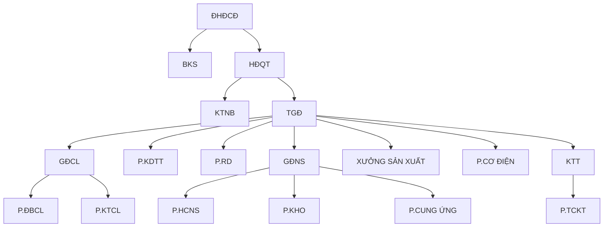

# BÁO CÁO THƯỜNG NIÊN NĂM 2025
**CÔNG TY CỔ PHẦN DƯỢC PHẨM PHONG PHÚ**
**Mã chứng khoán: PPP**

---

**CÔNG TY CỔ PHẦN DƯỢC PHẨM PHONG PHÚ**  
Số: 0226/BCTN-PP  

**CỘNG HÒA XÃ HỘI CHỦ NGHĨA VIỆT NAM**  
**Độc lập – Tự do – Hạnh phúc**  

*(Chữ ký số: CÔNG TY CỔ PHẦN DƯỢC PHẨM PHONG PHÚ; MST: 0301427564; Ngày ký: 2026-04-13 17:27:20)*

---

# BÁO CÁO THƯỜNG NIÊN
### Năm báo cáo 2025

---

## I. Thông tin chung:

### 1. Thông tin khái quát:
- **Tên giao dịch:** CÔNG TY CỔ PHẦN DƯỢC PHẨM PHONG PHÚ
- **Giấy chứng nhận đăng ký doanh nghiệp số:** 0 3 0 1 4 2 7 5 6 4
- **Vốn điều lệ:** 87.999.910.000 đồng *(Bằng chữ: Tám mươi bảy tỷ chín trăm chín mươi chín triệu chín trăm mười ngàn đồng)*
- **Địa chỉ:** Lô số 12, Đường số 8, KCN Tân Tạo, Phường Tân Tạo, TP.HCM
- **Điện thoại:** (028) 3754 7999; **Fax:** (028) 3754 7996
- **Người đại diện pháp luật:** Ông THÁI NHÃ NGÔN – Tổng Giám đốc
- **Website:** www.duocphongphu.com.vn
- **Mã cổ phiếu:** PPP

**Quá trình hình thành và phát triển:**
- Công ty Cổ phần Dược phẩm Phong Phú (gọi tắt là Công ty) được thành lập ngày 20/08/2000, theo quyết định số 8030/QĐ-UB-KT ký ngày 28/12/1999 của Ủy ban Nhân dân TP.HCM.
- Thời điểm niêm yết: 18/07/2011.

### 2. Ngành nghề và địa bàn kinh doanh:
- **Ngành nghề kinh doanh chính:** Sản xuất, kinh doanh thuốc và thực phẩm bảo vệ sức khỏe.
- **Địa bàn kinh doanh:** Toàn quốc.

### 3. Thông tin về mô hình quản trị, tổ chức kinh doanh và bộ máy quản lý:
- **Mô hình quản trị:** Đại hội đồng Cổ đông (ĐHĐCĐ), Hội đồng Quản trị (HĐQT), Ban Kiểm Soát (BKS), Tổng Giám đốc.
- **Cơ cấu bộ máy quản lý:** theo sơ đồ tổ chức dưới đây:

*Cơ cấu chi tiết bộ máy quản lý:*
- **Đại hội đồng Cổ đông (ĐHĐCĐ)**
  - **Ban Kiểm soát (BKS)**
  - **Hội đồng Quản trị (HĐQT)**
    - **Kiểm toán nội bộ (KTNB)**
    - **Tổng Giám đốc (TGĐ)**
      - **Giám đốc Chất lượng (GĐCL):** Phòng Đảm bảo Chất lượng (P.ĐBCL), Phòng Kiểm tra Chất lượng (P.KTCL).
      - **Phòng Kinh doanh - Tiếp thị (P.KDTT)**
      - **Phòng Nghiên cứu và Phát triển (P.RD)**
      - **Giám đốc Nhân sự (GĐNS):** Phòng Hành chính - Nhân sự (P.HCNS), Phòng Kho vận (P.KHO), Phòng Cung ứng (P.CUNG ỨNG).
      - **Xưởng Sản xuất**
      - **Phòng Cơ điện (P.CƠ ĐIỆN)**
      - **Kế toán trưởng (KTT):** Phòng Tài chính - Kế toán (P.TCKT).

- **Công ty con:** Công ty TNHH Usar Việt Nam
  + Địa chỉ: Lô 12, Đường số 8, KCN Tân Tạo, Phường Tân Tạo, TP. HCM.
  + Lĩnh vực kinh doanh chính: Bán buôn và bán lẻ thuốc, thực phẩm bảo vệ sức khỏe.
  + Công ty Phong Phú góp 100% tổng số vốn điều lệ 2.000.000.000 đ *(Hai tỷ đồng)*.

### 4. Định hướng phát triển:
- **Các mục tiêu chủ yếu của Công ty:**
  + Tiếp tục phát triển và nâng cao chất lượng nguồn nhân lực, nâng cao thu nhập cho người lao động, giúp ổn định sản xuất, tăng hiệu quả và tăng chất lượng sản phẩm, tạo được lòng tin với người tiêu dùng.
  + Tiếp tục cơ cấu hoàn chỉnh danh mục sản phẩm và đẩy mạnh phát triển các sản phẩm thuộc nhóm chiến lược và các sản phẩm đông dược, có nguồn gốc từ dược liệu vốn là thế mạnh của Công ty.
  + Tiếp tục đầu tư mới các dây chuyền máy móc hiện đại, cải tiến, nâng cấp thiết bị cho nhà xưởng nhằm rút ngắn thời gian sản xuất, giảm chi phí, nâng cao chất lượng sản phẩm, đảm bảo được tiến độ và năng suất đề ra. Cải tạo và nâng cấp cơ sở vật chất nhằm đảm bảo an toàn lao động và nâng cao năng suất, hiệu quả làm việc.
  + Xây dựng đội ngũ kinh doanh lớn mạnh và chuyên nghiệp, là cầu nối để phát triển sản phẩm góp phần đưa thương hiệu PP.Pharco đến từng khách hàng.
- **Chiến lược phát triển trung và dài hạn:**
  + Tiếp tục đẩy mạnh nghiên cứu các sản phẩm thuốc có nguồn gốc từ dược liệu mang giá trị cao, đồng thời cải tiến nâng cao chất lượng các sản phẩm hiện tại, gia tăng năng lực cạnh tranh của sản phẩm hướng tới mục tiêu tối đa hóa lợi nhuận.
  + Lựa chọn các sản phẩm tiềm năng làm tương đương sinh học phù hợp với xu thế và quy định hiện hành.
  + Xây dựng mối quan hệ bền chặt với các nhà cung cấp tin cậy, vững mạnh.
  + Đầu tư dây chuyền chiết xuất dược liệu để chủ động trong sản xuất.
  + Hoàn chỉnh hệ thống quản lý mạng lưới phân phối trên cả nước.
  + Xây dựng mức tăng trưởng doanh thu bình quân mỗi năm từ 05% đến 08%.
  + Đảm bảo đời sống và thu nhập của người lao động tăng trưởng hàng năm.
- **Các mục tiêu phát triển bền vững:**
  + Mục tiêu phát triển bền vững dựa trên nền tảng từng bước tăng trưởng qua hàng năm.
  + Phát triển các sản phẩm có nguồn gốc từ dược liệu nhằm tối ưu hóa việc điều trị và góp phần giảm thiểu các tác dụng phụ khi sử dụng thuốc trong quá trình điều trị.
  + Nước thải, không khí, rác thải được xử lý và thu gom đúng quy định đảm bảo môi trường sản xuất xanh, sạch, đẹp.
  + Nhận diện các vấn đề rủi ro liên quan đến phát triển bền vững trong quá trình hoạt động sản xuất kinh doanh.
  + Tất cả các yếu tố về lợi ích của Công ty hài hòa với lợi ích của người lao động, khách hàng, đối tác và cổ đông.

### 5. Các rủi ro:
**a. Rủi ro thị trường:**
- **Rủi ro về tỷ giá, lãi suất:**
  + Công ty có rất ít rủi ro ngoại tệ do việc mua và bán hàng hóa, dịch vụ được thực hiện bằng đơn vị tiền tệ kế toán chủ yếu là đồng Việt Nam.
  + Công ty không có rủi ro lãi suất do các khoản vay phát hành theo lãi suất cố định.
- **Rủi ro về biến động giá cả nguyên vật liệu:**
  + Tình hình chính trị và kinh tế thế giới tiếp tục bất ổn làm ảnh hưởng tiêu cực đến hoạt động thương mại, giá nguyên vật liệu, hàng hóa toàn cầu tăng cao làm ảnh hưởng đến giá thành sản phẩm.
  + Để giảm thiểu ảnh hưởng của biến động rủi ro về giá cả nguyên vật liệu, Công ty thường xuyên theo dõi tình hình thị trường để dự báo chính xác và có kế hoạch hoạt động phù hợp, đồng thời Công ty tiếp tục ký kết hợp đồng cung ứng với các nhà cung cấp uy tín, vững mạnh ngay từ đầu năm để ổn định giá cả và đảm bảo cơ số hàng tồn kho nhằm hạn chế tối đa sự biến động giá.
- **Rủi ro khác:**
  + Các rủi ro khác như: thiên tai, dịch bệnh, hỏa hoạn, lũ lụt… là những rủi ro bất khả kháng, nếu xảy ra sẽ gây thiệt hại cho tài sản, con người và tình hình hoạt động của Công ty. Công ty ngoài việc ký hợp đồng bảo hiểm tài sản với Công ty Bảo hiểm BIDV Hồ Chí Minh còn thực hiện nhiều chủ trương, chính sách, phương án khác phù hợp với tình hình thực tế từng giai đoạn.

**b. Rủi ro tín dụng:**
- Công ty giảm thiểu rủi ro tín dụng bằng cách đưa ra chính sách tín dụng phù hợp cho từng đối tượng khách hàng và thường xuyên theo dõi tình hình công nợ để đôn đốc thu hồi. Do đó, khoản phải thu của Công ty liên quan đến nhiều khách hàng khác nhau nên rủi ro tín dụng không tập trung vào một khách hàng nhất định.
- Phần lớn tiền gửi ngân hàng của Công ty được gửi tại các ngân hàng lớn, có uy tín ở Việt Nam, mức độ tập trung rủi ro tín dụng đối với tiền gửi ngân hàng là rất thấp.

**c. Rủi ro thanh khoản:**
- Rủi ro thanh khoản là rủi ro Công ty gặp khó khăn khi thực hiện nghĩa vụ tài chính do thiếu tiền, chủ yếu phát sinh từ việc các tài sản tài chính và nợ phải trả tài chính có các thời điểm đáo hạn lệch nhau.
- Công ty quản lý rủi ro thông qua việc duy trì một lượng tiền và các khoản tương đương tiền, phù hợp với các khoản vay ở mức đủ để đáp ứng nhu cầu hoạt động của Công ty nhằm giảm thiểu ảnh hưởng của những biến động về luồng tiền.
- Công ty có khả năng thanh toán các khoản nợ đến hạn từ dòng tiền hoạt động kinh doanh và tiền thu từ các tài sản tài chính đáo hạn.

---

## II. Tình hình hoạt động trong năm

### 1. Tình hình hoạt động sản xuất kinh doanh:
*Đơn vị tính: đồng*

| STT | Chỉ tiêu | Năm 2024 | Năm 2025 |
|:---:|---|---:|---:|
| 1. | Doanh thu bán hàng và cung cấp dịch vụ | 138.083.181.031 | 141.121.712.105 |
| 2. | Các khoản giảm trừ doanh thu | 535.318.494 | 1.382.046.865 |
| 3. | Doanh thu thuần bán hàng và cung cấp dịch vụ | 137.547.862.537 | 139.739.665.240 |
| 4. | Giá vốn hàng bán | 91.143.638.501 | 90.410.765.807 |
| 5. | Lợi nhuận gộp về bán hàng và cung cấp dịch vụ | 46.404.224.036 | 49.328.899.433 |
| 6. | Doanh thu hoạt động tài chính | 1.390.563.903 | 1.718.879.000 |
| 7. | Chi phí tài chính | 33.596.069 | 125.471.943 |
| | *Trong đó: Chi phí lãi vay* | *0* | *85.173.859* |
| 8. | Chi phí bán hàng | 13.366.814.606 | 14.402.295.682 |
| 9. | Chi phí quản lý doanh nghiệp | 12.781.925.815 | 13.726.671.496 |
| 10. | Lợi nhuận thuần từ hoạt động kinh doanh | 21.612.451.449 | 22.793.339.312 |
| 11. | Thu nhập khác | 202.639.166 | 408.681.839 |
| 12. | Chi phí khác | 4.599.730 | 5.494.454 |
| 13. | Lợi nhuận khác | 198.039.436 | 403.187.385 |
| 14. | Tổng lợi nhuận kế toán trước thuế | 21.810.490.885 | 23.196.526.697 |
| 15. | Chi phí thuế TNDN hiện hành | 4.589.569.518 | 4.960.753.698 |
| 16. | Chi phí thuế TNDN hoãn lại | (138.225.266) | (318.917.428) |
| 17. | Lợi nhuận sau thuế thu nhập doanh nghiệp | 17.359.146.633 | 18.554.690.427 |
| 18. | Lãi cơ bản trên cổ phiếu | 1.767 | 1.883 |
| 19. | Lãi suy giảm trên cổ phiếu | 0 | 0 |

- **Tình hình thực hiện so với kế hoạch:**

*Đơn vị tính: đồng*

| Chỉ tiêu | Kế hoạch 2025 | Thực hiện 2025 | Tỷ lệ hoàn thành |
|---|---:|---:|---:|
| Doanh thu thuần | 150.000.000.000 | 139.739.665.240 | 93% |
| Lợi nhuận sau thuế | 15.000.000.000 | 18.554.690.427 | 123% |
| Tỷ lệ chi trả cổ tức/ mệnh giá (%) | 15% | 15% | 100 % |

### 2. Tổ chức và nhân sự:
- **Danh sách Ban điều hành:**

| STT | HỌ VÀ TÊN | CHỨC DANH | CHUYÊN MÔN | SỐ CP | TỶ LỆ | GHI CHÚ |
|:---:|---|---|---|---:|---:|---|
| 1 | Thái Nhã Ngôn | Tổng Giám đốc | Cử nhân QTKD | 4.044.580 | 45,96% | |
| 2 | Nguyễn Thị Anh Chi | Kế toán trưởng | Cử nhân Kinh tế | 00 | 00% | |

- **Số lượng cán bộ, nhân viên:** 204 người (31/12/2025). Trong đó:
  • Ban Tổng Giám đốc: 02 người  
  • Phòng Hành chính - Nhân sự: 07 người  
  • Phòng Tài chính - Kế toán: 09 người  
  • Phòng Kinh doanh - Tiếp thị: 61 người  
  • Phòng Cung ứng: 03 người  
  • Phòng Kho vận: 15 người  
  • Phòng Nghiên cứu phát triển: 15 người  
  • Phòng Cơ điện – Bảo trì: 06 người  
  • Phòng Đảm bảo Chất lượng: 13 người  
  • Phòng Kiểm tra Chất lượng: 14 người  
  • Bộ phận Sản xuất: 59 người.

- **Tóm tắt chính sách và thay đổi trong chính sách đối với người lao động:**
  • **Chế độ làm việc:**
    - Thời giờ làm việc của Nhân viên công ty là 48 giờ/tuần. Tùy theo kế hoạch sản xuất kinh doanh, người sử dụng lao động và người lao động thỏa thuận làm thêm giờ. Chế độ làm thêm giờ được thực hiện theo quy định của Công ty trên cơ sở quy định của Bộ Luật Lao động.
    - Hàng năm, nhân viên trực tiếp sản xuất được cung cấp đồ bảo hộ lao động. Công ty luôn tạo điều kiện môi trường vệ sinh công nghiệp sạch, đẹp, an toàn cho khu vực trực tiếp sản xuất. Bộ phận văn phòng được trang bị đầy đủ thiết bị cho nhân viên thực hiện công việc.
  • **Chính sách lương, thưởng, phúc lợi:**
    - **Chính sách lương:** Công ty xây dựng hệ thống thang bảng lương rõ ràng, minh bạch theo quy định pháp luật và thực tế tại đơn vị. Mức lương quy định luôn cao hơn mức quy định của Nhà nước. Việc xét nâng lương cũng được quy định rõ để người lao động được biết và thực hiện. Ngoài việc nâng lương định kỳ, người lao động được nâng lương trước thời hạn khi có thành tích tốt trong công việc.
    - **Chính sách thưởng:** Công ty có quy chế thi đua khen thưởng, nhằm khen thưởng kịp thời đối với cá nhân và tập thể có công lao đóng góp cho Công ty. Công ty có chính sách khuyến khích người lao động đưa ra những cải tiến, sáng kiến, giải pháp hữu ích cho quá trình sản xuất kinh doanh, đi kèm theo đó là những phần thưởng bằng hiện vật và hiện kim. Những cá nhân có thành tích, hiệu quả làm việc tốt còn được xem xét nâng lương trước thời hạn hoặc bổ nhiệm ở vị trí cao hơn.
    - **Chính sách phúc lợi:** Công ty xây dựng chính sách phúc lợi rõ ràng, công bằng và minh bạch cho toàn thể CB-CNV như khám sức khỏe định kỳ, nghỉ mát, thăm hỏi khi người lao động bị ốm đau, thai sản, tang chế, hiếu hỉ, thưởng đánh giá xếp loại cuối năm, thưởng thâm niên, chi trả chi phí đào tạo theo yêu cầu công việc…

### 3. Tình hình đầu tư, tình hình thực hiện các dự án:
**a. Các khoản đầu tư lớn:** Trong năm 2025, Công ty đã thực hiện việc đầu tư:
- Nâng cấp nhà xưởng, tổng giá trị đầu tư 2.563.907.604 đồng.
- Đầu tư mới máy móc thiết bị sản xuất, kiểm nghiệm: tổng giá trị đầu tư 1.182.935.775 đồng.

**b. Các công ty con, công ty liên kết:**  
Tổng kết năm 2025, Công ty TNHH Usar Việt Nam (là công ty con, 100% vốn của Công ty) mang lại lợi nhuận sau thuế là 3.877.166.398 đồng.

### 4. Tình hình tài chính:
**a. Tình hình tài chính hợp nhất:**  
*Đơn vị tính: đồng*

| Chỉ tiêu | Năm 2024 | Năm 2025 | % Tăng/ Giảm |
|---|---:|---:|---:|
| - Tổng giá trị tài sản | 167.142.294.804 | 176.721.428.196 | 5,73% |
| - Doanh thu thuần | 137.547.862.537 | 139.739.665.240 | 1,59% |
| - Lợi nhuận thuần từ hoạt động kinh doanh | 21.612.451.449 | 22.793.339.312 | 5,46% |
| - Lợi nhuận khác | 198.039.436 | 403.187.385 | 103,59% |
| - Tổng lợi nhuận kế toán trước thuế thu nhập doanh nghiệp: | 21.810.490.885 | 23.196.526.697 | 6,35% |
| - Lợi nhuận sau thuế thu nhập doanh nghiệp: | 17.359.146.633 | 18.554.690.427 | 6,89% |
| - Lãi cơ bản trên cổ phiếu | 1.767 | 1.883 | 6,56% |

**b. Các chỉ tiêu tài chính chủ yếu:**

| Các chỉ tiêu | Năm 2024 | Năm 2025 | Ghi chú |
|---|---:|---:|---|
| **1. Chỉ tiêu về khả năng thanh toán** | | | |
| - Hệ số thanh toán ngắn hạn: TSLĐ/Nợ ngắn hạn | 2,89 | 2,66 | |
| - Hệ số thanh toán nhanh: (TSLĐ - Hàng tồn kho)/Nợ ngắn hạn | 1,72 | 1,60 | |
| **2. Chỉ tiêu về cơ cấu vốn** | | | |
| - Hệ số Nợ/Tổng tài sản | 0,19 | 0,21 | |
| - Hệ số Nợ/Vốn chủ sở hữu | 0,23 | 0,27 | |
| **3. Chỉ tiêu về năng lực hoạt động** | | | |
| - Vòng quay hàng tồn kho | 2,65 | 2,35 | |
| - Vòng quay tổng tài sản | 0,84 | 0,81 | |
| **4. Chỉ tiêu về khả năng sinh lời** | | | |
| - Hệ số Lợi nhuận sau thuế/Doanh thu thuần | 12,62% | 13,28% | |
| - Hệ số Lợi nhuận sau thuế/Vốn chủ sở hữu | 12,82% | 13,37% | |
| - Hệ số Lợi nhuận sau thuế/Tổng tài sản | 10,39% | 10,50% | |
| - Hệ số Lợi nhuận từ hoạt động kinh doanh/Doanh thu thuần | 15,71% | 16,31% | |

### 5. Cơ cấu cổ đông, thay đổi vốn đầu tư của chủ sở hữu:
**a. Cổ phần:**

| Số và Loại CP đang lưu hành: Phổ thông | Khác | Tổng | Tình trạng chuyển nhượng: Tự do | Hạn chế | Tổng | Ghi chú |
|:---:|:---:|:---:|:---:|:---:|:---:|---|
| 8.799.991 | - | 8.799.991 | 8.799.991 | 0 | 8.799.991 | Tự do chuyển nhượng |

**b. Cơ cấu cổ đông:** *(Cổ đông lớn – Cổ đông nhỏ; Cổ đông tổ chức – Cổ đông cá nhân; Cổ đông trong nước – Cổ đông nước ngoài; Cổ đông Nhà nước – các cổ đông khác) – 31/12/2025:*

| STT | LOẠI CỔ ĐÔNG | SỐ CP SỞ HỮU | TỶ LỆ SỞ HỮU (%) |
|:---:|---|---:|---:|
| **1** | **- Cổ đông lớn:** | **5.744.556** | **65,28%** |
| | - Cổ đông nhỏ: | 3.055.435 | 34,72% |
| | - Tổng: | 8.799.991 | 100% |
| **2** | **- Cổ đông tổ chức:** | **728.160** | **8,27%** |
| | - Cổ đông cá nhân: | 8.071.831 | 91,73% |
| | - Tổng: | 8.799.991 | 100% |
| **3** | **- Cổ đông trong nước:** | **8.059.261** | **91,58%** |
| | - Cổ đông nước ngoài: | 740.730 | 8,42% |
| | - Tổng: | 8.799.991 | 100% |
| **4** | **- Cổ đông nhà nước:** | **0** | **00%** |
| | - Cổ đông khác: | 8.799.991 | 100% |
| | - Tổng: | 8.799.991 | 100% |

- **c. Tình hình thay đổi vốn đầu tư của chủ sở hữu:** Vốn đầu tư chủ sở hữu trong năm 2025 không thay đổi.
- **d. Giao dịch cổ phiếu quỹ:** không có.
- **e. Các chứng khoán khác:** không có.

### 6. Báo cáo tác động đến môi trường và xã hội của Công ty:
**a. Tiêu thụ năng lượng điện:**
- Lượng điện sử dụng trung bình khoảng: 99.126 kwh/tháng.
- Điện được cung cấp chủ yếu cho các nhu cầu: chiếu sáng, vận hành máy móc thiết bị phục vụ nhu cầu sản xuất kinh doanh của Công ty.
- **Giải pháp tiết kiệm:** Việc sử dụng các thiết bị một cách tiết kiệm luôn được Công ty chú trọng, đảm bảo nằm trong giới hạn Công ty đề ra; quy định về chế độ và thời gian sử dụng các trang thiết bị điện.

**b. Tiêu thụ nước:**
- Nguồn cung cấp nước: Cty CP Đầu tư – Khai thác – Sản xuất & Cung cấp nước sạch ITA.
- Lưu lượng nước sử dụng trung bình khoảng: 461 m3/tháng, tương đương 18 m3/ngày.

**c. Tuân thủ pháp luật về bảo vệ môi trường:**
- Công ty luôn tuân thủ pháp luật về bảo vệ môi trường. Hàng năm, Công ty đều lập báo cáo “Công tác bảo vệ môi trường” trong đó báo cáo các vấn đề về: công trình bảo vệ môi trường đối với nước thải, công trình bảo vệ môi trường đối với khí thải, quản lý chất thải rắn, tình hình thu gom, vận chuyển, xử lý CTRSH, CTRCNTT, CTNH, tình hình quản lý phế liệu nhập khẩu…
- Trong những năm vừa qua Công ty chưa từng bị xử phạt vi phạm do không tuân thủ pháp luật và các quy định về môi trường.

**d. Chính sách liên quan đến người lao động:**
- ➢ **Số lượng lao động:** 204 người, thu nhập bình quân: 12.620.123 đ/người/tháng.
- ➢ **Chính sách lao động nhằm đảm bảo sức khỏe, an toàn và phúc lợi cho người lao động:**
  + **Bảo hiểm và phúc lợi:** 100% Cán bộ công nhân viên Công ty ký hợp đồng lao động được hưởng đầy đủ chế độ BHXH-BHYT-BHTN đúng quy định hiện hành. Chế độ nghỉ phép được thực hiện đúng theo quy định của Bộ Luật Lao động. Các mức chi thăm hỏi, hiếu, hỷ, trợ cấp khó khăn cho người lao động được trích từ Quỹ phúc lợi.
  + Định kỳ Công ty mời chuyên gia đào tạo, huấn luyện về an toàn lao động và các kỹ năng sơ cấp cứu, Phòng cháy chữa cháy.
  + Công ty tổ chức khám sức khỏe cho người lao động theo định kỳ mỗi năm một lần.
- ➢ **Hoạt động đào tạo người lao động:**
  + **Đào tạo về chuyên môn:** Công ty có chính sách đào tạo nội bộ định kỳ hàng năm và gửi nhân viên tham gia các lớp đào tạo bên ngoài đào tạo kỹ năng, chuyên môn nghiệp vụ … tuỳ theo tính chất, yêu cầu công việc cần đào tạo, Công ty tạo điều kiện về thời gian học tập.
  + **Đào tạo về quản lý:** Thực hiện nâng cao tính chuyên nghiệp trong quản lý, Công ty thường xuyên cử nhân viên tham gia các lớp quản lý ngắn hạn phục vụ cho công việc quản lý, điều hành.
  + Với mục tiêu phát triển bền vững và lâu dài, Công ty đã xây dựng chính sách đối với người lao động theo định hướng:
    * Hỗ trợ, tạo mọi điều kiện để người lao động phát huy khả năng trong học tập nâng cao kiến thức chuyên môn nghiệp vụ và thăng tiến trong công việc, các Phòng/Bộ phận trong Công ty luôn chú trọng đào tạo cho đội ngũ kế thừa.
    * Đào tạo và sắp xếp nguồn nhân lực phù hợp với tình hình của Công ty.
- ➢ **Báo cáo liên quan đến trách nhiệm đối với cộng đồng địa phương:**
  Hàng năm Công ty đều có các hoạt động hướng về cộng đồng như:
  + Tài trợ Hội Chữ Thập Đỏ Huyện Châu Thành, Tỉnh An Giang.
  + Tài trợ cho Đoàn Thanh Niên Cộng Sản Hồ Chí Minh Huyện Krông Pa, Tỉnh Gia Lai.
  + Phối hợp Hội Quân Dân Y Việt Nam tài trợ cho chương trình "Gieo yêu thương Tây Ninh".
  + Phối hợp Đại Học Y Dược Thành Phố Hồ Chí Minh tài trợ cho chương trình Blouse trắng tình nguyện Mùa Hè Xanh - Mặt trận Bình Thuận 2025.
  + Tài trợ cho chương trình khám tư vấn sức khỏe và tặng quà cho gia đình chính sách, người có công tại xã Đồng Khởi, Tỉnh Vĩnh Long.
  + Phối hợp Đoàn TNCS Hồ Chí Minh Xã Ia Dreh, Tỉnh Gia Lai (trụ sở Đảng Ủy- Uỷ Ban MTTQ Việt Nam) tài trợ chương trình ngày hội "Hành trình vì sức khỏe, tình nguyện vì sức khỏe cộng đồng năm 2025".
  + Ngoài ra, Công ty còn trực tiếp tham gia phát thuốc, thực phẩm bảo vệ sức khỏe và quyên góp ủng hộ cho đồng bào vùng lũ các tỉnh miền Trung (Bình Định, Phú Yên).

---

## III. Báo cáo và đánh giá của Ban Tổng Giám đốc

### 1. Đánh giá kết quả hoạt động sản xuất kinh doanh:
- Hoạt động sản xuất kinh doanh năm 2025 chưa đạt chỉ tiêu về doanh thu nhưng vượt chỉ tiêu lợi nhuận là do các yếu tố sau:
  + Công ty tiếp tục chú trọng xây dựng đội ngũ quản lý, đảm bảo thu nhập cho người lao động, đảm bảo tính ổn định và không ngừng nâng cao năng lực mỗi cá nhân, thường xuyên đào tạo nội bộ để cập nhật kiến thức chuyên môn cho đội ngũ nhân sự.
  + Bám sát tình hình thị trường, tái cơ cấu danh mục sản phẩm, phân nhóm sản phẩm cho các kênh kinh doanh khác nhau nhằm tối ưu hóa hiệu quả hoạt động của từng kênh.
  + Tập trung đầu tư cho công tác kiểm nghiệm, đảm bảo kiểm soát được chất lượng ngay từ đầu vào, giúp nâng cao giá trị của sản phẩm khi đưa ra thị trường.
  + Từng bước hoàn thiện quy trình đăng ký hồ sơ của Phòng Nghiên cứu Phát triển.
  + Cải tiến quy trình sản xuất, cải tạo và tiếp tục đầu tư mới máy móc thiết bị cho Xưởng Sản xuất… giúp tiết kiệm chi phí, nâng cao hiệu suất sử dụng máy móc thiết bị, tối ưu hóa nguồn lực lao động.
- Kết quả kinh doanh năm 2025 Công ty chưa đạt được kế hoạch doanh thu đề ra do gặp không ít khó khăn, thách thức từ các yếu tố bên ngoài:
  + Tình hình chính trị và kinh tế thế giới tiếp tục bất ổn làm ảnh hưởng tiêu cực đến hoạt động thương mại, giá nguyên vật liệu, hàng hóa toàn cầu tăng cao làm ảnh hưởng đến giá thành sản phẩm.
  + Năm 2025 có thể nói là một năm có quá nhiều bất ổn trong mảng sản xuất và kinh doanh hóa mỹ phẩm, TP. BVSK, cũng như dược phẩm… ảnh hưởng đến tâm lý chung của người tiêu dùng, làm giảm doanh số đáng kể trong một giai đoạn.

### 2. Tình hình tài chính:
**a. Tình hình tài sản:** Năm qua, công tác quản lý sử dụng tài sản được thực hiện tốt, hiệu quả. Nợ phải thu xấu, tài sản xấu không đáng kể và không ảnh hưởng đến kết quả hoạt động sản xuất kinh doanh.  
**b. Tình hình nợ phải trả:** Công ty vẫn kiểm soát tốt, thanh toán đúng kỳ hạn và không để tình hình nợ phải trả ảnh hưởng đến kế hoạch sản xuất kinh doanh của Công ty.

### 3. Những cải tiến về cơ cấu tổ chức, chính sách, quản lý:
- Trong năm 2025 cơ cấu tổ chức của Công ty không thay đổi so với năm 2024.
- Thường xuyên đánh giá chất lượng nguồn nhân lực bằng hiệu quả công việc (KPIs), bố trí công việc hợp lý, đào tạo và phát triển đội ngũ và chuẩn bị đội ngũ kế thừa.

### 4. Kế hoạch phát triển trong tương lai:
Ban Tổng Giám đốc và Hội đồng quản trị thống nhất kế hoạch và định hướng phát triển trong tương lai như sau:
- Tiếp tục giám sát đối với hoạt động của Ban Tổng Giám đốc và các cán bộ quản lý trong việc thực thi các Nghị quyết của Đại hội đồng cổ đông, Hội đồng quản trị đảm bảo đúng qui định của pháp luật và hoàn thành chỉ tiêu kinh doanh.
- Tiếp tục phát triển, nâng cao chất lượng NNL, nâng cao thu nhập cho người lao động.
- Xây dựng đội ngũ kinh doanh lớn mạnh và chuyên nghiệp.
- Tiếp tục đầu tư mới các dây chuyền máy móc hiện đại, cải tạo và nâng cấp cơ sở vật chất.
- Xây dựng mối quan hệ bền chặt với các nhà cung cấp tin cậy, vững mạnh.
- Tiếp tục cơ cấu hoàn chỉnh danh mục sản phẩm, đẩy mạnh phát triển sản phẩm thuộc nhóm chiến lược và các sản phẩm đông dược có nguồn gốc từ dược liệu vốn là thế mạnh của Công ty.
- Tập trung đẩy mạnh danh mục các sản phẩm xuất khẩu, góp phần phát triển doanh số và đưa thương hiệu Dược phong Phú ra nhiều quốc gia khác trên Thế giới.
- Lựa chọn các sản phẩm tiềm năng làm tương đương sinh học phù hợp với xu thế và quy định hiện hành.
- Tiếp tục xây dựng hình ảnh doanh nghiệp mang tính nhân văn trong các hoạt động đóng góp cho cộng đồng – xã hội.
- Xây dựng các chính sách, cơ chế, sản phẩm nhằm nâng cao năng lực cạnh tranh và nhận diện thương hiệu trên thị trường.
- Kiểm soát tốt các khoản chi phí hoạt động, quản lý hiệu quả nguồn tiền, hàng. Hạn chế tối đa tình trạng nợ quá hạn của khách hàng.

### 5. Báo cáo đánh giá liên quan đến trách nhiệm về môi trường và xã hội:
- ➢ **Đánh giá liên quan đến các chỉ tiêu môi trường:**  
  Số lượng điện, nước tiêu thụ hàng tháng được kiểm soát chặt chẽ và giảm hơn so với năm trước. Định kỳ hàng năm Công ty đều lập Báo cáo đánh giá tác động môi trường, theo đó các chỉ số đánh giá môi trường đều nằm trong giới hạn cho phép. Hoạt động sản xuất tại nhà máy không gây ô nhiễm môi trường do không khí, nước trước khi ra môi trường đã được xử lý qua hệ thống HVAC, lọc F8 và hệ thống xử lý nước đạt chuẩn của Công ty.
- ➢ **Đánh giá liên quan đến vấn đề người lao động:**  
  Công ty tuân thủ các quy định của pháp luật liên quan đến người lao động. Với mục tiêu nâng cao đời sống vật chất và tinh thần cho người lao động Công ty không ngừng xây dựng môi trường làm việc thân thiện, chia sẻ và tinh thần học hỏi lẫn nhau nhằm tạo động lực tốt cho người lao động nỗ lực làm việc, phát triển bản thân và gắn bó lâu dài với Công ty.
- ➢ **Đánh giá liên quan đến trách nhiệm của doanh nghiệp đối với cộng đồng địa phương:**  
  Công ty cam kết thực hiện trách nhiệm xã hội của doanh nghiệp đối với môi trường và cộng đồng với mục tiêu chính là đảm bảo lượng khí thải, nước thải, rác thải đã qua xử lý đạt tiêu chuẩn trước khi đưa ra môi trường hoặc ký hợp đồng với đơn vị có chức năng phù hợp; tiếp tục hỗ trợ, sẻ chia với người dân bằng các chương trình hỗ trợ, cấp phát thuốc miễn phí.

---

## IV. Đánh giá của HĐQT về hoạt động của Công ty

### 1. Đánh giá của HĐQT về các mặt hoạt động của Công ty:
- HĐQT đã chủ động giám sát, định hướng và chỉ đạo hoạt động sản xuất kinh doanh theo tháng và quý, cùng với Ban TGĐ và tập thể người lao động thực hiện nhiều biện pháp khắc phục khó khăn nhằm đạt và vượt kế hoạch đề ra.

### 2. Đánh giá của HĐQT về hoạt động của Ban TGĐ Công ty:
- HĐQT luôn theo dõi, chỉ đạo hoạt động của Ban TGĐ phù hợp với tình hình sản xuất kinh doanh trong điều kiện bị ảnh hưởng bởi các yếu tố kinh tế, chính trị, xã hội vĩ mô, kịp thời giải quyết những vấn đề thuộc thẩm quyền của HĐQT.
- Ban TGĐ đã triển khai thực hiện tất cả các nhiệm vụ theo đúng tinh thần Nghị quyết, quyết định của ĐHĐCĐ và của HĐQT.
- Ban TGĐ tiếp tục chuẩn hóa các quy chế, quy định, quy trình nhất là các quy trình sản xuất nhằm phù hợp các tiêu chuẩn tiên tiến.

### 3. Các kế hoạch, định hướng của Hội đồng quản trị:
Năm 2026, HĐQT triển khai các kế hoạch và định hướng như sau:
- Chỉ đạo và kiểm soát việc thực hiện kế hoạch kinh doanh năm 2026 của Ban TGĐ nhằm thực hiện thành công các chỉ tiêu sản xuất kinh doanh đã được Đại hội đồng Cổ đông thông qua.
- Chỉ đạo xây dựng mối quan hệ bền chặt với các nhà cung cấp tin cậy, vững mạnh.
- Chỉ đạo xây dựng và chuẩn bị kế hoạch xây dựng dây chuyền chiết xuất dược liệu.
- Tiếp tục đào tạo, phát triển nguồn nhân lực và chuẩn bị đội ngũ kế thừa.
- Kiểm soát việc thực hiện các hợp đồng/giao dịch giữa Công ty với người nội bộ, người có liên quan.

---

## V. Quản trị công ty

### 1. Hội đồng quản trị:
**a. Thành viên và cơ cấu của Hội đồng quản trị:**

| Stt | Thành viên HĐQT | Chức vụ | Ngày bắt đầu/không còn là thành viên HĐQT/ HĐQT độc lập - Ngày bổ nhiệm | Ngày miễn nhiệm |
|:---:|---|---|:---:|:---:|
| 1 | Phó Nghĩa Văn | Thành viên HĐQT, Chủ tịch HĐQT từ 25/4/2025 | 18/04/2020 | |
| 2 | Lê Thanh Trúc | Chủ tịch HĐQT, hết NK từ 25/4/2025 | 25/04/2015 | 25/04/2025 |
| 3 | Thái Nhã Ngôn | Phó Chủ tịch | 2008 | |
| 4 | Nguyễn Thị Mai Nguyệt | Thành viên độc lập | 18/04/2020 | |

- **Số cổ phần sở hữu:**

| Stt | Thành viên HĐQT | Chức vụ | Số cổ phần sở hữu | Tỷ lệ |
|:---:|---|---|---:|---:|
| 1 | Phó Nghĩa Văn | Chủ tịch từ 25/4/2025 | 28.500 | 0,32% |
| 2 | Lê Thanh Trúc | Chủ tịch, hết NK từ 25/4/2025 | 1.194.276 | 13,57% |
| 3 | Thái Nhã Ngôn | Phó Chủ tịch | 4.044.580 | 45,96% |
| 4 | Nguyễn Thị Mai Nguyệt | Thành viên | 55.000 | 0,62% |

- **Thành viên Hội đồng Quản trị giữ chức vụ quản lý tại Công ty khác:**

| STT | Họ và tên | Tên Công ty | Chức vụ |
|:---:|---|---|---|
| 01 | Nguyễn Thị Mai Nguyệt | Công ty TNHH An Medicol Pharma | Tổng Giám đốc |

- **b. Các tiểu ban thuộc Hội đồng quản trị:** HĐQT không phân chia theo các tiểu ban.
- **c. Hoạt động của Hội đồng quản trị:**  
  Năm 2025 Hội đồng quản trị có 09 buổi họp với sự tham dự đầy đủ các thành viên.
  - Tất cả các vấn đề liên quan đến sản xuất, kinh doanh, đầu tư nằm trong quyền hạn, trách nhiệm của Hội đồng quản trị đều được xem xét, phân tích, đánh giá trước khi quyết nghị.
  - Các giao dịch, hợp đồng liên quan đến người nội bộ, người có liên quan được xem xét một cách cẩn trọng sao cho đảm bảo quyền lợi hợp pháp của người nội bộ, người có liên quan và của cổ đông khác cũng như lợi ích của Công ty.
  - Hội đồng quản trị giám sát thường xuyên, chặt chẽ hoạt động điều hành của Ban Tổng Giám đốc.
  - Hoạt động của Hội đồng quản trị tuân thủ đầy đủ các quy định của Điều lệ Công ty, của Quy chế tổ chức và hoạt động của Hội đồng quản trị và pháp luật hiện hành.
  - Hội đồng quản trị tổ chức các cuộc họp định kỳ hàng quý đảm bảo xử lý các công việc của Công ty. Tỷ lệ tham dự cuộc họp của các thành viên HĐQT là 100%.
  - Hội đồng quản trị chỉ đạo, giám sát hoạt động công bố thông tin đảm bảo thực hiện đúng, đủ theo quy định pháp luật hiện hành.
- **d. Hoạt động của thành viên Hội đồng quản trị độc lập:**  
  Có 02/03 thành viên Hội đồng quản trị độc lập không điều hành tại Công ty. Tuy nhiên, các thành viên này luôn tham gia đầy đủ các cuộc họp của Hội đồng quản trị để đóng góp ý kiến về những vấn đề thuộc quyền của Hội đồng quản trị. Hàng năm 02 Thành viên Hội đồng Quản trị độc lập đều lập Báo cáo đánh giá hoạt động của Hội đồng Quản trị.
- **e. Hoạt động của các tiểu ban trong Hội đồng quản trị:** không có.
- **f. Danh sách các thành viên Hội đồng quản trị có chứng chỉ đào tạo về quản trị công ty:**
  – Ông Thái Nhã Ngôn

### 2. Ban Kiểm soát:
**a. Thành viên và cơ cấu của Ban kiểm soát:**

| STT | HỌ VÀ TÊN | CHỨC DANH | SỐ CP | TỶ LỆ |
|:---:|---|---|---:|---:|
| 1 | Nguyễn Văn Chắc | Thành viên, Trưởng BKS từ 25/4/2025 | 440 | 0,005% |
| 2 | Nguyễn Hoàng Ngọc Châu | Trưởng BKS, hết nhiệm kỳ từ 25/4/2025 | 00 | 00% |
| 3 | Võ Hồng Hạnh | Thành viên từ 25/4/2025 | 00 | 00% |
| 4 | Hồ Thủy Quỳnh Như | Thành viên từ 25/4/2025 | 00 | 00% |
| 5 | Phạm Thị Minh Tâm | Thành viên BKS, hết nhiệm kỳ từ 25/4/2025 | 66.100 | 0,75% |
| | **TỔNG CỘNG** | | **66.540** | **0,75%** |

**b. Hoạt động của Ban kiểm soát:**
- Kiểm tra giám sát tuân thủ việc triển khai thực hiện các Nghị quyết Đại Hội Đồng Cổ Đông năm 2025, các quyết định của Hội đồng Quản trị theo các Quy định của Luật doanh nghiệp và điều lệ công ty.
- Kiểm tra, giám sát tình hình thực hiện kế hoạch năm 2025.
- Kiểm tra tính hợp lý, hợp pháp, tính trung thực trong quản lý, điều hành hoạt động kinh doanh, trong tổ chức công tác kế toán, thống kê và lập báo cáo tài chính:
  + Ban kiểm soát đã thực hiện công tác thẩm tra toàn bộ các Báo cáo tài chính 6 tháng và Báo cáo tài chính năm 2025 của Công ty CP Dược phẩm Phong Phú, Công ty TNHH Usar Việt Nam và các Báo cáo hợp nhất được kiểm toán bởi Công ty TNHH Kiểm toán AFC Việt Nam và bảo đảm rằng các báo cáo này đã phản ánh trung thực và hợp lý, trên các khía cạnh trọng yếu tình hình tài chính của Công ty, phù hợp với các Chuẩn mực Kế toán Việt Nam, Chế độ Kế toán Việt Nam cũng như các nguyên tắc khác theo quy định của pháp luật.
  + Ban kiểm soát cũng tổ chức các cuộc họp định kỳ 06 tháng với đầy đủ các thành viên tham gia, để tổng kết các công việc đã thực hiện trong kỳ và lập kế hoạch làm việc cho kỳ kế tiếp, cũng như lập các báo cáo kiến nghị cần thiết để gửi HĐQT.

**c. Hoạt động của Bộ phận Kiểm toán nội bộ:**
- Trong năm 2025, Bộ phận Kiểm toán nội bộ trực thuộc Ban Kiểm soát đã làm tốt chức năng, nhiệm vụ được quy định trong Quy chế bao gồm thực hiện kiểm tra, kiểm soát các hoạt động nghiệp vụ tại Công ty, góp phần giảm thiểu tối đa những rủi ro và đảm bảo tính pháp lý về chứng từ trong hoạt động sản xuất kinh doanh; tham gia đóng góp các ý kiến về các quy định và quy trình quản lý.

### 3. Các giao dịch, thù lao và các khoản lợi ích của Hội đồng quản trị, Ban Tổng Giám đốc và Ban kiểm soát, người phụ trách quản trị Công ty:
**a. Lương, thưởng, thù lao, các khoản lợi ích tính đến ngày 31/12/2025:**  
*Đvt: vnđ*

| Stt | Họ tên | Chức vụ | Thù lao | Tiền lương | Tổng thu nhập |
|:---:|---|---|---:|---:|---:|
| 01 | Phó Nghĩa Văn | Thành viên HĐQT, Chủ tịch HĐQT từ 25/4/2025 | 84.000.000 | 00 | 84.000.000 |
| 02 | Lê Thanh Trúc | Chủ tịch HĐQT hết nhiệm kỳ từ 25/4/2025 | 28.000.000 | 137.270.500 | 165.270.500 |
| 03 | Thái Nhã Ngôn | Phó Chủ tịch HĐQT, Tổng Giám đốc | 80.000.000 | 727.883.333 | 807.883.333 |
| 04 | Nguyễn Thị Mai Nguyệt | Thành viên HĐQT | 68.000.000 | 00 | 68.000.000 |
| 05 | Phạm Thị Thạch Thảo | Người phụ trách quản trị Công ty | 62.000.000 | 268.789.308 | 330.789.308 |
| 06 | Nguyễn Hoàng Ngọc Châu | Trưởng Ban Kiểm soát, hết nhiệm kỳ từ 25/4/2025 | 20.000.000 | 00 | 20.000.000 |
| 07 | Nguyễn Văn Chắc | Thành viên Ban Kiểm soát, Trưởng BKS từ 25/4/2025 | 64.000.000 | 401.053.146 | 465.053.146 |
| 08 | Phạm Thị Minh Tâm | Thành viên Ban Kiểm soát , hết nhiệm kỳ từ 25/4/2025 | 16.000.000 | 00 | 16.000.000 |
| 09 | Võ Hồng Hạnh | Thành viên Ban Kiểm soát từ 25/4/2025 | 32.000.000 | 103.593.528 | 135.593.528 |
| 10 | Hồ Thủy Quỳnh Như | Thành viên Ban Kiểm soát từ 25/4/2025 | 32.000.000 | 00 | 32.000.000 |
| 11 | Nguyễn Thị Anh Chi | Kế toán trưởng | 00 | 653.346.883 | 653.346.883 |
| | **Tổng cộng** | | **486.000.000** | **2.291.936.698** | **2.777.936.698** |

- Các khoản lợi ích phi vật chất hoặc, khoản lợi ích chưa thể/không thể lượng hoá bằng tiền khác: không có.

**b. Giao dịch cổ phiếu của người nội bộ:** không có.

**c. Hợp đồng hoặc giao dịch với người nội bộ:**  
Trong năm 2025, Công ty đã ký kết hợp đồng mua bán với Công ty TNHH An Medicol Pharma, Công ty Cổ phần Dược phẩm Unit, Công ty TNHH Usar Việt Nam, Công ty TNHH Cơ khí chính xác Minh Luân, Công ty TNHH Tuyền Hiệp theo các điều khoản như hợp đồng mẫu của Công ty và không có điều khoản có lợi hơn cho các Công ty nêu trên so với các khách hàng/nhà cung cấp khác.

**d. Việc thực hiện các quy định về quản trị công ty:**  
Công tác quản trị Công ty trong năm của Hội đồng quản trị, Ban kiểm soát và Ban điều hành được thực hiện theo quy định pháp luật, Điều lệ và các quy chế nội bộ Công ty.

---

## VI. Báo cáo tài chính (Tóm lược phần kết thúc BCTN)

### 1. Ý kiến của kiểm toán:
Báo cáo tài chính hợp nhất đã phản ánh trung thực và hợp lý, trên các khía cạnh trọng yếu, tình hình tài chính của Công ty tại ngày 31/12/2025, cũng như kết quả hoạt động kinh doanh và tình hình lưu chuyển tiền tệ cho năm tài chính kết thúc cùng ngày, phù hợp với các chuẩn mực kế toán, chế độ kế toán doanh nghiệp Việt Nam và các quy định pháp lý có liên quan đến việc lập và trình bày Báo cáo tài chính.

### 2. Báo cáo tài chính:
**CÔNG TY TNHH KIỂM TOÁN AFC VIỆT NAM**
- **Địa chỉ:** Lầu 2, Tòa nhà Indochina Park Tower, số 04 Nguyễn Đình Chiểu, Phường Tân Định, TP.Hồ Chí Minh
- **Điện thoại:** (028) 222 00 237; **Fax:** (028) 222 00 265
- **Báo cáo Kiểm toán Số:** 175/2026/BCKTHN-HCM.00623 ngày 24/03/2026 *(đính kèm)*./

---

*TP.HCM, ngày 13 tháng 04 năm 2026*  
**TỔNG GIÁM ĐỐC**  
*(Đã ký tên và đóng dấu)*  
**Thái Nhã Ngôn**  

*(Ghi chú: Toàn bộ phần Báo cáo tài chính kiểm toán đính kèm từ trang 16 đến trang 55 được bỏ qua theo quy định ngắt đọc sớm).*
