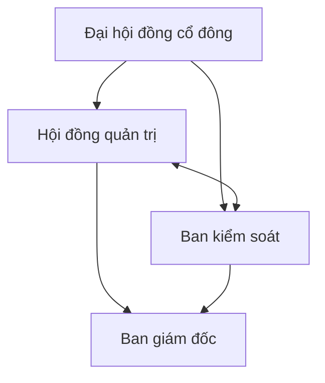
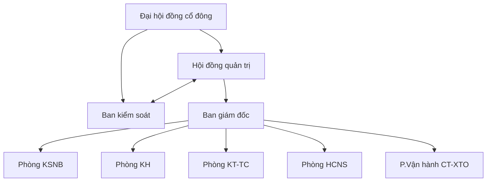

# CÔNG BỐ THÔNG TIN ĐỊNH KỲ

**CÔNG TY CỔ PHẦN CÁP TREO NÚI BÀ TÂY NINH**  
Số: 05/CBTT/TCT  

**CỘNG HÒA XÃ HỘI CHỦ NGHĨA VIỆT NAM**  
**Độc lập - Tự do - Hạnh phúc**  
*Tây Ninh, ngày 17 tháng 04 năm 2026*

**Kính gửi:** Sở Giao dịch Chứng khoán thành phố Hồ Chí Minh

1. **Tên tổ chức:** CÔNG TY CỔ PHẦN CÁP TREO NÚI BÀ TÂY NINH
- Mã chứng khoán: TCT
- Địa chỉ: Núi Bà Đen, khu phố Ninh Phú, phường Bình Minh, tỉnh Tây Ninh
- Điện thoại liên hệ: (0276) 3823448
- Email: tour@catour.com.vn

2. **Nội dung thông tin công bố:**
- Báo cáo thường niên năm 2025.

3. **Thông tin này đã được công bố trên trang thông tin điện tử của công ty vào ngày 17/04/2026 tại đường dẫn https://catour.com.vn**

Chúng tôi xin cam kết các thông tin công bố trên đây là đúng sự thật và hoàn toàn chịu trách nhiệm trước pháp luật về nội dung các thông tin đã công bố.

**Đại diện tổ chức**  
*Người được ủy quyền công bố thông tin*  
*(Đã ký và đóng dấu)*  
**Phạm Thế Hùng**

---

# BÁO CÁO THƯỜNG NIÊN NĂM 2025

**CÔNG TY CỔ PHẦN CÁP TREO NÚI BÀ TÂY NINH**  
Số: 01/2026/BC-TCT  

**CỘNG HÒA XÃ HỘI CHỦ NGHĨA VIỆT NAM**  
**Độc lập – Tự do – Hạnh phúc**  
*Tây Ninh, ngày 17 tháng 04 năm 2026*

**Năm báo cáo: Năm 2025**

**Kính gửi:**
- Ủy ban Chứng khoán Nhà nước
- Sở Giao dịch Chứng khoán TP. HCM

---

## I. THÔNG TIN CHUNG

### 1. Thông tin khái quát
- **Tên công ty:** CÔNG TY CỔ PHẦN CÁP TREO NÚI BÀ TÂY NINH
- **Tên giao dịch:** TAY NINH CABLE CAR TOUR COMPANY
- **Trụ sở chính:** Núi Bà Đen, KP. Ninh Phú, Phường Bình Minh, Tỉnh Tây Ninh.
- **Điện thoại:** (0276) 3823448
- **Website:** https://www.catour.com.vn ; **Email:** catour@catour.com.vn
- **Giấy chứng nhận đăng ký doanh nghiệp số:** 3900309621
- **Mã chứng khoán:** TCT
- **Vốn điều lệ:** 127.880.000.000 đồng.
- **Quá trình hình thành và phát triển:**  
  Công ty cổ phần Cáp treo Núi Bà Tây Ninh (“Công ty”) tiền thân là Bộ phận Cáp treo trực thuộc Công ty Du lịch Tây Ninh (nay là Công ty cổ phần Du lịch - Thương mại Tây Ninh). Bộ phận Cáp treo chính thức đi vào hoạt động ngày 08/03/1998 với chức năng kinh doanh chủ yếu là vận chuyển du khách, hàng hóa từ chân núi lên Chùa Bà bằng cáp treo và ngược lại. Trước xu thế hội nhập cũng như yêu cầu của việc mở rộng sản xuất kinh doanh, nâng cao sức cạnh tranh cho Bộ phận Cáp treo, lãnh đạo Công ty Du lịch Tây Ninh quyết định tách Bộ phận Cáp treo để thành lập một đơn vị độc lập dưới hình thức công ty cổ phần trong đó Nhà nước nắm cổ phần chi phối.  
  Ngày 10/01/2001 Bộ phận Cáp treo của Công ty Du lịch Tây Ninh chính thức chuyển thành Công ty cổ phần Cáp treo Núi Bà Tây Ninh theo Quyết định số 15/QĐ-CT của Chủ tịch UBND tỉnh Tây Ninh với vốn điều lệ ban đầu là 15.985.000.000 đồng trong đó phần vốn Công ty cổ phần Du lịch - Thương mại Tây Ninh là 8.152.600.000 đồng, chiếm 51%. Việc chuyển sang hình thức công ty cổ phần là một bước ngoặt lớn trong quá trình hình thành và phát triển của Công ty Cổ phần Cáp treo Núi Bà Tây Ninh. Từ đây hoạt động của Công ty dần đi vào ổn định và từng bước phát triển.
- **Thời điểm niêm yết:** Ngày 06/12/2006, cổ phiếu của Công ty được chính thức niêm yết trên sàn giao dịch chứng khoán Thành phố Hồ Chí Minh với mã chứng khoán là TCT. Đây là sự kiện lớn khẳng định bước đầu của sự thành công và quyết tâm không ngừng xây dựng Công ty ngày càng lớn mạnh.
- **Thời gian các mốc sự kiện quan trọng kể từ khi thành lập đến nay:**
  + Ngày 26/04/2002: Khánh thành đưa vào sử dụng công trình hệ thống máng trượt công nghệ Trung Quốc;
  + Ngày 10/02/2013: Khánh thành đưa vào sử dụng công trình hệ thống cáp treo công nghệ Châu Âu;
  + Ngày 01/01/2017: Khánh thành đưa vào sử dụng công trình Khu làm việc văn phòng Công ty;
  + Ngày 30/11/2017: Khánh thành đưa vào sử dụng công trình hệ thống xe trượt ống công nghệ Châu Âu, được nâng cấp thay cho hệ thống máng trượt Trung Quốc trước đó;
- **Các sự kiện khác:** Năm 2001 vốn điều lệ ban đầu là 15.985.000.000 đồng, đến năm 2014 được nâng lên thành 127.880.000.000 đồng (12.788.000 cổ phiếu).

### 2. Ngành nghề và địa bàn kinh doanh
- **Ngành nghề kinh doanh:** Vận chuyển khách bằng phương tiện cáp treo và xe trượt ống.
- **Địa bàn kinh doanh:** Khu Du lịch Quốc gia Núi Bà Đen (Núi Bà Đen, khu phố Ninh Phú, phường Bình Minh, tỉnh Tây Ninh).

### 3. Thông tin về mô hình quản trị và cơ cấu bộ máy quản lý

#### 3.1 Mô hình quản trị
Mô hình quản trị Công ty Cổ phần Cáp Treo Núi Bà Tây Ninh bao gồm: Đại hội đồng cổ đông, Hội đồng Quản trị, Ban Kiểm soát, Ban Giám đốc.

#### 3.2 Cơ cấu bộ máy quản lý

##### 3.2.1 Đại hội đồng cổ đông
Đại hội đồng cổ đông là cơ quan quyền lực cao nhất của Công ty, bao gồm tất cả các cổ đông có quyền biểu quyết và người được cổ đông ủy quyền.

##### 3.2.2 Hội đồng quản trị
Hội đồng quản trị do Đại hội đồng cổ đông bầu ra, là cơ quan quản lý cao nhất của Công ty, quản lý Công ty giữa 02 kỳ đại hội. Hiện tại HĐQT Công ty có 05 thành viên, nhiệm kỳ mỗi thành viên không quá 05 năm.

##### 3.2.3 Ban kiểm soát
Ban kiểm soát do Đại hội đồng cổ đông bầu ra, có nhiệm vụ kiểm tra tính hợp lý và hợp pháp trong điều hành hoạt động kinh doanh và báo cáo tài chính của Công ty. Hiện tại Ban kiểm soát có 03 thành viên, mỗi thành viên có nhiệm kỳ không quá 05 năm.

##### 3.2.4 Ban Giám đốc
Ban Giám đốc do Hội đồng quản trị bổ nhiệm, có nhiệm vụ tổ chức điều hành và quản lý mọi hoạt động kinh doanh hàng ngày của Công ty theo những chiến lược, kế hoạch đã được Hội đồng quản trị và Đại hội đồng cổ đông thông qua. Giám đốc có nhiệm kỳ không quá 05 năm.

##### 3.2.5 Phòng Hành chính – Nhân sự
Tham mưu công tác tuyển dụng, tổ chức, sắp xếp bộ máy, nhân sự toàn Công ty; Xây dựng các văn bản, nội quy, quy chế, của Công ty và hướng dẫn, kiểm tra thực hiện theo chính sách pháp luật nhà nước và quy định Công ty.

##### 3.2.6 Phòng Kế toán – Tài chính
Tham mưu công tác quản lý sử dụng vốn của Công ty đảm bảo có hiệu quả, đúng quy định.  
Ghi chép, hạch toán và phản ánh chính xác, kịp thời, trung thực, đầy đủ tình hình tài chính của Công ty; thu thập, xử lý số liệu kế toán và thực hiện công việc theo Luật kế toán và chuẩn mực kế toán hiện hành.  
Phân tích tình hình tài chính của Công ty, tham mưu, đề xuất các giải pháp quản lý, điều hành Công ty cho Ban Giám đốc Công ty; Kiểm tra, giám sát các khoản thu, chi, nghĩa vụ thu, nộp ngân sách và quản lý, đôn đốc thu hồi công nợ cho Công ty.

##### 3.2.7 Phòng Kế hoạch – Marketing
Tham mưu xây dựng các kế hoạch kinh doanh Ngắn hạn – Trung hạn – Dài hạn của công ty.  
Nghiên cứu, phát triển, tổ chức triển khai và quản lý các hoạt động kinh doanh, dịch vụ mang lại hiệu quả cao cho đơn vị.

##### 3.2.8 Phòng Vận hành cáp treo – xe trượt ống
Xây dựng kế hoạch phục vụ hàng năm, kế hoạch bảo trì, bảo dưỡng hàng tháng, hàng quý máy móc thiết bị phục vụ, nhằm đảm bảo chất lượng phục vụ tốt nhất cho khách hàng.  
Tham mưu xây dựng và bảo trì, sửa chữa hệ thống điện nước tại công ty, cũng như kinh doanh.  
Thực hiện trang trí, kiến tạo và giữ gìn cảnh quan mang bản sắc riêng của khu du lịch núi Bà Đen, tạo nên sức hút đối với du khách tham quan và tạo vị thế cạnh tranh riêng biệt mang một bản sắc.

##### 3.2.9 Phòng kiểm soát nội bộ
Tham mưu xây dựng quản trị Công ty; tổng hợp tình hình hoạt động của Công ty để tham mưu cho Ban Giám đốc Công ty trong công tác quản lý, điều hành.  
Thực hiện công tác tuyên truyền, quảng bá thương hiệu của Công ty.  
Giám sát hoạt động kinh doanh, dịch vụ, vận hành, đầu tư xây dựng việc thực hiện tuân thủ nội quy chung trong toàn công ty.

**Các công ty con, công ty liên kết:** không có.

### 4. Định hướng phát triển
- **Các mục tiêu chủ yếu của Công ty:** Hiện tại khu du lịch Quốc gia Núi Bà Đen đang đón hàng triệu lượt khách về tham quan mỗi năm. Với nhiều lợi thế phát triển mạnh du lịch văn hóa tâm linh, từ các ưu thế trên công ty đã ngày càng nâng cao chất lượng phục vụ của công ty, nhằm phát triển và mở rộng kinh doanh trong thời gian tới. Phấn đấu thực hiện hoàn thành tốt chỉ tiêu Nghị quyết Đại hội đồng cổ đông đề ra hàng năm.
- **Chiến lược phát triển trung và dài hạn:** Nâng cao chất lượng dịch vụ phục vụ Công ty đề ra, Nâng cao bản sắc văn hóa du lịch đặc trưng tại địa phương, dịch vụ khách hàng càng cao thể hiện rõ sự phát triển của công ty qua cách phục vụ, cho sự phát triển ổn định và bền vững của Công ty.
- **Các mục tiêu đối với môi trường, xã hội và cộng đồng:**
  * *Trách nhiệm đối với môi trường:* Thực hiện tốt phương châm “bảo vệ môi trường chính là bảo vệ sự sống của chúng ta”, song song đó chú trọng giữ gìn môi trường “xanh, sạch, đẹp” để phát triển du lịch bền vững, góp phần thu hút khách đến với Khu Du lịch Quốc gia Núi Bà Đen.
  * *Trách nhiệm với khách hàng:* Cung cấp dịch vụ chất lượng phục vụ tốt nhất đến với khách hàng, đáp ứng tối đa nhu cầu của quý khách hàng trên cơ sở cung cấp dịch vụ cáp treo và xe trượt ống chất lượng cao nhất.
  * *Trách nhiệm với cổ đông:* Ngày càng nâng cao giá trị bền vững dựa trên sự minh bạch về tài chính, bảo toàn và phát triển vốn, đảm bảo chi trả cổ tức cho các cổ đông và tuân thủ tốt quy định về công bố thông tin trên thị trường chứng khoán.
  * *Trách nhiệm với cộng đồng:* Phối hợp với các đơn vị ban ngành trong khu vực mang lại giá trị cho cộng đồng, cho xã hội, đồng thời cam kết thực hiện tốt nghĩa vụ tài chính đối với ngân sách Nhà nước.

### 5. Các rủi ro
- **Thời tiết:** Do đặc điểm của hệ thống cáp treo và xe trượt ống có thể vận hành trong lúc trời mưa với điều kiện mưa nhẹ và ít gió, trong trường hợp xảy ra mưa lớn hay gió mạnh thì hệ thống cáp treo và xe trượt ống buộc phải ngừng hoạt động. Tuy nhiên, do Tây Ninh là một tỉnh nằm sâu trong đất liền, giáp với Campuchia nên mức độ ảnh hưởng của thời tiết, đặc biệt là thời tiết do ảnh hưởng từ phía biển như bão, lốc,... luôn ở mức thấp hơn so với các tỉnh ven biển và các tỉnh thuộc khu vực miền Bắc, miền Trung. Như vậy, hệ thống cáp treo và xe trượt ống Tây Ninh được xây dựng ở một nơi có khí hậu khá ôn hòa và ít phải chịu những biến động bất thường của thời tiết, nên những rủi ro về thời tiết có thể được hạn chế phần nào.
- **Thiên tai:** Các rủi ro thiên tai như động đất, bão lụt, núi lửa ... là những rủi ro mang tính bất khả kháng, rất ít có khả năng xảy ra đối với con người, tài sản, máy móc thiết bị vận hành và tình hình hoạt động chung của Công ty.
- **Kỹ thuật vận hành:** Nếu một khâu nào đó trong dây chuyền vận hành hệ thống cáp treo và xe trượt ống không thực hiện đúng các quy trình kỹ thuật và nguyên tắc an toàn, hoặc do sơ suất từ phía du khách thì tai nạn có thể xảy ra và hậu quả sẽ rất nghiêm trọng vì cáp treo và xe trượt ống đều có độ cao so với mặt đất. Tai nạn xảy ra có thể ảnh hưởng đến uy tín, thương hiệu của công ty, đồng thời số lượng khách đi cáp treo và xe trượt ống sẽ sụt giảm. Để hạn chế những thiệt hại do rủi ro này gây ra, đã chuẩn mực hóa quy trình vận hành và mua bảo hiểm tai nạn cho du khách phòng ngừa tổn thất xảy ra khi tham gia dịch vụ. Việc quản lý và vận hành theo quy định hiện hành của Công ty cũng đã làm giảm nguy cơ xảy ra tai nạn do sơ suất của nhân viên vận hành. Đồng thời cũng chú trọng huấn luyện cho nhân viên về kỹ năng cứu hộ, trang bị đầy đủ các phương tiện cần thiết để phục vụ cho công tác cứu hộ khi có tai nạn. Việc quản lý và vận hành cáp treo và xe trượt ống luôn tuân thủ nghiêm ngặt các yêu cầu kỹ thuật, cán bộ - nhân viên có tinh thần trách nhiệm cao, do đó đã đảm bảo được an toàn tuyệt đối cho du khách.
- **Đối thủ cạnh tranh:** Hoạt động kinh doanh của Công ty chủ yếu vào tình hình khách đến Khu du lịch Núi Bà, doanh thu của Công ty chủ yếu từ việc vận chuyển du khách, khách hành hương lên Chùa Bà. Hiện nay có nhà đầu tư khác đồng thời khai thác kinh doanh tại Khu du lịch quốc gia núi Bà Đen, do đó áp lực cạnh tranh rất cao.

---

## II. TÌNH HÌNH HOẠT ĐỘNG TRONG NĂM 2025

### 1. Kết quả hoạt động kinh doanh năm 2025

*Đơn vị tính: đồng.*

| Stt | Chỉ tiêu | Kế hoạch 2025 | Thực hiện Năm 2025 | Thực hiện Năm 2024 | So sánh (%) KH | So sánh (%) CK |
| :-: | :--- | -: | -: | -: | -: | -: |
| 1 | Doanh thu | 53.500.000.000 | 65.144.132.212 | 48.462.052.338 | 121,76% | 134,42% |
| 2 | Lợi nhuận | 15.000.000.000 | 31.935.883.119 | 13.588.913.030 | 212,91% | 235,01% |
| 3 | Cổ tức (%/VĐL) | 5% | 5% | 5% | | |

Sản phẩm kinh doanh chủ yếu của Công ty Cổ phần Cáp treo Núi Bà Tây Ninh là dịch vụ vận chuyển hành khách, hàng hóa bằng phương tiện cáp treo – xe trượt ống.

### 2. Tổ chức và nhân sự

#### - Danh sách Ban điều hành
| Stt | Họ và tên | Chức danh | Năm sinh | Trình độ chuyên môn | Số cổ phần sở hữu | Tỷ lệ % |
| :-: | :--- | :--- | :-: | :--- | :-: | :-: |
| 1 | Trần Trung Kiên | Giám đốc | 1967 | Cử nhân Tài chính - Kế toán | 0 | 0 |
| 2 | Lâm Thị Ngọc Châu | Kế toán trưởng | 1974 | Cử nhân Kinh tế | 0 | 0 |

- **Những thay đổi trong Ban điều hành:** Không

#### - Số lượng cán bộ - nhân viên:
| Stt | Đối tượng | Số đầu kỳ | Phát sinh trong kỳ Tăng | Phát sinh trong kỳ Giảm | Số cuối kỳ |
| :-: | :--- | :-: | :-: | :-: | :-: |
| 1 | Ban giám đốc | 01 | 0 | 0 | 01 |
| 2 | Phòng kiểm soát nội bộ | 00 | 1 | 0 | 01 |
| 3 | Phòng Tài chính Kế toán | 03 | 0 | 1 | 02 |
| 4 | Phòng Hành chính nhân sự | 04 | 0 | 0 | 04 |
| 5 | Phòng Kế hoạch – Marketing | 00 | 0 | 0 | 00 |
| 6 | Phòng Vận hành CT - XTO | 12 | 0 | 0 | 12 |
| | Bộ phận Kỹ thuật | 07 | 0 | 0 | 07 |
| | **Tổng cộng** | **27** | **1** | **1** | **27** |

#### - Chính sách đối với người lao động:
Công ty thực hiện đầy đủ chế độ chính sách BHXH, BHYT, BHTN cho người lao động theo đúng quy định nhà nước, thực hiện đầy đủ và kịp thời về tiền lương hợp đồng lao động, lương tháng 13 và chi phí hỗ trợ hàng tháng cho người lao động, qua đó người lao động an tâm công tác, tập trung phục vụ khách và hoàn thành nhiệm vụ được giao.  
Công ty luôn luôn quan tâm đến đời sống vật chất, tinh thần cho người lao động, hỗ trợ tiền hiếu hỉ cho người thân ốm đau. Công ty còn tổ chức khen thưởng đột xuất và định kỳ cho các cá nhân có thành tích xuất sắc trong công ty. Tổ chức khám sức khỏe định kỳ hằng năm cho cán bộ nhân viên công ty được thực hiện đúng quy định.

### 3. Tình hình đầu tư, tình hình thực hiện các dự án:
a) Các khoản đầu tư lớn: Không.  
b) Các công ty con, công ty liên kết: Không.

### 4. Tình hình tài chính

#### a. Một số chỉ tiêu liên quan trên Bảng cân đối kế toán
*Đơn vị tính: triệu đồng.*

| Stt | Chỉ tiêu | Năm 2024 | Năm 2025 | 2025/2024 +, - |
| :-: | :--- | -: | -: | -: |
| 1 | Tổng giá trị tài sản | 343.033 | 366.985 | 6,98% |
| 2 | Doanh thu thuần | 27.109 | 43.457 | 60,3% |
| 4 | Lợi nhuận thuần từ hoạt động kinh doanh | 13.607 | 31.598 | 132,22% |
| 5 | Lợi nhuận khác | -18 | 338 | 1977,78% |
| 6 | Lợi nhuận trước thuế | 13.589 | 31.936 | 135,01% |
| 7 | Lợi nhuận sau thuế | 10.817 | 25.497 | 135,71% |
| 8 | Tỷ lệ lợi nhuận trả cổ tức | 5% | 5% | 100% |

#### b. Các chỉ tiêu tài chính chủ yếu
| Các chỉ tiêu | Đvt | Năm 2024 | Năm 2025 |
| :--- | :-: | -: | -: |
| **1. Chỉ tiêu về khả năng thanh toán** | | | |
| + Hệ số thanh toán ngắn hạn: Tài sản ngắn hạn/Nợ ngắn hạn | lần | 44,768 | 29,070 |
| + Hệ số thanh toán nhanh: (Tài sản ngắn hạn - hàng tồn kho)/Nợ ngắn hạn | lần | 43,453 | 28,441 |
| **2. Chỉ tiêu về cơ cấu vốn** | | | |
| + Hệ số nợ/Tổng tài sản: | % | 2,152 | 3,333 |
| + Hệ số nợ/Vốn chủ sở hữu: | % | 2,199 | 3,448 |
| **3. Chỉ tiêu về năng lực hoạt động** | | | |
| + Vòng quay hàng tồn kho: Giá vốn hàng bán/Hàng tồn kho bình quân | Vòng | 3,300 | 3,182 |
| + Vòng quay tổng tài sản: Doanh thu thuần/Tổng tài sản bình quân | Vòng | 0,077 | 0,122 |
| **4. Chỉ tiêu về khả năng sinh lời** | | | |
| + Hệ số lợi nhuận sau thuế/Doanh thu thuần | % | 39,900 | 58,670 |
| + Hệ số lợi nhuận sau thuế/Vốn chủ sở hữu | % | 3,223 | 7,187 |
| + Hệ số lợi nhuận sau thuế/Tổng tài sản | % | 3,153 | 6,948 |
| + Hệ số lợi nhuận từ hoạt động kinh doanh/Doanh thu thuần | % | 50,193 | 72,709 |

### 5. Cơ cấu cổ đông, thay đổi vốn đầu tư của chủ sở hữu

#### a. Cổ phần
- Tổng số cổ phần và loại cổ phần đang lưu hành: 12.788.000 cổ phần.
- Số lượng cổ phần chuyển nhượng tự do: 12.788.000 cổ phần.
- Số lượng cổ phần bị hạn chế chuyển nhượng theo quy định pháp luật, Điều lệ Công ty hay cam kết của người sở hữu: không có.

#### b. Cơ cấu cổ đông
| STT | Loại cổ đông | Số lượng cổ đông | Số cổ phiếu | Giá trị (đồng) | Tỷ lệ sở hữu/VĐL |
| :-: | :--- | :-: | :-: | -: | -: |
| **I** | **Cổ đông trong nước** | **870** | **11.483.960** | **114.839.600.000** | **89,80%** |
| 1 | Cổ đông tổ chức | 8 | 8.568.770 | 85.687.700.000 | 67,01% |
| 2 | Cổ đông cá nhân | 862 | 2.915.190 | 29.151.900.000 | 22,82% |
| **II** | **Cổ đông ngoài nước** | **43** | **1.304.040** | **13.040.400.000** | **10,20%** |
| 1 | Cổ đông tổ chức | 8 | 1.197.330 | 11.973.300.000 | 9,36% |
| 2 | Cổ đông Cá nhân | 35 | 106.710 | 1.061.000.000 | 0.84% |
| **III** | **Cổ phiếu quỹ** | **0** | **0** | **0** | **0%** |
| | **Tổng cộng** | **913** | **12.788.000** | **127.880.000.000** | **100%** |

- **c. Tình hình thay đổi vốn đầu tư của chủ sở hữu:** không có.
- **d. Giao dịch cổ phiếu quỹ:** không có.
- **e. Các chứng khoán khác:** không có.

### 6. Báo cáo tác động liên quan đến môi trường và xã hội của Công ty

#### 6.1 Tác động lên môi trường:
Tổng phát thải khí nhà kính (GHG) trực tiếp và gián tiếp: Công ty là đơn vị hoạt động trong lĩnh vực hỗ trợ du lịch nên không tạo ra khí thải nhà kính.

#### 6.2 Quản lý nguồn nguyên vật liệu:
Do hoạt động kinh doanh chính là lĩnh vực vận tải khách bằng phương tiện cáp treo và xe trượt ống nên không có nguyên vật liệu đầu vào, vật liệu tái chế để sản xuất.

#### 6.3 Tiêu thụ năng lượng:
Năng lượng tiêu thụ trực tiếp của hệ thống cáp treo và xe trượt ống là điện năng; tùy theo điều kiện trực tiếp, số lượng khách tham gia sử dụng dịch vụ mà vận hành linh hoạt các hệ thống để tiết kiệm điện năng, góp phần tiết kiệm năng lượng.  
Ngoài ra, Công ty còn sử dụng các đèn cao áp năng lượng mặt trời qua đó tiết kiệm điện năng.

#### 6.4 Tiêu thụ nước:
Công ty đã đầu tư hệ thống ống dẫn nước từ ga dưới lên ga trên cáp treo và xe trượt ống để phục vụ sinh hoạt, tưới tiêu, phòng chống cháy nổ tại Khu Du lịch Quốc gia Núi Bà Đen.
- **a. Nguồn cung cấp nước và lượng nước sử dụng:** Công ty cổ phần Cấp thoát nước Tây Ninh cung cấp nguồn nước sinh hoạt, lượng nước sử dụng bình quân là 30m³/ngày-đêm (lượng nước Công ty sử dụng trong năm 2025 là 10.944m³).
- **b. Tỷ lệ phần trăm và tổng lượng nước tái chế và tái sử dụng:** Nước thải sinh hoạt được thu gom và xử lý bằng nhà máy xử lý nước thải. Không tái chế sử dụng.

#### 6.5 Tuân thủ pháp luật về bảo vệ môi trường:
Luôn tuân thủ luật pháp và không vi phạm quy định về bảo vệ môi trường, định kỳ 6 tháng lập báo cáo đánh giá tác động môi trường, thuê đơn vị chức năng thu gom xử lý chất thải nguy hại, chất thải rắn trong Khu Du lịch Quốc gia Núi Bà Đen. Đóng thuế môi trường rừng theo quy định.
- a. Số lần bị xử phạt: không có.
- b. Tổng số tiền do bị xử phạt: không có.

#### 6.5 Chính sách liên quan đến người lao động
*(Theo nguyên bản đánh số mục của tài liệu)*
- **a. Số lượng lao động, mức tiền lương bình quân đối với người lao động:** Tổng số lao động tính đến ngày 31/12/2025 là 27 người, mức tiền lương bình quân của người lao động là 14,9 triệu đồng.
- **b. Chính sách lao động nhằm đảm bảo sức khỏe, an toàn và phúc lợi của người lao động:** Căn cứ vào tình hình hoạt động kinh doanh, Ban Giám đốc thống nhất với Ban Chấp hành Công đoàn cơ sở tập trung chăm lo cho người lao động trong các dịp lễ, tết; tổ chức cho người lao động khám sức khoẻ định kỳ, thăm hỏi khi ốm đau, ma chay, gia đình gặp khó khăn, vv.... Căn cứ theo Bộ luật lao động, Luật BHXH, BHTN, BHYT và hợp đồng lao động được ký kết, hàng tháng Công ty trích nộp theo mức tiền lương trên hợp đồng để tham gia BHXH, BHYT, BHTN và KPCĐ cho 100% người lao động.
- **c. Hoạt động đào tạo người lao động:** Năm 2025 mặc dù gặp nhiều khó khăn về nhân sự để tổ chức các hoạt động kinh doanh, nhưng với sự quyết tâm của Ban lãnh đạo Công ty cố gắng vẫn tổ chức các chương trình đào tạo nội bộ bằng các hình thức trực tiếp, trực tuyến nhằm bổ sung kiến thức và nâng cao kỹ năng cho CBNV. Số giờ đào tạo trung bình mỗi năm cho mỗi cán bộ nhân viên là 24 giờ.

#### 6.6 Báo cáo liên quan đến trách nhiệm đối với cộng đồng địa phương
Tích cực tham gia công tác từ thiện xã hội, trích quỹ phúc lợi mua quà tết tặng đồng bào nghèo các xã trong tỉnh vui tươi đón tết cổ truyền; hỗ trợ kinh phí lễ hội trong tỉnh.

#### 6.7 Báo cáo liên quan đến hoạt động thị trường vốn xanh:
Không có.

---

## III. BÁO CÁO VÀ ĐÁNH GIÁ CỦA BAN GIÁM ĐỐC

### 1. Đánh giá kết quả hoạt động kinh doanh

#### a. Về thuận lợi
- Khu Du lịch quốc gia núi Bà Đen được đầu tư với những công trình hoành tráng, song song đó là hiệu ứng truyền thông nên lượng khách đến với nơi đây khá đông đạt 5 triệu lượt khách, góp phần nâng cao hiệu quả kinh doanh trong năm 2025.
- Có lượng khách hàng truyền thống, khách hàng thân thuộc ở khắp nơi, đặc biệt là ở miền Tây Nam bộ thường xuyên sử dụng dịch vụ cáp treo và xe trượt ống nên đã phần nào giảm bớt áp lực cạnh tranh với hệ thống cáp treo khác hiện có trong Khu du lịch.
- Dịch vụ xe trượt ống của Công ty là dịch vụ hiện có duy nhất trong Khu du lịch, đây là dịch vụ vui chơi mang lại cảm giác mạnh lại được khám phá thiên nhiên được giới trẻ rất yêu thích nên mang lại hiệu quả kinh doanh khá cao, đặc biệt là trong mùa cao điểm tháng Hội xuân hàng năm.
- Nhân viên từng bước được nâng cao trình độ, thái độ phục vụ chuyên nghiệp nên đã thực hiện tốt văn hóa du lịch làm hài lòng du khách.

#### b. Về khó khăn, hạn chế:
- Tình hình kinh tế thế giới ngày càng đi xuống nói chung và Việt Nam nói riêng ảnh hưởng rất nhiều trong việc kinh doanh và phát triển cơ sở hạ tầng xây dựng trong khu du lịch.
- Công tác tuyển dụng nhân viên thời vụ rất khó khăn, do nhiều khu công nghiệp xuất hiện và quan trọng đối thủ cạnh tranh từ Tập đoàn Sun group với dịch vụ cáp treo hiện đại và chuỗi dịch vụ kèm theo, đã thu hút nhiều nhân sự lao động trên địa bàn tỉnh đã thu hút phần lớn lao động. Do đó, việc tuyển nhân viên thời vụ gặp nhiều khó khăn.

#### c. Những kết quả đạt được
- Trong hoạt động kinh doanh luôn chấp hành tốt chủ trương của Đảng, chính sách và pháp luật của Nhà nước, tổ chức thực hiện tốt nghị quyết của đại hội đồng cổ đông, nghị quyết của HĐQT, bảo toàn và phát triển vốn kinh doanh và hoàn thành nghĩa vụ đối với ngân sách Nhà nước.
- Bằng sự nỗ lực của Ban giám đốc, sự đoàn kết, gắn bó của người lao động, tình hình lợi nhuận năm 2025 hoàn thành vượt kế hoạch đã đề ra.

### 2. Tình hình tài chính

#### a. Tình hình tài sản
- Qua chỉ tiêu tổng tài sản năm 2025 so với cùng kỳ năm 2024, Công ty xét thấy có biến động (tăng 6,98%) về tình hình tài sản, về đánh giá hiệu quả sử dụng tài sản qua chỉ tiêu tỷ suất lợi nhuận trước thuế trên tổng tài sản bình quân năm 2025 là 8,7%, so với cùng kỳ năm 2024 là 3,96%.

#### b. Tình hình nợ phải trả
- Qua các chỉ tiêu về khả năng thanh toán và nợ phải trả tại thời điểm 31/12/2025, Công ty xét thấy tình hình nợ phải trả hiện tại vẫn trong khả năng thanh toán của Công ty, khả năng thanh toán tổng quát (29,07 lần).

### 3. Những cải tiến về cơ cấu tổ chức, chính sách, quản lý
- Ứng dụng công nghệ thông tin trong phục vụ trong công việc qua đó nâng cao năng suất lao động; thực hiện tái cơ cấu triệt để lại tổ chức, tinh giảm nhân sự nhằm cắt giảm chi phí thể hiện sự đa năng đa nhiệm trong từng cán bộ, nâng cao hiệu quả hoạt động kinh doanh.

### 4. Kế hoạch phát triển trong tương lai

#### 4.1 Nhiệm vụ hoạt động kinh doanh
Năm 2026 dự báo kinh tế thế giới nói chung và Việt Nam nói riêng vẫn còn nhiều khó khăn và thách thức, cuộc chiến thương mại toàn cầu diễn ra ngày càng gay gắt, ảnh hưởng tiêu cực đến nhu cầu tiêu dùng toàn cầu đối với hàng hóa sản xuất tại Việt Nam và hoạt động kinh doanh của nhiều Doanh nghiệp. Một số Doanh nghiệp sẽ tiếp tục cắt giảm lao động để giảm chi phí trong năm 2026; xu hướng giảm chi tiêu của người tiêu dùng vẫn còn tiếp diễn.

- **Kế hoạch tài chính năm 2026:**
*Đơn vị tính: triệu đồng.*

| Stt | Chỉ tiêu | Thực hiện 2025 | Kế hoạch 2026 | So sánh KH 2026/ TH 2025 |
| :-: | :--- | -: | -: | -: |
| 1 | Tổng doanh thu | 65.144 | 62.000 | 95,17% |
| 2 | Tổng chi phí | 33.208 | 34.000 | 102,38% |
| 3 | Lợi nhuận kế toán trước thuế | 31.935 | 28.000 | 87,68% |

*Ghi chú: Kế hoạch chỉ là dự thảo, chưa thông qua Đại hội đồng cổ đông.*

- Tổ chức Đại hội đồng cổ đông thường niên năm 2026.
- Tổ chức khai thác tối đa hóa công suất hoạt động dịch vụ cáp treo và xe trượt ống; tập trung công tác phục vụ và nâng cao chất lượng dịch vụ và tổ chức khai thác khách sử dụng dịch vụ cáp treo và xe trượt ống trong đợt cao điểm Hội xuân Núi Bà và các ngày lễ lớn trong năm 2026.
- Tăng cường công tác bảo trì, bảo dưỡng hệ thống cáp treo và xe trượt ống nhằm đảm bảo an toàn hoạt động phục vụ khách và hoàn thành kế hoạch kinh doanh năm 2026.

#### 4.2 Biện pháp thực hiện

##### a. Về công tác kinh doanh
- Luôn thực hiện tốt nhiệm vụ kế hoạch kinh doanh theo nghị quyết Hội đồng quản trị Công ty và Đại hội đồng cổ đông thường niên năm 2026. Ban Giám đốc báo cáo kịp thời các công tác đã thực hiện, những việc phát sinh, cũng như đề ra nhiệm vụ cụ thể từng quý, tháng và có phân kỳ kế hoạch tài chính đi kèm để phân tích, theo dõi và thực hiện đạt được mục tiêu đề ra.
- Tổ chức phục vụ tốt lượng khách đến tham gia sử dụng dịch vụ cáp treo và xe trượt ống trong những đợt cao điểm Hội xuân Núi Bà và các ngày lễ lớn trong năm 2026.
- Sẵn sàng các tình huống kinh doanh trong thời kỳ suy thoái kinh tế toàn cầu nhằm giảm mức thấp nhất ảnh hưởng của suy thoái kinh tế có thể kéo dài trong năm 2026.
- Lượng khách tham gia dịch vụ cáp treo và xe trượt ống của Công ty dự kiến sẽ giảm mạnh do lượng khách phân tán đi cáp treo của Sun World Bà Đen. Do đó, sẽ tổ chức tiếp thị, mời chào để khai thác tối đa lượng khách đến tham quan.
- Thực hiện triệt để việc tiết kiệm chi phí như tiếp tục tinh giảm nhân sự, chi phí điện, nước,... để nâng cao hiệu quả hoạt động.
- Tổ chức khảo sát lấy ý kiến khách hàng, nhằm cải tiến, nâng cao chất lượng phục vụ và đáp ứng nhu cầu tham gia sử dụng dịch vụ của khách hàng. Tổ chức xây dựng chiến lược giá thích hợp cho các loại hình dịch vụ; thực hiện các chế độ khuyến mãi giảm vé thích hợp cho từng đối tượng khách hàng để thu hút khách nhằm tận thu vào những tháng thấp điểm. Đẩy mạnh công tác maketing, chăm sóc khách hàng, xây dựng hình ảnh Công ty đối với khách hàng, củng cố và mở rộng mối quan hệ với các đơn vị lữ hành du lịch, khách hàng truyền thống, khách hàng tiềm năng và một số đối tượng khách hàng khác.

##### b. Về công tác bảo trì, bảo dưỡng thiết bị
- Công tác bảo trì, bảo dưỡng hệ thống cáp treo và xe trượt ống được thực hiện theo đúng quy trình kỹ thuật, không để xảy ra bất kỳ sự cố kỹ thuật nào do yếu tố chủ quan, đảm bảo các hệ thống được vận hành xuyên suốt; công tác kiểm định các hệ thống được chú trọng, đảm bảo các yêu cầu nghiêm ngặt theo đúng quy trình kiểm định kỹ thuật an toàn; nhập khẩu thiết bị dự phòng cho hệ thống cáp treo và xe trượt ống; định kỳ kiểm định toàn diện của hệ thống cáp treo và xe trượt ống, nhằm đảm bảo hoạt động phục vụ khách.

##### c. Về công tác đầu tư, xây dựng cơ bản
- Tiếp tục khảo sát thiết kế và tổ chức đầu tư Hệ thống hạ tầng công nghệ thông tin; Xây dựng mới nhà kho, nhà xưởng kỹ thuật.

##### d. Về công tác chăm sóc cảnh quan “xanh, sạch, đẹp”
- Công tác bảo vệ môi trường được thực hiện thường xuyên, tuân thủ đúng các quy định của các cơ quan quản lý, lập báo cáo giám sát môi trường định kỳ 6 tháng/ lần, hợp đồng thuê xử lý chất thải nguy hại, thu gom rác, chất thải rắn thông thường; thực hiện công tác hợp đồng đơn vị dịch vụ vệ sinh phục vụ tại các nhà vệ sinh, nhằm nâng cao chất lượng phục vụ khách miễn phí; thực hiện thuê đơn vị dịch vụ chăm sóc cây kiểng trong công tác chăm sóc hoa kiểng, trồng cây tạo bóng mát, vệ sinh môi trường và tạo cảnh quan xanh, sạch, đẹp trong khu vực.

### 5. Giải trình của Ban giám đốc đối với ý kiến kiểm toán:
Không có.

### 6. Báo cáo đánh giá liên quan đến trách nhiệm của Công ty đối với cộng đồng địa phương:
Không có.  
Ban lãnh đạo xác định phát triển du lịch của Công ty nói riêng và của tỉnh Tây Ninh nói chung phải đảm bảo tính bền vững, gắn với bảo vệ môi trường sinh thái, tôn tạo các tài nguyên du lịch tự nhiên và nhân văn; góp phần giữ gìn và phát huy giá trị văn hóa truyền thống; đảm bảo về an ninh, chính trị và an toàn xã hội.

#### 6.1 Đánh giá liên quan đến các chỉ tiêu môi trường (tiêu thụ nước, năng lượng, phát thải...):
- Hỗ trợ thu gom rác thải trong Khu du lịch, đặc biệt là trên mặt bằng Chùa Bà, qua đó khu du lịch trở nên khang trang, sạch đẹp, văn minh lịch sự.
- Đặc biệt, cán bộ nhân viên thường xuyên tham gia nhặt rác hưởng ứng kế hoạch “Ngày xanh tại núi Bà Đen”.
- Trong quá trình hoạt động, Công ty luôn khuyến khích các khách du lịch đề cao ý thức bảo vệ môi trường, hạn chế gây ảnh hưởng đến đời sống sinh hoạt của người dân vùng lân cận.

#### 6.2 Đánh giá liên quan đến vấn đề người lao động:
- Cán bộ nhân viên trong công ty luôn được trả lương đúng hạn, không xảy ra tình trạng thiếu hay nợ lương.
- Ngoài thực hiện những chính sách của Luật lao động, Công ty còn tổ chức các hoạt động tập thể, nhằm nâng cao tinh thần đoàn kết, gắn bó giữa các nhân viên trong Công ty.
- Khen thưởng những cá nhân, tập thể có ý tưởng, sáng kiến trong quá trình hoạt động, nâng cao hiệu suất làm việc, đặc biệt khuyến khích người lao động gắn bó với sự phát triển bền vững của Công ty.

#### 6.3 Đánh giá liên quan đến trách nhiệm của doanh nghiệp đối với cộng đồng địa phương:
- Ngoài các hoạt động kinh doanh, đơn vị đã tham gia tích cực các hoạt động mà địa phương đề ra. Góp một phần phúc lợi của mình vào công cuộc nâng cao chất lượng cuộc sống của cộng đồng.

---

## IV. ĐÁNH GIÁ CỦA HỘI ĐỒNG QUẢN TRỊ VỀ HOẠT ĐỘNG CỦA CÔNG TY

### 1. Đánh giá của Hội đồng quản trị về các mặt hoạt động của Công ty, trong đó có đánh giá liên quan đến trách nhiệm môi trường và xã hội
Trong năm 2025, Công ty thực hiện đầy đủ các quy định của Luật doanh nghiệp, Điều lệ tổ chức và hoạt động của Công ty và các quy định của Pháp luật hiện hành.
- Với sự quyết tâm cao của Ban lãnh đạo công ty chỉ đạo hoạt động kinh doanh đúng đắn, lợi nhuận của Công ty đều đạt vượt kế hoạch ra.
- Trong năm qua, Công ty không để nợ lương người lao động, các chế độ chính sách cho người lao động luôn được Công ty chi trả đầy đủ và kịp thời.
- Cùng với sự quyết tâm cao của cán bộ lãnh đạo cùng toàn thể cán bộ nhân viên, dưới sự lãnh đạo của Hội đồng quản trị, tập thể cán bộ công nhân viên Công ty đã tập trung quyết tâm để hoàn thành các mục tiêu then chốt và chiến lược, đã hoàn thành tốt các chỉ tiêu kế hoạch do Đại hội đồng cổ đông thường niên năm 2025 giao, sản xuất kinh doanh đạt lợi nhuận tốt, sử dụng và phát triển tốt nguồn vốn chủ sở hữu.
- Công ty luôn nỗ lực xây dựng được hình ảnh, quảng bá thương hiệu của mình đến nhiều nơi, được sự ủng hộ tin tưởng của các khách hàng truyền thống, tạo được sự tin tưởng đối với khách du lịch, các đơn vị lữ hành.

### 2. Đánh giá của Hội đồng quản trị về hoạt động của Ban Giám đốc công ty:
Hội đồng quản trị thường xuyên giám sát quá trình lãnh đạo, điều hành, tổ chức thực hiện kế hoạch kinh doanh của Ban Giám đốc Công ty căn cứ theo Luật Doanh nghiệp, Điều lệ tổ chức và hoạt động Công ty, Nghị quyết Đại hội đồng cổ đông và các Quyết nghị của Hội đồng quản trị ban hành. Nhìn chung, Ban Giám đốc đã thực hiện tốt chức năng, nhiệm vụ của mình, lãnh đạo tốt hoạt động điều hành kinh doanh, lợi nhuận vượt kế hoạch đề ra.
- Hội đồng quản trị thường xuyên họp trao đổi trực tiếp với Ban lãnh đạo Công ty. Qua đó ra các nhận xét sau:
  + Ban Giám đốc có trình độ chuyên môn cao, nhiều năm kinh nghiệm trong việc quản lý các hoạt động Công ty, nên luôn luôn có những chính sách xử lý kịp thời các vấn đề khó khăn, cũng như các kế hoạch phát triển kịp thời phù hợp với hoạt động kinh doanh của Công ty.
- Các thông tin công ty luôn được công khai minh bạch, tin tưởng lựa chọn những cán bộ có chuyên môn cao, phụ trách phối hợp cùng Ban lãnh đạo thực hiện một cách chính xác kịp thời. Báo cáo chính xác, trung thực mọi hoạt động của Ban điều hành và hoạt động của Công ty.

### 3. Các kế hoạch, định hướng của Hội đồng quản trị:
- Căn cứ kết quả doanh thu đạt được trong năm 2025, Hội đồng quản trị xác định chiến lược phát triển kinh doanh trong năm 2026 và thời gian sắp tới tập trung phát triển kinh doanh cốt lõi của Công ty tại Khu du lịch quốc gia Núi Bà Đen.
- Hội đồng quản trị có những quyết sách cụ thể, linh hoạt giúp Công ty hoàn thành kế hoạch năm 2026, cụ thể như sau:
  - Quý II/2026, Hội đồng quản trị giám sát, triển khai công tác tổ chức Đại hội đồng cổ đông thường niên năm 2026 đúng theo Điều lệ Công ty và quy định của pháp luật.
  - Trong những tháng tiếp theo sẽ tổ chức đánh gia sơ kết kết quả kinh doanh 6 tháng 9 tháng và một số giải pháp để thực hiện hoàn thành kế hoạch năm 2026 đề ra.
  - Hội đồng quản trị triển khai chỉ đạo, giám sát việc thực hiện Nghị quyết của Đại hội đồng cổ đông thường niên 2026 và các Nghị quyết của Hội đồng quản trị.

---

## V. QUẢN TRỊ CÔNG TY

### 1. Hội đồng quản trị

#### a. Thành viên và cơ cấu của Hội đồng quản trị:
| TT | Họ và Tên | Chức danh trong HĐQT Công ty | Tỷ lệ cổ phần sở hữu | TV độc lập không điều hành | Chức danh tại tổ chức, Công ty khác |
| :-: | :--- | :--- | :-: | :-: | :--- |
| 1 | Nguyễn Thành Đông | Chủ tịch HĐQT | 0 | | Chủ tịch HĐQT Công ty Cổ phần Du lịch Thương mại Tây Ninh |
| 2 | Trần Trung Kiên | Phó Chủ tịch HĐQT, Giám đốc Công ty | 0 | | |
| 3 | Nguyễn Hoàng Linh | TV.HĐQT | 0 | X | |
| 4 | Trần Ngọc Sơn | TV.HĐQT | 0 | | |
| 5 | Trịnh Văn Hà | TV.HĐQT | 0 | | |

*Ghi chú: Danh sách tại thời điểm ngày 31/12/2025.*

**Những thay đổi trong Ban Hội đồng Quản trị:**
- Miễn nhiệm thành viên HĐQT- bà Nguyễn Lâm Nhi Thuỳ ngày 05/06/2025 và bổ nhiệm Chủ tịch HĐQT ông Nguyễn Thành Đông ngày 05/06/2025.

#### b. Các tiểu ban thuộc Hội đồng quản trị:
Không có.

#### c. Hoạt động của Hội đồng quản trị:
Hội đồng quản trị tổ chức họp định kỳ theo đúng quy định và họp đột xuất thông qua một số vấn đề như sau:

| Stt | Số Nghị quyết/ Quyết định | Ngày | Nội dung |
| :-: | :--- | :-: | :--- |
| 1 | 1/2025/NQ-HĐQT/TCT | 01/01/2025 | Ký hợp đồng với Công ty Cổ phần Mặt Trời Tây Ninh – CN Sun World Tây Ninh về việc thực hiện dịch vụ vận chuyển hành khách bằng xe trượt ống đối với khách hàng mua vé cáp treo của Công ty Cổ phần Mặt Trời Tây Ninh – CN Sun World Tây Ninh. |
| 2 | 01/2025/NQ-HĐQT/TCT | 15/04/2025 | 1. Gia hạn thời gian tổ chức Đại hội đồng cổ đông năm 2025 chậm nhất đến ngày 30/6/2025. 2. Phê duyệt thời gian và địa điểm tổ chức Đại hội đồng cổ đông thường niên năm 2025 như sau: - Thời gian: 08 giờ 00, ngày 05 tháng 06 năm 2025 (Thứ 5) - Địa điểm: Hội trường Công ty cổ phần Cáp Treo Núi Bà Tây Ninh (Địa chỉ: Núi Bà Đen, khu phố Ninh Phú, phường Ninh Sơn, thành phố Tây Ninh, tỉnh Tây Ninh). 3. Phê duyệt ngày đăng ký cuối cùng chốt danh sách cổ đông mời họp Đại hội đồng cổ đông ngày 06/05/2025. |
| 3 | 02/2025/NQ-HĐQT/TCT | 15/04/2025 | 1. Tiếp tục ký kết các hợp đồng hàng hóa dịch vụ vệ sinh; cung cấp cây xanh, chăm sóc hoa kiểng; thiết kế và trang trí cảnh quan; quảng cáo, dịch vụ vận chuyển hành khách bằng xe điện với Công Ty Cổ Phần Du Lịch – Thương Mại Tây Ninh, trong năm 2025. 2. Thông qua việc sử dụng nguồn vốn nhàn rỗi của Công ty cho Công ty Cổ phần Sân Gôn Bà Nà Suối Mơ vay: - Mã số doanh nghiệp: 0401680793 - Địa chỉ trụ sở: Thôn An Sơn, xã Hoà Ninh, huyện Hoà Vang, thành phố Đà Nẵng, Việt Nam. - Tổng hạn mức cho vay: 90.000.000.000 đồng (Bằng chữ: Chín mươi tỷ đồng) - Lãi suất cho vay: 6%/ năm - Mục đích vay vốn: Phục vụ cho mục đích đầu tư, kinh doanh hoặc các mục đích khác phù hợp với quy định của pháp luật. - Thời hạn cho vay: 12 tháng, thời gian bắt đầu: trong tháng 04/2025. |
| 4 | 03/2025/NQ-HĐQT/TCT | 30/05/2025 | 1. Miễn nhiệm chức danh Kế toán trưởng Công ty Cổ phần Cáp treo Núi Bà Tây Ninh, nhiệm kỳ 2022 – 2026 đối với ông Nguyễn Thành Đông kể từ ngày 01/06/2025. 2. Bổ nhiệm chức danh Kế toán trưởng Công ty Cổ phần Cáp treo Núi Bà Tây Ninh, nhiệm kỳ 2022 – 2026 đối với bà Lâm Thị Ngọc Châu kể từ ngày 01/06/2025. |
| 5 | 04/2025/NQ-HĐQT/TCT | 05/06/2025 | Bổ nhiệm Chủ tịch Hội đồng quản trị Công ty Cổ phần Cáp treo Núi Bà Tây Ninh nhiệm kỳ 2022 – 2026: ông Nguyễn Thành Đông |
| 6 | 05/2025/NQ-HĐQT/TCT | 27/06/2025 | Phê duyệt chủ trương trích chi thưởng Hiệu quả công việc năm 2025 cho cán bộ nhân viên của Công ty, tỉ lệ trích thưởng 3% trên tổng doanh thu dịch vụ thực hiện năm 2025. |
| 7 | 06/2025/NQ-HĐQT/TCT | 03/10/2025 | Thực hiện Nội dung Nghị Quyết ĐHĐCĐ thường niên năm 2025 về việc chi cổ tức năm 2024 bằng tiền. |
| 8 | 07/2025/NQ-HĐQT/TCT | 13/12/2025 | 1. Thông qua việc sử dụng nguồn vốn nhàn rỗi của Công ty cho Công ty Cổ phần Sân Gôn Bà Nà Suối Mơ vay: - Mã số doanh nghiệp: 0401680793 - Địa chỉ trụ sở: Thôn An Sơn, xã Hoà Ninh, thành phố Đà Nẵng, Việt Nam. - Tổng hạn mức cho vay: 125.000.000.000 đồng (Bằng chữ: Một trăm hai mươi lăm tỷ đồng) - Lãi suất cho vay: 6,5%/ năm - Mục đích vay vốn: Phục vụ cho mục đích đầu tư, kinh doanh hoặc các mục đích khác phù hợp với quy định của pháp luật. - Thời hạn cho vay: 12 tháng, thời gian bắt đầu: trong tháng 12/2025 2. Thông qua việc sử dụng nguồn vốn nhàn rỗi của Công ty cho Công ty TNHH Mặt Trời Sông Hàn vay: - Mã số doanh nghiệp: 0401337219 - Địa chỉ trụ sở: 36-38 Bạch Đằng, phường Hải Châu, thành phố Đà Nẵng, Việt Nam. - Tổng hạn mức cho vay: 94.000.000.000 đồng (Bằng chữ: Chín mươi bốn tỷ đồng) - Lãi suất cho vay: 6,5%/ năm - Mục đích vay vốn: Phục vụ cho mục đích đầu tư, kinh doanh hoặc các mục đích khác phù hợp với quy định của pháp luật. - Thời hạn cho vay: 12 tháng, thời gian bắt đầu: trong tháng 12/2025. |

### 2. Ban Kiểm soát

#### a) Thành viên và cơ cấu của Ban kiểm soát
| STT | Họ và Tên | Chức danh | Tỷ lệ sở hữu cổ phần | Ghi chú |
| :-: | :--- | :--- | :-: | :--- |
| 1 | Bùi Minh Nam | Trưởng ban | 0 | |
| 2 | Võ Như Anh | Thành viên | 0 | |
| 3 | Bùi Thị Lâu | Thành viên | 0 | |

**Thay đổi nhân sự trong Ban Kiểm soát năm 2025:** Không

#### b) Hoạt động của Ban kiểm soát

##### b.1 Giám sát hoạt động Hội đồng quản trị và Ban Giám đốc Công ty
Thực hiện chức năng, nhiệm vụ của Ban Kiểm Soát được quy định tại Điều lệ Công ty và Quy chế hoạt động của Ban Kiểm soát hiện hành. Trong năm 2025, Ban Kiểm Soát đã tiến hành giám sát hoạt động Hội đồng Quản trị và Ban Giám đốc Công ty như sau:  
Hội đồng quản trị đã tổ chức 08 cuộc họp và ban hành 8 Nghị Quyết, nhằm thực hiện hoàn thành kế hoạch kinh doanh đã được Đại hội đồng cổ đông thường niên 2025 thông qua. Các nghị quyết, Quyết định của Hội đồng quản trị ban hành đúng trình tự, đúng thẩm quyền và phù hợp căn cứ pháp lý theo quy định của Pháp luật và Điều lệ Công ty. Các Nghị Quyết, quyết định của HĐQT giao cho Ban Giám đốc triển khai thực hiện.  
Ban Giám đốc đã tổ chức thực hiện theo Nghị Quyết Đại hội đồng cổ đông năm 2025 và các Nghị Quyết Hội đồng quản trị năm 2025. Các nội dung triển khai thực hiện luôn tuân thủ các quy định Điều lệ công ty và Luật Doanh Nghiệp. Ban Giám đốc phân công chỉ đạo các phòng/ ban trực thuộc triển khai các nội dung Nghị Quyết và Hội đồng Quản trị giao và báo cáo kết quả thực hiện cho Hội đồng quản trị.  
Năm 2025 Công ty đã thực hiện hoàn thành chỉ tiêu Lợi nhuận trước thuế. Báo cáo kết quả kinh doanh năm 2025, doanh thu 65.144 triệu đồng, đạt 121,76% so với kế hoạch (Kế hoạch tổng Doanh thu năm 2025: 53.500 triệu đồng); lợi nhuận 31.935 triệu đồng, đạt 212,91% so với kế hoạch.

##### b.2 Hoạt động Ban Kiểm soát
- Ban Kiểm soát đưa ra kiến nghị với Hội đồng Quản trị và ban Giám đốc Công ty về các vấn đề liên quan đến hoạt động sản xuất kinh doanh. Ban kiểm soát đã phát hành 02 văn bản kiến nghị về hoạt động của Ban điều hành; lần 1 thông qua nội dung Báo cáo hoạt động của Ban Kiểm soát năm 2024 trình Đại hội đồng cổ đông năm 2025, lần 2 thông qua đánh giá kết quả giám sát của Ban kiểm soát đối với HĐQT và BĐH trong năm 2025.
- Hoạt động của Ban kiểm soát tuân thủ chặt chẽ theo quy chế hoạt động đã ban hành. Việc thực hiện kiểm tra, kiểm soát trong công ty được thực hiện theo kế hoạch năm 2025 đã được Đại hội đồng cổ đông phê duyệt. Công tác kiểm soát vừa tự thực hiện vừa phối hợp với đơn vị kiểm toán độc lập, từ đó đề xuất hoàn thiện dần công tác quản lý kinh doanh, công tác kế toán quản trị đáp ứng cho tiến trình phát triển công ty.

### 3. Các giao dịch, thù lao và các khoản lợi ích của Hội đồng quản trị, Ban giám đốc và Ban kiểm soát

#### a) Lương, thưởng, thù lao, các khoản lợi ích:
| TT | Họ và Tên | Chức vụ | Lương (VNĐ) | Thù lao Công ty (VNĐ) | Tổng chi trả (VNĐ) |
| :-: | :--- | :--- | -: | -: | -: |
| **I** | **Hội đồng quản trị** | | | | **920.400.000** |
| 1 | Nguyễn Lâm Nhi Thùy | Chủ tịch HĐQT | | 31.000.000 | 31.000.000 |
| 2 | Nguyễn Thành Đông | Chủ tịch HĐQT | | 43.400.000 | 43.400.000 |
| 3 | Trần Trung Kiên | Phó CT HĐQT kiêm Giám đốc | 600.000.000 | 66.000.000 | 666.000.000 |
| 4 | Trịnh Văn Hà | TV.HĐQT | | 60.000.000 | 60.000.000 |
| 5 | Trần Ngọc Sơn | TV.HĐQT | | 60.000.000 | 60.000.000 |
| 6 | Nguyễn Hoàng Linh | TV HĐQT | | 60.000.000 | 60.000.000 |
| **II** | **Ban kiểm soát** | | | | **288.000.000** |
| 1 | Bùi Minh Nam | Trưởng ban | | 216.000.000 | 216.000.000 |
| 2 | Bùi Thị Lâu | Thành viên | | 36.000.000 | 36.000.000 |
| 3 | Võ Như Anh | Thành viên | | 36.000.000 | 36.000.000 |
| | **Tổng cộng** | | | | **1.208.400.000** |

***Ghi chú:***
1. Nguyễn Lâm Nhi Thùy (Thù lao từ tháng 01/2025 đến tháng 05/2025)
2. Nguyễn Thành Đông (Thù lao từ tháng 06/2025 đến tháng 12/2025)
3. Trần Trung Kiên (Lương và thù lao từ tháng 01/2025 đến tháng 12/2025)
4. Trịnh Văn Hà (Thù lao từ tháng 01/2025 đến tháng 12/2025)
5. Trần Ngọc Sơn (Thù lao từ tháng 01/2025 đến tháng 12/2025)
6. Nguyễn Hoàng Linh (Thù lao từ tháng 01/2025 đến tháng 12/2025)
7. Bùi Minh Nam (Thù lao từ tháng 01/2025 đến tháng 12/2025)
8. Bùi Thị Lâu (Thù lao từ tháng 01/2025 đến tháng 12/2025)
9. Võ Như Anh (Thù lao từ tháng 01/2025 đến tháng 07/2025)

#### b) Giao dịch cổ phiếu của cổ đông nội bộ:
Không.

#### c) Hợp đồng hoặc giao dịch với cổ đông nội bộ:
- Hợp đồng cung cấp hoa số 004/2025/HĐNT/TTT-TCT giữa Công ty Cổ phần Du lịch - Thương mại Tây Ninh và Công ty Cổ phần Cáp treo núi Bà Tây Ninh, thời hạn từ ngày 01/01/2025 đến ngày 31/12/2025;
- Hợp đồng cung cấp dịch vụ chăm sóc cây xanh, cảnh quan số 005/2025/HĐDV/TTT-TCT giữa Công ty Cổ phần Du lịch – Thương mại Tây Ninh và Công ty Cổ phần Cáp treo núi Bà Tây Ninh, thời hạn từ ngày 01/01/2025 đến 31/12/2025;
- Hợp đồng cung cấp dịch vụ vận chuyển hành khách bằng xe điện số 009/2025/HĐDV/TTT-TCT giữa Công ty Cổ phần Du lịch – Thương mại Tây Ninh và Công ty Cổ phần Cáp treo núi Bà Tây Ninh, thời hạn từ ngày 01/01/2025 đến 31/12/2025;
- Hợp đồng nguyên tắc cung cấp dịch vụ nhân sự bán vé số 011/2025/HĐDV/TTT-TCT giữa Công ty Cổ phần Du lịch – Thương mại Tây Ninh và Công ty Cổ phần Cáp treo núi Bà Tây Ninh, thời hạn từ ngày 01/01/2025 đến ngày 31/12/2025;
- Hợp đồng cung cấp dịch vụ vệ sinh môi trường số 012/HĐDV/2025/TTT-TCT giữa Công ty Cổ phần Du lịch – Thương mại Tây Ninh và Công ty Cổ phần Cáp treo núi Bà Tây Ninh, thời hạn từ ngày 01/01/2025 đến 31/12/2025;

#### d) Việc thực hiện các quy định về quản trị công ty
Việc quản trị Công ty luôn được Công ty đảm bảo theo đúng pháp luật, Điều lệ, các quy chế nội bộ và các tiêu chí nhằm đảm bảo được hoạt động của Công ty một cách có hiệu quả nhất.
