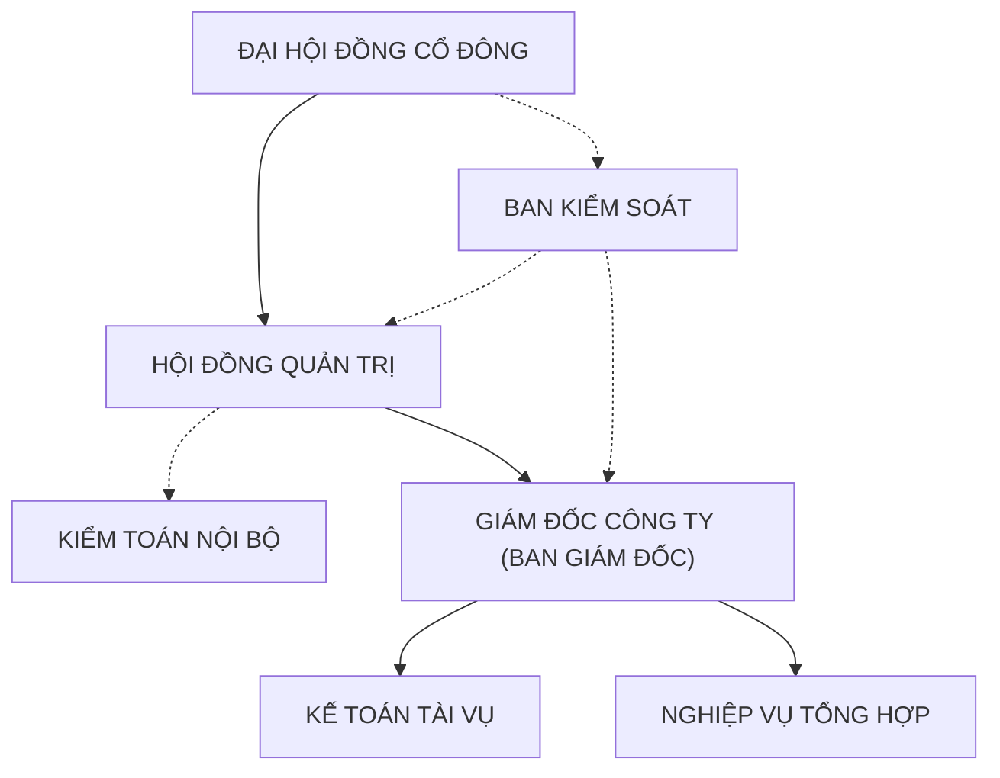

# CÔNG TY CỔ PHẦN PHÁT TRIỂN KHU CÔNG NGHIỆP TÍN NGHĨA (TIP)
## BÁO CÁO THƯỜNG NIÊN NĂM 2025

---

### THÔNG TIN CÔNG BỐ THÔNG TIN
- **Số văn bản:** 145/CV-CT (ngày 12/03/2026)
- **Tên tổ chức:** Công ty Cổ phần Phát triển Khu công nghiệp Tín Nghĩa
- **Mã chứng khoán:** TIP
- **Địa chỉ trụ sở:** Đường số 6, KCN Tam Phước, phường Tam Phước, tỉnh Đồng Nai
- **Điện thoại:** 02513.512.063 | **Fax:** 02513.512.479
- **Người thực hiện CBTT:** Ông Nguyễn Quốc Hùng - Phó Giám đốc Công ty
- **Loại thông tin công bố:** Định kỳ
- **Nội dung công bố:** Báo cáo thường niên năm 2025
- **Địa chỉ công bố thông tin trên website:** http://www.tinnghiaip.com.vn – mục Quan hệ cổ đông

---

# BÁO CÁO THƯỜNG NIÊN NĂM 2025
*(Số: 144/BC-CT, ngày 12 tháng 3 năm 2026)*

**Kính gửi:**
- Uỷ ban Chứng khoán Nhà nước;
- Sở Giao dịch chứng khoán TP Hồ Chí Minh.

---

## I. THÔNG TIN CHUNG

### 1. Thông tin khái quát
- **Tên giao dịch:** CÔNG TY CỔ PHẦN PHÁT TRIỂN KCN TÍN NGHĨA
- **Giấy CNĐKDN số:** 3600964611 do Sở KH&ĐT Tỉnh Đồng Nai cấp lần đầu ngày 08/01/2008, cấp thay đổi lần thứ 9 ngày 04/01/2023.
- **Vốn điều lệ:** 650.078.570.000 đồng
- **Vốn đầu tư của chủ sở hữu:** 650.078.570.000 đồng
- **Địa chỉ:** KCN Tam Phước, Đường số 6, phường Tam Phước, tỉnh Đồng Nai
- **Điện thoại:** 0251 3512 063 | **Fax:** 0251 3512 479
- **Website:** www.tinnghiaip.com.vn
- **Mã cổ phiếu:** TIP

#### Quá trình hình thành và phát triển:
- **2002:** Tiền thân là Xí nghiệp Dịch vụ và Phát triển Khu công nghiệp Tam Phước được thành lập theo Quyết định số 129/2002/QĐ-CT ngày 23/05/2002 của Tổng Giám đốc Công ty Tín Nghĩa.
- **2007:** Thành lập CTCP Phát triển Khu công nghiệp Tín Nghĩa trên cơ sở cổ phần hóa DN Nhà nước theo Quyết định số 222-CV/TU ngày 24/09/2007 của Tỉnh ủy tỉnh Đồng Nai.
- **2011:** Góp 8.360.000.000 đồng vào CTCP Khu công nghiệp Long Khánh.
- **2015:** Phát hành cổ phiếu thưởng tăng vốn điều lệ từ 173.354.320.000 đồng lên 260.031.430.000 đồng. Cuối năm 2015, góp thêm 14.440.000.000 đồng vào CTCP KCN Long Khánh thông qua đấu giá cổ phần, nâng tổng đầu tư lên 22.800.000.000 đồng (19% VĐL).
- **2016:** Niêm yết tại Sở GDCK TP. Hồ Chí Minh (HOSE) ngày 06/6/2016, giá tham chiếu phiên đầu tiên là 15.000 đồng/cổ phiếu.
- **2017:** Góp thêm 30 tỷ đồng vào CTCP Bất động sản Thống Nhất, nâng mức vốn sở hữu lên 59,2% VĐL.
- **2018:** Góp thêm 50 tỷ đồng tăng vốn điều lệ vào CTCP Thương mại và Xây dựng Phước Tân.
- **2019:** Góp thêm 70 tỷ đồng tăng vốn điều lệ vào CTCP Thương mại và Xây dựng Phước Tân.
- **2021:**
  - Tiếp tục góp thêm 120 tỷ đồng vào CTCP Thương mại và Xây dựng Phước Tân.
  - Ngày 28/12/2021, thành lập Bộ phận Kiểm toán nội bộ.
- **2022:** Phát hành thêm 39.004.714 cổ phiếu cho cổ đông hiện hữu tăng vốn điều lệ từ 260.031.430.000 đồng lên 650.078.570.000 đồng. Bổ sung vốn lưu động và hợp tác đầu tư KCN Phước An.
- **2023 - 2024 - 2025:** Tiếp tục hoàn thành tốt các mục tiêu hoạt động được ĐHĐCĐ giao phó, bảo đảm quyền lợi người lao động và nghĩa vụ ngân sách nhà nước.

#### Các sự kiện, danh hiệu đạt được:
- Nhiều năm liền đạt danh hiệu “Tập thể lao động xuất sắc” do UBND tỉnh Đồng Nai trao tặng.
- 2011: Bằng khen của Thủ tướng Chính phủ có thành tích trong công tác giai đoạn 2009-2011.
- 2019: Danh hiệu “Doanh nghiệp - Doanh nhân xuất sắc” do UBND tỉnh Đồng Nai tôn vinh.
- 2020-2023: Bằng khen tập thể lao động xuất sắc và cờ thi đua của UBND tỉnh Đồng Nai.
- 2020–2024: Top 15 Doanh nghiệp niêm yết nhóm vốn hóa vừa và nhỏ đạt chuẩn công bố thông tin trên TTCK.
- 2025: Đạt chuẩn công bố thông tin trên thị trường chứng khoán.

---

### 2. Ngành nghề và địa bàn kinh doanh
#### a) Ngành nghề kinh doanh chính:
- **Dịch vụ cho thuê cơ sở hạ tầng, nhà xưởng Khu công nghiệp:**
  - Hoạt động trong vùng kinh tế trọng điểm phía Nam; toàn bộ diện tích KCN Tam Phước đã được lấp đầy từ năm 2007. Khách hàng thanh toán tiền thuê đất/nhà xưởng và phí sử dụng hạ tầng.
  - Hợp tác đầu tư tại KCN dịch vụ Logistic cảng Phước An cạnh cảng biển Phước An và sân bay Long Thành.
- **Dịch vụ cấp nước và xử lý nước thải:**
  - Cung cấp nước dài hạn cho các doanh nghiệp trong KCN, bình quân gần 2 triệu m³/năm.
  - Vận hành trạm xử lý nước thải công nghệ UNITANK, C-TECH, SBR một bậc hiếu khí thế hệ thứ 3 với công suất thiết kế 7.000 m³/ngày đêm, đạt QCVN 40:2011 cột A ($K_q = 0,9; K_f = 0,9$), có hệ thống quan trắc tự động và hồ xử lý sự cố.
- **Kinh doanh bất động sản nhà ở, khu dân cư:**
  - Dự án Khu dân cư và tái định cư 18 ha Tam Phước (diện tích 16,47 ha nhận chuyển nhượng từ Tổng Công ty Tín Nghĩa) nằm trong quy hoạch tổng thể KDC 210 ha Tam Phước.
- **Dịch vụ khác:**
  - Cho thuê kios và văn phòng thương mại, kinh doanh chợ, thu gom rác thải, tư vấn môi trường.

#### b) Địa bàn kinh doanh:
Chủ yếu tại địa bàn tỉnh Đồng Nai, Việt Nam.

---

### 3. Mô hình quản trị, tổ chức kinh doanh và bộ máy quản lý
#### a) Mô hình quản trị:
- **Đại hội đồng cổ đông:** Cơ quan có thẩm quyền quyết định cao nhất của Công ty.
- **Hội đồng quản trị:** Cơ quan quản lý Công ty do ĐHĐCĐ bầu, thực hiện quản trị nhân danh Công ty.
- **Ban kiểm soát:** Do ĐHĐCĐ bầu, giám sát HĐQT và Giám đốc điều hành theo Điều lệ và luật định.
- **Ban Giám đốc:** Giám đốc Công ty do HĐQT bổ nhiệm, điều hành công việc kinh doanh hàng ngày.

#### b) Cơ cấu bộ máy quản lý:

#### c) Danh sách công ty con, công ty liên kết, đơn vị khác:

| Tên Công ty | Địa chỉ | Lĩnh vực SXKD chính | Giá trị vốn thực góp của TIP | Tỷ lệ lợi ích | Tỷ lệ biểu quyết |
|---|---|---|---|---|---|
| **Công ty con** | | | | | |
| Công ty Cổ phần Tín Khải | Số 1631D, Tổ 12, Ấp 4, phường Tân Triều, tỉnh Đồng Nai | Đầu tư xây dựng, kinh doanh hạ tầng khu dân cư, KCN, kinh doanh nhà ở và nhà xưởng cho thuê | 82,38 tỷ đồng | 99,88% | 82,38% |
| Công ty Cổ phần Bất động sản Thống Nhất | L4.09-10, đường N5, Tổ 14, ấp Lập Thành, xã Dầu Giây, tỉnh Đồng Nai | Kinh doanh bất động sản, kinh doanh và khai thác quản lý chợ | 44,45 tỷ đồng | 59,21% | 59,21% |
| **Công ty liên kết** | | | | | |
| Công ty Cổ phần Dịch vụ Bảo vệ Chuyên nghiệp Tín Nghĩa | Khu dân cư 18 ha Tam Phước, phường Tam Phước, tỉnh Đồng Nai | Cung ứng dịch vụ bảo vệ chuyên nghiệp | 1,20 tỷ đồng | 24,00% | 24,00% |
| Công ty Cổ phần Thương mại và Xây dựng Phước Tân | Tổ 25, Ấp Tân Mai 2, Phường Phước Tân, tỉnh Đồng Nai | Đầu tư xây dựng và kinh doanh nhà các loại, kinh doanh bất động sản | 296,69 tỷ đồng | 40,00% | 40,00% |
| **Đơn vị khác** | | | | | |
| Công ty Cổ phần Khu công nghiệp Long Khánh | Khu công nghiệp Long Khánh, xã Bình Lộc, tỉnh Đồng Nai | Đầu tư xây dựng, kinh doanh cơ sở hạ tầng khu công nghiệp và nhà xưởng cho thuê. | 23,23 tỷ đồng | 19% | 19% |
| Công ty Cổ phần Cà phê Olympic | Đường số 1, KCN Nhơn Trạch 3 – Giai đoạn 2, xã Nhơn Trạch, tỉnh Đồng Nai | Đầu tư sản xuất, kinh doanh cà phê,... | 53,40 tỷ đồng | 5,6% | 5,6% |

---

### 4. Định hướng phát triển
- **Mục tiêu chủ yếu:** Nâng cao chất lượng dịch vụ, tối ưu hóa hạ tầng KCN và dịch vụ logistic; đôn đốc tháo gỡ vướng mắc pháp lý các dự án; tham gia đấu thầu dự án tiềm năng; duy tu bảo trì hạ tầng, đảm bảo nghiêm ngặt quy định môi trường; tiết giảm chi phí thường xuyên.
- **Chiến lược trung và dài hạn:** Giữ vững tốc độ tăng trưởng, đáp ứng tiêu chuẩn phát triển xanh; đầu tư tài chính hiệu quả vào các công ty/dự án đối tác trong lĩnh vực KCN và KDC; quản trị chặt chẽ các công ty con, công ty liên kết.
- **Mục tiêu phát triển bền vững:** Thực hiện đạo đức kinh doanh, bảo vệ quyền lợi cổ đông, đối tác và khách hàng; tích cực tham gia các phong trào xã hội từ thiện (Đền ơn đáp nghĩa, ủng hộ Trường Sa, hỗ trợ học sinh nghèo, quỹ hỗ trợ đồng bào bão lũ, hiến máu tình nguyện).

---

### 5. Các yếu tố rủi ro
- **Rủi ro kinh tế:** Biến động vĩ mô, lạm phát, dòng vốn FDI toàn cầu, chính sách tiền tệ ảnh hưởng đến nhu cầu thuê đất và nhà xưởng. Công ty bám sát diễn biến kinh tế và chủ động điều hành theo kịch bản linh hoạt.
- **Rủi ro lãi suất:** Nguồn vốn nhàn rỗi lớn gửi ngân hàng hoặc cho vay các đối tác. Công ty theo dõi chặt chẽ chính sách Ngân hàng Nhà nước để tối ưu hóa doanh thu tài chính.
- **Rủi ro chính sách:** Luật Đất đai 2024 áp dụng bảng giá đất mới từ 01/01/2026; chính sách thuế tối thiểu toàn cầu 15% của OECD đối với doanh nghiệp có doanh thu từ 750 triệu EUR có hiệu lực từ 01/01/2024 ảnh hưởng tới dòng vốn FDI.
- **Rủi ro cạnh tranh:** Sự gia tăng nguồn cung KCN tại các tỉnh lân cận tạo áp lực cạnh tranh về giá thuê và tiện ích. TIP tập trung nâng cao chất lượng dịch vụ hiện hữu và liên kết đối tác chiến lược.
- **Rủi ro bất khả kháng:** Thiên tai, dịch bệnh được chủ động quản trị thông qua việc mua bảo hiểm tài sản và con người.

---
## II. TÌNH HÌNH HOẠT ĐỘNG TRONG NĂM

### 1. Tình hình hoạt động sản xuất kinh doanh
#### a) Kết quả hoạt động sản xuất kinh doanh trong năm:
*(Đơn vị tính: tỷ đồng)*

| Chỉ tiêu | Năm 2024 Giá trị | Năm 2024 Tỷ trọng | Năm 2025 Giá trị | Năm 2025 Tỷ trọng | % (+/-) 2025/2024 |
|---|---|---|---|---|---|
| **Doanh thu cho thuê hoạt động** | **63.022** | **37,55%** | **65.249** | **44,02%** | **3,53%** |
| - Phí cơ sở hạ tầng KCN Tín Nghĩa | 58.779 | 35,02% | 61.523 | 41,51% | 4,67% |
| - Cho thuê đất KCN Tín Nghĩa | 4.243 | 2,53% | 3.726 | 2,51% | -12,18% |
| **Doanh thu bán bất động sản** | **36.778** | **21,91%** | **9.047** | **6,10%** | **-75,40%** |
| - Bán đất của dự án KDC 18 ha Tam Phước | 375 | 0,22% | - | 0,00% | -100,00% |
| - Bán đất tại dự án Khu dân cư Thạnh Phú | 0 | 0,00% | - | 0,00% | - |
| - Bán đất nền, nhà thô, vựa kios chợ Thống Nhất | 36.403 | 21,69% | 9.047 | 6,10% | -75,15% |
| **Doanh thu cung cấp dịch vụ** | **68.057** | **40,54%** | **73.913** | **49,87%** | **8,60%** |
| - Cung cấp nước | 23.282 | 13,87% | 22.799 | 15,38% | -2,07% |
| - Phí thu gom nước thải | 24.118 | 14,37% | 27.639 | 18,65% | 14,60% |
| - Thu gom rác thải | 4.969 | 2,96% | 5.008 | 3,38% | 0,78% |
| - Cung cấp điện | 2.052 | 1,22% | 2.938 | 1,98% | 43,18% |
| - Cho thuê Kios, văn phòng và cung cấp dịch vụ | 13.636 | 8,12% | 15.529 | 10,48% | 13,88% |
| **TỔNG CỘNG** | **167.857** | **100,00%** | **148.209** | **100,00%** | **-11,71%** |

**Nhận xét:**
- Tổng doanh thu thuần đạt 148.209 triệu đồng, giảm nhẹ 11,71% so với năm 2024.
- **Mảng cho thuê hạ tầng:** Doanh thu đạt 65.249 triệu đồng, tăng 3,53% so với cùng kỳ, chiếm 44,02% tổng doanh thu thuần; duy trì nguồn thu bền vững cho doanh nghiệp.
- **Mảng bất động sản:** Doanh thu đạt 9.047 triệu đồng, giảm 75,15% do thị trường khó khăn và sản phẩm nhà thô/đất nền của CTCP BĐS Thống Nhất đã bán gần hết.
- **Mảng dịch vụ:** Doanh thu đạt 73.913 triệu đồng, tăng 8,60% nhờ hoạt động ổn định của các doanh nghiệp trong KCN Tam Phước, chiếm 49,87% cơ cấu doanh thu.

#### b) Tình hình thực hiện so với kế hoạch:
*(Đơn vị tính: Triệu đồng)*

| Stt | Chỉ tiêu | TH 2024 | KH 2025 | TH 2025 | % TH 2025/KH 2025 |
|---|---|---|---|---|---|
| 1 | Tổng doanh thu | 330.005 | 304.868 | 335.112 | 109,92% |
| 2 | Lợi nhuận sau thuế | 186.555 | 169.822 | 218.122 | 128,44% |
| 4 | Cổ tức | 15% | 15% | 15% | - |

- Tổng doanh thu thực hiện đạt 335.112 triệu đồng (vượt 9,92% kế hoạch, tăng 1,55% so với năm 2024). Doanh thu tài chính đóng góp 179.998 triệu đồng (chiếm 58,5% tổng doanh thu).
- Lợi nhuận sau thuế đạt 218.122 triệu đồng (vượt 28,44% kế hoạch, tăng 16,92% so với 2024).
- Tỷ lệ cổ tức dự kiến trình ĐHĐCĐ thông qua là 17%/mệnh giá.

---

### 2. Tổ chức và nhân sự
#### a) Danh sách Ban điều hành (tính đến 31/12/2025):

| Stt | Thành viên | Chức vụ | Số lượng CP sở hữu | Tỷ lệ sở hữu | Ghi chú |
|---|---|---|---|---|---|
| 1 | Phan Anh Dũng | Thành viên HĐQT kiêm Giám đốc | - | - | |
| 2 | Nguyễn Quốc Hùng | Phó Giám đốc | 8.200 | 0,01% | |
| 3 | Nguyễn Thị Ly | Kế toán trưởng | 17.300 | 0,02% | |

#### Tóm tắt lý lịch Ban điều hành:
1. **Ông Phan Anh Dũng - Thành viên HĐQT kiêm Giám đốc:**
   - Ngày sinh: 21/9/1975 | Trình độ: Thạc sỹ Kỹ thuật.
   - Quá trình công tác: Từng công tác tại CIENCO 1 (1997-2010), Phó TGĐ CTCP Đầu tư XD Tuấn Lộc (2020-nay), Giám đốc TIP từ 01/2023, Thành viên HĐQT TIP từ 04/2023; Chủ tịch HĐQT CTCP Tín Khải, Chủ tịch HĐQT CTCP BĐS Thống Nhất, Thành viên HĐQT CTCP KCN Long Khánh, Thành viên HĐQT CTCP Cà phê Olympic.
   - Sở hữu cổ phần cá nhân/đại diện tại TIP: 0.
2. **Ông Nguyễn Quốc Hùng - Phó Giám đốc (phụ trách Quản trị & CBTT):**
   - Ngày sinh: 07/4/1969 | Trình độ: Cử nhân Kinh tế.
   - Quá trình công tác: Kế toán trưởng TIP (2009-2019), Phó Giám đốc TIP (2019-nay); Trưởng BKS CTCP Tín Khải; Thành viên HĐQT CTCP DV BV CN Tín Nghĩa; Thành viên HĐQT CTCP Cà phê Olympic.
   - Sở hữu cá nhân tại TIP: 8.200 cổ phần (0,01% VĐL).
3. **Bà Nguyễn Thị Ly - Kế toán trưởng:**
   - Ngày sinh: 17/11/1983 | Trình độ: Thạc sĩ Quản lý kinh tế.
   - Quá trình công tác: Công tác tại TIP từ năm 2006; Trưởng BKS CTCP BĐS Thống Nhất; Kế toán trưởng TIP từ năm 2020 đến nay.
   - Sở hữu cá nhân tại TIP: 17.300 cổ phần (0,02% VĐL).

- **Thay đổi Ban điều hành trong năm 2025:** Không có.

#### b) Thống kê số lượng lao động và thu nhập bình quân:

| Stt | Tính chất phân loại | Số lượng (người) | Tỷ lệ (%) |
|---|---|---|---|
| **A** | **Theo trình độ** | **29** | **100** |
| 1 | Trên đại học | 4 | 13,8 |
| 2 | Đại học | 17 | 58,6 |
| 3 | Cao đẳng | 0 | 0 |
| 4 | Trung cấp, lao động tay nghề | 8 | 27,59 |
| **B** | **Theo tính chất hợp đồng lao động** | **29** | **100** |
| 1 | Hợp đồng có xác định thời hạn | 3 | 10,34 |
| 2 | Hợp đồng không xác định thời hạn | 26 | 89,66 |
| 3 | Hợp đồng theo thời vụ | 0 | 0 |

**Thu nhập bình quân:**

| Chỉ tiêu | Năm 2022 | Năm 2023 | Năm 2024 | Năm 2025 |
|---|---|---|---|---|
| Tổng số lượng người lao động (người) | 32 | 33 | 29 | 29 |
| Thu nhập bình quân (đồng/người/tháng) | 22.500.000 | 25.285.632 | 26.568.082 | 25.269.570 |

- **Chính sách nhân sự:** Chú trọng đào tạo chuyên môn định kỳ (phần mềm DocEye, tập huấn chào bán chứng khoán, tiếng Trung căn bản, an toàn vệ sinh lao động, PCCC); môi trường làm việc trang bị đầy đủ thiết bị, bảo hiểm 100%, khám sức khỏe định kỳ và tham quan nghỉ mát hàng năm.

---

### 3. Tình hình đầu tư và triển khai dự án
- **Dự án Kios và Văn phòng thương mại đường 3:** Lập phương án chuyển nhượng VP thương mại cho Agribank Chi nhánh Đồng Nai; khai thác tiếp thị các ki-ốt còn lại.
- **Dự án KCN Tam Phước:** Hoàn thiện cấp Giấy phép môi trường theo luật mới.
- **Hợp tác đầu tư KCN Phước An:** Tiếp tục bám sát hợp đồng hợp tác kinh doanh với CTCP Cảng Phước An.

#### Chi tiết các công ty con và liên kết trọng yếu:
- **CTCP Tín Khải (Công ty con):** Vốn điều lệ 100 tỷ đồng (TIP nắm 99,88% lợi ích, 82,38% quyền biểu quyết). Đầu tư hạ tầng KDC, KCN.
- **CTCP BĐS Thống Nhất (Công ty con):** Vốn điều lệ 70 tỷ đồng (TIP nắm 59,21%). Kinh doanh chợ và hạ tầng.
- **CTCP DV Bảo vệ Chuyên nghiệp Tín Nghĩa (Liên kết):** Vốn điều lệ 5 tỷ đồng (TIP nắm 24%).
- **CTCP Thương mại & Xây dựng Phước Tân (Liên kết):** Vốn điều lệ 700 tỷ đồng (TIP nắm 40%).
- **CTCP Cà phê Olympic:** Vốn điều lệ 680 tỷ đồng (TIP nắm 5,6%).
- **CTCP KCN Long Khánh:** Vốn điều lệ 120 tỷ đồng (TIP sở hữu 19%, giá trị góp vốn 23,23 tỷ đồng). Đơn vị hoạt động rất hiệu quả, chia cổ tức năm 2025 với tỷ lệ 45%, TIP nhận về 10,26 tỷ đồng cổ tức.

---

### 4. Tình hình tài chính
#### a) Tổng hợp kết quả tài chính:

| STT | Chỉ tiêu | Năm 2024 | Năm 2025 | % tăng giảm |
|---|---|---|---|---|
| 1 | Tổng giá trị tài sản | 2.129.127 | 2.155.655 | 1,25% |
| 2 | Doanh thu thuần | 167.857 | 148.210 | -11,71% |
| 3 | Lợi nhuận từ hoạt động kinh doanh | 243.305 | 268.317 | 10,28% |
| 4 | Lợi nhuận khác | -12.297 | -613 | -95,01% |
| 5 | Lợi nhuận trước thuế | 231.008 | 267.704 | 15,89% |
| 6 | Lợi nhuận sau thuế | 186.555 | 218.122 | 16,92% |
| 7 | Tỷ lệ trả cổ tức | 15,00% | 15,00% | 0,00% |

#### b) Các chỉ tiêu tài chính chủ yếu:

| Nhóm chỉ tiêu | Chỉ tiêu | ĐVT | Năm 2024 | Năm 2025 |
|---|---|---|---|---|
| **Khả năng thanh toán** | Hệ số thanh toán ngắn hạn ($TSNH / Nợ ngắn hạn$) | Lần | 4,69 | 20,79 |
| | Hệ số thanh toán nhanh ($(TSNH - Hàng tồn kho) / Nợ ngắn hạn$) | Lần | 3,72 | 19,24 |
| **Cơ cấu vốn** | Hệ số Nợ / Tổng tài sản | % | 14,88% | 11,74% |
| | Hệ số Nợ / Vốn chủ sở hữu | % | 17,48% | 13,3% |
| **Năng lực hoạt động** | Vòng quay hàng tồn kho ($Giá vốn / Hàng tồn kho bình quân$) | Vòng | 0,51 | 0,40 |
| | Vòng quay tổng tài sản ($DTT / Tổng tài sản bình quân$) | Vòng | 0,08 | 0,07 |
| **Khả năng sinh lời** | Lợi nhuận sau thuế / Doanh thu thuần | % | 111,14% | 147,17% |
| | Lợi nhuận sau thuế / Vốn chủ sở hữu bình quân (ROE) | % | 10,29% | 11,46% |
| | Lợi nhuận sau thuế / Tổng tài sản bình quân (ROA) | % | 8,76% | 10,12% |
| | Lợi nhuận từ HĐSXKD / Doanh thu thuần | % | 144,95% | 181,04% |

**Phân tích tài chính trọng yếu:**
- **Thanh toán:** Tăng vọt nhờ khoản tiền tương đương tiền (tiền gửi có kỳ hạn dưới 3 tháng) do nhận lại vốn ứng từ CTCP Cảng Phước An chuyển thanh toán trước hạn 1.033,2 tỷ đồng. Nợ ngắn hạn giảm 41,3% nhờ giảm khoản phải trả cổ tức tạm ứng (từ 13% năm 2024 còn 3% năm 2025).
- **Cơ cấu nợ:** Công ty không sử dụng đòn bẩy tài chính vay nợ ngân hàng. Vốn chủ sở hữu đạt 1.902,64 tỷ đồng, nợ phải trả chiếm tỷ trọng nhỏ (11,74% tổng tài sản).
- **Hiệu quả sinh lời:** Tỷ suất sinh lời vượt trội nhờ đóng góp mạnh mẽ của nguồn thu tài chính, lãi tiền gửi và lợi tức từ các đơn vị liên kết.

---

### 5. Cơ cấu cổ đông và thay đổi vốn điều lệ
- **Cổ phần:** Tổng số cổ phiếu phát hành và lưu hành là 65.007.857 cổ phiếu (loại phổ thông, mệnh giá 10.000 đồng/CP); không có cổ phiếu quỹ.
- **Cơ cấu cổ đông (tính đến 31/12/2025):**

| Stt | Loại cổ đông | Số cổ phần | Giá trị (đồng) | Tỷ lệ sở hữu (%) |
|---|---|---|---|---|
| **I** | **Cổ đông trong nước** | **53.851.665** | **538.516.650.000** | **82,84** |
| 1 | Cá nhân | 16.518.263 | 165.182.630.000 | 25,41 |
| 2 | Tổ chức | 37.333.402 | 373.334.020.000 | 57,43 |
| **II** | **Cổ đông nước ngoài** | **11.156.192** | **111.561.920.000** | **17,16** |
| 1 | Cá nhân | 257.860 | 2.578.600.000 | 0,40 |
| 2 | Tổ chức | 10.898.332 | 108.983.320.000 | 16,76 |
| | **Tổng cộng (I+II)** | **65.007.857** | **650.078.570.000** | **100** |

*Tỷ lệ sở hữu nước ngoài tối đa: 50%.*

- **Danh sách cổ đông lớn:**
  1. **CTCP Tổng Công ty Tín Nghĩa:** 36.885.000 cổ phiếu (56,74% VĐL).
  2. **America LLC:** 10.092.725 cổ phiếu (15,50% VĐL).

- **Lịch sử tăng vốn điều lệ:**
  - 2007: VĐL thành lập cổ phần hóa là 173.354,32 triệu đồng.
  - 2015: Tăng thêm 86.677,11 triệu đồng từ nguồn vốn chủ sở hữu, lên 260.031,43 triệu đồng.
  - 2022: Phát hành ra công chúng thêm 390.047,14 triệu đồng cho cổ đông hiện hữu, nâng VĐL lên 650.078,57 triệu đồng.
- **Giao dịch cổ phiếu quỹ & chứng khoán khác:** Không có.

---

### 6. Báo cáo môi trường và trách nhiệm xã hội
- Duy trì hệ thống ISO 9001:2015 và ISO 14001:2015; giám sát nước xả thải định kỳ.
- **Tiêu thụ năng lượng:** Điện năng tiêu thụ 1.600.000 kWh/năm; hệ thống điện mặt trời tiết kiệm 40.000 kWh trong năm 2025.
- **Tiêu thụ nước:** Khối lượng nước sử dụng khoảng 1.772.000 m³/năm cung cấp từ Nhà máy nước Thiện Tân.
- **Trách nhiệm cộng đồng:** Thực hiện các chương trình tài trợ xã hội (nhà tình thương, hỗ trợ gia đình chính sách dịp Tết, mổ tim cho trẻ em nghèo, học bổng tại Nhơn Trạch - Long Thành, hiến máu tình nguyện).

---
## III. BÁO CÁO VÀ ĐÁNH GIÁ CỦA BAN GIÁM ĐỐC

### 1. Đánh giá kết quả hoạt động sản xuất kinh doanh năm 2025
- **Khó khăn:**
  - Tác động tiêu cực của tình hình kinh tế chung, thị trường bất động sản gặp khó khăn trong thanh khoản và pháp lý kéo dài làm suy giảm thị trường; việc triển khai thủ tục các dự án bị đình trệ.
  - Doanh nghiệp thứ cấp trong KCN gặp khó khăn trong đơn hàng sản xuất, dẫn đến việc thu phí hạ tầng và tiền thuê đất bị ảnh hưởng. Quyết định tăng tiền thuê đất chu kỳ 5 năm của UBND tỉnh khiến chi phí tăng cao.
  - Các quy chuẩn bảo vệ môi trường khắt khe hơn đòi hỏi doanh nghiệp phải đầu tư lớn vào trạm quan trắc tự động, hồ sự cố và hoàn tất cấp lại giấy phép môi trường.
- **Thuận lợi:**
  - Nhận được sự chỉ đạo nhất quán và hỗ trợ sâu sát từ Tổng Công ty Tín Nghĩa và HĐQT; nội bộ đồng thuận cao.
  - Các dịch vụ tiện ích cốt lõi duy trì ổn định và hiệu quả: cấp nước sạch, xử lý nước thải, dịch vụ môi trường, thu gom rác thải.
- **Tiến bộ đạt được:**
  - Định kỳ tổ chức đối thoại trực tiếp tháo gỡ khó khăn cho khách hàng KCN.
  - Bảo dưỡng, duy tu thường xuyên hạ tầng kỹ thuật và mảng xanh; tuân thủ chuẩn mực bảo vệ môi trường.

---

### 2. Tình hình tài chính
#### a) Cơ cấu tài sản:
*(Đơn vị tính: Triệu đồng)*

| Stt | Chỉ tiêu | Năm 2024 | Năm 2025 | TH 2025 / TH 2024 | Tỷ trọng 2024 | Tỷ trọng 2025 |
|---|---|---|---|---|---|---|
| 1 | Tài sản ngắn hạn | 659.735 | 1.716.057 | 260,11% | 30,99% | 79,61% |
| 2 | Tài sản dài hạn | 1.469.392 | 439.598 | 29,92% | 69,01% | 20,39% |
| | **Tổng tài sản** | **2.129.127** | **2.155.655** | **101,25%** | **100%** | **100%** |

*Giải trình:* Tổng tài sản tăng 1,25%. Cơ cấu dịch chuyển mạnh sang tài sản ngắn hạn (chiếm 79,61%) chủ yếu do tăng các khoản tương đương tiền gửi có kỳ hạn dưới 3 tháng từ việc nhận lại thanh toán trước hạn hợp đồng hợp tác đầu tư từ CTCP Cảng Phước An.

#### b) Cơ cấu nợ phải trả:
*(Đơn vị tính: Triệu đồng)*

| Stt | Chỉ tiêu | Năm 2024 | Năm 2025 | TH 2025 / TH 2024 | Tỷ trọng 2024 | Tỷ trọng 2025 |
|---|---|---|---|---|---|---|
| 1 | Nợ ngắn hạn | 140.566 | 82.524 | 58,71% | 44,36% | 32,62% |
| 2 | Nợ dài hạn | 176.280 | 170.486 | 96,71% | 55,64% | 67,38% |
| | **Tổng nợ phải trả** | **316.846** | **253.010** | **79,85%** | **100%** | **100%** |

*Giải trình:* Tổng nợ giảm 20,15% chủ yếu do giảm nợ ngắn hạn (giảm số cổ tức tạm ứng phải trả). Công ty duy trì chính sách tài chính an toàn tuyệt đối, không có nợ vay tài chính ngân hàng.

---

### 3. Cải tiến tổ chức, chính sách và quản lý
- Chuẩn hóa chức năng, nhiệm vụ phòng ban; rà soát và kiện toàn bộ máy.
- Áp dụng hệ thống đánh giá hiệu quả KPI toàn diện, cắt giảm chi phí lãng phí, nâng cao năng suất lao động.

---

### 4. Kế hoạch phát triển năm 2026
#### a) Kế hoạch sản xuất kinh doanh riêng:
*(Đơn vị tính: Triệu đồng)*

| Stt | Chỉ tiêu | KH 2025 | TH 2025 | KH 2026 | TH 2025/KH 2025 | Kế hoạch 2026/TH 2025 |
|---|---|---|---|---|---|---|
| 1 | Tổng doanh thu | 279.546 | 307.479 | 264.757 | 110,0% | 86,1% |
| 2 | Tổng chi phí | 68.555 | 53.211 | 67.118 | 77,6% | 126,1% |
| 3 | Lợi nhuận trước thuế | 210.991 | 254.267 | 197.639 | 120,5% | 77,7% |
| 4 | Nộp ngân sách | 53.941 | 59.893 | 55.054 | 111,0% | 91,9% |
| 5 | Lợi nhuận sau thuế | 171.391 | 206.086 | 160.295 | 120,2% | 77,8% |
| 6 | Tỷ lệ chia cổ tức | 15% | 17% | 15% | 100,0% | 88,2% |

*Giải trình:* Doanh thu và lợi nhuận kế hoạch 2026 giảm so với thực hiện 2025 do thanh lý hợp đồng hợp tác với Cảng Phước An và điều chỉnh giảm mức cổ tức nhận được từ CTCP BĐS Thống Nhất.

#### b) Kế hoạch sản xuất kinh doanh hợp nhất:
*(Đơn vị tính: Triệu đồng)*

| Stt | Chỉ tiêu | KH 2025 | TH 2025 | KH 2026 | TH 2025/KH 2025 | KH 2026/TH 2025 |
|---|---|---|---|---|---|---|
| 1 | Tổng doanh thu hợp nhất | 304.868 | 335.112 | 281.712 | 109,92% | 84,06% |
| | *Trong đó: Công ty mẹ* | *279.546* | *307.479* | *264.757* | *109,99%* | *86,11%* |
| 2 | Lợi nhuận sau thuế | 169.822 | 218.122 | 168.921 | 128,44% | 77,44% |
| | *Trong đó: Công ty mẹ* | *171.391* | *206.086* | *160.295* | *120,24%* | *77,78%* |

**Kế hoạch các đơn vị thành viên:**
- **CTCP Tín Khải:** Doanh thu 3,2 tỷ đồng; LNST 7,4 tỷ đồng.
- **CTCP BĐS Thống Nhất:** Doanh thu 15,4 tỷ đồng; LNST 2,9 tỷ đồng.
- **CTCP TM & XD Phước Tân:** Doanh thu 24,9 tỷ đồng; LNST 12,3 tỷ đồng.

#### c) Giải pháp triển khai:
- **Kinh doanh:** Tối ưu hóa dịch vụ tiện ích, đẩy mạnh thu phí quản lý KCN; khai thác hiệu quả mặt bằng chợ và kios; tìm kiếm các dự án tiềm năng mở rộng quỹ đất.
- **Đầu tư - Xây dựng:** Khẩn trương hoàn thiện pháp lý khu đất 2,1 ha; duy tu hệ thống thoát nước mưa, nước thải; bảo dưỡng trang thiết bị công trình.
- **Tài chính:** Quản lý dòng tiền linh hoạt, tối ưu hóa nguồn thu tài chính an toàn.
- **Quản lý điều hành & nhân sự:** Thực thi chuẩn ISO 9001 và 14001, ứng dụng KPI và bố trí nhân sự phù hợp năng lực.

### 5. Giải trình của Ban Giám đốc đối với ý kiến kiểm toán
Không có ý kiến ngoại trừ hoặc lưu ý từ kiểm toán độc lập.

---

## IV. ĐÁNH GIÁ CỦA HỘI ĐỒNG QUẢN TRỊ

### 1. Đánh giá của Hội đồng quản trị về hoạt động của Công ty
- **Duy tu hạ tầng & kinh doanh:** Thực hiện kịp thời công tác sửa chữa hạ tầng giao thông, hệ thống thoát nước, cảnh quan cây xanh; kiểm soát nghiêm ngặt nước thải xả ra; thu phí quản lý hạ tầng với đơn giá 0,5 USD/m²/năm; ký phụ lục điều chỉnh giá thuê đất Kios và VP thương mại chu kỳ 2025-2029.
- **Tuân thủ đối với công ty đại chúng:** Công bố thông tin minh bạch, kịp thời; hoàn thành kiểm toán BCTC bán niên và năm 2024, lập báo cáo thường niên, tổ chức ĐHĐCĐ thường niên 2025 thành công.
- **Hệ thống quản lý:** Tái cấp chứng nhận hệ thống quản lý ISO 9001:2015 và ISO 14001:2015; duy trì đánh giá KPI định kỳ.

### 2. Đánh giá đối với Ban Giám đốc
Ban Giám đốc đã nỗ lực điều hành bám sát nghị quyết của ĐHĐCĐ và HĐQT, đảm bảo tuân thủ pháp luật, bảo toàn và phát triển vốn, hoàn thành vượt mức các chỉ tiêu doanh thu và lợi nhuận năm 2025.

### 3. Kế hoạch và định hướng của Hội đồng quản trị năm 2026
- Tập trung giải quyết dứt điểm vướng mắc pháp lý đất đai: đền bù giao đất khu 2,1 ha, chuyển đổi đất chợ sang nhà ở xã hội của CTCP Tín Khải.
- Tham gia đấu thầu, đấu giá mở rộng quỹ đất KCN và KDC tiềm năng.
- Nâng cấp trạm xử lý nước thải và tăng cường đào tạo chuyên môn hóa nguồn nhân lực.

---
## V. QUẢN TRỊ CÔNG TY

### 1. Hội đồng quản trị
#### a) Thành viên và cơ cấu Hội đồng quản trị (tính đến 31/12/2025):

| Stt | Thành viên | Chức vụ | Số lượng CP sở hữu | Tỷ lệ sở hữu |
|---|---|---|---|---|
| 1 | Đặng Thị Thanh Hà | Chủ tịch HĐQT | Đại diện: 36.885.000 CP | 56,74% |
| 2 | Nguyễn Cao Nhơn | Phó Chủ tịch HĐQT | 0 | 0% |
| 3 | Phan Anh Dũng | Thành viên HĐQT | 0 | 0% |
| 4 | Nguyễn Thị Thuỳ Vân | Thành viên HĐQT | 0 | 0% |
| 5 | Huỳnh Nguyễn Tuấn Anh | Thành viên HĐQT độc lập | 0 | 0% |

#### Chi tiết thông tin thành viên HĐQT:
- **Bà Đặng Thị Thanh Hà - Chủ tịch HĐQT:**
  - Đại diện sở hữu vốn của CTCP Tổng Công ty Tín Nghĩa: 36.885.000 cổ phần (56,74% VĐL). Sở hữu cá nhân: 0 cổ phần.
  - Chức vụ tại tổ chức khác: Chủ tịch HĐQT CTCP Tổng Công ty Tín Nghĩa; Chủ tịch HĐQT CTCP TM & XD Phước Tân; Chủ tịch HĐQT CTCP Chế biến XNK – NSTP Đồng Nai (Donafoods); Chủ tịch HĐQT CTCP Dược Đồng Nai.
- **Ông Nguyễn Cao Nhơn - Phó Chủ tịch HĐQT:**
  - Sở hữu cổ phần: 0 cổ phần.
  - Chức vụ tại tổ chức khác: TV HĐQT CTCP Cảng Container Đồng Nai; TV HĐQT CTCP KCN Tín Nghĩa – Phương Đông; TV HĐQT CTCP Logistics Tín Nghĩa – ICD Biên Hoà; Chủ tịch HĐQT CTCP Phát triển Doanh nghiệp Nhỏ và vừa Nhật Bản; TV HĐQT kiêm Phó TGĐ CTCP Tổng Công ty Tín Nghĩa; Giám đốc CTCP Logistics Tín Nghĩa – ICD Biên Hoà.
- **Ông Phan Anh Dũng - Thành viên HĐQT kiêm Giám đốc:**
  - Sở hữu cổ phần: 0 cổ phần.
  - Chức vụ tại tổ chức khác: Chủ tịch HĐQT kiêm Giám đốc CTCP Tín Khải; Chủ tịch HĐQT CTCP BĐS Thống Nhất; Thành viên HĐQT CTCP Cà phê Olympic; TV HĐQT CTCP KCN Long Khánh; Phó Tổng Giám đốc CTCP Đầu tư Xây dựng Tuấn Lộc.
- **Bà Nguyễn Thị Thuỳ Vân - Thành viên HĐQT:**
  - Sở hữu cổ phần: 0 cổ phần.
  - Chức vụ tại tổ chức khác: TV HĐQT CTCP Chế biến XNK – NSTP Đồng Nai (Donafoods); TV HĐQT CTCP BĐS Thống Nhất; Kế toán trưởng CTCP Tổng Công ty Tín Nghĩa.
- **Ông Huỳnh Nguyễn Tuấn Anh - Thành viên HĐQT độc lập:**
  - Sở hữu cổ phần: 0 cổ phần.
  - Chức danh tại tổ chức khác: Phó Giám đốc Công ty TNHH Đầu tư Quốc tế HTC.

#### Thay đổi thành viên HĐQT trong năm 2025:

| Stt | Thành viên HĐQT | Chức vụ | Ngày miễn nhiệm |
|---|---|---|---|
| 1 | Nguyễn Hiếu Lộc | Phó Chủ tịch HĐQT | 25/4/2025 |
| 2 | Trần Hoài Nam | TV HĐQT | 25/4/2025 |

#### b) Hoạt động của các tiểu ban thuộc HĐQT:
Bộ phận Kiểm toán nội bộ được thành lập theo Quyết định số 10/QĐ-HĐQT ngày 28/12/2021, hoạt động tuân thủ Nghị định 05/2019/NĐ-CP, Quy chế kiểm toán nội bộ và hoàn thành Kế hoạch Kiểm toán nội bộ năm 2025 được HĐQT duyệt.

#### c) Danh mục các Nghị quyết và Quyết định của HĐQT trong năm 2025:

| Stt | Số Nghị quyết/Quyết định | Ngày tháng | Nội dung chính | Tỷ lệ thông qua |
|---|---|---|---|---|
| 01 | 01/NQ-HĐQT | 15/01/2025 | Thống nhất chủ trương vay vốn tối đa 25 tỷ đồng bổ sung vốn lưu động tại VietinBank – CN Đồng Nai. | 100% |
| 02 | 02/NQ-HĐQT | 16/01/2025 | Phê duyệt chủ trương ký kết và thực hiện hợp đồng, giao dịch với bên liên quan phát sinh năm 2025. | 100% |
| 03 | 03/NQ-HĐQT | 16/01/2025 | Thống nhất chủ trương gia hạn Hợp đồng vay vốn lưu động cho CTCP TM và XD Phước Tân. | 100% |
| 04 | 04/NQ-HĐQT | 17/02/2025 | Quyết định triệu tập ĐHĐCĐ thường niên năm 2025. | 100% |
| 05 | 05/NQ-HĐQT | 07/03/2025 | Giới thiệu người đại diện phần vốn góp và ứng cử HĐQT tại CTCP TM và XD Phước Tân. | 100% |
| 5.1 | 01/QĐ-HĐQT | 07/03/2025 | Cử ông Phan Anh Dũng đại diện phần vốn góp tại CTCP TM và XD Phước Tân. | 100% |
| 5.2 | 02/QĐ-HĐQT | 07/03/2025 | Cử ông Trần Bá Tài đại diện theo ủy quyền và ứng cử HĐQT CTCP TM và XD Phước Tân. | 100% |
| 06 | 06/NQ-HĐQT | 21/03/2025 | Thống nhất tài liệu trình ĐHĐCĐ thường niên 2025, nhân sự HĐQT, BKS, quỹ lương kế hoạch. | 100% |
| 07 | 07/NQ-HĐQT | 22/05/2025 | Bầu bổ sung chức danh Phó Chủ tịch HĐQT đối với ông Nguyễn Cao Nhơn từ 22/5/2025. | 100% |
| 08 | 08/NQ-HĐQT | 22/05/2025 | Lựa chọn Công ty TNHH Hãng Kiểm toán AASC soát xét và kiểm toán BCTC năm 2025. | 100% |
| 09 | 09/NQ-HĐQT | 22/05/2025 | Miễn giảm phí hạ tầng cho khách hàng gặp khó khăn tại KCN Tam Phước; cử người đại diện vốn tại CTCP KCN Long Khánh. | 100% |
| 9.1 | 03/QĐ-HĐQT | 22/05/2025 | Cử ông Phan Anh Dũng đại diện vốn và tham gia HĐQT tại CTCP KCN Long Khánh. | 100% |
| 9.2 | 04/QĐ-HĐQT | 22/05/2025 | Cử ông Nguyễn Khắc Thanh đại diện vốn và ứng cử HĐQT tại CTCP KCN Long Khánh. | 100% |
| 10 | 10/NQ-HĐQT | 24/07/2025 | Thông qua ước kết quả kinh doanh 6 tháng đầu năm và kế hoạch 6 tháng cuối năm 2025. | 100% |
| 10.1 | 05/QĐ-HĐQT | 24/07/2025 | Quyết định chi trả cổ tức còn lại năm 2024 và tạm ứng cổ tức năm 2025. | 100% |
| 11 | 11/NQ-HĐQT | 24/07/2025 | Thống nhất mức tiền lương của Giám đốc Công ty. | 100% |
| 12 | 12/NQ-HĐQT | 20/08/2025 | Gia hạn khoản vay cho CTCP TM & XD Phước Tân theo HĐ số 100/HĐVV ngày 19/5/2023. | 100% |
| 13 | 13/NQ-HĐQT | 18/09/2025 | Chủ trương biểu quyết lấy ý kiến văn bản tại CTCP BĐS Thống Nhất về vay vốn lưu động. | 100% |
| 14 | 14/NQ-HĐQT | 07/10/2025 | Thống nhất ước kết quả kinh doanh 9 tháng năm 2025. | 100% |
| 15 | 15/NQ-HĐQT | 03/12/2025 | Chốt danh sách cổ đông tạm ứng cổ tức đợt 2 năm 2025 bằng tiền. | 100% |
| 16 | 16/NQ-HĐQT | 19/12/2025 | Thống nhất ước kết quả kinh doanh năm 2025. | 100% |
| 17 | 06/QĐ-HĐQT | 29/12/2025 | Bổ nhiệm lại chức vụ Giám đốc Công ty đối với ông Phan Anh Dũng. | 100% |
| 18 | 07/QĐ-HĐQT | 29/12/2025 | Bổ nhiệm lại chức vụ Phó Giám đốc Công ty đối với ông Nguyễn Quốc Hùng. | 80% |
| 19 | 08/QĐ-HĐQT | 29/12/2025 | Bổ nhiệm lại chức vụ Phụ trách Quản trị Công ty đối với ông Nguyễn Quốc Hùng. | 80% |
| 20 | 09/QĐ-HĐQT | 29/12/2025 | Bổ nhiệm lại chức vụ Kế toán trưởng đối với bà Nguyễn Thị Ly. | 100% |
| 21 | 10/QĐ-HĐQT | 29/12/2025 | Giao nhiệm vụ Thư ký HĐQT cho ông Đỗ Văn Trung. | 100% |
| 22 | 11/QĐ-HĐQT | 29/12/2025 | Ban hành Quy chế cán bộ nhân viên Công ty. | 100% |

#### d) Hoạt động thành viên HĐQT độc lập và đào tạo quản trị:
- Thành viên HĐQT độc lập giám sát độc lập, khách quan, minh bạch mọi nghị quyết và đánh giá công tác quản trị của HĐQT phù hợp với quy định.
- Các thành viên HĐQT, BKS, Ban điều hành tham gia đầy đủ các lớp tập huấn: KPI thẻ điểm cân bằng, kiểm soát chi phí & rủi ro, chính sách thuế, pháp luật chứng khoán, Luật Lao động, Đầu tư, Môi trường.

---

### 2. Ban Kiểm soát
#### a) Cơ cấu nhân sự Ban Kiểm soát (tính đến 31/12/2025):

| Stt | Thành viên | Chức vụ |
|---|---|---|
| 1 | Nguyễn Thị Giang | Trưởng Ban Kiểm soát (Bổ nhiệm từ 25/4/2025) |
| 2 | Nguyễn Như Huỳnh | Thành viên Ban Kiểm soát (Bổ nhiệm từ 25/4/2025) |
| 3 | Dương Thị Minh Hồng | Thành viên Ban Kiểm soát |

*Thay đổi nhân sự BKS năm 2025:* Miễn nhiệm ông Trần Tấn Nhật và bà Lê Kim Thảo vào ngày 25/4/2025.

#### b) Hoạt động của Ban Kiểm soát:
- Giám sát toàn diện hoạt động điều hành của HĐQT và Ban Giám đốc; phối hợp chặt chẽ cùng Kiểm toán nội bộ kiểm tra tính tuân thủ pháp lý và tài chính.
- Tình hình tham dự các phiên họp Ban Kiểm soát:

| Stt | Thành viên BKS | Số buổi họp tham dự | Tỷ lệ tham dự | Tỷ lệ biểu quyết | Ghi chú |
|---|---|---|---|---|---|
| 01 | Ông Trần Tấn Nhật | 1/2 | 50% | 100% | Miễn nhiệm từ 25/4/2025 |
| 02 | Bà Lê Kim Thảo | 1/2 | 50% | 100% | Miễn nhiệm từ 25/4/2025 |
| 03 | Bà Dương Thị Minh Hồng | 2/2 | 100% | 100% | |
| 04 | Bà Nguyễn Thị Giang | 2/2 | 100% | 100% | |
| 05 | Bà Nguyễn Như Huỳnh | 2/2 | 100% | 100% | |

**Nội dung các cuộc họp BKS:**
- Biên bản số 01/BB-BKS (30/3/2025): Thống nhất Báo cáo hoạt động BKS 2024 và Kế hoạch 2025 trình ĐHĐCĐ.
- Biên bản số 02/BB-BKS (25/4/2025): Thống nhất bầu bà Nguyễn Thị Giang giữ chức danh Trưởng Ban Kiểm soát nhiệm kỳ 2023–2028.

---

### 3. Thù lao, tiền lương, thưởng và giao dịch của người nội bộ
#### a) Tiền lương, thù lao, thưởng của HĐQT, BKS và Ban Giám đốc năm 2025:
*(Đơn vị tính: đồng)*

| Họ và tên | Chức danh | Tổng lương | Tổng thù lao | Thưởng | Lợi ích khác |
|---|---|---|---|---|---|
| **Hội đồng quản trị** | | | | | |
| Đặng Thị Thanh Hà | Chủ tịch HĐQT | - | 120.000.000 | - | - |
| Nguyễn Cao Nhơn | Phó Chủ tịch HĐQT | - | 79.000.000 | - | - |
| Phan Anh Dũng | Thành viên HĐQT kiêm Giám đốc | 964.000.000 | 96.000.000 | 236.666.666 | - |
| Nguyễn Thị Thùy Vân | Thành viên HĐQT | - | 72.000.000 | - | - |
| Huỳnh Nguyễn Tuấn Anh | Thành viên HĐQT độc lập | - | 96.000.000 | - | - |
| **Ban Kiểm soát** | | | | | |
| Lê Kim Thảo | Trưởng BKS (miễn nhiệm 25/4/2025) | - | 18.000.000 | - | - |
| Nguyễn Thị Giang | Trưởng BKS (bổ nhiệm 25/4/2025) | - | 54.000.000 | - | - |
| Dương Thị Minh Hồng | Thành viên BKS | - | 48.000.000 | - | - |
| Nguyễn Như Huỳnh | Thành viên BKS (bổ nhiệm 25/4/2025) | - | 36.000.000 | - | - |
| **Ban Giám đốc** | | | | | |
| Nguyễn Quốc Hùng | Phó Giám đốc | 601.000.000 | 48.000.000 | 163.000.000 | - |

- **Giao dịch cổ phiếu của người nội bộ:** Không có giao dịch phát sinh trong năm 2025.

---

#### b) Hợp đồng, giao dịch với bên có liên quan:
*(Theo Nghị quyết số 01/NQ-HĐQT ngày 16/01/2025)*

| Stt | Tên tổ chức/Cá nhân | Mối quan hệ | Số giấy NSH, ngày cấp, nơi cấp | Địa chỉ trụ sở/liên hệ | Thời điểm giao dịch | Nội dung và giá trị giao dịch (đồng) | Ghi chú |
|---|---|---|---|---|---|---|---|
| **A** | **GIAO DỊCH BÁN HÀNG VÀ CUNG CẤP DỊCH VỤ** | | | | | | |
| 1 | CTCP Tổng Công ty Tín Nghĩa | Người có liên quan | 3600283394 cấp ngày 03/11/2004 tại Đồng Nai | 96 Hà Huy Giáp, Trấn Biên, Đồng Nai | T01-T12/2025 | Thu gom rác thải thông thường: **11.073.200** | |
| 2 | CTCP Xăng dầu Tín Nghĩa | Người có liên quan | 3601038038 204 cấp ngày 08/12/2008 tại Đồng Nai | 96 Hà Huy Giáp, Trấn Biên, Đồng Nai | T01-T12/2025 | Cung cấp DV tư vấn môi trường, nước sạch, xử lý nước thải: **72.364.593** | |
| 3 | CTCP DV Bảo vệ Chuyên nghiệp Tín Nghĩa | Người có liên quan | 3603272464 cấp ngày 25/03/2015 tại Đồng Nai | Lô 60, Đ. số 1, KDC & TĐC Tam Phước, Biên Hoà, Đồng Nai | T01-T12/2025 | Cung cấp nước sạch: **1.529.000** | |
| 4 | CTCP Cảng Container Đồng Nai | Người có liên quan | 3603272464 cấp ngày 25/03/2015 tại Đồng Nai | Km 13, QL 51, P. Tam Phước, Đồng Nai | T01/2025 | Cung cấp DV tư vấn môi trường: **6.000.000** | |
| 5 | CTCP Xây dựng và Thương mại Phước Tân | Người có liên quan | 3602041601 cấp ngày 18/08/2009 tại Đồng Nai | Tổ 25, KP Tân Mai, P. Phước Tân, Đồng Nai | T01-T12/2025 | Lãi cho vay: **4.137.983.673** | |
| 6 | CTCP Đầu tư Nhơn Trạch | Người có liên quan | 3600694267 cấp ngày 14/09/2004 tại Đồng Nai | Đ. số 7, KĐT Đông Sài Gòn, Nhơn Trạch, Đồng Nai | T01-T12/2025 | Cho thuê xe ô tô: **333.333.332** | |
| 7 | CTCP KCN Tín Nghĩa - Phương Đông | Người có liên quan | 3501499635 cấp ngày 23/11/2009 tại Vũng Tàu | KCN Đất Đỏ I, huyện Đất Đỏ, Bà Rịa - Vũng Tàu | T01-T12/2025 | Cho thuê xe ô tô: **180.000.000** | |
| 8 | CTCP Đầu tư Tín Nghĩa - Á Châu | Người có liên quan | 3602181239 cấp ngày 20/11/2009 tại Đồng Nai | Số 2/11, Bùi Hữu Nghĩa, P. Tân Vạn, Biên Hòa, Đồng Nai | T01-T02/2025 | Lãi cho vay: **2.151.531.005** | Không còn liên quan từ 01/03/2025 |
| **B** | **GIAO DỊCH MUA NGUYÊN VẬT LIỆU, HÀNG HOÁ, DỊCH VỤ** | | | | | | |
| 1 | CTCP Xăng dầu Tín Nghĩa | Người có liên quan | 3601038038 204 cấp ngày 08/12/2008 tại Đồng Nai | 96 Hà Huy Giáp, Trấn Biên, Đồng Nai | T01-T12/2025 | Mua nhiên liệu (xăng, dầu, nhớt): **316.314.629** | |
| 2 | CTCP DV BV Chuyên nghiệp Tín Nghĩa | Người có liên quan | 3603272464 cấp ngày 25/03/2015 tại Đồng Nai | Lô 60, Đ. số 1, KDC & TĐC Tam Phước, Đồng Nai | T01-T12/2025 | Thuê dịch vụ bảo vệ: **1.176.884.000** | |
| 3 | CTCP Cây xanh Nhơn Trạch | Người có liên quan | 3603438670 cấp ngày 10/01/2017 tại Đồng Nai | Đường số 7, KĐT Đông Sài Gòn, Nhơn Trạch, Đồng Nai | T01-T12/2025 | Giao khoán chăm sóc cây xanh, vệ sinh đường giao thông: **3.451.949.540** | |
| 4 | CTCP Chế biến XNK Nông sản Thực phẩm Đồng Nai | Người có liên quan | 3603438670 cấp ngày 10/01/2017 tại Đồng Nai | Số 647, Xa lộ Hà Nội, P. Long Bình, Biên Hòa, Đồng Nai | T01/2025 | Mua hạt điều: **1.407.408** | |
| 5 | CTCP Tổng Công ty Tín Nghĩa | Người có liên quan | 3600283394 cấp ngày 03/11/2004 tại Đồng Nai | 96 Hà Huy Giáp, Trấn Biên, Đồng Nai | T03/2025 | Cước dịch vụ phần mềm Office365: **8.544.960** | |
| **C** | **GIAO DỊCH CHO VAY VỐN LƯU ĐỘNG** | | | | | | |
| 1 | CTCP XD và TM Phước Tân | Người có liên quan | 3602041601 cấp ngày 18/08/2009 tại Đồng Nai | Tổ 25, KP Tân Mai, P. Phước Tân, Đồng Nai | T01-T06/2025 | Lãi nhập gốc vay: **3.996.862.514** | |
| **D** | **GIAO DỊCH NHẬN CỔ TỨC** | | | | | | |
| 1 | CTCP Bất Động Sản Thống Nhất | Người có liên quan | 3602041707 cấp ngày 18/08/2009 tại Đồng Nai | L4.09-10, đường N5, xã Dầu Giây, Đồng Nai | T01-T12/2025 | Nhận cổ tức năm 2024 (9%): **3.730.050.000** | |
| 2 | CTCP KCN Long Khánh | Người có liên quan | 3600881612 cấp ngày 22/01/2007 tại Đồng Nai | KCN Long Khánh, xã Bình Lộc, Đồng Nai | T01-T12/2025 | Nhận cổ tức năm 2024 (45%): **10.260.000.000** | |

---

#### c) Giao dịch giữa người nội bộ/bên liên quan với các công ty con của TIP:

| Stt | Bên cung cấp | Bên mua/sử dụng dịch vụ | Thời điểm | Nội dung và giá trị giao dịch (đồng) |
|---|---|---|---|---|
| 1 | CTCP DV Bảo vệ Chuyên nghiệp Tín Nghĩa | CTCP BĐS Thống Nhất | 2025 | Cung cấp Dịch vụ bảo vệ: 596.500.000 |
| 2 | CTCP Xăng dầu Tín Nghĩa | CTCP BĐS Thống Nhất | 2025 | Cung cấp nhiên liệu xe công tác: 186.860.633 |
| 3 | CTCP Tổng Công ty Tín Nghĩa | CTCP BĐS Thống Nhất | 2025 | DV quảng cáo: 30.747.600; Phần mềm Office: 3.417.984 |
| 4 | CTCP BĐS Thống Nhất | CTCP Xăng dầu Tín Nghĩa | 2025 | Chi cổ tức năm 2024 (9%): 364.950.000 |
| 6 | CTCP BĐS Thống Nhất | CTCP Địa ốc Đại Á | 2025 | Thu hồi nợ gốc (cổ tức 9%): 1.890.000.000; Lãi vay: 473.794.521 |
| 7 | CTCP BĐS Thống Nhất | CTCP DV Bảo vệ CN Tín Nghĩa | 2025 | Cung cấp quyền khai thác DV bốc xếp: 763.636.364 |
| 9 | CTCP BĐS Thống Nhất | CTCP KCN Tín Nghĩa - Phương Đông | 2025 | Thu hồi nợ gốc vay: 70.000.000.000; Lãi vay: 1.093.150.685 |
| 11 | CTCP Xăng Dầu Tín Nghĩa | CTCP Tín Khải | 2025 | Cung cấp nhiên liệu dầu DO: 16.833.918 |
| 12 | CTCP Tín Khải | CTCP Đầu tư Tín Nghĩa Á Châu | Đến 28/02/2025 | Cho vay và lãi cho vay: 34.830.159.956 *(hết liên quan từ 01/03/2025)* |
| 14 | CTCP Quản lý dự án Tín Nghĩa | CTCP Tín Khải | 2025 | Dịch vụ giám sát, quản lý dự án: 30.000.000 |

---

### 4. Đánh giá việc thực hiện các quy định về quản trị công ty
Công ty Cổ phần Phát triển Khu công nghiệp Tín Nghĩa luôn tuân thủ và thực hiện đúng, đủ, kịp thời các quy định của pháp luật và quy định nội bộ về quản trị công ty. Công ty luôn xem xét các thông lệ tốt về quản trị công ty để đáp ứng phù hợp với yêu cầu phát triển doanh nghiệp và mang lại hiệu quả hoạt động bền vững. Điều lệ Công ty, Quy chế nội bộ về quản trị Công ty đã được ban hành, điều chỉnh kịp thời theo quy định pháp luật hiện hành và dần tiệm cận với các thông lệ quản trị tốt nhất. Đồng thời, Công ty duy trì và đảm bảo thực hiện nghĩa vụ công bố thông tin theo đúng quy định của pháp luật hiện hành.

---

## VI. BÁO CÁO TÀI CHÍNH

*(Đính kèm Báo cáo tài chính hợp nhất năm 2025 đã được kiểm toán bởi Công ty TNHH Hãng Kiểm toán AASC - Phần này được ngắt đọc theo quy tắc).*

---

### XÁC NHẬN CỦA ĐẠI DIỆN THEO PHÁP LUẬT CỦA CÔNG TY

**GIÁM ĐỐC**  
*(Đã ký tên và đóng dấu)*  

**PHAN ANH DŨNG**

---
*Nơi nhận:*  
- Như trên;  
- Lưu: VT-CT.  
