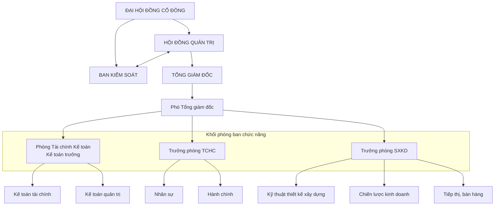

# CÔNG TY CỔ PHẦN PHÁT TRIỂN ĐÔ THỊ - BECAMEX UDJ

**Địa chỉ:** C1-2-3 đường DT6, khu Liên hợp CN-DV Bình Dương, Phường Định Hòa, Thành phố Thủ Dầu Một, Tỉnh Bình Dương  
**Điện thoại:** 0274. 3816681 – 3816661 | **Fax:** 0274. 3816655  
**Website:** www.becamexudj.com.vn  
**Mã cổ phiếu:** UDJ  

---

# BÁO CÁO THƯỜNG NIÊN 2025

**BÌNH DƯƠNG, THÁNG 03 NĂM 2026**

*Người ký số: HUỲNH GIA ĐẠT - Tổng Giám đốc CÔNG TY CP PHÁT TRIỂN ĐÔ THỊ*  
*Ký ngày: 31/03/2026 14:33:09*

---

**CÔNG TY CP PHÁT TRIỂN ĐÔ THỊ**  
Số: 16/BC - UDJ/2026  

**CỘNG HÒA XÃ HỘI CHỦ NGHĨA VIỆT NAM**  
**Độc lập – Tự do – Hạnh phúc**  
***  
*Bình Dương, ngày 31 tháng 03 năm 2026*  

## BÁO CÁO THƯỜNG NIÊN NĂM 2025

**Kính gửi:**  
- **Ủy ban Chứng khoán Nhà nước;**  
- **Sở Giao dịch Chứng khoán Hà Nội**  

---

## I. THÔNG TIN CHUNG

### 1. Thông tin khái quát
- **Tên giao dịch:** Công ty Cổ phần Phát triển Đô thị
- **Giấy chứng nhận đăng ký doanh nghiệp số:** 3700785535 do Sở Kế hoạch và Đầu tư tỉnh Bình Dương cấp ngày 12 tháng 06 năm 2024.
- **Vốn điều lệ:** 165.000.000.000 đồng
- **Vốn đầu tư của chủ sở hữu:** 165.000.000.000 đồng
- **Địa chỉ:** C1-2-3, đường DT6, khu liên hợp công nghiệp dịch vụ Bình Dương, Phường Định Hòa, Thành phố Thủ Dầu Một, Tỉnh Bình Dương.
- **Số điện thoại:** 0274.3816661 – 0274.3816681
- **Số fax:** 0274.3816655
- **Website:** www.becamexudj.com.vn
- **Mã cổ phiếu:** UDJ
- **Quá trình hình thành và phát triển:**
  - Công ty Cổ phần Phát triển Đô thị được thành lập ngày 26 tháng 3 năm 2007 theo Giấy chứng nhận đăng ký kinh doanh lần đầu số 4603000326 do Sở Kế hoạch và Đầu tư tỉnh Bình Dương cấp.
  - Trong quá trình hoạt động, Công ty đã được Sở Kế hoạch và Đầu tư tỉnh Bình Dương cấp bổ sung các Giấy chứng nhận đăng ký thay đổi kinh doanh từ lần 01 đến lần 09 về việc bổ sung vốn điều lệ, thay đổi cổ đông sáng lập, bổ sung ngành nghề kinh doanh, thay đổi địa chỉ trụ sở chính, thay đổi mã số doanh nghiệp, thay đổi người đại diện theo pháp luật.
  - Ngày 22 tháng 12 năm 2009 là ngày cổ phiếu của Công ty giao dịch đầu tiên trên sàn UPCOM.

### 2. Ngành nghề và địa bàn kinh doanh

#### Ngành nghề kinh doanh:
- Kinh doanh bất động sản, quyền sử dụng đất thuộc chủ sở hữu, chủ sử dụng hoặc đi thuê;
  - *Chi tiết:* Đầu tư xây dựng và kinh doanh cơ sở hạ tầng kỹ thuật khu công nghiệp, khu dân cư và khu đô thị. Kinh doanh bất động sản, cho thuê nhà ở, căn hộ, nhà xưởng và văn phòng. *(Trừ đầu tư xây dựng hạ tầng nghĩa trang, nghĩa địa để chuyển nhượng quyền sử dụng đất gắn với hạ tầng).*
- Chuẩn bị mặt bằng;
  - *Chi tiết:* San lấp mặt bằng. *(Trừ dịch vụ nổ mìn).*
- Bán buôn nông, lâm sản nguyên liệu (trừ gỗ, tre, nứa) và động vật sống;
  - *Chi tiết:* Mua bán mủ cao su nguyên liệu. *(Trừ thực hiện quyền xuất khẩu, quyền nhập khẩu, quyền phân phối đối với các hàng hóa: thuốc lá và xì gà, sách, báo và tạp chí, vật phẩm đã ghi hình, kim loại quý và đá quý, dược phẩm, thuốc nổ, dầu thô và dầu đã qua chế biến, gạo, đường mía và đường củ cải).*
- Bán buôn vật liệu, thiết bị lắp đặt khác trong xây dựng;
  - *Chi tiết:* Mua bán vật liệu xây dựng. *(Trừ thực hiện quyền xuất khẩu, quyền nhập khẩu, quyền phân phối đối với các hàng hóa: thuốc lá và xì gà, sách, báo và tạp chí, vật phẩm đã ghi hình, kim loại quý và đá quý, dược phẩm, thuốc nổ, dầu thô và dầu đã qua chế biến, gạo, đường mía và đường củ cải).*
- Bán buôn đồ dùng khác cho gia đình;
  - *Chi tiết:* Mua bán hàng trang trí nội thất các loại. *(Trừ thực hiện quyền xuất khẩu, quyền nhập khẩu, quyền phân phối đối với các hàng hóa: thuốc lá và xì gà, sách, báo và tạp chí, vật phẩm đã ghi hình, kim loại quý và đá quý, dược phẩm, thuốc nổ, dầu thô và dầu đã qua chế biến, gạo, đường mía và đường củ cải).*
- Hoạt động dịch vụ tài chính khác chưa được phân vào đâu (trừ bảo hiểm và bảo hiểm xã hội);
  - *Chi tiết:* Đầu tư tài chính vào các doanh nghiệp khác.
- Tư vấn, môi giới, đấu giá bất động sản, đấu giá quyền sử dụng đất;
  - *Chi tiết:* Dịch vụ tư vấn bất động sản; môi giới bất động sản; quản lý bất động sản; quảng cáo bất động sản; định giá bất động sản; sàn giao dịch bất động sản. *(Trừ dịch vụ đấu giá tài sản).*
- Hoạt động kiến trúc và tư vấn kỹ thuật có liên quan;
  - *Chi tiết:* Tư vấn, thiết kế xây dựng công trình dân dụng - công nghiệp; tư vấn, thiết kế xây dựng công trình hạ tầng kỹ thuật đô thị; tư vấn, thiết kế kết cấu công trình dân dụng và công nghiệp; giám sát công tác xây dựng và hoàn thiện công trình dân dụng và công nghiệp; tư vấn, lập qui hoạch chi tiết và lập tổng dự toán: khu dân cư, khu đô thị, khu công nghiệp, công trình dân dụng, công nghiệp, giao thông. *(Trừ dịch vụ thiết lập, vận hành, duy trì, bảo trì báo hiệu hàng hải, khu nước, vùng nước, luồng hàng hải công cộng và tuyến hàng hải; dịch vụ khảo sát khu nước, vùng nước, luồng hàng hải công cộng và tuyến hàng hải phục vụ công bố thông báo hàng hải; dịch vụ khảo sát, xây dựng và phát hành hải đồ vùng nước, cảng biển, luồng hàng hải và tuyến hàng hải).*
- Sản xuất bê tông và các sản phẩm từ bê tông, xi măng và thạch cao.
- Xây dựng nhà để ở;
  - *Chi tiết:* Xây dựng công trình dân dụng, công nghiệp.
- Xây dựng công trình kỹ thuật dân dụng khác;
  - *Chi tiết:* Xây dựng công trình công trình kỹ thuật hạ tầng.
- Xây dựng nhà không để ở.
- Xây dựng công trình đường sắt.
- Xây dựng công trình đường bộ;
  - *Chi tiết:* Xây dựng công trình giao thông
- Xây dựng công trình công ích khác.
  - *Chi tiết:* Xây dựng công trình công cộng.

#### Địa bàn kinh doanh:
- Kinh doanh bất động sản: Các dự án tại Bình Dương giao dịch kinh doanh tại trụ sở chính;

### 3. Thông tin về mô hình quản trị, tổ chức kinh doanh và bộ máy quản lý
- **a. Mô hình quản trị:** Công ty đại chúng quy mô lớn.
- **b. Cơ cấu bộ máy quản lý:**
  - Đại hội đồng cổ đông;
  - Hội đồng quản trị;
  - Ban kiểm soát;
  - Tổng giám đốc.

#### Sơ đồ tổ chức kinh doanh và bộ máy quản lý

### 4. Định hướng phát triển
- **Các mục tiêu chủ yếu của Công ty:**
  - Phát triển nghiên cứu, sản xuất và cung cấp các loại vật liệu xây dựng mới phục vụ các công trình xây dựng dân dụng, công nghiệp.
- **Chiến lược phát triển trung và dài hạn:**
  - *Trung hạn:* Đầu tư sản xuất các ngành nghề về vật liệu xây dựng chính yếu như bê tông tươi, gạch ngói phục vụ các công trình dân dụng song song với việc đầu tư xây dựng, kinh doanh bất động sản các khu nhà phố, khu nhà vườn biệt thự tại Bình Dương phục vụ nhu cầu của người dân.
  - *Dài hạn:* Mở rộng sản xuất đa dạng về chủng loại các nguyên vật liệu xây dựng đòi hỏi kỹ thuật cao phục vụ các công trình công nghiệp, đầu tư xây dựng cơ sở hạ tầng các khu công nghiệp, trung tâm thương mại, đầu tư tài chính mạnh mẽ vào các doanh nghiệp khác hoạt động kinh doanh có hiệu quả tạo thế phát triển ổn định và bền vững trong tương lai.

### 5. Các rủi ro
Lĩnh vực kinh doanh chính của Công ty hiện tại phục vụ chủ yếu cho phát triển thị trường bất động sản nên các chính sách, các nhân tố tác động gây ảnh hưởng làm kìm hãm đến sự phát triển của thị trường bất động sản đều là các rủi ro đối với việc thực hiện các mục tiêu của Công ty.

---

## II. TÌNH HÌNH HOẠT ĐỘNG TRONG NĂM

### 1. Tình hình hoạt động sản xuất kinh doanh
- **Kết quả hoạt động sản xuất kinh doanh trong năm:**

*ĐVT: Tỷ đồng*

| Chỉ tiêu | Thực hiện 2024 | Kế hoạch 2025 | Thực hiện 2025 | %TH/KH 2025 | % TH 2025/2024 |
| :--- | :---: | :---: | :---: | :---: | :---: |
| Tổng doanh thu | 42,82 | 116,52 | 61,09 | 52% | 143% |
| Lợi nhuận trước thuế | 8,64 | 13,72 | 6,33 | 46% | 73% |
| Lợi nhuận sau thuế | 6,78 | 10,84 | 5,06 | 47% | 75% |
| Trích lập các quỹ | 1,90 | 3,04 | 1,11 | 37% | 61% |
| Lợi nhuận còn lại sau khi trích lập các quỹ (1) | 4,88 | 7,80 | 3,95 | 51% | 80% |
| Tỷ lệ cổ tức đạt được trong kỳ | 2,96% | 5% | 2,39% | 51% | - |
| Lợi nhuận còn lại của các năm chuyển sang (2) | 7,09 | - | 3,79 | - | - |
| Tỷ lệ chia cổ tức (dự kiến) * | 5% | 5% | 4,69% | 94% | 94% |

### 2. Tổ chức và nhân sự

#### a. Danh sách Ban điều hành

##### • Tổng Giám đốc: Ông Huỳnh Gia Đạt
- **Sinh năm:** 1972
- **Địa chỉ:** 98/92/1 CMT8, phường 5, Tân Bình, TP.HCM
- **Trình độ chuyên môn:** Kỹ sư xây dựng

| Thời gian | Công việc, chức vụ | Đơn vị/nơi công tác |
| :--- | :--- | :--- |
| 1996 – 1999 | Giám sát thi công | Cty Đầu Tư & Phát Triển Công Nghiệp – BECAMEX IDC / Bình Dương |
| 2000 – 2004 | Chỉ huy trưởng công trường | Cty Đầu Tư & Phát Triển Công Nghiệp – BECAMEX IDC / Bình Dương |
| 2004 – 05/2007 | Cán bộ phòng kỹ thuật | Cty Đầu Tư & Phát Triển Công Nghiệp – BECAMEX IDC / Bình Dương |
| 06/2007 – 04/2022 | Phó Tổng Giám đốc | Công ty CP Phát Triển Đô Thị – BECAMEX UDJ / Bình Dương |
| 04/2022 - nay | Tổng Giám đốc | Công ty CP Phát Triển Đô Thị – BECAMEX UDJ / Bình Dương |

- *Tỷ lệ sở hữu cổ phần có quyền biểu quyết:* không

##### • Kế toán trưởng: Ông Nguyễn Phạm Văn Khoa
- **Sinh năm:** 1975
- **Địa chỉ:** Ấp Bình Hưng, Xã Bạch Đằng, TX Tân Uyên, Tỉnh Bình Dương
- **Trình độ chuyên môn:** Cử nhân kinh tế

| Thời gian | Công việc, chức vụ | Đơn vị/nơi công tác |
| :--- | :--- | :--- |
| 01/10/1996 – 31/12/2001 | Kế toán thanh toán | Công ty Trung Thành thuộc Văn phòng Tỉnh Ủy |
| 01/01/2002 – 21/06/2005 | Phó phòng Kế toán | Công ty Trung Thành thuộc Văn phòng Tỉnh Ủy |
| 22/06/2005 – 16/01/2006 | Quyền Kế toán trưởng | Công ty CP Trung Thành thuộc Văn phòng Tỉnh Ủy |
| 17/01/2006 – 31/10/2008 | Kế toán trưởng kiêm TV HĐQT | Công ty CP Trung Thành thuộc Văn phòng Tỉnh Ủy |
| 11/2008 – 10/2009 | Kế toán tổng hợp | Công ty cổ phần Thiên Nhiên Việt |
| 01/12/2009 – 30/04/2013 | Kế toán tổng hợp | Công ty Cổ phần Khoáng sản Becamex |
| 01/05/2013 – 31/01/2015 | Kế toán trưởng | Công ty Cổ phần Khoáng sản Becamex |
| 02/2015 – 31/03/2015 | Trưởng phòng Kế toán Tổng hợp | Công ty Cổ phần Khoáng sản Becamex |
| 01/03/2015 – nay | Kế toán trưởng | Công ty CP Phát triển Đô thị – Becamex UDJ |

- *Tỷ lệ sở hữu cổ phần có quyền biểu quyết:* không

#### b. Lao động và chính sách đối với người lao động
Tại ngày 31 tháng 12 năm 2025 Công ty có 14 nhân viên đang làm việc (tại ngày 31 tháng 12 năm 2024 là 14 nhân viên). Trong đó trình độ Đại học chiếm 64,29%, Cao đẳng và Trung cấp chiếm 7,14% và trình độ Khác chiếm 28,57%.

Công ty luôn tuân thủ Bộ Luật lao động, Luật BHXH, đảm bảo các quyền và lợi ích hợp pháp cho người lao động, các chế độ chính sách có liên quan đến người lao động như tiền lương, thưởng, chế độ BHXH, BHYT, cụ thể: Công ty luôn chi trả lương đầy đủ và kịp thời cho người lao động, tham gia BHXH, BHYT, BHTN đầy đủ, kịp thời cho người lao động đúng theo quy định của Bộ Luật lao động và Luật BHXH. Hàng năm, Công ty tổ chức khám sức khỏe định kỳ cho người lao động.

### 3. Tình hình đầu tư, tình hình thực hiện các dự án

#### a) Các khoản đầu tư lớn:

##### Tình hình thực hiện chi tiết các dự án:

#### 1. Dự án nhà phố liền kề cao cấp GREEN PEARL – TPM.BD:
- **Tổng diện tích ban đầu:** 39.658 m2 – Tương đương 182 căn nhà phố.
- **Diện tích còn lại (sau khi điều chỉnh):** 9.176,5 m2 – Tương đương 78 căn.
- **Vốn đầu tư dự kiến:** 400 tỷ đồng (Tiền đất, nhà & Hạ tầng).

- **Tình hình xây dựng tổng thể của dự án như sau:**

| Stt | DIỄN GIẢI | Diện tích đất (m2) | Số lượng nhà (căn) * | Diện tích đất đã bán (m2): Diện tích đã bàn giao (Đến 31/12/2025) | Diện tích đất đã bán (m2): Diện tích đã bán thu tiền theo tiến độ | Diện tích đất tồn kho [Tiến độ + Tồn kho] (m2) |
| :---: | :--- | :---: | :---: | :---: | :---: | :---: |
| 1 | Giai đoạn I | 6.118,8 | 51 | 3.306,4 | - | 2.812,4 |
| 2 | Giai đoạn II | 3.057,7 | 27 | 3.057,7 | - | - |
| ++ | **Tổng cộng** | **9.176,5** | **78** | **6.364,1** | **-** | **2.812,4** |

- **Kết quả thực hiện trong năm 2025:**
Doanh thu bán hàng theo tiến độ thực hiện trong năm 2025 như sau:

*ĐVT: Tỷ đồng.*

| Stt | DIỄN GIẢI | Số lượng căn | Tổng Doanh thu (Tỷ.đ) | Tổng Giá vốn (Tỷ.đ) | Lợi nhuận gộp (Tỷ.đ) | Lợi nhuận bình quân |
| :---: | :--- | :---: | :---: | :---: | :---: | :---: |
| 1 | Giai đoạn I | - | - | - | - | - |
| 2 | Giai đoạn II | 6 | 41,34 | 37,33 | 4,01 | 0,67 |
| | **Tổng cộng** | **6** | **41,34** | **37,33** | **4,01** | **0,67** |

- **Giá trị SXKD dở dang đến ngày 31/12/2025:** 108,33 tỷ đồng.

*ĐVT: tỷ đồng*

| Diễn giải | Số dư đầu kỳ: Dư Nợ | Số dư đầu kỳ: Dư Có | Số phát sinh trong kỳ: P/s Nợ (Tăng) | Số phát sinh trong kỳ: P/s Có (Giảm) | Số dư cuối kỳ: Dư Nợ | Số dư cuối kỳ: Dư Có |
| :--- | :---: | :---: | :---: | :---: | :---: | :---: |
| CP.SXKDDD | 160,21 | | 1,10 | 52,98 | 108,33 | - |

- **Sản phẩm tồn kho đến 31/12/2025:**

*ĐVT: căn*

| Diễn giải | Tồn đầu kỳ (căn) | Xây dựng trong kỳ | Bàn giao trong kỳ | Tồn cuối kỳ (căn) |
| :--- | :---: | :---: | :---: | :---: |
| Nhà liền kề | 20 | - | - | 20 |

- **Tình hình pháp lý của dự án Green Pearl (Tính đến ngày 31/12/2025):**
  - Quyết định 3193/QĐ-UBND phê duyệt QH 1/500 cục bộ: Hiện IDC là chủ đầu tư dự án.
  - Giấy chứng nhận QSDĐ: Các bên liên quan đang thực hiện các thủ tục pháp lý chuyển nhượng quyền sử dụng đất từ Tập đoàn Becamex IDC sang Công ty Becamex UDJ.
  - *Phương hướng:* Trên cơ sở có giấy CN.QSDĐ, đơn vị tiến hành chuẩn bị để hoàn thiện hồ sơ pháp lý để ra giấy chứng nhận cho khách hàng (dự kiến hoàn thành trong năm 2026).
- *(Ghi chú hình ảnh báo cáo: Hình ảnh nhà Dự án GREEN PEARL – TPM.BD giáp Đường Lê Lợi).*

---

#### 2. Tình hình thực hiện dự án Lake View:
- **Quy mô diện tích:** 63.633 m2 - 92 căn biệt thự cao cấp.
- Công ty CP Phát Triển Đô Thị tiến hành các thủ tục thanh lý hợp đồng số 231/DTMBD đã ký ngày 28/10/2009 hoàn trả dự án Lake View lại cho tập đoàn Becamex IDC đã thông qua Đại Hội Cổ Đông thường niên năm 2023.
- Hiện tại các bên gồm Tập đoàn Becamex IDC/ Công Ty CP Phát Triển Đô Thị/ 02 khách hàng là Công ty TNHH BeGa và cá nhân Bà Đoàn Thị Giáp cùng đang xúc tiến bàn bạc để đi đến thoả thuận giải quyết các nội dung còn vướng mắc liên quan việc ký thanh lý hợp đồng của 02 khách hàng trước đây Công ty cổ phần Phát triển Đô Thị ký hợp đồng và thu tiền.

---

#### 3. Dự án NOCN – Bàu Bàng:
- **Tình hình xây dựng và bàn giao nhà (Tính đến ngày 31/12/2025):**

| Stt | Lô đất | Tổng diện tích Đất và Nhà theo thiết kế: Diện tích đất (m2) | Tổng diện tích Đất và Nhà theo thiết kế: Block nhà (Block) | Số nhà tồn kho đầu năm (Block) | Kết quả thực hiện trong năm 2025: Xây dựng hoàn thành trong năm (Block) | Kết quả thực hiện trong năm 2025: Bàn giao khách hàng trong năm (Block) * | Kết quả thực hiện trong năm 2025: Số lượng nhà còn tồn kho tính đến ngày 31/12/2025 (Block) |
| :---: | :---: | :---: | :---: | :---: | :---: | :---: | :---: |
| 1 | Lô A 52 | 17.710 | 58 | | | | |
| 2 | Lô A 53 | 13.774 | 42 | | 02 | 02 | - |
| 3 | Lô A 51 | 17.710 | 56 | 01 | - | 01 | - |
| 4 | Lô A 50 | 13.774,4 | 42 | | | | |
| | **Tổng cộng** | **62.968,4 (M2)** | **198 (Block)** | **01** | **02** | **03** | **-** |

- **Doanh thu bán hàng thực hiện trong năm 2025 như sau:**

*ĐVT: Tỷ đồng.*

| Stt | Lô đất | Số lượng (block) * | Tổng Doanh thu (Tỷ.đ) | Tổng Giá vốn (Tỷ.đ) | Lợi nhuận gộp (Tỷ.đ) | Lợi nhuận bình quân |
| :---: | :---: | :---: | :---: | :---: | :---: | :---: |
| 1 | Lô A 52 | | | | | |
| 2 | Lô A 53 | 2 | 11,34 | 6,09 | 5,25 | 2,63 |
| 3 | Lô A 51 | 1 | 5,22 | 2,34 | 2,88 | 2,68 |
| 4 | Lô A 50 | | | | | |
| | **Tổng cộng** | **3** | **16,57** | **8,43** | **8,13** | **2,71** |

- **Chi phí SXKD.DD đến ngày 31/12/2025:** 0 đồng.
- **Tình hình pháp lý của dự án Bàu Bàng:** Đã ra sổ đất 100% cho khách hàng. Riêng quyền sở hữu nhà gắn liền với đất do còn vướng một số vấn đề về pháp lý nên hiện tại chưa thực hiện.
- *(Ghi chú hình ảnh báo cáo: Hình ảnh nhà tại Lô A51/ Bàu Bàng - Bàn giao khách hàng).*

---

#### 4. Dự án Green City – Hoà Lợi:
- **Tình hình pháp lý:**
  - Giấy chứng nhận quyền sử dụng đất đang đứng tên Công ty Becamex IJC.
  - Đã có quy hoạch của toàn dự án Green City.
- **Tình hình xây dựng và bàn giao nhà (Tính đến ngày 31/12/2025):**

| Stt | Lô đất | Tổng diện tích Đất và Nhà theo thiết kế: Diện tích đất (m2) | Tổng diện tích Đất và Nhà theo thiết kế: Block nhà (Block) | Số nhà tồn kho đầu năm (Block) | Kết quả thực hiện trong năm 2025: Xây dựng hoàn thành trong năm (Block) | Kết quả thực hiện trong năm 2025: Bàn giao khách hàng trong năm (Block) * | Kết quả thực hiện trong năm 2025: Số lượng nhà còn tồn kho tính đến ngày 31/12/2025 (Block) |
| :---: | :---: | :---: | :---: | :---: | :---: | :---: | :---: |
| 1 | G24 | 4.275 | 30 | - | - | | |
| 2 | G9 | 11.246 | 73 | - | - | | |
| | **Tổng cộng** | **15.521** | **103** | **-** | **-** | | |

- **Doanh thu bán hàng thực hiện trong năm 2025 như sau:** không phát sinh.
- Công ty Becamex UDJ nhận chuyển nhượng lô G9 và 01 phần lô G24 thuộc dự án Green City từ Công ty Becamex IJC. Sau khi IJC hoàn thành việc xây dựng và cập nhật sở hữu nhà vào Giấy chứng nhận sẽ thực hiện các thủ tục chuyển nhượng nhà và đất cho UDJ (dự kiến vào tháng 8/2026).
- Sau khi ký hợp đồng chuyển nhượng nhà và đất chính thức với IJC, UDJ mới triển khai kinh doanh dự án.

---

### 4. Tình hình tài chính

#### a) Tình hình tài chính

| Chỉ tiêu | Năm 2024 | Năm 2025 | % tăng, giảm |
| :--- | :---: | :---: | :---: |
| Tổng giá trị tài sản | 440.373.183.557 | 408.954.158.407 | -7,13% |
| Doanh thu thuần | 42.732.464.207 | 60.719.249.031 | 42,09% |
| Lợi nhuận từ hoạt động kinh doanh | 8.682.726.933 | 7.480.776.065 | -13,84% |
| Lợi nhuận khác | (40.896.297) | (1.146.690.312) | 2.703,90% |
| Lợi nhuận trước thuế | 8.641.830.636 | 6.334.085.753 | -26,70% |
| Lợi nhuận sau thuế | 6.777.210.849 | 5.061.308.602 | -25,32% |
| Tỷ lệ lợi nhuận trả cổ tức | 121,73% | 152,89% | 25,60% |

#### b/ Các chỉ tiêu tài chính chủ yếu

| Chỉ tiêu | Năm 2024 | Năm 2025 | Ghi chú |
| :--- | :---: | :---: | :---: |
| **1. Chỉ tiêu về khả năng thanh toán** | | | |
| + Hệ số thanh toán ngắn hạn: | 1,91 | 1,23 | |
| + Hệ số thanh toán nhanh: | 0,67 | 0,59 | |
| **2. Chỉ tiêu về cơ cấu vốn** | | | |
| + Hệ số Nợ/Tổng tài sản: | 0,47 | 0,44 | |
| + Hệ số Nợ/Vốn chủ sở hữu: | 0,90 | 0,80 | |
| **3. Chỉ tiêu về năng lực hoạt động** | | | |
| + Vòng quay hàng tồn kho: | 0,16 | 0,36 | |
| + Doanh thu thuần/Tổng tài sản bình quân: | 0,10 | 0,15 | |
| **4. Chỉ tiêu về khả năng sinh lời** | | | |
| + Hệ số Lợi nhuận sau thuế/Doanh thu thuần: | 0,16 | 0,08 | |
| + Hệ số Lợi nhuận sau thuế/Vốn chủ sở hữu: | 0,0293 | 0,0222 | |
| + Hệ số Lợi nhuận sau thuế/Tổng tài sản: | 0,015 | 0,012 | |
| + Hệ số Lợi nhuận từ hoạt động kinh doanh/Doanh thu thuần: | 0,20 | 0,12 | |

---

### 5. Cơ cấu cổ đông, thay đổi vốn đầu tư chủ sở hữu

#### a. Cổ phần
- **Số lượng cổ phần đang lưu hành:**
  - Năm 2024: 16.500.000 cổ phần
  - Năm 2025: 16.500.000 cổ phần
- **Cổ phần phổ thông:**
  - Năm 2024: 16.500.000 cổ phần
  - Năm 2025: 16.500.000 cổ phần
- **Mệnh giá cổ phiếu đang lưu hành:** 10.000 đồng /cổ phần

#### b. Cơ cấu cổ đông

##### – Cổ đông lớn và cổ đông nhỏ *(Tại thời điểm 29/09/2025)*

| STT | Cổ đông | Số lượng cổ đông | Số cổ phần nắm giữ | Tỷ lệ nắm giữ |
| :---: | :--- | :---: | :---: | :---: |
| 1 | Cổ đông lớn nắm giữ ≥5% | 1 | 8.415.000 | 51,00% |
| 2 | Cổ đông nhỏ nắm giữ <5% | 802 | 8.085.000 | 49,00% |
| | **Tổng cộng** | **803** | **16.500.000** | **100%** |

##### – Cổ đông sáng lập *(Cơ cấu cổ đông góp vốn sáng lập tại thời điểm 29/09/2025)*

| STT | Tên cổ đông | Địa chỉ | Số cổ phần nắm giữ | Tỷ lệ nắm giữ |
| :---: | :--- | :--- | :---: | :---: |
| 1 | Tổng Công ty Đầu Tư & Phát Triển Công Nghiệp – CTCP | Số 8, đường Hùng Vương, Phường Hòa Phú, Thành phố Thủ Dầu Một, Tỉnh Bình Dương, Việt Nam | 8.415.000 | 51,00 % |
| 2 | Nguyễn Thị Thùy Dương | A7 Định Bộ Lĩnh – Phú Cường – Thủ Dầu Một – Bình Dương | 0 | 0% |
| 3 | Kiều Oanh | B4 Hoàng Văn Thụ - Khu DC Chánh Nghĩa – Thủ Dầu Một – Bình Dương | 5.000 | 0,03 % |
| | **Tổng cộng** | | **8.420.000** | **51,03 %** |

##### – Cổ đông tổ chức và cổ đông cá nhân *(Tại thời điểm 29/09/2025)*

| STT | Tên cổ đông | Số lượng cổ đông | Số cổ phần nắm giữ | Tỷ lệ nắm giữ |
| :---: | :--- | :---: | :---: | :---: |
| 1 | Cổ đông tổ chức | 4 | 8.427.940 | 51,08% |
| 2 | Cổ đông cá nhân | 799 | 8.072.060 | 48,92% |
| | **Tổng cộng** | **803** | **16.500.000** | **100%** |

##### – Cổ đông trong nước và cổ đông nước ngoài *(Tại thời điểm 29/09/2025)*

| STT | Tên cổ đông | Số lượng cổ đông | Số cổ phần nắm giữ | Tỷ lệ nắm giữ |
| :---: | :--- | :---: | :---: | :---: |
| 1 | Cổ đông trong nước | 793 | 15.713.000 | 95,23% |
| 2 | Cổ đông nước ngoài | 10 | 787.000 | 4,77% |
| | **Tổng cộng** | **803** | **16.500.000** | **100%** |

- **Tỷ lệ sở hữu nước ngoài tối đa:** 50%

#### c. Tình hình thay đổi vốn đầu tư của chủ sở hữu: Không có
#### d. Giao dịch cổ phiếu quỹ: Không có
#### e. Các chứng khoán khác: Không có

---

## III. BÁO CÁO VÀ ĐÁNH GIÁ CỦA BAN TỔNG GIÁM ĐỐC

### 1. Đánh giá kết quả hoạt động sản xuất kinh doanh

#### a. Kinh doanh bất động sản

*ĐVT: Tỷ đồng*

| Chỉ tiêu | Thực hiện 2024 | Kế hoạch 2025 | Thực hiện 2025 | %TH/KH 2025 | % TH 2025/2024 |
| :--- | :---: | :---: | :---: | :---: | :---: |
| Nhà thương mại (căn) | 4 | 20 | 6 | 30% | 150% |
| Nhà ở công nhân (Block) | 4 | 3 | 3 | 100% | 75% |
| Tổng doanh thu (tỷ đồng) | 42,73 | 116,52 | 61,09 | 52% | 143% |
| Doanh thu BĐS. | 42,68 | 116,52 | 57,91 | 50% | 136% |
| Doanh thu khác | 0,05 | 0 | 3,18 | - | - |
| Lợi nhuận sau thuế (tỷ đồng) | 6,99 | 10,84 | 5,06 | 47% | 72% |

### 2. Tình hình tài chính
- **a/ Tình hình tài sản:**  
  Tình hình tài sản của Công ty đều hoạt động tích cực và hiệu quả tốt.
- **b/ Tình hình nợ phải trả:**  
  Công ty không có nợ phải trả người bán quá hạn chưa thanh toán.

---

## IV. ĐÁNH GIÁ CỦA HỘI ĐỒNG QUẢN TRỊ VỀ HOẠT ĐỘNG CỦA CÔNG TY

Qua các Nghị quyết, quyết định ban hành, HĐQT đã chỉ đạo và giám sát các hoạt động của Ban Tổng Giám đốc với đánh giá kết quả sau:
- Ban Tổng Giám đốc đã xây dựng các giải pháp, tổ chức thực hiện tốt các hoạt động kinh doanh của Công ty luôn ổn định.
- Hệ thống kiểm soát nội bộ quản lý tài chính luôn hoạt động tốt, đáp ứng được yêu cầu quản lý chặt chẽ ở tất cả các khâu công việc, thực hiện đúng và luôn tuân thủ các quy định của Pháp luật, của HĐQT Công ty.
- Công tác tổ chức quản lý, sắp xếp nhân sự hợp lý, có chú trọng đào tạo bồi dưỡng nghiệp vụ cho nhân viên đáp ứng được yêu cầu phát triển của Công ty; thực hiện tốt nghĩa vụ với ngân sách Nhà nước, đảm bảo đầy đủ các chế độ về BHXH, BHYT, BHTN, …

---

## V. QUẢN TRỊ CÔNG TY

### 1. Hội đồng quản trị

#### a. Thành viên và cơ cấu của Hội đồng quản trị:

| STT | Họ tên | Số CMND/ CCCD | Địa chỉ / Tên đơn vị | Số CP nắm giữ | Tỷ lệ % | Chức vụ |
| :---: | :--- | :---: | :--- | :---: | :---: | :--- |
| 1 | Ông Nguyễn Minh Đồng | 030066007068 | Phường Phú Lợi – Thành phố Thủ Dầu Một, Bình Dương, Việt Nam | 20.000 | 0,12% | Chủ tịch |
| 2 | Ông Huỳnh Vĩnh Thành | 074075005276 | Phường Chánh Hiệp, TP. Thủ Dầu Một, Bình Dương, Việt Nam | | | Thành viên HĐQT (Không điều hành) |
| | | | Công ty Cổ phần Xây dựng và Giao thông Bình Dương (Becamex BCE) | | | Thành viên HĐQT |
| | | | Công ty CP Cao su Bình Dương | | | Thành viên HĐQT |
| 3 | Bà Nguyễn Thị Thanh Trà | 074185001220 | 595/36, Tổ 102, Khu 7, Phường Phú Lợi, TP. Thủ Dầu Một, Bình Dương, Việt Nam | | | Thành viên HĐQT – (Không điều hành) |
| | | | Công ty Cổ phần Công nghệ & Truyền thông Việt Nam (VNTT) | | | Thành viên HĐQT |
| 4 | Bà Trần Thị Hồng Minh | 079183002311 | Nhà số 290, đường Đỗ Ngọc Thạnh, Phường 14, Quận 5, Thành Phố Hồ Chí Minh, Việt Nam. | | | Thành viên HĐQT – (Không điều hành) |
| | | | Tập đoàn Đầu tư và Phát triển Công Nghiệp Becamex - CTCP | | | Phó Tổng giám đốc |
| | | | Công ty TNHH Becamex Tokyu | | | Chủ tịch HĐTV |
| 5 | Bà Phạm Viết Yên | 074181009165 | Lô I38 Lý Thái Tổ, Phường Định Hòa, TP. Thủ Dầu Một, Bình Dương, Việt Nam | - | | Thành viên HĐQT (độc lập) |

#### b. Các tiểu ban thuộc Hội đồng quản trị: Không có

#### c. Hoạt động của Hội đồng quản trị:
Trong năm 2025, HĐQT đã tiến hành 06 phiên họp nhằm thông qua phương án kinh doanh cũng như chỉ đạo thực hiện các hoạt động Công ty, cụ thể như sau:
- Thống nhất thông qua việc phê duyệt mức giá trị của các hợp đồng, giao dịch giữa Công ty CP Phát triển Đô thị và Người có liên quan theo quy định tại Điều 167 Luật Doanh nghiệp 2020; điều 293 Nghị định 155/2020/NĐ/CP và Điều lệ Công ty.
- Thông qua kế hoạch tổ chức họp ĐHĐCĐ thường niên năm 2025.
- Chỉ đạo và tổ chức họp Đại hội đồng cổ đông thường niên năm 2025.
- Triển khai thực hiện Nghị quyết Đại hội đồng cổ đông thường niên năm 2025.
- Thông qua báo cáo kết quả thực hiện kinh doanh năm 2024 và kế hoạch năm 2025. Thông qua dự thảo tài liệu ĐHĐCĐ thường niên năm 2025.
- Thống nhất chọn Công ty TNHH Kiểm toán và Tư vấn A & C thực hiện soát xét báo cáo tài chính bán niên và kiểm toán báo cáo tài chính năm 2025. Giao Tổng giám đốc Công ty Cổ phần Phát triển Đô thị liên hệ với Công ty TNHH Kiểm toán và Tư vấn A & C ký hợp đồng kiểm toán báo cáo tài chính năm 2025 theo quy định.
- Thông qua việc chi trả cổ tức năm 2024.
- Thông qua việc bổ nhiệm Người phụ trách quản trị công ty kiêm Thư ký công ty.

#### d. Danh sách các thành viên Hội đồng quản trị có chứng chỉ đào tạo về quản trị công ty và tham gia các chương trình về quản trị công ty trong năm:

| STT | Họ tên | Chức vụ | Chứng chỉ quản trị | Tham gia trong năm |
| :---: | :--- | :--- | :---: | :---: |
| 1 | Nguyễn Minh Đồng | Chủ tịch | x | |
| 2 | Huỳnh Vĩnh Thành | Thành viên | x | |
| 3 | Nguyễn Thị Thanh Trà | Thành viên | | |
| 4 | Trần Thị Hồng Minh | Thành viên | | |
| 5 | Phạm Viết Yên | Thành viên | x | |

---

### 2. Ban kiểm soát

#### a. Thành viên và cơ cấu của Ban kiểm soát:

| STT | Họ tên | Số CMND | Địa chỉ | Số CP nắm giữ | Tỷ lệ % | Ghi chú |
| :---: | :--- | :---: | :--- | :---: | :---: | :--- |
| 1 | Nguyễn Hải Hoàng | 074091001527 | Phường Phú Lợi, TP. Thủ Dầu Một, Bình Dương, Việt Nam | 0 | 0 | Trưởng ban |
| 2 | Lê Thị Thùy Dương | 074189001014 | KDC Hiệp Thành 3, Phường Hiệp Thành, TP. Thủ Dầu Một, Bình Dương, Việt Nam | 0 | 0 | Thành viên |
| 3 | Huỳnh Thị Quế Anh | 074184001145 | Phường Phú Lợi, TP. Thủ Dầu Một, Bình Dương, Việt Nam | 0 | 0 | Thành viên |

#### b. Hoạt động của Ban kiểm soát:
- Giám sát tình hình hoạt động tài chính của công ty năm 2025
- Giám sát hoạt động của Hội đồng quản trị
- Giám sát hoạt động của Ban Tổng Giám Đốc;
- Giám sát về quy định công bố thông tin áp dụng với Công ty đại chúng
- Giám sát về giao dịch với các bên liên quan

Từng thành viên Ban kiểm soát đã thực hiện tốt nhiệm vụ được phân công, đảm bảo hiệu quả công tác kiểm tra, giám sát.
- HĐQT đã thực hiện tốt vai trò giám sát hoạt động của Ban điều hành, tiến hành các cuộc họp, kịp thời chỉ đạo chiến lược hoạt động của Ban điều hành thông qua việc ban hành các Nghị quyết đúng chức năng và thẩm quyền của Hội đồng quản trị quy định tại Điều lệ tổ chức và hoạt động của Công ty.
- HĐQT, Ban Tổng giám đốc đã thực hiện đúng chức năng nhiệm vụ được giao theo Điều lệ của Công ty, luôn đảm bảo các Nghị quyết được triển khai đúng kế hoạch và mục tiêu của Công ty.
- Công ty luôn tuân thủ theo đúng quy định về chế độ báo cáo về công bố thông tin trên thị trường chứng khoán theo quy định của pháp luật.
- Trong năm 2025, BKS không nhận được kiến nghị nào từ phía cổ đông.
- Trong năm 2025, BKS đã tổ chức 2 cuộc họp với các nội dung như sau:
  - ➤ Đánh giá kết quả sản xuất kinh doanh năm 2024 của Becamex UDJ và tình hình hoạt động của Ban Kiểm soát trình báo cáo tại cuộc họp ĐHĐCĐ thường niên năm 2025;
  - ➤ Thẩm định kết quả kinh doanh và tình hình tài chính Công ty tại báo cáo tài chính soát xét 6 tháng năm 2025;
  - ➤ Giám sát HĐQT và Ban điều hành trong việc triển khai kế hoạch sản xuất kinh doanh trích lập các quỹ, chi trả cổ tức cho cổ đông theo phương án phân phối lợi nhuận được ĐHĐCĐ thông qua;
  - ➤ Định kỳ kiểm tra các giao dịch liên quan phát sinh và việc chấp hành công bố thông tin của công ty theo các quy định hiện hành.

---

### 3. Các giao dịch, thù lao và các khoản lợi ích của Hội đồng quản trị, Ban Tổng giám đốc và Ban kiểm soát

#### a. Lương thưởng, thù lao:

##### Hội đồng quản trị:

*ĐVT: Ngàn đồng*

| STT | Họ tên | Chức vụ | Lương | Thưởng | Thù lao năm 2024 | Cộng |
| :---: | :--- | :--- | :---: | :---: | :---: | :---: |
| 1 | Nguyễn Minh Đồng | Chủ tịch | 475.200 | 198.000 | 22.783 | 695.983 |
| 2 | Huỳnh Vĩnh Thành | Thành viên | | | 15.946 | 15.946 |
| 3 | Nguyễn Thị Thanh Trà | Thành viên | | | 15.946 | 15.946 |
| 4 | Trần Thị Hồng Minh | Thành viên | | | 0 | 0 |
| 5 | Phạm Viết Yên | Thành viên | | | 15.946 | 15.946 |
| 6 | Quảng Văn Viết Cương | Phó chủ tịch nhiệm kỳ 2022 – 2027 *(Miễn nhiệm ngày 15/04/2025)* | | | 18.224 | 18.224 |
| | **Tổng cộng** | | **475.200** | **198.000** | **88.845** | **762.045** |

##### Ban Tổng giám đốc:

*ĐVT: Ngàn đồng*

| STT | Họ tên | Chức vụ | Lương | Thưởng | Cộng |
| :---: | :--- | :--- | :---: | :---: | :---: |
| 1 | Huỳnh Gia Đạt | Tổng giám đốc | 442.800 | 184.500 | 627.300 |
| 2 | Nguyễn Phạm Văn Khoa | Kế toán trưởng | 329.040 | 137.100 | 466.140 |
| | **Tổng cộng** | | **771.840** | **321.600** | **1.093.440** |

##### Ban kiểm soát:

*ĐVT: Ngàn đồng*

| STT | Họ tên | Chức vụ | Lương | Thưởng | Thù lao năm 2024 | Cộng |
| :---: | :--- | :--- | :---: | :---: | :---: | :---: |
| 1 | Nguyễn Hải Hoàng | Trưởng Ban | | | 15.946 | 15.946 |
| 2 | Huỳnh Thị Quế Anh | Thành viên | | | 10.251 | 10.251 |
| 3 | Lê Thị Thùy Dương | Thành viên | | | 10.251 | 10.251 |
| | **Tổng cộng** | | | | **36.448** | **36.448** |

#### b. Giao dịch cổ phiếu của người nội bộ và người có liên quan: Không có

#### c. Hợp đồng hoặc giao dịch với người nội bộ và người có liên quan:

| STT | Tên tổ chức/cá nhân | Mối quan hệ liên quan với công ty | Số giấy NSH*; ngày cấp, nơi cấp NSH | Địa chỉ Trụ sở chính / Địa chỉ liên hệ | Thời điểm giao dịch với công ty | Số hợp đồng/ biên bản thông qua (nếu có) | Nội dung, số lượng, tổng giá trị giao dịch |
| :---: | :--- | :--- | :--- | :--- | :--- | :--- | :--- |
| 1 | Công ty Cổ phần Công nghệ & truyền thông Việt Nam | Tổ chức có liên quan đến người nội bộ | 3700861497; 10/04/2017; Sở KH&ĐT Bình Dương | 21 VSIP II, đường số 1, KCN Việt Nam – Singapore II, P. Hòa Phú, TP. Thủ Dầu Một, Bình Dương. | Ngày 01/01/2023 - 31/12/2023 | 890/HDDV-VNTT Nghị quyết HĐQT số 01/NQ/HĐQT/2025 | Hợp đồng số: 890/HDDV-VNTT ngày 23/03/2012 Phí dịch vụ internet, điện thoại **20.602.943 đồng** |
| 2 | Tập đoàn Đầu tư và Phát triển Công Nghiệp Becamex - CTCP | Công ty mẹ, Tổ chức có liên quan đến người nội bộ | 3700145020; 03/06/2010; Sở Tài chính Thành phố Hồ Chí Minh | Tầng 10, Tòa nhà mPlaza Saigon, số 39 Lê Duẩn, Phường Bến Nghé, Quận 1, TP Hồ Chí Minh, Việt Nam | 04/04/2025 | 239/DTMBD ngày 16/11/2009 và 188/HDCN/2025 ngày 31/03/2025 Nghị quyết HĐQT số 01/NQ/HĐQT/2025 | Chuyển nhượng quyền sử dụng đất **36.776.709 đồng** |
| | | | | | Ngày 01/01/2025 - 19/06/2025 | Nghị quyết HĐQT số 01/NQ/HĐQT/2025 | **201.469.125 đồng** |
| | | | | | Ngày 01/01/2025 - 31/12/2025 | Nghị quyết HĐQT số 01/NQ/HĐQT/2025 | Lãi phạt chậm thanh toán **1.216.890.312 đồng** |
| 3 | Công ty Cổ phần Bệnh viện Đa khoa Quốc tế Becamex | Công ty cùng tập đoàn | 370221330; 30/06/2017; Sở KH&ĐT Bình Dương | Đại lộ Bình Dương, Khu Gò Cát, Phường Lái Thiêu, TP. Thuận An, Bình Dương, Việt Nam. | Ngày 24/04/2024 | 1044/2025/HĐ-KSK-BIH Nghị quyết HĐQT số: 01/NQ/HĐQT/2025 | Phí dịch vụ khám sức khỏe cho CBNV công ty năm 2025 **63.386.000 đồng** |

---

*(Toàn bộ Phần VI. BÁO CÁO TÀI CHÍNH từ trang 20/21 trở đi được bỏ qua theo quy tắc ngắt sớm).*
