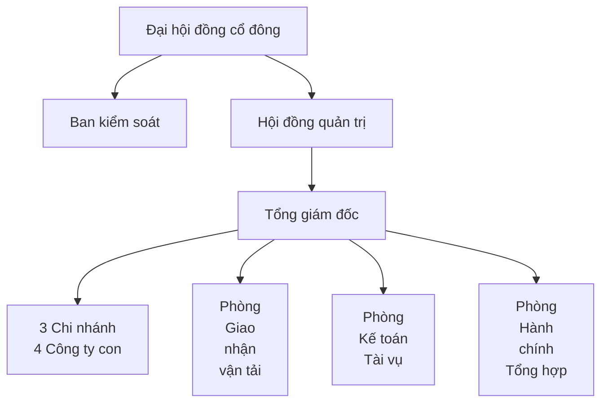

# BÁO CÁO THƯỜNG NIÊN NĂM 2025
**CÔNG TY CỔ PHẦN VẬN TẢI VÀ THUÊ TÀU**

---

### Thông tin ký số:
- **Người ký:** PHẠM QUỐC CHÍNH
- **Chứng thư số:** DN: C=VN, S=HÀ NỘI, L=Phường Cửa Nam, OU=CÔNG TY CỔ PHẦN VẬN TẢI VÀ THUÊ TÀU, T=Kế Toán Trưởng, CN=PHẠM QUỐC CHÍNH, OID.0.9.2342.19200300.100.1.1=CCCD:034080019898
- **Lý do ký:** I am the author of this document
- **Ngày ký:** 2026.04.06 08:26:46+07'00'
- **Ứng dụng ký:** Foxit PDF Reader Version: 2023.3.0

---

## MỤC LỤC

| Nội dung | Trang |
| :--- | :---: |
| **I. THÔNG TIN CHUNG** | **3** |
| 1. Thông tin khái quát | 3 |
| 2. Ngành nghề và địa bàn kinh doanh | 3 |
| 3. Thông tin về mô hình quản trị, tổ chức kinh doanh và bộ máy quản lý | 4 |
| 4. Định hướng phát triển | 6 |
| 5. Các rủi ro | 6 |
| **II. TÌNH HÌNH HOẠT ĐỘNG TRONG NĂM** | **7** |
| 1. Tình hình hoạt động sản xuất kinh doanh | 7 |
| 2. Tổ chức và nhân sự | 8 |
| 3. Tình hình đầu tư | 9 |
| 4. Tình hình tài chính | 9 |
| 5. Cơ cấu cổ đông, thay đổi vốn đầu tư của chủ sở hữu | 10 |
| 6. Báo cáo tác động liên quan đến môi trường và xã hội của Công ty | 12 |
| **III. BÁO CÁO VÀ ĐÁNH GIÁ CỦA BAN TỔNG GIÁM ĐỐC** | **12** |
| 1. Đánh giá kết quả hoạt động sản xuất kinh doanh | 12 |
| 2. Tình hình tài chính | 12 |
| 3. Những cải tiến về cơ cấu tổ chức, chính sách, quản lý | 12 |
| 4. Kế hoạch phát triển trong tương lai | 12 |
| 5. Giải trình của Ban Tổng giám đốc đối với ý kiến kiểm toán | 13 |
| 6. Báo cáo đánh giá liên quan đến trách nhiệm về môi trường và xã hội của Công ty | 13 |
| **IV. ĐÁNH GIÁ CỦA HỘI ĐỒNG QUẢN TRỊ VỀ HOẠT ĐỘNG CỦA CÔNG TY** | **13** |
| 1. Đánh giá của Hội đồng quản trị về các mặt hoạt động của Công ty | 13 |
| 2. Đánh giá của Hội đồng quản trị về hoạt động của Ban Tổng giám đốc công ty | 13 |
| 3. Các kế hoạch, định hướng của Hội đồng quản trị | 13 |
| **V. QUẢN TRỊ CÔNG TY** | **14** |
| 1. Hội đồng quản trị | 14 |
| 2. Ban kiểm soát | 15 |
| 3. Các giao dịch, thù lao và các khoản lợi ích của Hội đồng quản trị, Ban Tổng Giám đốc và ban kiểm soát | 16 |
| **VI. BÁO CÁO TÀI CHÍNH** | **16** |
| 1. Ý kiến kiểm toán | 16 |
| 2. Báo cáo tài chính được kiểm toán | 16 |

---

**CÔNG TY CỔ PHẦN VẬN TẢI VÀ THUÊ TÀU**  
Số: ...../BCTN-VFR  

**CỘNG HÒA XÃ HỘI CHỦ NGHĨA VIỆT NAM**  
**Độc lập - Tự do - Hạnh phúc**  
*Hà Nội, ngày...... tháng ... năm 2026*

# BÁO CÁO THƯỜNG NIÊN NĂM 2025
**Công ty Cổ phần Vận tải và Thuê tàu**

**Kính gửi:**  
- **Uỷ ban chứng khoán Nhà nước;**  
- **Sở Giao dịch chứng khoán Hà Nội;**

---

## I. THÔNG TIN CHUNG

### 1. Thông tin khái quát
- **Tên giao dịch:** Công ty CP Vận tải và Thuê tàu
- **Tên tiếng Anh:** Transport and Chartering Corporation
- **Giấy chứng nhận đăng ký doanh nghiệp số:** 0100105937 do Sở Kế hoạch và Đầu tư thành phố Hà Nội cấp lần đầu ngày 02 tháng 10 năm 2006, đăng ký thay đổi lần thứ mười ngày 25 tháng 06 năm 2025.
- **Vốn điều lệ:** 150.000.000.000 đồng (Một trăm năm mươi tỷ đồng)
- **Địa chỉ:** Số 74 Nguyễn Du, phường Cửa Nam, Thành phố Hà Nội
- **Số điện thoại:** 024 38 228915
- **Số fax:** 024 38 228916
- **Website:** www.vietfracht.com.vn
- **Mã cổ phiếu:** VFR

**Quá trình hình thành và phát triển:**  
Công ty cổ phần Vận tải và Thuê tàu được thành lập lần đầu vào ngày 18/02/1963 với tên gọi “Tổng Công ty Vận tải ngoại thương”, trực thuộc Bộ Ngoại thương. Đến năm 1984 được đổi tên là “Tổng Công ty Thuê tàu và Môi giới hàng hải” và được chuyển sang trực thuộc Bộ Giao thông Vận tải. Đến năm 2006 được cổ phần hoá và niêm yết trên sàn chứng khoán Hà Nội, mang tên mới từ đó đến nay là Công ty cổ phần Vận tải và Thuê tàu. Tên viết tắt cũng là thương hiệu của Công ty tồn tại không thay đổi suốt từ ngày thành lập, từ năm 1963 - đến nay là Vietfracht.

Vietfracht là thành viên của nhiều tổ chức quốc tế như: Tổ chức Hàng hải quốc tế và Ban-tích (BIMCO), Liên đoàn quốc tế những Hiệp hội giao nhận (FIATA), Liên đoàn những Hiệp hội quốc gia về đại lý và môi giới hàng hải (FONASBA), Hiệp hội Chủ tàu các nước thuộc Hội các nước Đông Nam Á (FASA), Diễn đàn Chủ tàu châu Á (ASF), và là một trong những thành viên sáng lập của nhiều tổ chức quốc gia như: Hiệp hội Chủ tàu Việt Nam (VSA), Hiệp hội Đại lý và môi giới hàng hải Việt Nam (VISABA), Hiệp hội Logistics Việt Nam (VLA) và Phòng Thương mại và công nghiệp Việt Nam (VCCI).

Với hơn 50 năm hình thành và phát triển, Vietfracht được biết đến là một trong những công ty hàng hải hàng đầu của Việt Nam, Công ty luôn đổi mới, cải tiến chất lượng dịch vụ để đáp ứng yêu cầu ngày càng cao của khách hàng và đạt hiệu quả cao trong SXKD. Với những thành tích đáng tự hào nêu trên, Công ty đã được Đảng và Nhà nước trao tặng nhiều phần thưởng và danh hiệu cao quý: Huân chương Lao động hạng Nhất/ Nhì/ Ba, Huân chương Độc lập hạng Ba, Đơn vị Anh hùng Lao động thời kỳ đổi mới.

### 2. Ngành nghề và địa bàn kinh doanh
#### 2.1 Ngành nghề kinh doanh chính
+ Vận tải hàng hóa bằng đường biển (bao gồm vận tải container, hàng siêu trường siêu trọng, hàng rời, hàng bách hoá theo các tuyến hàng hải trong nước và quốc tế). Thuê tàu, cho thuê tàu, môi giới hàng hải và các dịch vụ môi giới khác;
+ Đại lý tàu biển, đại lý giao nhận vận tải hàng hoá đa phương thức bằng đường không, đường biển, đường bộ... theo sự ủy thác của chủ tàu và chủ hàng và các dịch vụ liên quan;
+ Khai thác kho bãi container, kho ngoại quan, kho trung chuyển, phân phối, thu gom hàng hóa xuất nhập khẩu và hàng hoá nội địa;
+ Kinh doanh, cho thuê văn phòng làm việc;
+ Đầu tư thành lập các công ty liên doanh liên kết hoạt động trong cùng lĩnh vực (nêu trên) để mở rộng mạng lưới kinh doanh; Đầu tư tài chính vào các tổ chức kinh tế khác.

#### 2.2 Địa bàn kinh doanh:
Địa bàn kinh doanh của Công ty trải rộng trên khắp mọi miền của đất nước, chủ yếu tập trung ở những thành phố lớn hoặc thành phố - cảng biển lớn như Hải Phòng, Quảng Ninh, Tp Hồ Chí Minh, Đà Nẵng, Tp Vũng Tàu.

### 3. Thông tin về mô hình quản trị, tổ chức kinh doanh và bộ máy quản lý
#### 3.1 Mô hình quản trị:

**SƠ ĐỒ TỔ CHỨC CỦA CÔNG TY 2025**

**Các Chi Nhánh:**
1. Chi nhánh tại Hồ Chí Minh
2. Chi nhánh tại Hải Phòng
3. Chi nhánh tại Quảng Ninh

**Các Công ty Con:**

| STT | Tên Công ty | Địa chỉ | Lĩnh vực SXKD chính | Vốn điều lệ *(ĐVT: Triệu đồng)* | Tỷ lệ sở hữu của Vietfracht tại Công ty Con |
| :---: | :--- | :--- | :--- | :---: | :---: |
| 1 | Công ty Cổ phần Kho vận Vietfracht Hưng Yên | Km24, Quốc lộ 5A, Vĩnh Khúc, Văn Giang, Hưng Yên | Cho thuê kho bãi | 30.000 | 99.33% |
| 2 | Công ty TNHH Một thành viên Vietfracht Hải Phòng | Số 35, đường Minh Khai, phường Hoàng Văn Thụ, quận Hồng Bàng, Hải Phòng | Cho thuê kho bãi | 30.000 | 100% |
| 3 | Công ty TNHH Một thành viên Vietfracht Hà Nội | 74 Nguyễn Du, phường Nguyễn Du, quận Hai Bà Trưng, TP. Hà Nội | Cho thuê Bất động sản, Dịch vụ giao nhận hàng hóa/Hải quan | 12.000 | 100% |
| 4 | Công ty TNHH Một thành viên Vietfracht Thành phố Hồ Chí Minh | Số 11, Nguyễn Công Trứ, phường Nguyễn Thái Bình, quận 1, thành phố Hồ Chí Minh | Cho thuê Bất động sản, Dịch vụ giao nhận hàng hóa/Hải quan | 12.000 | 100% |

Công ty cổ phần Vận tải và thuê tàu được tổ chức và hoạt động tuân thủ theo Luật Doanh nghiệp số 59/2020/QH14 ngày 17/06/2020 và các văn bản hướng dẫn thi hành, Luật chứng khoán số 54/2019/QH14 ngày 26/11/2019, Nghị định số 155/2020/NĐ-CP ngày 31/12/2020 của Chính phủ quy định chi tiết thi hành một số điều của Luật chứng khoán và các văn bản hướng dẫn Luật chứng khoán khác, Điều lệ Công ty cổ phần vận tải và thuê tàu.
- **Đại hội đồng cổ đông:** Đại hội đồng cổ đông là cơ quan có thẩm quyền cao nhất của Công ty. Đại hội đồng cổ đông quyết định những vấn đề theo quy định của pháp luật và Điều lệ Công ty.
- **Hội đồng quản trị:** Hội đồng quản trị là cơ quan có đầy đủ quyền hạn để thực hiện tất cả các quyền nhân danh Công ty trừ những thẩm quyền thuộc về Đại hội đồng cổ đông. Hội đồng quản trị Công ty hiện có 3 thành viên.
- **Ban kiểm soát:** Ban kiểm soát Công ty gồm có 3 thành viên, thực hiện quyền hạn và trách nhiệm theo quy định tại Luật Doanh nghiệp và Điều lệ Công ty.

#### 3.2 Cơ cấu bộ máy quản lý:
- Ban Tổng Giám đốc.
- Các phòng ban: Phòng Hành chính Tổng hợp, Phòng Kế toán Tài vụ, Phòng Giao nhận vận tải.
- Các chi nhánh, đơn vị trực thuộc Công ty: Công ty hiện có 3 chi nhánh.
- Công ty Con: Công ty có 04 Công ty con.

### 4. Định hướng phát triển
+ Phấn đấu trở thành một trong số các doanh nghiệp logistics, hàng hải uy tín, tiêu biểu, có hiệu quả cao, chất lượng dịch vụ tốt của ngành hàng hải Việt Nam, thương hiệu Vietfracht nổi bật;
+ Luôn chú trọng cải thiện điều kiện, môi trường làm việc để nâng cao đời sống vật chất và tinh thần cho người lao động;
+ Chú trọng mở rộng quan hệ đối ngoại, tăng cường hợp tác liên kết để kh nâng cao hiệu quả kinh doanh và duy trì, phát triển hình ảnh, thương hiệu Vietfracht trên thương trường.
+ Tích cực tham gia công tác xã hội, phấn đấu hoàn thành tốt mọi nghĩa vụ đối với Nhà nước và Xã hội.

### 5. Các rủi ro
Sự biến động của kinh tế vĩ mô như tốc độ tăng trưởng, lạm phát, lãi suất, tỷ giá và chính sách phát triển chung của nền kinh tế cũng như của ngành sẽ có tác động trực tiếp hoặc gián tiếp đến hoạt động kinh doanh của doanh nghiệp.

Ngành hàng hải Việt Nam và thế giới tiếp tục phải đối mặt với những khó khăn, thách thức. Tình trạng khan hiếm đơn hàng, giá thuê tàu và giá cước thấp diễn ra đối với tất cả các phân khúc tàu hàng khô tiếp tục kéo dài và chưa thấy dấu hiệu tích cực trở lại. Thực trạng Công ty hiện vẫn đang trong quá trình tái cơ cấu, nhân sự không ổn định, nhiều biến động, cơ sở vật chất xuống cấp ảnh hưởng nhiều đến hoạt động kinh doanh của Công ty.

---

## II. TÌNH HÌNH HOẠT ĐỘNG TRONG NĂM

### 1. Tình hình hoạt động sản xuất kinh doanh
Kết quả hoạt động sản xuất kinh doanh trong năm, tình hình thực hiện so với kế hoạch và năm liền kề:  
Kết quả kinh doanh 2025 đạt được như sau:

*Đơn vị tính: Tỷ đồng*

| Chỉ tiêu | TH 2025 | KH 2025 | Chênh lệch TH - KH 2025 | TH 2024 | Chênh lệch TH 2025 TH 2024 |
| :--- | :---: | :---: | :---: | :---: | :---: |
| 1, Doanh thu thuần về bán hàng và cung cấp dịch vụ | 13,49 | 8.01 | 5.48 | 11,93 | 1,56 |
| 2, Giá vốn hàng bán | 10,29 | | | 10,02 | 0,27 |
| 3, Doanh thu HĐTC | 19,05 | | | 14,57 | 4,48 |
| 4, Chi phí quản lý | 6,21 | | | 5,67 | 0,54 |
| 5, Lợi nhuận thuần từ HĐKD | 15,98 | 12.21 | 3.77 | 10,67 | 5,31 |
| 6, Lợi nhuận khác | (0.20) | | | (0.26) | 0,06 |
| 7, Lợi nhuận kế toán trước thuế | 15,79 | | | 10,40 | 5,39 |
| 8, Lợi nhuận kế toán sau thuế | 15,79 | | | 10,40 | 5,39 |

+ Kết quả kinh doanh theo loại hình dịch vụ:

*Đơn vị tính: tỷ đồng*

| Nội dung | Doanh thu Năm 2025 - Số tiền | Doanh thu Năm 2025 - Tỉ trọng | Doanh thu Năm 2024 - Số tiền | Doanh thu Năm 2024 - Tỉ trọng | Lợi nhuận gộp Năm 2025 - Số tiền | Lợi nhuận gộp Năm 2024 - Số tiền |
| :--- | :---: | :---: | :---: | :---: | :---: | :---: |
| HĐ giao nhận vận tải | 5,74 | 42,55% | 3,68 | 30,84% | 1,16 | 0,42 |
| HĐ cho thuê bất động sản + khác | 7,75 | 57,45% | 8,25 | 69,16% | 2,04 | 1,49 |
| **Tổng cộng** | **13,49** | **100,00%** | **11,93** | **100,00%** | **3,20** | **1,91** |

+ **Dịch vụ giao nhận:**  
Dịch vụ giao nhận năm 2025 đạt doanh thu 5,74 tỷ đồng tăng 56% so với năm 2024, và tăng lợi nhuận gộp so với cùng kỳ 2024 là 0.88 tỷ đồng. Đây là một sự nỗ lực rất lớn của Ban TGĐ cùng phòng Giao nhận vận tải trong giai đoạn tái cơ cấu và tìm kiếm khách hàng mới.

+ **Hoạt động khai thác/cho thuê Bất động sản:**  
Năm 2025, giá thuê văn phòng trên thị trường giảm do nhiều công ty phải dừng hoạt động trả mặt bằng khiến diện tích trống để cho thuê tăng cao. Bên cạnh đó, cơ sở hạ tầng cho thuê của Công ty xuống cấp, Công tác hoàn thiện hệ thống phòng cháy chữa cháy gặp nhiều khó khăn nên rất khó đưa tài sản vào khai thác, sức cạnh tranh với các bất động sản mới hiện nay là rất thấp và phải giảm giá cho thuê một số khách hàng. Nhưng Công ty đã phối hợp với đơn vị chuyên nghiệp về khai thác Bất động sản để tìm kiếm khách hàng đồng thời Công ty vẫn nỗ lực, chủ động tìm kiếm khách hàng dưới mọi hình thức để tăng tỷ lệ lấp đầy. Mặc dù Doanh thu 2025 đạt 7,75 tỷ bằng 93,9% so với năm 2024, nhưng Lợi nhuận gộp đã tăng 0,55 tỷ đồng do chi phí thuê nhà đất năm 2025 được giảm 30%.

### 2. Tổ chức và nhân sự
#### 2.1 Danh sách Ban điều hành 2025:

| STT | Họ và tên | Chức danh |
| :---: | :--- | :--- |
| 1 | Ông Đào Nguyên Đặng | Tổng giám đốc (Bổ nhiệm 01/07/2024) |
| 2 | Ông Phạm Quốc Chính | Kế toán trưởng (Bổ nhiệm ngày 03/06/2024) |

**Tóm tắt lý lịch thành viên Ban điều hành**

**Tổng giám đốc: Ông Đào Nguyên Đặng**  
Sinh ngày 05/2/1982, Thạc sĩ Quản trị kinh doanh, Cử nhân kinh tế. Từ năm 2005 đến năm 2007 Ông giữ chức vụ Kế toán trưởng Chi nhánh Công ty cổ phần Xây dựng Hồng Hà dầu khí, từ năm 2007 đến năm 2016 Ông đảm nhiệm Chức vụ Kế toán trưởng XN, Phó Giám đốc – Giám đốc Công ty Thành viên Công ty Đầu tư và phát triển Hà Nội. Từ năm 2017 đến 22/11/2021 Ông giữ chức vụ Kế toán trưởng Công ty cổ phần vận tải và thuê tàu. Từ ngày 23/11/2021 ông được Bổ nhiệm giữ chức vụ Phó Tổng giám đốc kiêm Kế toán trưởng Công ty Cổ phần Vận tải và thuê tàu. Từ ngày 01/10/2022 ông giữ chức Phó Tổng giám đốc Công ty cổ phần vận tải và thuê tàu.  
Từ ngày 01/07/2024 ông giữ chức Tổng giám đốc Công ty cổ phần vận tải và thuê tàu.  
- Số cổ phần đại diện nắm giữ: 0 CP  
- Số cổ phần sở hữu cá nhân: 0 CP  
- Tổng số cổ phần nắm giữ: 0 CP  

**Kế toán trưởng: Phạm Quốc Chính**  
(Bổ nhiệm ngày 03/06/2024)  
- Số cổ phần đại diện nắm giữ: 0 CP  
- Số cổ phần sở hữu cá nhân: 0 CP  
- Tổng số cổ phần nắm giữ: 0 CP  

#### 2.2 Số lượng cán bộ, nhân viên. Chính sách đối với người lao động

| Trình độ: | Số lượng: |
| :--- | :---: |
| Trên đại học | 01 |
| Đại học | 12 |
| **Tổng số** | **13** |

**Chính sách lương thưởng**  
Việc phân phối tiền lương cho người lao động được thực hiện công khai và dân chủ theo Quy chế Trả lương của Công ty. Quy chế này được xây dựng để đảm bảo phù hợp với trình độ, kinh nghiệm và vị trí công việc của từng người, khuyến khích được cán bộ công nhân viên làm việc tích cực, hăng say. Tiền lương hàng tháng luôn được trả đầy đủ, đúng thời gian. Hàng năm, Công ty có xét nâng bậc lương, hoặc chuyển ngạch lương cho người lao động khi đủ điều kiện theo quy định của Nhà nước và của Công ty. Các chế độ chính sách về bảo hiểm xã hội, bảo hiểm y tế, bảo hộ lao động... được Công ty thực hiện theo đúng quy định, các trang thiết bị bảo hộ, an toàn cho người lao động đều được Công ty đáp ứng đầy đủ.

Công ty cũng có chính sách thưởng hàng kỳ, thưởng đột xuất cho cá nhân và tập thể, việc xét thưởng căn cứ vào thành tích trong lao động, sáng kiến cải tiến về kỹ thuật, về phương pháp tổ chức kinh doanh, tìm kiếm được khách hàng mới, có thành tích chống tiêu cực, trong thực hành tiết kiệm và chống tham ô, lãng phí.

**Chính sách đào tạo**  
Công ty luôn chú trọng công tác đào tạo bồi dưỡng cho cán bộ công nhân viên để thường xuyên nâng cao trình độ, kỹ năng làm việc nhằm đáp ứng kịp thời các yêu cầu của hoạt động SXKD. Về lĩnh vực đào tạo, Công ty chú trọng đào tạo chuyên môn nghiệp vụ, đào tạo về khoa học quản lý và đào tạo tiếng Anh, hoặc tin học. Khi có chính sách mới thì đào tạo để phổ biến về các chế độ, chính sách của Nhà nước.

Hoạt động đào tạo bao gồm đào tạo trong nước và cả ở nước ngoài. Công ty cũng chú ý đào tạo nội bộ, với việc mở lớp tại Công ty do các cán bộ Công ty có kinh nghiệm hướng dẫn, giảng dạy.

Hàng năm, Công ty đều lên kế hoạch đào tạo nhằm duy trì và nâng cao hiệu quả làm việc của người lao động. Mọi người lao động đều được khuyến khích đăng ký tham gia các lớp đào tạo.

### 3. Tình hình đầu tư:
Không phát sinh hoạt động đầu tư

### 4. Tình hình tài chính
#### 4.1. Tình hình tài chính
*ĐVT: Việt Nam đồng*

| Chỉ tiêu | Năm 2025 | Năm 2024 | % tăng giảm |
| :--- | :---: | :---: | :---: |
| Tổng giá trị tài sản | 222.490.535.903 | 212.364.980.761 | 5% |
| Doanh thu thuần | 13.492.948.145 | 11.934.236.937 | 13% |
| Lợi nhuận từ hoạt động kinh doanh | 15.981.698.367 | 10.656.153.413 | 50% |
| Lợi nhuận khác | (195.081.227) | (255.711.442) | -24% |
| Lợi nhuận trước thuế | 15.786.617.140 | 10.400.441.971 | 52% |
| Lợi nhuận sau thuế | 15.786.617.140 | 10.400.441.971 | 52% |

#### 4.2. Các chỉ tiêu tài chính chủ yếu

| Chỉ tiêu | Năm 2025 | Năm 2024 | Ghi chú |
| :--- | :---: | :---: | :---: |
| **1. Chỉ tiêu về khả năng thanh toán** | | | |
| - Hệ số thanh toán ngắn hạn: Tài sản ngắn hạn/Nợ ngắn hạn | 331,2% | 288,03% | |
| - Hệ số thanh toán nhanh: (Tài sản ngắn hạn - Hàng tồn kho) / Nợ ngắn hạn | 331,2% | 288,03% | |
| **2. Chỉ tiêu về cơ cấu vốn** | | | |
| - Hệ số Nợ/Tổng tài sản | 8,5% | 8,7% | |
| - Hệ số Nợ/Vốn chủ sở hữu | 9,3% | 9,6% | |
| **3. Chỉ tiêu về năng lực hoạt động** | | | |
| - Vòng quay hàng tồn kho: Giá vốn hàng bán/Hàng tồn kho bình quân | | | |
| - Vòng quay tổng tài sản: Doanh thu thuần/Tổng tài sản | 6,1% | 5,6% | |
| **4. Chỉ tiêu về khả năng sinh lời** | | | |
| - Hệ số Lợi nhuận sau thuế/Doanh thu thuần | 117% | 87,2% | |
| - Hệ số Lợi nhuận sau thuế/Vốn chủ sở hữu | 7,16% | 5,37% | |

### 5. Cơ cấu cổ đông, thay đổi vốn đầu tư của chủ sở hữu
#### 5.1. Cổ phần
- Tổng số cổ phần: 15.000.000 cổ phần phổ thông
- Số lượng cổ phần chuyển nhượng tự do: 15.000.000 cổ phần phổ thông

#### 5.2. Cơ cấu cổ đông

| STT | Tổ chức | Cá nhân | Trong nước | Nước ngoài | Cổ đông từ 30.000CP trở lên | Tổng số cổ đông |
| :---: | :---: | :---: | :---: | :---: | :---: | :---: |
| 1 | 07 | 495 | 494 | 08 | 11 | 502 |

#### 5.3. Tình hình thay đổi vốn đầu tư của chủ sở hữu:
Năm 2025 Công ty không có thay đổi vốn đầu tư của Chủ sở hữu.

#### 5.4. Giao dịch cổ phiếu quỹ:
Không.

#### 5.5. Các chứng khoán khác:
Không.

### 6. Báo cáo tác động liên quan đến môi trường và xã hội của Công ty
**6.1. Tác động lên môi trường:** Công ty không có hoạt động tác động lên môi trường  
**6.2. Quản lý nguồn nguyên vật liệu:** Công ty không có hoạt động sản xuất.  
**6.3. Tiêu thụ năng lượng**  
a) Năng lượng tiêu thụ trực tiếp và gián tiếp: sử dụng nguồn điện lưới quốc gia.  
b) Năng lượng tiết kiệm được thông qua các sáng kiến sử dụng năng lượng hiệu quả: Không có.  
c) Các báo cáo sáng kiến tiết kiệm năng lượng (cung cấp các sản phẩm và dịch vụ tiết kiệm năng lượng hoặc sử dụng năng lượng tái tạo): Không có.  
**6.4. Tiêu thụ nước**  
a) Nguồn cung cấp nước và lượng nước sử dụng: Công ty sử dụng nước sạch do Nhà máy nước sạch Hà Nội cung cấp.  
b) Tỷ lệ phần trăm và tổng lượng nước tái chế và tái sử dụng: không có.  
**6.5. Tuân thủ pháp luật về bảo vệ môi trường**  
a) Số lần bị xử phạt vi phạm do không tuân thủ luật pháp và các quy định về môi trường: không có.  
b) Tổng số tiền do bị xử phạt vi phạm do không tuân thủ luật pháp và các quy định về môi trường: không.  
**6.6. Chính sách liên quan đến người lao động**  
a) *Số lượng lao động, mức lương trung bình đối với người lao động*  
Số lượng người lao động trong Công ty đến 31/12/2025 là: 13 người. Thu nhập bình quân: 13,7 triệu đồng/người/tháng.  
b) *Chính sách lao động nhằm đảm bảo sức khỏe, an toàn và phúc lợi của người lao động*  
Công ty đã đảm bảo thực hiện đúng, đủ và giải quyết kịp thời chế độ chính sách cho cán bộ nhân viên (CBNV) của Công ty, cụ thể như sau:  
Công ty đã đóng đầy đủ các chế độ bảo hiểm xã hội, bảo hiểm y tế, bảo hiểm thất nghiệp cho cán bộ công nhân viên trong Công ty theo đúng quy định. Ngoài ra tham gia bảo hiểm con người cho toàn thể CBNV.  
Giải quyết kịp thời, đúng, đủ các chế độ bảo hiểm cho người lao động và các chế độ khác cho người lao động khi ốm đau, nghỉ dưỡng sức, thai sản, hưu trí, thôi việc.  
Giải quyết thôi việc cho người lao động khi đơn phương chấm dứt HĐLĐ đúng chế độ và thủ tục quy định. Hướng dẫn thủ tục hưởng chế độ trợ cấp thất nghiệp sau khi người lao động chấm dứt HĐLĐ.  
Khám sức khỏe định kỳ hàng năm cho toàn thể cán bộ công nhân viên trong Công ty.  
c) *Hoạt động đào tạo người lao động*  
Thực hiện chế độ đào tạo chuyên môn nghiệp vụ cho người lao động.  
Tập huấn kiến thức phòng cháy chữa cháy hàng năm cho cán bộ nhân viên phòng Kho vận và các CBNV khác có liên quan.  
**6.7. Báo cáo liên quan đến trách nhiệm đối với cộng đồng địa phương:** Không

---

## III. BÁO CÁO VÀ ĐÁNH GIÁ CỦA BAN TỔNG GIÁM ĐỐC

### 1. Đánh giá kết quả hoạt động sản xuất kinh doanh
Với sự chỉ đạo sát sao của cơ quan quản lý, Hội đồng quản trị, Ban Điều hành cùng sự cố gắng nỗ lực, đoàn kết của toàn thể cán bộ công nhân viên để lo việc làm và thu nhập cho người lao động, tuy nhiên do sự cạnh tranh mạnh mẽ trên thị trường kinh doanh vận tải biển và dịch vụ Logistics nên ảnh hưởng kết quả hoạt động kinh doanh trong năm 2025.

Kết quả hoạt động kinh doanh năm 2025 như sau: Doanh thu thuần là 13.492.948.145 VND đạt 168,5% kế hoạch năm, Lợi nhuận trước thuế là 15.786.617.140 VND, giảm 151,8% so với năm 2024.

### 2. Tình hình tài chính
*Tình hình tài sản:*  
Công ty kiểm soát chặt chẽ các khoản chi phí, tăng cường công tác quản lý, thu hồi công nợ để nâng cao hiệu quả kinh doanh, tình hình tài sản có biến động theo chiều hướng gia tăng về giá trị và hiệu quả sử dụng tài sản.  
Công ty đã thường xuyên, định kỳ đối chiếu công nợ, đôn đốc thu hồi công nợ phải thu, đánh giá các khoản nợ phải thu quá hạn để trích lập dự phòng phải thu theo quy định…

*Tình hình nợ phải trả:*  
Công nợ phải trả của Công ty chủ yếu là công nợ phải trả ngắn hạn, Công ty thực hiện thanh toán cho các khách hàng đúng thời hạn quy định.

### 3. Những cải tiến về cơ cấu tổ chức, chính sách, quản lý
Năm 2025 Công ty đã hoàn thiện bộ máy tổ chức theo hướng tinh gọn và hiệu quả, bố trí nhân sự Công ty và Chi nhánh phù hợp với điều kiện kinh doanh và quy mô Công ty.

### 4. Kế hoạch phát triển trong tương lai
Tiếp tục ưu tiên tập trung đầu tư phấn đấu là doanh nghiệp logistics, hàng hải uy tín, tiêu biểu, hiệu quả và có thương hiệu Vietfracht nổi bật.

Để ổn định và phát triển hoạt động kinh doanh cần nâng cao chất lượng các nguồn lực Nhân lực, cơ sở vật chất, trang thiết bị và công nghệ quản lý.

Cơ cấu tuyển dụng nhân lực, đào tạo nâng cao chất lượng nguồn nhân lực cho CBNV đặc biệt là đội ngũ kinh doanh.

Tăng cường hợp tác lâu dài và phát triển cùng các đối tác, nhà cung cấp hiện tại và thu hút các nhà cung ứng mới bằng đáp ứng chất lượng dịch vụ tốt nhất.

Tăng cường công tác quản lý theo quy định nhà nước, ngành và Công ty.

Tăng cường công tác kiểm soát thu hồi công nợ, kiểm soát chi phí, sử dụng vốn hiệu quả.

Rà soát, sửa đổi và bổ sung để hoàn thiện các quy trình, quy chế, quy định liên quan đến các hoạt động của Công ty cho phù hợp với quy định của pháp luật và mô hình hoạt động của Công ty.

Phấn đấu giữ vững sự ổn định của Công ty, đoàn kết người lao động, tăng cường sự ủng hộ của các cơ quan ban ngành, từng bước cải thiện cơ sở vật chất, điều kiện làm việc; nâng cao phúc lợi, chăm lo đời sống vật chất, tinh thần cho CBNV nhằm tạo sự gắn kết lâu dài giữa người lao động với Công ty góp phần vào sự phát triển bền vững của Công ty.

### 5. Giải trình của Ban Tổng giám đốc đối với ý kiến kiểm toán
Trong BCTC kiểm toán năm 2025, kiểm toán viên có ý kiến chấp thuận toàn phần với Báo cáo tài chính năm 2025 của Công ty.

### 6. Báo cáo đánh giá liên quan đến trách nhiệm về môi trường và xã hội của Công ty
a) Đánh giá liên quan đến các chỉ tiêu môi trường (tiêu thụ nước, năng lượng, phát thải...):  
Công ty đã sử dụng và tiêu thụ điện, nước một cách tiết kiệm và tuân thủ các quy định về bảo vệ môi trường.

b) Đánh giá liên quan đến vấn đề người lao động: Người lao động trong Công ty đa số được đào tạo đúng chuyên môn và có ý thức trong công việc, tuân thủ, chấp hành tốt các chính sách, pháp luật của nhà nước, các nội quy quy định của Công ty... nên góp phần vào việc hoàn thành các chỉ tiêu kinh doanh của Công ty cũng như góp phần vào việc xây dựng thương hiệu Vietfracht. Công ty tuân thủ các chính sách, chế độ cho người lao động theo đúng quy định của Nhà nước cũng như quan tâm đến các chính sách phúc lợi cho người lao động tạo sự gắn kết lâu dài giữa người lao động với Công ty.

c) Đánh giá liên quan đến trách nhiệm của doanh nghiệp đối với cộng đồng địa phương: Công ty luôn hiểu rõ về trách nhiệm của Công ty với cộng đồng, tích cực tham gia các hoạt động nhân đạo, từ thiện, đền ơn đáp nghĩa.

---

## IV. ĐÁNH GIÁ CỦA HỘI ĐỒNG QUẢN TRỊ VỀ HOẠT ĐỘNG CỦA CÔNG TY

### 1. Đánh giá của Hội đồng quản trị về các mặt hoạt động của Công ty
Năm 2025 với nhiều khó khăn thách thức, Công ty đã luôn nỗ lực, cố gắng để đảm bảo các chỉ tiêu sản xuất kinh doanh chủ yếu, lo việc làm và thu nhập cho người lao động. Công ty đã sử dụng và tiêu thụ điện, nước một cách tiết kiệm và tuân thủ các quy định về bảo vệ môi trường. Hội đồng quản trị đánh giá cao sự nỗ lực phấn đấu của các cán bộ quản lý cùng toàn thể cán bộ nhân viên Công ty để vượt qua khó khăn đạt được kết quả trên.

### 2. Đánh giá của Hội đồng quản trị về hoạt động của Ban Tổng giám đốc công ty
Ban Tổng giám đốc đã tuân thủ và thực hiện nghiêm túc, điều hành Công ty theo đúng quy định của pháp luật, Điều lệ Công ty, Nghị quyết ĐHĐCĐ, Nghị quyết của HĐQT; đảm bảo việc làm, thu nhập cho người lao động, thực hiện đầy đủ các nghĩa vụ với Nhà nước, tuân thủ pháp luật cũng như đóng góp các hoạt động xã hội; quan tâm hoạt động của công đoàn Công ty, tạo nền tảng cho sự phát triển ổn định của Công ty trong bối cảnh kinh tế khó khăn.

### 3. Các kế hoạch, định hướng của Hội đồng quản trị
Thực hiện mục tiêu chung, các Nghị quyết Đại hội đồng cổ đông, Công ty phấn đấu trở thành một trong số các doanh nghiệp logistics, hàng hải uy tín, tiêu biểu, có hiệu quả cao, chất lượng dịch vụ tốt của ngành hàng hải Việt Nam, tiếp tục ưu tiên tập trung phát triển thương hiệu Vietfracht nổi bật.

Để giữ vững sự ổn định và phát triển các hoạt động của Công ty, HĐQT tiếp tục giám sát cũng như chỉ đạo kịp thời, nhanh chóng việc thực hiện nhiệm vụ của Ban Tổng giám đốc và đội ngũ quản lý của Công ty trong tất cả các lĩnh vực như: hoạt động kinh doanh, công tác tài chính, nhân sự, công tác đầu tư xây dựng, khai thác tài sản.

Duy trì và phát triển cùng các đối tác nhà cung cấp hiện tại bằng cách đáp ứng chất lượng dịch vụ ngày càng cao về chính sách, quy mô, nhân sự; Tìm kiếm các đối tác mới và phát triển dịch vụ logistics; Tái cơ cấu đội tàu, triển khai công tác nhân sự có hiệu quả phù hợp yêu cầu phát triển của Công ty.

Tăng cường công tác quản lý theo quy định nhà nước, ngành và Công ty, làm tốt công tác quản lý tài chính, chi tiêu nội bộ, bảo đảm tuân thủ các quy định, chuẩn mực pháp luật, giảm các chi phí.

Phấn đấu giữ vững sự ổn định của Công ty, đoàn kết của người lao động, tăng cường sự ủng hộ của các cơ quan ban ngành, từng bước cải thiện cơ sở vật chất, điều kiện làm việc; nâng cao phúc lợi, chăm lo đời sống vật chất, tinh thần cho CBNV.

Chỉ đạo và giám sát Ban Tổng giám đốc trong việc triển khai thực hiện các vấn đề theo Nghị quyết của ĐHĐCĐ và HĐQT Công ty.

Chỉ đạo sát sao và giải quyết nhanh mọi vướng mắc trong hoạt động kinh doanh của Công ty nhằm thực hiện đúng kế hoạch, mục tiêu đề ra.

---

## V. QUẢN TRỊ CÔNG TY

### 1. Hội đồng quản trị
#### 1.1. Thành viên và cơ cấu của Hội đồng quản trị

| TT | Họ và tên | Chức danh | Số lượng cổ phần đại diện và sở hữu (CP) |
| :---: | :--- | :--- | :---: |
| 1 | Bà Khúc Thị Quỳnh Lâm | Chủ tịch HĐQT | 0 |
| 2 | Ông Nguyễn Năng Tuyến | Thành viên HĐQT | 0 |
| 3 | Ông Phạm Thanh Hải | Thành viên HĐQT | 0 |

#### 1.2. Các tiểu ban thuộc Hội đồng quản trị:
Vietfracht không thành lập tiểu ban

#### 1.3. Hoạt động của Hội đồng quản trị:
- Hội đồng quản trị hoạt động theo đúng quy định của Luật Doanh nghiệp và Điều lệ Vietfracht, HĐQT thực hiện công tác chỉ đạo các hoạt động của Vietfracht thông qua việc ban hành các Nghị quyết và Quyết định thuộc thẩm quyền của HĐQT. Các Nghị quyết, Quyết định của HĐQT đều sát với tình hình thực tiễn của Vietfracht và được thông qua với tỷ lệ nhất trí cao với 100% thành viên HĐQT tán thành.
- HĐQT đã tiến hành họp định kỳ, họp bất thường theo yêu cầu theo quy định tại Điều lệ và quy định pháp luật để xử lý công việc với một số nội dung chính như sau:
  1. Thoái toàn bộ vốn góp tại Công ty TNHH Heung A Line Việt Nam;
  2. Thông qua kế hoạch tổ chức ĐHĐCĐ thường niên năm 2025;
  3. Điều chỉnh thẩm quyền phê duyệt tài chính tại Công ty và tại các công ty con của Công ty;
  4. Thông qua lựa chọn đơn vị kiểm toán soát xét BCTC bán niên và kiểm toán BCTC năm 2025;
  5. Nhận chuyển nhượng cổ phần tại Công ty CP Kho vận Vietfracht Hưng Yên;
  6. Điều chỉnh quyết định phân cấp thẩm quyền của Chủ tịch HĐQT, Ban Tổng Giám đốc tại Công ty và điều chỉnh quyết định phân cấp thẩm quyền của Chủ tịch Công ty và Ban Giám đốc tại các công ty con của Công ty;
  7. Thoái toàn bộ vốn góp tại Công ty liên doanh TNHH Dimerco Vietfracht;
  8. Chuyển lợi nhuận từ Công ty TNHH MTV Vietfracht Hà Nội về Công ty mẹ;
  9. Chi trả cổ tức năm 2024;
  10. Thông qua các Báo cáo và Tờ trình của HĐQT trình Đại hội đồng cổ đông thường niên năm 2025:
      - Báo cáo của Tổng Giám đốc về KQ HĐSXKD năm 2024 và kế hoạch năm 2025;
      - BCTC riêng và BCTC hợp nhất đã kiểm toán năm 2024;
      - Báo cáo kết quả hoạt động của HĐQT năm 2024 và kế hoạch hoạt động của HĐQT năm 2025;
      - Báo cáo hoạt động của Ban kiểm soát 2024 và kế hoạch hoạt động 2025;
      - Thông qua thù lao của thành viên HĐQT, Ban Kiểm soát năm 2024 và dự toán thù lao HĐQT, BKS năm 2025;
      - Thông qua ủy quyền cho HĐQT quyết định việc lựa chọn đơn vị kiểm toán thực hiện kiểm toán BCTC năm 2025;
      - Thông qua việc trích lập quỹ và chia cổ tức cho cổ đông năm 2025.
- Trong công tác quản trị, Hội đồng quản trị đã phối hợp chặt chẽ với Ban Điều hành, Ban Kiểm soát trong việc xử lý các công việc quan trọng của Vietfracht, tạo điều kiện để Ban kiểm soát thực hiện tốt công tác kiểm soát tại Vietfracht và hỗ trợ tích cực Ban Tổng giám đốc trong công tác quản lý điều hành, nỗ lực hoàn thành mục tiêu chung của Vietfracht.

### 2. Ban kiểm soát
#### 2.1. Thành viên và cơ cấu của Ban kiểm soát
Ban kiểm soát gồm 03 thành viên, bao gồm:
- Ông Nguyễn Thanh Tuyền – Trưởng ban
- Bà Đặng Thị Hà Nguyên – Thành Viên
- Ông Nguyễn Đặng Việt Trung - Thành Viên

#### 2.2. Hoạt động của Ban kiểm soát
Trong năm 2025, các thành viên BKS đã phối hợp thực hiện công tác kiểm tra, giám sát hoạt động SXKD của Công ty trong các lĩnh vực cụ thể là:
- Thực hiện rà soát tình hình hoạt động sản xuất kinh doanh định kỳ theo chương trình làm việc của BKS;
- Thực hiện thẩm định báo cáo thực hiện kế hoạch sản xuất kinh doanh, báo cáo tài chính, báo cáo quản trị của Công ty, có ý kiến đóng góp để Công ty chỉnh sửa kịp thời đảm bảo báo cáo được lập theo đúng quy trình, phản ánh trung thực tình hình tài chính của Công ty;
- Giám sát việc thực hiện Nghị quyết Đại hội đồng cổ đông thường niên năm 2025;
- Giám sát hoạt động HĐQT, Ban điều hành và cán bộ quản lý;
- Giám sát việc tuân thủ pháp luật Nhà nước.

Công tác kiểm tra, giám sát của các thành viên BKS được thực hiện liên tục, có hệ thống nhằm nắm bắt kịp thời hoạt động của Công ty để giúp Công ty phát hiện và khắc phục những tồn tại trong hệ thống quản lý, điều hành và hệ thống kiểm soát nội bộ.

### 3. Các giao dịch, thù lao và các khoản lợi ích của Hội đồng quản trị, Ban Tổng Giám đốc và Ban kiểm soát
#### 3.1. Lương, thưởng, thù lao, các khoản lợi ích
Mức thù lao HĐQT năm 2025 đối với Chủ tịch HĐQT và thành viên HĐQT cụ thể như sau:
+ Chủ tịch HĐQT: 4.500.000 đồng/tháng
+ Thành viên HĐQT: 4.000.000 đồng/người/tháng.

Mức thù lao năm 2025 của BKS đã được Đại hội đồng cổ đông thông qua, cụ thể như sau:
+ Trưởng BKS: 4.000.000 đồng/tháng.
+ Thành viên BKS: 3.200.000 đồng/người/tháng.

#### 3.2. Giao dịch cổ phiếu của người nội bộ:
Không có

#### 3.3. Hợp đồng hoặc giao dịch với người nội bộ
Năm 2025, Công ty không phát sinh các giao dịch giữa công ty, công ty con, công ty do mình nắm quyền kiểm soát trên 50% trở lên vốn điều lệ với thành viên HĐQT và những người có liên quan của thành viên đó; giao dịch giữa công ty với công ty trong đó thành viên HĐQT là thành viên sáng lập hoặc là người quản lý doanh nghiệp trong thời gian 03 năm gần nhất trước thời điểm giao dịch.

#### 3.4. Đánh giá việc thực hiện các quy định về quản trị công ty
Vietfracht thực hiện nghĩa vụ công bố thông tin, báo cáo quản trị, báo cáo thường niên thường xuyên, nghiêm túc, đảm bảo các thông tin đều được công khai, minh bạch, bảo vệ quyền lợi của Công ty và các cổ đông. Hoạt động của HĐQT Công ty tuân thủ các quy định của pháp luật đối với tình hình hiện tại, tuân thủ Điều lệ và các quy chế/quy định nội bộ của Công ty.
