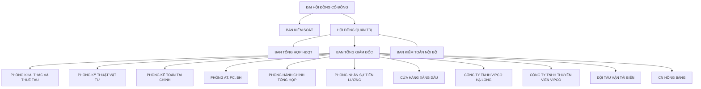

# BÁO CÁO THƯỜNG NIÊN NĂM 2025 - CÔNG TY CỔ PHẦN VẬN TẢI XĂNG DẦU VIPCO (MÃ CP: VIP)

---

## CÔNG BỐ THÔNG TIN

**TCT VẬN TẢI THỦY PETROLIMEX**  
**CÔNG TY CP VẬN TẢI XĂNG DẦU VIPCO**  
Số: 72/VIPCO-CV-CBTT  
*V/v: Báo cáo thường niên năm 2025*  

**CỘNG HOÀ XÃ HỘI CHỦ NGHĨA VIỆT NAM**  
**Độc lập - Tự do - Hạnh phúc**  
*Hải Phòng, ngày 06 tháng 04 năm 2025*  

**Kính gửi:**  
- **ỦY BAN CHỨNG KHOÁN NHÀ NƯỚC**  
- **SỞ GIAO DỊCH CHỨNG KHOÁN TP. HCM**  

1. **Tên tổ chức:** Công ty cổ phần vận tải xăng dầu VIPCO (Vietnam Petroleum Transport Joint Stock Company)  
   - Mã chứng khoán: VIP  
   - Địa chỉ trụ sở chính: Tòa nhà Hàng hải Liên minh - Số 802 đường Lê Hồng Phong, phường Hải An, Tp. Hải phòng, Việt nam  
   - Điện thoại: 0225 3838680 | Fax: 0225 3838033  
2. **Nội dung công bố thông tin:**  
   Căn cứ theo quy định tại Thông tư số 96/2020/TT-BTC ngày 16/11/2020 về công bố thông tin trên thị trường chứng khoán.  
   Công ty Cổ phần Vận tải xăng dầu VIPCO xin công bố thông tin: Báo cáo thường niên năm 2025 (File Báo cáo thường niên năm 2025 đính kèm).  
3. **Địa chỉ công bố:**  
   Thông tin này được công bố trên trang thông tin điện tử của Công ty vào ngày 06/04/2025 tại đường dẫn: `http://www.vipco.com.vn` (mục Nhà đầu tư/Tài liệu và ấn phẩm).  
   Chúng tôi cam kết các thông tin công bố trên đây là đúng sự thật và hoàn toàn chịu trách nhiệm trước pháp luật về nội dung các thông tin đã công bố.  

**Tài liệu đính kèm:**  
- Báo cáo thường niên năm 2025  

**Nơi nhận:**  
- Như trên;  
- Lưu: VT, Thanhpt.  

**CÔNG TY CP VẬN TẢI XĂNG DẦU VIPCO**  
**NGƯỜI CÔNG BỐ THÔNG TIN**  
*(Đã ký và đóng dấu)*  
**LÊ TRUNG TÂN**  

---

# TỔNG CÔNG TY VẬN TẢI THỦY PETROLIMEX
# CÔNG TY CỔ PHẦN VẬN TẢI XĂNG DẦU VIPCO

**Số:** 71/VIPCO-BC-HĐQT  
**Hải Phòng, ngày 06 tháng 04 năm 2026**  

# BÁO CÁO THƯỜNG NIÊN NĂM 2025

**Kính gửi:**  
- **ỦY BAN CHỨNG KHOÁN NHÀ NƯỚC**  
- **SỞ GIAO DỊCH CHỨNG KHOÁN Tp. HỒ CHÍ MINH**  

---

## I. THÔNG TIN CHUNG

### 1. Thông tin khái quát
- **Tên giao dịch:** Công ty Cổ phần Vận tải Xăng dầu VIPCO
- **Giấy chứng nhận đăng ký Doanh nghiệp:** Công ty Cổ phần mã số Doanh nghiệp số 0200113152 đăng ký lần đầu ngày 26/12/2005, đăng ký thay đổi lần 22 ngày 22/11/2024.
- **Vốn điều lệ:** 684.709.410.000 đồng
- **Vốn đầu tư của CSH:** 684.709.410.000 đồng
- **Địa chỉ trụ sở chính:** Tòa nhà Hàng hải Liên minh, Số 802 đường Lê Hồng Phong - phường Hải An - Thành phố Hải Phòng, Việt nam.
- **Số điện thoại:** 0225. 3838.680
- **Số fax:** 0225. 3838.033
- **Website:** vipco.com.vn
- **Mã cổ phiếu:** VIP

### 2. Quá trình hình thành và phát triển
- Ngày 22/7/1980, Bộ Vật Tư, nay là Bộ Công Thương có quyết định số 1683/VT-QĐ thành lập Công ty Vận tải Xăng dầu đường thủy I trực thuộc Tổng Công ty Xăng dầu Việt Nam, tiền thân của Công ty Cổ phần Vận tải Xăng dầu VIPCO ngày nay;
- Ngày 29/9/2005, Bộ Thương Mại nay là Bộ Công Thương có quyết định số 2439/QĐ-BTM chuyển đổi Công ty Vận tải Xăng dầu đường thủy I thành Công ty Cổ phần Vận tải Xăng dầu VIPCO;
- Ngày 02/12/2005, đã tiến hành Đại hội đồng cổ đông thành lập Công ty cổ phần Vận tải Xăng dầu VIPCO; ngày 26/12/2005, Công ty chính thức hoạt động theo mô hình công ty cổ phần;
- Ngày 09/11/2006, Ủy ban Chứng khoán Nhà nước đã cấp Giấy phép niêm yết số 71/UBCK-GPNY cho phép Công ty được niêm yết 35.100.000 cổ phiếu trên Sở giao dịch chứng khoán TP.HCM. Ngày 21/12/2006 cổ phiếu của Công ty lần đầu tiên được giao dịch;
- Năm 2007 phát hành 24.707.785 cổ phần bổ sung cổ phần cho cổ đông hiện hữu tăng vốn điều lệ từ 351.000.000 đồng lên 598.077.850.000 đồng.
- Năm 2014 phát hành 4.185.615 cổ phần tăng vốn điều lệ lên 639.934.000.000 đồng từ nguồn vốn chủ sở hữu.
- Năm 2016 phát hành 4.477.441 cổ phần tăng vốn điều lệ lên 684.709.410.000 đồng từ nguồn vốn chủ sở hữu.

### 3. Ngành nghề và địa bàn kinh doanh
#### 3.1. Ngành nghề kinh doanh:
- Vận tải ven biển và viễn dương;
- Đại lý vận tải đường biển, môi giới tàu biển và bốc dỡ hàng hóa tại cảng biển, khai thuê hải quan;
- Kinh doanh khai thác cầu cảng;
- Kinh doanh xăng dầu, gas hóa lỏng, các sản phẩm hóa dầu;
- Dịch vụ xuất nhập khẩu hàng hóa;
- Kinh doanh vật tư, thiết bị, phụ tùng;
- Kinh doanh dịch vụ giao nhận hàng hóa xuất nhập khẩu;
- Hoạt động kho bãi và dịch vụ kho ngoại quan;
- Cho thuê nhà, văn phòng;
- Cung ứng và quản lý nguồn lao động.

#### 3.2. Địa bàn kinh doanh:
Trong nước và Quốc tế

### 4. Thông tin về mô hình quản trị, tổ chức kinh doanh và bộ máy quản lý
#### 4.1. Mô hình quản trị:
- Công ty được tổ chức hoạt động dưới mô hình Công ty cổ phần theo quy định của Luật doanh nghiệp và Điều lệ Công ty.
- Công ty có Đại hội đồng cổ đông, Hội đồng quản trị, Ban kiểm soát, Tổng Giám đốc.

**Đại hội đồng cổ đông:**  
Đại hội đồng Cổ đông (ĐHĐCĐ) là cơ quan có thẩm quyền cao nhất của Công ty, bao gồm tất cả các cổ đông có quyền biểu quyết. ĐHĐCĐ có nhiệm vụ thảo luận và thông qua các báo cáo tài chính kiểm toán hàng năm, các báo cáo của Hội đồng quản trị và Ban Kiểm soát Công ty về tình hình hoạt động kinh doanh; quyết định các phương án, kế hoạch phát triển ngắn hạn và dài hạn của Công ty; tiến hành thảo luận thông qua, bổ sung, sửa đổi Điều lệ của Công ty; bầu, bãi nhiệm thành viên Hội đồng quản trị, Ban kiểm soát và các nhiệm vụ khác theo quy định của Điều lệ Công ty.

**Hội đồng quản trị:**  
Hội đồng quản trị là tổ chức quản trị cao nhất của Công ty do ĐHĐCĐ bầu ra với nhiệm kỳ thành viên HĐQT tối đa là 05 năm. Hiện tại HĐQT Công ty gồm 07 thành viên. Trong đó có 02 thành viên HĐQT độc lập. Hội đồng quản trị có đầy đủ quyền hạn để thực hiện tất cả các quyền nhân danh Công ty trừ những thẩm quyền thuộc về ĐHĐCĐ. Hoạt động kinh doanh và các công việc của Công ty phải chịu sự quản lý hoặc chỉ đạo thực hiện của Hội đồng quản trị và Hội đồng quản trị có trách nhiệm giám sát Tổng giám đốc điều hành và các cán bộ quản lý của Công ty.  
Hội đồng quản trị Công ty hiện nay gồm:
- Ông Nguyễn Hữu Thành - Chủ tịch HĐQT
- Ông Nguyễn Quang Minh - Thành viên HĐQT, Tổng Giám đốc Công ty
- Ông Vũ Đình Hiển - Thành viên HĐQT
- Ông Đỗ Lệnh Công - Thành viên HĐQT
- Ông Vũ Ngọc Vinh - Thành viên HĐQT
- Ông Nguyễn Đình Tuấn - Thành viên độc lập HĐQT
- Ông Nguyễn Tiến Sang - Thành viên độc lập HĐQT

**Ban kiểm soát:**  
Ban kiểm soát là tổ chức giám sát, kiểm tra việc thực hiện nghị quyết Hội đồng quản trị và tính hợp lý, hợp pháp trong quản lý điều hành hoạt động kinh doanh; trong ghi chép sổ sách kế toán và tài chính của Công ty nhằm đảm bảo các lợi ích hợp pháp của các cổ đông. Ban kiểm soát Công ty hiện tại gồm 03 Kiểm soát viên với nhiệm kỳ của Kiểm soát viên tối đa là 05 năm do Đại hội đồng cổ đông bầu ra.  
Ban Kiểm soát Công ty hiện nay gồm:
- Bà Nguyễn Thị Thanh Hảo - Trưởng ban Kiểm soát
- Ông Nguyễn Tiến Long - Thành viên ban Kiểm soát
- Bà Phí Tuyết Thanh - Thành viên ban Kiểm soát

**Ban điều hành:**  
Ban điều hành hiện tại của Công ty gồm có Tổng Giám đốc và 04 Phó Tổng giám đốc, Kế toán trưởng;  
Tổng Giám đốc do Hội đồng quản trị bổ nhiệm với nhiệm kỳ 05 năm; là người đại diện theo pháp luật của Công ty; là người chịu trách nhiệm chính trước Hội đồng quản trị và Đại hội đồng cổ đông về việc thực hiện nhiệm vụ và quyền hạn được giao.  
Ban điều hành của Công ty hiện nay gồm:
- Ông Nguyễn Quang Minh - Tổng Giám đốc
- Ông Đào Ngọc Trung - Phó Tổng Giám đốc
- Ông Lê Đức Dũng - Phó Tổng Giám đốc
- Ông Lê Đức Bình - Phó Tổng Giám đốc
- Ông Bùi Minh Tuấn - Phó Tổng Giám đốc
- Ông Bùi Đức Hòa - Kế toán Trưởng

#### 4.2. Cơ cấu bộ máy quản lý:

#### 4.3. Các Công ty con, Công ty liên kết
##### 4.3.1. Công ty TNHH một thành viên VIPCO Hạ Long:
- **Địa chỉ:** Tổ 6B, khu phố Yết Kiêu 6, phường Hồng Gai, tỉnh Quảng Ninh.
- **Điện thoại:** 020.3829 183 | **Fax:** 020.3826 016
- **Ngành nghề kinh doanh:** Kinh doanh xăng dầu và các sản phẩm hóa dầu, gas và các thiết bị sử dụng gas; Vận tải thủy, đại lý tàu biển, đại lý vận tải, môi giới hàng hải; Xuất nhập khẩu hàng hóa, vật tư, thiết bị phụ tùng, cung ứng tàu biển, kiểm đếm, khai thuê hải quan; Dịch vụ du lịch và kinh doanh du lịch lữ hành nội địa; Bán buôn phân bón; Cho thuê nhà, văn phòng.
- **Vốn điều lệ:** 50.000.000.000 đồng (100% vốn của Công ty CP VTXD VIPCO)

##### 4.3.2. Công ty TNHH một thành viên Thuyền viên VIPCO:
- **Địa chỉ:** Số 156/109 - đường Trường Chinh, cụm công nghiệp Đồng Hòa, phường Kiến An, Hải Phòng.
- **Điện thoại:** 0225 3544 539 | **Fax:** 0225 3544 309
- **Ngành nghề kinh doanh:** Cho thuê thuyền viên
- **Vốn điều lệ:** 7.500.000.000 đồng (100% vốn của Công ty CP VTXD VIPCO)

##### 4.3.3. Công ty cổ phần vận tải hóa dầu VP (Công ty liên kết):
- **Địa chỉ:** Phòng Phòng 5.09, tòa nhà Taiyo, số 97 Bạch Đằng, phường Hồng Bàng, Tp.Hải Phòng.
- **Điện thoại:** 0225 3730011
- **Ngành nghề kinh doanh:** Vận tải hàng hóa ven biển và viễn dương, bán buôn xăng dầu và các sản phẩm liên quan, đại lý tàu biển, môi giới và mua bán tàu biển.
- **Vốn điều lệ:** 150.761.770.000 đồng, Công ty Cổ phần Vận tải xăng dầu VIPCO góp 45,10% vốn điều lệ.

### 5. Định hướng phát triển
#### 5.1. Mục tiêu chủ yếu của Công ty:
- Tiếp tục rà soát, sửa đổi bổ sung, xây dựng hệ thống quy chế quản lý phù hợp với tình hình thực tế và các quy định của Pháp luật. Đổi mới hệ thống quản trị và bộ máy tổ chức nhằm hướng tới mục tiêu tăng năng suất - chất lượng - hiệu quả.
- Quản lý và sử dụng có hiệu quả các nguồn vốn trong việc phát triển các lĩnh vực kinh doanh được pháp luật cho phép và được Đại hội đồng cổ đông thông qua nhằm thu lợi nhuận tối đa, tăng lợi tức cho các cổ đông, tạo việc làm ổn định cho người lao động, đóng góp cho ngân sách Nhà nước và phát triển Công ty.
- Đổi mới, thay thế, cơ cấu lại và trẻ hóa đội tàu bao gồm loại tàu, cỡ tàu phù hợp, trong đó ưu tiên theo hướng tiên tiến, thân thiện với môi trường, phù hợp với xu hướng chuyển đổi xanh, chuyển đổi số.
- Hoàn thành đầu tư xây dựng, ổn định nơi làm việc và tận dụng tối đa lợi thế, khai thác hiệu quả tòa nhà trụ sở của Công ty tại số 06 Cù Chính Lan, Phường Hồng Bàng, TP.Hải Phòng. Phấn đấu hoàn thành và đưa vào sử dụng trong năm 2027.
- Quản lý tốt nguồn vốn của Công ty, làm tốt công tác xây dựng kế hoạch tài chính, kế hoạch dòng tiền nhằm sẵn sàng đáp ứng đủ nguồn vốn phục vụ sản xuất kinh doanh và công tác đầu tư.

#### 5.2. Chiến lược phát triển trung và dài hạn:
- Tiếp tục đầu tư đổi mới, thay thế, cơ cấu lại và trẻ hóa đội tàu bao gồm loại tàu, cỡ tàu phù hợp, trong đó ưu tiên theo hướng tiên tiến, thân thiện với môi trường, phù hợp với xu hướng chuyển đổi xanh, chuyển đổi số.
- Quản lý tốt nguồn vốn của Công ty, làm tốt công tác xây dựng kế hoạch tài chính, kế hoạch dòng tiền nhằm sẵn sàng đáp ứng đủ nguồn vốn phục vụ sản xuất kinh doanh và công tác đầu tư.
- Thực hiện công tác chuyển đổi số trong công tác quản lý, điều hành. Đầu tư phát triển hạ tầng công nghệ thông tin theo hướng tập trung, đồng bộ nhằm đáp ứng công tác chuyển đổi số và ứng dụng vào công tác chỉ đạo, điều hành của Ban điều hành Công ty, các Công ty thành viên trong hoạt động sản xuất kinh doanh.
- Tiếp tục nghiên cứu các quy định của pháp luật và đánh giá hiệu quả hoạt động SXKD của Công ty và các đơn vị thành viên, Công ty liên kết, Chi nhánh và Cửa hàng Xăng dầu để cấu trúc, sắp xếp lại mô hình quản lý nhằm tinh gọn bộ máy và nâng cao năng suất lao động và đạt hiệu quả hơn, phù hợp điều kiện thực tế và xu hướng phát triển chung của đất nước.
- Thường xuyên cập nhật, duy trì và cải tiến hệ thống quản lý chất lượng của Công ty.

#### 5.3. Các mục tiêu phát triển bền vững của Công ty:
Thường xuyên đánh giá hiệu quả hoạt động SXKD, sửa đổi bổ sung, xây dựng hệ thống quy chế quản lý của Công ty phù hợp với tình hình thực tế và các quy định của Pháp luật. Đổi mới hệ thống quản trị và bộ máy tổ chức, trẻ hóa đội tàu theo xu hướng sinh thái kết hợp chuyển đổi số và phát triển xanh với mục tiêu tăng hiệu quả hoạt động sản xuất kinh doanh, nâng cao chất lượng dịch vụ, tối đa hóa lợi ích cho cổ đông.

### 6. Các rủi ro
- Rủi ro cao từ biến động giá nhiên liệu, xung đột địa chính trị làm đứt gãy chuỗi cung ứng do một số quốc gia hạn chế xuất khẩu xăng dầu.
- Rủi ro có thể phát sinh khi các tàu của Công ty hoạt động trên các tuyến Quốc tế có hành trình qua khu vực Trung Đông.
- Sự cạnh tranh ngày càng lớn của các Công ty kinh doanh xăng dầu trong và ngoài Tập đoàn và ảnh hưởng của cơ chế kinh doanh xăng dầu gây khó khăn cho việc bán hàng của Công ty.

---
## II. TÌNH HÌNH HOẠT ĐỘNG TRONG NĂM 2025

### 1. Tình hình hoạt động sản xuất kinh doanh
- **Tổng doanh thu:** 652.372.006.000 đồng, đạt 113,29% kế hoạch và bằng 105,45% so với thực hiện năm 2024.
- **Tổng lợi nhuận trước thuế:** đạt 108.297.767.000 đồng, đạt 106,10% kế hoạch và bằng 91,69% so với thực hiện năm 2024.
- **Nộp ngân sách:** 67.210.610.000 đồng, đạt 126,69% kế hoạch và bằng 135,48% so với thực hiện năm 2024.
- Trong năm Công ty đã đảm bảo an toàn tuyệt đối trong hoạt động SX-KD.
- Thực hiện nghĩa vụ với ngân sách nhà nước, tích cực tham gia công tác an sinh xã hội và chăm lo đời sống vật chất cũng như tinh thần cho người lao động, tạo mọi điều kiện cho người lao động phát huy, cống hiến cho sự phát triển chung của Công ty.

### 2. Tổ chức và nhân sự
**Danh sách ban điều hành hiện tại của Công ty:**

| Stt | Họ và tên | Chức vụ | Ngày bổ nhiệm | Ghi chú |
| :---: | :--- | :--- | :---: | :--- |
| 1 | Ông Nguyễn Quang Minh | Tổng giám đốc | 19/11/2024 | Bổ nhiệm mới |
| 2 | Ông Đào Ngọc Trung | Phó Tổng giám đốc | 08/4/2024 | Bổ nhiệm lại |
| 3 | Ông Lê Đức Dũng | Phó Tổng giám đốc | 01/02/2025 | Bổ nhiệm lại |
| 4 | Ông Lê Đức Bình | Phó Tổng giám đốc | 06/11/2023 | Bổ nhiệm mới |
| 5 | Ông Bùi Minh Tuấn | Phó Tổng giám đốc | 17/04/2025 | Bổ nhiệm mới |
| 6 | Ông Bùi Đức Hòa | Kế toán Trưởng | 06/11/2023 | Bổ nhiệm mới |

#### 2.1. Tổng giám đốc - ÔNG NGUYỄN QUANG MINH
- **Họ và tên:** NGUYỄN QUANG MINH
- **Giới tính:** Nam
- **Ngày tháng năm sinh:** 21/05/1979
- **Quê quán:** Phú Diễn, Hà nội
- **CCCD:** Số 031079002646, Ngày cấp: 12/06/2022, Nơi cấp: Cục cảnh sát QLHC về TTXH
- **Quốc tịch:** Việt Nam
- **Dân tộc:** Kinh
- **Địa chỉ thường trú:** 6/9/33 Kỳ Đồng, phường Hồng Bàng, Tp. Hải Phòng
- **Số ĐT liên lạc:** 0913.246.202
- **Trình độ chuyên môn:** Kỹ sư kinh tế VTB - ĐH Hàng hải
- **Quá trình công tác:**
  - *Từ 07/2003 - 12/2005:* Chuyên viên khai thác tàu Phòng Kinh doanh công ty Vận tải Xăng dầu Đường thủy I (Nay là Công ty Cổ phần Vận tải Xăng dầu Vipco)
  - *Từ 01/2006 - 02/2008:* Chuyên viên khai thác tàu Phòng Khai thác & Thuê tàu, Công ty Cổ phần Vận tải Xăng dầu Vipco (Công ty Vipco)
  - *Từ 03/2008 - 03/2009:* Chuyên viên khai thác tàu Phòng Khai thác & Thuê tàu, Công ty Vipco; Thành viên HĐQT Công ty Cổ phần Vận tải hóa dầu VP.
  - *Từ 04/2009 - 08/2009:* Quyền Trưởng phòng Khai thác & Thuê tàu, Công ty Vipco; Thành viên HĐQT Công ty Cổ phần Vận tải hóa dầu VP.
  - *Từ 09/2009 - 03/2016:* Trưởng phòng Khai thác & Thuê tàu, Công ty Vipco; Thành viên HĐQT Công ty Cổ phần Vận tải hóa dầu VP.
  - *Từ 04/2016 - 04/2018:* Thành viên HĐQT Công ty Vipco; Trưởng phòng Khai thác & Thuê tàu, Công ty Vipco; Thành viên HĐQT Công ty Cổ phần Vận tải hóa dầu VP.
  - *Từ 05/2018 - 08/2019:* Thành viên HĐQT Công ty Vipco; Trưởng phòng Khai thác & Thuê tàu, Công ty Vipco.
  - *Từ 09/2019 - 01/2020:* Thành viên HĐQT Công ty Vipco; Phó Tổng giám đốc Công ty Vipco
  - *Từ 02/2020 - 05/2020:* Bí Thư Chi bộ An toàn-Khai thác; Thành viên HĐQT Công ty Vipco; Phó Tổng giám đốc Công ty Vipco.
  - *Từ 06/2020 - 06/2023:* Bí Thư Chi bộ An toàn-Khai thác; Thành viên HĐQT Công ty Vipco; Phó Tổng giám đốc Công ty Vipco; Thành viên HĐQT Công ty Cổ phần Vận tải hóa dầu VP
  - *Từ 07/2023 - 07/2023:* Bí Thư Chi bộ An toàn-Khai thác; Thành viên HĐQT Công ty Vipco; Phó Tổng giám đốc Công ty Vipco
  - *+ 08/2023 - 11/2024:* Ủy viên Ban Chấp hành Đảng bộ Công ty Vipco; Bí Thư Chi bộ An toàn-Khai thác; Thành viên HĐQT Công ty Vipco; Phó Tổng giám đốc Công ty Vipco; Chủ tịch Công ty TNHH MTV Thuyền viên Vipco
  - *Từ 11/2024 - 03/2025:* Ủy viên Ban Chấp hành Đảng bộ Công ty Vipco; Bí Thư Chi bộ An toàn-Khai thác; Thành viên HĐQT Công ty Vipco; Tổng giám đốc Công ty Vipco; Chủ tịch Công ty TNHH MTV Thuyền viên Vipco
  - *Từ 03/2025 - đến nay:* Ủy viên Ban Chấp hành Đảng bộ Công ty Vipco; Phó Bí Thư Đảng bộ; Thành viên HĐQT Công ty Vipco; Tổng giám đốc Công ty Vipco.
- **Các chức vụ công tác hiện nay tại Công ty:** Ủy viên Ban Chấp hành Đảng bộ Công ty Vipco; Phó Bí Thư Đảng bộ; Thành viên HĐQT Công ty Vipco; Tổng giám đốc Công ty Vipco.

#### 2.2. Phó Tổng giám đốc - ÔNG ĐÀO NGỌC TRUNG
- **Họ và tên:** ĐÀO NGỌC TRUNG
- **Giới tính:** Nam
- **Ngày tháng năm sinh:** 28/9/1965
- **Quê quán:** Hàm Thuận, Hàm Nghĩa, Bình Thuận
- **CCCD:** Số 031065011370, Ngày cấp: 09/08/2021, Nơi cấp: Cục cảnh sát QLHC về TTXH
- **Quốc tịch:** Việt Nam
- **Dân tộc:** Kinh
- **Địa chỉ thường trú:** Số 534 Ngô Gia Tự, phường Hải An, Hải Phòng
- **Số ĐT liên lạc:** 0903 211 599
- **Trình độ chuyên môn:** Cử nhân Kinh tế
- **Quá trình công tác:**
  - *Từ 05/1987 - 06/1996:* Thợ điện XN sửa chữa tàu biển 2 - Nhà máy sửa chữa tàu biển Nam Triệu.
  - *Từ 07/1996 - 3/1998:* Cán bộ phòng TCTL - Nhà máy sửa chữa tàu biển Nam Triệu.
  - *Từ 4/1998 - 12/2001:* Cán bộ phòng TCLĐ Thanh tra Công ty Vận tải Xăng dầu đường thủy I
  - *Từ 01/2002 - 12/2005:* Chuyên viên phòng TCTL - Công ty Vận tải Xăng dầu đường thủy I
  - *Từ 01/2006 - 5/2006:* Phụ trách phòng Nhân Chính - Công ty CP Vận tải Xăng dầu Vipco.
  - *Từ 6/2006 - 3/2009:* Trưởng phòng Nhân Chính - Công ty CP Vận tải Xăng dầu Vipco.
  - *Từ 4/2009 - 5/2010:* Phó Giám đốc - Công ty TNHH MTV Thuyền viên Vipco.
  - *Từ 06/2010 - 3/2015:* Trưởng phòng Nhân Chính - Công ty CP Vận tải Xăng dầu Vipco.
  - *Từ 10/2017 - 3/2018:* Kiêm nhiệm Giám đốc - Công ty TNHH MTV Thuyền viên Vipco.
  - *Từ 4/2015 - nay:* Phó Tổng giám đốc Công ty CP Vận tải Xăng dầu Vipco
  - *Từ 6/2015 - nay:* Chủ tịch Công đoàn Công ty CP vận tải xăng dầu Vipco
- **Các chức vụ công tác hiện nay tại Công ty:** Phó Tổng giám đốc, Chủ tịch Công đoàn Công ty CP vận tải xăng dầu Vipco.

#### 2.3. Phó Tổng giám đốc - ÔNG LÊ ĐỨC DŨNG
- **Họ và tên:** LÊ ĐỨC DŨNG
- **Giới tính:** Nam
- **Ngày tháng năm sinh:** 10/03/1974
- **Quê quán:** Quảng Bình
- **CCCD:** Số 031074017647, Ngày cấp: 01/06/2021, Nơi cấp: Cục cảnh sát QLHC về TTXH
- **Quốc tịch:** Việt Nam
- **Dân tộc:** Kinh
- **Địa chỉ thường trú:** 95 Hoàng Thế Thiện, phường Đông Hải, Tp. Hải Phòng
- **Số ĐT liên lạc:** 0914 766 303
- **Trình độ chuyên môn:** Kỹ sư khai thác máy tàu thủy - ĐH Hàng hải
- **Quá trình công tác:**
  - *Từ 5/2000 - 3/2006:* Kỹ sư máy tàu biển - Trung tâm đào tạo và bồi dưỡng nghiệp vụ hàng hải - Trường ĐHHH
  - *Từ 4/2006 - 12/2007:* Sỹ quan máy tàu biển - Công ty CP Vận tải xăng dầu VIPCO
  - *Từ 1/2008 - 7/2008:* Sỹ quan máy tàu biển - Công ty TNHH MTV Thuyền viên VIPCO
  - *Từ 8/2008 - 7/2015:* Máy trưởng tàu biển - Công ty TNHH MTV Thuyền viên VIPCO
  - *Từ 8/2015 - 1/2016:* Chuyên viên phòng kỹ thuật vật tư - Công ty CP Vận tải xăng dầu VIPCO
  - *Từ 2/2016 - 10/2016:* Quyền trưởng phòng kỹ thuật vật tư - Công ty CP Vận tải xăng dầu VIPCO
  - *Từ 11/2016 - 1/2020:* Trưởng phòng kỹ thuật vật tư - Công ty CP Vận tải xăng dầu VIPCO
  - *Từ 2/2020 - đến nay:* Phó Tổng Giám đốc - Công ty CP Vận tải Xăng dầu VIPCO.
- **Các chức vụ công tác hiện nay tại Công ty:** Phó Tổng giám đốc Công ty CP vận tải xăng dầu Vipco.

#### 2.4. Phó Tổng giám đốc - ÔNG LÊ ĐỨC BÌNH
- **Họ và tên:** LÊ ĐỨC BÌNH
- **Giới tính:** Nam
- **Ngày tháng năm sinh:** 18/10/1968
- **Quê quán:** Phường Phù Khê, Bắc Ninh
- **CCCD:** Số 031068004496, Ngày cấp: 09/05/2021, Nơi cấp: Cục cảnh sát QLHC về TTXH
- **Quốc tịch:** Việt Nam
- **Dân tộc:** Kinh
- **Địa chỉ thường trú:** Số 108 Tây Trung Hành, phường Hải An, Tp. Hải Phòng
- **Số ĐT liên lạc:** 0913 265 033
- **Trình độ chuyên môn:** Kế toán Công nghiệp - Đại học Tài chính Kế toán
- **Quá trình công tác:**
  - *Từ 10/1989 - 05/1996:* Nhân viên Kế toán - Công ty May Hải Phòng.
  - *Từ 06/1996 - 10/1999:* Nhân viên, phó trưởng phòng KTTC - Công ty vận tải xăng dầu đường thủy I.
  - *Từ 11/1999 - 09/2003:* Phó Giám đốc Chi nhánh - Kiêm trưởng phòng Kinh doanh - Tổng hợp Chi nhánh Quảng Ninh thuộc Công ty vận tải xăng dầu đường thủy I.
  - *Từ 10/2003 - 12/2005:* Phó Trưởng Ban điều hành dự án, Phó trưởng phòng đầu tư kinh doanh bất động sản Công ty vận tải xăng dầu đường thủy I.
  - *Từ 01/2006 - 12/2006:* Phó Ban dự án, Giám đốc Chi nhánh VIPCO Anh Dũng Công ty CP vận tải xăng dầu VIPCO.
  - *Từ 01/2007 - 02/2009:* Giám đốc Công ty TNHH một thành viên bất động sản VIPCO
  - *Từ 03/2009 - 10/2023:* Trưởng Ban kiểm soát Công ty.
  - *Từ 03/2012 - 03/2014:* Trưởng ban kiểm soát Công ty CP Cảng Nam Hải Đình Vũ
  - *Từ 12/2014 - 5/2016:* Trưởng ban kiểm soát Công ty CP Cảng Xanh VIP
  - *Từ 11/2023 - nay:* Phó Tổng giám đốc Công ty Cổ phần vận tải xăng dầu Vipco.
  - *Từ 03/2025 - nay:* Chủ tịch Công ty TNHH MTV Thuyền viên Vipco
- **Các chức vụ công tác hiện nay tại Công ty:** Phó Tổng giám đốc Công ty Cổ phần vận tải xăng dầu Vipco.
- **Các chức vụ hiện đang nắm giữ tại tổ chức khác:** Chủ tịch Công ty TNHH MTV Thuyền viên Vipco

#### 2.5. Phó Tổng giám đốc - ÔNG BÙI MINH TUẤN
- **Họ và tên:** BÙI MINH TUẤN
- **Giới tính:** Nam
- **Ngày tháng năm sinh:** 10/12/1981
- **Quê quán:** Tiên Lữ, Hưng Yên
- **CCCD:** Số 033081004369, Ngày cấp: 20/08/2021, Nơi cấp: Cục cảnh sát QLHC về TTXH
- **Quốc tịch:** Việt Nam
- **Dân tộc:** Kinh
- **Địa chỉ thường trú:** Paris 09-03 Vinhomes Imperial, Hồng Bàng, Hải Phòng
- **Số ĐT liên lạc:** 0968 257 979
- **Trình độ chuyên môn:** Thạc sỹ Quản lý kinh tế
- **Quá trình công tác:**
  - *Từ 06/2006 - 06/2009:* Thủy thủ - Công ty TNHH MTV thuyền viên VIPCO.
  - *Từ 07/2009 - 03/2014:* Sỹ quan vận hành - Công ty TNHH MTV thuyền viên VIPCO.
  - *Từ 04/2014 - 01/2018:* Sỹ quan quản lý - Công ty TNHH MTV thuyền viên VIPCO.
  - *Từ 02/2019 - 11/2019:* Thuyền trưởng - Công ty TNHH MTV thuyền viên VIPCO
  - *Từ 12/2019 - 01/2020:* CV khai thác tàu - Phòng khai thác & thuê tàu Công ty CP vận tải xăng dầu VIPCO.
  - *Từ 02/2020 - 12/2020:* Quyền trưởng phòng khai thác & thuê tàu Công ty CP vận tải xăng dầu VIPCO
  - *Từ 01/2021 - 03/2025:* Trưởng phòng khai thác & thuê tàu Công ty CP vận tải xăng dầu VIPCO.
  - *Từ 04/2025 - nay:* Phó Tổng giám đốc Công ty Cổ phần vận tải xăng dầu Vipco
- **Các chức vụ công tác hiện nay tại Công ty:** Phó Tổng giám đốc Công ty Cổ phần vận tải xăng dầu Vipco.

#### 2.6. Kế toán Trưởng – ÔNG BÙI ĐỨC HÒA
- **Họ và tên:** BÙI ĐỨC HÒA
- **Giới tính:** Nam
- **Ngày tháng năm sinh:** 21/09/1976
- **Quê quán:** Tỉnh Ninh Bình
- **CCCD:** Số 036076003975, Ngày cấp: 13/08/2021, Nơi cấp: Cục trưởng cục cảnh sát QLHC về trật tự xã hội
- **Quốc tịch:** Việt Nam
- **Dân tộc:** Kinh
- **Địa chỉ thường trú:** HA2.29 Vinhome Marina, phường An Biên, Tp. HP
- **Số ĐT liên lạc:** 091 3249 948
- **Trình độ chuyên môn:** Cử nhân Kinh tế trường Đại học Kế toán tài chính.
- **Quá trình công tác:**
  - *Từ 05/1999 - 8/2002:* Chuyên viên phòng Kế toán Công ty Vận tải Xăng dầu Đường thủy I
  - *Từ 9/2002 - 12/2005:* Phó trưởng phòng Kế toán Chi nhánh Quảng Ninh - Công ty Vận tải Xăng dầu Đường thủy I
  - *Từ 01/2006 - 3/2006:* Trưởng phòng Kinh doanh Chi nhánh Quảng Ninh - Công ty Vận tải Xăng dầu Đường thủy I (Nay là Công ty Cổ phần Vận tải Xăng dầu Vipco, sau đây gọi tắt là Công ty Vipco)
  - *Từ 04/2006 - 4/2007:* Trưởng phòng Kinh doanh Công ty TNHH MTV Vipco Hạ Long – Công ty Vipco.
  - *Từ 05/2007 - 5/2010:* Trưởng phòng Kế toán Công ty TNHH Thương mại Vipco – Công ty Vipco
  - *Từ 6/2010 - 5/2012:* Trưởng phòng Kế toán Công ty TNHH MTV Bất Động sản Vipco – Công ty Vipco
  - *Từ 6/2012 - 8/2017:* Kế toán trưởng Công ty TNHH MTV Bất Động sản Vipco – Công ty Vipco
  - *Từ 9/2017 - 10/2023:* Trưởng phòng Kế toán Tổng hợp Chi nhánh Hồng Bàng – Công ty Vipco
  - *Từ 11/2023 - nay:* Kế toán trưởng Công ty CP vận tải xăng dầu Vipco.
- **Các chức vụ công tác hiện nay tại Công ty:** Kế toán trưởng Công ty CP vận tải xăng dầu Vipco.

### 3. Tình hình đầu tư, tình hình thực hiện các dự án:
#### 3.1. Các khoản đầu tư lớn:
- **3.1.1. Về đầu tư tàu:** Do yếu tố thị trường, các quy định về pháp lý về đầu tư trong năm, giá tàu biến động mạnh, mặt khác do các tác động về các quy định về quản lý phát thải đòi hỏi phải có sự đánh giá kỹ lưỡng về lộ trình hiện đại hóa đội tàu nên chưa thực hiện được kế hoạch đầu tư tàu.
- **3.1.2. Về đầu tư trụ sở văn phòng Công ty:** Trong năm 2025 đã thực hiện hoàn thành giai đoạn chuẩn bị đầu tư, đang tiến hành các công việc giai đoạn thực hiện đầu tư, đã phá dỡ xong công trình hiện trạng để chuẩn bị các bước tiếp theo.
- **3.1.3. Đầu tư dự án Anh Dũng 7:** Theo kế hoạch kinh doanh năm, Công ty không thực hiện chào bán bất động sản đầu tư mà chỉ thực hiện các bước rà soát, hoàn thiện đầu tư một số hạng mục phần hạ tầng kỹ thuật như công viên, cây xanh, thảm atsphalt mặt đường để thực hiện bàn giao cho các cơ quan quản lý nhà nước, quản lý cùng các hộ đã đầu tư hạ tầng xây dựng nhà ở để tăng tính phủ đầy dự án.

#### 3.2. Tóm tắt về hoạt động và tình hình tài chính của các Công ty con, Công ty liên kết
##### 3.2.1. Công ty TNHH một thành viên VIPCO Hạ Long:
*ĐVT: đồng*

| Chỉ tiêu | Tại 31/12/2024 | Tại 31/12/2025 | So sánh (%) |
| :--- | :---: | :---: | :---: |
| 1. Tổng giá trị tài sản | 50.806.913.818 | 52.077.533.745 | 102,50 |
| 2. Doanh thu thuần | 14.730.726.283 | 28.510.984.530 | 193,55 |
| 3. Lợi nhuận từ hoạt động KD | 144.004.030 | 1.374.595.839 | 954,55 |
| 4. Lợi nhuận khác | 755.875.934 | 10.437.025 | 1,38 |
| 5. Lợi nhuận trước thuế | 899.879.964 | 1.385.032.864 | 153,91 |
| 6. Lợi nhuận sau thuế | 687.846.048 | 1.123.068.395 | 163,27 |

##### 3.2.2. Công ty TNHH một thành viên Thuyền viên VIPCO:
*ĐVT: đồng*

| Chỉ tiêu | Tại 31/12/2024 | Tại 31/12/2025 | So sánh (%) |
| :--- | :---: | :---: | :---: |
| 1. Tổng giá trị tài sản | 17.101.323.208 | 17.565.462.646 | 102,71 |
| 2. Doanh thu thuần | 91.444.224.007 | 108.813.300.852 | 118,99 |
| 3. Lợi nhuận từ hoạt động KD | 501.052.101 | 555.058.519 | 110,78 |
| 4. Lợi nhuận khác | 112.480.706 | 27.807.760 | 24,72 |
| 5. Lợi nhuận trước thuế | 613.532.807 | 582.866.279 | 95,00 |
| 6. Lợi nhuận sau thuế | 483.115.981 | 466.293.023 | 96,52 |

##### 3.2.3 Công ty cổ phần vận tải hóa dầu VP:
*ĐVT: đồng*

| Chỉ tiêu | Tại 31/12/2024 | Tại 31/12/2025 | So sánh (%) |
| :--- | :---: | :---: | :---: |
| 1. Tổng giá trị tài sản | 290.832.998.592 | 252.994.096.647 | 86,99 |
| 2. Doanh thu thuần | 107.625.581.854 | 126.310.292.012 | 117,36 |
| 3. Lợi nhuận từ HĐ KD | (50.418.260.644) | (31.265.952.429) | - |
| 4. Lợi nhuận khác | 270.496.488 | (1.624.258.409) | - |
| 7. Lợi nhuận trước thuế | (50.147.764.156) | (32.890.210.838) | - |
| 8. Lợi nhuận sau thuế | (50.147.764.156) | (32.890.210.838) | - |

### 4. Tình hình tài chính
#### 4.1 Tình hình tài chính
*Đơn vị tính: 1.000 Đồng*

| Chỉ tiêu | Tại 31/12/2024 | Tại 31/12/2025 | So sánh (%) |
| :--- | :---: | :---: | :---: |
| 1. Tổng giá trị tài sản | 1.391.228.301 | 1.410.932.949 | 101,42 |
| 2. Tổng Doanh thu | 569.810.705 | 607.237.297 | 106,57 |
| 3. Lợi nhuận từ HĐ KD | 106.895.041 | 110.310.110 | 103,19 |
| 4. Lợi nhuận khác | 11.215.496 | (2.012.342) | - |
| 5. Lợi nhuận trước thuế | 118.110.537 | 108.297.768 | 91,69 |
| 6. Lợi nhuận sau thuế | 92.905.968 | 85.810.900 | 92,36 |
| 7. Tỷ lệ trả cổ tức | 10% | 10% | 100 |

#### 4.2 Các chỉ tiêu tài chính chủ yếu

| Chỉ tiêu | Năm 2024 | Năm 2025 | Ghi chú |
| :--- | :---: | :---: | :---: |
| **1. Chỉ tiêu về khả năng thanh toán** | | | |
| - Hệ số thanh toán ngắn hạn | 15,67 | 10,96 | |
| - Hệ số thanh toán nhanh | 14,42 | 9,95 | |
| **2. Chỉ tiêu về cơ cấu vốn** | | | |
| - Hệ số nợ/Tổng tài sản | 0,08 | 0,09 | |
| - Hệ số nợ/Vốn chủ sở hữu | 0,09 | 0,1 | |
| **3. Chỉ tiêu về năng lực hoạt động** | | | |
| - Vòng quay hàng tồn kho | 5,22 | 4,3 | |
| - Vòng quay tổng tài sản | 0,41 | 0,43 | |
| **4. Chỉ tiêu về khả năng sinh lời** | | | |
| - Hệ số lợi nhuận sau thuế / Doanh thu thuần | 0,16 | 0,14 | |
| - Hệ số lợi nhuận sau thuế / Vốn chủ sở hữu (ROE) | 0,07 | 0,067 | |
| - Hệ số lợi nhuận sau thuế / Tổng tài sản (ROA) | 0,07 | 0,06 | |
| - Hệ số lợi nhuận từ hoạt động KD/Doanh thu thuần | 0,19 | 0,18 | |

### 5. Cơ cấu cổ đông, thay đổi vốn đầu tư của chủ sở hữu
#### 5.1. Cổ phần:
- **Số lượng chứng khoán đã phát hành:** 68.470.941 cổ phiếu  
  Trong đó:
  - Cổ phiếu phổ thông: 68.470.941 cổ phiếu
  - Cổ phiếu ưu đãi: 0 cổ phiếu
- **Số lượng cổ phiếu quỹ:** 0 cổ phiếu
- **Số lượng cổ phiếu đang lưu hành:** 68.470.941 cổ phiếu  
  Trong đó:
  - Cổ phiếu phổ thông: 68.470.941 cổ phiếu
  - Cổ phiếu ưu đãi: 0 cổ phiếu

#### 5.2 Cơ cấu cổ đông: *(theo danh sách ngày 06/03/2026 của Tổng công ty lưu ký và bù trừ chứng khoán Việt Nam)*:

| STT | Diễn giải | Số cổ đông | Số CP có quyền biểu quyết | Tỷ lệ (%) |
| :---: | :--- | :---: | :---: | :---: |
| | **Tổng cộng** | **6.094** | **68.470.941** | **100** |
| **1** | **Cổ đông trong nước** | **5.949** | **64.896.728** | **94,78** |
| **1.1** | **Cổ đông Tổ chức** | **24** | **36.680.203** | **53,57** |
| | - Cổ đông sở hữu trên 5% | 1 | 34.923.232 | 51,00 |
| | - Cổ đông sở hữu dưới 5% | 23 | 1.756.971 | 2,57 |
| **1.2** | **Cổ đông cá nhân** | **5.925** | **28.216.525** | **41,21** |
| | - Cổ đông sở hữu trên 5% | - | - | - |
| | - Cổ đông sở hữu dưới 5% | 5.925 | 28.216.525 | 41,21 |
| **2** | **Cổ đông nước ngoài** | **145** | **3.574.213** | **5,22** |
| **2.1** | **Cổ đông tổ chức** | **25** | **3.071.527** | **4,49** |
| | - Cổ đông sở hữu trên 5% | - | - | - |
| | - Cổ đông sở hữu dưới 5% | 25 | 3.071.527 | 4,49 |
| **2.2** | **Cổ đông cá nhân** | **120** | **502.686** | **0,73** |
| | - Cổ đông sở hữu trên 5% | - | - | - |
| | - Cổ đông sở hữu dưới 5% | 120 | 502.686 | 0,73 |

#### 5.3 Tình hình thay đổi vốn đầu tư của chủ sở hữu:
- Ngày 09/11/2006, Ủy ban Chứng khoán Nhà nước đã cấp Giấy phép niêm yết số 71/UBCK-GPNY cho phép Công ty được niêm yết 35.100.000 cổ phiếu trên Sở giao dịch chứng khoán TP.HCM. Ngày 21/12/2006 cổ phiếu của Công ty lần đầu tiên được giao dịch;
- Năm 2007 phát hành 24.707.785 cổ phần bổ sung cổ phần cho cổ đông hiện hữu tăng vốn điều lệ từ 351.000.000 đồng lên 598.077.850.000 đồng.
- Năm 2014 phát hành 4.185.615 cổ phần tăng vốn điều lệ lên 639.934.000.000 đồng từ nguồn vốn chủ sở hữu
- Năm 2016 phát hành 4.477.441 cổ phần tăng vốn điều lệ lên 684.709.410.000 đồng từ nguồn vốn chủ sở hữu

#### 5.4 Giao dịch cổ phiếu quỹ:
Không có

#### 5.5 Các chứng khoán khác:
Không có

### 6. Báo cáo tác động liên quan đến môi trường và xã hội của Công ty:
#### 6.1 Tác động lên môi trường:
- Tổng phát thải khí nhà kính trực tiếp và gián tiếp: 70.713,8 Tấn CO2  
  Khối lượng khí CO2 do đội tàu phát thải trong năm 2025 là: 68.597,2 tấn.
- **Các sáng kiến và biện pháp giảm thiểu phát thải khí nhà kính:**
  - Luôn duy trì tình trạng kỹ thuật của đội tàu tốt, các thiết bị được bảo dưỡng đúng thời hạn theo khuyến cáo của nhà sản xuất.
  - Trong quá trình khai thác, công ty luôn thực hiện ngay việc thuê nhà thầu làm sạch vỏ tàu trong trường hợp có hà bám để đảm bảo duy trì tốc độ tàu tốt và không làm tăng nhiên liệu tiêu thụ, giảm thiểu lượng khí phát thải ra môi trường.

#### 6.2 Tiêu thụ năng lượng:
Tiêu thụ năng lượng trực tiếp và gián tiếp:
- **Tổng nhiên liệu do đội tàu tiêu thụ trong năm 2025:**
  - Dầu D.O: 2.706,48 tấn
  - Dầu F.O: 19.239,21 tấn
- **Tiêu thụ điện năng phục vụ khối văn phòng:** 107,887 MWh

#### 6.3 Chính sách đối với người lao động:
##### 6.3.1. Số lượng CBCNV và thu nhập bình quân của người lao động:

| Stt | Các chỉ tiêu chính | Năm 2025 |
| :---: | :--- | :---: |
| 1 | Tổng số lao động (Người) | 417 |
| 2 | Tổng quỹ lương thực hiện (đồng) | 133.915.721.048 |
| 3 | Thu nhập bình quân (đ/người/tháng) | 26.762.000 |

##### 6.3.2. Chính sách lương, thưởng và phụ cấp:
Người lao động được trả lương tháng một lần theo hệ số lương chức danh công việc. Định kỳ hàng năm theo nhu cầu công việc, các điều kiện, tiêu chuẩn, thành tích đóng góp hoặc thay đổi chức danh của NLĐ, NSDLĐ tiến hành đánh giá, xếp/ điều chỉnh hệ số lương của NLĐ.  
Căn cứ vào kết quả hoạt động sản xuất kinh doanh và nguồn quỹ tiền lương của đơn vị định kỳ 6 tháng, 9 tháng, tổng kết năm, Công ty sẽ xem xét để trích thưởng và phân phối lại quỹ lương cho người lao động theo kết quả, thành tích đóng góp của từng người trong năm.

##### 6.3.3. Chính sách bảo hiểm:
Công ty thống nhất áp dụng thu, nộp, tham gia các chế độ BHXH, BHYT, BHTN cho người lao động trên cơ sở tiền lương hàng tháng của người lao động.  
Hàng năm Công ty đều tổ chức học tập, huấn luyện, hướng dẫn thông báo cho người lao động về những quy định, biện pháp làm việc an toàn vệ sinh lao động và những yếu tố xảy ra tai nạn ở từng công việc để cho mọi người biết. Tại nơi làm việc người lao động được trang bị đầy đủ các trang thiết bị, dụng cụ phòng tránh tai nạn.  
Công ty tổ chức khám sức khỏe định kỳ cho người lao động mỗi năm một lần. Nếu phát hiện người lao động mắc bệnh nghề nghiệp, bệnh mãn tính do ảnh hưởng của nghề nghiệp Công ty sẽ có trách nhiệm bố trí cho người lao động chữa trị.

##### 6.3.4. Chính sách khen thưởng:
Người lao động sẽ được hưởng tiền thưởng kèm theo các danh hiệu thi đua như: Lao động tiên tiến, tiên tiến xuất sắc, Chiến sỹ thi đua, được tặng bằng khen, giấy khen, ... Mức thưởng do Hội đồng thi đua khen thưởng của Công ty xem xét quyết định.

##### 6.3.5. Chính sách đào tạo:
Công ty chú trọng việc đào tạo nâng cao trình độ chuyên môn và đa dạng nghiệp vụ cho CBNV thông qua việc thường xuyên cử cán bộ tham gia các chương trình đào tạo, tập huấn nâng cao chuyên môn nghiệp vụ trong và ngoài nước.

##### 6.3.6. Chính sách chế độ khác:
Căn cứ vào nguồn quỹ phúc lợi và nguồn quỹ công đoàn hàng năm, người lao động sẽ được trợ cấp khi gặp khó khăn đột xuất, được tổ chức tham quan học tập thực tế và tham gia các hoạt động phong trào văn hóa văn nghệ thể thao, được tặng quà vào các dịp lễ Tết trong năm...

#### 6.4. Báo cáo liên quan đến trách nhiệm đối với cộng đồng địa phương:
Năm 2025 Công ty đã tài trợ và ủng hộ xã hội và từ thiện là: 157.000.000 đồng.  
Trong đó:
- Ủng hộ và tài trợ học bổng cho sinh viên trường ĐHHH Việt nam là: 54.000.000 đồng
- Trợ cấp cho thuyền viên khó khăn: 103.000.000 đồng

---
## III. BÁO CÁO VÀ ĐÁNH GIÁ CỦA BAN TỔNG GIÁM ĐỐC

Năm 2025, nền kinh tế trong nước chịu một số tác động tiêu cực từ việc tăng trưởng toàn cầu ở mức thấp, suy giảm khả năng xuất khẩu đến các thị trường lớn, chính sách tiền tệ thắt chặt, rào cản thuế quan, giá dầu duy trì ở mức biến động cao, thị trường vận tải xăng dầu khu vực và quốc tế có những tín hiệu tích cực về nguồn hàng và giá cước, tuy nhiên biên độ dao động lên xuống thất thường, không có tính ổn định. Năm 2025, Công ty đạt được những chỉ tiêu sau:

**Kết quả hoạt động sản xuất kinh doanh năm 2025:**

| STT | NỘI DUNG | ĐVT | TH 2025 | % SO VỚI TH 2024 | % SO VỚI KH 2025 |
| :---: | :--- | :---: | :---: | :---: | :---: |
| 1 | Tổng doanh thu | 1.000 đ | 652.372.006 | 105,45 | 113,29 |
| 2 | Tổng lợi nhuận trước thuế | 1.000 đ | 108.297.767 | 91,69 | 106,10 |

### 1. Đánh giá kết quả hoạt động trên các lĩnh vực kinh doanh
#### 1.1. Hoạt động vận tải:
**Thực trạng đội tàu Công ty tới thời điểm báo cáo:**

| Stt | Chỉ tiêu đánh giá các tàu | Số lượng tàu | Tỉ lệ |
| :---: | :--- | :---: | :---: |
| 1 | Tàu trẻ: <10 tuổi | 0 | 0% |
| 2 | Tàu trung bình: 10 đến 15 tuổi | 0 | 0% |
| 3 | Tàu già: 15 đến 20 tuổi (Px18; Px21) | 2 | 50,0% |
| 4 | Tàu quá già: trên 20 tuổi (Px15, Px16) | 2 | 50,0% |

Từ bảng số liệu của đội tàu công ty nhận thấy cơ bản tàu đã già, để đáp ứng công ước về kiểm soát phát thải khí Carbon, các tàu này đã buộc phải giảm công suất máy chính, Công ty đã triển khai và tiếp tục thực hiện các giải pháp cải tiến kỹ thuật, lắp đặt thêm trang thiết bị để các tàu hoạt động đáp ứng yêu cầu.  
Thị trường vận tải xăng dầu khu vực và quốc tế đã có những tín hiệu tích cực từ đầu quý 1/2025 tạo điều kiện về nguồn hàng và giá cước do vậy đã cải thiện được điều kiện khai thác đội tàu. Các tàu của Công ty được Tổng công ty Vận tải thủy Petrolimex thuê định hạn với giá cước ổn định.  
Thị trường mua bán tàu có sự tăng trưởng nóng, giá mua/bán tàu thay đổi nhanh và tăng rất cao ảnh hưởng lớn đến kế hoạch đầu tư thay thế, trẻ hóa và phát triển đội tàu của Công ty.  
Tình trạng kỹ thuật các tàu của Công ty luôn đáp ứng yêu cầu của hợp đồng, công tác quản lý kỹ thuật, an toàn đội tàu luôn được coi trọng hàng đầu. Trong năm, Công ty thực hiện dừng sửa chữa định kỳ tàu Petrolimex 21, tàu Petrolimex 18 bị sự cố bất khả kháng phải dừng tàu khoảng 20 ngày.  
Công tác quản lý và giao nhận hàng hóa đối với các tàu được theo dõi chỉ đạo sát sao đối với từng chuyến hàng do vậy về cơ bản kết quả hao hụt trong quá trình vận chuyển và giao nhận đảm bảo định mức theo điều khoản hợp đồng đã xác nhận.  
Doanh thu vận tải 471,9 tỷ đồng, đạt 106,32% so với kế hoạch và bằng 100,70% so với thực hiện năm 2024. Lợi nhuận vận tải 65,07 tỷ đồng, đạt 83,87% so với kế hoạch và bằng 85,67% so với thực hiện năm 2024.

#### 1.2. Kinh doanh xăng dầu:
Sản lượng và doanh thu đều đạt vượt mức kế hoạch giao, cơ chế chiết khấu, mức chiết khấu của Công ty đầu mối đã được cải thiện, cao hơn mức chiết khấu kế hoạch năm 2025. Mức chiết khấu đã tác động lớn đến kết quả kinh doanh về xăng dầu, đây là tình trạng chung đối với các đại lý và thương nhân nhượng quyền thương mại trong hệ thống kinh doanh xăng dầu của Petrolimex. Tuy nhiên bắt đầu từ Quý 4/2025 tình hình chiết khấu của các Công ty đầu mối đã có xu hướng tăng dần, cải thiện lãi gộp.  
Doanh thu kinh doanh xăng dầu 53,37 tỷ đồng, đạt 103,86% so với kế hoạch và bằng 105,33% so với thực hiện năm 2024.

#### 1.3. Kinh doanh khác:
- **Về hoạt động đại lý:** Năm 2025 được đánh giá là một năm thuận lợi đối với hoạt động đại lý hàng hải. Các tàu về Hòn Gai chủ yếu là tàu MR size, tàu nội địa tại khu vực Nghi Sơn - Nghệ An duy trì ổn định, đồng thời tiếp tục giữ vững và mở rộng được một số khách hàng ngoài ngành, duy trì các dịch vụ gia tăng. Doanh thu đại lý đạt 11,6 tỷ đồng, đạt 126,66% so kế hoạch năm và bằng 123,16% so với cùng kỳ năm 2024. Lợi nhuận đạt 0,34 tỷ đồng.
- **Về hoạt động cung ứng thuyền viên:** Công ty TNHH MTV Thuyền viên VIPCO duy trì ổn định hoạt động cung ứng thuyền viên cho các chủ tàu: VIPCO, PG tanker, Công ty CP Vận tải Hóa dầu VP và một số chủ tàu khác, đáp ứng nhu cầu thay thế thuyền viên của các chủ tàu theo kế hoạch. Doanh thu đạt 108,8 tỷ đồng, đạt 124,55% kế hoạch năm và bằng 118,99% so với cùng kỳ năm 2024. Lợi nhuận đạt 0,58 tỷ đồng, bằng 105,00% so với kế hoạch năm.
- **Về kinh doanh bất động sản (Anh Dũng 7):** Công ty đã tiến hành làm giấy chứng nhận quyền sử dụng đất và tài sản gắn liền với đất đối với các căn nhà đã được nhà đầu tư thứ cấp hoàn thiện xây dựng. Đã bàn giao cho Thành phố các hạng mục, hệ thống chiếu sáng, cây xanh, thoát nước mặt/nước thải. Hiện nay công ty đã đầu tư 02 hạng mục công viên cây xanh và rải asphalt mịn mặt đường và đang làm thủ tục bàn giao cho Thành phố. Công ty tích cực, chủ động thông báo và yêu cầu các nhà đầu tư thứ cấp phối hợp cùng với chủ đầu tư để triển khai xây dựng thô, tăng tính phủ đầy của dự án. Năm 2025, Công ty đã tiến hành xây dựng nhà ở cho khách, doanh thu 29,01 tỷ đồng.
- **Hoạt động liên doanh liên kết:** Năm 2025 rất nhiều yếu tố khách quan ảnh hưởng bất lợi đến kết quả kinh doanh của Công ty CP Vận tải hóa dầu VP, thị trường vận tải nhựa đường lỏng vào mùa mưa nên biến động bất lợi, sức tiêu thụ kém, tỉ giá biến động lớn.
- **Hoạt động tài chính:** Công ty vẫn tiếp tục triển khai nghị quyết của ĐHĐCĐ bám sát thị trường mua bán tàu, điều chỉnh các phương án đầu tư tàu thay thế các tàu cũ đã thanh lý, tuy nhiên tình hình thị trường mua bán tàu vẫn đang giao dịch ở mức cao nên chưa triển khai đầu tư được do vậy gia tăng được khoản thu nhập từ lãi tiền gửi đạt 45,02 tỷ đồng bằng 161,54% so với kế hoạch năm.

### 2. Tình hình tài chính
#### 2.1 Tình hình tài sản:
Tổng tài sản của Công ty tại thời điểm 31/12/2025 là **1.410.932.948.716 đồng**.

#### 2.2 Vay nợ và các khoản phải trả:
- Tổng nợ phải trả của Công ty tại thời điểm 31/12/2025 là **131.738.478.614 đồng**.  
  Trong đó:
  - Tổng nợ ngắn hạn là **104.388.293.117 đồng**,
  - Tổng nợ dài hạn là **27.350.185.497 đồng**.
- **Các khoản nợ khó đòi:** Những tồn tại từ những năm 2008-2012 về các khoản phải thu khó đòi kéo dài khả năng thu hồi còn rất thấp, một số đối tượng mất khả năng thanh toán đã làm ảnh hưởng đến nguồn lực tài chính của công ty.  
  - Tổng dư nợ khó đòi đến 31/12/2025: **43.343.663.372 đồng**.
  - Tổng số thu hồi nợ khó đòi năm 2025: **2.212.000.000 đồng** (5,10%/tổng dư nợ khó đòi).

### 3. Những cải tiến về cơ cấu tổ chức, chính sách, quản lý
- Tiếp tục thực hiện hợp đồng định hạn với Tổng Công ty Vận tải thủy Petrolimex với giá cước ổn định đối với đội tàu Petrolimex, phối hợp chặt chẽ với Công ty nhựa đường Petrolimex và các đối tác khác vận hành khai thác 02 tàu VP Atsphalt.
- Chủ động xây dựng phương án và bảo đảm các điều kiện trong việc sửa chữa định kỳ tàu Petrolimex 15, Petrolimex 16 nhằm bảo đảm tiến độ thời gian và tiết kiệm chi phí sửa chữa. Duy trì mức tối đa ngày tàu tốt, thực hiện tốt việc kiểm tra đánh giá cũng như khắc phục khiếm khuyết, tồn tại sau kiểm tra, đáp ứng cao nhất yêu cầu của người thuê.
- Bám sát thị trường khi có cơ hội chủ động xây dựng dự án đầu tư bổ sung, đổi mới và trẻ hóa đội tàu bảo đảm hợp lý và hiệu quả.
- Triển khai công tác chuyển đổi số trong quản lý, vận hành đội tàu tích hợp với hệ thống quản lý tích hợp nâng cao hiệu suất và hiệu quả quản trị giảm chi phí vận hành, tăng hiệu quả khai thác và tăng năng lực cạnh tranh.

### 4. Kế hoạch năm 2026:
Trên cơ sở phân tích đánh giá kết quả thực hiện năm 2025 và dự báo trong thời gian tới, Hội đồng quản trị thống nhất chỉ đạo các đơn vị xây dựng kế hoạch SX-KD và kế hoạch đầu tư năm 2026 như sau:

#### 4.1 Về kế hoạch SX-KD:

| STT | CHỈ TIÊU | ĐVT | THỰC HIỆN 2025 | KẾ HOẠCH 2026 | SO VỚI TH 2025 (%) |
| :---: | :--- | :---: | :---: | :---: | :---: |
| 1 | Tổng doanh thu | 1.000 đ | 652.372.005 | 702.024.826 | 107,61 |
| 2 | Lợi nhuận trước thuế | 1.000 đ | 108.297.767 | 109.799.965 | 101,39 |
| 3 | Thuế thu nhập DN | 1.000 đ | 22.486.868 | 22.052.992 | 98,07 |
| 4 | Lợi nhuận sau thuế | 1.000 đ | 85.810.899 | 87.746.973 | 102,26 |
| 5 | Cổ tức | % | 10 | 10 | 100 |

#### 4.2 Về kế hoạch đầu tư:
- **a)** Tiếp tục tiến hành các bước đầu tư xây dựng trụ sở Công ty tại Số 6 Cù Chính Lan - Hồng Bàng - Hải Phòng với tổng mức đầu tư dự kiến khoảng 103,5 tỷ đồng và sẽ giải ngân trong năm 2026 khoảng 50 tỷ đồng.
- **b)** Đối với công tác đầu tư tàu: Đánh giá thị trường vận tải cũng như thị trường mua bán tàu để có phương án đầu tư phù hợp nhằm đổi mới, thay thế trẻ hóa đội tàu tập trung đối với cỡ tàu MR 40.000 - 55.000 DWT.
- **c)** Tiếp tục công tác bàn giao các hạng mục hạ tầng kỹ thuật tại dự án Anh Dũng 7, Xây dựng phương án tổ chức xây dựng nhà kinh doanh cho giai đoạn 2026-2031 và hoàn tất các thủ tục cấp Giấy chứng nhận quyền sử dụng đất và tài sản trên đất cho nhà đầu tư, hiện thực hóa lợi nhuận từ dự án này.

---

## IV. ĐÁNH GIÁ CỦA HỘI ĐỒNG QUẢN TRỊ VỀ CÁC MẶT CỦA CÔNG TY

### 1. Tổng kết các cuộc họp và các quyết định của Hội đồng quản trị:
Trong năm 2025, Hội đồng quản trị đã họp 10 phiên và 18 lần lấy ý kiến bằng văn bản để đưa ra các nghị quyết, quyết định kịp thời, đáp ứng yêu cầu quản lý điều hành, trong đó một số nghị quyết, quyết định quan trọng như sau:
- Triển khai Nghị quyết ĐHĐCĐ thường niên 2025: Lựa chọn đơn vị kiểm toán báo cáo tài chính năm 2025; giao kế hoạch SXKD năm 2025; Chi trả cổ tức năm 2024; Các Nghị quyết về quản lý sử dụng quỹ khen thưởng, phúc lợi; chi thưởng, thực hiện phương án tổ chức du lịch cho CBCNV Công ty.
- Phê duyệt kế hoạch kiểm toán nội bộ năm 2025.
- Sửa đổi bổ sung một số Quy chế Công ty và Điều lệ, Quy chế Công ty con.
- Tổ chức tri ân khách hàng năm 2025 nhìn lại hành trình 45 năm hình thành và phát triển Công ty và 20 năm Cổ phần hóa.
- Kiện toàn Ban Tổng giám đốc Công ty, Chủ tịch, Giám đốc Công ty thành viên; Các quyết định về công tác cán bộ phòng/ban theo thẩm quyền.
- Giao Tổng giám đốc làm việc với Chủ đầu tư Dự án Anh Dũng 6, tìm kiếm nhà đầu tư thứ cấp nhượng quyền đầu tư để thoái vốn tại dự án Anh Dũng 6.
- Phê duyệt dự toán sửa chữa trên dock tàu Petrolimex 21.
- Phê duyệt báo cáo tiền khả thi đầu tư tàu chở xăng dầu/hóa chất đã qua sử dụng cỡ MR 40.000-55.000 DWT.
- Chỉ đạo Công ty mẹ và đơn vị thành viên tiếp tục tăng cường rà soát công nợ, thực hiện quyết liệt các giải pháp trong xử lý và thu hồi công nợ theo thẩm quyền.
- Chỉ đạo thực hiện các kết luận, kiến nghị của Kiểm toán nhà nước.
- Đánh giá nhận xét tập thể Hội đồng quản trị và các thành viên HĐQT là đảng viên năm 2025.
- Các Nghị quyết đối với Dự án Anh Dũng 7: Hoàn thiện và bàn giao hạ tầng kỹ thuật thuộc trách nhiệm của chủ đầu tư cho cơ quan chức năng; thống nhất chủ trương xây nhà thô đồng thời yêu cầu nhà đầu tư thứ cấp phối hợp với chủ đầu tư thực hiện xây dựng nhà theo quy định; chỉ đạo xây dựng Quy định của Chủ đầu tư về phương án phân bổ giá vốn và kinh doanh bất động sản, tổng hợp chi phí để làm cơ sở điều chỉnh tổng mức đầu tư hạ tầng.
- Các Nghị quyết, quyết định về thủ tục giai đoạn chuẩn bị đầu tư và thực hiện đầu tư của Dự án đầu tư xây dựng trụ sở Công ty.
- Đối với Công ty CP Vận tải Hóa dầu VP (Công ty VP): Yêu cầu Nhóm đại diện phối hợp chặt chẽ với ban điều hành VIPCO, Nhóm đại diện vốn của Tổng Công ty CP Hóa dầu Petrolimex (PLC) tại Công ty VP, Hội đồng quản trị và Ban điều hành Công ty VP, Ngân hàng, đơn vị tư vấn pháp lý để có giải pháp xử lý, tháo gỡ các khó khăn tại Công ty VP.
- Một số nội dung khác thuộc thẩm quyền.

Các Nghị quyết, Quyết định của Hội đồng quản trị được phân công và giao nhiệm vụ cụ thể để thực hiện và quản lý; bên cạnh đó, quy định rõ các chế độ thông tin, báo cáo và chế độ trách nhiệm rõ ràng.

### 2. Đánh giá kết quả hoạt động của các thành viên HĐQT năm 2025:
Theo nhiệm vụ được phân công, các thành viên HĐQT đã chủ động công tác, nghiên cứu, báo cáo, đề xuất với Hội đồng quản trị xem xét, quyết định những vấn đề thuộc lĩnh vực phân công và những lĩnh vực khác theo yêu cầu. Các thành viên luôn chủ động, có trách nhiệm trong trao đổi, thảo luận để kịp thời đưa ra các quyết sách đúng đắn phục vụ kịp thời các hoạt động của Công ty.  
Trong năm qua, các thành viên HĐQT đã hoàn thành tốt nhiệm vụ phân công.

### 3. Kết quả giám sát đối với Tổng giám đốc, Chủ tịch, Giám đốc các Công ty thành viên, Nhóm đại diện theo ủy quyền đối với phần vốn của Công ty đầu tư vào doanh nghiệp khác (Nhóm đại diện) và cán bộ quản lý:
Thực hiện quyền hạn, nghĩa vụ của HĐQT, trong đó giám sát, chỉ đạo Tổng giám đốc và người quản lý khác trong điều hành công việc hàng ngày của Công ty, hoạt động giám sát của HĐQT đối với Ban Tổng giám đốc được thực hiện thường xuyên và đầy đủ. HĐQT cũng chủ động đánh giá thị trường, căn cứ tình hình thực tế kinh doanh của Công ty để ban hành các Nghị quyết, Quyết định đúng thẩm quyền, đúng Điều lệ và Quy chế quản trị của Công ty nhằm định hướng các hoạt động của Ban điều hành trong năm 2025.  
HĐQT luôn theo dõi, chỉ đạo hoạt động của Ban Tổng Giám đốc; Chủ tịch, Giám đốc Công ty thành viên, Nhóm đại diện, kịp thời giải quyết những vấn đề phát sinh thuộc thẩm quyền của HĐQT nhằm tạo điều kiện thuận lợi cho hoạt động của Công ty và đơn vị thành viên.  
Nhìn chung năm 2025, Tổng giám đốc, Chủ tịch, Giám đốc các Công ty thành viên và các cán bộ quản lý đã triển khai thực hiện có trách nhiệm các nhiệm vụ theo đúng tinh thần Nghị quyết ĐHĐCĐ và Nghị quyết HĐQT đề ra.

### 4. Định hướng hoạt động của Hội đồng quản trị năm 2026 và nhiệm kỳ 2026 - 2031:
Căn cứ kết quả thực hiện nhiệm kỳ 2021-2025, trên cơ sở đánh giá những thuận lợi, khó khăn và đặc điểm tình hình trong thời gian tới, Hội đồng quản trị xây dựng định hướng phát triển Công ty giai đoạn 2026-2031 như sau:
- **4.1.** Chỉ đạo thực hiện thành công Nghị quyết Đại hội đồng cổ đông thường niên năm 2026 và các năm tiếp theo.
- **4.2.** Tiếp tục rà soát, sửa đổi bổ sung, xây dựng hệ thống quy chế quản lý phù hợp với tình hình thực tế và các quy định của Pháp luật. Đổi mới hệ thống quản trị và bộ máy tổ chức nhằm hướng tới mục tiêu tăng năng suất - chất lượng- hiệu quả, tăng trách nhiệm của người đứng đầu các bộ phận.
- **4.3.** Hoàn thành đầu tư xây dựng, ổn định nơi làm việc và tận dụng tối đa lợi thế, khai thác hiệu quả tòa nhà trụ sở của Công ty tại số 06 Cù Chính Lan, Phường Hồng Bàng, TP.Hải Phòng. Phấn đấu hoàn thành và đưa vào sử dụng trong năm 2027.
- **4.4. Công tác đầu tư tàu:**
  - Tiếp tục đầu tư đổi mới, thay thế, cơ cấu lại và trẻ hóa đội tàu bao gồm loại tàu, cỡ tàu phù hợp, trong đó ưu tiên theo hướng tiên tiến, thân thiện với môi trường, phù hợp với xu hướng chuyển đổi xanh, chuyển đổi số; tìm kiếm cơ hội đầu tư chủng loại tàu vận tải chuyên dụng khác như tàu chở hóa chất, chở khí hóa lỏng phù hợp với xu thế thị trường nhằm duy trì và nâng cao năng lực đội tàu, bảo đảm ổn định, hiệu quả và phát triển bền vững, bảo đảm việc làm, thu nhập cho người lao động.
  - Trong giai đoạn 2026-2027, trình ĐHĐCĐ chấp thuận chủ trương đầu tư từ 01 đến 02 tàu cỡ MR trọng tải từ 40.000 DWT- 55.000 DWT theo hình thức đóng mới và/hoặc mua resale và/hoặc mua lại tàu đã qua sử dụng dưới 08 tuổi nhằm thay thế trẻ hóa đội tàu (thay thế tàu Petrolimex 10 đã thanh lý trong năm 2022 và dự kiến thanh lý các tàu trên 20 tuổi trong giai đoạn 2026-2031); mức giá tối đa 56 triệu USD/tàu (Giá trị trên 35% tổng tài sản ghi trong Báo cáo tài chính). Nguồn vốn đầu tư: từ vốn vay và vốn tự có của doanh nghiệp với tỷ lệ tùy từng dự án. Ủy quyền cho HĐQT căn cứ vào thực tế, thời điểm phê duyệt dự án, quyết định đầu tư và thực hiện công việc có liên quan để hoàn tất đầu tư tàu, đảm bảo tuân thủ các quy chế, quy định nội bộ của Công ty và quy định pháp luật có liên quan.
- **4.5.** Đối với dự án Anh Dũng 7: Tiếp tục đẩy nhanh tiến độ hoàn thành nốt các hạng mục hạ tầng thuộc trách nhiệm của chủ đầu tư; tiếp tục bàn giao các hạng mục hoàn thành cho cơ quan chức năng; điều chỉnh tổng mức đầu tư; triển khai xây dựng nhà kết hợp với xây dựng và triển khai phương án thoái vốn mang lại hiệu quả trong hoạt động SXKD.
- **4.6.** Quản lý tốt nguồn vốn của Công ty, làm tốt công tác xây dựng kế hoạch tài chính, kế hoạch dòng tiền nhằm sẵn sàng đáp ứng đủ nguồn vốn phục vụ sản xuất kinh doanh và công tác đầu tư.
- **4.7.** Tiếp tục tăng cường đánh giá, kiểm tra, giám sát và chỉ đạo các hoạt động của Công ty và các đơn vị thành viên; Tăng cường hơn nữa công tác giám sát đối với Tổng giám đốc Công ty, Chủ tịch, Giám đốc các Công ty thành viên, Nhóm đại diện theo ủy quyền đối với phần vốn của Công ty đầu tư vào doanh nghiệp khác và cán bộ quản lý; phối hợp chỉ đạo nhằm củng cố, nâng cao năng lực của bộ máy điều hành. Phối hợp chặt chẽ với Tổng công ty Hóa dầu Petrolimex, Công ty TNHH Nhựa đường Petrolimex, quyết liệt chỉ đạo Ban điều hành Công ty và nhóm đại diện vốn theo ủy quyền của VIPCO tại Công ty VP hoàn thiện và triển khai phương án quản lý, vận hành khai thác trực tiếp các tàu VP Asphalt nhằm tháo gỡ khó khăn và đạt hiệu quả trong kinh doanh tại Công ty VP.
- **4.8.** Thực hiện công tác chuyển đổi số trong công tác quản lý, điều hành. Đầu tư phát triển hạ tầng công nghệ thông tin theo hướng tập trung, đồng bộ nhằm đáp ứng công tác chuyển đổi số và ứng dụng vào công tác chỉ đạo, điều hành của Ban điều hành Công ty, các Công ty thành viên trong hoạt động sản xuất kinh doanh.
- **4.9.** Tiếp tục nghiên cứu các quy định của pháp luật và đánh giá hiệu quả hoạt động SXKD của Công ty và các đơn vị thành viên, Công ty liên kết, Chi nhánh và Cửa hàng Xăng dầu để cấu trúc, sắp xếp lại mô hình quản lý nhằm tinh gọn bộ máy và nâng cao năng suất lao động và đạt hiệu quả hơn, phù hợp điều kiện thực tế và xu hướng phát triển chung của đất nước.

---
## V. QUẢN TRỊ CÔNG TY

### 1. Hội đồng quản trị
#### 1.1. Thành viên và cơ cấu của Hội đồng quản trị
##### 1.1.1 Thành viên
Thành viên HĐQT Công ty gồm có 07 thành viên bao gồm:

| Stt | Họ và tên | Chức vụ | Ngày bổ nhiệm | Ghi chú |
| :---: | :--- | :---: | :---: | :--- |
| 1 | Ông Nguyễn Hữu Thành | Chủ tịch | 01/11/2019 | TV HĐQT không điều hành |
| 2 | Ông Nguyễn Quang Minh | Thành viên | 25/04/2016 | TV HĐQT, Tổng Giám đốc |
| 3 | Ông Vũ Đình Hiển | Thành viên | 01/11/2014 | TV HĐQT chuyên trách |
| 4 | Đỗ Lệnh Công | Thành viên | 28/06/2021 | TV HĐQT không điều hành |
| 5 | Ông Vũ Ngọc Vinh | Thành viên | 22/06/2020 | TV HĐQT không điều hành |
| 6 | Ông Nguyễn Đình Tuấn | Thành viên | 22/06/2020 | TV HĐQT độc lập |
| 7 | Ông Nguyễn Tiến Sang | Thành viên | 06/11/2023 | TV HĐQT độc lập |

##### 1.1.2 Cơ cấu

| Stt | Họ và tên | Số cổ phần sở hữu | Tỷ lệ sở hữu cổ phần (%) | Chức danh nắm giữ tại các tổ chức khác |
| :---: | :--- | :---: | :---: | :--- |
| 1 | **Ông Nguyễn Hữu Thành** *Trong đó: Đại diện TCT vận tải thủy Petrolimex* | 8.556.000 *8.556.000* | 12,50 *12,50* | Chủ tịch HĐQT Công ty CP Hóa dầu VP |
| 2 | **Ông Nguyễn Quang Minh** *Trong đó: Đại diện TCT vận tải thủy Petrolimex* | 5.893.446 *5.882.000* | 8,61 *8,59* | |
| 3 | **Ông Vũ Đình Hiển** *Trong đó: Đại diện TCT vận tải thủy Petrolimex* | 5.883.365 *5.882.000* | 8,59 *8,59* | |
| 4 | **Ông Đỗ Lệnh Công** *Trong đó: Đại diện TCT vận tải thủy Petrolimex* | 5.883.365 *5.882.000* | 8,59 *8,59* | |
| 5 | **Ông Vũ Ngọc Vinh** | 2.140 | 0,0031 | Chủ tịch Cty TNHH MTV Vipco Hạ Long. |
| 6 | **Ông Nguyễn Đình Tuấn** | 1.255 | 0,0018 | |
| 7 | **Ông Nguyễn Tiến Sang** | - | - | Phó chủ tịch HĐQT - Công ty cổ phần TMDV và XNK Hải phòng (Tradimexco), Phó Tổng giám đốc - Công ty cổ phần cơ khí xây dựng Amecc. |

#### * Sơ yếu lý lịch các thành viên Hội đồng quản trị:
##### 1. Ông NGUYỄN HỮU THÀNH
- **Họ và tên:** NGUYỄN HỮU THÀNH
- **Giới tính:** Nam
- **Ngày tháng năm sinh:** 26/6/1971
- **Quê quán:** Bắc Lý, Ninh Bình
- **CCCD:** Số 031071007271, Ngày cấp: 29/05/2021, Nơi cấp: Cục cảnh sát QLHC về TTXH
- **Quốc tịch:** Việt Nam
- **Dân tộc:** Kinh
- **Địa chỉ thường trú:** Số 415 Lê Lợi, phường Gia Viên, Tp. Hải Phòng
- **Số ĐT liên lạc:** 0913.020.122
- **Trình độ chuyên môn:** Thạc sỹ Quản lý Kinh tế, Kỹ sư máy tàu biển, Máy trưởng tàu biển hạng 1
- **Quá trình công tác:**
  - *Từ 12/1993 - 1996:* Thợ máy tàu biển – Công ty vận tải thủy Bắc
  - *+ 1996 - 1997:* Thợ máy tàu biển – Công ty INLACO Sài Gòn
  - *Từ 10/1998 - 11/2006:* Thợ máy, Sỹ quan máy, Máy trưởng tàu biển Công ty Vận tải biển Việt Nam (VOSCO)
  - *Từ 06/2006 - 03/2006:* Sỹ quan máy, Máy trưởng tàu biển Công ty CP Vận tải biển Việt Nam
  - *Từ 04/2006 – 08/2008:* Máy trưởng tàu biển Công ty vận tải biển Quốc tế ITC
  - *Từ 09/2008 – 01/2009:* Sỹ quan máy tàu biển Công ty CP Vận tải xăng dầu VITACO
  - *Từ 02/2009 - 03/2013:* Sỹ quan, Máy trưởng tàu biển Công ty CP Vận tải Xăng dầu Vipco.
  - *Từ 4/2013 - 10/2013:* Quyền Trưởng phòng Kỹ thuật - vật tư Công ty CP Vận tải Xăng dầu Vipco
  - *Từ 11/2013 - 12/2015:* Trưởng phòng Kỹ thuật - vật tư Công ty CP Vận tải Xăng dầu Vipco
  - *Từ 12/2013 - 4/2018:* Kiểm soát viên Công ty CP Vận tải Hóa dầu VP.
  - *Từ 01/2016 - 10/2019:* Phó Tổng giám đốc Công ty CP Vận tải Xăng dầu Vipco.
  - *Từ 11/2019 - 06/2020:* Trưởng nhóm đại diện vốn của TCTy vận tải thủy Petrolimex tại Công ty CP VTXD VIPCO, Phó bí thư đảng ủy, Chủ tịch HĐQT Công ty CP vận tải xăng dầu VIPCO.
  - *Từ 05/2018 - nay:* Chủ tịch HĐQT Công ty CP Vận tải Hóa dầu VP.
  - *Từ 07/2020 - 06/2025:* Trưởng nhóm đại diện vốn của TCTy vận tải thủy Petrolimex tại Công ty CP VTXD VIPCO, Bí thư đảng ủy, Chủ tịch HĐQT Công ty CP vận tải xăng dầu VIPCO
  - *Từ 06/2025 - nay:* Ủy viên BCH Đảng bộ, Trưởng nhóm đại diện vốn của TCTy vận tải thủy Petrolimex tại Công ty CP VTXD VIPCO, Bí thư đảng ủy, Chủ tịch HĐQT Công ty CP vận tải xăng dầu VIPCO.
- **Các chức vụ công tác hiện nay tại Công ty:** Ủy viên BCH Đảng bộ, Trưởng nhóm đại diện vốn của TCTy vận tải thủy Petrolimex tại Công ty CP VTXD VIPCO, Bí thư đảng ủy, Chủ tịch HĐQT Công ty CP vận tải xăng dầu VIPCO.
- **Các chức vụ hiện đang nắm giữ tại tổ chức khác:** Chủ tịch HĐQT Công ty CP Vận tải Hóa dầu VP.

##### 2. Ông NGUYỄN QUANG MINH
*(Chi tiết như Mục II; 2.1)*

##### 3. Ông VŨ ĐÌNH HIỂN
- **Họ và tên:** VŨ ĐÌNH HIỂN
- **Giới tính:** Nam
- **Ngày tháng năm sinh:** 19/12/1974
- **Quê quán:** Phường Phong Cốc, Quảng Ninh
- **CCCD:** Số 022074000058, Ngày cấp: 19/03/2019, Nơi cấp: Hải Phòng
- **Quốc tịch:** Việt Nam
- **Dân tộc:** Kinh
- **Địa chỉ thường trú:** Ngọc trai 11-18 KĐT Vinhomes Marina, P. An Biên, TP. Hải Phòng.
- **Số ĐT liên lạc:** 0912560100
- **Trình độ chuyên môn:** Thạc sỹ máy tàu biển, Máy trưởng tàu biển hạng 1
- **Quá trình công tác:**
  - *Từ 10/1998 - 06/2006:* Sỹ quan máy tàu biển trường ĐHHH, Máy 2 tàu biển Công ty CP Vận tải Xăng dầu Vipco.
  - *Từ 06/2006 - 08/2008:* Máy trưởng tàu biển Công ty Vận tải TNHH MTV Thuyền viên Vipco.
  - *Từ 09/2008 - 04/2013:* Chuyên viên, Quyền trưởng phòng, Trưởng phòng An toàn, Trưởng phòng Kỹ thuật - vật tư Công ty CP Vận tải Xăng dầu Vipco
  - *Từ 05/2013 - 05/2015:* Phó Tổng giám đốc Công ty CP Vận tải Xăng dầu Vipco.
  - *Từ 11/2014 - nay:* Thành viên HĐQT Công ty CP vận tải xăng dầu Vipco.
  - *Từ 06/2015 - 12/2019:* Chủ tịch Công ty TNHH MTV Thuyền viên Vipco
  - *Từ 06/2015 - 07/2024:* Tổng giám đốc Công ty CP Vận tải Xăng dầu Vipco.
  - *Từ 08/2025 - nay:* Thành viên HĐQT Công ty CP vận tải xăng dầu Vipco
- **Các chức vụ công tác hiện nay tại Công ty:** Thành viên HĐQT Công ty CP vận tải xăng dầu Vipco.

##### 4. Ông ĐỖ LỆNH CÔNG
- **Họ và tên:** ĐỖ LỆNH CÔNG
- **Giới tính:** Nam
- **Ngày tháng năm sinh:** 20/10/1982
- **Quê quán:** Hai Bà Trưng, Hà Nội
- **CCCD:** Số 001082024299, Ngày cấp: 25/04/2021, Nơi cấp: Cục QLHC TTXH
- **Quốc tịch:** Việt Nam
- **Dân tộc:** Kinh
- **Địa chỉ thường trú:** CH 1207B2, tầng 12, CC Mandarin Garden Khu B, p. Yên Hòa, TP HN
- **Số ĐT liên lạc:** 0915.087.440
- **Trình độ chuyên môn:** Thạc sỹ Quản trị Kinh doanh (MBA), Cử nhân kinh tế kế toán (BA)
- **Quá trình công tác:**
  - *Từ 12/2005 - 02/2006:* Kiểm toán, Công ty TNHH Kiểm toán KPMG Việt Nam (KPMG)
  - *Từ 03/2006 - 10/2014:* Chuyên viên xuất nhập khẩu mặt hàng Xăng, phòng Xuất nhập khẩu Tập đoàn xăng dầu Việt Nam
  - *Từ 11/2014 - 07/2018:* Chuyên viên tái xuất thị trường Campuchia, phòng Xuất nhập khẩu Tập đoàn xăng dầu Việt Nam.
  - *Từ 08/2018 - nay:* Phó trưởng Phòng Kinh doanh, Tổng Công ty Vận tải thủy Petrolimex.
  - *Từ 07/2021 - nay:* Thành viên HĐQT Công ty CP Vận tải Xăng dầu Vipco, thành viên nhóm đại diện vốn Tổng Công ty Vận tải thủy Petrolimex tại Công ty CP Vận tải xăng dầu Vipco
- **Các chức vụ công tác hiện nay tại Công ty:** Thành viên HĐQT Công ty CP Vận tải Xăng dầu Vipco.
- **Các chức vụ hiện đang nắm giữ tại tổ chức khác:** Trưởng Phòng Kinh doanh, Tổng Công ty Vận tải thủy Petrolimex

##### 5. Ông VŨ NGỌC VINH
- **Họ và tên:** VŨ NGỌC VINH
- **Giới tính:** Nam
- **Ngày tháng năm sinh:** 14/04/1974
- **Quê quán:** Xã An Thành, Hải phòng
- **CMND:** Số 030074007479, Ngày cấp: 25/02/2020, Nơi cấp: Cục cảnh sát QLHC về TTXH.
- **Quốc tịch:** Việt Nam
- **Dân tộc:** Kinh
- **Địa chỉ thường trú:** Số 126/G5 Khu đô thị Anh Dũng 7 - Hưng Đạo - Tp. Hải Phòng.
- **Số ĐT liên lạc:** 0915 348 943
- **Trình độ chuyên môn:** Cử nhân Đại học sư phạm ngoại ngữ, cử nhân Đại học ngoại thương, cử nhân học viện hàng hải Singapore.
- **Quá trình công tác:**
  - *Từ 11/2001 - 1/2004:* Chuyên viên phòng Kinh doanh - Công ty vận tải xăng dầu đường thủy I
  - *Từ 2/2004 - 3/2006:* Chuyên viên Petrolimex Singapore.
  - *Từ 3/2006 - 10/2006:* Chuyên viên phòng Khai thác thuê tàu - Công ty CP vận tải xăng dầu VIPCO.
  - *Từ 10/2006 - 03/2010:* Trưởng phòng kinh doanh - Công ty TNHH MTV Vipco Hải Phòng.
  - *Từ 03/2010 - 9/2013:* Phó giám đốc Công ty TNHH MTV Vipco Hải Phòng.
  - *Từ 10/2013 - 03/2014:* Phó giám đốc Chi nhánh Công ty TNHH MTV Vipco Hạ Long tại Hải Phòng.
  - *Từ 04/2014 - 04/2015:* Giám đốc Chi nhánh Công ty TNHH MTV Vipco Hạ Long tại Hải Phòng.
  - *Từ 04/2015 - nay:* Giám đốc Công ty TNHH MTV Vipco Hạ Long.
  - *Từ 06/2020 - nay:* Thành viên HĐQT Công ty cổ phần vận tải xăng dầu VIPCO.
  - *Từ 06/2020 - nay:* Chủ tịch Công ty TNHH MTV Vipco Hạ Long.
- **Các chức vụ công tác hiện nay tại Công ty:** Thành viên HĐQT Công ty cổ phần vận tải xăng dầu VIPCO.
- **Các chức vụ hiện đang nắm giữ tại tổ chức khác:** Chủ tịch kiêm Giám đốc Công ty TNHH MTV Vipco Hạ Long.

##### 6. Ông NGUYỄN ĐÌNH TUẤN
- **Họ và tên:** NGUYỄN ĐÌNH TUẤN
- **Giới tính:** Nam
- **Ngày tháng năm sinh:** 26/04/1985
- **Quê quán:** Hải phòng.
- **CCCD:** Số 031085002789, Ngày cấp: 03/10/2019, Nơi cấp: Cục cảnh sát QLHC về TTXH
- **Quốc tịch:** Việt Nam
- **Dân tộc:** Kinh
- **Địa chỉ thường trú:** Số 41 Cầu Đất, phường Gia Viên, Hải Phòng.
- **Số ĐT liên lạc:** 0943 302 536
- **Trình độ chuyên môn:** Quản trị kinh doanh
- **Quá trình công tác:**
  - *Từ 10/2003 - 01/2015:* Học và làm việc ở Anh
  - *Từ 09/2015 - 9/2019:* Chuyên viên phòng Kỹ thuật-vật tư - Công ty CP vận tải xăng dầu VIPCO
  - *Từ 06/2020 - nay:* Thành viên HĐQT độc lập Công ty cổ phần vận tải xăng dầu VIPCO.
- **Các chức vụ công tác hiện nay tại Công ty:** Thành viên độc lập HĐQT Công ty Cổ phần vận tải xăng dầu VIPCO.

##### 7. Ông NGUYỄN TIẾN SANG
- **Họ và tên:** NGUYỄN TIẾN SANG
- **Giới tính:** Nam
- **Ngày tháng năm sinh:** 15/07/1973
- **Quê quán:** Hải phòng.
- **CCCD:** Số 031073018924, Ngày cấp: 30/09/2019, Nơi cấp: Cục QLHCvề TTXH
- **Quốc tịch:** Việt Nam
- **Dân tộc:** Kinh
- **Địa chỉ thường trú:** Số 4, Manhattan 12, KĐT Vinhomes Imperia, phường Hồng Bàng, Tp. Hải Phòng.
- **Số ĐT liên lạc:** 0989580588
- **Trình độ chuyên môn:** MBA Quản trị kinh doanh Quốc Tế
- **Quá trình công tác:**
  - *Từ 05/1994 - 03/2003:* Công chức phòng thuế quản lý các DN có vốn đầu tư nước ngoài tại HP - Cục thuế nhà nước Tp. Hải phòng
  - *Từ 04/2003 - 07/2009:* Nhân viên phòng kế hoạch kỹ thuật - Công ty cổ phần xây dựng số 3 Hải phòng
  - *Từ 08/2009 - 07/2010:* Nhân viên phòng QHKH - Ngân hàng An Bình - Chi nhánh Hải phòng
  - *Từ 09/2010 - 02/2012:* Phó giám đốc - Công ty cổ phần chứng khoán Thăng Long - Chi nhánh Hải phòng
  - *Từ 10/2012 - 05/2015:* Phó Tổng giám đốc - Công ty cổ phần Nhựa và cơ khí Hải phòng
  - *Từ 06/2015 - 05/2019:* Phó chủ tịch HĐQT, Tổng giám đốc - Công ty cổ phần TMDV và XNK Hải phòng (Tradimexco)
  - *Từ 05/2019 - nay:* Phó chủ tịch HĐQT - Công ty cổ phần TMDV và XNK Hải phòng (Tradimexco)
  - *Từ 06/2019 - 03/2022:* Tổng giám đốc - Công ty cổ phần năng lượng Tradimexco
  - *Từ 04/2022 - 01/2023:* Trưởng phòng Kinh doanh Công ty TNHH STT Hải phòng
  - *Từ 02/2023 - nay:* Phó Tổng giám đốc - Công ty cổ phần cơ khí xây dựng Amecc.
  - *Từ 11/2023 - nay:* Thành viên độc lập HĐQT Công ty cổ phần vận tải xăng dầu VIPCO
- **Các chức vụ công tác hiện nay tại Công ty:** Thành viên Hội đồng quản trị độc lập Công ty Cổ phần vận tải xăng dầu VIPCO.
- **Các chức vụ hiện đang nắm giữ tại tổ chức khác:** Phó chủ tịch HĐQT - Công ty cổ phần TMDV và XNK Hải phòng (Tradimexco), Phó Tổng giám đốc - Công ty cổ phần cơ khí xây dựng Amecc.

#### 1.2. Các tiểu ban thuộc Hội đồng quản trị:
Ban Tổng hợp Hội đồng quản trị: bao gồm 08 thành viên và ban Kiểm toán nội bộ: bao gồm 02 thành viên đều trực thuộc HĐQT.

#### 1.3 Hoạt động của Hội đồng quản trị
##### 1.3.1. Các cuộc họp của Đại hội đồng cổ đông
Năm 2025, Công ty đã tổ chức 01 cuộc họp Đại hội đồng cổ đông theo hình thức trực tuyến vào ngày 15/4/2025.

##### 1.3.2. Các nghị quyết của Đại hội đồng cổ đông:

| Stt | Số Nghị quyết | Ngày | Trích yếu nội dung Nghị quyết |
| :---: | :---: | :---: | :--- |
| 1 | 61/VIPCO-NQ-ĐHĐCĐ | 15/4/2025 | - Thông qua báo cáo kết quả hoạt động SXKD năm 2024 và kế hoạch năm 2025. - Thông qua báo cáo hoạt động của HĐQT năm 2024, phương hướng nhiệm vụ năm 2025. - Thông qua Báo cáo hoạt động của Ban kiểm soát năm 2024, phương hướng nhiệm vụ năm 2025. - Thông qua BCTC hợp nhất năm 2024 được kiểm toán bởi Công ty TNHH KPMG Việt nam và phương án phân phối lợi nhuận năm 2024. - Thông qua báo cáo quyết toán thù lao HĐQT, BKS năm 2024. - Thông qua phương án thù lao HĐQT, BKS năm 2025. - Phê duyệt danh sách các Công ty kiểm toán để lựa chọn đơn vị kiểm toán BCTC năm 2025 và ủy quyền cho HĐQT lựa chọn một trong những Công ty kiểm toán trong danh sách đã duyệt để thực hiện kiểm toán BCTC năm 2025 của Công ty. - Chấp thuận các hợp đồng, giao dịch giữa Công ty với “người liên quan” theo quy định tại Điều 167 Luật doanh nghiệp 2020, Điều 293 Nghị định 155/2020/NĐ-CP và Điều 15 Điều lệ Công ty. - Sửa đổi điểm b, khoản 1 Điều 12 Quy chế hoạt động của HĐQT Công ty. |

##### 1.3.3. Các cuộc họp và lấy ý kiến của Hội đồng quản trị
Năm 2025, Hội đồng quản trị Công ty đã tiến hành họp 10 phiên vào các ngày 16/01, 27/02, 10/4, 15/4, 28/4, 09/7, 12/8, 25/9, 05/11, 12/12 và 18 lần lấy ý kiến thành viên HĐQT bằng văn bản.

---
##### 1.3.4. Các nghị quyết của Hội đồng quản trị

| Stt | Số Nghị quyết | Ngày | Trích yếu nội dung Nghị quyết | Tỷ lệ thông qua |
| :---: | :---: | :---: | :--- | :---: |
| 1 | 15a/VIPCO-NQ-HĐQT (Phiên 35) | 21/01/2025 | - Về báo cáo đề xuất ngày 14/01/2025 của Chủ tịch HĐQT/Trưởng ban chỉ đạo thực hiện dự án đầu tư xây dựng trụ sở Công ty CP Vận tải Xăng dầu VIPCO (Ban chỉ đạo dự án/Ban), Hội đồng quản trị thống nhất như sau: + Điều chỉnh chủ trương quy mô xây dựng dự án đầu tư xây dựng trụ sở Công ty CP Vận tải Xăng dầu VIPCO gồm 09 tầng nổi, 01 tum, 0 tầng hầm và có thể thêm tầng lửng tùy tình hình thực tế hoặc quy mô xây dựng trụ sở gồm 09 tầng nổi, 01 tum, 0 tầng hầm + tầng lửng. + Giao cho Chủ tịch HĐQT/Trưởng ban chỉ đạo thực hiện dự án trên cơ sở bám sát quy hoạch của thành phố và các quy định về quản lý xây dựng, chủ động xây dựng và điều chỉnh thiết kế công trình cho phù hợp; đánh giá, điều chỉnh kế hoạch lựa chọn nhà thầu giai đoạn chuẩn bị đầu tư và chỉ đạo thực hiện, báo cáo Hội đồng quản trị kết quả thực hiện theo thẩm quyền. - Bổ nhiệm lại Ông Phạm Thế Long giữ chức vụ Phó Ban Tổng hợp HĐQT kể từ ngày 03/02/2025, thời hạn 05 năm. Ông Phạm Thế Long được hưởng hệ số lương chức danh Bậc 2 theo Bảng lương chức danh công việc của Công ty và các chế độ khác theo quy định hiện hành của Pháp luật và Công ty. | 100% |
| 2 | 17/VIPCO-NĐ-HĐQT | 22/01/2025 | Bổ nhiệm lại Ông Lê Đức Dũng giữ chức vụ Phó Tổng giám đốc Công ty CP Vận tải Xăng dầu VIPCO từ ngày 01/2/2025, thời hạn 05 năm. Ông Lê Đức Dũng được hưởng tiền lương và các chế độ khác theo quy định hiện hành. | 100% |
| 3 | 18/VIPCO-NĐ-HĐQT | 21/01/2025 | - Chấp thuận chủ trương bổ nhiệm lại Ông Đỗ Trường Sinh giữ chức vụ Trưởng phòng Nhân sự Tiền lương Công ty CP Vận tải Xăng dầu VIPCO từ ngày 01/2/2025, thời hạn 5 năm. - Chấp thuận chủ trương bổ nhiệm lại Ông Nguyễn Đức Nhật giữ chức vụ Trưởng phòng Kỹ thuật Vật tư Công ty CP Vận tải Xăng dầu VIPCO từ ngày 01/2/2025, thời hạn 5 năm. | 100% |
| 4 | 29/VIPCO-NQ-HĐQT | 14/02/2025 | Triệu tập họp Đại hội đồng cổ đông thường niên năm 2025 như sau: - Ngày đăng ký cuối cùng để thực hiện quyền tham dự Đại hội đồng cổ đông thường niên năm 2025: 13/3/2025. - Thời gian tổ chức Đại hội: 08 giờ 00 phút, Thứ ba, ngày 15/04/2025. - Hình thức tổ chức: Đại hội trực tuyến. - Địa điểm tổ chức điều hành Đại hội: Hội trường Tầng 7 - Tòa nhà Hàng hải Liên Minh - Số 802 Đường Lê Hồng Phong, Phường Thành Tô, Quận Hải An, TP. Hải Phòng. - Nội dung họp: + Báo cáo kết quả hoạt động SX-KD năm 2024 và Kế hoạch năm 2025; + Báo cáo hoạt động của Hội đồng quản trị năm 2024 và Phương hướng năm 2025; + Báo cáo hoạt động của Ban kiểm soát năm 2024 và Phương hướng năm 2025; + Báo cáo tài chính hợp nhất năm 2024 đã được kiểm toán và Phương án phân phối lợi nhuận năm 2024; + Báo cáo quyết toán tiền lương, thù lao của Hội đồng quản trị, Ban kiểm soát năm 2024. Trình phương án trả tiền lương, thù lao Hội đồng quản trị, Ban kiểm soát năm 2025; + Tờ trình lựa chọn đơn vị kiểm toán Báo cáo tài chính năm 2025; + Một số nội dung khác thuộc thẩm quyền của Đại hội đồng cổ đông. - Giao cho Chủ tịch HĐQT Công ty chỉ đạo thực hiện các thủ tục liên quan chốt danh sách cổ đông tham dự ĐHĐCĐ thường niên năm 2025, đồng thời lựa chọn, ký hợp đồng dịch vụ tổ chức ĐHĐCĐ trực tuyến năm 2025 với đơn vị tư vấn đảm bảo tuân thủ quy định hiện hành. - Thành lập Ban chỉ đạo tổ chức Đại hội đồng cổ đông thường niên năm 2025 do Chủ tịch Hội đồng quản trị làm Trưởng ban, các thành viên do Trưởng ban chỉ định và phân công nhiệm vụ. - Thành lập Ban kiểm tra tư cách cổ đông tham dự Đại hội đồng cổ đông thường niên năm 2025 do Ông Lương Văn Khuyến - Phó Ban Tổng hợp HĐQT làm Trưởng ban, các thành viên do Trưởng ban đề xuất và phân công nhiệm vụ. | 100% |
| 5 | 32/VIPCO-NQ-HĐQT (Phiên 36) | 03/3/2025 | - Đối với Dự án Anh Dũng 7: + Giao Tổng giám đốc tìm kiếm, lựa chọn và khẩn trương ký hợp đồng với đơn vị tư vấn để lập dự toán bổ sung các hạng mục chưa hoàn thiện, phát sinh và lập tổng mức đầu tư hạ tầng kỹ thuật, báo cáo HĐQT phê duyệt điều chỉnh theo quy định hiện hành. Chỉ đạo lập kế hoạch thực hiện hoàn thiện hạ tầng kỹ thuật, báo cáo HĐQT phê duyệt để sớm triển khai. + Đề nghị Tổng giám đốc làm việc với các sở ngành liên quan tiến hành kiểm tra, thực hiện các thủ tục để bàn giao các hạng mục đã thực hiện xong (điện chiếu sáng, hệ thống thoát nước thải/nước mặt, cây xanh cho các đơn vị chức năng quản lý, báo cáo Hội đồng quản trị. - Công tác cán bộ: + Thôi cử Ông Nguyễn Quang Minh - Thành viên HĐQT, Tổng giám đốc Công ty CP Vận tải Xăng dầu VIPCO kiêm nhiệm chức vụ Chủ tịch Công ty TNHH MTV Thuyền viên VIPCO kể từ ngày 05/03/2025. + Cử Ông Lê Đức Bình - Phó Tổng giám đốc Công ty CP Vận tải Xăng dầu VIPCO kiêm nhiệm chức vụ Chủ tịch Công ty TNHH MTV Thuyền viên VIPCO kể từ ngày 05/03/2025, thời hạn 05 năm. Ông Lê Đức Bình được hưởng thù lao kiêm nhiệm hệ số là 0,6 tính trên mức tiền lương bình quân chung của Công ty TNHH MTV Thuyền viên VIPCO, thực hiện quyết toán theo quy định. + Chấp thuận chủ trương bổ nhiệm Bà Phan Thị Ngân - Trưởng phòng Kế toán Tài chính Công ty TNHH MTV Thuyền viên VIPCO giữ chức vụ Kế toán trưởng Công ty TNHH MTV Thuyền viên VIPCO, thời hạn 05 năm. - Một số nội dung khác: | 100% |
| 6 | 41/VIPCO-NQ-HĐQT | 24/3/2025 | Giao Tổng giám đốc thực hiện các thủ tục liên quan đến giao nhận, hoàn tất các công việc theo hướng dẫn cơ quan chức năng để thực hiện bàn giao các hạng mục hạ tầng kỹ thuật Dự án Anh Dũng VII cho cơ quan chức năng Thành phố Hải phòng theo quy định. | 100% |
| 7 | 42/VIPCO-NQ-HĐQT | 24/3/2025 | Thông qua nội dung tài liệu phục vụ Đại hội đồng cổ đông thường niên năm 2025. Giao cho Chủ tịch HĐQT hoàn thiện các nội dung tài liệu, đồng thời ra quyết định sửa đổi bổ sung một số thông tin tài liệu nếu cần thiết hoặc có sự thay đổi để trình Đại hội và thực hiện công bố thông tin theo quy định. | 100% |
| 8 | 47/VIPCO-NQ-HĐQT | 02/4/2025 | Phê duyệt phương án chi thưởng cho người lao động theo nội dung Tờ trình số 58/VIPCO-TT-TGĐ ngày 26/3/2025 của Tổng giám đốc Công ty, Tờ trình số 16/VIPCOHL-TT-CT ngày 23/03/2025 của Chủ tịch Công ty TNHH MTV VIPCO Hạ Long và Tờ trình số 06/VIPCO-TT-CTTV ngày 23/03/2025 của Chủ tịch Công ty TNHH MTV Thuyền viên VIPCO. | 100% |
| 9 | 55/VIPCO-NQ-HĐQT | 08/4/2025 | Chấp thuận chủ trương tiếp tục bổ nhiệm lần thứ ba đối với Bà Nguyễn Thị Hoàng Yến giữ chức vụ Phó trưởng phòng Kế toán tài chính Công ty CP Vận tải Xăng dầu VIPCO theo nội dung Báo cáo số 28/VIPCO-BC-TGĐ ngày 24/01/2025 của Tổng giám đốc. | 100% |
| 10 | 59/VIPCO-NQ-HĐQT (Phiên 37) | 14/4/2025 | Bổ nhiệm Ông Bùi Minh Tuấn - Trưởng phòng Khai thác thuê tàu giữ chức vụ Phó Tổng giám đốc Công ty Cổ phần Vận tải Xăng dầu VIPCO từ ngày 17/04/2025, thời hạn 05 năm. Ông Bùi Minh Tuấn được tiền lương và các chế độ khác theo quy định hiện hành. | 100% |
| 11 | 62/VIPCO-NQ-HĐQT (Phiên 37) | 15/4/2025 | - Đối với Dự án Anh Dũng 7: + Thống nhất giao cho Tổng giám đốc tiếp tục triển khai và hoàn tất các công việc theo hướng dẫn của cơ quan chức năng để thực hiện bàn giao các hạng mục hạ tầng tại Dự án Anh Dũng 7 theo quy định. + Yêu cầu Tổng giám đốc tiếp tục chỉ đạo Chi nhánh Hồng Bàng làm việc với đơn vị tư vấn và các cơ quan chức năng liên quan khẩn trương xác định tổng mức đầu tư Dự án, báo cáo Hội đồng quản trị xem xét quyết định. + Thống nhất với kế hoạch thực hiện các công việc liên quan Dự án Anh Dũng 7 theo các nội dung báo cáo của Tổng giám đốc. Yêu cầu Tổng giám đốc tập trung chỉ đạo khẩn trương thực hiện xây dựng dự toán các hạng mục và báo cáo Hội đồng quản trị phê duyệt theo thẩm quyền. - Một số nội dung khác: + Phê duyệt kế hoạch kiểm toán nội bộ năm 2025 theo nội dung Tờ trình số 24/VIPCO-KH-KTNB ngày 14/03/2025 của Ban Kiểm toán nội bộ Công ty CP Vận tải Xăng dầu VIPCO. + Thông qua báo cáo đánh giá mức độ hoàn thành công việc năm 2024 của Người đại diện theo ủy quyền đối với phần vốn của Công ty (Nhóm đại diện) tại Công ty CP Vận tải Hóa dầu VP (Công ty VP). Yêu cầu Nhóm đại diện tại Công ty VP tiếp tục phối hợp chặt chẽ với HĐQT và Ban điều hành Công ty VP đánh giá kết quả thực hiện năm 2024, phân tích dự báo những thuận lợi khó khăn trong năm 2025, tiếp tục rà soát kế hoạch SXKD 2025 sát thực tế, báo cáo HĐQT; phối hợp cùng Nhóm đại diện theo ủy quyền đối với phần vốn của Tổng công ty Hóa dầu Petrolimex tại Công ty VP trên cơ sở tư vấn luật, báo cáo HĐQT VIPCO kế hoạch phương án SX-KD, phương án xử lý đối với Công ty VP. | 100% |
| 12 | 63/VIPCO-NQ-HĐQT (Phiên 38) | 16/4/2025 | - Thôi giao nhiệm vụ thành viên HĐQT chuyên trách đối với Ông Nguyễn Đình Tuấn - Thành viên độc lập HĐQT Công ty từ ngày 17/4/2025. - Ông Nguyễn Đình Tuấn thôi hưởng thù lao, phụ cấp thành viên Hội đồng quản trị chuyên trách từ ngày 17/4/2025 và hưởng thù lao thành viên HĐQT không chuyên trách, độc lập theo Nghị quyết của Đại hội đồng cổ đông thường niên từ ngày 17/4/2025. - Giao Chủ tịch HĐQT căn cứ tình hình thực tế, phân công và ban hành lại nhiệm vụ của các thành viên HĐQT thời gian còn lại nhiệm kỳ 2021-2025. | 100% |
| 13 | 81/VIPCO-NQ-HĐQT | 25/4/2025 | Triển khai một số nội dung Nghị quyết Đại hội đồng cổ đông thường niên năm 2025 như sau: - Thống nhất giao kế hoạch SXKD năm 2025 cho Công ty mẹ, chấp thuận kế hoạch SXKD năm 2025 các Công ty TNHH MTV. - Phê duyệt Báo cáo tài chính năm 2024 Công ty CP Vận tải Xăng dầu VIPCO và các Công ty TNHH một thành viên. - Chốt danh sách cổ đông để chi trả cổ tức năm 2024 bằng tiền mặt như sau: + Ngày đăng ký cuối cùng: 29/5/2025. + Tỷ lệ chi trả cổ tức: 10%/cổ phiếu (01 cổ phiếu được nhận 1.000 đồng). + Ngày thanh toán: 26/6/2025. + Địa điểm thực hiện: +) Đối với chứng khoán lưu ký: người sở hữu làm thủ tục nhận cổ tức tại các thành viên lưu ký nơi mở tài khoản lưu ký. +) Đối với chứng khoán chưa lưu ký: người sở hữu làm thủ tục nhận cổ tức tại Phòng Kế toán - Tài chính Công ty Cổ phần Vận tải Xăng dầu VIPCO, Tầng 1 - Tòa nhà Hàng Hải Liên Minh - Số 802 đường Lê Hồng Phong, Quận Hải An, Thành phố Hải Phòng. - Giao cho Chủ tịch HĐQT chỉ đạo thực hiện các thủ tục liên quan đến chốt danh sách cổ đông và thực hiện chi trả cổ tức năm 2024 cho các cổ đông theo quy định hiện hành. | 100% |
| 14 | 86/VIPCO-NQ-HĐQT | 25/4/2025 | Chấp thuận chủ trương bổ nhiệm Ông Trần Ngọc Sơn - Phó trưởng phòng kiêm phụ trách Phòng khai thác và thuê tàu giữ chức vụ Trưởng phòng khai thác và thuê tàu Công ty CP Vận tải Xăng dầu VIPCO theo nội dung Công văn số 90/VIPCO-CV-TGĐ ngày 23/4/2025 của Tổng giám đốc. Tổng giám đốc có trách nhiệm thực hiện bổ nhiệm theo quy định hiện hành. | 100% |
| 15 | 90/VIPCO-NQ-HĐQT (Phiên 39) | 29/4/2025 | - Chấp thuận bản vẽ tổng mặt bằng và phương án kiến trúc công trình: Xây dựng trụ sở Công ty CP Vận tải Xăng dầu VIPCO. Địa điểm: số 6 Cù Chính Lan, Phường Minh Khai, Quận Hồng Bàng, TP. Hải Phòng. - Giao Chủ tịch HĐQT/Trưởng ban chỉ đạo thực hiện xây dựng đầu tư trụ sở Công ty tiếp tục làm việc với đơn vị tư vấn quản lý dự án, nhà thầu và các đơn vị, tổ chức liên quan để triển khai thực hiện đầu tư xây dựng trụ sở công ty theo quy định, báo cáo Hội đồng quản trị. | 100% |
| 16 | 104/VIPCO-NQ-HĐQT | 15/5/2025 | Thông qua sửa đổi bổ sung Quy chế tổ chức hoạt động của Chi nhánh Hồng Bàng - Công ty CP Vận tải Xăng dầu VIPCO, Quy chế được sửa đổi bổ sung này thay thế cho Quy chế tổ chức hoạt động của Chi nhánh Hồng Bàng đã được ban hành kèm theo Quyết định số 165a/VP-QĐ-HĐQT ngày 01/08/2017 của Tổng giám đốc. | 100% |
| 17 | 107/VIPCO-NQ-HĐQT | 20/5/2025 | - Tách riêng Nghị quyết HĐQT về các nội dung liên quan đầu tư xây dựng trụ sở Công ty tại các Nghị quyết số 213/VIPCO-NQ-HĐQT ngày 16/9/2024, Nghị quyết số 234/VIPCO-NQ-HĐQT ngày 14/11/2024, Nghị quyết số 277/VIPCO-NQ-HĐQT ngày 23/12/2024 và Nghị quyết số 15/VIPCO-NQ-HĐQT ngày 21/01/2025, giữ nguyên ngày tháng và số Nghị quyết ban hành. - Giao Chủ tịch HĐQT chủ động tách riêng Nghị quyết HĐQT về các nội dung liên quan công tác đầu tư xây dựng trụ sở, tổ chức cán bộ, công bố thông tin và các nội dung khác khi cần thiết đảm bảo ngắn gọn, bảo mật thông tin trong quá trình thực hiện công việc. | 100% |
| 18 | 111/VIPCO-NQ-HĐQT | 30/5/2025 | Phê duyệt báo cáo tiền khả thi đầu tư tàu chở xăng dầu/hóa chất đã qua sử dụng cỡ MR 40.000-55.000 DWT theo nội dung Tờ trình số 71/VIPCO-TT-TGĐ ngày 14/04/2025 của Tổng Giám đốc/Trưởng ban thực hiện đầu tư tàu như sau: a. Tiêu chuẩn kỹ thuật cơ bản: - Loại tàu: chở xăng dầu/hóa chất đã qua sử dụng. - Trọng tải: Cỡ modern MR 40.000-55.000 DWT có Multi-loadline - Năm đóng: Tuổi tàu dưới 10 tuổi - Nơi đóng: Nhật Bản/Hàn Quốc b. Giá trị đầu tư và huy động vốn: - Giá trị đầu tư: khoảng 40 triệu USD - Nguồn vốn: Vốn tự có 40%, vay ngân hàng tối đa 60%. c. Hình thức và quy trình đầu tư: Thực hiện mua tàu theo hình thức mời chào giá cạnh tranh trong nước trên các phương tiện thông tin đại chúng. | 100% |
| 19 | 113/VIPCO-NQ-HĐQT | 30/5/2025 | Nhất trí với nội dung trình ĐHĐCĐ thường niên năm 2025 của Công ty CP Vận tải hóa dầu VP (Công ty VP) gồm: BCTC năm 2024 đã kiểm toán, phân phối lợi nhuận 2024 theo báo cáo ngày 26/05/2025 của Nhóm đại diện theo ủy quyền đối với phần vốn của VIPCO tại Công ty VP (Nhóm đại diện). Riêng với kế hoạch hoạt động SXKD năm 2025: Ủy quyền cho Nhóm đại diện phối hợp với nhóm đại diện của TCTy Hóa dầu Petrolimex tại Công ty VP và HĐQT Công ty VP xây dựng kế hoạch, phấn đấu tốt hơn dự thảo kế hoạch theo Tờ trình ngày 26/5/2025 của Nhóm đại diện. | 100% |
| 20 | 128/VIPCO-NQ-HĐQT | 03/7/2025 | Thống nhất lựa chọn Công ty TNHH KPMG là đơn vị thực hiện kiểm báo cáo tài chính năm 2025 của Công ty. Giao cho Chủ tịch HĐQT đàm phán ký kết hợp đồng kiểm toán báo cáo tài chính năm 2025 với mức phí dịch vụ kiểm toán năm 2025 cho Công ty CP Vận tải Xăng dầu VIPCO theo Tờ trình số 152/VIPCO-TT-CTHĐQT ngày 01/7/2025. | 100% |
| 21 | 130/VIPCO-NQ-HĐQT (Phiên 40) | 10/7/2025 | - Thông qua kế hoạch tổ chức kỷ niệm 45 năm ngày thành lập Công ty 1980-2025 theo nội dung Tờ trình số 147/VIPCO-TT-TGĐ ngày 25/6/2025 của Tổng Giám đốc, trong đó tổng chi phí không quá 05 tỷ đồng. Giao Tổng giám đốc tổ chức triển khai thực hiện, báo cáo cập nhật Hội đồng quản trị. - Giao Tổng giám đốc làm việc với Chủ đầu tư Dự án Anh Dũng 6, tìm kiếm nhà đầu tư thứ cấp nhượng quyền đầu tư để thoái vốn tại dự án Anh Dũng 6 đảm bảo mang lại hiệu quả tốt nhất theo nội dung Tờ trình 146/VIPCO-TT-TGĐ ngày 23/6/2025, báo cáo Hội đồng quản trị theo quy định. - Thống nhất bổ sung vào danh sách các ngân hàng Công ty gửi tiền có kỳ hạn chưa đầu tư theo nội dung Báo cáo số 04/VIPCO-BC-CTHĐQT ngày 30/6/2025 của Chủ tịch HĐQT. - Đối với Công ty VP: Hội đồng quản trị ghi nhận những khó khăn hiện nay của Công ty VP và sự cố gắng của Nhóm đại diện. Yêu cầu Nhóm đại diện tại Công ty VP phối hợp với Nhóm đại diện của PLC, HĐQT và Ban điều hành Công ty VP lập phương án phục hồi SX-KD báo cáo HĐQT. Yêu cầu Chủ tịch HĐQT/Trưởng nhóm đại diện tiếp tục khẩn trương cùng Công ty Luật tư vấn, làm việc với các Ngân hàng để có phương án hỗ trợ Công ty VP vượt qua khó khăn, sẵn sàng các phương án tiếp theo. - Đối với Dự án Anh Dũng 7: + Do chưa thể tìm được đơn vị tư vấn rà soát và xây dựng điều chỉnh Tổng mức đầu tư hạ tầng kỹ thuật, Hội đồng quản trị giao Tổng giám đốc chỉ đạo thực hiện tổng hợp số liệu đã được kiểm toán độc lập, các hạng mục đã được phê duyệt đầu tư và dự toán các hạng mục còn lại báo cáo đề xuất HĐQT điều chỉnh tổng mức đầu tư hạ tầng kỹ thuật. + Yêu cầu Tổng giám đốc chỉ đạo các bộ phận liên quan sớm trình dự toán hạng mục asphalt mịn và công viên công cộng, lập kế hoạch dự toán xây nhà thô cùng với phương án thoái vốn dự án Anh Dũng 7 trình HĐQT quyết định. - Yêu cầu Tổng giám đốc tiếp tục chỉ đạo các bộ phận chủ động làm việc, phối hợp với cơ quan chức năng và các bên liên quan để giải quyết sự việc đảm bảo giảm thiểu tối đa thiệt hại cho Công ty, sớm đưa tàu Petrolimex 18 trở lại hoạt động an toàn, hiệu quả. | 100% |
| 22 | 131/VIPCO-NQ-HĐQT (Phiên 40) | 10/7/2025 | - Thông qua quy mô công trình Trụ sở Công ty CP Vận tải xăng dầu Vipco - Số 6 Cù Chính Lan, Hồng Bàng, TP Hải Phòng như nêu trong Giấy chứng nhận thẩm duyệt phòng cháy chữa cháy số 398/TD-PCCC ngày 27/6/2025 của Phòng cảnh sát PCCC & CNCH Công an TP Hải Phòng. - Công tác thanh quyết toán các gói thầu: + Đơn vị tư vấn xác nhận, Ban chỉ đạo thống nhất các gói thầu đó thực hiện, nghiệm thu và đủ điều kiện tạm ứng hoặc thanh toán. + Ban Tổng hợp HĐQT chuẩn bị hồ sơ tài liệu liên quan, đề xuất thanh toán. + Bộ phận tài chính rà soát hồ sơ, tài liệu đảm bảo đúng với quy định về tạm ứng, thanh toán. + Phê duyệt thanh toán (Đại diện theo Pháp luật) - Thành lập tổ thực hiện các thủ tục đầu tư - Hành chính tổng hợp - Thành lập tổ tài chính - Thành lập tổ giám sát hiện trường - Giao Chủ tịch HĐQT/Trưởng ban chỉ đạo căn cứ yêu cầu thực tế quyết định kiện toàn, thay đổi, bổ sung nhân sự các Tổ. Giao Tổng giám đốc/Phó ban chỉ đạo căn cứ quy chế hiện hành và thực tế công việc, quyết định về thời điểm, mức phụ cấp kiêm nhiệm công việc của các thành viên Ban chỉ đạo xây dựng trụ sở và các thành viên của các Tổ giúp việc từ nguồn quỹ lương dự phòng Công ty. - Yêu cầu Ban chỉ đạo căn cứ kế hoạch công việc sớm kết thúc giai đoạn chuẩn bị đầu tư, tiến hành các thủ tục, công việc liên quan đến giai đoạn đầu tư, đặc biệt là hạng mục phá dỡ nhà cũ, đảm bảo tiến độ trong năm 2025. - Giao Chủ tịch HĐQT/Trưởng ban chỉ đạo thực hiện xây dựng đầu tư trụ sở Công ty tiếp tục làm việc với đơn vị tư vấn quản lý dự án, nhà thầu và các đơn vị, tổ chức liên quan để triển khai thực hiện đầu tư xây dựng trụ sở công ty theo quy định, báo cáo Hội đồng quản trị. | 100% |
| 23 | 140/VIPCO-NQ-HĐQT | 30/7/2025 | - Bổ nhiệm lại Ông Vũ Ngọc Vinh - Thành viên HĐQT, Giám đốc Công ty TNHH MTV VIPCO Hạ Long giữ chức vụ Chủ tịch Công ty TNHH MTV VIPCO Hạ Long kể từ ngày 01/8/2025, thời hạn 05 năm. - Chấp thuận chủ trương bổ nhiệm lại Ông Hoàng Đức Thảo giữ chức vụ Trưởng phòng An toàn - Pháp chế - Bảo hiểm, thời hạn 05 năm, kể từ ngày 01/08/2025. - Chấp thuận chủ trương bổ nhiệm Ông Lê Mạnh Hoàng - Phó trưởng phòng kiêm phụ trách Phòng Hành chính tổng hợp giữ chức vụ Trưởng phòng Hành chính tổng hợp, thời hạn 05 năm. | 100% |
| 24 | 151/VIPCO-NQ-HĐQT (Phiên 41) | 14/8/2025 | - Phê duyệt bản vẽ thi công, dự toán hạng mục: Hoàn thiện nền - mặt đường Dự án Khu nhà ở Anh Dũng 7 theo nội dung Tờ trình số 163/VIPCO-TT-TGĐ ngày 11/7/2025 của Tổng giám đốc. - Phê duyệt bản vẽ thi công, dự toán hạng mục: Công viên cây xanh Dự án Khu nhà ở Anh Dũng 7 theo nội dung Tờ trình số 164/VIPCO-TT-TGĐ ngày 11/7/2025. - Thống nhất Thay đổi địa chỉ trụ sở chính Công ty TNHH MTV Thuyền Viên VIPCO và sửa đổi Khoản 2, Điều 3 Điều lệ Công ty TNHH MTV Thuyền viên VIPCO đã được ban hành kèm theo Quyết định số 206/QĐ-VP-HĐQT ngày 14/10/2021 của Hội đồng quản trị. - Phê duyệt phương án chi cho người lao động theo nội dung Tờ trình số 189/VIPCO-TT-TGĐ, Tờ trình số 190/VIPCO-TT-TGĐ ngày 11/8/2025 của Tổng giám đốc và Tờ trình số 70/VIPCOHL-TT-CT ngày 11/8/2025 của Chủ tịch Công ty TNHH MTV VIPCO Hạ Long, Tờ trình số 13/VIPCO-TT-CT ngày 11/8/2025 của Chủ tịch Công ty TNHH MTV Thuyền viên VIPCO. - Thống nhất với các nội dung sửa đổi bổ sung Điều lệ và Quy chế quản lý Công ty TNHH MTV VIPCO Hạ Long theo các nội dung đề xuất tại Tờ trình số 59a/VIPCOHL-TT-CT ngày 05/8/2025 của Chủ tịch Công ty TNHH MTV VIPCO Hạ Long. - Yêu cầu Chủ tịch HĐQT/ Trưởng Nhóm đại diện theo ủy quyền đối với phần vốn của Công ty tại Công ty CP Vận tải Hóa dầu VP (Công ty VP) tiếp tục phối hợp với Nhóm đại diện của PLC, HĐQT và Ban điều hành Công ty VP lập phương án phục hồi SX-KD, phối hợp với Công ty Luật tư vấn, làm việc với Ngân hàng để có phương án hỗ trợ Công ty VP vượt qua khó khăn, sẵn sàng các phương án tiếp theo, báo cáo cập nhật Hội đồng quản trị. | 100% |
| 25 | 167/VIPCO-NQ-HĐQT (Phiên 42) | 26/9/2025 | Phê duyệt dự án đầu tư: Xây dựng Trụ sở Công ty CP Vận tải Xăng dầu VIPCO | 100% |
| 26 | 169/VIPCO-NQ-HĐQT (Phiên 42) | 26/9/2025 | - Về sửa đổi Điều lệ, Quy chế quản lý: + Đối với Công ty CP Vận tải Xăng dầu VIPCO: +) Thống nhất sửa đổi bổ sung Quy chế tổ chức và cán bộ Công ty. +) Đối với Quy chế thực hiện dân chủ: Giao Tổng giám đốc căn cứ các quy định hiện hành, ban hành Quy chế thực hiện dân chủ tại cơ sở thay thế các quy chế thực hiện dân chủ trước đây. + Đối với Công ty TNHH MTV Thuyền viên VIPCO: Trên cơ sở Tờ trình số 10/VPC-TT-CT ngày 29/7/2025 của Chủ tịch Công ty TNHH MTV Thuyền viên VIPCO về sửa đổi bổ sung các quy chế quản lý và tổng hợp các nội dung đề xuất kiến nghị của Ban Tổng hợp HĐQT: Thống nhất sửa đổi bổ sung Điều lệ Công ty, Quy chế quản lý tiền lương, Quy chế quản lý tài chính thay thế Điều lệ và các quy chế cũ. - Phê duyệt dự toán sửa chữa trên dock tàu Petrolimex 21 theo nội dung Tờ trình số 211/VIPCO-TT-TGĐ ngày 23/9/2025 của Tổng giám đốc Công ty. - Thông qua kế hoạch tổ chức chương trình gặp mặt tri ân năm 2025 theo nội dung Báo cáo ngày 28/7/2025 của Tổng Giám đốc. Kinh phí thực hiện: trích từ nguồn sản xuất kinh doanh của Công ty. - Căn cứ nội dung báo cáo của Nhóm đại diện vốn theo ủy quyền đối với phần vốn của Công ty tại Công ty CP Vận tải Hóa dầu VP (Công ty VP): Giao Chủ tịch HĐQT/Trưởng Nhóm đại diện theo ủy quyền đối với phần vốn của Công ty tại Công ty CP Vận tải Hóa dầu VP (Công ty VP) chủ động phối hợp với Nhóm đại diện của PLC, HĐQT và Ban điều hành Công ty VP, Công ty Luật tư vấn và làm việc chặt chẽ với ngân hàng để lập phương án tái cơ cấu lại Hợp đồng tín dụng, đề xuất phương án phục hồi SX-KD giúp Công ty VP vượt qua khó khăn; tổng hợp báo cáo các cấp có thẩm quyền về các nội dung trên để có phương án hỗ trợ đối với Công ty VP; thường xuyên báo cáo cập nhật Hội đồng quản trị quá trình kết quả thực hiện. | 100% |
| 27 | 170/VIPCO-NQ-HĐQT (Phiên 42) | 26/9/2025 | Thông qua kế hoạch tham quan, nghiên cứu thị trường năm 2025 theo nội dung Tờ trình ngày 25/9/2025 của Tổng giám đốc | 100% |
| 28 | 175/VIPCO-NQ-HĐQT | 02/10/2025 | - Phê duyệt kế hoạch lựa chọn nhà thầu dự án: Xây dựng Trụ sở Công ty CP Vận tải Xăng dầu VIPCO. - Giao Chủ tịch HĐQT/Trưởng ban chỉ đạo thực hiện xây dựng đầu tư trụ sở Công ty tiếp tục làm việc với đơn vị tư vấn quản lý dự án, nhà thầu và các đơn vị, tổ chức liên quan để triển khai thực hiện đầu tư xây dựng trụ sở công ty theo quy định, báo cáo Hội đồng quản trị. | 100% |
| 29 | 179/VIPCO-NQ-HĐQT | 15/10/2025 | - Thông qua việc Phá dỡ công trình: Nhà 3 tầng + Nhà 2 tầng hiện trạng tại số 6 Cù Chính Lan, phường Minh Khai, quận Hồng Bàng, Thành phố Hải Phòng để phục vụ cho việc xây dựng mới Trụ sở Công ty CP Vận tải Xăng dầu VIPCO. - Căn cứ tình hình thực tế, Ban chỉ đạo thực hiện dự án được chủ động điều chỉnh dự toán tăng/giảm các gói thầu khi thực hiện nhưng đảm bảo không vượt tổng mức đầu tư đã được HĐQT phê duyệt tại Quyết định số 168/VIPCO-QĐ-HĐQT ngày 26/9/2025. Trường hợp tổng dự toán tăng vượt Tổng mức đầu tư dự án đã được Hội đồng quản trị phê duyệt phải báo cáo Hội đồng quản trị xem xét, quyết định. | 100% |
| 30 | 193/VIPCO-NQ-HĐQT (Phiên 43) | 06/11/2025 | - Trên cơ sở báo cáo của Tổng Giám đốc về thực hiện các Nghị quyết của HĐQT liên quan đến Dự án Anh Dũng 7, HĐQT thống nhất giao TGĐ chủ động thực hiện 1 số nội dung sau: + Lựa chọn, thuê các đơn vị tư vấn xây dựng, thẩm tra dự toán xây dựng các căn nhà thô trên phần đất thuộc Công ty VIPCO quản lý, quyết định phê duyệt và chỉ đạo triển khai xây dựng nhà mẫu theo từng dãy đúng mẫu được phê duyệt. + Đẩy nhanh tiến độ và nghiệm thu hai hạng mục hạ tầng kỹ thuật đã được HĐQT phê duyệt dự toán và xây dựng kế hoạch bàn giao cho các cơ quan chức năng. - Thống nhất thông qua sửa đổi các Quy chế quản lý kế hoạch, Quy chế thi đua khen thưởng, Quy chế quản lý tài chính, và Quy định về quản lý chi phí, chi tiêu nội bộ của Công ty. - Trên cơ sở báo cáo của nhóm đại diện vốn theo ủy quyền đối với phần vốn của Công ty tại Công ty VP: về cơ cấu trả nợ gốc + lãi ngân hàng, tình hình SXKD 10 tháng/2025 và dự kiến năm 2025, HĐQT ghi nhận sự cố gắng của Nhóm đại diện và khẳng định việc phục hồi SXKD của Công ty VP là rất khó khăn; Yêu cầu nhóm đại diện và lãnh đạo Công ty VIPCO phối hợp chặt chẽ với Nhóm đại diện và Lãnh đạo Tổng Công ty Hóa dầu Petrolimex tiếp tục tư vấn và đề xuất phương án xử lý trong năm 2026 đặc biệt tư vấn liên quan đến bảo lãnh Ngân hàng của hai cổ đông lớn. - HĐQT thống nhất với đánh giá của Nhóm đại diện, ghi nhận sự nhiệt huyết, cố gắng rất cao của Ông Đỗ Minh Hồng và thống nhất đề nghị Nhóm đại diện vốn và cá nhân người đại diện/ông Đỗ Minh Hồng tiếp tục nhiệm vụ Người đại diện/Giám đốc Công ty VP, phối hợp với Ban lãnh đạo Công ty VIPCO xử lý các vướng mắc, khó khăn của Công ty VP trong năm 2026. - Chấp thuận bổ nhiệm lại Bà Lê Thị Tuyết Mai giữ chức vụ Kế toán trưởng Công ty TNHH MTV VIPCO Hạ Long nhiệm kỳ hai, thời hạn 05 năm. | 100% |
| 31 | 200/VIPCO-NQ-HĐQT | 28/11/2025 | Thống nhất các nội dung chỉ đạo về thực hiện các kết luận của Kiểm toán Nhà nước như sau: - Đối với Công ty VP: Yêu cầu Chủ tịch HĐQT/Trưởng nhóm đại diện theo ủy quyền đối với phần vốn của Công ty đầu tư vào doanh nghiệp khác tiếp tục triển khai các nội dung nghị quyết HĐQT Công ty VIPCO liên quan đến Công ty VP. - Đối với nhà đất số 31 Phan Bội Châu, phường Hồng Bàng, Hải phòng: Giao Chủ tịch HĐQT chỉ đạo rà soát tài liệu, làm việc với các cơ quan liên quan, lập phương án xử lý báo cáo HĐQT xem xét, quyết định. - Đối với Cửa hàng Xăng dầu VIPCO: Yêu cầu TGĐ tiếp tục đôn đốc Chủ đầu tư dự án Anh Dũng 1 phối hợp thực hiện các thủ tục để cấp Giấy chứng nhận quyền sử dụng đất. - Đối với phần góp vốn tại Công ty Cổ phần An Phú: Yêu cầu TGĐ thực hiện đánh giá, triển khai báo cáo đề xuất phương án trình HĐQT. - Đối với các khoản phải thu/phải trả: Yêu cầu TGĐ/ Hội đồng xử lý công nợ tiếp tục khẩn trương xử lý theo kết luận của Kiểm toán Nhà nước. - Đối với Công ty TNHH MTV VIPCO Hạ Long: Yêu cầu Chủ tịch Công ty TNHH MTV VIPCO Hạ Long báo cáo kết quả thực hiện các chỉ đạo của HĐQT liên quan đến cấu trúc mảng kinh doanh năm 2025. | 100% |
| 32 | 204/VIPCO-NQ-HĐQT | 05/12/2025 | Thống nhất đánh giá nhận xét tập thể HĐQT và các thành viên HĐQT là Đảng viên năm 2025 như sau: - Tập thể HĐQT Công ty CP vận tải xăng dầu VIPCO hoàn thành tốt nhiệm vụ theo quy định tại Điều lệ, Quy chế quản lý Công ty. - Đánh giá chất lượng thành viên HĐQT là Đảng viên trong năm 2025: Đã chủ động, tích cực và hoàn thành tốt nhiệm vụ theo quy định tại Điều lệ, Quy chế quản lý Công ty và phân công nhiệm vụ được giao. | 100% |
| 33 | 207/VIPCO-NQ-HĐQT | 19/12/2025 | Trên cơ sở Báo cáo số 12/VIPCO-BC-BĐTDA ngày 11/12/2025 và Báo cáo số 13/VIPCO-BC-BĐTDA ngày 16/12/2025 của Ban chỉ đạo thực hiện đầu tư dự án trụ sở Công ty, HĐQT thống nhất như sau: - Phê duyệt bản vẽ thi công và dự toán Công trình thuộc dự án xây dựng trụ sở Công ty CP vận tải xăng dầu VIPCO; Địa điểm: Tại số 06 Cù Chính Lan - phường Hồng Bàng, Tp. Hải Phòng. Đối với trang thiết bị và vật liệu, giao Ban chỉ đạo được chủ động điều chỉnh loại vật liệu, màu sắc ... ngoại trừ những nội dung điều chỉnh phải thẩm định lại. - Phê duyệt Kế hoạch lựa chọn nhà thầu điều chỉnh, giao Ban chỉ đạo căn cứ tình hình thực tế điều chỉnh dự toán các hạng mục trong kế hoạch lựa chọn nhà thầu nhưng đảm bảo Tổng mức đầu tư không đổi theo quyết định số 168/VIPCO-QĐ-HĐQT ngày 26/09/2025 của HĐQT. | 100% |
| 34 | 216/VIPCO-NQ-HĐQT (Phiên 44) | 22/12/2025 | - Với ước kết quả hoạt động SXKD năm 2025, HĐQT ghi nhận, đánh giá cao sự đoàn kết, nỗ lực của Ban điều hành, các phòng ban nghiệp vụ và toàn thể CBCNV. Đề nghị TGĐ, Chủ tịch Công ty TNHH MTV, Nhóm đại diện theo ủy quyền đối với phần vốn của Công ty tại Công ty VP trên cơ sở đánh giá kết quả năm 2025, phân tích, dự báo những thuận lợi, khó khăn trong năm 2026 và các năm tiếp theo, làm việc chặt chẽ với TCTy vận tải thủy Petrolimex, đối tác và các bên liên quan để tiếp tục đánh giá, rà soát và hoàn thiện kế hoạch hoạt động SXKD năm 2026 đảm bảo sát thực tế, hiệu quả trình HĐQT xem xét quyết định. - Đối với dự án Anh Dũng 7: + Thống nhất chủ trương xây dựng các căn nhà để phủ đầy diện tích thuộc chủ đầu tư Công ty VIPCO. Giao TGĐ chỉ đạo đánh giá tổng thể, thuê các đơn vị tư vấn kiểm toán chi phí, tư vấn pháp lý, lập phương án, kế hoạch xây dựng nhà thô đối với phần diện tích thuộc riêng chủ đầu tư VIPCO trình HĐQT phê duyệt, đồng thời yêu cầu nhà đầu tư thứ cấp phối hợp với chủ đầu tư thực hiện xây dựng nhà tại dự án Anh Dũng 7. + Trong quá trình triển khai xây dựng nhà tại Dự án Anh Dũng 7, giao Chủ tịch HĐQT chỉ đạo xây dựng quy định của Chủ đầu tư về phương án phân bổ giá vốn và kinh doanh BĐS, báo cáo HĐQT theo thẩm quyền. - Phê duyệt kế hoạch sử dụng quỹ phúc lợi năm 2026, kế hoạch chương trình tham quan du lịch năm 2026 theo nội dung Tờ trình số 273/VIPCO-TGĐ-CĐ ngày 04/12/2025 của TGĐ. - Phê duyệt phương án chi thưởng cho NLĐ theo nội dung Tờ trình số 265/VIPCO-TT-TGĐ ngày 15/12/2025 của TGĐ Công ty, Tờ trình số 103/VIPCOHL-TT-GĐ-CĐ ngày 12/12/2025 của Chủ tịch Công ty VIPCO Hạ Long và Tờ trình số 17/VPC-TT-CT ngày 12/12/2025 của Chủ tịch Công ty Thuyền viên VIPCO. - Phê duyệt điều chỉnh quỹ tiền lương khối chuyên môn nghiệp vụ theo Tờ trình số 261/VIPCO-TT-BTGĐ ngày 12/12/2025 của TGĐ. - Một số nội dung khác | 100% |
| 35 | 216/VIPCO-NQ-HĐQT | 22/12/2025 | - Bổ nhiệm lại Ông Lê Trung Tấn giữ chức vụ Trưởng Ban Tổng hợp HĐQT, thời hạn 05 năm, kể từ ngày 01/01/2026. - Bổ nhiệm lại Ông Lương Văn Khuyến giữ chức vụ Phó Ban Tổng hợp HĐQT, thời hạn 05 năm, kể từ ngày 01/01/2026. | 100% |

#### 1.4. Hoạt động của thành viên độc lập HĐQT
##### 1.4.1. Đánh giá chung của thành viên HĐQT độc lập:
- Năm 2025, HĐQT đã tổ chức 10 phiên họp và 18 lần lấy ý kiến thành viên HĐQT bằng văn bản. Các cuộc họp của HĐQT đã được triệu tập và thực hiện với lịch trình cụ thể, chuẩn bị tài liệu đầy đủ, tuân thủ quy định tại Điều lệ Công ty và quy định của pháp luật. Nội dung các cuộc họp được các thành viên HĐQT thảo luận, phản biện, đánh giá đầy đủ và cẩn trọng tích cực đóng góp ý kiến vào các hoạt động chỉ đạo tình hình SXKD của Công ty.
- Các vấn đề liên quan đến chiến lược, kế hoạch kinh doanh, tài chính, xây dựng hệ thống quản lý trong Công ty đều được thảo luận, kiểm soát một cách chặt chẽ giữa HĐQT và Ban điều hành.
- HĐQT có sự phân công nhiệm vụ rõ ràng, các thành viên thực hiện tốt chức trách và nhiệm vụ của mình, đảm bảo tuân thủ các quy định của pháp luật và Điều lệ Công ty.
- HĐQT đã lãnh đạo và quản lý Công ty hoàn thành các chỉ tiêu tăng trưởng và lợi nhuận năm 2025, thực hiện tốt nghĩa vụ với Ngân sách nhà nước, mang lại hiệu quả cho cổ đông và thu nhập ổn định cho người lao động.

##### 1.4.2. Kết quả công tác quản trị và giám sát:
- Về tổng thể, HĐQT đã thực hiện tốt vai trò của mình trong việc triển khai các kế hoạch, chủ trương, định hướng chiến lược do Đại hội đồng cổ đông (ĐHĐCĐ) đề ra.
- HĐQT đã tuân thủ các quy định về quản trị công ty, triệu tập các cuộc họp định kỳ và bất thường nhằm kịp thời chỉ đạo, ban hành các quyết định phù hợp với tình hình thực tế.
- HĐQT đã thực hiện đúng vai trò, trách nhiệm trong việc chỉ đạo, hỗ trợ, giám sát BĐH thực hiện các nội dung đã được ĐHĐCĐ và HĐQT thông qua, đảm bảo tuân thủ quy định của pháp luật, đồng thời hài hòa lợi ích của Công ty và các cổ đông.
- Thành viên HĐQT giữ chức danh trong Ban điều hành thường xuyên tham dự các cuộc họp định kỳ và bất thường của BĐH. Các quyết định quan trọng của Ban điều hành đều được phân tích, phản biện và tham vấn từ các thành viên HĐQT/ Chủ tịch HĐQT nhằm bảo đảm lợi ích của Công ty.
- Các thành viên HĐQT nhận diện một cách chủ động vai trò, trách nhiệm hỗ trợ đối với BĐH và có sự chia sẻ kinh nghiệm, tương tác, trao đổi đối với Ban điều hành về nghiệp vụ quản trị Công ty.

---
### 2. Ban kiểm soát
#### 2.1. Thành viên
Ban kiểm soát gồm 03 thành viên, thực hiện nhiệm vụ thay mặt cho cổ đông kiểm soát mọi hoạt động kinh doanh, hoạt động quản trị và điều hành của công ty.

#### 2.2. Cơ cấu ban Kiểm soát:

| Stt | Họ và tên | Chức vụ | Ngày bổ nhiệm | Số cổ phần | Tỷ lệ sở hữu (%) | Chức danh nắm giữ tại các tổ chức khác |
| :---: | :--- | :---: | :---: | :---: | :---: | :--- |
| 1 | **Bà Nguyễn Thị Thanh Hảo** *Trong đó: Đại diện TCTy vận tải thủy Petrolimex* | Trưởng Ban | 06/11/2023 | 5.135.800 *5.135.800* | 7,50 *7,50* | |
| 2 | **Ông Nguyễn Tiến Long** *Trong đó: Đại diện TCTy vận tải thủy Petrolimex* | TV BKS | 28/6/2021 | 3.585.432 *3.585.432* | 5,23 *5,23* | Phó trưởng phòng Tổ chức Hành chính TCTy Vận tải thủy Petrolimex |
| 3 | **Bà Phí Tuyết Thanh** | TV BKS | 28/6/2021 | 5 | - | |

#### 2.3. Sơ yếu lý lịch các thành viên Ban Kiểm soát
##### 2.3.1 Trưởng Ban kiểm soát - BÀ NGUYỄN THỊ THANH HẢO
- **Họ và tên:** NGUYỄN THỊ THANH HẢO
- **Giới tính:** Nữ
- **Ngày tháng năm sinh:** 18/11/1977
- **Quê quán:** Yên Phong, Bắc Ninh
- **CCCD:** Số 022177003196, Ngày cấp: 19/06/2019, Nơi cấp: Quảng Ninh
- **Quốc tịch:** Việt Nam
- **Dân tộc:** Kinh
- **Địa chỉ thường trú:** Tổ 5 khu 4A phường Hạ Long, Quảng Ninh
- **Số ĐT liên lạc:** 0904 778 668
- **Trình độ chuyên môn:** Cử nhân Kinh tế trường Đại học Kế toán tài chính.
- **Quá trình công tác:**
  - *Từ 10/1999 - 05/2001:* Nhân viên phòng Kế toán - Mỏ than Thành Công, Quảng Ninh
  - *Từ 06/2001 - 03/2013:* CV kế toán, Phó trưởng phòng, trưởng phòng, kế toán trưởng Công ty TNHH MTV Vipco Hạ Long.
  - *Từ 04/2013 - 06/2013:* Phó trưởng phòng KTTC Công ty CP vận tải xăng dầu Vipco.
  - *Từ 07/2013 - 05/2014:* Trưởng phòng KTTC Công ty CP vận tải xăng dầu Vipco.
  - *Từ 06/2014 - T10/2023:* Kế toán trưởng Công ty CP vận tải xăng dầu Vipco.
  - *Từ 12/2013 - T6/2023:* Trưởng ban Kiểm soát Công ty CP vận tải hóa dầu VP.
  - *Từ T11/2023 - nay:* Trưởng Ban kiểm soát Công ty CP vận tải xăng dầu Vipco
- **Các chức vụ công tác hiện nay tại Công ty:** Trưởng Ban kiểm soát Công ty CP vận tải xăng dầu Vipco.

##### 2.3.2 Thành viên Ban kiểm soát: ÔNG NGUYỄN TIẾN LONG
- **Họ và tên:** NGUYỄN TIẾN LONG
- **Giới tính:** Nam
- **Ngày tháng năm sinh:** 28/5/1984
- **Quê quán:** Hải Phòng
- **Số CCCD:** 031084003344; Ngày cấp: 09/01/2025; Nơi cấp: Cục cảnh sát QLHC về TTXH.
- **Quốc tịch:** Việt Nam
- **Dân tộc:** Kinh
- **Địa chỉ thường trú:** Tổ 20 Khu 1, phường An Biên, Hải Phòng
- **Số ĐT liên lạc:** 0704.161616
- **Trình độ chuyên môn:** Cử nhân Kinh tế
- **Quá trình công tác:**
  - *Từ 07/2009 - 08/2010:* Chuyên viên kinh doanh tại Công ty Cổ phần Đầu tư Xây dựng Bảo An.
  - *Từ 9/2010 - 11/2011:* Phó phòng Kinh doanh tại Công ty Cổ phần Nội thất Bảo An.
  - *Từ 04/2012 - 06/2015:* Trưởng phòng Logistics tại Công ty TNHH Thương mại Dịch vụ Vận tải và Xuất nhập khẩu Tùng Bách.
  - *Từ 08/2015 - 12/2020:* Chuyên viên phòng Tổ chức Hành chính, Tổng Công ty Vận tải Thủy Petrolimex.
  - *Từ 01/2021 - nay:* Phó trưởng phòng Tổ chức Hành chính, Tổng Công ty Vận tải Thủy Petrolimex.
  - *Từ 07/2021 - nay:* Thành viên Ban Kiểm soát Công ty Cổ phần Vận tải Xăng dầu Vipco.
- **Các chức vụ công tác hiện nay tại Công ty:** Thành viên Ban Kiểm soát Công ty Cổ phần Vận tải Xăng dầu Vipco.
- **Các chức vụ hiện đang nắm giữ tại tổ chức khác:** Phó trưởng phòng Tổ chức Hành chính, Tổng Công ty Vận tải Thủy Petrolimex.

##### 2.3.3 Thành viên Ban kiểm soát: BÀ PHÍ TUYẾT THANH
- **Họ và tên:** PHÍ TUYẾT THANH
- **Giới tính:** Nữ
- **Ngày tháng năm sinh:** 18/03/1975
- **Quê quán:** Xã Đông Quan, tỉnh Hưng Yên
- **CCCD:** Số 031175008154, Ngày cấp: 08/06/2021, Nơi cấp: Cục cảnh sát quản lý hành chính về trật tự xã hội
- **Quốc tịch:** Việt Nam
- **Dân tộc:** Kinh
- **Địa chỉ thường trú:** Paris 06-10 KDT Vinhome Imperia, phường Hồng Bàng, Tp. Hải Phòng
- **Số ĐT liên lạc:** 0919272179
- **Trình độ chuyên môn:** Thạc sỹ khoa học ngành tổ chức và khai thác tàu biển, Kỹ sư Kinh tế Vận tải biển.
- **Quá trình công tác:**
  - *Từ 06/1996 - 02/1998:* Nhân viên phòng KTTC - Xí nghiệp sửa chữa tàu Hồng Hà - Công ty vận tải xăng dầu đường thủy I
  - *Từ 03/1998 - 12/2005:* Chuyên viên phòng Kinh doanh - Công ty vận tải xăng dầu đường thủy I
  - *Từ 01/2006 - 02/2009:* Chuyên viên phòng Kinh doanh - Công ty Cổ phần vận tải xăng dầu VIPCO
  - *Từ 03/2009 - 03/2010:* Chuyên viên Ban Kiểm toán nội bộ - Công ty Cổ phần vận tải xăng dầu VIPCO
  - *Từ 04/2010 - 03/2019:* Kiểm soát viên Công ty TNHH MTV Vipco Hạ Long
  - *Từ 04/2010 - nay:* Chuyên viên Ban Tổng hợp HĐQT - Công ty Cổ phần vận tải xăng dầu VIPCO
  - *Từ 07/2021 - nay:* Thành viên ban Kiểm soát - Công ty Cổ phần vận tải xăng dầu Vipco
- **Các chức vụ công tác hiện nay tại Công ty:** Thành viên Ban Kiểm soát - Công ty Cổ phần vận tải xăng dầu Vipco.

#### 2.4. Các cuộc họp và nghị quyết của Ban kiểm soát
Năm 2025, Ban Kiểm soát Công ty đã tiến hành họp 02 phiên họp vào ngày 21/3/2025 và ngày 03/12/2025.

| Stt | Số Nghị quyết | Ngày | Trích yếu nội dung Nghị quyết | Tỷ lệ thông qua |
| :---: | :---: | :---: | :--- | :---: |
| 1 | - | 21/03/2025 | Thống nhất thông qua các nội dung: - Thông qua Báo cáo kết quả hoạt động giám sát, kiểm tra của Ban Kiểm soát năm 2024 và phương hướng nhiệm vụ năm 2025 trình ĐHĐCĐ thường niên năm 2025. - Thống nhất tờ trình lựa chọn đơn vị kiểm toán BCTC năm 2025 phối hợp với HĐQT thực hiện thống nhất việc lựa chọn đơn vị kiểm toán BCTC năm 2025. | 100% |
| 2 | - | 03/12/2025 | Ban Kiểm soát thống nhất nhận xét đánh giá chất lượng thành viên Ban Kiểm soát là Đảng viên trong năm 2025: Đã chủ động tích cực và hoàn thành tốt nhiệm vụ theo quy định tại Điều lệ, Quy chế hoạt động của Ban Kiểm soát và phân công nhiệm vụ được giao. | 100% |

#### 2.5. Hoạt động của Ban kiểm soát:
Trong năm 2025, Ban kiểm soát đã tiến hành 02 cuộc họp, thông qua Báo cáo trình ĐHĐCĐ năm 2025 phương hướng nhiệm vụ hoạt động năm 2025, kế hoạch kiểm tra định kỳ 9 tháng tại Công ty mẹ và các Công ty thành viên; Soát xét báo cáo tài chính tại Công ty mẹ và các Công ty thành viên, rà soát công tác xây dựng kế hoạch SX-KD hàng năm của các đơn vị.  
Trong năm Ban kiểm soát đã thực hiện đúng chức năng nhiệm vụ của mình, quá trình hoạt động của Ban kiểm soát luôn tuân thủ đúng Điều lệ, quy chế quản lý của Công ty. Ban kiểm soát đã tham dự đầy đủ các phiên họp của Hội đồng quản trị, giao ban thường kỳ của Ban Tổng giám đốc Công ty.  
Ban kiểm soát đã thực hiện việc giám sát, kiểm soát các hoạt động và việc tuân thủ các quy định của pháp luật, Điều lệ và quy chế quản lý Công ty đối với Hội đồng quản trị, Ban điều hành và người quản lý khác trong hệ thống quản lý điều hành Công ty.  
Ban kiểm soát thực hiện việc soát xét, kiểm tra và thẩm định báo cáo tài chính quý, 6 tháng và năm của Công ty mẹ và các đơn vị thành viên theo quy định. Trong năm, Ban kiểm soát đã tiến hành 01 cuộc kiểm tra giữa kỳ tại Công ty mẹ và các đơn vị thành viên nhằm đánh giá tình hình quản lý, điều hành và công tác tài chính-kế toán.  
Xem xét thư quản lý của Kiểm toán độc lập, tham gia góp ý cùng ban điều hành Công ty.  
Phối hợp với HĐQT đánh giá lựa chọn đơn vị kiểm toán BCTC năm 2025, lựa chọn danh mục các Công ty kiểm toán độc lập đủ điều kiện, uy tín trình ĐHĐCĐ 2025 lựa chọn.  
Thù lao của Ban kiểm soát thực hiện theo phương án được Đại hội đồng cổ đông thông qua ngày 15/04/2025, tổng số: 302.680.000 đồng *(Trưởng ban kiểm soát chuyên trách không nhận thù lao)*.

### 3. Các giao dịch, thù lao và các khoản lợi ích của Hội đồng quản trị, Ban giám đốc và Ban kiểm soát
#### 3.1 Lương, thưởng, thù lao, các khoản lợi ích

| Stt | Họ và tên | Chức vụ | Tiền lương + PPLL (1.000đ) | Thù lao HĐQT + kiêm nhiệm (1.000đ) | Ghi chú |
| :---: | :--- | :--- | :---: | :---: | :---: |
| **I** | **Hội đồng quản trị** | | | | |
| 1 | Ông Nguyễn Hữu Thành | Chủ tịch HĐQT | 1.870.585 | - | |
| 2 | Ông Nguyễn Quang Minh | Thành viên HĐQT, Tổng giám đốc | 1.384.701 | 258.813 | |
| 3 | Ông Vũ Đình Hiển | Thành viên HĐQT | 1.176.342 | - | |
| 4 | Ông Đỗ Lệnh Công | Thành viên HĐQT | - | 284.000 | |
| 5 | Ông Vũ Ngọc Vinh | Thành viên HĐQT | - | 233.600 | |
| 6 | Ông Nguyễn Đình Tuấn | Thành viên HĐQT độc lập | - | 347.290 | |
| 7 | Ông Nguyễn Tiến Sang | Thành viên HĐQT độc lập | - | 284.000 | |
| **II** | **Ban kiểm soát** | | | | |
| 1 | Bà Nguyễn Thị Thanh Hảo | TB kiểm soát | 1.216.588 | - | |
| 2 | Ông Nguyễn Tiến Long | Thành viên BKS | - | 206.600 | |
| 3 | Bà Phí Tuyết thanh | Thành viên BKS | 286.192 | 206.600 | |

#### 3.2 Giao dịch cổ phiếu của cổ đông nội bộ và những người có liên quan:
Không có

#### 3.3. Giao dịch cổ phiếu của cổ đông lớn

| Stt | Người thực hiện giao dịch | Chức vụ/ Quan hệ | Số đầu kỳ C.phiếu | Tỷ lệ (%) | PS trong kỳ C.phiếu Tăng | CP Giảm | Số cuối kỳ C.phiếu | Tỷ lệ (%) | Lý do |
| :---: | :--- | :---: | :---: | :---: | :---: | :---: | :---: | :---: | :--- |
| 1 | Công ty TNHH Quỹ TM HOLDING | Cổ đông lớn | 5.050.000 | 7,38 | - | 2.200.000 | 2.850.000 | 4,16 | Không còn là CĐL từ ngày 21/02/25 |
| 2 | Công ty CP Cung ứng và DV Kỹ thuật Hàng hải | Cổ đông lớn | 3.449.800 | 5,04 | - | 29.800 | 3.420.000 | 4,99 | Trở thành CĐL từ ngày 24/02/25 và thôi không còn là CĐL từ ngày 03/03/25 |
| 3 | Công ty TNHH quản lý Quỹ KIM Việt nam | Cổ đông lớn | 3.501.100 | 5,11 | 1.500.000 | 1.794.600 | 3.206.500 | 4,68 | Trở thành CĐL từ ngày 26/02/25 và thôi không còn là CĐL từ ngày 29/01/26 |

#### 3.4. Giao dịch cổ phiếu quỹ:
Không có

#### 3.5. Hợp đồng hoặc giao dịch với cổ đông nội bộ, người liên quan:

| STT | Tên tổ chức /cá nhân | Mối quan hệ liên quan với công ty | Số Giấy NSH*, ngày cấp, nơi cấp NSH | Địa chỉ trụ sở chính/ Địa chỉ liên hệ | Thời điểm giao dịch với công ty | Số Nghị quyết/ Quyết định của ĐHĐCĐ/ HĐQT thông qua | Nội dung, số lượng, tổng giá trị giao dịch | Ghi chú |
| :---: | :--- | :--- | :--- | :--- | :---: | :---: | :--- | :--- |
| 1 | Tổng công ty vận tải thủy Petrolimex | Cổ đông nhà nước chiếm 51% VĐL của Cty Vipco | Giấy CNDKDN số 0106116043, cấp ngày 07/3/2013 | Số 1 Khâm Thiên, phường Văn Miếu - Quốc Tử Giám, Tp. Hà Nội | Từ 01/01/2025 đến 31/12/2025 | Nghị quyết HĐQT số 61/VP-NQ-ĐHĐCĐ ngày 15/04/2025 | Hợp đồng thuê tàu. Giá trị thực hiện năm 2025: 467.200.933.991 VNĐ | HĐ nguyên tắc. Giá trị thực hiện thanh toán theo thực tế phát sinh. |
| 2 | Công ty TNHH MTV Vipco Hạ Long | Công ty TNHH MTV do Công ty VIPCO sở hữu 100% vốn điều lệ | Giấy CNDKDN số 5700587576, cấp ngày 13/4/2006 | Tổ 6B, khu phố Yết Kiêu 6, p. Hồng Gai, tỉnh QN | Từ 01/01/2025 đến 31/12/2025 | Nghị quyết HĐQT số 61/VP-NQ-ĐHĐCĐ ngày 15/04/2025 | Hợp đồng dịch vụ đại lý tàu biển. Giá trị thực hiện năm 2025: 14.065.814.786 VNĐ | HĐ nguyên tắc. Giá trị thực hiện thanh toán theo thực tế phát sinh. |
| 3 | Công ty TNHH MTV Thuyền viên Vipco | Công ty TNHH MTV do Công ty VIPCO sở hữu 100% vốn điều lệ | Giấy CNDKDN số 0201120681, cấp ngày 21/12/2006 | Số 204 đường Quán Trữ, Tổ dân phố Tân khê, P Kiến An, Tp. Hải Phòng | Từ 01/01/2025 đến 31/12/2025 | Nghị quyết HĐQT số 61/VP-NQ-ĐHĐCĐ ngày 15/04/2025 | Hợp đồng đại lý thuyền viên. Giá trị thực hiện năm 2025: 70.233.472.420 VNĐ | HĐ nguyên tắc. Giá trị thực hiện thanh toán theo thực tế phát sinh. |
| 4 | Công ty cổ phần vận tải hóa dầu VP | Công ty liên kết do Công ty VIPCO sở hữu 45,1% vốn điều lệ | Giấy CNDKDN số 0200809454, cấp ngày 23/4/2008 | Phòng 5.09 tòa nhà Taiyo, số 97 Bạch Đằng, p.Hồng Bàng, Tp. HP | Từ 01/01/2025 đến 31/12/2025 | Nghị quyết HĐQT số 61/VP-NQ-ĐHĐCĐ ngày 15/04/2025 | Hợp đồng cung cấp dịch vụ. Giá trị thực hiện năm 2025: 13.246.275.679 VNĐ | HĐ nguyên tắc. Giá trị thực hiện thanh toán theo thực tế phát sinh. |

#### 3.6. Giao dịch với các công ty liên quan khác trong Tập đoàn xăng dầu Việt Nam

| STT | Tên tổ chức /cá nhân | Mối quan hệ liên quan với công ty | HĐ | Địa chỉ trụ sở chính/ Địa chỉ liên hệ | Thời điểm giao dịch với công ty | Nội dung, số lượng, tổng giá trị giao dịch | Ghi chú |
| :---: | :--- | :--- | :--- | :--- | :---: | :--- | :--- |
| 1 | Công ty TNHH MTV Petrolimex HP | Công ty liên quan khác trong Tập đoàn xăng dầu Việt Nam | Hợp đồng mua bán dầu | Số 1 Sở dầu, phường Hồng Bàng, Tp. Hải phòng | Từ 01/01/2025 đến 31/12/2025 | Hợp đồng mua bán dầu. Giá trị thực hiện năm 2025: 50.782.088.850 VNĐ | HĐ nguyên tắc. Giá trị thực hiện thanh toán theo thực tế phát sinh. |
| 2 | Tổng công ty hóa dầu Petrolimex | Công ty liên quan khác trong Tập đoàn xăng dầu Việt Nam | Hợp đồng nguyên tắc mua bán dầu mỡ nhờn | Tầng 18 & 19, số 229 Tây Sơn, Tp. Hà nội | Từ 01/01/2025 đến 31/12/2025 | Hợp đồng mua bán dầu mỡ nhờn. Giá trị thực hiện năm 2025: 11.160.551.006 VNĐ | HĐ nguyên tắc. Giá trị thực hiện thanh toán theo thực tế phát sinh. |
| 3 | Công ty CP bảo hiểm PJICO Hải phòng | Công ty liên quan khác trong Tập đoàn xăng dầu Việt Nam | Hợp đồng Bảo hiểm thân tàu và Hợp đồng bảo hiểm trách nhiệm dân sự chủ tàu (P&I) | Số 1 Trần Hưng Đạo, Tp. Hải phòng. | Từ 01/01/2025 đến 31/12/2025 | Hợp đồng Bảo hiểm. Giá trị thực hiện năm 2025: 22.399.283.080 VNĐ | HĐ nguyên tắc. Giá trị thực hiện thanh toán theo thực tế phát sinh. |
| 4 | Công ty CP Vận tải Xăng dầu Vitaco | Công ty liên quan khác trong Tập đoàn xăng dầu Việt Nam | Hợp đồng cung cấp dịch vụ | 236/106/1A Điện Biên Phủ, phường Gia Định, Tp. HCM | Từ 01/01/2025 đến 31/12/2025 | Hợp đồng cung cấp dịch vụ. Giá trị thực hiện năm 2025: 557.277.300 VNĐ | HĐ nguyên tắc. Giá trị thực hiện thanh toán theo thực tế phát sinh. |
| 5 | Công ty TNHH MTV VITACO SG | Công ty liên quan khác trong Tập đoàn xăng dầu Việt Nam | Hợp đồng cung cấp dịch vụ | 236/106/1A Điện Biên Phủ, phường Gia Định, Tp. HCM | Từ 01/01/2025 đến 31/12/2025 | Hợp đồng cung cấp dịch vụ. Giá trị thực hiện năm 2025: 631.318.519 VNĐ | HĐ nguyên tắc. Giá trị thực hiện thanh toán theo thực tế phát sinh. |
| 6 | Công ty CP vận tải và dịch vụ Petrolimex HP | Công ty liên quan khác trong Tập đoàn xăng dầu Việt Nam | Hợp đồng đại lý tàu biển | Số 16 đường Ngô Quyền, phường Ngô quyền, Tp. Hải phòng | Từ 01/01/2025 đến 31/12/2025 | Hợp đồng đại lý tàu biển. Giá trị thực hiện năm 2025: 1.843.500.000 VNĐ | HĐ nguyên tắc. Giá trị thực hiện thanh toán theo thực tế phát sinh |
| 7 | Công ty CP VTXD đường thủy Petrolimex | Công ty liên quan khác trong Tập đoàn xăng dầu Việt Nam | Hợp đồng đại lý tàu biển | Tầng 7 tòa nhà 322 Điện Biên Phủ, Tp. Hồ Chí Minh | Từ 01/01/2025 đến 31/12/2025 | Hợp đồng đại lý tàu biển. Giá trị thực hiện năm 2025: 177.777.778 VNĐ | HĐ nguyên tắc. Giá trị thực hiện thanh toán theo thực tế phát sinh |
| 8 | Cảng dầu B12 | Công ty liên quan khác trong Tập đoàn xăng dầu Việt Nam | Hợp đồng dịch vụ cảng biển & mua bán hàng hóa | Phường Bãi cháy - Tp.Quảng Ninh | Từ 01/01/2025 đến 31/12/2025 | Hợp đồng dịch vụ cảng biển & mua bán hàng hóa. Giá trị thực hiện năm 2025: 135.028.983 VNĐ | HĐ nguyên tắc. Giá trị thực hiện thanh toán theo thực tế phát sinh |
| 9 | Công ty TNHH MTV Petrolimex Singapore | Công ty liên quan khác trong Tập đoàn xăng dầu Việt Nam | Hợp đồng mua bán dịch vụ | Số 200 đường Cantonment, # 02-02 SouthPoint, Singapore | Từ 01/01/2025 đến 31/12/2025 | Hợp đồng dịch vụ. Giá trị thực hiện năm 2025: 267.714.550 VNĐ | HĐ nguyên tắc. Giá trị thực hiện thanh toán theo thực tế phát sinh |
| 10 | Tổng kho xăng dầu Nhà Bè | Công ty liên quan khác trong Tập đoàn xăng dầu Việt Nam | Hợp đồng mua bán hàng hóa | 79 Đặng Nhữ Lâm, ấp 10, xã Nhà Bè, Tp. HCM | Từ 01/01/2025 đến 31/12/2025 | Hợp đồng mua bán hàng hóa. Giá trị thực hiện năm 2025: 1.774.276.068 VNĐ | HĐ nguyên tắc. Giá trị thực hiện thanh toán theo thực tế phát sinh |

#### 3.7. Việc thực hiện các quy định về quản trị Công ty:
Công ty luôn đảm bảo tuân thủ đúng các quy định hiện hành của pháp luật về quản trị Công ty.

---
*(Ghi chú: Theo quy tắc ngắt đọc sớm, toàn bộ phần Báo cáo tài chính kiểm toán từ trang 69 trở đi được dừng và không trích xuất).*
