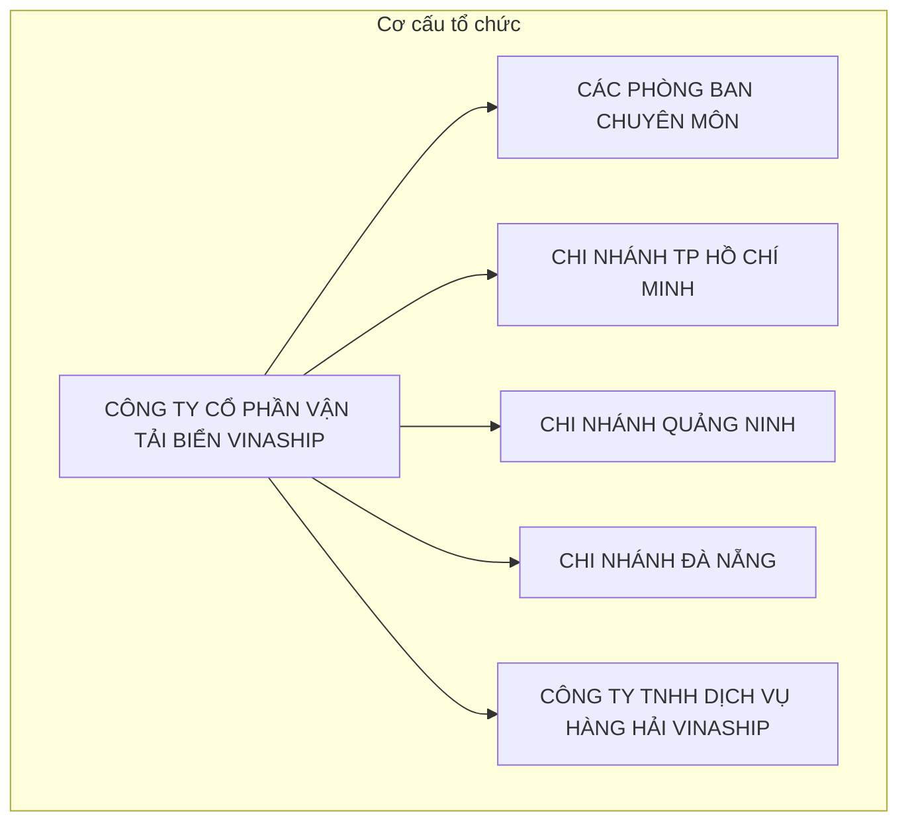
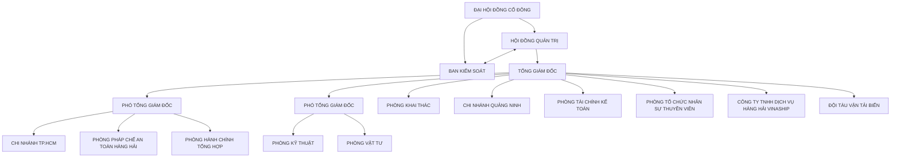

# CÔNG TY CỔ PHẦN VẬN TẢI BIỂN VINASHIP

**--------o0o-------**

# BÁO CÁO THƯỜNG NIÊN NĂM 2025

**CÔNG TY CỔ PHẦN VẬN TẢI BIỂN VINASHIP**  
*(Giấy chứng nhận ĐKDN do Sở Kế hoạch Đầu tư TP. Hải Phòng cấp Đăng ký lần đầu, ngày 27 tháng 12 năm 2006)*

### NIÊM YẾT CỔ PHIẾU TRÊN SỞ GIAO DỊCH CHỨNG KHOÁN HÀ NỘI

---

## MỤC LỤC

| NỘI DUNG | Trang |
| :--- | :---: |
| **Phần I: Thông tin chung** | **4** |
| 1. Thông tin khái quát | 4 |
| 2. Quá trình hình thành và phát triển | 4 |
| 3. Ngành nghề và địa bàn kinh doanh | 5 |
| 4. Thông tin về mô hình quản trị, tổ chức kinh doanh và bộ máy quản lý | 7 |
| 5. Định hướng phát triển | 8 |
| 6. Các rủi ro | 9 |
| **Phần II: Tình hình hoạt động trong năm** | **10** |
| 1. Tình hình hoạt động sản xuất kinh doanh | 10 |
| 2. Tổ chức và nhân sự | 11 |
| 3. Hoạt động đầu tư và thực hiện các dự án | 20 |
| 4. Tình hình tài chính | 21 |
| 5. Cơ cấu cổ đông, thay đổi vốn đầu tư của chủ sở hữu | 22 |
| 6. Báo cáo tác động liên quan đến môi trường và xã hội của công ty – Báo cáo phát triển bền vững | 24 |
| **Phần III: Báo cáo và đánh giá của Ban Giám đốc Công ty** | **25** |
| 1. Đánh giá kết quả hoạt động sản xuất kinh doanh | 25 |
| 2. Tình hình tài chính | 29 |
| 3. Những cải tiến về cơ cấu tổ chức, chính sách quản lý | 30 |
| 4. Kế hoạch phát triển trong tương lai | 31 |
| 5. Giải trình của ban giám đốc về ý kiến kiểm toán | 30 |
| 6. Báo cáo đánh giá liên quan đến trách nhiệm về môi trường và xã hội của công ty | 34 |
| **Phần IV: Báo cáo của Hội đồng quản trị** | **34** |
| 1. Đánh giá của HĐQT về các mặt hoạt động của Công ty | 34 |
| 2. Đánh giá của HĐQT về hoạt động của Ban giám đốc Công ty | 35 |
| 3. Các kế hoạch, định hướng của HĐQT | 35 |
| **Phần V: Quản trị Công ty** | **36** |
| 1. Hội đồng quản trị | 36 |
| 2. Ban kiểm soát | 44 |
| 3. Tiền lương và thù lao của HĐQT và Ban kiểm soát, Ban Giám đốc | 49 |

---

# PHẦN I: THÔNG TIN CHUNG

## 1. THÔNG TIN KHÁI QUÁT

- **Tên giao dịch:** CÔNG TY CỔ PHẦN VẬN TẢI BIỂN VINASHIP
- **Giấy chứng nhận ĐKKD số:** 0200119965 đăng ký lần đầu ngày 27 tháng 12 năm 2006 do Sở Kế hoạch đầu tư tp.Hải Phòng cấp, đăng ký thay đổi lần thứ 08 do Sở Tài chính thành phố Hải Phòng cấp ngày 08 tháng 9 năm 2025.
- **Vốn điều lệ:** 339.999.600.000 đồng
- **Vốn đầu tư của chủ sở hữu:** 339.999.600.000 đồng
- **Địa chỉ:** Số 14 Võ Nguyên Giáp, phường An Biên, TP.Hải Phòng
- **Số điện thoại:** (84-225) 3842151
- **Số fax:** (84-225) 3842271
- **Website:** www.vinaship.com.vn
- **Mã cổ phiếu:** VNA

## 2. QUÁ TRÌNH HÌNH THÀNH VÀ PHÁT TRIỂN

### Việc thành lập
Ngày 23/3/1993: Bộ Giao thông Vận tải ra quyết định thành lập lại Công ty Vận tải biển III theo Quyết định số 463/QĐ-TCCB. Công ty Vận tải biển III là Doanh nghiệp Nhà nước hạng I, hạch toán kinh tế độc lập, trực thuộc Tổng Công ty Hàng hải Việt Nam và hoạt động theo Giấy Chứng nhận ĐKKD số 105658 do Sở Kế hoạch đầu tư t/p Hải Phòng cấp, đăng ký lần đầu ngày 05 tháng 4 năm 1993 và đăng ký thay đổi lần 2 ngày 06 tháng 3 năm 2002.

Ngày 24 tháng 10 năm 2006, Bộ Giao thông vận tải ký quyết định số 2264/QĐ-BGTVT về việc phê duyệt phương án và chuyển Công ty vận tải biển III , đơn vị thành viên của Tổng Công ty Hàng hải Việt Nam thành Công ty Cổ phần Vận tải biển VINASHIP.

Công ty Cổ phần Vận tải biển VINASHIP (Sau đây gọi là Vinaship hoặc Công ty) đã tiến hành Đại hội đồng cổ đông thành lập Công ty ngày 21 tháng 12 năm 2006, được Sở Kế hoạch đầu tư Thành phố Hải phòng cấp giấy chứng nhận đăng ký kinh doanh số 0200119965 ngày 27/12/2006, với tổng số vốn điều lệ là 200 tỷ đồng, trong đó vốn Nhà Nước nắm giữ 51%. Năm 2024, Vinaship đã hoàn thành việc tăng vốn điều lệ công ty từ 200 tỷ lên 339,99 tỷ đồng bằng hình thức chia thưởng cổ phiếu.

Trong lịch sử 40 năm hình thành và phát triển, Công ty đã luôn nỗ lực phấn đấu đạt được những thành tích cao trong sản xuất kinh doanh và góp phần đáng kể vào sự nghiệp xây dựng CNXH và bảo vệ Tổ quốc XHCN.

### Niêm yết cổ phiếu
Công ty được niêm yết cổ phiếu trên Sở Giao dịch chứng khoán Hà Nội theo Quyết định về việc chấp thuận đăng ký giao dịch cổ phiếu số 280/QĐ-SGDHN do Phó Tổng giám đốc Sở giao dịch chứng khoán Hà Nội cấp ngày 24/4/2017 .
- Mã chứng khoán: VNA
- Loại cổ phiếu niêm yết: Cổ phiếu phổ thông
- Mệnh giá: 10.000 đ/cổ phiếu
- Ngày giao dịch cổ phiếu đầu tiên: 03/5/2017
- Số lượng cổ phiếu niêm yết hiện tại: 33.999.960 cổ phiếu

## 3. NGÀNH NGHỀ VÀ ĐỊA BÀN KINH DOANH

### Ngành nghề kinh doanh chính của Công ty
- Vận tải hàng hóa ven biển và viễn dương;
- Vận tải hàng hóa bằng đường bộ;
- Kho bãi và lưu giữ hàng hóa;
- Bán buôn chuyên doanh khác chưa được phân vào đâu: Bán buôn tàu biển. Bán buôn phế liệu, phế thải kim loại, phi kim loại;
- Hoạt động dịch vụ hỗ trợ khác liên quan đến vận tải;
- Sửa chữa và bảo dưỡng phương tiện vận tải (trừ ô tô, mô tô, xe máy và xe có động cơ khác): Sửa chữa và bảo dưỡng phương tiện vận tải biển;
- Cung ứng và quản lý nguồn lao động;
- Bốc xếp hàng hóa;
- Kinh doanh bất động sản, quyền sử dụng đất thuộc chủ sở hữu, chủ sử dụng hoặc đi thuê: Cho thuê văn phòng, Điều hành quản lý tòa nhà văn phòng;
- Đại lý, môi giới, đấu giá;
- Dịch vụ lưu trú ngắn ngày;
- Vận tải hàng hóa đường thủy nội địa;
- Hoạt động dịch vụ hỗ trợ kinh doanh khác còn lại chưa được phân vào đâu;
- Môi giới hợp đồng hàng hóa và chứng khoán;

### Địa bàn hoạt động

**Vận tải đường biển:**  
Xét về phương diện quy mô vốn, số tấn trọng tải Đội tàu và thị phần vận tải thì VINASHIP được coi là một trong các doanh nghiệp vận tải biển lớn tại Việt Nam. Xét về hiệu quả sản xuất kinh doanh, với mô hình tổ chức hiện có, được thừa hưởng đội ngũ thuyền viên có bề dày kinh nghiệm, đội ngũ cán bộ quản lý có năng lực, Vinaship cũng luôn nằm trong top những doanh nghiệp vận tải biển Việt Nam có hiệu quả sản xuất kinh doanh và tỷ suất lợi nhuận cao. Công ty cũng đã xác lập được thương hiệu “VINASHIP” trong thị trường vận tải trong nước cũng như thị trường vận tải quốc tế, đặc biệt là hoạt động vận tải hàng xuất nhập khẩu của Việt Nam và các nước Khu vực Đông Nam Á và Bắc Á. Các đối tác và bạn hàng chiến lược của Công ty là các tập đoàn, nhà kinh doanh, nhà nhập khẩu lớn của khu vực như: nông sản (Tổng Công ty Lương thực Miền Nam – VINAFOOD II, Thoresen Indochina SA, Bulog, NFA, Toepfer, Cargill, Samsung Logistic, Chayaporn Rice Co., Thailand…), than đá (Thailand Anthracite Coal Co., Ltd, Teparak SA…), Clinker, thạch cao (SCT, SCCC, Larfarge, DIC, ITC, …), sắt thép (Vinakyoe, Lee Metal Group Singapore, Green Pacific Jakarta…); phân bón (Philippine Phosphata Fertilizer Corporation, Mekatrade Asia Pte Ltd, MITCO Petronas Malaysia…).

**Hoạt động dịch vụ logistics và đại lý vận tải đa phương thức:**  
Song hành với kinh doanh vận tải biển, Vinaship đã tích cực phát triển ngành dịch vụ logistics và đại lý vận tải đa phương thức để khai thác thế mạnh về kiến thức, kinh nghiệm và quan hệ trên thị trường vận tải. Vinaship đã đưa ra thị trường sản phẩm dịch vụ logistics có uy tín và chất lượng cao được các khách hàng trong nước cũng như các doanh nghiệp nước ngoài đang hoạt động kinh doanh tại Việt Nam tin cậy.

**Hoạt động kho bãi, bốc xếp hàng hoá và dịch vụ kho vận:**  
VINASHIP đang quản lý khai thác 01 bãi Container có vị trí địa lý rất thuận lợi. Với mục tiêu vừa khai thác kho bãi vừa làm dịch vụ kho vận giao nhận kết hợp với lực lượng nhân lực bốc xếp có kinh nghiệm, VINASHIP sẽ đưa ra một dịch vụ forwarding hoàn hảo nhằm phục vụ khách hàng chu đáo nhất. Hiện tại công việc này đã mang lại việc làm cho hơn một trăm lao động và một nguồn doanh thu đáng kể cho doanh nghiệp. Trong những năm tới, khu vực này sẽ là một bộ phận kinh doanh quan trọng góp phần đa dạng hoá hoạt động sản xuất của doanh nghiệp.

So với các đối thủ trên thị trường, VINASHIP là một trong những doanh nghiệp hàng đầu tại Việt Nam trong ngành vận tải biển và dịch vụ hàng hải.

## 4. THÔNG TIN VỀ MÔ HÌNH QUẢN TRỊ, TỔ CHỨC KINH DOANH VÀ BỘ MÁY QUẢN LÝ

### Sơ đồ cơ cấu tổ chức

### SƠ ĐỒ TỔ CHỨC QUẢN LÝ CÔNG TY

### CÁC CÔNG TY CON:

| STT | Tên công ty | Địa chỉ trụ sở chính | Lĩnh vực hoạt động kinh doanh | Vốn điều lệ thực góp (VNĐ) | Tỷ lệ sở hữu của Vinaship |
| :---: | :--- | :--- | :--- | :---: | :---: |
| 1 | Công ty TNHH Dịch vụ Hàng hải Vinaship | Số 280 đường Ngô Quyền, Phường Ngô Quyền, Hải Phòng | Dịch vụ bốc xếp hàng hóa và logistics | 5.000.000.000 | 100% |

## 5. ĐỊNH HƯỚNG PHÁT TRIỂN

### Các mục tiêu chủ yếu của công ty:
- Xây dựng và phát triển thương hiệu của Công ty luôn là một doanh nghiệp hàng đầu trong lĩnh vực dịch vụ vận tải hàng hải; với chiến lược phát triển ổn định và bền vững dựa trên nền tảng kinh doanh cốt lõi là dịch vụ vận tải biển, đại lý vận tải và logistics, chú trọng đầu tư có trọng tâm đội tàu để nâng cao hiệu quả khai thác.
- Tối đa hóa lợi nhuận cho Công ty và các cổ đông trên cơ sở xây dựng hệ thống quản lý điều hành tinh giản, gọn nhẹ, hiệu lực, hiệu quả, ứng dụng công nghệ thông tin và công cụ quản lý tiên tiến, quản trị tốt nhất các nguồn lực và hoạt động sản xuất kinh doanh.
- Đa dạng hóa các hình thức đầu tư, nâng cao năng lực cạnh tranh để mở rộng mạng lưới và các hoạt động kinh doanh ra thị trường thế giới.

### Chiến lược phát triển trung và dài hạn:
- Đội tàu của Công ty tính đến ngày 31/12/2025 gồm 05 tàu chở hàng khô với tổng trọng tải khoảng 100.376 DWT. Công ty sẽ tiếp tục đầu tư nâng cao năng lực vận tải Đội tàu thông qua hình thức đóng tàu mới, mua tàu đã qua sử dụng; tập trung vào đầu tư Đội tàu chở hàng rời, hàng bách hóa; tiếp tục thực hiện chiến lược trẻ hóa Đội tàu thông qua việc bán những tàu già, cũ, hiệu quả khai thác kém.
- Bên cạnh việc đẩy mạnh đầu tư Đội tàu hàng rời, trong thời gian tới Công ty cũng sẽ xem xét việc phát triển các loại tàu hàng khác như tàu Container, tàu hàng lỏng, tàu chuyên dụng… tại thời điểm xét thấy có hiệu quả nhất.

#### Bảng 1: Bảng kê đội tàu của Công ty đến ngày 31/12/2025

| STT | Tên con tàu | Năm đóng/Nơi đóng | Trọng tải (DWT) | Mớn nước (m) | Năm đưa vào sử dụng |
| :---: | :--- | :---: | :---: | :---: | :---: |
| 1 | Tàu Mỹ Hưng | 2003/Việt Nam | 6.500 | 6,9 | 2003 |
| 2 | Tàu Vinaship Gold | 2008/Việt Nam | 13.245 | 8,35 | 2008 |
| 3 | Tàu Vinaship Pearl | 1996/Nhật Bản | 24.241 | 9,548 | 2009 |
| 4 | Tàu Vinaship Unity | 2012/Nhật Bản | 28.189 | 9,8 | 2025 |
| 5 | Tàu Vinaship Harmony | 2010/Nhật Bản | 28.201 | 9,8 | 2025 |

### Các mục tiêu phát triển bền vững ( môi trường, xã hội và cộng đồng) và chương trình chính liên quan đến ngắn và trung hạn của công ty
Công ty luôn thực hiện tốt trách nhiệm bảo vệ môi trường trong hoạt động SXKD, không gây ô nhiễm hay tác động xấu đến môi trường tại các địa bàn kinh doanh; thực hiện trách nhiệm với xã hội, cam kết tham gia các hoạt động từ thiện hỗ trợ cộng đồng.

## 6. CÁC RỦI RO

### Rủi ro về kinh tế:
Hoạt động SXKD của công ty là hoạt động vận tải biển – chịu rất nhiều tác động từ môi trường kinh tế vĩ mô và các biến động chính trị trên toàn thế giới. Tất cả các biến động về kinh tế, chính trị đều làm ảnh hưởng tới quan hệ thương mại giữa các quốc gia, khu vực do đó tất yếu ảnh hưởng tới hoạt động kinh doanh của công ty.

### Rủi ro về biến động giá cổ phần:
Việc công ty đưa cổ phiếu lên giao dịch tại thị trường chứng khoán sẽ góp phần nâng cao năng lực tài chính, khẳng định uy tín và thương hiệu của doanh nghiệp. Tuy nhiên, rủi ro biến động giá cổ phiếu trên thị trường chứng khoán là điều không tránh khỏi. Giá cả chứng khoán trên thị trường được quyết định bởi nhiều yếu tố. Giá cả biến động có thể do cung – cầu cổ phiếu, tình hình kinh tế xã hội hay sự thay đổi quy định pháp luật về chứng khoán, yếu tố tâm lý của nhà đầu tư. Vì vậy, công ty cổ phần vận tải biển Vinaship đã xây dựng và thực hiện quy trình công bố thông tin nhằm giúp cổ đông, các nhà đầu tư và khách hàng có những thông tin tin cậy, chính xác về các hoạt động của công ty.

### Rủi ro về tỷ giá hối đoái:
Công ty chịu rủi ro về tỷ giá do giá trị hợp lý của các luồng tiền trong tương lai của một công cụ tài chính sẽ biến động theo những thay đổi của tỷ giá ngoại tệ khi các khoản vay, doanh thu và chi phí của công ty được thực hiện bằng đơn vị tiền tệ khác với đồng Việt Nam.

### Rủi ro về lãi suất:
Công ty chịu rủi ro về lãi suất do giá trị hợp lý của các luồng tiền trong tương lai của một công cụ tài chính sẽ biến động theo những thay đổi của lãi suất thị trường khi công ty có phát sinh các khoản tiền gửi có hoặc không có kỳ hạn, các khoản vay và nợ chịu lãi suất thả nổi. Công ty quản lý rủi ro lãi suất bằng cách phân tích tình hình cạnh tranh trên thị trường để có được các lãi suất có lợi cho mục đích của công ty.

### Rủi ro tín dụng:
Rủi ro tín dụng là rủi ro mà một bên tham gia một công cụ tài chính hoặc hợp đồng không có khả năng thực hiện được nghĩa vụ của mình dẫn đến tổn thất về tài chính cho công ty. Công ty có các rủi ro tín dụng từ hoạt động SXKD ( chủ yếu đối với các khoản phải thu khách hàng ) và hoạt động tài chính ( bao gồm tiền gửi ngân hàng và các công cụ tài chính khác).

### Rủi ro thanh khoản:
Rủi ro thanh khoản là rủi ro công ty gặp khó khăn khi thực hiện các nghĩa vụ tài chính do thiếu vốn. Rủi ro thanh khoản của công ty chủ yếu phát sinh từ việc các tài sản tài chính và nợ phải trả tài chính có các thời điểm đáo hạn khác nhau.

---

# PHẦN II: HOẠT ĐỘNG KINH DOANH TRONG NĂM

## 1. HOẠT ĐỘNG KINH DOANH

#### Bảng 2: Kết quả kinh doanh năm 2025 ( ĐVT: triệu đồng)

| CHỈ TIÊU | KH NĂM 2025 | THỰC HIỆN NĂM 2025 | THỰC HIỆN NĂM 2024 | THỰC HIỆN 2025 SO VỚI KH 2025 | THỰC HIỆN 2025 SO VỚI 2024 |
| :--- | :---: | :---: | :---: | :---: | :---: |
| Tổng doanh thu | 745.000 | 690.518 | 730.631 | 92,69% | 94,51% |
| Doanh thu vận tải | 504.805 | 389.255 | 442.525 | 77,11% | 87,96% |
| Lợi nhuận trước thuế | 117.500 | 54.257 | 82.215 | 46,18% | 65,99% |

Thị trường vận tải biển quốc tế trong năm 2025 tiếp tục đối mặt với nhiều khó khăn thách thức. Chỉ số cước tàu hàng khô BDI có thời điểm thấp nhất tụt xuống mức 715 điểm vào đầu năm, giá cước vận tải biển giai đoạn 6 tháng đầu năm 2025 giảm mạnh.

Trong năm 2025, Vinaship đã bán thanh lý tàu “Vinaship Sea” và mua thành công tàu “Vinaship Harmony”, do đó, đội tàu hàng khô của Vinaship tính đến ngày 31/12/2025 có 5 chiếc với tổng trọng tải 100.376 DWT, hoạt động khai thác trên tuyến Châu Á, Vùng Vịnh và Đông Phi với các mặt hàng chủ yếu là xi măng, clinker, gạo, phân bón. Các chân hàng truyền thống của Công ty chịu tác động tiêu cực từ quy mô vận chuyển thay đổi (gạo), thuế phòng vệ tăng (xi măng), cạnh tranh từ đội tàu nội địa Trung Quốc (phân bón). Bên cạnh đó, biến đổi khí hậu và những điều kiện thời tiết cực đoan bất thường xảy ra không theo chu kỳ đã tác động tiêu cực đến các hoạt động kinh tế nói chung và vận tải biển nói riêng. Ngoài ra, hoạt động kinh doanh vận tải biển còn gặp một số khó khăn nội tại như tình trạng kỹ thuật của một số tàu già cũ phát sinh sự cố làm giảm ngày tàu vận doanh; các phương án chuyển đổi tuyến vận tải, mặt hàng và khu vực khai thác ngoài các chân hàng truyền thống chưa đạt hiệu quả như kỳ vọng do hạn chế về tuổi tàu và đặc tính kỹ thuật đội tàu. Từ những yếu tố trên khiến doanh thu và lợi nhuận trước thuế của Công ty trong năm 2025 chưa đạt kế hoạch đề ra và giảm so với cùng kỳ năm 2024.

Mặc dù hoạt động vận tải biển gặp nhiều khó khăn nhưng trong năm 2025, hoạt động dịch vụ thuê tàu ngoài tăng trưởng tích cực góp phần quan trọng vào việc đa dạng hóa và ổn định nguồn thu. Một số hoạt động dịch vụ khác cũng được đẩy mạnh, trong đó hoạt động cho thuê văn phòng cùng với hoạt động dịch vụ bốc xếp đã hoàn thành vượt mức kế hoạch đề ra. Bên cạnh đó, Công ty cũng ghi nhận khoản thu nhập từ việc bán thanh lý 01 tàu cũ Vinaship Sea khoảng 72 tỷ đồng, góp phần bổ sung nguồn thu trong kỳ.

Nhìn chung, trong bối cảnh thị trường còn nhiều khó khăn, Công ty đã nỗ lực duy trì hoạt động ổn định, tăng cường quản trị chi phí và đa dạng hóa nguồn thu, góp phần đảm bảo kết quả sản xuất kinh doanh trong năm 2025.

## 2. TỔ CHỨC VÀ NHÂN SỰ

### Danh sách Ban điều hành
Ban điều hành hiện nay của Công ty gồm có bốn (04) thành viên, đứng đầu là Tổng giám đốc, giúp việc Tổng giám đốc có các Phó tổng giám đốc và Kế toán trưởng. Ban giám điều hành do Hội đồng quản trị bổ nhiệm, chịu sự giám sát của Hội đồng quản trị và chịu trách nhiệm trước Đại hội đồng cổ đông, Hội đồng quản trị và trước Pháp luật về việc thực hiện các quyền và nhiệm vụ được giao.

#### Thành viên Ban điều hành Công ty:

| Chức vụ | Tên | Tuổi/Năm sinh | CCCD |
| :--- | :--- | :---: | :---: |
| Tổng Giám đốc | Dương Ngọc Tú | 20/10/1976 | 031076025495 |
| Phó TGĐ | Lê Văn Thái | 12/11/1977 | 034077019152 |
| Phó TGĐ | Đoàn Minh Thân | 15/10/1980 | 034080027264 |
| Kế toán trưởng | Trần Thị Thanh Hương | 13/8/1973 | 031173016145 |

### Tóm tắt lý lịch thành viên Ban điều hành

#### 1) Ông Dương Ngọc Tú
- **Chức vụ hiện tại:** Thành viên HĐQT kiêm Tổng giám đốc
- **Ngày sinh:** 20/10/1976
- **Nơi sinh:** Hải Phòng
- **Căn cước công dân:** 031076025495 do Cục CS QLHCTTXH cấp
- **Dân tộc:** Kinh
- **Địa chỉ thường trú:** Ven 22-06 Vinhomes Imperia, P. Hồng Bàng, Hải Phòng
- **Trình độ chuyên môn:** Thạc sỹ kinh tế vận tải biển

**Quá trình công tác:**

| Thời gian | Nơi làm việc | Chức vụ |
| :--- | :--- | :--- |
| 8/1999 - 6/2006 | Công ty vận tải biển III | Cán bộ |
| 7/2006 – 12/2006 | Công ty vận tải biển III | Phó phòng Kinh doanh |
| 1/2007 – 2008 | Công ty cổ phần Vận tải biển Vinaship | Phó phòng phụ trách p.Đầu tư – phát triển đội tàu |
| 2008 – 2012 | Công ty cổ phần Vận tải biển Vinaship | Trưởng phòng Đầu tư – Đối ngoại |
| 2012 – 7/2013 | Công ty cổ phần Vận tải biển Vinaship | Thành viên HĐQT, Trưởng p.Đầu tư đối ngoại, Trưởng Ban quản lý và Khai thác Bãi container |
| 7/2013 – 7/2018 | Công ty cổ phần Vận tải biển Vinaship | Thành viên HĐQT, Phó tổng Giám đốc |
| 7/2018 – 4/2021 | Công ty cổ phần Vận tải biển Vinaship | Phó tổng giám đốc |
| 4/2021 - 11/2021 | Công ty cổ phần Vận tải biển Vinaship | Thành viên HĐQT, Phó tổng Giám đốc |
| 11/2021 đến nay | Công ty cổ phần Vận tải biển Vinaship | Thành viên HĐQT, Tổng Giám đốc |

- **Các chức vụ tại tổ chức khác:** Không
- **Số cổ phần sở hữu cá nhân:** 25.500 cổ phần
- **Số cổ phần đại diện:** 6.120.000 cổ phần (18% vốn điều lệ) Đại diện phần vốn của Tổng Công ty Hàng hải Việt Nam tại Vinaship

**Những người có liên quan:**

| STT | Họ và tên người có liên quan | Mối quan hệ | Số cổ phần nắm giữ | Tỷ lệ (%) |
| :---: | :--- | :--- | :---: | :---: |
| 1 | Trần Thu Hằng | Vợ | 11.441 | 0,033 |
| 2 | Dương Trần Nhật Minh | Con | Không | |
| 3 | Dương Trần Minh Thư | Con | Không | |
| 4 | Dương Đức Tiến | Anh trai | Không | |
| 5 | Dương Thị Thu Hương | Em gái | Không | |
| 6 | Tổng công ty Hàng hải Việt Nam | Tổ chức có liên quan - Ông Dương Ngọc Tú là người đại diện phần vốn | 17.340.000 | 51 |

- **Những khoản nợ đối với Công ty:** Không
- **Hành vi vi phạm pháp luật:** Không
- **Quyền lợi mâu thuẫn với Công ty:** Không

#### 2) Ông Lê Văn Thái
- **Chức vụ hiện tại:** Phó Tổng Giám đốc
- **Ngày sinh:** 12/11/1977
- **Nơi sinh:** Thái Bình
- **Căn cước công dân:** 034077019152 do Cục CS ĐKQL cư trú và DLQG về dân cư cấp
- **Dân tộc:** Kinh
- **Địa chỉ thường trú:** Số 12/8 Đường 58, Tổ 1, Khu phố 5, Thủ Đức , TP Hồ Chí Minh
- **Trình độ chuyên môn:** Kỹ sư kinh tế vận tải biển

**Quá trình công tác:**

| Thời gian | Nơi làm việc | Chức vụ |
| :--- | :--- | :--- |
| 01/2002 - 12/2006 | Công ty vận tải biển III | Cán bộ nghiệp vụ CN TP Hồ Chí Minh |
| 12/2006 – 9/2009 | Công ty cổ phần Vận tải biển Vinaship | Cán bộ nghiệp vụ CN TP Hồ Chí Minh |
| 9/2009 – 8/2012 | Công ty cổ phần Vận tải biển Vinaship | Phó Giám đốc CN TP Hồ Chí Minh |
| 8/2012 – 7/2021 | Công ty cổ phần Vận tải biển Vinaship | Giám đốc CN TP Hồ Chí Minh |
| 7/2021 đến nay | Công ty cổ phần Vận tải biển Vinaship | Phó tổng GĐ, Giám đốc CN TP Hồ Chí Minh |

- **Các chức vụ tại tổ chức khác:** Không
- **Số cổ phần sở hữu cá nhân:** Không
- **Số cổ phần đại diện:** Không

**Những người có liên quan:**

| STT | Họ và tên người có liên quan | Mối quan hệ | Số cổ phần nắm giữ | Tỷ lệ (%) |
| :---: | :--- | :--- | :---: | :---: |
| 1 | Trần Thị Hường | Vợ | Không | |
| 2 | Lê Trần Tường Linh | Con | Không | |
| 3 | Lê Việt An | Con | Không | |
| 4 | Lê Trần Khánh Vân | Con | Không | |
| 5 | Lê Văn Năm | Bố | Không | |
| 6 | Trần Thị Nga | Mẹ | Không | |

- **Những khoản nợ đối với Công ty:** Không
- **Hành vi vi phạm pháp luật:** Không
- **Quyền lợi mâu thuẫn với Công ty:** Không

#### 3) Ông Đoàn Minh Thân
- **Chức vụ hiện tại:** Phó Tổng giám đốc kiêm Trưởng phòng vật tư
- **Ngày sinh:** 15/10/1980
- **Nơi sinh:** Hải Phòng
- **Căn cước công dân:** 034080027264 do Cục CS ĐKQL cư trú và DLQG về dân cư cấp
- **Dân tộc:** Kinh
- **Địa chỉ thường trú:** Số 19/13 Vĩnh Lưu, Hải An, Hải Phòng
- **Trình độ chuyên môn:** Kỹ sư khai thác máy tài biển

**Quá trình công tác:**

| Thời gian | Nơi làm việc | Chức vụ |
| :--- | :--- | :--- |
| 1/2002 – 11/2010 | Công ty Vận tải biển III | Trải qua các chức danh từ thợ máy đến máy trưởng |
| 1/2003 - 3/2003 | Tàu Hưng Yên - Công ty Vận tải biển III | Thợ máy |
| 7/2004 – 3/2006 | Tàu Hà Đông (M4-M3) - Công ty Vận tải biển III | Sỹ quan máy |
| 6/2006 – 4/2008 | Tàu Mỹ An – Công ty CP vận tải biển Vinaship | Sỹ Quan Quản lý |
| 9/2008 – 11/2010 | Tàu Hà Tiên - Công ty CP vận tải biển Vinaship | Máy trưởng |
| 3/2011 – 6/2013 | Học Đại học Ngành khai thác máy tàu biển trường Đại học Hàng hải Việt Nam | |
| 7/2013 – 9/2014 | Công ty cổ phần Vận tải biển Vinaship | Máy trưởng tàu Vinaship Sea |
| 10/2014 – 7/2015 | Công ty cổ phần Vận tải biển Vinaship | Nhân viên phòng vật tư |
| 7/2015 – 4/2019 | Công ty cổ phần Vận tải biển Vinaship | Phó phòng vật tư |
| 4/2019 – 7/2019 | Công ty cổ phần Vận tải biển Vinaship | Phó phòng phụ trách phòng vật tư |
| 7/2019 – 11/2024 | Công ty cổ phần Vận tải biển Vinaship | Trưởng phòng vật tư |
| 12/2024 đến nay | Công ty cổ phần Vận tải biển Vinaship | Phó Tổng giám đốc kiêm Trưởng phòng vật tư |

- **Các chức vụ tại tổ chức khác:** Không
- **Số cổ phần sở hữu cá nhân:** 510 cổ phần
- **Số cổ phần đại diện:** Không

**Những người có liên quan:**

| STT | Họ và tên người có liên quan | Mối quan hệ | Số cổ phần nắm giữ | Tỷ lệ (%) |
| :---: | :--- | :--- | :---: | :---: |
| 1 | Đoàn Minh Tuân | Bố đẻ | Không | |
| 2 | Lê Viết Quyên | Bố vợ | Không | |
| 3 | Bùi Thị Phượng | Mẹ vợ | Không | |
| 4 | Đoàn Thị Dần | Chị gái | Không | |
| 5 | Đoàn Minh Thắng | Chị gái | Không | |
| 6 | Lê Thị Hải Yến | Vợ | Không | |
| 7 | Đoàn Minh Huyền | Con gái | Không | |
| 8 | Đoàn Bảo Minh | Con trai | Không | |

- **Những khoản nợ đối với Công ty:** Không
- **Hành vi vi phạm pháp luật:** Không
- **Quyền lợi mâu thuẫn với Công ty:** Không

#### 4) Bà Trần Thị Thanh Hương
- **Chức vụ hiện tại:** Kế toán trưởng
- **Ngày sinh:** 13/8/1973
- **Nơi sinh:** Hải Phòng
- **Căn cước công dân:** 031173016145 do Cục CS ĐKQL cư trú và DLQG về dân cư cấp
- **Dân tộc:** Kinh
- **Địa chỉ thường trú:** Số nhà 56 lô 26D Lê Hồng Phong, Ngô Quyền, Hải Phòng
- **Trình độ chuyên môn:** Cử nhân kinh tế

**Quá trình công tác:**

| Thời gian | Nơi làm việc | Chức vụ |
| :--- | :--- | :--- |
| 4/1995 – 4/1998 | Công ty liên doanh TNHH Kai nan HP | Kế toán |
| 1998 - 2004 | Công ty vận tải biển III | Kế toán |
| 2004 - 2012 | Công ty vận tải biển III ( từ năm 2007 đổi tên là Công ty cổ phần vận tải biển Vinaship) | Phó phòng tài chính kế toán |
| 2010 - 2012 | Công ty cổ phần Vận tải biển Vinaship | Phó phòng TCKT |
| 2013 - 2015 | Công ty cổ phần Vận tải biển Vinaship | Trưởng phòng TCKT |
| 2015 đến nay | Công ty cổ phần Vận tải biển Vinaship | Kế toán trưởng |

- **Các chức vụ tại tổ chức khác:** Không
- **Số cổ phần sở hữu cá nhân:** 340 cổ phần
- **Số cổ phần đại diện:** Không

**Những người có liên quan:**

| STT | Họ và tên người có liên quan | Mối quan hệ | Số cổ phần nắm giữ | Tỷ lệ (%) |
| :---: | :--- | :--- | :---: | :---: |
| 1 | Nguyễn Đắc Cương | Chồng | Không | |
| 2 | Nguyễn Trần Hoàng | Con | Không | |
| 3 | Nguyễn Đắc Hoàn | Con | Không | |
| 4 | Trần Thị Hương Giang | Em | Không | |
| 5 | Trần Thị Hợi | Em | Không | |
| 6 | Trần Thị Thanh Nhạn | Em | Không | |
| 7 | Trần Du Nam | Bố | Không | |
| 8 | Nguyễn Thị Thục | Mẹ | Không | |

- **Những khoản nợ đối với Công ty:** Không
- **Hành vi vi phạm pháp luật:** Không
- **Quyền lợi mâu thuẫn với Công ty:** Không

### Chế độ chính sách và công tác quản lý nhân sự:

#### Số lượng người lao động trong Công ty

#### Bảng 4 : Bảng kê lao động Công ty tại thời điểm 31/12/2025
*Đơn vị tính : Người*

| Yếu tố | 31/12/2024 | 31/12/2025 |
| :--- | :---: | :---: |
| **Số lượng nhân viên** | **285** | **274** |
| • Sỹ quan thuyền viên | 219 | 211 |
| • Cán bộ công nhân viên | 66 | 63 |
| **Phân theo trình độ chuyên môn** | | |
| • Đại học và Trên đại học | 103 | 97 |
| • Cao đẳng, Trung cấp, PTTH, Sơ cấp | 182 | 177 |

Nguồn nhân lực là yếu tố then chốt đối với hiệu quả khai thác đội tàu và hoạt động quản lý điều hành của Công ty. Trong năm 2025, Công ty tiếp tục triển khai đồng bộ các giải pháp quản trị nhân sự theo hướng tinh gọn, ổn định và gắn với yêu cầu sản xuất kinh doanh.

Tính đến ngày 31/12/2025, tổng số lao động của Công ty là 274 người, trong đó có 211 sỹ quan thuyền viên và 63 cán bộ công nhân viên khối phòng, chi nhánh. So với cuối năm 2024, quy mô lao động giảm nhẹ, phù hợp với yêu cầu cơ cấu lại lao động và nâng cao hiệu quả sử dụng nhân lực.

Về trình độ chuyên môn, lao động có trình độ đại học và trên đại học chiếm 97 người; lao động có trình độ cao đẳng, trung cấp và các trình độ khác là 177 người.

Trong năm, Công ty thực hiện tuyển dụng, bố trí, điều động và sử dụng lao động theo nguyên tắc công khai, minh bạch, phù hợp với năng lực, vị trí việc làm và nhu cầu thực tế của đội tàu cũng như các đơn vị. Công tác quy hoạch, bổ nhiệm cán bộ được triển khai đúng quy trình, bảo đảm tiêu chuẩn chức danh, năng lực chuyên môn và kinh nghiệm công tác.

100% người lao động được ký kết hợp đồng lao động theo đúng quy định; công tác điều động sỹ quan thuyền viên nhập tàu, rời tàu được thực hiện công khai, minh bạch. Trong năm 2025, Công ty không phát sinh khiếu nại, tranh chấp lao động và không có trường hợp người lao động bị xử lý kỷ luật.

Song song với công tác quản lý nhân sự truyền thống, Công ty tiếp tục triển khai các chương trình đổi mới quản trị và nâng cao hiệu quả làm việc như hệ thống đánh giá KPI, lương theo mô hình 3P, chuyển đổi số, Kaizen và các chương trình nâng cao chất lượng quản trị, góp phần chuẩn hóa hoạt động quản lý và nâng cao năng suất lao động.

#### Chính sách tiền lương, thưởng và phúc lợi
Trong bối cảnh hoạt động sản xuất kinh doanh còn gặp nhiều khó khăn, Công ty vẫn duy trì đầy đủ và ổn định các chế độ, chính sách đối với người lao động theo quy định của pháp luật, Thỏa ước lao động tập thể và các quy chế nội bộ.

- **Chính sách tiền lương:**  
Công ty thực hiện chi trả lương đầy đủ, đúng thời hạn và bảo đảm thu nhập ổn định cho người lao động. Năm 2025, thu nhập bình quân của người lao động (tiền lương, thưởng) đạt khoảng 18,95 triệu đồng/người/tháng. Việc chi trả tiền lương được thực hiện đúng theo hợp đồng lao động và quy chế trả lương của Công ty.

- **Chính sách thưởng và khuyến khích:**  
Bên cạnh các khoản thưởng định kỳ như thưởng cuối năm và thưởng các dịp lễ, Tết, Công ty thường xuyên tổ chức khen thưởng đột xuất đối với các tập thể và cá nhân có thành tích trong công tác khai thác tàu, bảo quản – bảo dưỡng phương tiện, thực hiện sáng kiến cải tiến kỹ thuật, tiết giảm chi phí và nâng cao hiệu quả sản xuất kinh doanh.  
Công tác khen thưởng được triển khai kịp thời, công khai, gắn với kết quả thực hiện nhiệm vụ của từng đơn vị, từng cá nhân, qua đó góp phần khuyến khích tinh thần trách nhiệm và phong trào thi đua lao động trong toàn Công ty.

- **Chính sách bảo hiểm và phúc lợi:**  
Công ty thực hiện đầy đủ các chế độ bảo hiểm xã hội, bảo hiểm y tế, bảo hiểm thất nghiệp và bảo hiểm tai nạn cho 100% người lao động theo quy định; việc trích nộp và giải quyết chế độ được thực hiện đúng thời hạn, không để phát sinh nợ đọng.  
Thời giờ làm việc, thời giờ nghỉ ngơi và chế độ nghỉ phép của người lao động được thực hiện đúng quy định pháp luật và Thỏa ước lao động tập thể. Công ty tổ chức khám sức khỏe định kỳ cho cán bộ công nhân viên và thực hiện khám sức khỏe cho sỹ quan thuyền viên trước khi tuyển dụng và trước khi xuống tàu làm việc.  
Ngoài các chế độ bắt buộc theo quy định, Công ty và Công đoàn phối hợp triển khai nhiều chính sách phúc lợi bổ sung như: bảo hiểm tai nạn 24/24, chế độ công tác phí, hỗ trợ người lao động có hoàn cảnh khó khăn, chế độ hiếu hỉ, thăm hỏi ốm đau.  
Trong năm 2025, nhiều hoạt động chăm lo đời sống vật chất và tinh thần cho người lao động được tổ chức như: tuyên dương thuyền viên tiêu biểu nhân Ngày Thuyền viên thế giới; thăm và tặng quà các tàu; tổ chức tham quan, du lịch cho cán bộ công nhân viên và người thân; tổ chức các hoạt động nhân Ngày Quốc tế Phụ nữ, Ngày Phụ nữ Việt Nam; khen thưởng con cán bộ công nhân viên, sỹ quan thuyền viên có thành tích học tập tốt; hỗ trợ các hoạt động văn hóa, thể thao cho người lao động và thuyền viên.

#### Công tác đào tạo và phát triển nguồn nhân lực
Công ty xác định đào tạo và phát triển nguồn nhân lực là nhiệm vụ trọng tâm nhằm đáp ứng yêu cầu vận hành đội tàu, nâng cao chất lượng quản lý và chuẩn bị nguồn nhân lực cho các kế hoạch phát triển trong các năm tiếp theo.

Trong năm 2025, các chương trình đào tạo được triển khai theo từng nhóm đối tượng:
- **Đối với sỹ quan thuyền viên:** Công ty tổ chức các khóa đào tạo, bồi dưỡng chuyên môn và cập nhật quy trình, công nghệ, đặc biệt đối với lực lượng sỹ quan tiếp nhận và khai thác các tàu mới. Nội dung đào tạo tập trung vào nghiệp vụ vận hành, tiêu chuẩn an toàn, kỹ thuật khai thác và yêu cầu công nghệ của tàu, nhằm bảo đảm đội ngũ thuyền viên đáp ứng đầy đủ yêu cầu chuyên môn và kế hoạch khai thác đội tàu.
- **Đối với cán bộ công nhân viên khối phòng, chi nhánh:** Công ty tổ chức các chương trình đào tạo nội bộ, đồng thời cử cán bộ tham gia các khóa đào tạo chuyên môn, nghiệp vụ, quản lý do các đơn vị chuyên ngành và Tổng công ty tổ chức. Bên cạnh hình thức đào tạo trực tiếp, Công ty tiếp tục triển khai các chương trình đào tạo trực tuyến (E-learning) nhằm nâng cao kiến thức chuyên môn, kỹ năng quản lý và năng lực ứng dụng công nghệ trong công việc.

Thông qua công tác đào tạo, đội ngũ cán bộ công nhân viên và sỹ quan thuyền viên của Công ty cơ bản đáp ứng yêu cầu về trình độ, kỹ năng và năng lực thực hiện nhiệm vụ theo từng vị trí việc làm, góp phần nâng cao chất lượng quản lý, an toàn khai thác và hiệu quả sản xuất kinh doanh.

#### Đánh giá chung
Năm 2025, Công ty đã thực hiện đầy đủ và kịp thời các chế độ, chính sách đối với người lao động; duy trì ổn định việc làm, thu nhập và đời sống vật chất, tinh thần cho cán bộ công nhân viên và sỹ quan thuyền viên trong điều kiện thị trường còn nhiều biến động.

Công tác quản lý nhân sự, đào tạo và phúc lợi được triển khai đồng bộ, gắn với các chương trình đổi mới quản trị và nâng cao hiệu quả hoạt động, qua đó góp phần ổn định đội ngũ lao động, tăng cường sự gắn bó của người lao động và tạo nền tảng cho sự phát triển bền vững của Công ty trong các năm tiếp theo.

## 3. HOẠT ĐỘNG ĐẦU TƯ VÀ THỰC HIỆN CÁC DỰ ÁN

### Hoạt động đầu tư

- **Bán thanh lý tài sản:**  
Thực hiện Nghị quyết Đại hội đồng cổ đông bất thường thông qua bằng hình thức lấy ý kiến cổ đông bằng văn bản số 06/NQ-ĐHĐCĐ ngày 06/8/2025, công ty đã bán thành công tàu Vinaship Sea (27.841 dwt, năm đóng 1998 tại Nhật Bản) vào quý IV/2025.

- **Đầu tư tàu biển:**  
Thực hiện Nghị quyết Đại hội đồng cổ đông thường niên số 02/2025/NQ-ĐHĐCĐ ngày 25/4/2025, Công ty đã ký hợp đồng mua tàu Bright Hope, trọng tải 28.201 DWT, đóng năm 2010 tại Nhật Bản ngày 30/9/2025 và đã nhận bàn giao tàu tại Nhật bản vào ngày 05/11/2025 và đã đổi tên tàu thành “Vinaship Harmony”.

## 4. TÌNH HÌNH TÀI CHÍNH

### a) Tình hình tài chính

#### Bảng 5: Tình hình tài chính Công ty

| Chỉ tiêu | Năm 2024 | Năm 2025 | % tăng trưởng |
| :--- | :---: | :---: | :---: |
| Tổng giá trị tài sản | 808.856.859.263 | 958.843.625.345 | 18,54% |
| Doanh thu thuần | 620.600.948.687 | 610.098.917.813 | -1,69% |
| Lợi nhuận từ hoạt động kinh doanh | -11.585.833.559 | -15.665.422.366 | 35,21% |
| Lợi nhuận khác | 93.800.511.186 | 69.922.601.963 | -25,46% |
| Lợi nhuận trước thuế | 82.214.677.627 | 54.257.179.597 | -34,01% |
| Lợi nhuận sau thuế | 65.721.232.745 | 43.284.649.394 | -34,14% |
| Lãi cơ bản trên cổ phiếu | 1.636 | 1.273 | -22,19% |

### b) Các chỉ tiêu tài chính chủ yếu

#### Bảng 6: Một số chỉ tiêu tài chính chủ yếu

| Các chỉ tiêu | Năm 2024 | Năm 2025 | Ghi chú |
| :--- | :---: | :---: | :---: |
| **1. Chỉ tiêu về khả năng thanh toán** | | | |
| + Hệ số thanh toán ngắn hạn: TSNH/Nợ ngắn hạn | 3,43 | 2,37 | |
| + Hệ số thanh toán nhanh: (TSNH – Hàng tồn kho) / Nợ ngắn hạn | 3,05 | 2,08 | |
| **2. Chỉ tiêu về cơ cấu vốn** | | | |
| + Hệ số Nợ/Tổng tài sản | 0,28 | 0,38 | |
| + Hệ số Nợ/Vốn chủ sở hữu | 0,4 | 0,63 | |
| **3. Chỉ tiêu về năng lực hoạt động** | | | |
| + Vòng quay hàng tồn kho: Giá vốn hàng bán / Hàng tồn kho bình quân | 16,7 | 14,78 | |
| + Doanh thu thuần/Tổng tài sản | 0,76 | 0,64 | |
| **4. Chỉ tiêu về khả năng sinh lời** | | | |
| + Hệ số lợi nhuận sau thuế/Doanh thu thuần | 0,1 | 0,07 | |
| + Hệ số lợi nhuận sau thuế/Vốn chủ sở hữu | 0,11 | 0,07 | |
| + Hệ số Lợi nhuận sau thuế/Tổng tài sản | 0,08 | 0,05 | |
| + Hệ số Lợi nhuận từ hoạt động kinh doanh/Doanh thu thuần | -0,01 | -0,03 | |

## 5. CƠ CẤU CỔ ĐÔNG, THAY ĐỔI VỐN ĐẦU TƯ CỦA CHỦ SỞ HỮU

### Cổ phần
- **Mã chứng khoán:** VNA
- **Tổng số cổ phần đang lưu hành:** 33.999.960 cổ phần
- **Tổng số cổ phần niêm yết:** 33.999.960 cổ phần
- **Số lượng cổ phần chuyển nhượng tự do:** 33.999.960 cổ phần
- **Số lượng cổ phần bị hạn chế chuyển nhượng:** 0 cổ phần

### Các dữ liệu thống kê về cổ đông

#### Cổ đông trong nước
- **Cơ cấu cổ đông**

| STT | Danh mục | Tại ngày 31/12/2024 - Cổ phiếu | Tại ngày 31/12/2024 - Tỷ lệ (%) | Tại ngày 31/12/2025 - Cổ phiếu | Tại ngày 31/12/2025 - Tỷ lệ (%) |
| :---: | :--- | :---: | :---: | :---: | :---: |
| 1 | Cổ đông tổ chức | 31.030.890 | 91,26 | 30.627.690 | 90,08 |
| | - Cổ đông sở hữu trên 5% | 30.943.240 | 91,01 | 30.599.840 | 90 |
| | - Cổ đông sở hữu dưới 5% | 87.650 | 0,25 | 27.850 | 0,08 |
| 2 | Cổ đông cá nhân | 2.368.693 | 6,97 | 2.773.644 | 8,16 |
| | - Cổ đông sở hữu trên 5% | - | - | - | - |
| | - Cổ đông sở hữu dưới 5% | 2.368.693 | 6,97 | 2.773.644 | 8,16 |

- **Thông tin chi tiết về cổ đông nhà nước và cổ đông lớn**

| Cổ đông | Phân loại: Cổ đông nhà nước | Phân loại: Cổ đông lớn | Địa chỉ | Số CCCD/ĐKKD | Số lượng CP sở hữu | Tỷ trọng (%) |
| :--- | :---: | :---: | :--- | :---: | :---: | :---: |
| 1. Tổng Công ty Hàng Hải Việt Nam | x | | Số 1, Đào Duy Anh, Hà Nội | 0100104595 | 17.340.000 | 51 |
| 2. Công ty Cổ phần Container Việt Nam | | x | Số 11 Võ Thị Sáu, Phường Ngô Quyền, Thành phố Hải Phòng | 0200453688 | 13.259.840 | 39 |

#### Cổ đông nước ngoài
- **Cơ cấu cổ đông**

| STT | Danh mục | Tại ngày 31/12/2024 - Cổ phiếu | Tại ngày 31/12/2024 - Tỷ lệ (%) | Tại ngày 31/12/2025 - Cổ phiếu | Tại ngày 31/12/2025 - Tỷ lệ (%) |
| :---: | :--- | :---: | :---: | :---: | :---: |
| 1 | Cổ đông tổ chức | 59.557 | 0,18 | 59.166 | 0,17 |
| 2 | Cổ đông cá nhân | 540.820 | 1,59 | 539.460 | 1,59 |

- **Thông tin chi tiết về cổ đông lớn:** Không có

### Tình hình thay đổi vốn đầu tư của chủ sở hữu:
Trong năm 2025, Công ty không có thay đổi về vốn đầu tư của chủ sở hữu. Lần thay đổi vốn gần nhất được thực hiện vào tháng 7/2024 bằng hình thức phát hành cổ phiếu để tăng vốn cổ phần từ nguồn vốn chủ sở hữu.

| Lần | Thời gian hoàn thành đợt phát hành | Vốn điều lệ thực góp tăng thêm (ĐVT: đồng) | Vốn điều lệ thực góp sau phát hành (ĐVT: đồng) | Hình thức phát hành |
| :---: | :---: | :---: | :---: | :--- |
| Ban đầu | | | 200.000.000.000 | Thành lập công ty Cổ phần |
| Lần 1 | 1/7/2024 | 139.999.600.000 | 339.999.600.000 | Phát hành cổ phiếu để tăng vốn cổ phần từ nguồn vốn chủ sở hữu |

## 6. BÁO CÁO TÁC ĐỘNG LIÊN QUAN ĐẾN MÔI TRƯỜNG VÀ XÃ HỘI CỦA CÔNG TY - BÁO CÁO PHÁT TRIỂN BỀN VỮNG

Trong bối cảnh các nền kinh tế tham gia ngày càng sâu rộng hơn vào tiến trình toàn cầu hóa, với sự phát triển nhanh chóng của khoa học công nghệ, trước những nguy cơ về biến đổi khí hậu và ô nhiễm môi trường, nguy cơ cạn kiệt tài nguyên thiên nhiên, phát triển bền vững đang dần trở thành một trong những mục tiêu của mỗi doanh nghiệp.

Công ty cổ phần vận tải biển Vinaship với bề dày truyền thống và sự tận tâm với khách hàng luôn tự hào là một trong những công ty vận tải biển hàng đầu Việt Nam. Trong quá trình phát triển của mình, công ty không chỉ cam kết nỗ lực đảm bảo cung cấp cho khách hàng những dịch vụ vận tải chuyên nghiệp và chất lượng, mà còn luôn chú trọng đến việc xây dựng chính sách phát triển bền vững và đề cao trách nhiệm xã hội của doanh nghiệp, nhằm gia tăng lợi ích cho khách hàng, đối tác, cộng đồng xã hội, góp phần vào sự phát triển kinh tế của địa phương. Vinaship luôn coi việc thực hiện trách nhiệm xã hội của doanh nghiệp không chỉ là những hành động giải quyết các các vấn đề xã hội vì mục đích từ thiện và nhân đạo mà công ty còn hướng tới trách nhiệm xã hội là cách thức mà một doanh nghiệp đạt được sự cân bằng hoặc kết hợp những yêu cầu về kinh tế, môi trường và xã hội, đồng thời đáp ứng được những kỳ vọng của cổ đông và các đối tác.

### Tác động tới môi trường
Công ty luôn quan tâm đến việc phát triển kinh doanh gắn liền với việc bảo vệ môi trường. Đội tàu của công ty tuân thủ nghiêm ngặt các quy định về sử dụng nhiên liệu có hàm lượng lưu huỳnh thấp, hệ thống xử lý nước dằn, xử lý nước thải và rác thải theo đúng quy chuẩn để giảm ô nhiễm môi trường biển. Công ty đã có các phương án chạy tàu phù hợp với diễn biến thị trường vận tải, giá nhiên liệu và hợp đồng vận chuyển, kết hợp với việc rà soát điều chỉnh mức tiêu thụ nhiên liệu cho đội tàu để giảm lượng nhiên liệu tiêu thụ, đồng thời giảm lượng khí thải phát ra môi trường.

### Quản lý nguyên vật liệu
Công ty luôn rà soát các hạng mục phụ tùng và vật tư cần cấp cho đội tàu; liên tục theo dõi hành trình tàu để cấp vật tư cho tàu theo lô lớn, theo quý, tránh cấp phát nhỏ lẻ gây lãng phí nguồn nguyên vật liệu và tốn kém cho khâu vận chuyển giao nhận. Thường xuyên nhắc nhở, yêu cầu các tàu cân nhắc trước khi đặt phụ tùng vật tư, tránh lãng phí không cần thiết.

### Tiêu thụ năng lượng
Trong năm 2025, tổng lượng dầu FO, DO, LO tiêu thụ lần lượt là 8.024 và 1.369 tấn, dầu nhờn là 181.072 lit. Công ty đã áp dụng các giải pháp giảm tiêu thụ dầu FO cho một số tàu do khai thác với công suất phù hợp.

### Tiêu thụ nước
Nguồn cung cấp nước và lượng nước ngọt chủ yếu được sử dụng tại trụ sở chính của công ty. Công ty có hệ thống xử lý nước thải sinh hoạt trước khi thải ra hệ thống thoát nước.

### Tuân thủ pháp luật về bảo vệ môi trường
Công ty luôn tuân thủ thực hiện các quy định pháp luật liên quan đến vấn đề môi trường .

---

# PHẦN III. BÁO CÁO VÀ ĐÁNH GIÁ CỦA BAN GIÁM ĐỐC

## 1. ĐÁNH GIÁ KẾT QUẢ HOẠT ĐỘNG SẢN XUẤT KINH DOANH

### Các yếu tố tác động đến kết quả sản xuất kinh doanh

#### * Về mặt khách quan:
Năm 2025, tình hình kinh tế – chính trị thế giới tiếp tục diễn biến phức tạp, tiềm ẩn nhiều yếu tố bất định. Kinh tế toàn cầu tăng trưởng chậm và thiếu động lực bền vững, chịu tác động đan xen của xung đột địa chính trị kéo dài tại một số khu vực trọng điểm, cạnh tranh chiến lược giữa các nền kinh tế lớn, cùng xu hướng gia tăng các biện pháp bảo hộ và điều chỉnh chính sách thương mại. Chính sách tiền tệ thận trọng và mặt bằng lãi suất duy trì ở mức cao tại nhiều quốc gia tiếp tục ảnh hưởng đến dòng vốn, đầu tư và thương mại quốc tế.

Bên cạnh đó, các yêu cầu về chuyển đổi năng lượng, giảm phát thải và tuân thủ các tiêu chuẩn môi trường quốc tế ngày càng rõ nét, làm thay đổi cấu trúc chi phí và phương thức hoạt động của chuỗi cung ứng toàn cầu.

Thị trường vận tải biển quốc tế trong năm 2025 tiếp tục đối mặt với nhiều khó khăn thách thức. Tăng trưởng hàng hải toàn cầu chỉ đạt khoảng 0,5% trong năm 2025, thấp hơn nhiều so với các năm trước. Nhu cầu vận chuyển trên phân khúc hàng khô được dự báo tăng rất khiêm tốn (khoảng 0–1%) do yếu tố nhu cầu nguyên liệu cơ bản như quặng sắt và than tiếp tục giảm hoặc trì trệ, trong khi đội tàu vẫn tăng trưởng dẫn đến sức ép cân bằng cung–cầu. Chỉ số BDI có thời điểm thấp nhất tụt xuống mức 715 điểm vào thời điểm đầu năm, giá cước vận tải biển giai đoạn 6 tháng đầu năm 2025 giảm mạnh. Các chân hàng truyền thống của Công ty chịu tác động tiêu cực từ quy mô vận chuyển thay đổi (gạo), thuế phòng vệ tăng (xi măng), cạnh tranh từ đội tàu nội địa Trung Quốc (phân bón).

Biến đổi khí hậu và những điều kiện thời tiết cực đoan bất thường xảy ra không theo chu kỳ đã tác động tiêu cực đến các hoạt động kinh tế nói chung và vận tải biển nói riêng. Các tác động có thể là trực tiếp như mưa lũ liên tục kéo dài hàng tháng làm đình trệ mọi tác nghiệp hàng hoá kỵ nước, hoặc gián tiếp như làm dồn ứ các tàu đến cảng gây tắc nghẽn cầu bến, hay gây gián đoạn chuỗi logistics cấp hàng sau bão lũ.

#### * Về mặt chủ quan:
Năm 2025, Công ty khai thác đội tàu 6 chiếc với tổng số tấn trọng tải khoảng 128.000 DWT, độ tuổi bình quân hơn 20 tuổi, tàu trẻ nhất 13 tuổi là tàu Vinaship Unity mới đầu tư cuối năm 2024, tàu Vinaship Harmony mới nhận bàn giao ngày 05/11/2025 và đưa vào khai thác 2 tháng cuối năm, tàu Vinaship Sea đã bánh thanh lý thành công và tàu bàn giao cho người mua ngày 23/11/2025. Quy mô đội tàu biển ngày cảng suy giảm, số tấn trọng tải nhỏ, chủ yếu khai thác trên tuyến Châu Á + Vùng Vịnh+ Đông Phi theo 2 phương thức tàu chuyến và kết hợp chuyến+ định hạn ngắn nên nhìn chung khả năng cạnh tranh với các đội tàu bên ngoài ngày một hạn chế.

Ngoài chịu tác động của các yếu tố thị trường, địa chính trị chung, quy mô đội tàu suy giảm, hoạt động kinh doanh vận tải biển năm 2025 của Công ty còn đối mặt với nhiều khó khăn nội tại và yếu tố chủ quan:
- Một số chuyến hàng bị ảnh hưởng lớn bởi điều kiện thời tiết cực đoan trong khu vực (mưa dài ngày, bão nhiệt đới) gia tăng cả về tần suất và mức độ và Công ty cũng chưa có các giải pháp phòng ngừa hay giảm thiểu các thiệt hại của đội tàu phát sinh do thời tiết cực đoan.
- Một số tàu già cũ tình trạng kỹ thuật kém, phát sinh sự cố ảnh hưởng đến ngày tàu vận doanh tốt.
- Thời gian vận doanh đội tàu thực tế thấp hơn kịch bản kế hoạch do việc đầu tư tàu mới bị chậm hơn 4 tháng so với kế hoạch đầu năm và phát sinh việc tàu Vinaship Sea giảm thời gian vận doanh 2 tháng do bán thanh lý trước hạn lên đà.

### Các giải pháp đã thực hiện để hoàn thành/vượt kế hoạch/khắc phục/thúc đẩy hoàn thành kế hoạch SXKD.

#### a/ Về hoạt động khai thác đội tàu:
- Trong bối cảnh năng lực đội tàu suy giảm, hiệu suất quay vòng chuyến của một số chân hàng chính như xi măng, phân bón ngày càng kém, mức độ rủi ro về thời tiết, tình trạng tắc nghẽn cầu bến ngày cảng trầm trọng, do vậy Công ty triển khai nhiều giải pháp cho hoạt động khai thác đội tàu và giảm thiểu các rủi ro phát sinh. Mở rộng tuyến khai thác cho tàu mới đầu tư Vinaship Unity và tàu Vinaship Harmony từ Bắc Á đến vùng vịnh Ả rập và Đông Phi. Thực hiện được một số hợp đồng chuyến và định hạn với giá trị tốt, không phát sinh ngày tàu off hire, nâng cao hiệu quả sản xuất kinh doanh của đội tàu. Đối với các tàu cũ, Công ty đã áp dụng một số giải pháp khắc phục như cạo hà vỏ tàu, bảo dưỡng máy chính và trang thiết bị để dần phục hồi tốc độ khai thác. Tăng cường công tác kiểm tra tình trạng kỹ thuật tàu, rà soát tổng thể và tập trung việc nâng cao hiệu quả khai thác máy móc, trang thiết bị. Kịp thời can thiệp và có giải pháp về quản lý và kỹ thuật khi phát hiện tốc độ giảm bất thường.

#### b/ Hoạt động dịch vụ khác và thuê tàu ngoài
Với mảng hoạt động thuê tàu ngoài: mở rộng hoạt động thuê tàu ngoài vận chuyển hàng tôn và quặng tuyến nội địa từ Dung Quất ra vào các tỉnh phía Bắc và phía Nam, vận chuyển mặt hàng Clinker từ Indonesia đến cảng Taichung, Đài Loan. Tổng kết năm 2025, hoạt động thuê tàu ngoài toàn Công ty đạt 736.475 tấn sản lượng, đóng góp 134,7 tỷ đồng doanh thu.

Duy trì và mở rộng quy mô hoạt động dịch vụ bốc xếp tại khu vực Cảng Hateco, Lạch Huyện, Hải Phòng. Từng bước đa dạng hóa hoạt động dịch vụ tại Công ty TNHH Dịch vụ hàng Hải Vinaship (Vimaser), nâng cao hiệu quả SXKD. Kết thúc năm 2025, Vimarser đạt sản lượng bốc xếp hàng container: 1.608.767 cont, sản lượng bốc xếp hàng rời: 18.801 tấn, tổng doanh thu: 64,85 tỷ đồng (106,31% KH năm 2025), lợi nhuận trước thuế: 550 triệu đồng (110% KH năm 2025).

Đối với mảng hoạt động cho thuê văn phòng và kho bãi: Công ty đẩy mạnh hoạt động marketing với các nhóm khách hàng tiềm năng có nhu cầu thuê văn phòng tại khu vực Hải Phòng, ký hợp đồng cho thuê thêm gần 600m2 sàn tầng 3-4 nâng tỷ lệ lấp đầy lên 70%.

#### c/ Về hoạt động đầu tư, thanh lý tàu biển:

- **Về hoạt động đầu tư:**  
Công ty đã hoàn thành việc mua tàu hàng khô Bright Hope – trọng tải 28.201 DWT đóng năm 2010 tại Nhật Bản với giá trị đầu tư là 251.165 triệu đồng, công ty đã nhận bàn giao tàu này tại Kobe, Nhật Bản đổi tên thành Vinaship Harmony và đưa vào khai thác từ ngày 05/11/2025.

- **Về hoạt động thanh lý tàu biển:**  
Tàu Vinaship Sea ký hợp đồng bán tàu ngày 17/09/2025 với giá bán là 72.320 triệu đồng và được bàn giao thành công cho người mua nước ngoài tại Vũng Tàu vào ngày 23/11/2025.

### Kết quả hoạt động kinh doanh

#### Các chỉ tiêu chính

#### Bảng 7: Các chỉ tiêu kinh doanh chính

| STT | Chỉ tiêu | Đơn vị | KH năm 2025 | TH năm 2025 | Tỷ lệ % hoàn thành kế hoạch |
| :---: | :--- | :---: | :---: | :---: | :---: |
| **1** | **Sản lượng vận tải** | **Tấn** | **1.700.000** | **1.757.661** | **103,39%** |
| **2** | **Doanh thu HĐ SXKD** | **Tr Đồng** | **745.000** | **690.518** | **92,69%** |
| a | Hoạt động vận tải biển | Tr Đồng | 504.805 | 389.255 | 77,11% |
| b | Hoạt động tài chính | Tr Đồng | 2.210 | 10.386 | 469,95% |
| c | Hoạt động dịch vụ | Tr Đồng | 177.985 | 220.844 | 124,08% |
| d | Thu khác | Tr Đồng | 60.000 | 70.033 | 116,72% |
| **3** | **Chi phí hoạt động SXKD và chi phí khác** | **Tr Đồng** | **627.500** | **636.289** | **101,40%** |
| **4** | **Tổng lợi nhuận trước thuế** | **Tr Đồng** | **117.500** | **54.257** | **46,18%** |
| a | Hoạt động vận tải biển | Tr Đồng | 66.934 | (22.44) | (33,53)% |
| b | Hoạt động tài chính | Tr Đồng | (13.790) | (2.102) | 15,24% |
| c | Hoạt động dịch vụ | Tr Đồng | 4.558 | 8.878 | 194,78% |
| d | Lợi nhuận khác | Tr Đồng | 59.798 | 69.925 | 116,94% |

Do nguyên nhân khách quan và chủ quan đã nêu trên, nên một số chỉ tiêu tài chính của Công ty chưa hoàn thành kế hoạch: Tổng doanh thu đạt 690,51 tỷ đồng (~ 92,69 % kế hoạch) và lợi nhuận trước thuế đạt 54,26 tỷ đồng (~ 46,18% kế hoạch).

Tuy nhiên, với sự nỗ lực toàn Công ty một chỉ tiêu hoàn thành và hoàn thành vượt mức kế hoạch như: sản lượng vận chuyển đạt 1.757.661 tấn (~ 103,39 % kế hoạch), doanh thu từ hoạt động thuê tàu ngoài chở clinker, sắt, thép đạt 134,7 tỷ đồng (~ 112,26 %), doanh thu từ hoạt động dịch vụ khác hoàn thành vượt mức kế hoạch đạt 86,16 tỷ đồng (tương đương 148,59%) trong đó hoạt động cho thuê văn phòng và bất động sản đầu tư đạt 8,72 tỷ đồng (~108,82 % kế hoạch), hoạt động dịch vụ bốc xếp đạt 64,85 tỷ đồng (~129,6% kế hoạch). Trong năm 2025, Công ty cũng ghi nhận khoản thu nhập từ việc bán thanh lý 01 tàu cũ Vinaship Sea khoảng 72 tỷ đồng, góp phần bổ sung nguồn thu trong kỳ.

Bên cạnh đó, công tác quản trị và kiểm soát chi phí cũng được Công ty thực hiện với kết quả tương đối khả quan, ước tổng chi phí giá thành vận tải đạt mức xấp xỉ 94 % kế hoạch năm. Công tác tiết kiệm, tiết giảm chi phí cũng đạt kết quả đáng khích lệ.

## 2. TÌNH HÌNH TÀI CHÍNH

Hoạt động tài chính, cùng với việc tăng cường công tác giám sát thu, chi và quản lý công nợ, Công ty đã chủ động cân đối dòng tiền và làm việc với các ngân hàng để cơ cấu các khoản vay phù hợp với tình hình hoạt động. Trong năm 2025, Công ty phát sinh thêm chi phí lãi vay từ khoản vay ngân hàng phục vụ đầu tư tàu theo cơ cấu nguồn vốn 40% vốn tự có và 60% vốn vay, qua đó ảnh hưởng đến cấu trúc tài chính của Công ty.

Công ty đã hoàn thành công tác hoàn thuế VAT cho giai đoạn từ tháng 7/2024 đến tháng 5/2025, đồng thời hoàn thành công tác hậu kiểm thuế VAT với Cục Thuế Hải Phòng cho giai đoạn 2021–2024.

#### Bảng 8: Một số chỉ tiêu tài chính

| Các chỉ tiêu | ĐVT | Năm 2024 | Năm 2025 |
| :--- | :---: | :---: | :---: |
| **1. Bố trí cơ cấu tài sản** | **Lần** | | |
| + Tài sản cố định/Tổng tài sản | | 0,51 | 0,65 |
| + Tài sản ngắn hạn/Tổng tài sản | | 0,44 | 0,33 |
| **2. Khả năng thanh toán** | **Lần** | | |
| + Tỷ lệ nợ phải trả /tổng tài sản (Khả năng thanh toán hiện hành) | | 0,28 | 0,38 |
| + Tài sản ngắn hạn – Hàng tồn kho / Nợ ngắn hạn (Khả năng thanh toán nhanh) | | 3,05 | 2,08 |
| + Khả năng thanh toán bằng tiền: Tiền và các khoản tương đương tiền/Nợ ngắn hạn | | 1,32 | 1,33 |
| **3. Tỷ suất lợi nhuận** | **%** | | |
| + Tỷ suất lợi nhuận/ doanh thu | | 10,59 | 7,09 |
| + Tỷ suất lợi nhuận /tổng tài sản | | 8,12 | 4,51 |
| + Tỷ suất lợi nhuận /vốn CSH | | 11,38 | 7,34 |

## 3. NHỮNG CẢI TIẾN VỀ CƠ CẤU TỔ CHỨC, CHÍNH SÁCH, QUẢN LÝ

Năm 2025, công ty thực hiện tốt các nội quy, quy chế liên quan đến hoạt động quản trị doanh nghiệp và quyền lợi người lao động. Trong điều kiện khó khăn chung về nhân lực thuyền viên, làm tốt công tác tuyển dụng, đào tạo, huấn luyện và duy trì định biên cho các tàu đảm bảo quân số hoạt động liên tục, sẵn sàng điều động khi có nhu cầu. Việc thu xếp thay thế thuyền viên được tính toán lựa chọn thời gian địa điểm sao cho giảm thiểu chi phí nhập rời tàu.

Thực hiện công tác đánh giá rủi ro, ngăn ngừa hạn chế tổn thất đối với các tàu, giảm thiểu tối đa các sự cố lớn trong khai thác tàu, Ban điều hành đã chỉ đạo công tác tuyên truyền nâng cao ý thức thuyền viên trong việc thực hiện các công ước, bộ luật các quy định của quốc gia và quốc tế, tuân thủ các quy định hệ thống quản lý an toàn, an ninh và lao động hàng hải của công ty; tăng cường công tác kiểm tra thực tế trên tàu… Điều này đã góp phần đảm bảo cho đội tàu công ty hoạt động an toàn và hiệu quả. Công tác ngăn ngừa tổn thất đã luôn được quan tâm và đi trước một bước, đảm bảo được an toàn phương tiện, con người và hàng hóa. Do vậy như theo số liệu thống kê của 05 năm gần đây tỷ lệ bồi thường bảo hiểm tương đối thấp nên mức phí bảo hiểm thân vỏ và P&I đội tàu hàng năm của Công ty luôn thấp hơn mặt bằng chung.

Đẩy mạnh phong trào đổi mới sáng tạo và hoạt động cải tiến liên tục (Kaizen) giảm chi phí, nâng cao hiệu quả kinh doanh; nâng cao chất lượng sản phẩm và dịch vụ; xây dựng văn hóa doanh nghiệp với thói quen tiết kiệm và hiệu quả trong từng chi tiết, từng thao tác nghiệp vụ và hoạt động sản xuất.

## 4. KẾ HOẠCH PHÁT TRIỂN TRONG TƯƠNG LAI

### 4.1. Đánh giá các yếu tố nội tại và thị trường 2026:

#### Hoạt động vận tải biển:
- Đội tàu hàng khô trong năm 2026 dự kiến gồm 06 chiếc với tổng tấn trọng tải khoảng 140.000 DWT, trong đó có bốn tàu hiện hữu gồm 02 tàu Vinaship Unity và Vinaship Harmony 28.000 DWT, độ tuổi bình quân từ 13-16 tuổi, 01 tàu Vinaship Gold 13.000 DWT là 18 tuổi, Mỹ Hưng 6.595 DWT là 23 tuổi, và 02 tàu dự kiến đầu tư mới trong năm 2026 có trọng tải khoảng 32.000 DWT. Thời gian vận doanh trong năm 2025 của 2 tàu Vinaship Unity và Vinaship Harmony hiện có là 12 tháng. Hai tàu dự kiến bổ sung trong năm 2026 có thời gian khai thác lần lượt là 9 và 6 tháng. Hai tàu trong kế hoạch thanh lý chỉ khai thác 3 tháng (Vinaship Gold) và 9 tháng (Mỹ Hưng) do trong năm 2026, 2 tàu này đến hạn lên đà sửa chữa định kỳ, Vinaship Gold (13.245 DWT) tháng 4/2026 và Mỹ Hưng (6.595 DWT) tháng 11/2026.
- Phương thức khai thác đội tàu nhỏ dưới 13.000 DWT chủ yếu là tàu chuyến, với tuyến khai thác chủ yếu khu vực Đông Nam và Nam Trung Quốc, kết hợp tuyến Bắc Á khi có điều kiện phù hợp. Nhóm tàu handysize kết hợp 2 phương thức tàu chuyến + định hạn với tuyến khai thác không hạn chế. Thời gian khai thác chuyến và định hạn của các tàu handysize là Vinaship Unity: 300 ngày/năm, Vinaship Harmony là 240 ngày/năm, Vinaship X là 120 ngày/năm, Vinaship Y là 90 ngày/năm.
- Trong phương án kinh doanh năm 2026, Công ty lựa chọn kịch bản thị trường vận tải biển nhóm tàu hàng khô theo hướng dẫn của Tổng công ty Hàng hải Việt Nam. Các tàu đều được xây dựng các chỉ tiêu kinh doanh theo khung TCE và OPS cost tương ứng được Tổng Công ty phê duyệt.

#### Hoạt động thuê tàu ngoài, thương mại:
Công ty xác định đây là hoạt động cấp thiết để hiện thực hoá mục tiêu tăng trưởng 2 con số về sản lượng và doanh thu trong bối cảnh quy mô đội tàu biển hiện nay chưa thể mở rộng nhanh chóng được. Nhóm khách hàng mục tiêu vẫn là các đơn vị thương mại hàng hóa như nông sản, xi măng, clinker, than, sắt thép. Bên cạnh việc tận dụng thị trường và khách hàng thuê tàu hiện nay, tiếp tục triển khai hoạt động tiếp thị, mở rộng quan hệ với các chủ tàu trong nước và quốc tế để có thêm các cơ hội hợp tác trong tương lai. Đồng thời, trong năm 2026 sẽ xúc tiến các hoạt động kinh doanh thương mại với nhóm hàng xi măng, clinker xuất khẩu.

#### Hoạt động bốc xếp, kho bãi, giao nhận trong năm 2026:
Tiếp tục giữ và ổn định các khách hàng hiện có. Tìm kiếm thêm các hoạt động dịch vụ mà đưa được con người cùng phương tiện máy móc để làm tại các cảng, tăng năng suất và hiệu quả thu về.

#### Hoạt động cho thuê văn phòng:
Tiếp tục các hoạt động marketing và chào hàng sản phẩm văn phòng cho thuê đến các đơn vị môi giới, đối tác trong nước có nhu cầu.

#### Đầu tư, thanh lý tài sản:
- **Về chỉ tiêu đầu tư:**  
Căn cứ các nguồn lực hiện có, Công ty xây dựng kế hoạch trong năm 2026 đầu tư 02 tàu hàng khô đã qua sử dụng, trọng tải từ 28.000 - 35.000 DWT, năm đóng trong khoảng từ 2009 - 2014. Tổng mức đầu tư dự kiến khoảng 226-305 tỷ đồng/tàu (tương đương khoảng từ 8,5 - 11,5 triệu usd/tàu). Cơ cấu nguồn vốn: vốn vay ngân hàng thương mại 60%, vốn đối ứng 40%. Thời gian dự kiến hoàn thành: Dự án tàu thứ nhất: cuối quý I năm 2026. Dự án tàu thứ hai : cuối quý II năm 2026.
- **Về chỉ tiêu thanh lý:**  
Năm 2026 Công ty dự kiến bán thanh lý 3 tàu: Tàu Vinaship Pearl bán trước thời gian lên đà (22/01/2026), tàu Vinaship Gold bán trước tháng 04/2026, tàu Mỹ Hưng bán thanh lý trước tháng 11/2026.

### 4.2. Các chỉ tiêu kế hoạch chính
Trên cơ sở phương hướng xây dựng chỉ tiêu kế hoạch và căn cứ kịch bản thị trường như trình bày ở trên, Công ty đã xây dựng, trình Tổng Công ty hàng hải Việt Nam và được phê duyệt một số chỉ tiêu chính về sản xuất kinh doanh năm 2026 như sau:
- **Sản lượng vận tải biển:** 1.910.000 tấn
- **Tổng doanh thu:** 790,2 tỷ đồng.
- **Tổng lợi nhuận trước thuế:** 130 tỷ đồng.
- **Đầu tư, thanh lý:** mua 02 tàu hàng khô qua sử dụng, bán thanh lý các tàu Vinaship Pearl trước tháng 2/2026, tàu Vinaship Gold trước tháng 4/2026, tàu Mỹ Hưng trước tháng 11/2026. Thuê 01 tàu hàng khô theo phương thức tàu trần bareboat.

### 4.3. Các nhiệm vụ trọng tâm và giải pháp thực hiện năm 2026:
Trong bối cảnh tình hình thị trường vận tải còn nhiều biến động phức tạp và sự phục hồi thị trường còn nhiều mong manh, dựa trên các nguồn lực hiện có của doanh nghiệp, Công ty sẽ triển khai và vận dụng sáng tạo các giải pháp kinh tế, kỹ thuật và quản trị phù hợp với mục tiêu thực hiện các nhiệm vụ SXKD trong năm 2026 đã đề ra một cách tốt nhất có thể, cụ thể tập trung vào các nội dung sau:

#### a/ Thị trường, khách hàng và phương thức kinh doanh
- Tiếp tục duy trì vận chuyển một số nhóm hàng truyền thống như nông sản, phân bón cho nhóm tàu nhỏ Mỹ Hưng, Vinaship Gold. Mở rộng hơn nữa chân hàng, phương thức và tuyến khai thác của các tàu Vinaship Unity, Vinaship Harmony, chuẩn bị sẵn các phương án khai thác phù hợp với các tàu dự kiến đầu tư trong năm 2026. Cân đối tỷ lệ khai thác chuyến/ thuê định hạn để phòng ngừa rủi ro biến động nhanh của thị trường spot. Xem xét và cân nhắc các khu vực hoạt động có rủi ro chiến tranh và chuẩn bị các giải pháp phòng ngừa rủi ro phù hợp. Tiếp tục đẩy mạnh hoạt động thuê tàu ngoài tuyến nội địa và quốc tế, xem xét phương án thuê định hạn một số tàu nhỏ nếu đảm bảo hiệu quả khai thác. Chuẩn bị các điều kiện cho hoạt động kinh doanh thương mại hàng hoá ngay sau khi bổ sung thêm ngành nghề trong giấy đăng ký kinh doanh.
- Duy trì và mở rộng quy mô hoạt động dịch vụ bốc xếp tại khu vực Cảng Hateco, Lạch Huyện, Hải Phòng. Từng bước đa dạng hóa hoạt động dịch vụ tại Công ty TNHH Dịch vụ hàng Hải Vinaship (Vimaser), nâng cao hiệu quả SXKD.
- Tiếp tục thông qua các kênh thông tin khác nhau tìm kiếm khách hàng và nâng số diện tích sàn văn phòng cho thuê tại khu vực 14 Võ Nguyên Giáp Hải Phòng.

#### b/ Điều hành khai thác và quản lý chi phí
- Theo dõi và đôn đốc các tàu vận hành đúng vòng tua máy và tốc độ khai thác định mức từng chuyến đã lập. Kịp thời can thiệp và có giải pháp về quản lý và kỹ thuật khi phát hiện tốc độ giảm bất thường. Khảo sát kỹ tình trạng cầu bến, mật độ tàu ghé cảng và liên tục cập nhật diễn biến trước khi tàu đến để chủ động việc thu xếp cầu bến, tránh chờ đợi. Đánh giá kỹ mức độ rủi ro khai thác từng chuyến hàng và chuẩn bị sẵn sàng phương án ứng phó và biện pháp phòng ngừa, giảm thiểu hậu quả phát sinh từ những rủi ro đó. Kiểm soát chặt chẽ và duy trì hạn mức dư nợ của các hoạt động thương mại trong giới hạn cho phép, giảm thiểu rủi ro dư nợ quá hạn.
- Tiến hành rà soát lại định mức tiêu thụ nhiên liệu - dầu nhờn, vòng tua máy chính, tốc độ khai thác của từng tàu từng chuyến, phân tích nguyên nhân và đề ra biện pháp khắc phục đối với những trường hợp vận hành tàu không hoàn thành chỉ tiêu kế hoạch chuyến đi. Các bộ phận phối hợp chặt chẽ trong công tác dự báo và khai thác để lựa chọn thời gian, địa điểm cấp nhiên liệu với giá thành phù hợp nhất, hạn chế việc cấp bổ sung tại địa điểm có giá thành cao. Thực hiện việc cạo hà cho các tàu định kỳ hoặc sau thời gian neo chờ dài ngày để cải thiện tốc độ tàu, giảm tiêu hao nhiên liệu. Tiếp tục nghiên cứu tăng cường áp dụng các biện pháp công nghệ trong quản lý kỹ thuật sao cho đạt hiệu quả cao, trong năm 2026 sẽ triển khai việc lắp đặt Flowmeter điện tử giám sát tiêu thụ nhiên liệu cho tàu Vinaship Unity, Vinaship Harmony.

#### c/ Hoạt động tài chính và đầu tư:
- Quản lý chi phí có hiệu quả được thực hiện trên tất cả các hoạt động SXKD của công ty. Cân đối dòng tiền để đảm bảo khả năng thanh toán đối với các tổ chức tín dụng, các nhà cung cấp, người lao động, nộp thuế, đẩy mạnh ứng dụng công nghệ thông tin trong quản lý, vận hành để tăng hiệu quả và giảm chi phí.
- Đối với dự án đầu tư mua tàu: tính toán hiệu quả đầu tư, tính toán cân đối nguồn tài trợ vốn đầu tư phù hợp, khả thi với tình hình tài chính, khả năng trả nợ của công ty. Khi huy động nguồn vốn tài trợ từ các ngân hàng: Đàm phán với Ngân hàng thương mại các điều khoản trả nợ, lãi suất có lợi nhất. Tăng cường quản lý và sử dụng hiệu quả sử dụng vốn, đặc biệt là vốn vay.
- Thanh lý tàu già cũ không hiệu quả : Đẩy nhanh việc thanh lý các tàu nhỏ, tàu nhiều tuổi khai thác không hiệu quả để tập trung nguồn lực đầu tư phát triển đội tàu thế hệ mới,
- Nghiên cứu xu hướng thị trường vận tải biển để đầu tư tàu qua sử dụng nâng cao năng lực vận chuyển.

#### d) Quản trị nhân sự
- Đối với nguồn lực khối phòng ban, chi nhánh: Rà soát và kiện toàn bộ máy, xem xét độ tuổi, lộ trình nghỉ hưu; xác định lao động có thể kiêm nhiệm, luân chuyển; lập phương án thay thế vị trí sắp nghỉ. Trên cơ sở đó tinh giản, sắp xếp và phân công lại công việc phù hợp. Tiếp tục nâng cao chuyên môn và kỹ năng mềm thông qua các khóa của Tổng công ty và các trung tâm đào tạo chuyên ngành.
- Đối với nguồn lực khối Sỹ quan thuyền viên: Sắp xếp và sàng lọc đội ngũ, ưu tiên sử dụng thuyền viên có năng lực, kỷ luật tốt; không tái ký với thuyền viên có chuyên môn hoặc đạo đức kém. Tuyển bổ sung các chức danh thiếu do chấm dứt HĐLĐ, ưu tiên ứng viên có trình độ trung cấp – cao đẳng để tạo nguồn sỹ quan.

#### e/ Quản trị doanh nghiệp và đổi mới sáng tạo
Hoàn thiện các quy trình, Quy chế, đẩy mạnh ứng dụng công nghệ và chuyển đổi số vào công tác quản lý doanh nghiệp. Thúc đẩy tính sáng tạo theo đúng tinh thần Kaizen trong tất cả các hoạt động của doanh nghiệp.

## 5. GIẢI TRÌNH CỦA BAN GIÁM ĐỐC ĐỐI VỚI Ý KIẾN KIỂM TOÁN: Không có

## 6. BÁO CÁO ĐÁNH GIÁ LIÊN QUAN ĐẾN TRÁCH NHIỆM VỀ MÔI TRƯỜNG VÀ XÃ HỘI CỦA CÔNG TY: 
Đã báo cáo tại mục 6 phần II – Tình hình hoạt động trong năm.

---

# PHẦN IV: BÁO CÁO CỦA HỘI ĐỒNG QUẢN TRỊ

## 1. ĐÁNH GIÁ CỦA HĐQT VỀ CÁC MẶT HOẠT ĐỘNG CỦA CÔNG TY NĂM 2025

### Đánh giá hoạt động của Công ty trong năm 2025
Trong năm 2025, Hội đồng quản trị cùng Ban giám đốc đã chủ động đánh giá thị trường, căn cứ tình hình kinh doanh thực tiễn để ban hành các Nghị quyết, quyết định theo đúng thẩm quyền, cố gắng tận dụng các cơ hội thị trường và đàm phán với các tổ chức tín dụng để cùng công ty đạt được kết quả như sau:
- Tổng doanh thu: 690,518 tỷ đồng
- Lợi nhuận trước thuế: 54,257 tỷ đồng
- Bảo đảm được mức lương của CBCNV và thuyền viên theo mặt bằng chung của ngành.

#### Bảng 8 : Giá trị sổ sách tại ngày 31/12/2025

| Chỉ tiêu Tài sản (đồng) | 31/12/2025 | 01/01/2025 | Chỉ tiêu Nguồn vốn (đồng) | 31/12/2025 | 01/01/2025 |
| :--- | :---: | :---: | :--- | :---: | :---: |
| Tài sản ngắn hạn | 316.850.862.216 | 360.796.526.906 | Nợ phải trả | 368.907.775.682 | 231.694.514.575 |
| Tài sản dài hạn | 641.992.763.129 | 448.060.332.357 | Vốn CSH | 589.935.849.663 | 577.162.344.688 |
| **Tổng cộng** | **958.843.625.345** | **808.856.859.263** | **Tổng cộng** | **958.843.625.345** | **808.856.859.263** |

## 2. ĐÁNH GIÁ CỦA HĐQT VỀ HOẠT ĐỘNG CỦA BAN GIÁM ĐỐC NĂM 2025

Hội đồng quản trị đánh giá cao nỗ lực của ban giám đốc trong việc điều hành hoạt động và công tác quản lý nói chung. Ban giám đốc đã thực hiện các quyền và nhiệm vụ được giao theo quy định của Luật Doanh nghiệp, Điều lệ công ty, cũng như các quy chế quản lý nội bộ của công ty, đảm bảo lợi ích hợp pháp của công ty và các cổ đông. Công ty giữ ổn định hoạt động kinh doanh, việc làm, thu nhập và quyền lợi cho người lao động, bảo toàn vốn của các cổ đông là một nỗ lực đáng ghi nhận của HĐQT, ban điều hành và các cán bộ quản lý trong năm 2025.

## 3. CÁC KẾ HOẠCH VÀ ĐỊNH HƯỚNG CỦA HĐQT NĂM 2026

- Tiếp tục nâng cao chất lượng trong công tác quản lý giám sát;
- Triển khai có hiệu quả Nghị quyết của Đại hội đồng cổ đông thường niên năm 2026;
- Chỉ đạo Ban điều hành thực hiện Nghị quyết của Đại hội đồng cổ đông, Hội đồng quản trị, tổ chức thực hiện kế hoạch năm 2026 đạt hiệu quả;
- Nắm bắt kịp thời tình hình phát triển kinh tế trong nước và quốc tế, những chính sách vĩ mô của Nhà nước và Chính phủ để điều chỉnh, bổ sung kịp thời cho công tác quản lý điều hành, hạn chế những rủi ro cho Công ty;
- Quan tâm bảo vệ quyền lợi hợp pháp cho cổ đông, quyền lợi và thu nhập của người lao động trong Công ty;
- Tổ chức các phiên họp định kỳ để phân tích các báo cáo, giải quyết kiến nghị của Ban giám đốc, thảo luận thông qua các phương án, dự án và các chính sách trong hoạt động sản xuất kinh doanh của Công ty;
- Tổ chức các phiên họp bất thường để giải quyết các công việc phát sinh thuộc thẩm quyền của Hội đồng quản trị;
- Thảo luận các phương án, kế hoạch, chiến lược phát triển trong thời gian tới của Công ty;
- Nghiên cứu phương án đổi mới quản trị để nâng cao chất lượng và hiệu quả điều hành nhằm đạt được kết quả kinh doanh cao nhất.

---

# PHẦN V: QUẢN TRỊ CÔNG TY

## 1. HỘI ĐỒNG QUẢN TRỊ

- Số lượng thành viên Hội đồng quản trị là năm (05) người. Nhiệm kỳ của thành viên Hội đồng quản trị không quá năm (05) năm. Thành viên Hội đồng quản trị có thể được bầu lại với số nhiệm kỳ không hạn chế. Tổng số thành viên Hội đồng quản trị độc lập không điều hành phải chiếm ít nhất một phần ba tổng số thành viên Hội đồng quản trị. Số lượng tối thiểu thành viên Hội đồng quản trị không điều hành/độc lập được xác định theo phương thức làm tròn xuống.
- Trong năm 2025, Hội đồng quản trị Công ty đã tổ chức 05 phiên họp để triển khai thực hiện Nghị quyết Đại hội đồng cổ đông, xem xét và đánh giá tình hình hoạt động sản xuất kinh doanh, triển khai các dự án đầu tư ...

### Thành phần Hội đồng quản trị

| Chức vụ | Tên | Tuổi/Năm sinh | CCCD | Ghi chú |
| :--- | :--- | :---: | :---: | :--- |
| Chủ tịch | Nguyễn Ngọc Ánh | 26/11/1969 | 001069006969 | |
| Phó Chủ tịch | Vương Ngọc Sơn | 23/7/1961 | 040061000060 | Miễn nhiệm từ ngày 25/04/2025 |
| Thành viên | Dương Ngọc Tú | 20/10/1976 | 031076025495 | |
| Thành viên | Phạm Bá Chính | 01/3/1984 | 031084011342 | Miễn nhiệm từ ngày 25/04/2025 |
| Thành viên | Vũ Thị Phương Thảo | 17/8/1982 | 031182019415 | |
| Thành viên | Vũ Ngọc Lâm | 04/11/1974 | 031074007433 | Bổ nhiệm từ ngày 25/04/2025 |
| Thành viên | Lê Quang Huy | 25/03/1979 | 031079006117 | Bổ nhiệm từ ngày 25/04/2025 |

### Tóm tắt lý lịch Hội đồng quản trị

#### 1) Ông Nguyễn Ngọc Ánh
- **Chức vụ hiện tại:** Chủ tịch Hội đồng quản trị
- **Ngày sinh:** 26/11/1969
- **Nơi sinh:** Ninh Bình
- **Căn cước công dân:** 001069006969 Cấp ngày: 6/6/2016 Tại: Cục CS DLQG cư trú và dữ liệu quốc gia về dân cư
- **Dân tộc:** Kinh
- **Địa chỉ thường trú:** Số 3 đường Ngọc Khánh, Ba Đình, Hà Nội
- **Trình độ chuyên môn:** Thạc sỹ

**Quá trình công tác:**

| Thời gian | Nơi làm việc | Chức vụ |
| :--- | :--- | :--- |
| 12/1992 – 10/2000 | Trường Đại học Hàng hải Việt Nam | Giảng viên khoa máy |
| 11/2000 – 8/2002 | Cục đăng kiểm Việt Nam | Chuyên viên phòng tàu biển |
| 9/2002 – 9/2003 | Công ty vận tải Biển Đông | Quyền trưởng phòng kỹ thuật vật tư |
| 8/2004 – 11/2005 | Công ty vận tải Biển Đông | Trưởng phòng kỹ thuật vật tư |
| 12/2005 – 12/2007 | Công ty vận tải Biển Đông | Trưởng phòng quản lý tàu |
| 1/2007 – 8/2007 | Công ty vận tải Biển Đông | Phó giám đốc |
| 9/2007 – 8/2009 | Công ty vận tải Biển Đông | Phó tổng giám đốc |
| 8/2009 – 5/2010 | Công ty vận tải Biển Đông | Quyền tổng giám đốc |
| 6/2010 – 11/2013 | Công ty TNHH MTV vận tải Biển Đông | Chủ tịch kiêm Tổng giám đốc |
| 12/2013 – 7/2016 | Công ty TNHH MTV vận tải Biển Đông | Chủ tịch HĐTV kiêm Tổng giám đốc |
| 8/2016 – 3/2020 | Công ty TNHH MTV vận tải Biển Đông | Thành viên HĐTV kiêm Tổng giám đốc |
| 3/2020 - 2023 | Công ty TNHH MTV vận tải Biển Đông | Chủ tịch HĐTV |
| | Công ty cổ phần vận tải biển Việt Nam | Thành viên HĐQT |
| | Tổng công ty Hàng hải Việt Nam | Trưởng ban Ban vận tải biển |
| Hiện nay | Tổng công ty Hàng hải Việt Nam | Phó tổng giám đốc |

- **Số cổ phần sở hữu cá nhân:** Không
- **Số cổ phần đại diện:** 6.120.000 cổ phần (18% vốn điều lệ) Đại diện phần vốn của Tổng Công ty Hàng hải Việt Nam tại Vinaship

**Những người có liên quan:**

| STT | Họ và tên người có liên quan | Mối quan hệ | Số cổ phần nắm giữ | Tỷ lệ (%) |
| :---: | :--- | :--- | :---: | :---: |
| 1 | Giang Thị Hải | Mẹ | Không | |
| 2 | Đinh Thị Thu Hằng | Vợ | Không | |
| 3 | Nguyễn Hồng Phúc | Con | Không | |
| 4 | Nguyễn Khánh Linh | Con | Không | |
| 5 | Đinh Quốc Vương | Anh vợ | Không | |
| 6 | Đinh Quốc Anh | Anh vợ | Không | |
| 7 | Tổng công ty Hàng hải Việt Nam | Tổ chức có liên quan đến ông Nguyễn Ngọc Ánh - Phó Tổng giám đốc và Người đại diện phần vốn | 17.340.000 | 51 |

- **Những khoản nợ đối với Công ty:** Không
- **Hành vi vi phạm pháp luật:** Không
- **Quyền lợi mâu thuẫn với Công ty:** Không

#### 2) Ông Dương Ngọc Tú:
*(Đã trình bày chi tiết tại Phần II, Mục 2 - Tóm tắt lý lịch thành viên Ban điều hành)*

#### 3) Bà Vũ Thị Phương Thảo
- **Chức vụ hiện tại:** Thành viên HĐQT
- **Ngày sinh:** 17/8/1982
- **Nơi sinh:** Hải Phòng
- **Căn cước công dân:** 031182019415 cấp ngày 10/7/2021 tại Cục CSQLHC về trật tự xã hội
- **Dân tộc:** Kinh
- **Địa chỉ thường trú:** Số 12/1/125 Trung Kính, Cầu Giấy, Hà Nội
- **Trình độ chuyên môn:** Thạc sĩ Quản trị kinh doanh

**Quá trình công tác:**

| Thời gian | Nơi làm việc | Chức vụ |
| :--- | :--- | :--- |
| 12/2006 – 5/2023 | Tổng công ty Hàng hải Việt Nam | Chuyên viên |
| 6/2023 – 04/2024 | Tổng công ty Hàng hải Việt Nam | Phó Trưởng Ban Tổ chức Nhân sự |
| 04/2024 đến nay | Tổng công ty Hàng hải Việt Nam | Phó Trưởng Ban Tổ chức Nhân sự |
| | Công ty cổ phần vận tải biển Vinaship | Thành viên HĐQT |

- **Số cổ phần sở hữu cá nhân:** Không
- **Số cổ phần đại diện:** 5.100.000 cổ phần (15% vốn điều lệ) Đại diện phần vốn của Tổng Công ty Hàng hải Việt Nam tại Vinaship

**Những người có liên quan:**

| STT | Họ và tên người có liên quan | Mối quan hệ | Số cổ phần nắm giữ | Tỷ lệ (%) |
| :---: | :--- | :--- | :---: | :---: |
| 1 | Vũ Huy Cường | Bố đẻ | Không | |
| 2 | Trịnh Thị Thơ | Mẹ đẻ | Không | |
| 3 | Hoàng Ngôn Luận | Bố chồng | Không | |
| 4 | Trịnh Thị Chinh | Mẹ chồng | Không | |
| 5 | Vũ Huy Thành | Anh trai | Không | |
| 6 | Hoàng Quốc Phương | Chồng | Không | |
| 7 | Hoàng Uyên Chung | Con gái | Không | |
| 8 | Hoàng Bảo Hân | Con gái | Không | |
| 9 | Tổng công ty Hàng hải Việt Nam | Tổ chức có liên quan đến bà Vũ Thị Phương Thảo - Người đại diện phần vốn | 17.340.000 | 51 |

- **Những khoản nợ đối với Công ty:** Không
- **Hành vi vi phạm pháp luật:** Không
- **Quyền lợi mâu thuẫn với Công ty:** Không

#### 4) Ông Vũ Ngọc Lâm
- **Chức vụ hiện tại:** Thành viên HĐQT
- **Ngày sinh:** 04/11/1974
- **Nơi sinh:** Quảng Ninh
- **Căn cước công dân:** 031074007433 cấp ngày 30/03/2023 tại Cục Cảnh sát QLHC về TTXH
- **Dân tộc:** Kinh
- **Địa chỉ thường trú:** Số 12, Venice 06, Vinhomes Imperia, Phường Hồng Bàng, Thành phố Hải Phòng
- **Trình độ chuyên môn:** Cử nhân Kinh tế Quốc tế

**Quá trình công tác:**

| Thời gian | Nơi làm việc | Chức vụ |
| :--- | :--- | :--- |
| Từ 1995 – 2000 | Công ty tư nhân | Nhân viên XNK |
| Từ 2000 đến 2006 | Công ty Inlaco Sài Gòn, CN Hải Phòng - Hãng tàu Wanhai HP. | Nhân viên Khai thác |
| Từ 2006 đến 2007 | Cảng Đình Vũ, HP | Nhân viên Kinh doanh |
| Từ 2007 đến 2017 | Hãng tàu SITC Vietnam, HP | Giám đốc Khai thác |
| Từ 7/2017 đến 12/2017 | Cảng Tân Cảng 128 - HP | Trưởng TTĐHXSX |
| Từ 2018 đến 2019 | Công ty TNHH Cảng Container Quốc tế Tân Cảng Hải Phòng (TC-HICT) | Giám đốc TTĐHSX |
| Từ 2019 đến 9/2024 | Cảng Tân Cảng 128 - HP | Giám đốc |
| Từ 9/2024 đến nay | Công ty Cổ phần Container Việt Nam | Phó Tổng Giám đốc |

- **Số cổ phần sở hữu cá nhân:** Không
- **Số cổ phần đại diện:** 6.629.920 cổ phần (19,5% vốn điều lệ) Đại diện phần vốn của Công ty Cổ Phần Container Việt Nam tại Vinaship

**Những người có liên quan:**

| STT | Họ và tên người có liên quan | Mối quan hệ | Số cổ phần nắm giữ | Tỷ lệ (%) |
| :---: | :--- | :--- | :---: | :---: |
| 1 | Bùi Diệu Linh | Vợ | Không | |
| 2 | Vũ Phương Nhi | Con đẻ | Không | |
| 3 | Vũ Thành An | Con đẻ | Không | |
| 4 | Vũ Minh Phương | Bố đẻ | Không | |
| 5 | Đinh Kim Loan | Mẹ vợ | Không | |
| 6 | Vũ Quang Hiệp | Em ruột | Không | |
| 7 | Lê Thị Vân Anh | Em dâu | Không | |
| 8 | Công ty Cổ Phần Container Việt Nam | Tổ chức có liên quan đến ông Vũ Ngọc Lâm – Phó tổng giám đốc; Người đại diện phần vốn | 13.259.840 | 39 |

- **Những khoản nợ đối với Công ty:** Không
- **Hành vi vi phạm pháp luật:** Không
- **Quyền lợi mâu thuẫn với Công ty:** Không

#### 5) Ông Lê Quang Huy
- **Chức vụ hiện tại:** Thành viên HĐQT
- **Ngày sinh:** 25/03/1979
- **Nơi sinh:** Hải Phòng
- **Căn cước công dân:** 031079006117 cấp ngày 09/01/2022 tại Cục Cảnh sát QLHC về TTXH
- **Dân tộc:** Kinh
- **Địa chỉ thường trú:** Lô 46, Khu TĐC Điểm 3 (phố Mai Trung Thứ), Hải An, Hải Phòng.
- **Trình độ chuyên môn:** Cử nhân Quốc tế học

**Quá trình công tác:**

| Thời gian | Nơi làm việc | Chức vụ |
| :--- | :--- | :--- |
| 09/2002 - 06/2006 | Chi nhánh Công ty SAFI tại Hà Nội | Nhân viên Kinh doanh |
| 07/2006 - 04/2008 | Công ty CP giao nhận Phương Đông | Trưởng phòng Kinh doanh |
| 05/2008 - 10/2010 | Công ty CP vận tải biển Vinashin | Phó phòng Giao nhận |
| 04/2011 - 12/2013 | Công ty cổ phần tiếp nhận Biển Đông | Tổng Giám đốc |
| 01/2014 - 04/2015 | Công ty CP Vinalines Logistics VN | Phó phòng Kinh doanh |
| 04/2015 - 06/2017 | Công ty Cổ phần Vận tải Duyên Hải | Tổng Giám đốc |
| 06/2017 - 01/2024 | CTCP Tân Cảng 128 - Hải Phòng | Phó Giám đốc |
| 02/2024 đến nay | Công ty TNHH MTV Trung tâm Logistics Xanh | Giám đốc |
| 11/2024 đến nay | CTCP Cảng cạn Quảng Bình Đình Vũ | Giám đốc |

- **Số cổ phần sở hữu cá nhân:** Không
- **Số cổ phần đại diện:** 6.629.920 cổ phần (19,5% vốn điều lệ) Đại diện phần vốn của Công ty Cổ Phần Container Việt Nam tại Vinaship

**Những người có liên quan:**

| STT | Họ và tên người có liên quan | Mối quan hệ | Số cổ phần nắm giữ | Tỷ lệ (%) |
| :---: | :--- | :--- | :---: | :---: |
| 1 | Hà Thị Hồng Diệp | Vợ | Không | |
| 2 | Lê Hữu Minh Hiếu | Con | Không | |
| 3 | Lê Hà Nguyên | Con | Không | |
| 4 | Lê Minh Nhật | Con | Không | |
| 5 | Lê Quang Tuấn | Bố đẻ | Không | |
| 6 | Nguyễn Huyền Nga | Mẹ đẻ | Không | |
| 7 | Lê Thị Minh Huệ | Chị gái | Không | |
| 8 | Trần Tiến Dũng | Anh rể | Không | |
| 9 | Lê Thị Minh Hồng | Chị gái | Không | |
| 10 | Nguyễn Đức Cường | Anh rể | Không | |
| 11 | Hoàng Thị Hải Tín | Mẹ vợ | Không | |
| 12 | Hà Việt Dũng | Em vợ | Không | |
| 13 | Công ty TNHH MTV Trung tâm Logistics Xanh | Tổ chức có liên quan đến ông Lê Quang Huy - Giám đốc | Không | |
| 14 | Công ty Cổ phần Cảng cạn Quảng Bình Đình Vũ | Tổ chức có liên quan đến ông Lê Quang Huy - Giám đốc | Không | |
| 15 | Công ty Cổ phần VSC Green Logistics | Tổ chức có liên quan đến ông Lê Quang Huy - Thành viên HĐQT | Không | |
| 16 | Công ty Cổ Phần Container Việt Nam | Tổ chức có liên quan đến ông Lê Quang Huy - Người đại diện phần vốn | 13.259.840 | 39 |

- **Những khoản nợ đối với Công ty:** Không
- **Hành vi vi phạm pháp luật:** Không
- **Quyền lợi mâu thuẫn với Công ty:** Không

### Hoạt động của Hội đồng quản trị năm 2025
Năm 2025, với mục tiêu chiến lược đã được xác định, với vai trò hết sức quan trọng là đại diện cho cổ đông Vinaship, Hội đồng quản trị Công ty đã cố gắng nỗ lực vượt lên những khó khăn, thách thức với một quyết tâm cao độ nhằm giữ ổn định và phát triển được doanh nghiệp.

Triển khai thực hiện Nghị quyết Đại hội đồng cổ đông năm 2025, Hội đồng quản trị Vinaship đã tổ chức nghiêm túc 05 cuộc họp định kỳ đánh giá tình hình theo Quý và Ban hành các Nghị quyết cụ thể để định hướng Ban điều hành triển khai quyết liệt mọi mặt hoạt động sản xuất kinh doanh, cụ thể như sau:
- Tổng kết và đánh giá kết quả sản xuất kinh doanh năm 2025, sơ kết kết quả kinh doanh các quý năm 2025.
- Xây dựng chương trình và tổ chức thành công Đại hội đồng cổ đông thường niên và bất thường năm 2025, lập kế hoạch năm 2026.
- Giám sát và phê chuẩn các hợp đồng tín dụng, phương án cơ cấu tài chính Công ty.
- Xây dựng các phương án mở rộng thị trường vận tải và thúc đẩy các hoạt động sản xuất dịch vụ. Theo dõi biến động thị trường để chỉ đạo Ban giám đốc điều hành khai thác tàu phù hợp.
- Chỉ đạo và giám sát Ban giám đốc thực hiện các biện pháp cắt giảm chi phí, giám sát đơn giá sửa chữa đội tàu, bố trí sửa chữa đội tàu một cách hợp lý, khoa học để khai thác tối đa ngày vận doanh của tàu.
- Chỉ đạo Ban giám đốc xây dựng và thực hiện kế hoạch đào tạo, nâng cao trình độ nhân lực.
- Lựa chọn và hợp đồng thuê Công ty TNHH Kiểm toán và Tư vấn UHY thực hiện việc kiểm toán Báo cáo tài chính năm 2025.

Các quyết định về chủ trương, chiến lược, giải pháp kinh doanh thông qua tại các phiên họp hoặc qua thư tín đều nhận được sự nhất trí của các thành viên tham dự cuộc họp. Các nghị quyết thông qua đều được Hội đồng quản trị ủy nhiệm cho Ban điều hành thực hiện và báo cáo Hội đồng quản trị.

### Hoạt động giám sát của Hội đồng quản trị đối với Ban giám đốc
Hội đồng quản trị đã chỉ đạo Ban giám đốc tổng hợp báo cáo kết quả sản xuất kinh doanh hàng tháng và hàng quý; tổ chức các phiên họp định kỳ (hàng quý) để tổng hợp kết quả sản xuất kinh doanh, phân tích thị trường và lập kế hoạch cho quý tiếp theo và tổ chức các phiên họp bất thường để giải quyết các vấn đề phát sinh; theo dõi và chỉ đạo Ban Giám đốc thực hiện các dự án, đề án mà Đại hội đồng cổ đông đã thông qua.

Về cơ bản các Nghị quyết, quyết định của Đại hội đồng cổ đông và Hội đồng quản trị đã được Ban giám đốc triển khai với nỗ lực và quyết tâm cao.

## 2. BAN KIỂM SOÁT

Ban Kiểm soát do Đại hội đồng cổ đông bầu ra gồm 03 thành viên, thay mặt cổ đông để kiểm soát mọi hoạt động quản trị và điều hành sản xuất kinh doanh của Công ty. Ban kiểm soát họp thường kỳ mỗi quý để xem xét và đánh giá kết quả hoạt động của Công ty.

### Thành viên Ban Kiểm soát

| Chức vụ | Tên | Tuổi/Năm sinh | Ghi chú |
| :--- | :--- | :---: | :--- |
| Trưởng ban | Lã Thị Liên Hương | 26/4/1978 | |
| Thành viên | Nguyễn Hà Thanh | 14/5/1973 | Miễn nhiệm từ ngày 25/4/2025 |
| Thành viên | Phan Văn Hưng | 11/7/1979 | Miễn nhiệm từ ngày 25/4/2025 |
| Thành viên | Đặng Thanh Tâm | 16/10/1982 | Bổ nhiệm từ ngày 25/4/2025 |
| Thành viên | Chu Thế Nga | 08/10/1989 | - Bổ nhiệm từ ngày 25/4/2025 - Có đơn xin từ nhiệm ngày 12/8/2025 |

### Tóm tắt lý lịch thành viên Ban Kiểm soát

#### 1) Bà Lã Thị Liên Hương
- **Chức vụ hiện tại:** Trưởng Ban Kiểm soát
- **Ngày sinh:** 26/4/1978
- **Nơi sinh:** Vĩnh Phúc
- **Căn cước công dân:** 026178005167 do Cục CS quản lý hành chính về TTXH cấp
- **Dân tộc:** Kinh
- **Địa chỉ thường trú:** P1604 CT1 Văn Khê, Hà Đông, Hà Nội
- **Trình độ chuyên môn:** Cử nhân kinh tế

**Quá trình công tác:**

| Thời gian | Nơi làm việc | Chức vụ |
| :--- | :--- | :--- |
| 2000-2004 | Công ty TNHH MTV thương mại Đồng Tâm | Kế toán bán hàng |
| 2005-9/2009 | Công ty TNHH MTV thương mại Đồng Tâm | Cửa hàng trưởng |
| 11/2009-11/2010 | Tổng công ty Hàng hải Việt Nam | Chuyên viên Ban KTNB |
| 11/2010-1/2016 | Tổng công ty Hàng hải Việt Nam | Chuyên viên Ban KTNB |
| 1/2016 - 2017 | Tổng công ty Hàng hải Việt Nam | Chuyên viên Ban TCKT |
| 2017 đến nay | Tổng công ty Hàng hải Việt Nam | Chuyên viên Ban TCKT |
| | Công ty cổ phần vận tải biển Vinaship | Trưởng ban kiểm soát |

- **Số cổ phần sở hữu cá nhân:** Không
- **Số cổ phần đại diện:** Không

**Những người có liên quan:**

| STT | Họ và tên người có liên quan | Mối quan hệ | Số cổ phần nắm giữ | Tỷ lệ (%) |
| :---: | :--- | :--- | :---: | :---: |
| 1 | Vũ Thế Diễm | Chồng | Không | |
| 2 | Vũ Hương Giang | Con gái | Không | |
| 3 | Vũ Bình Minh | Con trai | Không | |
| 4 | Lã Xuân Tuất | Bố | Không | |
| 5 | Phạm Thị Liên | Mẹ | Không | |
| 6 | Lã Kim Sơn | Em | Không | |
| 7 | Lã Kim Ngọc | Em | Không | |

- **Những khoản nợ đối với Công ty:** Không
- **Hành vi vi phạm pháp luật:** Không
- **Quyền lợi mâu thuẫn với Công ty:** Không

#### 2) Bà Đặng Thanh Tâm
- **Chức vụ hiện tại:** Thành viên Ban Kiểm soát
- **Ngày sinh:** 16/10/1982
- **Nơi sinh:** Hải Phòng
- **Căn cước công dân:** 031182016683 cấp tại Cục Cảnh sát QLHC về TTXH
- **Dân tộc:** Kinh
- **Địa chỉ thường trú:** Số 46 Bạch Đằng, Hồng Bàng, Thành phố Hải Phòng
- **Trình độ chuyên môn:** Cử nhân Kế toán - Kiểm toán

**Quá trình công tác:**

| Thời gian | Nơi làm việc | Chức vụ |
| :--- | :--- | :--- |
| 06/2006 - 08/2007 | Công ty may quốc tế Woojin Việt Nam | Nhân viên kế toán |
| 09/2007 - 12/2012 | Công ty CP Container Việt Nam | Nhân viên kế toán |
| 01/2013 - 02/2016 | Công ty TNHH MTV Bến Xanh | Nhân viên thu ngân |
| 03/2016 - 06/2017 | Công ty TNHH MTV Bến Xanh | Nhân viên kế toán |
| 07/2017 - 05/2019 | Công ty CP đầu tư và phát triển Xanh | Nhân viên kế toán |
| 06/2019 - 02/2020 | Công ty TNHH MTV VTB Ngôi Sao Xanh | Nhân viên kế toán |
| 02/2020 - 03/2021 | Công ty TNHH MTV VTB Ngôi Sao Xanh | Phó phòng TC-TH |
| 04/2021 đến Nay | Công ty TNHH MTV VTB Ngôi Sao Xanh | Kế toán trưởng |

- **Số cổ phần sở hữu cá nhân:** Không
- **Số cổ phần đại diện:** Không

**Những người có liên quan:**

| STT | Họ và tên người có liên quan | Mối quan hệ | Số cổ phần nắm giữ | Tỷ lệ (%) |
| :---: | :--- | :--- | :---: | :---: |
| 1 | Đặng Đình Bình | Bố đẻ | Không | |
| 2 | Đỗ Thị Ánh | Mẹ đẻ | Không | |
| 3 | Trần Văn Tranh | Bố chồng | Không | |
| 4 | Phan Thị Gọn | Mẹ chồng | Không | |
| 5 | Trần Anh Chuyên | Chồng | Không | |
| 6 | Trần Quang Huy | Con đẻ | Không | |
| 7 | Trần Quang Minh | Con đẻ | Không | |
| 8 | Đặng Minh Tiến | Em ruột | Không | |
| 9 | Đỗ Thị Thúy Quỳnh | Em dâu | Không | |
| 10 | Công ty TNHH MTV Vận tải biển Ngôi sao xanh | Tổ chức liên quan đến bà Đặng Thanh Tâm - Kế toán trưởng | Không | |
| 11 | Công ty cổ phần Container Miền Trung | Tổ chức liên quan đến bà Đặng Thanh Tâm - Thành viên ban kiểm soát | Không | |
| 12 | Công ty cổ phần Container Việt Nam | Tổ chức liên quan đến bà Đặng Thanh Tâm - Thành viên ban kiểm toán nội bộ | 13.259.840 | 39 |

- **Những khoản nợ đối với Công ty:** Không
- **Hành vi vi phạm pháp luật:** Không
- **Quyền lợi mâu thuẫn với Công ty:** Không

#### 3) Ông Chu Thế Nga *(Có đơn xin từ nhiệm ngày 12/8/2025)*
- **Chức vụ:** Thành viên Ban Kiểm soát
- **Ngày sinh:** 08/10/1989
- **Nơi sinh:** Nghệ An
- **Chứng minh nhân dân:** 040089044476 do Bộ công an cấp
- **Dân tộc:** Kinh
- **Địa chỉ thường trú:** 809 Giải Phóng, Hoàng Mai, TP Hà Nội
- **Trình độ chuyên môn:** Cử nhân kế toán

**Quá trình công tác:**

| Thời gian | Nơi làm việc | Chức vụ |
| :--- | :--- | :--- |
| 10/2011 - 10/2015 | Công ty TNHH 1 thành viên vận tải viễn dương Vinashinlines | Sỹ quan vận hành |
| 10/2015 - 10/2027 | Công ty Bất động sản Thái Sơn Land | Chuyên viên |
| 10/2017 - 10/2019 | Phòng kỹ thuật - Công ty vận tải biển VIMC | Chuyên viên |
| 10/2019 - 06/2023 | Phòng khai thác - Công ty vận tải biển VIMC | Chuyên viên |
| 06/2023 đến nay | Ban vận tải biển - VIMC | Chuyên viên |

- **Số cổ phần sở hữu cá nhân:** Không
- **Số cổ phần đại diện:** Không

**Những người có liên quan:**

| STT | Họ và tên người có liên quan | Mối quan hệ | Số cổ phần nắm giữ | Tỷ lệ (%) |
| :---: | :--- | :--- | :---: | :---: |
| 1 | Nguyễn Thị Phương | Vợ | Không | |
| 2 | Chu Phương Thảo | Con gái | Không | |
| 3 | Chu Hoàng Dương | Con trai | Không | |
| 4 | Chu Thế Kỷ | Bố ruột | Không | |
| 5 | Nguyễn Thị Loan | Mẹ ruột | Không | |
| 6 | Chu Thị Quỳnh | Em gái | Không | |
| 7 | Nguyễn Văn Ngọc | Bố vợ | Không | |
| 8 | Bùi Thị Cương | Mẹ vợ | Không | |
| 9 | Nguyễn Văn Nam | Em vợ | Không | |
| 10 | Nguyễn Văn Hoàng | Em vợ | Không | |

- **Những khoản nợ đối với Công ty:** Không
- **Hành vi vi phạm pháp luật:** Không
- **Quyền lợi mâu thuẫn với Công ty:** Không

### Hoạt động của Ban kiểm soát Công ty
- Trong năm 2025, Ban kiểm soát đã định kỳ thực hiện công tác kiểm tra theo chức năng, nhiệm vụ được quy định trong điều lệ, tham gia đầy đủ các cuộc họp của Hội đồng quản trị, tham gia đóng góp ý kiến xây dựng để Hội đồng quản trị và Ban điều hành có thêm ý kiến về các kết quả của hoạt động sản xuất kinh doanh và những khó khăn thuận lợi trong sản xuất.
- Ban kiểm soát đã có kế hoạch và lịch làm việc báo cáo Hội đồng quản trị phê duyệt và đã thực hiện 2 kỳ kiểm tra báo cáo tài chính của công ty. Mỗi lần kiểm tra, Ban kiểm soát đều lập biên bản xác nhận kết quả kiểm tra, các nhận xét đánh giá, các kiến nghị và lập báo cáo gửi Hội đồng quản trị và Ban điều hành. Qua các kỳ kiểm tra Ban kiểm soát đã thống nhất các số liệu trong báo cáo tài chính, đồng thời thường xuyên kiểm tra và nhắc nhở việc tuân thủ các quy định của Nhà nước, quy chế và quy định của công ty, kiểm tra chặt chẽ các hồ sơ chứng từ trong hạch toán kế toán.
- Ban kiểm soát luôn tuân thủ các quy định của pháp luật, Điều lệ và quy chế quản trị Công ty đối với Hội đồng quản trị, Ban điều hành và người quản lý khác trong hệ thống quản lý điều hành Công ty.

## 3. CÁC GIAO DỊCH, THÙ LAO VÀ CÁC KHOẢN LỢI ÍCH CỦA THÀNH VIÊN HỘI ĐỒNG QUẢN TRỊ, BAN GIÁM ĐỐC VÀ BAN KIỂM SOÁT CÔNG TY NĂM 2025

### Lương thưởng, thù lao và các khoản lợi ích:

#### Thù lao của Hội đồng Quản trị và Ban Kiểm soát Công ty:
Căn cứ Nghị quyết Đại hội đồng cổ đông thường niên năm 2025 ngày 25/4/2025 và Biên bản họp Hội đồng quản trị, Ban kiểm soát Công ty, năm 2025 Công ty đã thực hiện chi trả tiền thù lao của Hội đồng quản trị và Ban kiểm soát như sau:
- Chủ tịch HĐQT: 8.000.000 đ/tháng
- Phó Chủ tịch HĐQT (nếu có): 6.000.000 đ/tháng
- Thành viên HĐQT: 6.000.000 đ/tháng
- Trưởng Ban kiểm soát: 6.000.000 đ/tháng
- Thành viên Ban kiểm soát: 5.000.000 đ/tháng

#### Thu nhập của Hội đồng Quản trị, Ban Kiểm soát và Ban Giám đốc năm 2025:

| STT | Họ và tên | Chức danh | Thu nhập Năm 2025 (VNĐ) | Thu nhập Năm 2024 (VNĐ) | Ghi chú |
| :---: | :--- | :--- | :---: | :---: | :--- |
| 1 | Ông Nguyễn Ngọc Ánh | Chủ tịch HĐQT | 117.000.000 | 80.000.000 | |
| 2 | Ông Vương Ngọc Sơn | Phó Chủ tịch HĐQT | 50.100.000 | 67.000.000 | Miễn nhiệm từ ngày 25/04/2025 |
| 3 | Ông Dương Ngọc Tú | Thành viên HĐQT, Tổng giám đốc | 906.377.399 | 903.173.158 | |
| 4 | Bà Vũ Thị Phương Thảo | Thành viên HĐQT | 95.000.000 | 41.000.000 | |
| 5 | Ông Phạm Bá Chính | Thành viên HĐQT | 50.100.000 | 67.000.000 | Miễn nhiệm từ ngày 25/04/2025 |
| 6 | Ông Vũ Ngọc Lâm | Thành viên HĐQT | 56.000.000 | 0 | Bổ nhiệm từ ngày 25/04/2025 |
| 7 | Ông Lê Quang Huy | Thành viên HĐQT | 56.000.000 | 0 | Bổ nhiệm từ ngày 25/04/2025 |
| 8 | Ông Nguyễn Quang Duy | Phó Tổng giám đốc | 5.000.000 | 327.616.390 | Nghỉ hưu từ ngày 1/7/2024 |
| 9 | Ông Lê Văn Thái | Phó Tổng giám đốc | 648.359.180 | 727.321.572 | |
| 10 | Ông Đoàn Minh Thân | Phó Tổng giám đốc | 588.464.782 | 70.963.783 | |
| 11 | Bà Trần Thị Thanh Hương | Kế toán trưởng | 581.410.657 | 586.648.914 | |
| 12 | Bà Lã Thị Liên Hương | Trưởng ban kiểm soát | 95.000.000 | 53.000.000 | |
| 13 | Bà Nguyễn Hà Thanh | Thành viên Ban kiểm soát | 35.100.000 | 41.000.000 | Miễn nhiệm từ ngày 25/04/2025 |
| 14 | Ông Phan Văn Hưng | Thành viên ban kiểm soát | 35.100.000 | 41.000.000 | Miễn nhiệm từ ngày 25/04/2025 |
| 15 | Bà Đặng Thanh Tâm | Thành viên ban kiểm soát | 47.000.000 | 0 | Bổ nhiệm từ ngày 25/04/2025 |
| 16 | Ông Chu Thế Nga | Thành viên ban kiểm soát | 17.000.000 | 0 | - Bổ nhiệm từ ngày 25/04/2025 - Có đơn xin từ nhiệm ngày 12/8/2025 |

### Giao dịch cổ phiếu của người nội bộ, người có liên quan năm 2025 (tính đến ngày 31/12/2025)

| STT | NGƯỜI THỰC HIỆN GIAO DỊCH | NNB/QUAN HỆ VỚI NNB | SỐ CP SỞ HỮU ĐẦU KỲ: SỐ CP SỞ HỮU | SỐ CP SỞ HỮU ĐẦU KỲ: TỶ LỆ | SỐ CP SỞ HỮU CUỐI KỲ: SỐ CP SỞ HỮU | SỐ CP SỞ HỮU CUỐI KỲ: TỶ LỆ | LÝ DO TĂNG/GIẢM |
| :---: | :--- | :--- | :---: | :---: | :---: | :---: | :--- |
| 1 | Công ty Cổ phần Container Việt Nam | Cổ đông lớn/ NCLQ đến NNB | 13.603.240 | 40,01% | 13.259.840 | 39% | Giảm tỷ lệ sở hữu CP |

### Giao dịch giữa công ty với người có liên quan của công ty hoặc giữa công ty với cổ đông lớn, người nội bộ, người có liên quan của người nội bộ

| STT | Tên tổ chức/cá nhân | Mối quan hệ liên quan với công ty | Địa chỉ trụ sở chính/ Địa chỉ liên hệ | Số Nghị quyết/Quyết định của ĐHĐCĐ/HĐQT… thông qua | Nội dung, số lượng, tổng giá trị giao dịch |
| :---: | :--- | :--- | :--- | :--- | :--- |
| 1 | Công ty TNHH Vận tải hàng Công nghệ cao | Cùng tập đoàn | Phòng 1502, Tòa nhà Ocean Park, Số 1 đường Đào Duy Anh, Thành phố Hà Nội | Nghị quyết 03/NQ-HĐQT năm 2025 của Hội đồng Quản trị về việc Phê duyệt và ủy quyền cho Tổng giám đốc Vinaship ký kết các hợp đồng giữa Vinaship với công ty con, liên kết trong năm 2025 | Vinaship cho thuê kho bãi: 902.726.547 VNĐ |
| 2 | Công ty TNHH Dịch vụ hàng hải Vinaship | Công ty con | Số 280 Ngô Quyền, Ngô Quyền, thành phố Hải Phòng | Nghị quyết 03/NQ-HĐQT năm 2025 của Hội đồng Quản trị về việc Phê duyệt và ủy quyền cho Tổng giám đốc Vinaship ký kết các hợp đồng giữa Vinaship với công ty con, liên kết trong năm 2025 | Vinaship cho thuê văn phòng: 24.000.000 VNĐ |
| 3 | Tổng Công ty Hàng Hải Việt Nam | Công ty mẹ | Số 1 Đào Duy Anh, Đống Đa, Hà Nội | Nghị quyết 03/NQ-HĐQT năm 2025 của Hội đồng Quản trị về việc Phê duyệt và ủy quyền cho Tổng giám đốc Vinaship ký kết các hợp đồng giữa Vinaship với công ty con, liên kết trong năm 2025 | Mua hàng hóa dịch vụ: 185.185.185 VNĐ |
| 4 | Công ty CP Vận tải biển Việt Nam – VOSCO | Cùng tập đoàn | Số 215 phố Lạch Tray, Phường Gia Viên, Thành phố Hải Phòng | Nghị quyết 03/NQ-HĐQT năm 2025 của Hội đồng Quản trị về việc Phê duyệt và ủy quyền cho Tổng giám đốc Vinaship ký kết các hợp đồng giữa Vinaship với công ty con, liên kết trong năm 2025 | Mua hàng hóa dịch vụ: 30.000.000 VNĐ |
| 5 | Công ty Cổ phần thương mại và Dịch vụ VOSCO | Cùng tập đoàn | Số 215 Lạch Tray, Phường Gia Viên, Thành phố Hải Phòng | Nghị quyết 03/NQ-HĐQT năm 2025 của Hội đồng Quản trị về việc Phê duyệt và ủy quyền cho Tổng giám đốc Vinaship ký kết các hợp đồng giữa Vinaship với công ty con, liên kết trong năm 2025 | Mua hàng hóa dịch vụ: 1.610.740.000 VNĐ |

### Đánh giá việc thực hiện các quy định về quản trị công ty
Trong năm 2025, Công ty đã thực hiện đầy đủ, đúng theo các quy định về quản trị doanh nghiệp trong Điều lệ Công ty, Luật doanh nghiệp 2020, Luật Chứng khoán, Thông tư 116/2020/TT-BTC hướng dẫn một số điều về Quản trị Công ty áp dụng đối với công ty đại chúng (có hiệu lực thi hành từ 15/02/2021) và các quy định có liên quan.
