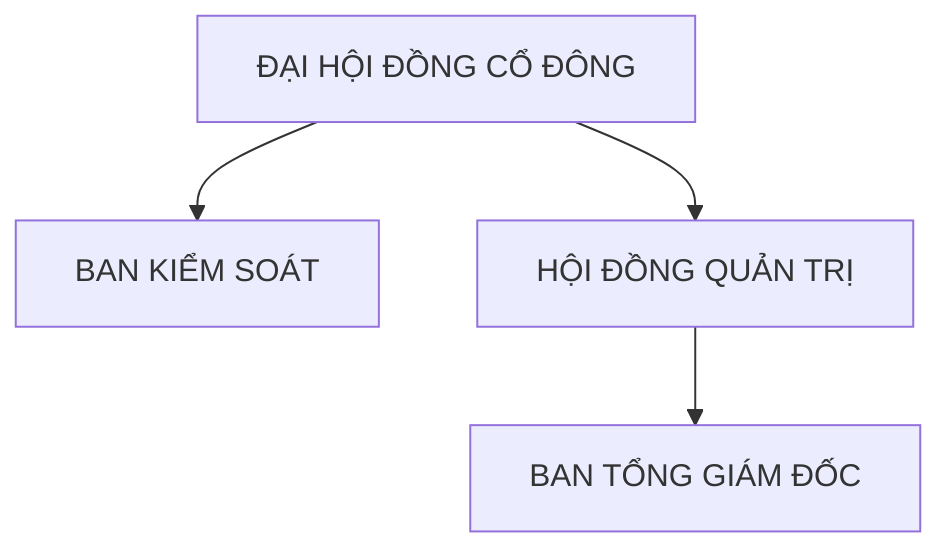
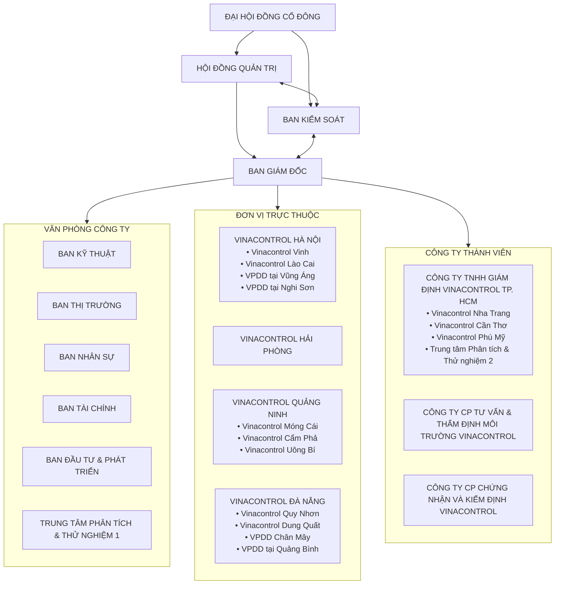

# CÔNG TY CỔ PHẦN TẬP ĐOÀN VINACONTROL
## BÁO CÁO THƯỜNG NIÊN 2025

---

### THÔNG TIN VĂN BẢN & PHÁP LÝ BÌA
- **Đơn vị ban hành:** CÔNG TY CỔ PHẦN TẬP ĐOÀN VINACONTROL
- **Mã số doanh nghiệp (M.S.D.N):** 0100107772
- **Địa chỉ:** Số 54 Trần Nhân Tông, Phường Nguyễn Du, Quận Hai Bà Trưng, Thành phố Hà Nội, Việt Nam
- **Người ký số:** PHAN VĂN HÙNG - Phó Tổng Giám Đốc
- **Thời gian ký:** 2026-04-09 13:17:17

---

# 1. THÔNG TIN CHUNG

## 1.1. THÔNG TIN KHÁI QUÁT

- **Tên đăng ký tiếng Việt:** CÔNG TY CỔ PHẦN TẬP ĐOÀN VINACONTROL
- **Tên đăng ký tiếng Anh:** VINACONTROL GROUP CORPORATION
- **Giấy chứng nhận đăng ký doanh nghiệp:**  
  Số 0100107772 do Sở Kế hoạch và Đầu tư TP. Hà Nội cấp lần đầu ngày 01/6/2005, đăng ký thay đổi lần thứ 13 ngày 26/8/2025
- **Vốn điều lệ:**  
  209.995.110.000 đồng
- **Vốn đầu tư của chủ sở hữu:**  
  331.376.403.507 đồng (tính đến 31/12/2025)
- **Trụ sở chính:**  
  Số 54 Trần Nhân Tông, phường Hai Bà Trưng, thành phố Hà Nội, Việt Nam  
  - Tel: 024.39439105; 024.39436011; 024.39433840  
  - Fax: 024.39433844  
  - Website: www.vinacontrol.com.vn
- **Mã cổ phiếu:** VNC

---

## 1.2. QUÁ TRÌNH HÌNH THÀNH VÀ PHÁT TRIỂN

### a. 60 năm xây dựng và phát triển
- **Ngày 24/10/1957:** Bộ trưởng Bộ Thương nghiệp ra Quyết định số 514/BTN-TCCB ngày 24/10/1957 thành lập Cục Kiểm nghiệm hàng hóa XNK trực thuộc Bộ Thương nghiệp (kiêm Sở Giám định hàng hóa XNK). Đây cũng chính là ngày thành lập Công ty và Vinacontrol trở thành công ty giám định có lịch sử phát triển lâu đời nhất của Việt Nam.
- **Ngày 16/7/1974:** Bộ trưởng Ngoại thương ra Quyết định số 513/BNgT-TCCB ngày 16/7/1974: tách Sở Giám định hàng hóa XNK ra khỏi Cục Kiểm nghiệm hàng hóa XNK và đổi tên thành Công ty Giám định hàng hóa XNK Việt Nam.
- **Ngày 12/11/1988:** Bộ trưởng Bộ Kinh tế đối ngoại ra Quyết định số 420/KTĐN-TCCB ngày 12/11/1988: Hợp nhất Công ty Giám định hàng hóa XNK và Cục Kiểm nghiệm hàng hóa XNK thành Công ty Giám định hàng hóa XNK Việt Nam.
- **Năm 2004 và 2005:** Bộ trưởng Bộ Thương mại ra Quyết định số 1758/2004/QĐ-BTM ngày 29/11/2004 và Quyết định số 1525/QĐ-BTM ngày 24/5/2005 chuyển Công ty Giám định hàng hóa XNK thành Công ty cổ phần Giám định Vinacontrol (Vinacontrol).
- **Ngày 23/5/2011:** Công ty cổ phần Giám định Vinacontrol chính thức đổi tên thành Công ty cổ phần Tập đoàn Vinacontrol.

### b. Niêm yết
- **Ngày 21/12/2006:** Công ty CP Tập đoàn Vinacontrol được Sở Giao dịch Chứng khoán Hà Nội (HNX) chấp thuận niêm yết với:
  - Loại cổ phiếu: Cổ phiếu phổ thông
  - Mã cổ phiếu: VNC
  - Mệnh giá cổ phần: 10.000 đồng
  - Khối lượng đăng ký giao dịch: 5.250.000 cổ phiếu.
- **Ngày 1/10/2007:** Công ty phát hành cổ phiếu tăng vốn điều lệ lên 78,75 tỷ đồng (theo Quyết định số 186/UBCK-GCN ngày 1/10/2007 của Ủy ban Chứng khoán Nhà nước), ngày 13/5/2008 số cổ phiếu phát hành thêm đã chính thức giao dịch trên sàn Hà Nội, đưa tổng số cổ phiếu giao dịch lên 7.875.000 cổ phiếu.
- **Tháng 7/2013:** Công ty phát hành cổ phiếu để tăng vốn cổ phần từ nguồn vốn chủ sở hữu, nâng số vốn điều lệ lên 104.999.550.000 đồng.
- **Tháng 6/2025:** Công ty phát hành cổ phiếu để tăng vốn cổ phần từ nguồn vốn chủ sở hữu, nâng số vốn điều lệ lên 209.995.110.000 đồng.
- Tổng số cổ phiếu giao dịch trên sàn tính đến 31/12/2025 là 20.999.112 cổ phiếu.

---

## 1.3. NGÀNH NGHỀ VÀ ĐỊA BÀN KINH DOANH

### a. Ngành nghề kinh doanh
- Giám định thương mại: Giám định quy cách, phẩm chất, tình trạng, số-khối lượng, bao bì, ký mã hiệu đối với mọi loại hàng hóa; Giám sát hàng hóa trong quá trình sản xuất, giao nhận, bảo quản, vận chuyển, xếp dỡ, giám sát quá trình lắp ráp thiết bị dây chuyền công nghệ; Thẩm định, tư vấn, giám sát công trình xây dựng; Giám định các phương tiện vận tải, container, các dịch vụ giám định về hàng hải; Giám định an toàn con tàu trước khi xếp hàng, phá dỡ hoặc sửa chữa; Giám định tổn thất; Đại lý giám định tổn thất, phân bổ tổn thất cho các công ty bảo hiểm trong và ngoài nước;
- Giám định/chứng nhận/thử nghiệm theo yêu cầu để cung cấp chứng từ phục vụ công tác quản lý của Nhà nước thuộc các lĩnh vực như: xuất xứ hàng hóa; quản lý chất lượng; an toàn, vệ sinh hàng hóa; nghiệm thu, quyết toán công trình đầu tư; bảo vệ môi trường; các dịch vụ phục vụ thông quan;
- Dịch vụ lấy mẫu, phân tích và thử nghiệm mẫu;
- Chứng nhận sản phẩm;
- Các dịch vụ có liên quan: Xông hơi khử trùng, thẩm định giá, giám định không phá hủy, kiểm tra kết cấu hàn các công trình, kiểm tra thiết bị và thiết bị đo lường, kiểm tra và lập bảng dung tích các loại bồn chứa, sà lan, kiểm đếm, niêm phong cặp chì, dịch vụ kiểm tra chất lượng hệ thống quản lý theo yêu cầu của khách hàng;
- Tư vấn, đánh giá, chứng nhận áp dụng hệ thống quản lý theo các tiêu chuẩn quốc tế; Tư vấn về chất lượng hàng hóa; Tư vấn và thẩm định môi trường;
- Dịch vụ kiểm định kỹ thuật an toàn lao động;
- Đo lường và lập bảng dung tích các phương tiện thủy; Hiệu chuẩn và kiểm định các thiết bị đo lường; và
- Các hoạt động khác theo Giấy chứng nhận đăng ký doanh nghiệp.

### b. Địa bàn kinh doanh
Công ty CP Tập đoàn Vinacontrol có Trụ sở chính đặt tại số 54 Trần Nhân Tông, phường Nguyễn Du, quận Hai Bà Trưng, Hà Nội; có các chi nhánh tại các thành phố lớn: Hà Nội, Hải Phòng, Quảng Ninh, Đà Nẵng và Tp. Hồ Chí Minh; các chi nhánh cấp 2, trạm, văn phòng đại diện tại: Lào Cai, Thanh Hóa, Móng Cái, Cửa Ông, Vinh, Hà Tĩnh, Quảng Bình, Quy Nhơn, Vũng Tàu, Cần Thơ …

---

## 1.4. MÔ HÌNH QUẢN TRỊ, CƠ CẤU BỘ MÁY QUẢN LÝ

### a. Mô hình quản trị

- Đại hội đồng cổ đông có thẩm quyền cao nhất Công ty.
- Ban kiểm soát do Đại hội đồng cổ đông bầu cử, gồm 03 thành viên.
- Hội đồng quản trị công ty do Đại hội đồng cổ đông bầu cử, gồm 07 thành viên.
- Ban Tổng Giám đốc Công ty: 01 Tổng Giám đốc, 01 Phó Tổng Giám đốc.

### b. Các công ty con, công ty liên kết

| STT | TÊN CÔNG TY | ĐỊA CHỈ | LĨNH VỰC KINH DOANH | TỶ LỆ VỐN GÓP |
| :---: | :--- | :--- | :--- | :---: |
| 1. | Công ty TNHH Giám định Vinacontrol Tp. Hồ Chí Minh | 80 Bà Huyện Thanh Quan, Q.3, Tp. Hồ Chí Minh | Giám định và phân tích các loại mặt hàng theo yêu cầu của khách hàng, các dịch vụ khác: hun trùng, thẩm định giá... | 100% |
| 2. | Công ty CP Tư vấn và Thẩm định môi trường Vinacontrol | 54 Trần Nhân Tông, Q. Hai Bà Trưng, Hà Nội | Tư vấn và thẩm định môi trường | 51% |
| 3. | Công ty CP Chứng nhận và Kiểm định Vinacontrol | 41 Nguyễn Thượng Hiền, Q. Hai Bà Trưng, Hà Nội | Chứng nhận và kiểm định sản phẩm, chứng nhận hệ thống quản lý chất lượng | 51% |
| 4. | Công ty CP Thẩm định giá Vinacontrol (*) | 54 Trần Nhân Tông, Q. Hai Bà Trưng, Hà Nội | Xác định giá trị các tài sản, giá trị doanh nghiệp, thẩm định giá, tư vấn các lĩnh vực liên quan đến giá... | 35% |

(*) Công ty đã thoái toàn bộ vốn, tương đương 35% vốn điều lệ tại Công ty CP Thẩm định giá Vinacontrol theo Nghị quyết của HĐQT số 165/NQ-HĐQT ngày 20/5/2025.

### c. Cơ cấu bộ máy quản lý

**Chi tiết hệ thống bộ máy:**
- **Văn phòng Công ty:**
  - Ban Kỹ thuật
  - Ban Thị trường
  - Ban Nhân sự
  - Ban Tài chính
  - Ban Đầu tư & Phát triển
  - Trung tâm Phân tích & Thử nghiệm 1
- **Đơn vị trực thuộc:**
  - **Vinacontrol Hà Nội:** Vinacontrol Vinh, Vinacontrol Lào Cai, VPDD tại Vũng Áng, VPDD tại Nghi Sơn
  - **Vinacontrol Hải Phòng**
  - **Vinacontrol Quảng Ninh:** Vinacontrol Móng Cái, Vinacontrol Cẩm Phả, Vinacontrol Uông Bí
  - **Vinacontrol Đà Nẵng:** Vinacontrol Quy Nhơn, Vinacontrol Dung Quất, VPDD Chân Mây, VPDD tại Quảng Bình
- **Công ty thành viên:**
  - **Công ty TNHH Giám định Vinacontrol TP. HCM:** Vinacontrol Nha Trang, Vinacontrol Cần Thơ, Vinacontrol Phú Mỹ, Trung tâm Phân tích & Thử nghiệm 2
  - **Công ty CP Tư vấn & Thẩm định môi trường Vinacontrol**
  - **Công ty CP Chứng nhận và Kiểm định Vinacontrol**

---

## 1.5. ĐỊNH HƯỚNG PHÁT TRIỂN

### a. Các mục tiêu phát triển của Công ty
+ Tiếp tục khẳng định vai trò là một trong những tổ chức giám định, kiểm định, chứng nhận và thẩm định hàng đầu Việt Nam.
+ Đảm bảo tốc độ tăng trưởng của Công ty trên các chỉ tiêu: Doanh thu tăng trưởng 2-3%/năm, tỷ lệ cổ tức tối thiểu từ 12%/năm, tổng lượng khách hàng phục vụ trong năm tăng 5%.
+ Ưu tiên đầu tư các dịch vụ phục vụ quản lý Nhà nước, dịch vụ đánh giá sự phù hợp trên cơ sở giữ vững mảng dịch vụ cốt lõi (dịch vụ giám định truyền thống).
+ Xây dựng Công ty vững mạnh về bộ máy tổ chức, nâng cao trình độ chuyên nghiệp về quản lý tài chính, kinh doanh và chất lượng phục vụ thông qua xây dựng và phát triển nguồn nhân lực có trình độ chuyên môn và đạo đức nghề nghiệp.
+ Phát huy mọi nguồn lực để nâng cao năng lực cạnh tranh và nâng cao đời sống vật chất, tinh thần cho người lao động.

### b. Chiến lược phát triển trung và dài hạn
+ Đa dạng hóa dịch vụ: chú trọng phát triển các dịch vụ mới, các dịch vụ quản lý nhà nước, các dịch vụ trọn gói.
+ Tập trung nâng cao chất lượng dịch vụ.
+ Hợp tác, liên danh, liên kết: Tìm kiếm các đối tác có tiềm lực tài chính, kinh nghiệm...để hợp tác đầu tư những lĩnh vực/thị trường Vinacontrol còn hạn chế và chưa vươn tới được.
+ Chiến lược phát triển nguồn nhân lực tập trung vào chất lượng nguồn nhân lực, không ngừng đào tạo/đào tạo lại tại chỗ, xây dựng đội ngũ kế thừa xứng tầm; bố trí công việc đúng người, đúng việc nhằm khai thác tối đa khả năng sáng tạo của người lao động; tạo môi trường làm việc chuyên nghiệp và thân thiện, đoàn kết, gắn bó, tập trung phát triển văn hóa doanh nghiệp.

### c. Các mục tiêu phát triển bền vững và chương trình chính liên quan đến ngắn hạn và trung hạn của Công ty
+ Hỗ trợ các Cơ quan QLNN quản lý chất lượng hàng hóa, tránh nhập về những hàng hóa kém chất lượng; ngăn ngừa thiệt hại cho doanh nghiệp, người tiêu dùng trong nước, hạn chế ảnh hưởng xấu đến môi trường…
+ Giám định chất lượng hàng hóa lưu thông trong nước, đúng giá trị, an toàn trong sử dụng, từ đó bảo vệ quyền lợi chính đáng của người tiêu dùng, bảo vệ sức khỏe của cộng đồng…

---

## 1.6. CÁC RỦI RO
- Do đặc thù dịch vụ của Công ty nên hoạt động xuất nhập khẩu có tác động sâu rộng tới hoạt động kinh doanh của Vinacontrol. Việc cấm xuất hay nhập một số mặt hàng sẽ ảnh hưởng trực tiếp tới doanh thu của Công ty.
- Các thay đổi trong chính sách QLNN đối với các mặt hàng nhập khẩu liên quan đến dịch vụ chứng nhận chất lượng tác động lớn đến doanh thu của Công ty.

---

# 2. TÌNH HÌNH HOẠT ĐỘNG TRONG NĂM

## 2.1. TÌNH HÌNH HOẠT ĐỘNG SẢN XUẤT KINH DOANH
*Xem phần 3.1*

---

## 2.2. TỔ CHỨC VÀ NHÂN SỰ

### a. Danh sách Ban điều hành

#### 1. Ông MAI TIẾN DŨNG - ỦY VIÊN HĐQT, TỔNG GIÁM ĐỐC
- **Sinh ngày:** 18/11/1964
- **Quê quán:** Nga Sơn, Thanh Hóa
- **Thường trú:** Căn hộ 2703, Khối A Tổ hợp chung cư cao tầng và dịch vụ N04, Khu đô thị Đông Nam Đường Trần Duy Hưng, Trung Hòa, Cầu Giấy, Hà Nội
- **Nơi công tác:** Công ty CP Tập đoàn Vinacontrol
- **Trình độ:** Đại học
- **Quá trình công tác:**
  - 3/1988 – 8/1994: Kiểm nghiệm viên Cục Kiểm nghiệm hàng hóa XNK và Giám định viên Công ty Giám định hàng hóa XNK
  - 9/1994 – 12/1995: Phó Giám đốc Vinacontrol Quảng Ninh
  - 1/1996 – 6/2003: Phó Trưởng phòng, Trưởng phòng KTTH Công ty Giám định hàng hóa XNK
  - 7/2003 – 5/2005: Phó Giám đốc Công ty Giám định hàng hóa XNK
  - 1/6/2005 – nay: Ủy viên HĐQT, Tổng Giám đốc Vinacontrol
  - Từ 11/2013: thôi giữ chức Chủ tịch HĐQT Công ty CP Tư vấn và Thẩm định môi trường Vinacontrol.
- **Tỷ lệ sở hữu cổ phần có quyền biểu quyết (đến 31/12/2025):** 119.244 cổ phiếu (0,57%)

#### 2. Ông PHAN VĂN HÙNG - ỦY VIÊN HĐQT, PHÓ TỔNG GIÁM ĐỐC
- **Sinh ngày:** 26/10/1965
- **Quê quán:** Xã Thanh Long, huyện Thanh Chương, tỉnh Nghệ An
- **Thường trú:** Khối 1, phường Lê Lợi, thành phố Vinh, Nghệ An
- **Nơi công tác:** Công ty CP Tập đoàn Vinacontrol
- **Trình độ:** Đại học
- **Quá trình công tác:**
  - 6/1990 – 1/1991: Cán bộ Ban Kinh tế đối ngoại tỉnh Nghệ Tĩnh
  - 2/1991 – 3/1992: Cán bộ Công ty Khai thác ILMENI xuất khẩu
  - 4/1992 – 3/1993: Cán bộ Trung tâm Giám định hàng hóa XNK Bắc miền Trung
  - 4/1993 – 7/1995: Phó GĐ Trung tâm Giám định hàng hóa XNK Bắc miền Trung
  - 8/1995 – 6/1996: Giám đốc Trung tâm Giám định hàng hóa XNK Bắc miền Trung
  - 7/1996 – 5/2005: Trạm trưởng Trạm Giám định hàng hóa XNK Nghệ An
  - 6/2005 – 8/2007: Giám đốc Chi nhánh Công ty CP Giám định Vinacontrol Vinh
  - 9/2007 – 9/2009: Phó Tổng Giám đốc Vinacontrol
  - 10/2009 – nay: Phó Tổng Giám đốc Vinacontrol kiêm Giám đốc Kỹ thuật
  - Từ 5/2013: thôi Giám đốc Kỹ thuật
- **Tỷ lệ sở hữu cổ phần có quyền biểu quyết (đến 31/12/2025):** 142.732 cổ phiếu (0,68%)

#### 3. Ông LƯU NGỌC HIỀN – KẾ TOÁN TRƯỞNG
- **Sinh ngày:** 14/2/1962
- **Quê quán:** Nam Hồng, Nam Trực, Nam Định
- **Thường trú:** Số 403, Nhà 34T, Khu Đô thị Trung Hòa Nhân Chính, Hà Nội
- **Nơi công tác:** Công ty CP Tập đoàn Vinacontrol
- **Trình độ:** Đại học
- **Quá trình công tác:**
  - 5/1987 – 3/1997: Chuyên viên Kế toán thuộc Vinacontrol Hà Nội
  - 4/1997 – 12/2004: Phó trưởng phòng Hành chính Kế toán - Vinacontrol Hà Nội
  - 1/2005 – 1/2008: Trưởng phòng Hành chính Kế toán thuộc Vinacontrol Hà Nội
  - 2/2008 – nay: Kế toán trưởng Công ty CP Tập đoàn Vinacontrol
- **Tỷ lệ sở hữu cổ phần có quyền biểu quyết (đến 31/12/2025):** 162.088 cổ phiếu (0,77%)

### b. Những thay đổi trong Ban Điều hành
Không

### c. Số lượng cán bộ, nhân viên
Số lượng cán bộ, nhân viên: 1.041 người (đến hết tháng 12/2025)

### d. Chính sách và thay đổi chính sách đối với người lao động
- Công ty luôn đảm bảo chế độ nâng lương, nâng ngạch theo quy định; giải đáp/tư vấn về chế độ chính sách cho người lao động kịp thời và chính xác làm cho người lao động trong Tập đoàn thật sự yên tâm công tác. Luôn đảm bảo thực hiện và đầy đủ đúng theo quy định các chế độ bảo hiểm xã hội, y tế, thất nghiệp và đảm bảo hài hòa lợi ích giữa người lao động và người sử dụng lao động.
- Công ty luôn tạo môi trường làm việc tốt từ đầu tư cơ sở vật chất, phương tiện làm việc đến tạo môi trường làm việc trong đó đề cao tinh thần đoàn kết, phối hợp, tương trợ lẫn nhau. Ban Lãnh đạo Tập đoàn luôn chú trọng xây dựng và phát triển văn hóa Vinacontrol đến từng cán bộ, giám định viên.
- Công tác thi đua khen thưởng được thực hiện kịp thời, chính xác và công minh, góp phần khuyến khích động viên người lao động thi đua công tác.

---

## 2.3. TÌNH HÌNH ĐẦU TƯ, THỰC HIỆN CÁC DỰ ÁN

Tất cả các khoản đầu tư, mua sắm tài sản và thiết bị thử nghiệm của Vinacontrol đều được thực hiện đúng theo các Quy chế của Hội đồng quản trị và quy định của Điều lệ Công ty.

### a. Các khoản đầu tư lớn
Năm 2025, Vinacontrol đã đầu tư mua sắm máy móc thiết bị phục vụ công tác phân tích thử nghiệm hơn 16 tỷ đồng bằng vốn tự có, cụ thể như sau:
- Văn Phòng Tập đoàn: 3,53 tỷ đồng
- Vinacontrol Hà Nội: 0,49 tỷ đồng
- Vinacontrol Hải Phòng: 0,18 tỷ đồng
- Vinacontrol Quảng Ninh: 5,23 tỷ đồng
- Vinacontrol Đà Nẵng: 0,78 tỷ đồng
- Vinacontrol Tp. HCM: 3,60 tỷ đồng
- Vinacontrol Chứng nhận: 2,26 tỷ đồng

### b. Các công ty con, công ty liên kết

- **Công ty CP Tư vấn và Thẩm định môi trường Vinacontrol:**
  - Vinacontrol góp vốn đến 31/12/2025 là: 1.530.000.000 đồng
  - Công ty được thành lập năm 2008
  - Kết quả kinh doanh năm 2025:
    - Tổng doanh thu: 8.740.949.570 đồng
    - Lợi nhuận trước thuế: 202.043.560 đồng

- **Công ty CP Chứng nhận và Kiểm định Vinacontrol:**
  - Vinacontrol góp vốn đến 31/12/2025 là: 2.550.000 đồng
  - Công ty được thành lập năm 2010
  - Kết quả kinh doanh năm 2025:
    - Tổng doanh thu: 124.252.425.806 đồng
    - Lợi nhuận trước thuế: 18.490.487.953 đồng

- **Công ty TNHH Giám định Vinacontrol TP. Hồ Chí Minh:**
  - Kết quả kinh doanh năm 2025:
    - Tổng doanh thu: 426.530.103.115 đồng
    - Lợi nhuận trước thuế: 33.599.205.361 đồng

---

## 2.4. TÌNH HÌNH TÀI CHÍNH

### a. Các chỉ tiêu tài chính chủ yếu

| Các chỉ tiêu | Năm 2025 | Năm 2024 | Đơn vị | Ghi chú |
| :--- | :---: | :---: | :---: | :---: |
| **1. Chỉ tiêu về khả năng thanh toán** | | | | |
| + Hệ số thanh toán ngắn hạn: TSLĐ/Nợ ngắn hạn | 1.99 | 2.10 | Lần | MS100/MS310 |
| + Hệ số thanh toán nhanh: (TSLĐ - Hàng tồn kho) / Nợ ngắn hạn | 1.98 | 2.09 | Lần | MS100-MS140 / MS310 |
| **2. Chỉ tiêu về cơ cấu vốn** | | | | |
| + Hệ số nợ/Tổng tài sản | 37.04 | 30.80 | % | MS300/MS270 |
| + Hệ số nợ/Vốn chủ sở hữu | 58.84 | 44.51 | % | MS300/MS410 |
| **3. Chỉ tiêu về năng lực hoạt động** | | | | |
| + Vòng quay hàng tồn kho: Giá vốn hàng bán / Hàng tồn kho bình quân | 371.69 | 167.99 | Lần | MS11 / MS140 |
| + Doanh thu thuần/Tổng tài sản | 2.30 | 1.99 | Lần | MS10/MS270 |
| **4. Chỉ tiêu về khả năng sinh lời** | | | | |
| + Hệ số Lợi nhuận sau thuế/Doanh thu thuần (ROS) | 7.77 | 4.43 | % | MS60/MS10 |
| + Hệ số Lợi nhuận sau thuế/Vốn chủ sở hữu (ROE) | 25.10 | 12.98 | % | MS60/MS400 |
| + Hệ số Lợi nhuận sau thuế/Tổng tài sản (ROA) | 15.80 | 8.98 | % | MS60/MS270 |
| + Hệ số Lợi nhuận từ hoạt động kinh doanh/Doanh thu thuần | 9.84 | 5.67 | % | MS30/MS10 |

### b. Tình hình tài chính

- **Tình hình tài sản:**  
  Tổng tài sản 526,4 tỷ đồng tăng so với năm 2024 là 30,07%. Cùng với việc kiểm soát tốt các chi phí đầu vào góp phần giữ cho các chỉ số khả năng sinh lời: Lợi nhuận sau thuế/Vốn chủ sở hữu (ROE) và Lợi nhuận sau thuế/Tổng tài sản (ROA) lần lượt là 25,1% và 15,8%. Nguồn vốn đầu tư của các cổ đông vào Vinacontrol luôn được bảo toàn và phát triển. Đời sống của người lao động và môi trường làm việc được cải thiện, người lao động ngày càng thêm gắn bó với Vinacontrol.

- **Tình hình nợ phải trả, phải thu:**  
  Tổng nợ phải trả của Công ty được cấu thành từ nợ ngắn hạn và nợ dài hạn, chủ yếu là nợ ngắn hạn phải trả người lao động và thuế nộp Nhà nước.  
  Phần lớn các khoản công nợ phải thu khách hàng chủ yếu là khoản phải thu ngắn hạn, còn các khoản nợ phải thu quá hạn đã được Vinacontrol tính tuổi nợ và trích lập dự phòng 100% theo đúng quy định.

---

## 2.5. CƠ CẤU CỔ ĐÔNG, THAY ĐỔI VỐN ĐẦU TƯ CỦA CHỦ SỞ HỮU

### a. Cổ phần
- Tổng số cổ phần: 20.999.511 CP
- Loại cổ phần: cổ phần phổ thông
- Số lượng cổ phần chuyển nhượng tự do: 20.999.112 CP
- Số lượng cổ phần bị hạn chế chuyển nhượng theo quy định của Pháp luật, Điều lệ Công ty hoặc cam kết của người sở hữu: 399 CP (CP loại 2 – CK chuyển nhượng có điều kiện).

### b. Cơ cấu cổ đông
*(Tính tới thời điểm 24/9/2025 - Ngày đăng ký cuối cùng để thực hiện quyền nhận cổ tức tạm ứng năm 2025)*

| Phân loại | Số lượng cổ đông | Số CP sở hữu | Tỷ lệ |
| :--- | :---: | :---: | :---: |
| **TỔNG SỐ** | **1.158** | **20.999.112** | **100,00%** |
| **CP Quỹ** | **1** | **399** | **0,0019%** |
| *Trong đó* | | | |
| Cổ đông VN | 1.128 | 20.453.402 | 97,40% |
| Cổ đông nước ngoài | 30 | 545.710 | 2.60% |
| *Trong đó* | | | |
| Cổ đông cá nhân | 1.142 | 14.842.518 | 70,68% |
| Cổ đông tổ chức | 16 | 6.156.594 | 29,32% |
| *Trong đó* | | | |
| Cổ đông nhà nước | 0 | - | - |
| Cổ đông khác | 0 | - | - |
| *Trong đó: Cổ đông lớn* | | | |
| - Công ty TNHH DOHA Đầu tư | 1 | 5.056.800 | 24,08% |
| - Bà Đỗ Vân Anh | 1 | 1.785.066 | 8,50% |
| - Ông Bùi Duy Chinh | 1 | 1.900.722 | 9,06% |
| - Bà Nguyễn Thị Thùy Ngân | 1 | 1.464.694 | 6,99% |

*(Ghi chú: theo Danh sách tổng hợp người sở hữu chứng khoán số VNDVCAVSDV005625/VSDVNCXX của Tổng Công ty Lưu ký và Bù trừ chứng khoán Việt Nam chốt ngày 24/09/2025).*

### c. Tình hình thay đổi vốn đầu tư của chủ sở hữu
Công văn số 1009/QĐ-SGDHN ngày 19/8/2025 của Sở giao dịch Chứng khoán Hà Nội về việc chấp thuận niêm yết bổ sung cổ phiếu Công ty CPTĐ Vinacontrol, cụ thể:
- **Tên chứng khoán:** Cổ phiếu CTPT Tập đoàn Vinacontrol;
- **Loại cổ phiếu:** Cổ phiếu phổ thông
- **Mã cổ phiếu:** VNC
- **Mệnh giá:** 10.000 đồng/cổ phiếu
- **Hình thức phát hành:** phát hành cổ phiếu để tăng vốn cổ phần từ nguồn vốn chủ sở hữu
- **Số lượng chứng khoán đăng ký niêm yết bổ sung:** 10.499.556 cổ phiếu (Mười triệu, bốn trăm chín mươi chín nghìn, năm trăm năm mươi sáu cổ phiếu)
- **Giá trị chứng khoán đăng ký niêm yết bổ sung (theo mệnh giá):** 104.995.560.000 đồng (Một trăm linh tư tỷ, chín trăm chín mươi lăm triệu, năm trăm sáu mươi nghìn đồng)
- **Tổng số lượng cổ phiếu niêm yết:** 20.999.511 cổ phiếu (Hai mươi triệu chín trăm chín mươi chín nghìn năm trăm mười một cổ phiếu)
- **Tổng giá trị cổ phiếu niêm yết (theo mệnh giá):** 209.995.110.000 đồng (Hai trăm linh chín tỷ chín trăm chín mươi lăm triệu một trăm mười nghìn đồng).

### d. Giao dịch cổ phiếu quỹ
Không

### e. Các chứng khoán khác
Không

---

## 2.6. BÁO CÁO TÁC ĐỘNG LIÊN QUAN ĐẾN MÔI TRƯỜNG VÀ XÃ HỘI CỦA CÔNG TY

### a. Tác động lên môi trường
- Tổng phát thải khí nhà kính (GHG) trực tiếp và gián tiếp: Không có
- Các sáng kiến và biện pháp giảm thiểu phát thải khí nhà kính: Không

### b. Tiêu thụ năng lượng
- Năng lượng tiết kiệm được thông qua các sáng kiến sử dụng năng lượng hiệu quả: Không
- Các báo cáo sáng kiến tiết kiệm năng lượng: Không

### c. Tiêu thụ nước
- Tỷ lệ phần trăm và tổng lượng nước tái chế và tái sử dụng: Không

### d. Tuân thủ pháp luật về bảo vệ môi trường
- Số lần bị xử phạt do không tuân thủ luật pháp và các quy định về môi trường: Không
- Tổng số tiền do bị xử phạt vi phạm do không tuân thủ luật pháp và các quy định về môi trường: 0 đồng

### e. Chính sách liên quan đến người lao động
- **Số lượng lao động:** 1.041 người (đến 31/12/2025).
- **Chính sách lao động nhằm đảm bảo sức khỏe, an toàn và phúc lợi của người lao động:**
  - Hàng năm, người lao động được trang bị đầy đủ phương tiện bảo hộ lao động theo tính chất công việc, đào tạo an toàn lao động nhằm đảm bảo an toàn, vệ sinh lao động theo quy định Pháp luật;
  - Hàng năm, Công ty tổ chức khám sức khoẻ định kỳ cho người lao động;
  - Công ty luôn đảm bảo chế độ bảo hiểm xã hội, thai sản đầy đủ cho người lao động theo quy định của pháp luật;
  - Xây dựng tổ chức công đoàn độc lập, vững mạnh để đảm bảo quyền và lợi ích hợp pháp của người lao động;
  - Quy định chi tiết về ngày làm thêm được hưởng lương, được nghỉ bù cho người lao động;
  - Quy định đầy đủ về tổng kết và khen thưởng hàng năm đối với người lao động.
- **Chế độ phúc lợi khác:**
  - Chế độ nghỉ mát hàng năm, 01 lần trong năm với tối đa 05 ngày liên tiếp;
  - Hỗ trợ tiền ăn trưa, xăng xe, điện thoại, đồng phục hàng năm cho người lao động;
  - Phúc lợi liên quan tới chúc mừng sinh nhật, hiếu hỷ, các ngày lễ trong năm, đám hoặc phẫu thuật, điều trị bệnh; Tri ân cán bộ nghỉ hưu, viếng thân nhân cán bộ nhân viên (gồm cán bộ nhân viên đã nghỉ hưu và đang công tác);
  - Xây dựng quỹ nghĩa tình giám định hỗ trợ các trường hợp cán bộ nhân viên gặp khó khăn trong cuộc sống.
- **Hoạt động đào tạo người lao động:**
  Với một Công ty luôn xem chất lượng là hàng đầu, con người là nhân tố quan trọng nhất quyết định sự thành công của Công ty thì công tác đào tạo cũng luôn được coi trọng. Hàng năm, các Đơn vị liên tục tổ chức các lớp đào tạo, đa dạng về loại hình, phong phú về hình thức nhằm mục đích nâng cao năng lực của CBNV, từ đó tăng hiệu suất lao động. Hệ thống tài liệu hướng dẫn liên quan tới công tác đào tạo cũng rất phong phú và đầy đủ: Quy chế đào tạo, quy trình đào tạo, hướng dẫn công việc về việc lập và triển khai các lớp đào tạo…

### f. Báo cáo liên quan đến trách nhiệm đối với cộng đồng địa phương
Các hoạt động đầu tư cộng đồng và hoạt động phát triển cộng đồng khác, bao gồm hỗ trợ tài chính nhằm phục vụ cộng đồng:
- Thi đua lập thành tích chào mừng 68 năm thành lập Tập đoàn Vinacontrol (2025);
- Tổ chức các hoạt động, cuộc thi chào mừng 68 năm thành lập Tập đoàn Vinacontrol như: Ngày hội kết nối Vinacontrol và Giải chạy kết nối Vinacontrol lần thứ 7 (2025);
- Tổ chức hoạt động tương tác - minigame trực tuyến “Khám phá điều hay – Rinh quà về tay” từ ngày 14/10 đến hết 24/10/2025 trên hai kênh Fanpage Facebook và Zalo Official Account (OA) của Vinacontrol Group nhằm tri ân cộng đồng người theo dõi;
- Trong năm 2025, Quỹ Nghĩa tình giám định Vinacontrol đã phát hỗ trợ được cho 13 trường hợp cán bộ nhân viên Vinacontrol gặp đau ốm, hoạn nạn, v.v….;
- Ngày 8/9/2025, trong khuôn khổ Lễ tiếp nhận Chương trình vận động ủng hộ nhân dân Cuba “65 năm nghĩa tình Việt Nam – Cuba” do Trung ương Hội Chữ thập đỏ Việt Nam tổ chức, Tập đoàn Vinacontrol đã trân trọng trao gửi 100.000.000 VNĐ để chuyển tặng nhân dân Cộng hòa Cuba. Riêng Vinacontrol TP. Hồ Chí Minh ủng hộ nhân dân Cuba 175.890.000 VNĐ;
- Trong năm 2025, Tập đoàn Vinacontrol đã ủng hộ đồng bào miền Trung, Tây Nguyên 50.000.000 VNĐ;
- Vinacontrol Đà Nẵng trong năm 2025 tổ chức công tác thiện nguyện tại 2 địa điểm:
  + Tại xã Bình Điền (Huế) tặng áo ấm và quà cho 200 em nhỏ (trị giá 26 triệu VNĐ);
  + Tại Đà Nẵng tặng 20 phần quà gồm bánh và tiền mặt (trị giá 10 triệu VNĐ) cho học sinh nghèo vượt khó của trường Nguyễn Du thuộc phường Hòa Cường (Địa phương đặt VP Chi nhánh).

### g. Báo cáo liên quan đến hoạt động thị trường vốn xanh theo hướng dẫn của UBCKNN
Không có

---

# 3. BÁO CÁO VÀ ĐÁNH GIÁ CỦA BAN GIÁM ĐỐC

## 3.1. ĐÁNH GIÁ KẾT QUẢ HOẠT ĐỘNG SẢN XUẤT KINH DOANH

Năm 2025, Công ty cổ phần Tập đoàn Vinacontrol (Tập đoàn) vượt mốc doanh thu 1.000 tỷ đồng, đạt 1.070 tỷ đồng, tăng 30,45% so với cùng kỳ năm trước. Tổng lợi nhuận sau thuế hợp nhất đạt 83,17 tỷ đồng, bằng 228,80% so với năm 2024 (theo số liệu Báo cáo tài chính hợp nhất đã kiểm toán năm 2025).

### Các chỉ tiêu kết quả kinh doanh của Vinacontrol trên Báo cáo tài chính hợp nhất đã kiểm toán năm 2025

| STT | Chỉ tiêu | 2025 (đồng) Đã kiểm toán | 2024 (đồng) Đã kiểm toán | 2025/2024 (%) |
| :---: | :--- | :---: | :---: | :---: |
| 1. | Tổng giá trị tài sản | 526.365.388.404 | 404.684.504.478 | 130,07% |
| 2. | Doanh thu thuần về cung cấp dịch vụ (hợp nhất) | 1.070.298.728.872 | 820.483.069.668 | 130,45% |
| 3. | Lợi nhuận thuần từ hoạt động kinh doanh (hợp nhất) | 105.306.082.960 | 46.571.955.388 | 226,11% |
| 4. | Lợi nhuận khác | (710.198.167) | (604.610.027) | - |
| 5. | Tổng lợi nhuận kế toán trước thuế (hợp nhất) | 104.595.884.793 | 45.967.345.361 | 227,54% |
| 6. | Lợi nhuận sau thuế (hợp nhất) | 83.172.768.022 | 36.352.326.990 | 228,80% |

Trong đó, tình hình hoạt động kinh doanh của các Đơn vị cụ thể như sau:
- **Công ty TNHH Giám định Vinacontrol Thành phố Hồ Chí Minh:** Năm 2025 đạt doanh thu 426,53 tỷ đồng, đóng góp gần 40% tổng doanh thu toàn Tập đoàn. So với năm 2024, doanh thu từ nhóm Dây chuyền sản xuất, Máy móc thiết bị tăng trưởng mạnh 37,4%; Điều thô tiếp tục là một trong những mặt hàng chiếm tỷ trọng lớn, với mức tăng trưởng 28,8%; đặc biệt dịch vụ Kiểm nghiệm sầu riêng xuất khẩu mang lại doanh thu gần 80 tỷ đồng, đóng góp tích cực vào kết quả tăng trưởng của Công ty.
- **Vinacontrol Hà Nội:** Đứng đầu về tỷ lệ tăng trưởng là Vinacontrol Hà Nội với doanh thu đạt 90,36 tỷ đồng, bằng 137,1% so với năm 2024. Năm 2025, Vincontrol Hà Nội tập trung khai thác các loại hình dịch vụ mới, có tiềm năng cao như: Giám định máy móc thiết bị, dây chuyền công nghệ cao trong các dự án đầu tư (QĐ29), Kiểm định thiết bị y tế, Kiểm kê khí nhà kính… trong đó nhóm Dây chuyền sản xuất, Máy móc thiết bị của Đơn vị đạt 22 tỷ đồng, bằng 208% so với năm 2024.
- **Vinacontrol Hải Phòng:** Cơ cấu mặt hàng của Vinacontrol Hải Phòng rất đa dạng, tuy nhiên Đơn vị tập trung vào khai thác hiệu quả nhóm mặt hàng/dịch vụ chủ lực phục vụ Quản lý Nhà nước như: Máy móc thiết bị, phế liệu, phân bón, sắt thép và LPG… Năm 2025, nhóm dịch vụ chứng nhận và kiểm tra Nhà nước đóng góp 48,96% trên tổng doanh thu Đơn vị, trong đó Phế liệu tiếp tục giữ vai trò mũi nhọn, đạt tốc độ tăng trưởng tích cực và tính ổn định cao. Doanh thu năm 2025 của Vinacontrol Hải Phòng đạt 114,33 tỷ đồng, bằng 118,6% so với cùng kỳ năm trước.
- **Vinacontrol Quảng Ninh:** Năm 2025, Vinacontrol Quảng Ninh thực hiện tái cơ cấu tổ chức theo phương án đã được Hội đồng Quản trị phê duyệt. Đơn vị đã thực hiện quản lý nhân sự hiệu quả, đảm bảo nhân lực tham gia các dự án đấu thầu, chi phí thuê nhân lực/doanh thu giảm 0,41% so với năm 2024. Các gói thầu giám định Than cho nhà máy nhiệt điện tiếp tục chiếm tỷ trọng lớn trong cơ cấu doanh thu của Đơn vị, đạt 34,73 tỷ đồng trên tổng doanh thu 81,29 tỷ đồng. Bên cạnh mặt hàng Dăm gỗ có sự sụt giảm do nguồn nguyên liệu và tính cạnh tranh (đạt 20,84 tỷ đồng, bằng 83,8% năm 2024), nhóm các mặt hàng có sự tăng trưởng rõ rệt so với năm 2024 (đạt 145,5%) là Thạch cao, Clinker, Xi măng và Quặng các loại.
- **Vinacontrol Đà Nẵng:** Dăm gỗ tiếp tục là mặt hàng chủ lực của Vinacontrol Đà Nẵng, chiếm hơn 70% tổng doanh thu với thị phần giám định ngày càng được mở rộng. Một số khách hàng chủ chốt của Chi nhánh có sản lượng mua rất tốt như Liansheng, Primewood, Homewealth, các khách hàng truyền thống, ổn định từ thị trường Nhật Bản như OCM, Itochu… Đặc biệt trong năm 2025, Ban Lãnh đạo Đơn vị cũng đã tiếp xúc và thành công khai thác được dịch vụ giám định một số tàu dăm gỗ bán cho Chenming, một khách hàng đã nhiều năm không sử dụng dịch vụ của Vinacontrol. Dịch vụ cung cấp thuốc và vật tư, thiết bị khử trùng cũng như rải baking soda khử mùi cho các tàu dăm gỗ cũng tăng mạnh trong năm, đạt 28 tỷ đồng. Doanh thu năm 2025 của Vinacontrol Đà Nẵng đạt 154,9 tỷ đồng, bằng 111,2% so với năm 2024.
- **Các công ty con:** Hai công ty con là Công ty CP Chứng nhận và Kiểm định Vinacontrol và Công ty CP Tư vấn và Thẩm định môi trường Vinacontrol đạt mức doanh thu tích cực trong năm 2025, lần lượt là 124,32 và 8,74 tỷ đồng, đóng góp 12,39% trên tổng doanh thu toàn Tập đoàn.

---

## 3.2. CÔNG TÁC QUẢN LÝ, ĐIỀU HÀNH NĂM 2025

### a. Bộ máy tổ chức, nhân sự
- Thoái toàn bộ cổ phần tương đương 35% vốn điều lệ tại Công ty CP Thẩm định giá Vinacontrol.
- Kiện toàn các tài liệu tổ chức đáp ứng Hệ thống quản lý chất lượng ISO/IEC 17029, ISO 14064 và 14065.
- Sắp xếp lại bộ máy tổ chức của Vinacontrol Quảng Ninh.
- Tập trung hoàn thiện đội ngũ nhân sự phù hợp đáp ứng các dịch vụ mới đang triển khai (kiểm kê KNK, kiểm toán năng lượng…)
- Kiện toàn công tác quản trị nhân sự và đảm bảo tính pháp lý cao theo các quy định/HĐCV sửa đổi/ban hành mới (Bổ nhiệm cán bộ; Quản lý GĐV; Tuyển dụng và ký HĐLĐ; Thi chức danh, tìm kiếm và lựa chọn, giữ các nhân sự chủ chốt/nhân sự kỹ thuật cao) nhằm đảm bảo sự thống nhất và đồng bộ trong toàn ngành.

### b. Phát triển thị trường

- **Thị trường trong nước:**
  + Hoạt động marketing tiếp tục được quan tâm, đầu tư mạnh theo định hướng phát triển đa kênh, đa nền tảng, lấy lợi ích của khách hàng làm trung tâm. Các chuyên gia Vinacontrol tham gia chia sẻ, tư vấn, giải đáp chuyên môn trên các trang tin và diễn đàn uy tín như Heritage, Vietnam Investment Review, Vietnamnet, Hội thảo đào tạo về Tiêu chuẩn xanh EU và thị trường carbon, Hội nghị quốc tế ngành Điều Việt Nam… qua đó khẳng định vị thế của Tập đoàn trong các lĩnh vực.
  + Tăng cường mở rộng quan hệ với các cơ quan quản lý, hiệp hội và đối tác để nâng cao khả năng tiếp cận thông tin về xu hướng tiêu chuẩn kỹ thuật và nhu cầu thị trường. Tổng lượng khách hàng phục vụ toàn Tập đoàn trong năm 2025 tăng 9,25% so với cùng kỳ năm trước.
  + Hoạt động đấu thầu tiếp tục là kênh quan trọng để mở rộng thị trường, tạo nguồn doanh thu ổn định và khẳng định uy tín, năng lực của Tập đoàn. Trong năm 2025, Vinacontrol đã tham gia 183 gói thầu, chào hàng và chào giá dịch vụ, trong đó 143 gói trúng thầu, với tổng trị giá 83,9 tỷ đồng, bằng 111% so với năm 2024.

- **Thị trường quốc tế:**
  + Tại thị trường quốc tế, Tập đoàn xúc tiến hợp tác với nhiều đối tác mới tại các quốc gia Trung Quốc, Hàn Quốc, Anh và Mỹ… mở ra cơ hội phát triển dịch vụ thử nghiệm, chứng nhận, tư vấn, thẩm định và đánh giá trong các lĩnh vực như quản lý năng lượng, chuỗi cung ứng thực phẩm, khí nhà kính và phát triển bền vững.
  + Các hoạt động hợp tác quốc tế không chỉ góp phần nâng cao năng lực chuyên môn và tiếp cận công nghệ mới, mà còn tạo nền tảng để Vinacontrol từng bước mở rộng hoạt động ra các thị trường ngoài lãnh thổ Việt Nam trung và dài hạn.

### c. Công tác kỹ thuật nghiệp vụ và phát triển dịch vụ mới
- Duy trì các quyết định chỉ định của cơ quan Quản lý Nhà nước đối với tổ chức đánh giá sự phù hợp.
- Chuẩn hóa công tác kỹ thuật và nghiệp vụ: Rà soát, cập nhật và thống nhất hệ thống các quy trình, hướng dẫn kỹ thuật và biểu mẫu nghiệp vụ, đảm bảo áp dụng đồng bộ tại các Đơn vị thành viên.
- Xây dựng tổ chức thẩm tra, thẩm định khí nhà kính theo ISO ISO/IEC 17029, ISO 17064 và 14065, mô hình tổ chức Ban tư vấn dịch vụ môi trường (Thực hiện đánh giá công nhận lần đầu).
- Định hướng phát triển dịch vụ kỹ thuật mới, đặc biệt là các lĩnh vực liên quan đến môi trường, khí nhà kính, ESG, CBAM và đánh giá sự phù hợp theo chuẩn mực quốc tế.

### d. Nâng cao năng lực, mở rộng thị trường dịch vụ thử nghiệm
Năm 2025, Vinacontrol đã có sự quan tâm đầu tư mạnh mẽ đối với các dự án đầu tư máy móc thiết bị nhằm tăng cường hàm lượng kỹ thuật công nghệ trong dịch vụ. Trong đó, các phòng thí nghiệm không chỉ được quan tâm thúc đẩy đầu tư củng cố năng lực và chất lượng dịch vụ mà còn khởi động nhiều dự án hợp tác tìm kiếm nguồn lực từ bên ngoài.  
Đặc biệt, trong năm 2025, hoạt động kiểm nghiệm sầu riêng xuất khẩu đã mang lại doanh thu đột biến cho Vinacontrol với hơn 145 tỷ đồng, trong đó doanh thu của Trung tâm PT&TN1 và Trung tâm PT&TN2 lần lượt là 65 tỷ đồng và 80 tỷ đồng. Trong bối cảnh số lượng phòng thử nghiệm được Tổng cục Hải quan Trung Quốc công nhận đối với các chỉ tiêu Cadimi và Vàng O còn hạn chế, việc Vinacontrol được công nhận năng lực thử nghiệm các chỉ tiêu này đã tạo ra lợi thế quan trọng trong cung cấp dịch vụ đối với hàng hóa xuất khẩu sang thị trường Trung Quốc.

### e. Hoạt động đầu tư phát triển
Tất cả các khoản đầu tư, mua sắm tài sản và thiết bị thử nghiệm của Vinacontrol đều được thực hiện đúng theo các Quy chế của Hội đồng quản trị và quy định của Điều lệ Công ty. Năm 2025, Vinacontrol đã đầu tư mua sắm máy móc thiết bị phục vụ công tác phân tích thử nghiệm hơn 16 tỷ đồng bằng vốn tự có, cụ thể như sau:
- Văn phòng Tập đoàn: 3,53 tỷ đồng
- Vinacontrol Hà Nội: 0,49 tỷ đồng
- Vinacontrol Hải Phòng: 0,18 tỷ đồng
- Vinacontrol Quảng Ninh: 5,23 tỷ đồng
- Vinacontrol Đà Nẵng: 0,78 tỷ đồng
- Vinacontrol Tp. Hồ Chí Minh: 3,60 tỷ đồng
- Công ty CP Chứng nhận và Kiểm định Vinacontrol: 2,26 tỷ đồng

---

## 3.3. KẾ HOẠCH VÀ PHƯƠNG HƯỚNG HOẠT ĐỘNG NĂM 2026

Năm 2026, Vinacontrol tập trung vào xây dựng và thực hiện các nhiệm vụ sau:

### a. Công tác thị trường
Năm 2026 là năm bản lề để tái cấu trúc công tác thị trường của Vinacontrol, với định hướng phát triển thị trường theo chiều sâu và hiệu quả. Bên cạnh việc liên tục củng cố, cải tiến các hoạt động đang triển khai và có hiệu quả tốt, Vinacontrol tập trung vào 03 trụ cột chiến lược để tạo động lực phát triển mới, nâng cao năng lực nội tại và gia tăng hiệu quả vận hành toàn hệ thống. Cụ thể là: **Số hóa toàn diện, Chuyển đổi xanh và Tối ưu hiệu suất**. Để hiện thực hóa định hướng trên, trong năm 2026, Vinacontrol đề ra các giải pháp, nhiệm vụ cụ thể:
- Tăng cường chăm sóc khách hàng hiện hữu, khách hàng lớn và chiến lược; đồng thời phát triển khách hàng mới thông qua hệ sinh thái đối tác, đấu thầu và các hoạt động phát triển thị trường;
- Nâng cao hiệu quả hoạt động đấu thầu, tập trung vào các dự án quy mô lớn, trọng điểm và có tính ổn định dài hạn;
- Tổ chức lại danh mục dịch vụ hiện có và mới thành các gói giải pháp tổng thể có lộ trình và cho từng ngành hàng, lĩnh vực của khách hàng;
- Tiếp tục đầu tư vào công tác nghiên cứu, phát triển dịch vụ mới xoay quanh các chủ đề về Khí nhà kính (GHG); Phát triển bền vững (ESG); Logistics và quản lý chuỗi cung ứng (LSCM); Quản lý năng lượng, nông sản xanh…
- Thúc đẩy hợp tác quốc tế theo hướng linh hoạt (liên doanh, liên kết, M&A, white-label), từng bước mở rộng thị trường nước ngoài;
- Đẩy mạnh Chuyển đổi số toàn diện dòng chảy Marketing - Kinh doanh - Chăm sóc khách hàng; lấy khách hàng làm trung tâm, ứng dụng AI và dữ liệu lớn để nâng cao trải nghiệm khách hàng, tối ưu hiệu quả kinh doanh và doanh thu, củng cố lợi thế cạnh tranh dài hạn.

### b. Công tác kỹ thuật nghiệp vụ và quản lý hệ thống các phòng thử nghiệm

- **Kỹ thuật nghiệp vụ:**
  + Duy trì, cải tiến hệ thống quản lý chất lượng, đảm bảo đáp ứng các yêu cầu của các tiêu chuẩn HTCL tương ứng; Tuân thủ và hướng dẫn thực hiện theo các quy trình quản lý, các quy trình/phương pháp và các văn bản pháp quy của cơ quan quản lý Nhà nước.
  + Phối hợp với các Đơn vị nghiên cứu, phát triển các dịch vụ mới.

- **Quản lý hệ thống các phòng thử nghiệm:**
  + Tiếp tục tập trung đầu tư/mở rộng cơ sở vật chất và năng lực thiết bị phân tích thử nghiệm tại các Đơn vị, đặc biệt ưu tiên đầu tư tại 02 Trung tâm phân tích thử nghiệm khu vực phía Bắc và phía Nam để hỗ trợ cho hoạt động chung.

### c. Quản trị, nhân sự
- Tập trung hoàn thiện đội ngũ nhân sự ở 05 mảng dịch vụ: Nhân sự đáp ứng Nghị định 107 về hoạt động giám định; Nhân sự đáp ứng Nghị định Quy định chi tiết một số điều và biện pháp thi hành Luật tiêu chuẩn và quy chuẩn kỹ thuật (đang dự thảo); Nhân sự Kiểm tra nhà nước; Nhân sự dịch vụ mới và Nhân sự chủ chốt tham gia công tác thầu.
- Chính sách đãi ngộ cho đội ngũ nhân sự chất lượng cao và nhân sự phục vụ các Dự án/Hợp đồng trọng điểm/quy mô lớn.
- Tăng cường rà soát và kiện toàn hệ thống quản trị nhân sự nội bộ nhằm đảm bảo tính pháp lý và hiệu quả, tính đồng bộ và thống nhất để sẵn sàng cho việc áp dụng chuyển đổi số.

### d. Công tác tài chính, kế toán
Liên tục cập nhật các nghiệp vụ kinh tế phát sinh kịp thời, chính xác; lập các báo cáo tài chính định kỳ và theo yêu cầu của cổ đông và Hội đồng quản trị. Ngoài ra, năm 2026, công tác tài chính, kế toán cần thực hiện những nhiệm vụ sau:
- Hỗ trợ kiểm soát công tác tài chính của các Đơn vị và công ty con kịp thời, sát sao.
- Định kỳ đánh giá tài chính doanh nghiệp tại các Đơn vị trực thuộc.
- Tăng cường rà soát, kiểm tra công nợ tại các Đơn vị và toàn Tập đoàn.

### e. Công tác đầu tư, phát triển
- Ưu tiên đầu tư có trọng tâm, trọng điểm, tập trung vào các dự án nâng cao năng lực giám định, thử nghiệm, đáp ứng yêu cầu của các cơ quan quản lý Nhà nước.
- Chuẩn hóa quy trình lập, thẩm định và phê duyệt dự án đầu tư, đảm bảo bám sát nhu cầu thực tế.
- Tăng cường phối hợp, giám sát và kiểm soát rủi ro trong quá trình triển khai đầu tư, đảm bảo tiến độ, tuân thủ quy định và sử dụng hiệu quả các nguồn vốn.
- Hoàn thiện cơ chế theo dõi và đánh giá hiệu quả sau đầu tư, các Đơn vị lập báo cáo định kỳ về hiệu suất khai thác, hiệu quả kinh tế và chất lượng dịch vụ của các dự án đã triển khai.

---

## 3.4. GIẢI TRÌNH CỦA BAN GIÁM ĐỐC ĐỐI VỚI Ý KIẾN KIỂM TOÁN
Không

---

## 3.5. BÁO CÁO ĐÁNH GIÁ LIÊN QUAN ĐẾN TRÁCH NHIỆM VỀ MÔI TRƯỜNG VÀ XÃ HỘI CỦA CÔNG TY
Các chính sách về đảm bảo sức khỏe, an toàn và môi trường lao động (HSE) tiếp tục được Công ty duy trì thông qua các hình thức/biện pháp:
- Thực hiện Kaizen 5S vệ sinh điều kiện môi trường làm việc/phòng thử nghiệm tại các Đơn vị toàn Công ty.
- Tổ chức khám sức khỏe định kỳ cho người lao động toàn Công ty.
- Cung cấp trang thiết bị dụng cụ/phương tiện bảo hộ cá nhân tại hiện trường/phòng thử nghiệm, trang bị dụng cụ phòng chống cháy nổ/hỏa hoạn.

---

# 4. ĐÁNH GIÁ CỦA HỘI ĐỒNG QUẢN TRỊ VỀ HOẠT ĐỘNG CỦA CÔNG TY

## 4.1. ĐÁNH GIÁ CỦA HỘI ĐỒNG QUẢN TRỊ VỀ CÁC MẶT HOẠT ĐỘNG CỦA CÔNG TY, TRONG ĐÓ CÓ ĐÁNH GIÁ LIÊN QUAN ĐẾN TRÁCH NHIỆM MÔI TRƯỜNG VÀ XÃ HỘI

### a. Tình hình thực hiện các chỉ tiêu cơ bản
Trong bối cảnh nền kinh tế khởi sắc, hoạt động của Vinacontrol gặp nhiều thuận lợi vì các hoạt động của Công ty phụ thuộc rất lớn vào hoạt động XNK. Các giá trị thực dần được tôn trọng. Chất lượng, an toàn hàng hóa sản phẩm ngày càng được Nhà nước và người dân quan tâm. Công tác giám định, chứng nhận, kiểm tra an toàn, chất lượng ngày càng được coi trọng nên các loại hình dịch vụ của Vinacontrol có nhiều cơ hội phát triển.

Tuy nhiên, hoạt động của Vinacontrol đã vấp phải một số những khó khăn nhất định. Sự cạnh tranh gay gắt đến từ các tổ chức giám định tư nhân/quốc tế, các đơn vị trực thuộc Bộ ngành và các Chi cục kiểm định hải quan khu vực. Áp lực cạnh tranh quyết liệt giá phí, chiêu trò của nhiều tổ chức giám định, đặc biệt là với các dự án đấu thầu công khai. Tuy nhiên, với nỗ lực vượt khó, sáng tạo, tận dụng cơ hội, các Đơn vị Vinacontrol đã nghiên cứu triển khai và tiếp cận được nhiều lĩnh vực mới tiềm năng như chứng nhận Nông nghiệp hữu cơ, kiểm định trang thiết bị Y tế, kiểm kê khí nhà kính, chứng nhận quản lý rừng bền vững…

Kết thúc năm 2025, toàn Tập đoàn đã hoàn thành vượt mức kế hoạch Đại hội cổ đông giao, tiếp tục đánh dấu một năm thành công của Tập đoàn Vinacontrol trên chặng đường phát triển 68 năm của mình. Cổ tức năm 2025 đã tạm ứng: 6%/vốn điều lệ;

Để hoàn thành được các nhiệm vụ kinh doanh được giao trên, HĐQT và Ban điều hành đã luôn kiên trì theo đuổi định hướng nâng cao chất lượng dịch vụ giữ vững các mảng dịch vụ truyền thống. Đồng thời tập trung đầu tư nguồn lực đặc biệt là đầu tư trang thiết bị phân tích thử nghiệm nâng cao năng lực kỹ thuật tại các Đơn vị phục vụ cho hoạt động giám định/chứng nhận chung, các dịch vụ có hàm lượng kỹ thuật cao và theo yêu cầu của cơ quan Quản lý Nhà nước. Chính vì vậy, trong những năm gần đây, Công ty vẫn giữ vững tốc độ tăng trưởng và đạt được những thành tích nổi bật về mọi mặt, đồng thời đáp ứng tốt các yêu cầu của nhiều Bộ, ngành trong dịch vụ giám định/chứng nhận phục vụ các cơ quan quản lý Nhà nước. Thương hiệu Vinacontrol tiếp tục được khẳng định tại thị trường trong nước và quốc tế, trở thành thương hiệu có uy tín đối với các đối tác, cơ quan Quản lý Nhà nước, các khách hàng trong và ngoài nước.

### b. Công tác lao động, tiền lương, chế độ và chính sách
Công ty luôn đảm bảo chế độ nâng lương, nâng ngạch theo quy định; giải đáp/tư vấn về chế độ chính sách cho người lao động kịp thời và chính xác làm cho người lao động trong Công ty thật sự yên tâm công tác. Luôn đảm bảo thực hiện và đầy đủ đúng theo quy định các chế độ bảo hiểm xã hội, y tế, thất nghiệp và đảm bảo hài hòa lợi ích giữa người lao động và người sử dụng lao động.

Năm 2025, Công ty tiếp tục áp dụng các công cụ quản trị tiên tiến vào công tác quản lý và thực hiện công việc: Các Quy định về chuyên môn các hướng dẫn công việc liên quan (hướng dẫn tuyển dụng, ký Hợp đồng lao động; công tác tự đào tạo; quản lý giám định viên; Thi và công nhận chức danh chuyên môn nghiệp vụ) tuân thủ theo đúng quy định Pháp luật, nội dung ngày càng hoàn thiện cùng với các quy định/hướng dẫn cụ thể đã phát huy hiệu quả công tác chuyên môn và gắn với lợi ích người lao động, là động lực khuyến khích đội ngũ cán bộ/giám định viên hoàn thành tốt công việc..

Công ty luôn tạo môi trường làm việc tốt từ đầu tư cơ sở vật chất, phương tiện làm việc đến tạo môi trường làm việc trong đó đề cao tinh thần đoàn kết, phối hợp, tương trợ lẫn nhau. Ban Lãnh đạo luôn chú trọng xây dựng và phát triển văn hóa Vinacontrol đến từng cán bộ, giám định viên.

Công tác thi đua khen thưởng được thực hiện kịp thời, chính xác và công minh, góp phần khuyến khích động viên người lao động thi đua công tác.

### c. Hoạt động của các tổ chức Đoàn thể và thực hiện công tác an sinh xã hội
Công ty và Công đoàn Vinacontrol tại các địa phương tích cực tham gia các hoạt động thể hiện trách nhiệm xã hội và phát triển cộng đồng, tiêu biểu như:
- Thi đua lập thành tích chào mừng 68 năm thành lập Tập đoàn Vinacontrol (2025).
- Tổ chức các hoạt động, cuộc thi chào mừng 68 năm thành lập Tập đoàn Vinacontrol như: Ngày hội kết nối Vinacontrol và Giải chạy kết nối Vinacontrol lần thứ 7 (2025);
- Tổ chức hoạt động tương tác - minigame trực tuyến “Khám phá điều hay – Rinh quà về tay” từ ngày 14/10 đến hết 24/10/2025 trên hai kênh Fanpage Facebook và Zalo Official Account (OA) của Vinacontrol Group nhằm tri ân cộng đồng người theo dõi.
- Trong năm 2025, quỹ Nghĩa tình giám định Vinacontrol đã phát hỗ trợ được cho 13 trường hợp cán bộ nhân viên Vinacontrol gặp đau ốm, hoạn nạn, v.v….
- Ngày 8/9/2025, trong khuôn khổ Lễ tiếp nhận Chương trình vận động ủng hộ nhân dân Cuba “65 năm nghĩa tình Việt Nam – Cuba” do Trung ương Hội Chữ thập đỏ Việt Nam tổ chức, Tập đoàn Vinacontrol đã trân trọng trao gửi 100.000.000 VNĐ để chuyển tặng nhân dân Cộng hòa Cuba. Riêng Vinacontrol TP. Hồ Chí Minh ủng hộ nhân dân Cuba 175.890.000 VNĐ
- Trong năm 2025, Tập đoàn Vinacontrol đã ủng hộ đồng bào miền Trung, Tây Nguyên 50.000.000 VNĐ.
- Vinacontrol Đà Nẵng trong năm 2025 tổ chức công tác thiện nguyện tại 2 địa điểm:
  + Tại xã Bình Điền Huế tặng áo ấm và quà cho 200 em nhỏ (trị giá 26 triệu VNĐ).
  + Tại Đà Nẵng tặng 20 phần quà gồm bánh và tiền mặt (trị giá 10 triệu VNĐ) cho học sinh nghèo vượt khó của trường Nguyễn Du thuộc phường Hòa Cường (Địa phương đặt VP Chi nhánh)

---

## 4.2. ĐÁNH GIÁ CỦA HỘI ĐỒNG QUẢN TRỊ VỀ HOẠT ĐỘNG CỦA BAN GIÁM ĐỐC CÔNG TY

Ban Tổng Giám đốc đã triển khai thực hiện tốt các Nghị quyết, Quyết định của ĐHĐCĐ, HĐQT, đồng thời thường xuyên tổ chức các cuộc họp giữa lãnh đạo các đơn vị trong Công ty, các trưởng Ban/Phòng để xử lý, tháo gỡ, kịp thời giải quyết những khó khăn và đề ra các phương án khắc phục, cũng như các định hướng và quyết định kịp thời.

Năm 2025, những thay đổi trong chính sách của cơ quan Quản lý Nhà nước đối với một số mặt hàng một số mặt hàng/lĩnh vực giám định/chứng nhận và sự cạnh tranh quyết liệt của các tổ chức giám định đã ảnh hưởng rất lớn đến hoạt động kinh doanh của Vinacontrol. Tuy vậy, với sự chỉ đạo đúng đắn kịp thời của ban lãnh đạo và sự cố gắng của toàn thể cán bộ nhân viên Vinacontrol, Tập đoàn đã vượt qua khó khăn và thách thức để vượt chỉ tiêu đã đề ra.

---

## 4.3. CÁC KẾ HOẠCH, ĐỊNH HƯỚNG CỦA HĐQT

### 4.3.1. Định hướng đầu tư và phát triển
- Đầu tư sâu vào các loại hình dịch vụ/mặt hàng truyền thống đang có thế mạnh. Phát triển các dịch vụ thay thế, dịch vụ bổ sung, dịch vụ gia tăng để tạo thành các gói dịch vụ hoàn chỉnh cho khách hàng.
- Đầu tư vào năng lực kỹ thuật/trang thiết bị phân tích thử nghiệm một số lĩnh vực/mặt hàng trọng điểm, đang là thế mạnh và còn có xu hướng phát triển trong tương lai như than nhập khẩu, viên nén gỗ xuất khẩu, gạo, nông sản, thủy sản, thực phẩm, sản phẩm nội thất gỗ).
- Đầu tư vào năng lực của phòng thí nghiệm, đóng gói, thương mại hóa dịch vụ từ các năng lực đã phát triển được; chia sẻ mở rộng phạm vi các đơn vị trong Tập đoàn có thể cùng khai thác và làm cơ sở cho các dịch vụ giám định, chứng nhận, kiểm định, dịch vụ nghiên cứu và phát triển (dịch vụ phòng sạch; kiểm định, hiệu chuẩn thiết bị; tư vấn xây dựng phòng thí nghiệm; kiểm tra hiệu suất năng lượng đối với các mặt hàng thiết bị; dầu nhớt, lốp ô tô; máy tính điện thoại…)
- Phát triển các loại hình dịch vụ chứng nhận sản phẩm, chứng nhận hệ thống quản lý, kiểm định an toàn, kiểm định chất lượng để tạo thành gói dịch vụ hoàn chỉnh và tận dụng nguồn khách hàng sẵn có.
- Nghiên cứu, cập nhật những xu hướng mới của những mặt hàng mới có khả năng thay thế cho những mặt hàng hiện có trên thị trường hoặc các mặt hàng dự kiến sẽ nhập khẩu vào Việt Nam để đầu tư đón đầu
- Tiếp tục tập trung nguồn lực đăng ký pháp nhân Tập đoàn về một số lĩnh vực kiểm tra Nhà nước liên quan Phân tích thử nghiệm, hoạt động giám định chất lượng nhằm nâng cao năng lực chung toàn Tập đoàn.

### 4.3.2. Định hướng truyền thông, quảng bá, khai thác, hợp tác
- Đẩy mạnh công tác truyền thông đến Khách hàng để quảng bá thương hiệu Vinacontrol. Nghiên cứu thành lập văn phòng đại diện tại khu vực trong và ngoài nước.
- Tăng cường các nguồn lực & công tác kết nối/liên kết với các Tổng Công ty/Tập đoàn lớn/các Bộ ban ngành Quản lý Nhà nước nhằm khai thác có hiệu quả các Dự án lớn, phát triển/đăng ký chỉ định pháp nhân Tập đoàn/đơn vị các dịch vụ/loại hình mặt hàng mới.
- Bám sát các quy định của các cơ quan quản lý nhà nước nhằm có kế hoạch chuẩn bị nguồn lực cũng như phát triển dịch vụ và thị trường mới.
- Đẩy mạnh các hoạt động hợp tác quốc tế, khai thác nguồn khách hàng nước ngoài.
- Tiếp tục phát triển khách hàng/thị trường thông qua hoạt động đấu thầu.
- Tìm kiếm cơ hội và tham gia các dự án nghiên cứu cùng các trường đại học, các tổ chức phi lợi nhuận, hiệp hội, cơ quan quản lý để quảng bá, phát triển dịch vụ, nâng cao vị thế của Vinacontrol.

### 4.3.3. Định hướng công tác điều hành và quản trị doanh nghiệp
- Hoàn thiện cơ cấu tổ chức, bộ máy gọn nhẹ, sử dụng nguồn nhân lực hiệu quả, nhằm tạo điều kiện thực sự cho các đơn vị chủ động trong kinh doanh, tăng cường công tác kiểm soát, phối kết hợp và hỗ trợ chặt chẽ giữa Công ty mẹ và các Đơn vị thành viên để nâng cao hiệu quả hoạt động của toàn Công ty. Tạo ra bước ngoặt trong cách quản lý của công ty trên con đường định hướng phát triển thành Tập đoàn mạnh.
- Thống nhất các quy trình cung cấp dịch vụ/đồng nhất giá phí thực hiện tại các đơn vị trong Vinacontrol sẽ tạo ra sự tin cậy, thuận tiện và cung cấp chất lượng dịch vụ chuyên nghiệp đến khách hàng.
- Phát huy sức mạnh tổng thể thông qua việc hợp tác chia sẻ năng lực giữa các đơn vị tạo nhiều cơ hội về doanh thu, thị trường cho nhiều đơn vị.
- Tăng cường hợp tác nội bộ, nghiên cứu cung cấp cho khách hàng dịch vụ trọn gói giám định/phân tích/thẩm định/chứng nhận & tư vấn trọn gói và phát triển dịch vụ mới có liên quan đến mảng dịch vụ cốt lõi của Vinacontrol.
- Triển khai thực hiện công tác chuyển đổi số tiến tới số hóa toàn bộ quy trình quản lý công tác chuyên môn trong toàn Vinacontrol. Làm nền tảng và sức bật cho mọi hoạt động kinh doanh của Vinacontrol.
- Hoàn thiện Hệ thống Quy chế Quản trị nội bộ cho phù hợp theo tình hình mới và đặc thù Vinacontrol. Triển khai áp dụng khoa học công nghệ, công nghệ thông tin vào công tác quản trị nội bộ.
- Phối hợp cùng Ban kiểm soát tăng cường công tác kiểm tra, giám sát các mặt hoạt động của Công ty nhằm phát huy tối đa hiệu quả đồng vốn đầu tư của các cổ đông đảm bảo độ an toàn về mặt tài chính, minh bạch hóa các hoạt động theo đúng quy định.
- Bảo toàn và sử dụng hiệu quả nguồn vốn, tăng cường công tác về quản trị tài chính, tái cấu trúc nguồn vốn hoạt động để phục vụ cho mục tiêu/định hướng phát triển của Công ty. Xây dựng/kiểm soát Ngân sách hàng năm, trích lập quỹ dự phòng, giảm thiểu công nợ, thắt chặt kiểm soát chi phí.
- Chú trọng công tác thi đua khen thưởng, tiếp tục duy trì và phát triển văn hóa Vinacontrol một cách sâu rộng đến toàn thể cán bộ nhân viên toàn Công ty, là nền tảng của phát triển và thành công.
- Quan tâm, chia sẻ và bảo vệ quyền lợi hợp pháp tối đa của các cổ đông cũng như quyền, lợi ích của người lao động trong Công ty.

---

# 5. QUẢN TRỊ CÔNG TY

## 5.1. HỘI ĐỒNG QUẢN TRỊ

### a. Thành viên và cơ cấu của Hội đồng Quản trị

| STT | Thành viên HĐQT | Chức vụ | Tỷ lệ sở hữu CP có quyền biểu quyết | SL chức danh TV HĐQT nắm giữ tại các Công ty khác |
| :---: | :--- | :--- | :---: | :--- |
| 1 | Ông Bùi Duy Chinh | Chủ tịch HĐQT | 1.900.722 (9,05%) | |
| 2 | Ông Mai Tiến Dũng | Ủy viên HĐQT | 119.244 (0,57%) | |
| 3 | Ông Phan Văn Hùng | Ủy viên HĐQT | 142.732 (0,68%) | |
| 4 | Bà Dương Thanh Huyền | Ủy viên HĐQT | 0 | |
| 5 | Ông Phạm Ngọc Dũng | Ủy viên HĐQT | 882.590 (4,2%) | Chủ tịch HĐTV Công ty TNHH Giám định Vinacontrol TP. Hồ Chí Minh |
| 6 | Ông Lê Ngọc Lợi | Ủy viên HĐQT | 291.976 (1,39%) | Tổng Giám đốc Công ty TNHH Giám định Vinacontrol TP. Hồ Chí Minh |
| 7 | Ông Phùng Tấn Phú | Ủy viên HĐQT | 468.098 (2,23%) | |

*(Ghi chú: Các công ty khác là công ty con, công ty liên danh, liên kết của Vinacontrol)*

### b. Các tiểu ban thuộc Hội đồng Quản trị
Không thành lập các Tiểu ban

### c. Hoạt động của Hội đồng Quản trị
Trong năm 2025, Hội đồng Quản trị Công ty đã có những hoạch định, quyết định thực hiện các mục tiêu phát triển bền vững và đưa ra các chỉ đạo ứng phó kịp thời với các thay đổi đến từ quản lý Nhà nước và biến động của môi trường ngành.  
Hội đồng quản trị gồm 07 thành viên: Chủ tịch HĐQT, 02 ủy viên HĐQT kiêm nhiệm chức danh trong Ban Tổng giám đốc (Ông Mai Tiến Dũng, Ủy viên HĐQT kiêm Tổng giám đốc, Ông Phan Văn Hùng, Ủy viên HĐQT kiêm Phó Tổng Giám đốc), 01 uỷ viên thường trực HĐQT và 03 uỷ viên nắm giữ chức vụ quản lý tại các Chi nhánh, Công ty con.

#### Bảng tham dự các cuộc họp Hội đồng Quản trị

| STT | Thành viên HĐQT | Chức vụ | Số buổi họp tham dự | Tỷ lệ | Lý do không tham dự |
| :---: | :--- | :--- | :---: | :---: | :---: |
| 1 | Ông Bùi Duy Chinh | Chủ tịch HĐQT | 5/5 | 100% | |
| 2 | Ông Mai Tiến Dũng | Ủy viên HĐQT | 5/5 | 100% | |
| 3 | Ông Phan Văn Hùng | Ủy viên HĐQT | 5/5 | 100% | |
| 4 | Bà Dương Thanh Huyền | Ủy viên HĐQT | 5/5 | 100% | |
| 5 | Ông Phạm Ngọc Dũng | Ủy viên HĐQT | 5/5 | 100% | |
| 6 | Ông Lê Ngọc Lợi | Ủy viên HĐQT | 5/5 | 100% | |
| 7 | Ông Phùng Tấn Phú | Ủy viên HĐQT | 5/5 | 100% | |

Trong năm 2025, Hội đồng quản trị đã đưa ra các Nghị quyết/Quyết định, cụ thể như sau:

| STT | Số Nghị quyết/ Quyết định | Ngày | Nội dung |
| :---: | :--- | :---: | :--- |
| 1. | 034/NQ-HĐQT | 11/02/2025 | Họp thường kỳ lần 1: Thông báo kết quả kinh doanh và định hướng hoạt động 2025 cùng các nội dung khác |
| 2. | 042/NQ-HĐQT | 13/02/2025 | Chốt thời gian và địa điểm tổ chức đại hội đồng cổ đông năm 2025 |
| 3. | 096/QĐ-HĐQT | 06/05/2025 | Ban hành quy chế nội bộ quản trị công ty 2024-2026 |
| 4. | 097/QĐ-HĐQT | 06/05/2025 | Ban hành quy chế hoạt động của HĐQT 2024-2026 |
| 5. | 165/NQ-HĐQT | 20/05/2025 | Chuyển nhượng vốn tại Công ty CP Thẩm định giá Vinacontrol |
| 6. | 166/QĐ-HĐQT | 22/05/2025 | Bổ nhiệm kế toán trưởng Công ty CP Tập đoàn Vinacontrol |
| 7. | 168/NQ-HĐQT | 23/05/2025 | Triển khai phương án phát hành cổ phiếu để tăng vốn cổ phần từ nguồn vốn chủ sở hữu |
| 8. | 170/NQ-HĐQT | 28/05/2025 | Họp thường kỳ lần 2 Thông qua kết quả kinh doanh 04 tháng đầu năm, triển khai thực hiện Nghị quyết ĐHĐCĐ 2025 và một số nội dung khác |
| 9. | 223/NQ-HĐQT | 10/06/2025 | Chi trả cổ tức còn lại năm 2024 bằng tiền mặt và chốt danh sách cổ đông nhận cổ phiếu phát hành do thực hiện tăng vốn cổ phần từ nguồn vốn chủ sở hữu |
| 10. | 291/NQ-HĐQT | 27/08/2025 | Họp thường kỳ lần 3 Thông qua báo cáo kết quả kinh doanh 7 tháng đầu năm 2025 Đánh giá kết quả thực hiện 7 tháng và dự kiến kế hoạch kinh doanh năm 2025 và các nội dung khác |
| 11. | 292/NQ-HĐQT | 27/08/2025 | Tạm ứng cổ tức năm 2025 bằng tiền mặt |
| 12. | 355/HĐQT-QĐ | 28/11/2025 | Họp thường kỳ lần 4: Thông qua kết quả kinh doanh 10 tháng đầu năm 2025 Đánh giá kết quả thực hiện 10 tháng và dự kiến thực hiện năm 2025 và các nội dung khác |

### d. Hoạt động của thành viên Hội đồng Quản trị độc lập
*(Báo cáo không có nội dung phát sinh)*

### e. Danh sách các thành viên Hội đồng Quản trị có chứng chỉ đào tạo về quản trị Công ty. Danh sách các thành viên Hội đồng Quản trị tham gia các chương trình về quản trị Công ty trong năm.

- **Danh sách các thành viên HĐQT có chứng chỉ đào tạo về quản trị Công ty:**
  | STT | Thành viên HĐQT |
  | :---: | :--- |
  | 1 | Ông Bùi Duy Chinh |
  | 2 | Ông Mai Tiến Dũng |
  | 3 | Ông Phan Văn Hùng |

- **Danh sách các thành viên HĐQT tham gia các chương trình về quản trị Công ty trong năm:** Không có

---

## 5.2. BAN KIỂM SOÁT

### a. Thành viên và cơ cấu của Ban Kiểm soát (BKS)

| Danh sách BKS | Số CP sở hữu có quyền biểu quyết (đến 31/12/2025) |
| :--- | :---: |
| 1- Trưởng ban: Bà Nguyễn Thị Thủy Ngân | 1.464.694 |
| 2- Thành viên: Ông Nguyễn Quốc Minh | 52.454 |
| 3- Thành viên: Ông Cao Quý Lân | 0 |

### b. Hoạt động của Ban Kiểm soát
- Tiến hành họp 04 lần với sự tham gia đầy đủ các thành viên, trước thời gian tham gia các kỳ họp định kỳ của Hội đồng quản trị, nội dung: xem xét, thảo luận và thống nhất ý kiến đóng góp tại cuộc họp, đánh giá hoạt động của Công ty theo chức năng, nhiệm vụ đã được quy định.
- Thực hiện việc kiểm tra, giám sát tại Đơn vị trực thuộc và Văn phòng Công ty.
- Tham dự đầy đủ các cuộc họp định kỳ của Hội đồng quản trị; ghi nhận tình hình hoạt động của các đơn vị và tham gia đóng góp ý kiến về hoạt động kinh doanh, quản trị và đầu tư phát triển Công ty.
- Theo dõi việc thực hiện phân phối lợi nhuận năm 2024.
- Lựa chọn Công ty kiểm toán độc lập cho năm tài chính 2025.
- BKS tham dự họp tổng kết công tác năm 2024 và triển khai nhiệm vụ năm 2025 của Công ty.
- Thẩm định tính đầy đủ, hợp pháp và trung thực của Báo cáo tình hình kinh doanh, Báo cáo tài chính, Báo cáo đánh giá công tác quản lý của Hội đồng quản trị Công ty.
- Trong quá trình thực thi nhiệm vụ, các thành viên BKS dù ở phân tán, nhưng vẫn duy trì thường xuyên, kịp thời việc trao đổi thông tin; một trong số ba thành viên đang giữ các chức vụ quản lý tại các đơn vị thành viên của Công ty, tham gia vào hoạt động kinh doanh của đơn vị nên có điều kiện trao đổi, góp ý trực tiếp với lãnh đạo đơn vị các vấn đề về điều hành và giám sát việc thực hiện nghị quyết của HĐQT, các quy chế, quy định do Hội đồng quản trị, Tổng Giám đốc Công ty ban hành. BKS được tạo điều kiện thuận lợi để thực hiện và hoàn thành nhiệm vụ do cổ đông giao cho.

---

## 5.3. CÁC GIAO DỊCH, THÙ LAO, CÁC KHOẢN LỢI ÍCH

### a. Lương, thưởng, thù lao và các khoản lợi ích năm 2025
*(Theo số liệu Báo cáo tài chính hợp nhất đã kiểm toán năm 2025)*

| Tên | Chức vụ | Thu nhập (đồng) |
| :--- | :--- | :---: |
| Ông Bùi Duy Chinh | Chủ tịch HĐQT | 3.379.159.270 |
| Ông Mai Tiến Dũng | Tổng Giám đốc/ Thành viên HĐQT | 3.193.261.713 |
| Ông Phan Văn Hùng | Phó Tổng Giám đốc/ Thành viên HĐQT | 3.000.764.158 |
| Bà Dương Thanh Huyền | Thành viên HĐQT | 1.425.983.708 |
| Ông Phạm Ngọc Dũng | Thành viên HĐQT | 129.777.778 |
| Ông Lê Ngọc Lợi | Thành viên HĐQT | 129.777.778 |
| Ông Phùng Tấn Phú | Thành viên HĐQT | 2.470.020.963 |
| Bà Nguyễn Thị Thuỷ Ngân | Trưởng BKS | 367.036.199 |
| Ông Cao Quý Lân | Thành viên BKS | 84.000.000 |
| Ông Nguyễn Quốc Minh | Thành viên BKS | 84.000.000 |
| **TỔNG CỘNG** | | **14.263.781.567** |

### b. Giao dịch cổ phiếu của cổ đông nội bộ
Không

### c. Hợp đồng hoặc giao dịch với cổ đông nội bộ
Không

### d. Việc thực hiện các quy định về quản trị Công ty
Công ty luôn thực hiện đúng/đầy đủ các quy định trong Quy chế Quản trị Công ty (được xây dựng theo quy định của Luật Doanh nghiệp, Luật Chứng khoán, Thông tư số 116/2020/TT-BTC ngày 31 tháng 12 năm 2020 quy định về Quản trị Công ty áp dụng cho các công ty đại chúng, các văn bản hướng dẫn và vận dụng những thông lệ quốc tế tốt nhất về quản trị Công ty phù hợp với điều kiện Việt Nam và thực tế doanh nghiệp).
