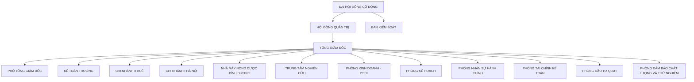

# BÁO CÁO THƯỜNG NIÊN NĂM 2025

**Phụ lục IV**  
**BÁO CÁO THƯỜNG NIÊN**  
*(Ban hành kèm theo Thông tư số 96/2020/TT-BTC ngày 16 tháng 11 năm 2020 của Bộ trưởng Bộ Tài chính)*

**CÔNG TY CỔ PHẦN THUỐC SÁT TRÙNG VIỆT NAM**  
**Số: 02/BCQT**  
**CỘNG HÒA XÃ HỘI CHỦ NGHĨA VIỆT NAM**  
**Độc lập - Tự do - Hạnh phúc**  
*Tp Hồ Chí Minh, ngày 23 tháng 03 năm 2026*

---

# BÁO CÁO
### Thường niên năm 2025

**Kính gửi:**
- Uỷ ban Chứng khoán Nhà nước;
- Sở Giao dịch chứng khoán Thành phố Hồ Chí Minh.

---

## I. Thông tin chung

### 1. Thông tin khái quát
- **Tên giao dịch:** Công ty cổ phần Thuốc sát trùng Việt Nam
- **Tên viết tắt:** VIPESCO
- **Giấy chứng nhận đăng ký doanh nghiệp số:** 0300408946 do Sở Kế hoạch và Đầu tư thành phố Hồ Chí Minh cấp ngày 11/05/2006, đăng ký thay đổi lần thứ 10 ngày 26/01/2022.
- **Vốn điều lệ:** 244.607.920.000 đồng *(Hai trăm bốn mươi bốn tỷ, sáu trăm lẻ bảy triệu, chín trăm hai mươi ngàn đồng)*.
- **Vốn đầu tư của chủ sở hữu:** 244.607.920.000 đồng *(Hai trăm bốn mươi bốn tỷ, sáu trăm lẻ bảy triệu, chín trăm hai mươi ngàn đồng)*.
- **Địa chỉ:** 102 Nguyễn Đình Chiểu, phường Tân Định, Thành phố Hồ Chí Minh
- **Website:** www.vipesco.com.vn
- **Mã cổ phiếu:** VPS

#### Quá trình hình thành và phát triển
- **Quá trình hình thành và phát triển:** Công ty cổ phần Thuốc sát trùng Việt Nam (VIPESCO) tự hào là nhà sản xuất nông dược uy tín, gắn bó lâu dài cùng sự phát triển của nền nông nghiệp nước nhà với lịch sử phát triển 50 năm qua.

Được thành lập vào năm 1976, Công ty cổ phần Thuốc sát trùng Việt Nam có tên gọi ban đầu là Công ty Thuốc sát trùng Miền Nam, trên cơ sở hợp nhất các nhà máy, xí nghiệp sản xuất thuốc BVTV tại Miền Nam có từ trước giải phóng.

Đến năm 1990 Công ty được đổi tên thành CÔNG TY THUỐC SÁT TRÙNG VIỆT NAM (VIPESCO) nhằm phù hợp với tình hình sản xuất và kinh doanh ngày càng mở rộng và phát triển trên khắp lãnh thổ Việt Nam. Vipesco cũng tiếp tục đầu tư xây dựng hai Chi nhánh tại Huế và Hà Nội để đảm bảo phục vụ kịp thời nhu cầu của khách hàng.

Bên cạnh hoạt động sản xuất, kinh doanh trong nước, Vipesco cũng rất coi trọng hợp tác và xuất khẩu sản phẩm ra nước ngoài. Sản phẩm của Công ty hiện đang được xuất khẩu sang một số nước Châu Á như: Đài Loan, Myanmar, Malaysia, Campuchia...

Năm 2006, từ doanh nghiệp nhà nước, do yêu cầu cổ phần hoá doanh nghiệp, Công ty Thuốc sát trùng Việt Nam được chuyển đổi thành CÔNG TY CỔ PHẦN THUỐC SÁT TRÙNG VIỆT NAM, trong đó Tập đoàn Hóa chất Việt Nam nắm giữ 51% vốn. Tiếp tục đà tăng trưởng, Công ty vẫn đang tiến hành đầu tư xây dựng thêm dây chuyền sản xuất theo công nghệ mới, đa dạng hóa và nâng cao chất lượng sản phẩm theo hướng phục vụ nền nông nghiệp xanh sạch, bền vững với mục tiêu vừa bảo đảm lợi ích cộng đồng, vừa bảo đảm quyền lợi của cổ đông Công ty.

VIPESCO là nhà cung cấp có uy tín và quen thuộc nhất với nông dân, mọi hoạt động của Công ty đều hướng về nông dân Việt Nam với phương châm:  
**VIPESCO - NHÀ NÔNG THỊNH VƯỢNG.**

#### Những cột mốc phát triển quan trọng

| Thời gian | Những cột mốc phát triển quan trọng |
|---|---|
| **19/4/1976** | Công ty được thành lập với tên gọi ban đầu là Công ty Thuốc sát trùng Miền Nam, trực thuộc Tổng cục Hóa chất. |
| **Năm 1990** | Tổng cục Hóa chất đổi tên Công ty thành Công ty Thuốc sát trùng Việt Nam (Quyết định số 70/HC – TCLĐ ngày 24/02/1990). |
| **Năm 1993** | Bộ Công nghiệp thành lập lại Công ty Thuốc sát trùng Việt Nam trực thuộc Tổng Công ty Hóa chất Việt Nam, với mức vốn là 99.573.000.000 đồng (Quyết định số 72/CNNg/TC ngày 13/02/1993). |
| **Năm 2005** | Công ty triển khai thực hiện cổ phần hóa theo Quyết định số 3494/QĐ-TCCB ngày 28/12/2004 của Bộ Công nghiệp. |
| **Tháng 6/2006** | Công ty cổ phần Thuốc sát trùng Việt Nam (VIPESCO) chính thức đi vào hoạt động theo Giấy chứng nhận Đăng ký kinh doanh số 4103004735 do Sở Kế hoạch và Đầu tư Thành phố Hồ Chí Minh cấp ngày 11/05/2006 với vốn điều lệ 156.000.000.000 đồng (Tập đoàn Hóa chất Việt Nam nắm giữ 51% vốn điều lệ). |
| **Tháng 6/2007** | Công ty được Ủy ban Chứng khoán Nhà nước công nhận là công ty đại chúng. |
| **Tháng 5/2008** | Công ty tăng vốn điều lệ lên 174.719.940.000 đồng thông qua việc trả cổ tức bằng cổ phiếu cho các cổ đông hiện hữu. |
| **19/08/2015** | Cổ phiếu của Công ty (Mã chứng khoán là VPS) chính thức giao dịch phiên đầu tiên trên Sàn của Sở Giao dịch Chứng khoán TP Hồ Chí Minh. |
| **31/10/2016** | Công ty tăng vốn điều lệ lên 244.607.920.000 đồng bằng việc phân phối cổ phiếu thưởng cho cổ đông hiện hữu. |

---

### 2. Ngành nghề và địa bàn kinh doanh:
- **Ngành nghề kinh doanh:**  
Ngành nghề kinh doanh chính của Công ty là sản xuất và kinh doanh thuốc bảo vệ thực vật (BVTV), phân bón, dịch vụ khử trùng và thuốc sát trùng gia dụng, vật tư phục vụ ngành nông nghiệp.
- **Địa bàn kinh doanh:**  
  + Trên toàn lãnh thổ Việt Nam.  
  + Xuất khẩu: Đài Loan, Cambodia, Myanmar.  
- **Tỷ lệ sở hữu tối đa của nhà đầu tư nước ngoài:** 49%

---

### 3. Thông tin về mô hình quản trị, tổ chức kinh doanh và bộ máy quản lý
- **Mô hình quản trị:** Đại hội đồng cổ đông, Hội đồng quản trị, Ban kiểm soát và Tổng giám đốc.
- **Cơ cấu bộ máy quản lý:**

- **Các công ty con, công ty liên kết:**

#### Công ty con:
• **Công ty TNHH Sản xuất Nông dược Vi sinh VIGUATO**  
- Tỷ lệ vốn góp của Công ty cổ phần Thuốc sát trùng Việt Nam: 75,24%  
- Trụ sở: KP1, Nguyễn Văn Quỳ, phường Tân Thuận, TP.HCM  
- Điện thoại: (84-28) 3873 1971 - Fax: (84-28) 3873 3654  
- Ngành nghề kinh doanh: sản xuất kinh doanh thuốc nông dược vi sinh Validamycin.  
- Vốn điều lệ đã đăng ký: 25.627.806.332 đồng  
- Vốn điều lệ thực góp: 27.772.526.318 đồng  

#### Công ty liên kết:
• **Công ty Cổ phần Trừ mối – Khử trùng**  
- Tỷ lệ vốn góp của Công ty cổ phần Thuốc sát trùng Việt Nam: 30,22%  
- Trụ sở: 2/29 Hàm Nghi, phường Bến Thành, TP.HCM  
- Điện thoại: (84-28) 38210245 - Fax: (84-28) 38212011  
- E-mail: tcfc@hcm.fpt.vn - Website: www.tcfc.com.vn  
- Ngành nghề kinh doanh: dịch vụ trừ côn trùng, khử trùng; trừ hại cho các loại cây trồng; kinh doanh cây hoa kiểng; xuất nhập khẩu thiết bị chuyên dùng để trừ mối-khử trùng.  
- Vốn điều lệ đã đăng ký: 4.500.000.000 đồng  
- Vốn điều lệ thực góp: 4.001.300.000 đồng  

• **Công ty TNHH Mosfly Việt Nam Industries (MVI)**  
- Tỷ lệ vốn góp của Công ty cổ phần Thuốc sát trùng Việt Nam: 50,00%  
- Trụ sở: Lô J4, đường N4, KCN Nam Tân Uyên mở rộng, phường Bình Cơ, TP.HCM  
- Điện thoại: (84-274) 3639 110 - Fax: (84-274) 3639 112  
- Website: www.mosflyvn.com  
- Ngành nghề kinh doanh: sản xuất hoá mỹ phẩm, chế phẩm diệt côn trùng, diệt khuẩn  
- Vốn điều lệ đã đăng ký: 41.900.000.000 VNĐ  
- Vốn điều lệ thực góp: 41.900.000.000 VNĐ  

---

### 4. Định hướng phát triển
- **Các mục tiêu chủ yếu của Công ty:**  
Trở thành Top 10 trong lĩnh sản xuất kinh doanh thuốc bảo vệ thực vật tại Việt Nam.

- **Chiến lược phát triển trung và dài hạn:**  
Tập trung vào năng lực cốt lõi, nguồn lực hiện có và khai thác tối đa lợi thế cạnh tranh của ngành sản xuất thuốc bảo vệ thực vật để tạo nền tảng phát triển bền vững.

- **Các mục tiêu phát triển bền vững (môi trường, xã hội và cộng đồng) và chương trình chính liên quan đến ngắn hạn và trung hạn của Công ty:**  
  + **Về hướng đến nông nghiệp bền vững và thân thiện môi trường:** Bên cạnh việc định hướng: đầu tư sản xuất, nghiên cứu và kinh doanh thuốc bảo vệ thực vật theo hướng giảm thiểu tác động tiêu cực lên môi trường, thúc đẩy nông nghiệp xanh – sạch – bền vững, Công ty còn áp dụng và duy trì hệ thống quản lý chất lượng và môi trường theo tiêu chuẩn ISO, ví dụ ISO 14000 (Quản lý môi trường), nhằm giảm thiểu ô nhiễm, rủi ro môi trường trong sản xuất. Công ty đã xây dựng kế hoạch di dời Nhà máy Nông dược Bình Dương để giải quyết áp lực về môi trường và an cư xung quanh khu dân cư, phát triển sản phẩm thân thiện môi trường, đặc biệt là công tác nghiên cứu, đăng ký sản phẩm mới có hiệu quả cao nhưng ít độc hại cho môi trường, góp phần giảm dư lượng hóa chất trong đất và nước sau sử dụng.  
  + **Về mục tiêu xã hội và cộng đồng:**  
    - *Đối với người lao động:* Luôn tạo môi trường và điều kiện lao động an toàn, văn hoá doanh nghiệp nhân văn hấp dẫn người lao động bên cạnh các phúc lợi đi kèm (bảo hiểm xã hội, bảo hiểm tai nạn, chế độ khám sức khỏe định kỳ, bữa ăn ca, huấn luyện an toàn.... Tổ chức hội nghị người lao động, thu nhập ổn định và mở rộng cơ hội nghề nghiệp thông qua tăng cường nhân sự chiến lược, xây dựng chương trình văn hóa – thể thao, chăm lo người lao động trong các dịp lễ tết, trao quà cho con em công nhân, hỗ trợ nhân viên gặp khó khăn, tạo môi trường đoàn kết bền vững.  
    - *Đối với khách hàng và nông dân (người trực tiếp tiêu thụ sản phẩm):* Tri ân bà con nông dân, khách hàng bằng các chương trình quay số tri ân, giải thưởng, hỗ trợ kỹ thuật sản xuất bền vững giúp nâng cao hiệu quả sản xuất nông nghiệp.  
    - *Đối với chính quyền địa phương, cộng đồng dân cư:* Tham gia các chương trình khi có sự phát động tại địa phương nơi Nhà máy đang hoạt động, thăm hỏi, chúc tết với cộng đồng dân cư xung quanh Nhà máy, lắng nghe và tạo môi trường tiếp xúc, đối thoại trên cơ sở cởi mở, thân thiện và hiểu biết lẫn nhau.

---

### 5. Các rủi ro
- **Rủi ro đặc thù ngành thuốc BVTV:**  
Các sản phẩm của VIPESCO gắn liền với sản xuất nông nghiệp nên có tính mùa vụ rất cao. Vì thế, Công ty luôn chú trọng đến việc điều phối sản xuất hợp lý để đảm bảo nguồn cung cấp đầy đủ và hợp lý cho thị trường.

- **Rủi ro do phải di dời Nhà máy, Xưởng sản xuất ra khỏi khu dân cư:**  
Các Nhà máy, Xưởng sản xuất hiện nay của Công ty đều nằm trong khu dân cư, cần phải di dời về khu công nghiệp tập trung. Công ty đã có kế hoạch: song song với việc cải tạo nhà xưởng máy móc thiết bị tại nơi đang sản xuất để đảm bảo sản xuất xanh, sạch, không gây ảnh hưởng xấu đến môi trường (từ đó vẫn được tiếp tục sản xuất cho đến khi di dời theo kế hoạch). Công ty tiếp tục triển khai xây dựng nhà máy tại Khu/Cụm CN tập trung để di dời, sắp xếp lại các cơ sở sản xuất của Công ty trên cả 3 miền. Với kế hoạch này, Công ty đảm bảo việc đầu tư nhà máy mới được quy hoạch mặt bằng tối ưu và trang thiết bị hiện đại hơn, trong quá trình nâng dần công suất sẽ kết hợp với việc tiếp nhận dây chuyền từ Nhà máy cũ, không ảnh hưởng đến việc cung cấp sản phẩm của Công ty đến khách hàng truyền thống và khả năng mở rộng tiêu thụ trong tương lai.

- **Rủi ro nguyên liệu đầu vào:**  
Nguyên liệu phục vụ cho sản xuất thuốc bảo vệ thực vật hiện chủ yếu được nhập khẩu, vậy nên những rủi ro về biến động giá và nguồn cung ứng nguyên liệu đầu vào sẽ tác động trực tiếp tới giá thuốc bảo vệ thực vật trong nước cũng như khả năng tiêu thụ, doanh thu và lợi nhuận của các doanh nghiệp trong ngành nói chung và VIPESCO nói riêng. Hơn 85% nguyên vật liệu của Công ty là nhập khẩu từ nước ngoài, chủ yếu là từ Trung Quốc, Ấn Độ, Đài Loan và Nhật Bản. Để giảm thiểu bớt rủi ro này, Công ty chủ động ký kết hợp đồng mua nguyên liệu từ các nhà cung cấp lớn, có năng lực và uy tín ở các quốc gia trên.

- **Rủi ro tỷ giá hối đoái:**  
Phần lớn nguyên liệu đầu vào của VIPESCO (các loại hóa chất) phải nhập khẩu, do đó, chi phí đầu vào của Công ty chịu ảnh hưởng lớn của biến động tỷ giá hối đoái. Tuy nhiên, trong các năm gần đây, Chính phủ duy trì chính sách tỷ giá ổn định nên hoạt động kinh doanh của Công ty cũng ít chịu ảnh hưởng bởi rủi ro tỷ giá hối đoái.

- **Rủi ro ô nhiễm môi trường:**  
Thuốc bảo vệ thực vật sử dụng nhiều loại hoá chất có ảnh hưởng nguy hại tới sức khoẻ con người và gây rủi ro ô nhiễm môi trường. Là doanh nghiệp hoạt động trong lĩnh vực sản xuất và kinh doanh thuốc bảo vệ thực vật, VIPESCO đã áp dụng hệ thống quản lý môi trường ISO14000 nhằm kiểm soát môi trường trên cơ sở đánh giá các rủi ro ô nhiễm môi trường. Công ty đã đầu tư các hệ thống xử lý khí thải, nước thải, xử lý bụi – mùi, chất thải rắn phát sinh tại các cơ sở sản xuất – kinh doanh của Công ty đều được chuyển giao các đơn vị có chức năng xử lý đúng quy định.

---

## II. Tình hình hoạt động trong năm

### 1. Tình hình hoạt động sản xuất kinh doanh

#### • Tình hình chung năm 2025
Về diễn biến thời tiết - mùa vụ: Năm 2025, tình hình bão lũ diễn biến phức tạp và ảnh hưởng rõ nét đến cả ba miền. Miền Bắc chịu nhiều đợt mưa lớn kéo dài, gây lũ quét, sạt lở đất và thiệt hại đáng kể cho sản xuất nông nghiệp, đặc biệt tại các tỉnh trung du và miền núi. Miền Trung tiếp tục là khu vực chịu tác động nặng nề nhất, với nhiều cơn bão mạnh đổ bộ, gây ngập lụt diện rộng, hư hỏng cơ sở hạ tầng và mất mùa ở nhiều địa phương. Miền Nam, đặc biệt là Đồng bằng sông Cửu Long, tuy ít bão trực tiếp nhưng chịu ảnh hưởng bởi mưa lớn trái mùa, triều cường và xâm nhập mặn, làm gia tăng rủi ro cho sản xuất nông nghiệp.

Tình hình địa chính trị thế giới diễn biến ngày càng căng thẳng. Xung đột Nga – Ukraine bùng phát từ năm 2022 đã làm thay đổi cục diện an ninh châu Âu và gây ra những hệ lụy nghiêm trọng đối với kinh tế toàn cầu, đặc biệt là khủng hoảng năng lượng và lương thực. Giá dầu, khí đốt và nhiều mặt hàng nông sản biến động mạnh, làm gia tăng chi phí sản xuất và áp lực lạm phát tại nhiều quốc gia. Bên cạnh đó, căng thẳng tại Trung Đông và khu vực Châu Á – Thái Bình Dương tiếp tục gia tăng, làm gia tăng rủi ro đối với thương mại quốc tế, đầu tư và chuỗi cung ứng chiến lược.

Năm 2025, xuất khẩu nông sản của Việt Nam tiếp tục tăng trưởng tích cực, với kim ngạch đạt 70 tỷ USD, tăng so với năm trước. Nhiều mặt hàng chủ lực như cà phê, hồ tiêu, hạt điều, thủy sản và rau quả ghi nhận mức tăng trưởng tốt cả về sản lượng và giá trị. Giá nông sản nhìn chung có xu hướng tăng, đặc biệt là cà phê và hồ tiêu, góp phần nâng cao giá trị xuất khẩu. Tuy nhiên, một số mặt hàng như gạo và sắn gặp khó khăn do cạnh tranh và nhu cầu thị trường giảm. Thị trường xuất khẩu được mở rộng, trong đó Mỹ, EU và Trung Quốc tiếp tục là các thị trường quan trọng. Việt Nam tiếp tục đẩy mạnh hội nhập kinh tế quốc tế thông qua các hiệp định thương mại tự do (FTA) như CPTPP, EVFTA, RCEP. Các hiệp định này không chỉ mở rộng thị trường xuất khẩu cho nông sản Việt Nam mà còn tạo điều kiện thuận lợi để thu hút vốn đầu tư nước ngoài vào lĩnh vực nông nghiệp. Tuy nhiên xuất khẩu nông sản tăng trưởng mạnh đặt ra yêu cầu nghiêm ngặt về an toàn dư lượng thuốc BVTV. Điều này thúc đẩy các doanh nghiệp sản xuất thuốc BVTV nâng cao chất lượng sản phẩm để đáp ứng tiêu chuẩn quốc tế. Bên cạnh đó, nông nghiệp toàn cầu chuyển mạnh theo hướng bền vững, an toàn và thân thiện môi trường. Các mô hình như nông nghiệp hữu cơ, nông nghiệp thông minh, nông nghiệp tuần hoàn và nông nghiệp phát thải thấp ngày càng được thúc đẩy bởi chính phủ, tổ chức quốc tế và người tiêu dùng. Xu hướng này làm gia tăng nhu cầu đối với thuốc BVTV sinh học, chế phẩm vi sinh, giải pháp quản lý dịch hại tổng hợp và các sản phẩm ít độc hại, dễ phân hủy. Đồng thời, các doanh nghiệp phải chú trọng hơn đến trách nhiệm xã hội, bảo vệ môi trường và phát triển chuỗi cung ứng bền vững.

Các quy định về dư lượng tối đa, truy xuất nguồn gốc, đánh giá rủi ro môi trường và sức khỏe ngày càng nghiêm ngặt. Bộ Nông nghiệp và Phát triển nông thôn tiếp tục loại bỏ các hoạt chất độc hại ra khỏi danh mục thuốc BVTV được phép sử dụng.

Thị trường thuốc BVTV toàn cầu có mức độ cạnh tranh cao, với sự hiện diện của các tập đoàn đa quốc gia lớn như Bayer, Syngenta, BASF, Corteva cùng với số lượng lớn doanh nghiệp tại Trung Quốc, Ấn Độ và các nước đang phát triển.

#### • Hoạt động kinh doanh & phát triển thương hiệu
Công tác bán hàng và phát triển thị trường đã được tăng cường mạnh mẽ nhằm thúc đẩy tăng trưởng doanh số và giảm lượng hàng tồn kho trong hệ thống đại lý. Việc này không chỉ góp phần nâng cao hiệu quả kinh doanh mà còn tạo điều kiện để các đại lý tiếp nhận và phân phối các sản phẩm mới. Công ty đã triển khai nhiều hình thức bán hàng linh hoạt như tổ chức hội thảo kết hợp bán hàng, tư vấn trực tiếp tại cửa hàng, tư vấn kỹ thuật tại vườn và các chương trình khuyến mãi như mua hàng tặng quà. Đồng thời, Câu lạc bộ khách hàng được thành lập nhằm tăng cường sự gắn kết giữa khách hàng và Công ty, qua đó xây dựng lòng trung thành và thúc đẩy tiêu thụ sản phẩm.

Để mở rộng độ phủ và quảng bá sản phẩm đến đông đảo bà con nông dân, Công ty đẩy mạnh truyền thông trên các nền tảng trực tuyến như Facebook, Zalo, YouTube, TikTok. Các kênh này không chỉ giúp lan tỏa thông tin sản phẩm rộng rãi mà còn tạo môi trường tương tác hai chiều, hỗ trợ giải đáp thắc mắc và cung cấp kiến thức hữu ích cho khách hàng. Song song đó, các hoạt động quảng bá trực tiếp như trình diễn sản phẩm, hội thảo đầu bờ được tổ chức thường xuyên tại đồng ruộng, giúp nông dân trực tiếp trải nghiệm và đánh giá hiệu quả thực tế. Đặc biệt, Câu lạc bộ nông dân với sự tham gia của những nông dân nòng cốt, giàu kinh nghiệm đã hình thành một cộng đồng chia sẻ kiến thức và kinh nghiệm sản xuất hiệu quả.

Công ty cũng chủ động áp dụng các chính sách hỗ trợ ngắn hạn như chương trình hậu mãi, rút thăm trúng thưởng và các chính sách khuyến mãi dành cho khách hàng cấp 2. Bên cạnh đó, các giải pháp hỗ trợ thu hồi công nợ được triển khai đồng bộ nhằm hạn chế rủi ro tài chính và đảm bảo dòng tiền ổn định. Những biện pháp này vừa giúp củng cố quan hệ hợp tác với khách hàng, vừa tăng cường tính thanh khoản và sự an toàn trong hoạt động tài chính của Công ty.

Hoạt động dự báo và cập nhật thông tin về thời tiết, mùa vụ, tình hình dịch hại cũng như biến động giá cả thị trường được thực hiện thường xuyên, kịp thời. Nhờ đó, Công ty có thể chủ động trong công tác chuẩn bị nguyên vật liệu phục vụ sản xuất – kinh doanh, đồng thời linh hoạt điều chỉnh chính sách giá phù hợp với diễn biến thị trường, đảm bảo năng lực cạnh tranh.

Trong năm qua, Công ty đã đưa ra thị trường nhiều sản phẩm mới, bao gồm các sản phẩm tự đăng ký và các sản phẩm hợp tác với đối tác nước ngoài cung cấp hoạt chất. Việc bổ sung các sản phẩm này không chỉ làm phong phú danh mục hàng hóa mà còn đáp ứng tốt hơn nhu cầu ngày càng đa dạng của thị trường, qua đó nâng cao lợi thế cạnh tranh.

Bên cạnh đó, công tác kiện toàn tổ chức và nâng cao chất lượng nhân sự cũng được chú trọng. Việc sắp xếp, đào tạo và sử dụng nhân lực hợp lý giúp tối ưu hóa nguồn lực, đảm bảo các hoạt động vận hành thông suốt và đạt hiệu quả cao trong toàn hệ thống.

#### • Hoạt động nghiên cứu và phát triển sản phẩm
- **Công tác nghiên cứu công thức, định mức vật tư:** Bộ phận nghiên cứu hóa đã đáp ứng kịp thời công thức/ định mức vật tư cho sản xuất. Tổng số công thức áp dụng vào sản xuất năm 2025: 293 công thức; nghiên cứu cải tiến 11 sản phẩm đang lưu hành theo hướng nâng cao chất lượng, giảm chi phí nguyên vật liệu từ 1,0 - 1,5 triệu đồng/tấn sản phẩm và đã áp dụng đưa vào sản xuất.
- **Công tác phát triển sản phẩm mới:** Trong năm 2025 bộ phận nghiên cứu đã nghiên cứu hoàn thiện 09 công thức sản phẩm mới; đã hoàn thiện hồ sơ và đăng ký sản phẩm mới theo thư ủy quyền cho 06 sản phẩm; được Cục trồng trọt và bảo vệ thực vật cấp phép lưu hành 01 sản phẩm.
- **Công tác đảm bảo chất lượng sản phẩm:** Trong năm bộ phận kiểm tra chất lượng đã thực hiện kiểm tra 3.753 mẫu (Nguyên liệu, bao bì, bán thành phẩm, thành phẩm, sản phẩm mới,..) đáp ứng kịp thời cho sản xuất, đảm bảo chất lượng đầu ra cho toàn bộ sản phẩm của Công ty. Tiến hành xây dựng 09 phương pháp thử mới và chuyển đổi 23 phương pháp thử nội bộ sang TCVN, TCCS để đưa vào hồ sơ đăng ký chỉ định với Cục bảo vệ thực vật trong năm 2026.
- **Công tác nghiên cứu, thử nghiệm sinh học:** Trong năm đã tiến hành 90 thử nghiệm hiệu lực sinh học ngoài đồng ruộng của các sản phẩm đang kinh doanh, sản phẩm cải tiến và sản phẩm mới phục vụ cho công tác phát triển sản phẩm. Triển khai mô hình quản lý hiệu quả sâu, bệnh trên cây sầu riêng và cây có múi bằng việc sử dụng bộ sản phẩm của Công ty. Triển khai sản xuất 4,1 tấn giống Trichoderma cho sản xuất chế phẩm sinh học Vi- ĐK.

#### - Các chỉ tiêu cơ bản theo Báo cáo hợp nhất

| Stt | Chỉ tiêu | Năm 2024 | Năm 2025 Kế hoạch | Năm 2025 Thực hiện | % TH/KH | So 2024 |
|:---:|---|:---:|:---:|:---:|:---:|:---:|
| 1 | Vốn Điều lệ | 244.607.920.000 | 244.607.920.000 | 244.607.920.000 | 100,0% | 100,0% |
| 2 | Vốn chủ sở hữu | 344.234.317.879 | 343.845.724.096 | 351.875.049.279 | 102,3% | 102,2% |
| 3 | Tổng doanh thu | 607.118.128.554 | 643.902.000.000 | 658.950.746.910 | 102,3% | 108,5% |
| 4 | Doanh thu thuần | 572.795.476.755 | 611.431.000.000 | 633.767.562.455 | 103,7% | 110,6% |
| 5 | Lợi nhuận trước thuế | 32.646.078.738 | 23.000.000.000 | 30.771.324.748 | 133,8% | 94,3% |
| 6 | Lợi nhuận sau thuế | 24.919.135.149 | 18.700.000.000 | 24.395.731.525 | 130,5% | 97,9% |
| 7 | Tỷ lệ Lợi nhuận trước thuế/ D.Thu | 5,4% | 3,6% | 4,7% | | |
| 8 | Lãi cơ bản/ Cổ phiếu | 979 | 764 | 957 | | |

#### + Trong đó, các chỉ tiêu cơ bản của Công ty mẹ:

| Stt | Chỉ tiêu | Năm 2024 | Năm 2025 Kế hoạch | Năm 2025 Thực hiện | % TH/KH | So 2024 |
|:---:|---|:---:|:---:|:---:|:---:|:---:|
| 1 | Vốn Điều lệ | 244.607.920.000 | 244.607.920.000 | 244.607.920.000 | 100,0% | 100,0% |
| 2 | Vốn chủ sở hữu | 335.023.578.335 | 334.764.846.889 | 343.501.800.351 | 102,6% | 102,5% |
| 3 | Tổng doanh thu | 570.428.779.104 | 610.000.000.000 | 614.446.227.870 | 100,7% | 107,7% |
| 4 | Doanh thu thuần | 536.812.246.985 | 577.529.000.000 | 589.307.390.615 | 102,0% | 109,8% |
| 5 | Lợi nhuận trước thuế | 23.821.894.849 | 23.000.000.000 | 29.271.776.467 | 127,3% | 122,9% |
| 6 | Lợi nhuận sau thuế | 18.100.110.612 | 18.700.000.000 | 23.946.793.676 | 128,1% | 132,3% |
| 7 | Tỷ lệ Lợi nhuận trước thuế/ D.Thu | 4,2% | 3,8% | 4,8% | | |

---

### 2. Tổ chức và nhân sự

#### - Danh sách Ban điều hành:
1. **Ông Nguyễn Thân** – Thành viên Hội đồng quản trị kiêm Tổng giám đốc.
2. **Ông Hồ Thái Quang** – Phó Tổng Giám đốc kiêm Trưởng ban Phát triển Kinh doanh.
3. **Ông Võ Văn Nhật Thành** – Phó Tổng Giám đốc kiêm Trưởng phòng Kế hoạch – Vật tư – Xuất Nhập khẩu và Điều độ sản xuất.
4. **Ông Cao Minh Kiệm** – Phó Tổng Giám đốc kiêm Giám đốc Trung tâm Nghiên cứu và phát triển nông dược.
5. **Ông Thái Nguyên Luật** – Kế toán trưởng kiêm Trưởng phòng Tài chính kế toán Công ty.

---

#### a. Ông Nguyễn Thân – Thành viên HĐQT kiêm Tổng Giám đốc

| Chỉ mục | Thông tin |
|---|---|
| **Họ và tên:** | NGUYỄN THÂN |
| **Giới tính:** | Nam |
| **Ngày tháng năm sinh:** | 03/06/1968 |
| **Nơi sinh:** | Thừa Thiên Huế |
| **Số CCCD:** | 046068015149 Ngày cấp: 29/11/2021 Nơi cấp: Cục CSQLHCVTTXH |
| **Quốc tịch:** | Việt Nam |
| **Dân tộc:** | Kinh |
| **Địa chỉ thường trú:** | 19A Mai Thị Lựu, phường Tân Định, TP.HCM |
| **Số điện thoại công ty:** | (84-28) 3829 5730 |
| **Địa chỉ email:** | nguyenthan@vipesco.com.vn |
| **Trình độ chuyên môn:** | Thạc sĩ Quản trị kinh doanh – Thạc sĩ Nông nghiệp |
| **Quá trình công tác:** | |
| • Từ 05/1995-07/2003 | Chuyên viên – Công ty Thuốc sát trùng Việt Nam |
| • Từ 08/2003 đến 05/2006: | Phó phòng Kinh tế – Kế hoạch, Công ty Thuốc sát trùng Việt Nam |
| • Từ 06/2006 đến 03/2010: | Trưởng phòng Kinh doanh và PTTH – Công ty CP Thuốc sát trùng Việt Nam |
| • Từ 04/2010 đến 04/2014: | Phó Tổng Giám đốc kiêm Trưởng phòng Kinh doanh và PTTH – Công ty CP Thuốc sát trùng Việt Nam |
| • Từ 05/2014 đến 11/2014: | Tổng Giám đốc – Công ty CP Thuốc sát trùng Việt Nam |
| • Từ 12/2014 đến 21/05/2016: | Chủ tịch HĐQT kiêm Tổng GĐ – Công ty CP Thuốc sát trùng Việt Nam |
| • Từ 22/05/2016 đến nay: | Thành viên HĐQT kiêm Tổng Giám đốc – Công ty CP Thuốc sát trùng Việt Nam |
| **Chức vụ công tác hiện nay tại tổ chức niêm yết:** | |
| • Thành viên HĐQT kiêm Tổng Giám đốc Công ty CP Thuốc sát trùng Việt Nam. | |
| **Tổng số CP nắm giữ tại thời điểm 18/11/2025:** | 3.709.269 cổ phần chiếm 15,164% vốn điều lệ |
| **Trong đó:** | |
| • Đại diện phần vốn của Tập đoàn Hóa chất Việt Nam: | 3.669.120 cổ phần, chiếm 15,000% vốn điều lệ |
| • Cá nhân sở hữu: | 40.149 cổ phần, chiếm 0,164% vốn điều lệ |
| **Các cam kết nắm giữ:** | Đã hết thời hạn cam kết nắm giữ cổ phiếu |

---

#### b. Ông Hồ Thái Quang – Phó Tổng Giám đốc

| Chỉ mục | Thông tin |
|---|---|
| **Họ và tên:** | HỒ THÁI QUANG |
| **Giới tính:** | Nam |
| **Ngày tháng năm sinh:** | 14/07/1976 |
| **Nơi sinh:** | Nam Định |
| **Số CCCD:** | 036076012463 ngày cấp 09/05/2021 Nơi cấp: Cục CSQLHCVTTXH |
| **Quốc tịch:** | Việt Nam |
| **Dân tộc:** | Kinh |
| **Địa chỉ thường trú:** | 116 đường 67CL, phường Cát Lái, TP.HCM. |
| **Số điện thoại công ty:** | (84-28) 3823 0751 |
| **Địa chỉ email:** | hothaiquang@vipesco.com.vn |
| **Trình độ chuyên môn:** | Cử nhân kinh tế (QTKD) |
| **Quá trình công tác:** | |
| • Từ 2004 đến 06/2006 | Đại diện Công ty Xà Phòng Hà Nội tại TP. Hồ Chí Minh |
| • Từ 07/2006 đến 10/2010 | Phụ trách Quảng bá – Thị trường, Công ty CP Khử Trùng Việt Nam |
| • Từ 11/2010 đến 07/2011 | Chuyên viên phụ trách Marketing quảng bá – Công ty CP Thuốc Sát Trùng Việt Nam |
| • Từ 08/2011 đến 12/2014 | Phó Trưởng phòng Kinh doanh – Phát triển Thương hiệu, Công ty CP Thuốc sát trùng Việt Nam |
| • Từ 01/2015 đến 15/09/2017 | Trưởng phòng Kinh doanh – Phát triển Thương hiệu, Công ty CP Thuốc sát trùng Việt Nam |
| • Từ 15/09/2017 đến 05/2023 | Phó Tổng Giám đốc kiêm Trưởng phòng Kinh doanh – Phát triển Thương hiệu, Công ty CP Thuốc sát trùng Việt Nam |
| • Từ 06/2023 đến nay | Phó Tổng Giám đốc kiêm Trưởng ban Phát triển Kinh doanh Công ty CP Thuốc sát trùng Việt Nam |
| **Chức vụ công tác hiện nay tại tổ chức niêm yết:** | |
| • Phó Tổng Giám đốc kiêm Trưởng ban Phát triển Kinh doanh Công ty CP Thuốc sát trùng Việt Nam | |
| **Các chức vụ hiện đang nắm giữ tại tổ chức khác:** | Thành viên Hội đồng quản trị Công ty CP Trừ mối – Khử trùng, Chủ tịch Hội đồng thành viên Công ty TNHH sản xuất nông dược vi sinh VIGUATO. |
| **Tổng số CP nắm giữ tại thời điểm 18/11/2025:** | Không có |

---

#### c. Ông Võ Văn Nhật Thành – Phó Tổng Giám đốc

| Chỉ mục | Thông tin |
|---|---|
| **Họ và tên:** | VÕ VĂN NHẬT THÀNH |
| **Giới tính:** | Nam |
| **Ngày tháng năm sinh:** | 29/11/1974 |
| **Nơi sinh:** | Đà Nẵng |
| **Số CCCD:** | 048074004683. Ngày cấp: 15/08/2022 Nơi cấp: Cục Cảnh sát QLHC về TTXH |
| **Quốc tịch:** | Việt Nam |
| **Dân tộc:** | Kinh |
| **Địa chỉ thường trú:** | 209/25 Nguyễn Văn Khối, phường Thông Tây Hội, TP.HCM |
| **Số điện thoại công ty:** | (84-28) 38243037 |
| **Địa chỉ email:** | vovannhatthanh@vipesco.com.vn |
| **Trình độ chuyên môn:** | Kỹ sư Nông học; Kỹ sư Công nghệ thông tin |
| **Quá trình công tác:** | |
| • Từ 10/2000 đến 12/2007 | Nhân viên bán hàng thuộc phòng Kinh doanh – Phát triển Thương hiệu, Công ty Thuốc sát trùng Việt Nam |
| • Từ 01/2008 đến 02/2011 | Phó Trưởng phòng Kinh doanh – Phát triển Thương hiệu, Công ty CP Thuốc sát trùng Việt Nam |
| • 03/2011 đến 02/2015 | Phó Trưởng phòng Nhân sự – Hành chính quản trị, Công ty CP Thuốc sát trùng Việt Nam. |
| • Từ 03/2015 đến 07/2022 | Trưởng phòng Kế hoạch – Vật tư – Xuất nhập khẩu và Điều độ sản xuất, Công ty CP Thuốc sát trùng Việt Nam |
| • Từ 08/2022 đến nay | Phó Tổng giám đốc kiêm Trưởng phòng Kế hoạch – Vật tư – Xuất nhập khẩu và Điều độ sản xuất, Công ty CP Thuốc sát trùng Việt Nam |
| **Chức vụ công tác hiện nay tại tổ chức niêm yết:** | |
| • Phó Tổng Giám đốc kiêm Trưởng phòng Kế hoạch – Vật tư – Xuất nhập khẩu và Điều độ sản xuất Công ty CP Thuốc sát trùng Việt Nam | |
| **Các chức vụ hiện đang nắm giữ tại tổ chức khác:** | Không. |
| **Tổng số CP nắm giữ tại thời điểm 18/11/2025:** | Không có |

---

#### d. Ông Cao Minh Kiệm – Phó Tổng Giám đốc

| Chỉ mục | Thông tin |
|---|---|
| **Họ và tên:** | CAO MINH KIỆM |
| **Giới tính:** | Nam |
| **Ngày tháng năm sinh:** | 10/11/1974 |
| **Nơi sinh:** | Quảng Ngãi |
| **Số CCCD:** | 0051074010456 ngày cấp 10/8/2021 Nơi cấp: Cục CSQLHCVTTXH |
| **Quốc tịch:** | Việt Nam |
| **Dân tộc:** | Kinh |
| **Địa chỉ thường trú:** | 1/3 đường 53, khu phố 75, phường Hiệp Bình, TP.Hồ Chí Minh. |
| **Số điện thoại công ty:** | (84-28) 3823 0751 |
| **Địa chỉ email:** | kiem@vipesco.com.vn |
| **Trình độ chuyên môn:** | Cử nhân hoá học |
| **Quá trình công tác:** | |
| • Từ 04/1998 đến 04/2004 | Cán bộ kỹ thuật tại Trung tâm Nghiên cứu & Phát triển Nông dược, Cty Thuốc sát trùng Việt Nam |
| • Từ 05/2004 đến 04/2012 | Phó Giám đốc Xí nghiệp Bình Triệu, Cty CP Thuốc sát trùng Việt Nam |
| • Từ 05/2012 đến 05/2017 | Phó Giám đốc Nhà máy Nông dược Bình Dương, Công ty CP Thuốc Sát Trùng Việt Nam |
| • Từ 06/2017 đến 12/10/2023 | Giám đốc Trung tâm Nghiên cứu & Phát triển Nông dược, Cty CP Thuốc sát trùng Việt Nam |
| • Từ 12/10/2023 đến nay | Phó Tổng Giám đốc kiêm Giám đốc Trung tâm Nghiên cứu & Phát triển Nông dược, Cty CP Thuốc sát trùng Việt Nam |
| **Chức vụ công tác hiện nay tại tổ chức niêm yết:** | |
| • Phó Tổng Giám đốc kiêm Giám đốc Trung tâm Nghiên cứu & Phát triển Nông dược Công ty CP Thuốc sát trùng Việt Nam | |
| **Các chức vụ hiện đang nắm giữ tại tổ chức khác:** | Không. |
| **Tổng số CP nắm giữ tại thời điểm 18/11/2025:** | 2.979 cổ phần, chiếm 0,012% vốn điều lệ |
| **Trong đó:** | |
| • Cá nhân sở hữu: | 2.979 cổ phần, chiếm 0,012% vốn điều lệ |
| **Các cam kết nắm giữ:** | Đã hết thời hạn cam kết nắm giữ cổ phiếu |

---

#### e. Ông Thái Nguyên Luật – Kế toán trưởng

| Chỉ mục | Thông tin |
|---|---|
| **Họ và tên:** | THÁI NGUYÊN LUẬT |
| **Giới tính:** | Nam |
| **Ngày tháng năm sinh:** | 29/04/1972 |
| **Nơi sinh:** | TP.HCM |
| **Số CCCD:** | 079072007760 Ngày cấp: 29/11/2021 Nơi cấp: Cục CSQLHCVTTXH |
| **Quốc tịch:** | Việt Nam |
| **Dân tộc:** | Kinh |
| **Địa chỉ thường trú:** | 98 Thăng Long, phường Tân Sơn Nhất, TP.HCM |
| **Số điện thoại công ty:** | (84-28) 3911 8419 |
| **Địa chỉ email:** | thainguyenluat@vipesco.com.vn |
| **Trình độ chuyên môn:** | Cử nhân Tài chính kế toán |
| **Quá trình công tác:** | |
| • Từ 01/1997 đến 05/2006 | Chuyên viên Phòng TC–KT Công ty Thuốc sát trùng Việt Nam |
| • Từ 06/2006 đến 06/2007: | Phó phòng TC–KT Công ty Cổ phần Thuốc sát trùng Việt Nam |
| • Từ 07/2007 đến 05/2008: | Quyền trưởng phòng TC–KT tại CTCP Thuốc sát trùng VN |
| • Từ 06/2008 đến nay: | Kế toán trưởng kiêm Trưởng phòng TC – KT Công ty Cổ phần Thuốc sát trùng Việt Nam |
| **Chức vụ công tác hiện nay tại tổ chức niêm yết:** | |
| • Kế toán trưởng kiêm Trưởng phòng TC – KT Công ty CP Thuốc sát trùng Việt Nam | |
| **Các chức vụ hiện đang nắm giữ tại tổ chức khác:** | |
| Trưởng Ban Kiểm soát Công ty CP Trừ mối - Khử trùng | |
| **Tổng số CP nắm giữ tại thời điểm 18/11/2025:** | 1.568 cổ phần chiếm 0,006% vốn điều lệ |
| **Trong đó:** | |
| • Cá nhân sở hữu: | 1.568 cổ phần, chiếm 0,006% vốn điều lệ |
| **Các cam kết nắm giữ:** | Đã hết thời hạn cam kết nắm giữ cổ phiếu |

---

- **Những thay đổi trong Ban điều hành:** Không.
- **Số lượng cán bộ, nhân viên:** Số lượng cán bộ, nhân viên Công ty đến thời điểm 31 tháng 12 năm 2025 là 329 người.

---

### 3. Tình hình đầu tư, tình hình thực hiện các dự án

#### a) Các khoản đầu tư lớn:
**(1). Dự án thuê đất trả tiền một lần để thực hiện Dự án di dời Nhà máy Nông dược Bình Dương:**
- Trong năm 2025, Công ty đã chủ động liên hệ với các Khu/Cụm công nghiệp hiện có và đang triển khai theo quy hoạch của Nhà nước và đã tìm được địa điểm phù hợp cho việc triển khai di dời Nhà máy tại Cụm công nghiệp Tam Lập 2, huyện Phú Giáo, tỉnh Bình Dương (nay là xã Phú Giáo, TP. Hồ Chí Minh) có các điều kiện phù hợp với ngành nghề sản xuất của Công ty *(có ngành nghề: sản xuất, gia công, sang chai, đóng gói thuốc bảo vệ thực vật và sản phẩm hoá chất khác dùng trong nông nghiệp)*.
- Ngày 30/10/2024 Công ty đã ký Biên bản ghi nhớ về việc thuê lại quyền sử dụng đất và hạ tầng kỹ thuật trong Cụm CN Tam Lập 2 với Công ty TNHH Trung Hậu;
- Ngày 15/5/2025 các bên đã tiến hành ký biên bản xác định mốc giới đất.
- Ngày 08/7/2025, Công ty TNHH Trung Hậu là đơn vị chủ hạ tầng Cụm công nghiệp Tam Lập 2, xã Phú Giáo, TP. Hồ Chí Minh đã phát hành Thông báo số 35/2025/TB -TH thông báo giá thuê đất trả tiền thuê 1 lần cho khoảng 50 năm là 180 USD/m².
- Ngày 23/8/2025 Công ty ký hợp đồng nguyên tắc với Công ty TNHH Trung Hậu với diện tích dự kiến thuê: 27.125,5 m² để làm cơ sở cho việc ký hợp đồng thuê đất chính thức sau này trong khi chờ cấp có thẩm quyền phê duyệt.

**(2). Dự án di dời Nhà máy Nông dược Bình Dương:** Đã hoàn thành việc lập Báo cáo nghiên cứu tiền khả thi cho Dự án và Dự án đã được Đại Hội đồng cổ đông chấp thuận chủ trương di dời Nhà máy Nông dược Bình Dương, công suất 9.500 tấn sản phẩm/năm vào CCN Tam Lập 2, xã Phú Giáo, Thành phố Hồ Chí Minh tại Nghị quyết số 02/NQ-ĐHĐCĐ2025 ngày 24/12/2025. Hiện Vipesco đang trong giai đoạn triển khai thực hiện các công việc liên quan công tác chuẩn bị đầu tư cho Dự án.

#### b) Các công ty con, công ty liên kết:
- **Công ty TNHH Sản xuất Nông dược Vi sinh Viguato**  
Theo Giấy chứng nhận đầu tư số 411022000383 ngày 04/12/2008 của UBND Tp.HCM, Công ty TNHH Sản Xuất Nông Dược Vi Sinh VIGUATO có thời hạn hoạt động của Công ty là 20 năm, từ 08/6/1994 đến 08/06/2014.  
Theo Nghị quyết số 04/2019/NQ-HĐTV ngày 25/12/2019 của Công ty Viguato, từ 01/01/2020, công ty tiếp tục hoạt động theo giấy chứng nhận đăng ký doanh nghiệp Công ty TNHH hai thành viên trở lên với mã số doanh nghiệp 0300811376 và thay đổi ngành nghề kinh doanh từ Sản xuất thuốc nông dược vi sinh sang bán buôn phân bón, thuốc trừ sâu, thuốc nông dược vi sinh (không tồn trữ hóa chất).  
Kết quả kinh doanh và hiệu quả điều hành doanh nghiệp đã đạt yêu cầu của kế hoạch đặt ra từ đầu năm 2025.  
- Ban lãnh đạo và điều hành công ty cũng đã nỗ lực thúc đẩy tiêu thụ sản phẩm như phát động chương trình khuyến mãi sản phẩm, cam kết giữ giá bán (bằng VNĐ) khi tỉ giá hối đoái liên tục tăng, ký cam kết tiêu thụ sản lượng lớn để hưởng ưu đãi v.v..  
- Công ty thực hiện nghiêm túc và đầy đủ các quy định về giám sát tài chính của pháp luật, thực hiện chế độ báo cáo và kiểm toán định kỳ. Tình hình tài chính công ty an toàn theo quy định; quản lý tốt công nợ, nợ quá hạn trong phạm vi kiểm soát.  
Công ty con Viguato năm 2025 doanh thu 51,12 tỷ đồng, lợi nhuận sau thuế 4,00 tỷ đồng, đạt 7,84%/ doanh thu, tăng 2,5% so với cùng kỳ, tỷ suất lợi nhuận sau thuế trên vốn CSH đạt 12,45%, tình hình kinh doanh ổn định, hiệu quả, tài chính lành mạnh.

- **Công ty TNHH Mosfly Việt Nam Industries (MVI)**  
Tại Công ty liên kết của Công ty là Công ty TNHH Mosfly Việt Nam Industries (MVI), kể từ thời điểm 31/08/2021, nợ phải trả ngắn hạn vượt quá tài sản ngắn hạn; Phần lớn các khoản phải trả của MVI đã quá hạn thanh toán và chưa có nguồn để hoàn trả; Nhà đầu tư Mosfly International SDN. BHD. (MISB) đã thu hồi lại thương hiệu Mosfly. Những nguyên nhân trên khiến cho Công ty MVI đã tạm dừng hoạt động. Công ty Cổ phần Thuốc sát trùng Việt Nam đã khởi kiện Nhà đầu tư Mosfly International SDN. BHD. (MISB) là đối tác cùng thành lập Công ty liên kết MVI, ra Tòa án Nhân dân tỉnh Bình Dương, yêu cầu Tòa án giải quyết buộc MISB bồi thường thiệt hại do MISB đã không tuân thủ quy định tại Điều lệ MVI, trong thời gian MVI không có Tổng Giám đốc nên không thể hoạt động dẫn đến MVI thua lỗ.  
Theo quyết định sơ thẩm số 1120/2021/HC-ST ngày 22/09/2023, Toà sơ thẩm đã quyết định không chấp nhận yêu cầu khởi kiện của Công ty Cổ phần Thuốc sát trùng Việt Nam về việc buộc MISB phải bồi thường thiệt hại tại MVI.  
Ngày 02/8/2024, Công ty chúng tôi nhận được Bản án số: 32/2024/KDTM-PT ngày 12/06/2024 của Tòa án nhân dân cấp cao tại TP. Hồ Chí Minh với nội dung "Không chấp nhận một phần yêu cầu khởi kiện của nguyên đơn Công ty Cổ phần Thuốc Sát trùng Việt Nam về việc buộc bị đơn Mosfly International SDN.BHD phải bồi thường thiệt hại số tiền 9.207.806.979 VND (Chín tỷ, hai trăm lẻ bảy triệu, tám trăm lẻ sáu nghìn, chín trăm bảy mươi chín đồng)". Công ty đang xem xét các thủ tục pháp lý tiếp theo để giải quyết vụ kiện này.  
Ngày 19/11/2025, Tòa án nhân dân TP.HCM ban hành Quyết định số 31/2025/QĐ-TBPS tuyên bố phá sản Công ty MVI dựa trên kết quả Hội nghị chủ nợ ngày 03/11/2025. Tuy nhiên, Công ty đã liên tiếp gửi các văn bản phản đối gồm Đơn kiến nghị ngày 10/11/2025, Đơn kiến nghị bổ sung số 685/CV-TST ngày 17/11/2025, cùng Công văn số 726/CV-TST và 727/CV-TST cùng ngày 01/12/2025 để đề nghị xem xét lại và kháng nghị quyết định trên. Công ty cho rằng quá trình giải quyết có dấu hiệu thiếu minh bạch, vi phạm thủ tục Luật Phá sản và có nguy cơ gây thất thoát tài sản Nhà nước. Tòa án nhân dân TP.HCM đã ra Thông báo số 22306/TA-TB ngày 05/12/2025 về việc thụ lý đơn đề nghị, đồng thời chuyển hồ sơ vụ việc lên Tòa án nhân dân cấp cao tại TP.HCM vào ngày 24/12/2025, nội dung này sau đó được Viện kiểm sát nhân dân TP.HCM xác nhận tại Thông báo số 05/TB-VKS-P10 ngày 10/01/2026.

- **Công ty cổ phần Trừ mối Khử trùng**  
Theo Giấy chứng đăng ký kinh doanh lần đầu số 063376 ngày 27/03/1999 do Sở kế hoạch và Đầu tư TP Hồ Chí Minh cấp. Hiện nay, giấy chứng nhận đăng ký kinh doanh thay đổi lại số là 0301669450 cấp ngày 31/05/2019. Vốn điều lệ là: 4.001.300.000 Việt Nam đồng, mệnh giá 01 cổ phiếu 10.000VNĐ. Ngành nghề sản xuất kinh doanh là trừ mối khử trùng, dịch vụ trừ các loại côn trùng (ruồi, muỗi, kiến, gián, nhện, chuột), xuất nhập khẩu các mặt hàng và trang thiết bị chuyên dùng để trừ mối khử trùng. Vipesco đầu tư chiếm tỷ lệ 30,22% (120.910 cổ phiếu).  
Công ty liên kết Trừ mối - Khử trùng năm 2025 doanh thu 61,43 tỷ đồng giảm 1,25% so với cùng kỳ, lợi nhuận sau thuế 1,46 tỷ đồng tương ứng 2,39%/ doanh thu giảm 7,03% so với cùng kỳ, tỷ suất lợi nhuận sau thuế trên vốn CSH đạt 13,97%, tình hình kinh doanh ổn định, tài chính lành mạnh.

---

### 4. Tình hình tài chính

#### a) Tình hình tài chính (BCTC hợp nhất)

| Stt | Chỉ tiêu | Năm 2025 | Năm 2024 | % Tăng/ Giảm |
|:---:|---|:---:|:---:|:---:|
| 1 | Tổng giá trị tài sản, đồng | 542.787.408.209 | 555.852.045.295 | 97,6% |
| 2 | Doanh thu thuần, đồng | 633.767.562.455 | 572.795.476.755 | 110,6% |
| 3 | Lợi nhuận từ hoạt động kinh doanh, đồng | 25.046.768.118 | 32.219.608.741 | 77,7% |
| 4 | Lợi nhuận khác, đồng | 5.724.556.630 | 426.469.997 | 1342,3% |
| 5 | Lợi nhuận trước thuế, đồng | 30.771.324.748 | 32.646.078.738 | 94,3% |
| 6 | Lợi nhuận sau thuế, đồng | 24.395.731.525 | 24.919.135.149 | 97,9% |

- **Các chỉ tiêu khác:**

#### b) Các chỉ tiêu tài chính chủ yếu:

| Chỉ tiêu | Năm 2025 | Năm 2024 | Ghi chú |
|---|:---:|:---:|---|
| **1. Chỉ tiêu về khả năng thanh toán** | | | |
| Hệ số thanh toán ngắn hạn | 2,43 | 2,23 | |
| Hệ số thanh toán nhanh | 1,87 | 1,72 | |
| **2. Chỉ tiêu về cơ cấu vốn** | | | |
| Hệ số Nợ/Tổng tài sản | 0,35 | 0,38 | |
| Hệ số Nợ/Vốn chủ sở hữu | 0,54 | 0,61 | |
| **3. Chỉ tiêu về năng lực hoạt động** | | | |
| Vòng quay hàng tồn kho | 4,24 | 3,62 | |
| Doanh thu thuần/Tổng tài sản | 1,13 | 1,03 | |
| **4. Chỉ tiêu về khả năng sinh lời** | | | |
| Hệ số LNST/Doanh thu thuần | 3,85% | 4,35% | |
| Hệ số LNST/Vốn chủ sở hữu | 6,93% | 7,24% | |
| Hệ số LNST/Tổng tài sản | 4,49% | 4,48% | |
| Hệ số LN từ HĐ KD/DT thuần | 3,95% | 5,62% | |

---

### 5. Cơ cấu cổ đông, thay đổi vốn đầu tư của chủ sở hữu

#### a) Cổ phần:
Tổng số cổ phần và loại cổ phần đang lưu hành, số lượng cổ phần chuyển nhượng tự do và số lượng cổ phần bị hạn chế chuyển nhượng theo quy định pháp luật, Điều lệ công ty hay cam kết của người sở hữu:

| Đối tượng | Số lượng CP hạn chế chuyển nhượng | Số lượng CP chuyển nhượng tự do | Tổng cộng | Tỷ lệ sở hữu (%) |
|---|:---:|:---:|:---:|:---:|
| **I. Người nội bộ** | **-** | **58.494** | **58.494** | **0,24%** |
| **II. Cổ phiếu quỹ** | **-** | **-** | **-** | **-** |
| **III. Công đoàn Công ty** | **-** | **105** | **105** | **0,00%** |
| **IV. Cổ đông sở hữu cổ phiếu ưu đãi (nếu có)** | **-** | **-** | **-** | **-** |
| **V. Cổ đông khác** | **-** | **24.402.193** | **24.402.193** | **99,76%** |
| 1. Trong nước | - | 24.379.278 | 24.379.278 | 99,66% |
| 1.1 Cá nhân | - | 10.763.699 | 10.763.699 | 44,00% |
| 1.2 Tổ chức | - | 13.615.579 | 13.615.579 | 55,66% |
| - *Trong đó Nhà nước:* | - | 12.475.008 | 12.475.008 | 51,00% |
| 2. Nước ngoài | - | 22.915 | 22.915 | 0,094% |
| 2.1 Cá nhân | - | 10.548 | 10.548 | 0,04% |
| 2.2 Tổ chức | - | 12.367 | 12.367 | 0,05% |
| **TỔNG CỘNG:** | **-** | **24.460.792** | **24.460.792** | **100,00%** |

*(Nguồn: Danh sách cổ đông chốt ngày 18/11/2025)*  
**Ghi chú:**  
- Hiện nay tại Công ty không có cổ phần hạn chế chuyển nhượng.  
- Công ty không có chứng khoán giao dịch, lưu hành ở nước ngoài.

#### b) Cơ cấu cổ đông:

| STT | Đối tượng | Số lượng cổ phiếu | Tỷ lệ sở hữu (%) | Số lượng cổ đông | Cơ cấu cổ đông Tổ chức | Cơ cấu cổ đông Cá nhân |
|:---:|---|:---:|:---:|:---:|:---:|:---:|
| 1 | Cổ đông Nhà nước/ Cổ đông sáng lập/ cổ đông FDI | 12.475.008 | 51,00% | 1 | 1 | - |
| 2 | - Trong nước | - | - | - | - | - |
| | - Nước ngoài | - | - | - | - | - |
| 3 | Cổ đông lớn | 7.011.700 | 28,67% | 2 | - | 2 |
| | - Trong nước | 7.011.700 | 28,67% | 2 | - | 2 |
| | - Nước ngoài | - | - | - | - | - |
| 4 | Công đoàn Công ty | 105 | 0,00% | 1 | 1 | - |
| | - Trong nước | 105 | 0,00% | 1 | 1 | - |
| | - Nước ngoài | - | - | - | - | - |
| 5 | Cổ phiếu quỹ | - | - | - | - | - |
| 6 | Cổ đông sở hữu cổ phiếu ưu đãi (nếu có) | - | - | - | - | - |
| 7 | Cổ đông khác | 4.973.979 | 20,33% | 1094 | 26 | 1068 |
| | - Trong nước | 4.951.064 | 20,24% | 1080 | 20 | 1060 |
| | - Nước ngoài | 22.915 | 0,09% | 14 | 6 | 8 |
| | **TỔNG CỘNG** | **24.460.792** | **100,00%** | **1094** | **26** | **1068** |
| | *Trong đó: - Trong nước* | *24.450.877* | *99,91%* | *1080* | *20* | *1060* |
| | *- Nước ngoài* | *22.915* | *0,09%* | *14* | *6* | *8* |

*(Nguồn: Danh sách cổ đông chốt ngày 18/11/2025)*  
**c) Tình hình thay đổi vốn đầu tư của chủ sở hữu:** Không có.  
**d) Giao dịch cổ phiếu quỹ:** Không có.  
**e) Các chứng khoán khác:** Không có.

---

### 6. Báo cáo tác động liên quan đến môi trường và xã hội của Công ty
Công ty thực hiện quan trắc chất lượng môi trường với tần suất: nước thải 01 tháng/01 lần, nước mặt 03 tháng/01 lần, khí thải 03 tháng/01 lần, và thực hiện báo cáo giám sát 01 năm/01 lần; báo cáo quản lý chất thải nguy hại 01 năm/02 lần với kết quả: các kết quả quan trắc chất lượng khí thải, nước thải đều đạt yêu cầu theo tiêu chuẩn TCVN/QCVN.
- Thực hiện diễn và lập báo cáo về việc ứng phó với sự cố hóa chất/diễn tập PCCC 01 năm/01 lần.
- Thực hiện các quy định của pháp luật về PCCC, kế hoạch ứng cứu sự cố khẩn cấp: trong năm qua không có sự cố về hoá chất và sự cố cháy nổ trong quá trình sản xuất cũng như tại văn phòng làm việc.
- Điều kiện nhà xưởng, kho tàng: hệ thống thu lôi, chống sét:  
  + Nhà xưởng, kho tàng đều đáp ứng với các yêu cầu quy định về ứng phó sự cố hóa chất, PCCC: Rãnh/hồ thu gom chống chảy tràn, nền tráng Epoxy/Bê tông chống thấm, hệ thống chữa cháy vách tường, hệ thống báo cháy, thoát hiểm, trang thiết bị, phương tiện ứng phó sự cố hoá chất.  
  + Hệ thống thu lôi, chống sét: lắp đặt tất cả các khu vực văn phòng, kho, sản xuất và được đo kiểm điện trở nối đất 01 năm/01 lần.

#### 6.1. Quản lý nguồn nguyên vật liệu:
**a) Tổng lượng nguyên vật liệu được sử dụng để sản xuất và đóng gói các sản phẩm và dịch vụ chính của Công ty trong năm.**

| STT | KHOẢN MỤC | ĐVT | SỐ LƯỢNG |
|:---:|---|:---:|:---:|
| **I** | **NGUYÊN LIỆU CHÍNH** | **kg** | **1.667.469** |
| **II** | **PHỤ GIA** | **kg** | **4.849.973** |
| **III** | **BAO BÌ** | | |
| 1 | Bao bì màng đa lớp | m² | 527.350 |
| 2 | Túi nhựa đa lớp | cái | 1.431.345 |
| 3 | Nhãn các loại | cái | 9.614.475 |
| 4 | Hộp các loại | cái | 2.945.435 |
| 5 | Chai các loại | cái | 3.772.710 |
| 6 | Chai thuỷ tinh | cái | 1.903.429 |
| 7 | Thùng carton | cái | 573.863 |

**b) Báo cáo tỉ lệ phần trăm nguyên vật liệu được tái chế được sử dụng để sản xuất sản phẩm và dịch vụ chính của Công ty:** Không có tái chế

#### 6.2. Tiêu thụ năng lượng:
a) Năng lượng tiêu thụ trực tiếp và gián tiếp: phần lớn năng lượng được tiêu thụ trực tiếp vào sản xuất tạo sản phẩm.  
b) Năng lượng tiết kiệm được thông qua các sáng kiến sử dụng năng lượng hiệu quả: Không có.  
c) Các báo cáo sáng kiến tiết kiệm năng lượng (cung cấp các sản phẩm và dịch vụ tiết kiệm năng lượng hoặc sử dụng năng lượng tái tạo); báo cáo kết quả của các sáng kiến này: Không có.

#### 6.3. Tiêu thụ nước: *(mức tiêu thụ nước của các hoạt động kinh doanh trong năm)*
a) Nguồn cung cấp nước và lượng nước sử dụng: nước thủy cục.  
b) Tỷ lệ phần trăm và tổng lượng nước tái chế và tái sử dụng: 0%.

#### 6.4. Tuân thủ pháp luật về bảo vệ môi trường:
Không bị xử phạt vi phạm lần nào do không tuân thủ pháp luật và các quy định môi trường.

#### 6.5. Chính sách liên quan đến người lao động:
**a) Số lượng lao động, mức lương trung bình đối với người lao động.**  
Số người lao động trong Công ty: Tính đến ngày 31/12/2025, số lao động trong danh sách của Công ty là 329 người. Trong đó:  
- Lao động có HĐLĐ không xác định thời hạn: 243 người.  
- Lao động có HĐLĐ có thời hạn: 86 người.

| TT | Trình độ | Số lượng (31/12/2025) | Tỷ lệ (%) (31/12/2025) |
|:---:|---|:---:|:---:|
| 1. | Sau Đại học | 10 | 3,04% |
| 2. | Đại học | 132 | 40,12% |
| 3. | Cao đẳng | 21 | 6,38% |
| 4. | Trung học chuyên nghiệp | 15 | 4,56% |
| 5. | Trình độ khác | 151 | 45,9% |
| | **Tổng số** | **329** | **100,00%** |

**b) Chính sách lao động nhằm đảm bảo sức khỏe, an toàn và phúc lợi của người lao động.**  
Công ty cổ phần Thuốc sát trùng Việt Nam thực hiện nghiêm chỉnh Bộ luật Lao động, xây dựng Thỏa ước lao động tập thể, triển khai cụ thể đến toàn thể người lao động.  
Thang bảng lương của Công ty tuân thủ theo quy định của Chính phủ. Công ty thực hiện đúng việc nộp và thanh toán đầy đủ các chế độ Bảo hiểm xã hội bắt buộc, giải quyết đầy đủ các chế độ chính sách cho người lao động theo đúng quy định. Công ty đã tham gia Bảo hiểm tai nạn con người 24/24h cho tất cả người lao động, tổ chức khám sức khỏe định kỳ để phát hiện bệnh nghề nghiệp, thực hiện chế độ ăn giữa ca, bồi dưỡng độc hại và nghỉ dưỡng sức đúng đối tượng.  
Công ty thực hiện tốt công tác bảo hộ lao động, trang bị đầy đủ các phương tiện bảo hộ cá nhân, thực hiện nghiêm các quy chế an toàn trong sản xuất. Công ty có hệ thống nước sạch phục vụ sinh hoạt, vệ sinh đầy đủ và an toàn cho người lao động.  
Công ty đảm bảo ổn định việc làm và thu nhập cho người lao động, thu nhập từ tiền lương bình quân của người lao động trong năm 2025 là 17.365.000 đồng/tháng.

**c) Hoạt động đào tạo người lao động**  
Công ty liên tục thực hiện các chương trình đào tạo bồi dưỡng nâng cao trình độ cho người lao động, đánh giá mức độ hoàn thành công việc và nâng mức hiệu quả công việc đối với người lao động gián tiếp. Ngoài ra, Công ty còn tổ chức các lớp đào tạo ngắn hạn cho nhân viên với hình thức mời giảng viên về dạy hoặc cử nhân viên tham gia các khóa học do các Trung tâm đào tạo tổ chức.

---

## III. Báo cáo và đánh giá của Ban Tổng Giám đốc

### 1. Đánh giá kết quả hoạt động sản xuất kinh doanh
Năm 2025, xuất khẩu nông sản của Việt Nam đạt mức kỷ lục, sản lượng các mặt hàng chủ lực như rau quả, gạo, hạt điều, cà phê, hồ tiêu... tăng mạnh so với năm 2024. Giá nông sản nhìn chung có xu hướng tăng, đặc biệt là cà phê và hồ tiêu, góp phần nâng cao giá trị xuất khẩu.

Thị trường xuất khẩu được mở rộng, trong đó Mỹ, EU và Trung Quốc tiếp tục là các thị trường quan trọng. Việt Nam tiếp tục đẩy mạnh hội nhập kinh tế quốc tế thông qua các hiệp định thương mại tự do (FTA) như CPTPP, EVFTA, RCEP. Các hiệp định này không chỉ mở rộng thị trường xuất khẩu cho nông sản Việt Nam mà còn tạo điều kiện thuận lợi để thu hút vốn đầu tư nước ngoài vào lĩnh vực nông nghiệp.

Bên cạnh đó, xu hướng phát triển nông nghiệp xanh và kinh tế xanh đang trở thành yêu cầu tất yếu trong sản xuất - xuất khẩu. Việc kiểm soát và giảm dần lượng thuốc bảo vệ thực vật (BVTV) hóa học đang được đẩy mạnh, thay thế bằng các sản phẩm sinh học thân thiện với môi trường.

#### a. Thuận lợi
Năm 2025 xuất khẩu nông sản của Việt Nam tăng trưởng tích cực, với kim ngạch đạt 70 tỷ USD, tăng so với năm trước, sự phục hồi ở các thị trường chính (Mỹ, Trung Quốc), giá một số mặt hàng tăng cao (cà phê, tiêu, điều) và nỗ lực của ngành nông nghiệp trong việc vượt qua khó khăn do thiên tai và biến động kinh tế thế giới, dù vẫn còn thách thức cạnh tranh giá gạo và chi phí logistics.

Lực lượng bán hàng và hoạt động thị trường năng động, nhiệt huyết sẵn sàng vượt khó khăn thách thức. Bên cạnh đó cùng với sự quan tâm sát sao đến hoạt động kinh doanh của Ban lãnh đạo Công ty, kịp thời đưa ra những quyết sách nhằm đảm bảo hoàn thành mục tiêu kinh doanh năm.

#### b. Khó khăn
Sản xuất nông nghiệp cuối năm 2025 tập trung vào thu hoạch lúa mùa, gieo trồng cây màu vụ đông và chăm sóc, khôi phục sản xuất do ảnh hưởng của thiên tai, bão lụt, đặc biệt tại các tỉnh miền Trung và Tây Nguyên.

Cạnh tranh trong ngành diễn ra mạnh, thị trường phân mảnh bởi có quá nhiều công ty tham gia kinh doanh, nguồn cung cho thị trường dư thừa cộng với áp lực doanh thu dồn vào những tháng cuối năm khi tình hình kinh doanh chung của ngành BVTV giảm trong những tháng đầu năm.

Giá vật tư và nguyên liệu đầu vào nhìn chung ổn định. Tuy nhiên, một số nguyên liệu như Cartap, Mancozeb, Abamectin, Emamectin khan hàng và tăng giá. Bên cạnh đó, tỷ giá USD tăng liên tục trong những tháng đầu năm làm gia tăng chi phí nhập khẩu nguyên vật liệu.

Hệ thống đại lý tiếp tục có xu hướng giữ ổn định kinh doanh ở mức độ vừa, không ôm hàng, chỉ mua hàng nhỏ lẻ vừa sức bán và chọn kinh doanh các mặt hàng có lợi nhuận cao.

Mức độ thanh khoản trong hệ thống còn thấp, công nợ trong hệ thống cao phần nào ảnh hưởng đến tình hình bán hàng phát triển doanh thu.

Mặc dù giá nông sản ở mức cao nhưng nhìn chung năng suất cây trồng không cao, nông dân có lợi nhuận thấp, việc thu hồi công nợ từ nông dân cũng gặp nhiều khó khăn.

Hoạt chất Carbosufan bị Bộ Nông nghiệp cấm nhập khẩu theo công ước Rotterdam có hiệu lực từ tháng 11/2025 làm ảnh hưởng đến doanh thu.

#### c. Kết quả thực hiện kế hoạch cả năm 2025
Mặc dù giá nông sản tăng cao mang lại nhiều thuận lợi, nhưng doanh nghiệp vẫn đối mặt với không ít thách thức. Do đó, việc hoàn thành các chỉ tiêu kế hoạch năm 2025 gặp nhiều khó khăn. Tuy nhiên, với quyết tâm cao trong thực hiện mục tiêu, Công ty đã phân tích tình hình, tận dụng cơ hội kinh doanh và triển khai các giải pháp kịp thời.

Cụ thể, Công ty đã điều chỉnh chính sách bán hàng linh hoạt, thực hiện các chương trình khuyến mãi - hậu mãi phù hợp, đồng thời chia sẻ thông tin thị trường với khách hàng nhằm tăng cường sự kết nối. Chính sách giá bán cũng được điều chỉnh theo từng giai đoạn, đảm bảo phù hợp với biến động giá nguyên liệu đầu vào và khả năng chấp nhận của thị trường.

Bên cạnh đó, Công ty kiểm soát sản lượng bán hàng theo nhu cầu thực tế của từng mùa vụ, từng khu vực và đối tượng khách hàng. Việc quản lý chặt chẽ dư nợ khách hàng cũng được đặt lên hàng đầu. Đối với những khách hàng không đáp ứng được yêu cầu về dư nợ, Công ty chủ động ngừng cung cấp hàng hóa. Mặc dù điều này có thể ảnh hưởng đến doanh thu trước mắt, nhưng đây là biện pháp cần thiết để đảm bảo sự ổn định tài chính và bảo vệ lợi ích lâu dài.

Nhờ những chiến lược linh hoạt và quyết liệt, năm 2025, Công ty mẹ đạt doanh thu 614,44 tỷ đồng, tăng 44,01 tỷ đồng (tương đương 7,70%) so với cùng kỳ năm 2024, vượt kế hoạch năm 4,44 tỷ đồng (tương đương 0,73%). Lợi nhuận trước thuế đạt 29,27 tỷ đồng, tăng 5,44 tỷ đồng (tương đương 22,90%) so với năm trước và vượt kế hoạch năm 6,27 tỷ đồng (tương đương 27,27%).

---

### 2. Tình hình tài chính
Từ những thuận lợi và khó khăn đã nêu trên làm ảnh hưởng đến doanh thu cũng như tình hình tài chính của Công ty trong năm 2025.

#### - Kết quả kinh doanh năm 2025
Doanh thu tiêu thụ hợp nhất tăng 8,54% so với cùng kỳ năm trước. Tuy nhiên, lợi nhuận gộp giảm 9,4% do ảnh hưởng từ nhóm sản phẩm thương mại mới tiếp cận thị trường. Mặc dù chi phí tài chính giảm 15,7% và chi phí bán hàng giảm 15,2%, lợi nhuận thuần từ hoạt động kinh doanh giảm 22,3% so với cùng kỳ, tổng lợi nhuận trước thuế đạt 30,77 tỷ đồng giảm 1,87 tỷ đồng tương đương 5,74% so với cùng kỳ năm trước trong một năm có nhiều biến động khó khăn của thị trường kinh doanh thuốc bảo vệ thực vật. Trong kỳ báo cáo, ghi nhận lợi nhuận khác tăng 5,3 tỷ đồng so với cùng kỳ (trong đó 5,4 tỷ đồng là khoản doanh thu khác ghi nhận từ tiền bồi thường của cơ quan nhà nước liên quan đến việc thu hồi đất tại Bàu Bàng, tỉnh Bình Dương).

Báo cáo riêng Công ty mẹ ghi nhận doanh thu đạt 614,44 tỷ đồng, tăng 44,01 tỷ đồng (tương đương 7,70%) so với cùng kỳ năm 2024, vượt kế hoạch năm 4,44 tỷ đồng (tương đương 0,73%). Lợi nhuận đạt 29,27 tỷ đồng, tăng 5,44 tỷ đồng (tương đương 22,90%) so với năm trước và vượt kế hoạch năm 6,27 tỷ đồng (tương đương 27,27%).

Chỉ số về khả năng thanh toán ngắn hạn 2,43 lần, năm 2024 là 2,23 lần, khả năng thanh toán nhanh là 1,87 lần năm 2024 là 1,72 lần. Các chỉ số này trong năm 2025 có tăng nhẹ so với cùng kỳ chủ yếu do tình hình tài chính, tín dụng toàn thị trường đã bớt khó khăn, đồng thời Công ty áp dụng chính về bán hàng, quản lý công nợ, chiết khấu giúp cho dòng tiền luôn chuyển phù hợp hơn với tình hình kinh doanh của thị trường.

Chỉ số nợ trên tài sản 0,35 lần so với năm 2024 là 0,38 lần, trên vốn chủ sở hữu là 0,54 lần so với năm 2024 là 0,61 lần, hệ số nợ giảm so với cùng kỳ do chính sách quản lý dòng tiền lành mạnh, phù hợp với tình hình kinh doanh công ty trong năm 2025.

Vòng quay hàng tồn kho đạt được là 4,24 vòng, tăng cao so với 3,62 vòng năm 2024.

#### - Tình hình quản lý tài sản
Tổng tài sản trong năm giảm 13,06 tỷ đồng so với cùng kỳ, tương đương 2,35%. Trong đó tài sản ngắn hạn giảm 8,91 tỷ đồng, tương đương 1,93%, tập trung chủ yếu ở khoản công nợ phải thu giảm 7,02 tỷ đồng tương đương 2,66% và hàng tồn kho giảm 2,59 tỷ đồng tương đương 2,45%. Tài sản dài hạn giảm 4,15 tỷ đồng, tương đương giảm 4,41% chủ yếu là chi phí trả trước dài hạn 2,25 tỷ đồng tương đương 3,30%, tài sản dở dang giảm 1,48 tỷ đồng tương đương 38,19% và đầu tư tài chính giảm 0,79 tỷ đồng tương đương 19,17%.

Tổng tài sản giảm tương ứng nguồn vốn giảm chủ yếu ở nhóm công nợ phải trả cụ thể nợ phải trả giảm 20,70 tỷ đồng tương đương 9,79%, nguồn vốn chủ sở hữu tăng 7,64 tỷ đồng tương đương 2,22%, dòng tiền hoạt động kinh doanh dương, tình hình tài chính công ty ổn định, lành mạnh và an toàn.

#### - Tình hình nợ phải trả
Nợ phải trả của Công ty giảm 20,70 tỷ đồng, tương đương 9,79% so với cùng kỳ, trong năm qua Công ty có dòng tiền từ bán hàng khá tốt đảm bảo việc thanh khoản và tăng chi trả thanh toán cho nhà cung cấp tốt hơn, tạo mối quan hệ gắn kết, uy tín với khách hàng. Chính sách bán hàng của công ty tăng cường hỗ trợ tín dụng cho khách hàng nên đối với nợ phải trả công ty cũng tăng cường đàm phán tăng thời gian cũng như hạn mức nợ để có thể cân bằng tài chính, đảm bảo các khoản phải trả được thanh toán tốt nhất.

---

### 3. Báo cáo đánh giá liên quan đến trách nhiệm về môi trường và xã hội của Công ty

#### a. Đánh giá liên quan đến các chỉ tiêu môi trường (tiêu thụ nước, năng lượng, phát thải...).
- Các cơ sở sản xuất hiện có đầy đủ cơ sở pháp lý về mặt môi trường.
- Nước thải và khí thải phát thải trong quá trình sản xuất được đưa qua hệ thống xử lý, xử lý đạt yêu cầu theo tiêu chuẩn TCVN/quy chuẩn QCVN trước khi thải ra môi trường: định kỳ tuần xuất tuần/tháng/quý tuỳ theo yêu cầu kiểm soát của cơ quan quản lý môi trường và theo yêu cầu kiểm soát của đơn vị, các chỉ tiêu phát thải đều được quan trắc đúng định kỳ, kịp thời đưa ra các biện pháp xử lý kịp thời, từ đó ngày càng hoàn thiện hơn biện pháp quản lý, quy trình và công nghệ trong công tác sản xuất cũng như công tác quản lý môi trường.
- Nước được sử dụng chủ yếu là vệ sinh công nghiệp, một phần làm nguyên liệu sản xuất, nhìn chung được sử dụng tiết kiệm và hiệu quả.
- Năng lượng: sử dụng chủ yếu là điện năng dùng cho công tác vận hành máy móc thiết bị sản xuất là chủ yếu với tinh thần tiết kiệm và hiệu quả thông qua việc: Quản lý điều hành sản xuất chẳng hạn như: sử dụng các thiết bị giúp tiết kiệm điện như biến tần; trong công tác đầu tư mua sắm thiết bị và công tác lựa chọn công nghệ đều có tính đến yếu tố tiết kiệm điện bên cạnh các yếu tố khác.

#### b. Đánh giá liên quan đến vấn đề người lao động.
Vipesco lấy người lao động làm trung tâm, quan tâm đến các vấn đề thu nhập, phúc lợi, đào tạo về chuyên môn nghiệp vụ và văn hoá doanh nghiệp nhằm thu hút, giữ chân và nâng cao chất lượng, hiệu quả lao động.

Công ty nghiêm túc thực hiện và tuân thủ đầy đủ những quy định, chính sách chung của Nhà nước về quản lý và sử dụng lao động. Người lao động luôn được Công ty tạo điều kiện thực hiện đầy đủ quyền và nghĩa vụ trong quan hệ lao động, ký kết hợp đồng trên cơ sở thoả thuận, tự do, bình đẳng, làm việc trong điều kiện đảm bảo an toàn, vệ sinh lao động. Người lao động được tham gia, hoạt động trong tổ chức đại diện người lao động, tổ chức nghề nghiệp và tổ chức khác theo quy định của pháp luật; yêu cầu và tham gia đối thoại, thực hiện quy chế dân chủ, thương lượng tập thể với người sử dụng lao động và được tham vấn tại nơi làm việc để bảo vệ quyền và lợi ích hợp pháp chính đáng của mình; tham gia quản lý theo nội quy của Công ty.

Người lao động được tuyển dụng vào Công ty đều được phổ biến đầy đủ các quy định về chính sách lao động, quyền và nghĩa vụ của Người lao động, Người sử dụng lao động, quan hệ lao động, các hành vi bị cấm trong lĩnh vực lao động theo quy định tại Bộ luật Lao động. Tất cả lao động làm việc tại Công ty sau khi kết thúc thời gian thử việc, đào tạo nghề đều được ký kết Hợp đồng lao động theo luật định.

Bên cạnh việc nghiêm chỉnh tuân thủ các quy định của pháp luật liên quan đến trách nhiệm của Công ty đối với người lao động, Công ty cũng chú trọng nâng cao đời sống vật chất và tinh thần cho cán bộ, nhân viên. Tình hình lao động, việc làm và chế độ chính sách đãi ngộ đối người lao động tại Công ty được đảm bảo đầy đủ, phù hợp với quy định hiện hành và tình hình tài chính của Công ty. Trong đó có một số chế độ đãi ngộ được thực hiện cao hơn so với các quy định của Bộ luật Lao động. Công ty tham gia Bảo hiểm tai nạn con người 24/24h cho tất cả người lao động, có chế độ thăm hỏi, động viên, khen thưởng kịp thời nhằm động viên, khuyến khích người lao động gắn bó, nỗ lực để cùng phát triển Công ty.

#### c. Đánh giá liên quan đến trách nhiệm của doanh nghiệp đối với cộng đồng địa phương.
Công ty đã tham gia tổ chức RC của Việt Nam có tên gọi chính thức “Hội đồng trách nhiệm xã hội tự nguyện của các Doanh nghiệp Hóa chất Việt Nam” – VACC. Đây là tổ chức tự nguyện của các Doanh nghiệp hoạt động trên lãnh thổ Việt Nam thuộc Hội đồng toàn cầu của các Hiệp hội hóa chất; mục đích hoạt động của Hội là triển khai các hoạt động tự nguyện nhằm ngày càng làm tốt hơn công tác ngăn ngừa, ứng phó rủi ro hóa chất, bảo vệ môi trường, bảo đảm an toàn và sức khỏe cho người lao động và cho cộng đồng xã hội nhằm đáp ứng mục tiêu sản xuất bền vững mà Vipesco là thành viên của Hội luôn tuân thủ theo tiêu chí đề ra của Hội.

Ngoài ra tại các đơn vị sản xuất trong khu vực dân cư tập trung: Công ty phối hợp chặt chẽ với cơ quan quản lý địa phương nhằm giải đáp kịp thời các phản ánh của cộng đồng nếu có phát sinh do đó hạn chế tối đa được các khiếu kiện về môi trường, giải đáp thoả đáng được các kiến nghị cũng như minh bạch thông tin về hoạt động sản xuất, hoạt động quản lý kiểm soát ô nhiễm, tăng cường công tác quản lý, công tác chấp hành nghiêm các quy định, quy trình sản xuất, thường xuyên tăng cường công tác đào tạo chuyên môn cũng như nâng cao ý thức chấp hành công tác bảo vệ môi trường cho các cán bộ công nhân viên.

Về lâu dài Công ty có kế hoạch triển khai di dời nhà máy Nông dược Bình Dương hiện đang nằm trong khu dân cư để di dời Nhà máy vào Khu/Cụm công nghiệp phù hợp với quy hoạch của địa phương, nhằm hạn chế tối đa tác động môi trường đến cộng đồng dân cư địa phương.

---

## IV. Đánh giá của Hội đồng quản trị về hoạt động của Công ty

### 1. Đánh giá của Hội đồng quản trị về hoạt động của Ban Điều hành Công ty
Hội đồng quản trị đánh giá, trong năm 2025, Ban Điều hành Công ty đã thực hiện đầy đủ, nghiêm túc và có hiệu quả các Nghị quyết, Quyết định, Thông báo kết luận và chỉ đạo của Hội đồng quản trị trong hoạt động điều hành Công ty nhằm thực hiện Nghị quyết của Đại hội đồng cổ đông thường niên.

Kết quả: các chỉ tiêu doanh thu đạt 614,44 tỷ đồng, tăng 44,01 tỷ đồng (7,70%) so với cùng kỳ năm 2024, vượt kế hoạch năm 4,44 tỷ đồng (0,73%). Lợi nhuận trước thuế đạt 29,27 tỷ đồng, tăng 5,44 tỷ đồng (22,90%) so với năm trước và vượt kế hoạch năm 6,27 tỷ đồng (27,27%) so với kế hoạch Đại hội đồng cổ đông thường niên năm 2025 đã thông qua.

Ban điều hành Công ty đã đưa ra nhiều giải pháp cụ thể nhằm giữ vững thị phần, tăng doanh thu và lợi nhuận so với năm 2024: điều chỉnh chính sách bán hàng linh hoạt, thực hiện các chương trình khuyến mãi - hậu mãi phù hợp, đồng thời chia sẻ thông tin thị trường với khách hàng nhằm tăng cường sự kết nối. Chính sách giá bán cũng được điều chỉnh theo từng giai đoạn, đảm bảo phù hợp với biến động giá nguyên liệu đầu vào và khả năng chấp nhận của thị trường. Bên cạnh đó, Công ty kiểm soát sản lượng bán hàng theo nhu cầu thực tế của từng mùa vụ, từng khu vực và đối tượng khách hàng; quản lý chặt chẽ dư nợ khách hàng.

Trong năm 2025, Ban điều hành Công ty đã khẩn trương triển khai các công việc nhằm di dời Nhà máy Nông dược Bình Dương: lập Báo cáo nghiên cứu tiền khả thi để trình ĐHĐCĐ thông qua chủ trương thực hiện Dự án di dời Nhà máy Nông dược Bình Dương về CCN Tam Lập 2, triển khai việc Lập báo cáo nghiên cứu khả thi và các công việc thuộc giai đoạn chuẩn bị đầu tư của Dự án này.

Ban Điều hành cũng đã nỗ lực đưa ra nhiều giải pháp nhằm giải quyết các vấn đề còn tồn tại tại Công ty Mosfly Việt Nam Industries (MVI). Tuy nhiên, đến nay, do các thủ tục pháp lý có liên quan, vấn đề tại Công ty MVI vẫn chưa được giải quyết dứt điểm.

### 2. Các kế hoạch, định hướng của Hội đồng quản trị
- Tổ chức triển khai thực hiện đầy đủ và hiệu quả Nghị quyết của Đại hội đồng cổ đông thường niên năm 2026 của Công ty theo quy định tại Điều lệ và các Quy chế quản trị nội bộ của Công ty.
- Trên cơ sở kế hoạch sản xuất kinh doanh năm 2026 được Đại hội đồng cổ đông thường niên thông qua, Hội đồng quản trị có quyết định giao kế hoạch sản xuất kinh doanh cho Tổng giám đốc theo từng quý và chỉ đạo, giám sát kết quả thực hiện để có những biện pháp kịp thời.
- Chỉ đạo và tổ chức thực hiện Kế hoạch đầu tư và kế hoạch sửa chữa lớn năm 2026 đã được thông qua; quyết định phương án đầu tư và dự án đầu tư theo thẩm quyền quy định.
- Tập trung triển khai thực hiện Nghị quyết của ĐHĐCĐ bất thường năm 2025 ngày 24/12/2025 về các nội dung chủ trương đầu tư Dự án Di dời Nhà máy Nông dược Bình Dương và quyết định chuyển nhượng quyền sử dụng đất tại KCN Đức Hoà I, xã Mỹ Hạnh, tỉnh Tây Ninh để đảm bảo tiến độ thực hiện Dự án.
- Triển khai hoạt động kiểm toán nội bộ Công ty theo đúng Kế hoạch kiểm toán nội bộ năm 2026.
- Tiếp tục cùng Ban điều hành Công ty đưa ra các giải pháp nhằm giải quyết những vấn đề tại Công ty TNHH Mosfly Việt Nam Industries (MVI), bảo vệ quyền và lợi ích hợp pháp của VIPESCO.
- Thực hiện việc chỉ đạo, giám sát chặt chẽ đối với công tác điều hành Công ty của Ban Tổng Giám đốc và các tập thể, cá nhân có liên quan. Thực hiện việc giám sát hoạt động sản xuất kinh doanh và kết quả hoạt động của Công ty con – Viguato.
- Tiếp tục rà soát các Quy chế quản lý nội bộ của Công ty để đảm bảo các Quy chế, quy định của Công ty phù hợp với quy định của pháp luật hiện hành và tình hình thực tế tại Công ty.
- Phối hợp công tác chặt chẽ với Ban kiểm soát Công ty nhằm đảm bảo các hoạt động của Công ty tuân thủ đúng qui định của pháp luật và Điều lệ, mang lại lợi ích cho cổ đông Công ty.

---

## V. Quản trị công ty

### 1. Hội đồng quản trị

#### a) Thành viên và cơ cấu của Hội đồng quản trị:
Hội đồng quản trị của Công ty có 5 thành viên, trong năm 2025 danh sách thành viên HĐQT của Công ty như sau:

| STT | Họ tên | Chức vụ | Tỷ lệ sở hữu CP (%) | Số lượng chức danh TV HĐQT, quản lý tại Công ty khác |
|:---:|---|---|:---:|:---:|
| 1 | Nguyễn Thân | TV HĐQT kiêm TGĐ, đại diện vốn NN tại DN | 0,16% | |
| 2 | Lê Ngọc Quang | Chủ tịch HĐQT, đại diện vốn NN tại DN | | 1 |
| 3 | Vũ Thanh Thuỷ | TV HĐQT, đại diện vốn NN tại DN | | |
| 4 | Nguyễn Thanh Thuỷ | TV HĐQT | | |
| 5 | Mai Thanh Bình | TV độc lập HĐQT | | 1 |

*Trong đó, thành viên HĐQT độc lập: 01 người*

#### b) Các tiểu ban thuộc Hội đồng quản trị:
Công ty có 01 tiểu ban trực thuộc HĐQT là: Tiểu ban quan hệ cổ đông.

#### c) Hoạt động của Hội đồng quản trị:
Hoạt động của HĐQT bảo đảm tuân thủ đúng trách nhiệm và quyền hạn theo qui định của pháp luật và Điều lệ Công ty. Căn cứ vào chiến lược kinh doanh và tình hình thực tế cụ thể trong từng thời điểm để đưa ra các quyết định nhằm mang lại lợi ích cho Công ty và cổ đông. Trong năm 2025, HĐQT đã tổ chức 07 cuộc họp và 10 Văn bản lấy ý kiến HĐQT, ban hành 33 Nghị quyết và Quyết định chỉ đạo các hoạt động quản lý, tổ chức và sản xuất, kinh doanh của Công ty.

**Các Nghị quyết/Quyết định của Hội đồng quản trị năm 2025**

| Stt | Số Nghị quyết/ Quyết định | Ngày | Nội dung |
|:---:|---|:---:|---|
| 1 | 01/NQ-HĐQT | 14/02/2025 | - Kết quả sản xuất kinh doanh Quý IV và Năm 2024 - Kế hoạch sản xuất kinh doanh năm 2025 - Giao Kế hoạch sản xuất kinh doanh Quý I năm 2025 - Quỹ tiền lương KH năm 2025 - Thông qua KH Đầu tư xây dựng năm 2025 - Thông qua KH Sửa chữa lớn năm 2025 - Thông qua KH Kiểm toán nội bộ năm 2025 - Thông qua KH sản xuất kinh doanh của Công ty TNHH Viguato |
| 2 | 02/NQ-HĐQT | 14/02/2025 | Thông qua Ngày đăng ký cuối cùng chốt DS cổ đông tham dự ĐHĐCĐ thường niên 2025 |
| 3 | 03/NQ-HĐQT | 21/03/2025 | Thông qua KH đoàn đi công tác nước ngoài của HĐQT, TGĐ năm 2025 |
| 4 | 04/NQ-HĐQT | 02/04/2025 | Về việc tổ chức ĐHĐCĐ thường niên năm 2025 |
| 5 | 05/NQ-HĐQT | 17/04/2025 | Bổ sung Chương trình họp ĐHĐCĐ thường niên năm 2025 |
| 6 | 06/NQ-HĐQT | 17/04/2025 | Phê duyệt hạn mức vay vốn lưu động |
| 7 | 07/NQ-HĐQT | 19/05/2025 | Thông qua KHSXKD quý II năm 2025 |
| 8 | 08/NQ-HĐQT | 31/05/2025 | Công tác chuẩn bị đầu tư Dự án Di dời Nhà máy Nông dược Bình Dương, công suất 9.500 tấn sản phẩm/năm |
| 9 | 09/NQ-HĐQT | 31/05/2025 | Lựa chọn đơn vị kiểm toán Báo cáo tài chính năm 2025 |
| 10 | 10/NQ-HĐQT | 02/06/2025 | Thực hiện chi trả cổ tức năm 2024 |
| 11 | 11/NQ-HĐQT | 20/06/2025 | Trả lại đất sản xuất nông nghiệp tại xã Đinh Trang Hoà, huyện Di Linh, tỉnh Lâm Đồng |
| 12 | 12/NQ-HĐQT | 26/07/2025 | - Kết quả sản xuất kinh doanh Quý II năm 2025 - Giao kế hoạch sản xuất kinh doanh Quý III năm 2025 - Thông qua kết quả đánh giá, xếp loại người đại diện vốn năm 2024 |
| 13 | 13/NQ-HĐQT | 07/08/2025 | - Phê duyệt kết quả rà soát, bổ sung quy hoạch lãnh đạo quản lý Công ty giai đoạn 2021-2026 và giai đoạn 2026-2031 - Thông qua Tờ trình về việc ký Quyết định cử cán bộ đi công tác NN |
| 14 | 14/NQ-HĐQT | 07/08/2025 | NQ về Kế hoạch triển khai và thực hiện dự án di dời Nhà máy ND Bình Dương |
| 15 | 15/NQ-HĐQT | 03/10/2025 | Thông qua chủ trương bổ nhiệm lại Phó Tổng giám đốc Công ty |
| 16 | 16/NQ-HĐQT | 10/10/2025 | - Kết quả sản xuất kinh doanh Quý II năm 2025 - Giao kế hoạch sản xuất kinh doanh Quý IV năm 2025 - Chấp thuận chủ trương bổ nhiệm lại Trưởng phòng Đầu tư - Quản lý môi trường - Báo cáo về Chi nhánh trực thuộc Công ty |
| 17 | 17/NQ-HĐQT | 27/10/2025 | Thông qua kế hoạch tổ chức họp ĐHĐCĐ bất thường năm 2025, ngày đăng ký cuối cùng thực hiện quyền tham dự Đại hội |
| 18 | 18/NQ-HĐQT | 27/10/2025 | - Báo cáo về Thẩm định giá quyền sử dụng đất - Thông qua Tờ trình về việc thành lập Chi nhánh tại Phú Giáo, TP.HCM - Thông qua Tờ trình về việc sửa đổi và ban hành Quy chế quản lý dự án đầu tư trong Công ty CP Thuốc sát trùng Việt Nam |
| 19 | 19/NQ-HĐQT | 27/10/2025 | Thống nhất đề nghị của Tổng giám đốc về chủ trương đầu tư Dự án di dời Nhà máy Nông dược Bình Dương để trình cấp có thẩm quyền phê duyệt |
| 20 | 20/NQ-HĐQT | 15/11/2025 | Thông qua chủ trương bổ nhiệm lại Kế toán trưởng Công ty |
| 21 | 01/QĐ-HĐQT | 10/01/2025 | Chi Quỹ thưởng Người quản lý Công ty đợt 1 |
| 22 | 02/QĐ-HĐQT | 21/03/2025 | Phê duyệt Quỹ tiền lương thực hiện năm 2024 |
| 23 | 03/QĐ-HĐQT | 29/03/2025 | Gia hạn đầu tư Dự án Nhà máy tại Long An |
| 24 | 04/QĐ-HĐQT | 29/03/2025 | Thôi cử Người đại diện vốn tại Công ty CP Trừ mối - Khử trùng |
| 25 | 05/QĐ-HĐQT | 29/03/2025 | Cử Người đại diện vốn tại Công ty CP Trừ mối - Khử trùng |
| 26 | 06/QĐ-HĐQT | 29/03/2025 | Ban hành Kế hoạch rà soát cán bộ lãnh đạo, quản lý giai đoạn 2021-2026 |
| 27 | 07/QĐ-HĐQT | 29/03/2025 | Ban hành Kế hoạch rà soát cán bộ lãnh đạo, quản lý giai đoạn 2026-2031 |
| 28 | 08/QĐ-HĐQT | 07/08/2025 | Ban hành Danh sách nhân sự đưa ra khỏi QH, bổ sung QH lãnh đạo quản lý Công ty giai đoạn 2021-2026 |
| 29 | 09/QĐ-HĐQT | 07/08/2025 | Ban hành Danh sách nhân sự đưa ra khỏi QH lãnh đạo quản lý Công ty giai đoạn 2026-2031 |
| 30 | 10/QĐ-HĐQT | 19/08/2025 | Quyết định cử đoàn đi công tác nước ngoài |
| 31 | 11/QĐ-HĐQT | 27/10/2025 | Thành lập Chi nhánh Công ty CP Thuốc sát trùng Việt Nam |
| 32 | 12/QĐ-HĐQT | 27/10/2025 | Ban hành Quy chế quản lý Dự án đầu tư trong Công ty CP Thuốc sát trùng Việt Nam |
| 33 | 13/QĐ-HĐQT | 10/12/2025 | Bổ nhiệm lại chức vụ Phó Tổng giám đốc Công ty đối với ông Hồ Thái Quang |

#### d) Hoạt động của thành viên Hội đồng quản trị độc lập:
Trong năm 2025, thành viên độc lập Hội đồng quản trị Công ty đã tham gia đầy đủ tất cả các cuộc họp do HĐQT triệu tập, cho ý kiến đối với tất cả các Văn bản lấy ý kiến thành viên HĐQT. Ông Mai Thanh Bình- Thành viên độc lập Hội đồng quản trị đã tích cực tham gia vào công tác chỉ đạo, giám sát của Hội đồng quản trị và có những ý kiến đóng góp cụ thể, khách quan cho hoạt động điều hành của Tổng giám đốc.

Ngoài ra, với vai trò là Người phụ trách kiểm toán nội bộ của Công ty, ông Mai Thanh Bình đã phối hợp với đơn vị kiểm toán nội bộ được thuê thực hiện Kế hoạch kiểm toán nội bộ năm 2025 đã được Hội đồng quản trị phê duyệt, các hoạt động kiểm toán nội bộ khách quan, chính xác nhằm tăng cường công tác quản lý của HĐQT đối với các hoạt động của Công ty.

---

### 2. Ban Kiểm soát

#### a) Thành viên và cơ cấu của Ban kiểm soát:

| Stt | Tên cá nhân | Tỷ lệ sở hữu CP (%) |
|:---:|---|:---:|
| 1 | Nguyễn Xuân Khánh | 0,0339% |
| 2 | Đặng Thị Hà | |
| 3 | Nguyễn Thị Thanh Thảo | |

#### b) Hoạt động của Ban kiểm soát:
Năm 2025, Ban Kiểm soát Công ty Cổ phần Thuốc sát trùng Việt Nam đã thực hiện đầy đủ chức năng, nhiệm vụ theo quy định của Luật Doanh nghiệp, Điều lệ Công ty và Quy chế hoạt động của Ban Kiểm soát. Công tác kiểm tra, giám sát được triển khai thường xuyên, bảo đảm tính khách quan, minh bạch và tuân thủ các quy định của pháp luật cũng như quy định nội bộ của Công ty.

Ban Kiểm soát đã tổ chức 04 cuộc họp với sự tham dự đầy đủ của các thành viên, tập trung xây dựng và triển khai kế hoạch kiểm tra, giám sát; theo dõi việc thực hiện Nghị quyết Đại hội đồng cổ đông thường niên năm 2025 và giám sát tình hình thực hiện kế hoạch sản xuất kinh doanh, đầu tư, quản lý và sử dụng vốn của Công ty. Đồng thời, Ban Kiểm soát tham dự đầy đủ các cuộc họp của Hội đồng quản trị, làm việc với Ban Điều hành và phối hợp với các đơn vị chức năng trong công tác kiểm kê, đánh giá tài sản, vật tư và hàng hóa, bảo đảm việc quản lý tài sản được thực hiện đúng quy định.

Ban Kiểm soát đã thực hiện thẩm định các báo cáo quản trị và báo cáo tài chính định kỳ (quý, bán niên và năm); giám sát hoạt động kiểm toán nội bộ và phối hợp với đơn vị kiểm toán độc lập trong quá trình kiểm toán Báo cáo tài chính năm. Bên cạnh đó, Ban Kiểm soát thường xuyên giám sát việc tuân thủ pháp luật và nghĩa vụ của doanh nghiệp, đồng thời phối hợp với các phòng ban chức năng trong việc trao đổi thông tin, thu thập tài liệu và đề xuất các giải pháp nhằm nâng cao hiệu quả công tác kiểm tra, giám sát.

---

### 3. Các giao dịch, thù lao và các khoản lợi ích của Hội đồng quản trị, Ban giám đốc và Ban kiểm soát

#### a) Lương, thưởng, thù lao, các khoản lợi ích:
**LƯƠNG, THƯỞNG, THÙ LAO, CÁC KHOẢN LỢI ÍCH NĂM 2025**  
*ĐVT: Ngàn đồng*

| TT | HỌ TÊN | CHỨC VỤ | LƯƠNG | THƯỞNG | THÙ LAO | PHỤ CẤP |
|:---:|---|---|:---:|:---:|:---:|:---:|
| **I.** | **Hội đồng quản trị** | | **312.000** | **657.478** | **262.000** | **585.840** |
| 1 | Lê Ngọc Quang | Chủ tịch HĐQT | | | 62.000 | |
| 2 | Nguyễn Thân | TV HĐQT-TGĐ | 312.000 | 657.478 | 50.000 | 585.840 |
| 3 | Nguyễn Minh Việt Hưng | TV HĐQT *(đến 25/4/2025)* | | | 18.000 | |
| 3' | Vũ Thanh Thủy | TV HĐQT *(từ 25/4/2025)* | | | 32.000 | |
| 4 | Nguyễn Thanh Thủy | TV HĐQT | | | 50.000 | |
| 5 | Mai Thanh Bình | TV HĐQT | | | 50.000 | |
| **II.** | **Ban Kiểm soát** | | **191.256** | **186.211** | **134.000** | **70.000** |
| 1 | Nguyễn Xuân Khánh | Trưởng ban *(kiêm nhiệm)* | 191.256 | 186.211 | 50.000 | 70.000 |
| 2 | Nguyễn Thị Thanh Thảo | Thành viên | | | 42.000 | |
| 3 | Đặng Thị Hà | Thành viên | | | 42.000 | |
| **III.** | **Cán bộ quản lý** | | **1.036.800** | **1.761.314** | **-** | **1.104.648** |
| 1 | Hồ Thái Quang | Phó Tổng giám đốc | 261.600 | 474.649 | | 288.216 |
| 2 | Võ Văn Nhật Thành | Phó Tổng giám đốc | 261.600 | 422.831 | | 288.216 |
| 3 | Cao Minh Kiệm | Phó Tổng giám đốc | 261.600 | 422.831 | | 288.216 |
| 4 | Thái Nguyên Luật | Kế toán trưởng | 252.000 | 441.003 | | 240.000 |
| | **Tổng cộng** | | **1.540.056** | **2.605.003** | **396.000** | **1.760.488** |

#### b) Giao dịch cổ phiếu của cổ đông nội bộ: Không có.

#### c) Hợp đồng hoặc giao dịch với cổ đông nội bộ:
Năm 2025 Công ty có thực hiện giao dịch mua bán vật tư hàng hóa với Công ty con là Công ty TNHH sản xuất nông dược vi sinh Viguato với tổng giá trị giao dịch trong năm là 10.496.011.000 đồng và giao dịch với công ty liên kết là Công ty Cổ phần Trừ mối Khử trùng với tổng giá trị giao dịch trong năm là 9.090.909 đồng.

#### d) Việc thực hiện các quy định về quản trị công ty:
Công ty thực hiện theo đúng các quy định của pháp luật về quản trị Công ty. Thực hiện việc rà soát, điều chỉnh các quy định trong Điều lệ Công ty theo các quy định của Luật và cập nhật các văn bản hướng dẫn của cơ quan nhà nước.

---
*(Ghi chú: Toàn bộ phần Báo cáo tài chính kiểm toán và các phụ lục tài chính sau Mục V được ngắt/bỏ qua theo đúng quy tắc kỹ thuật).*
